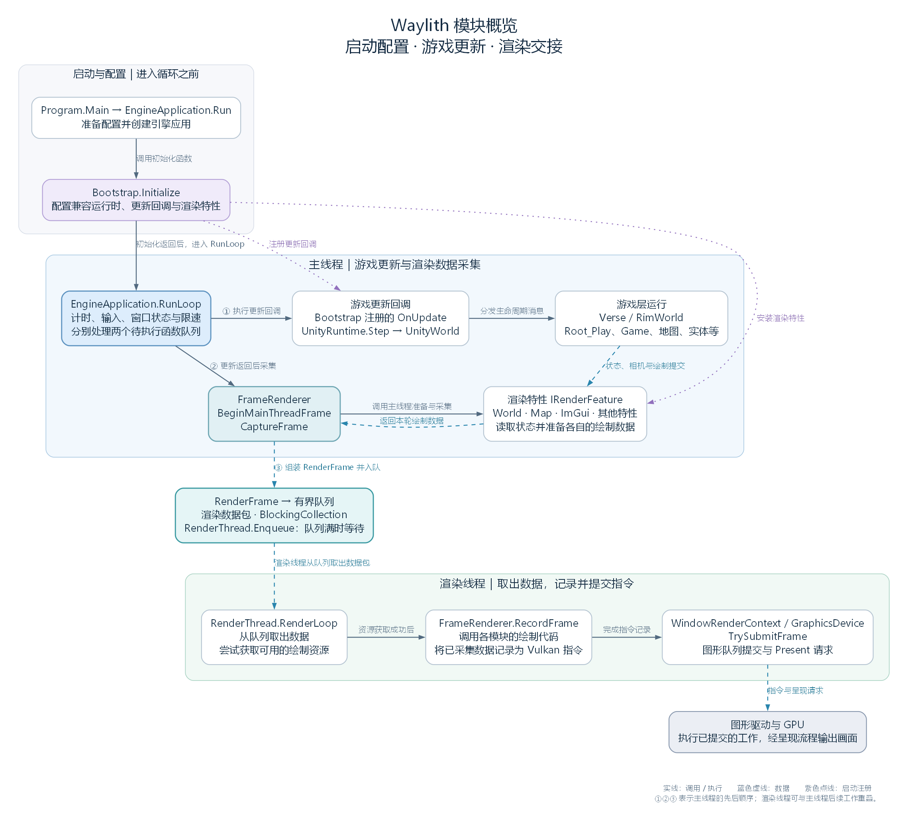
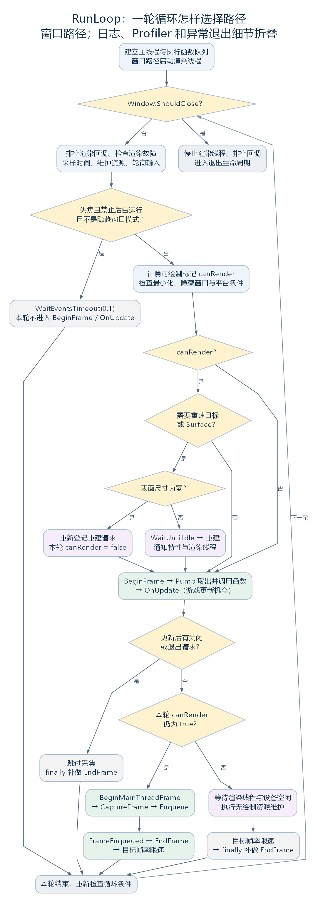
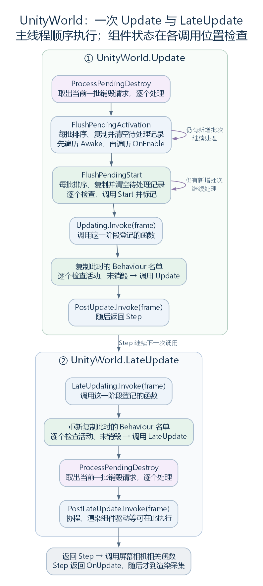

# 从启动到每一帧：Waylith 怎样驱动 RimWorld

状态：模块汇总稿 v0.2，按启动与每轮工作的线性主线整理，供共同阅读和继续修改。依据工作区 RimWorld 1.7.4982 rev1280 的现有反编译语料；本文说明源码中的执行关系，尚未测量实际帧率和显示延迟。

本文保留为汇总阶段的参考底稿。正式阅读请进入 [《从启动到每一帧：Waylith 怎样驱动 RimWorld》v1.0](chapters/01-waylith/article.md)。

源码定位采用“命名空间.类型名.cs:行号”，如 `RimWorldWaylith.Bootstrap.cs:749`；行号对应当前反编译文件，供本地核对。反编译语料不随仓库分发。

## 一、Waylith 总览

在 RimWorld 中，殖民者、地图、界面和声音各有自己的运行逻辑。Waylith 为这些模块提供持续工作的环境：建立窗口与设备，轮询输入和采样时间，调用游戏更新，再把本轮绘制需要的数据交给渲染线程，记录指令、提交图形工作并发起呈现。

理解这套环境，可以沿三个问题阅读：谁让程序持续运行，游戏怎样接住一次更新，以及绘制数据怎样跨过线程并成为图像。先用总图确认这些工作的位置，随后沿应用创建、初始化、主线程、渲染线程和提交过程依次阅读。

本文的绘制部分沿引擎调用顺序，说明怎样收集数据、交给渲染线程、记录并提交 Vulkan 指令。渲染特性内部的数据结构、地图与 UI 怎样形成绘制内容，以及各 pass 的具体实现，放入独立渲染模块，在地图、空间和 UI 解析完成之后研究。



图中从启动区进入主线程，随后经数据队列进入渲染线程，最后到 GPU 与呈现路径。①②③ 表示主线程先更新、再采集、再入队的顺序；渲染线程可与主线程后续工作重叠。放大查看：[PNG](figures/waylith-overview.png)、[SVG](figures/waylith-overview.svg)。

阅读时，先分清三种进度：

| 用语 | 本文的含义 |
| --- | --- |
| 主循环的一轮 | 主线程走过一次 while 迭代；它可能选择等待事件，也可能更新但不采集画面 |
| 一份绘制数据 | 主线程收集本轮绘制需要的数据，组成 RenderFrame 交给渲染线程；记录指令、GPU 执行和画面显示还在后面 |
| 游戏 tick | 游戏模拟的推进单位；其调度从游戏流程模块继续解释 |

本文按以下顺序展开：引擎创建 → 初始化 → 两条线程与三个队列 → 主线程的一轮工作 → 渲染线程 → 渲染数据的交换与 Vulkan 提交。图中的总览关系会在实际调用位置逐步解释。

## 二、引擎创建

程序从 `Program.Main` 进入。它准备引擎配置，将 `Bootstrap.Initialize` 这个方法作为初始化委托传给 `EngineApplication.Run`。`EngineApplication` 是应用对象：窗口、输入、时间和渲染等对象由它组织，持续运行的主循环也在它里面。

Run 的关键顺序如下，摘自源码，省略日志和外围错误处理：

```csharp
app = new EngineApplication(options);
if (initialize != null)
{
    initialize(app);
}
num = app.RunLoop();
```

这里的 `initialize` 指向 Bootstrap.Initialize。执行顺序因而是：先建立引擎所需的对象，再让游戏配置这些对象，最后进入持续循环。初始化函数在这条启动路径中调用一次；循环运行时使用的是它事先接好的更新与绘制入口。

构造 EngineApplication 时，程序建立引擎运行状态、渲染组织对象 FrameRenderer 和计时器。常规窗口路径继续准备 GLFW 与 Vulkan，创建窗口、Surface、图形设备和 WindowRenderContext，连接输入及 GPU 资源服务。

其中，GLFW 处理本机窗口和输入事件，Vulkan 提供与图形设备交互的接口。Surface 把呈现关联到这个本机窗口，WindowRenderContext 则组织面向它的绘制与提交环境。

窗口先以隐藏状态创建，进入 RunLoop 后才按配置显示。窗口对象的建立、游戏侧连接的配置和窗口显示，发生在不同位置。

源码定位：应用入口（`RimWorldWaylith.Program.cs:21`）、Run 的调用顺序（`Waylith.EngineApplication.cs:529`）、应用构造（`Waylith.EngineApplication.cs:208`）。

FrameRenderer 是应用创建时就建立的绘制组织对象。它的成员声明是：

```csharp
public FrameRenderer FrameRenderer { get; } = new FrameRenderer();
```

后续初始化会给它加入地图、世界、界面等模块提供的绘制功能。它先组织主线程上的数据采集，再组织渲染线程上的指令记录；本节先确认它在应用对象中已经存在，具体调用顺序继续往下读。

应用构造也会检查 Headless 选项。带 Headless 开关启动时，会跳过窗口与图形设备的建立；普通有窗口路径继续创建前面所述对象。这个选择发生在启动阶段，后面的最小化或隐藏窗口不会将程序自动切换成 Headless。

源码定位：FrameRenderer 成员（`Waylith.EngineApplication.cs:179`）、构造中的 Headless 分支（`Waylith.EngineApplication.cs:213`）。

## 三、初始化：把 RimWorld 的功能登记到引擎上

`Bootstrap` 是 `RimWorldWaylith` 命名空间中的静态类，可以按职责理解为“启动配置代码”。本文反复出现的 `Bootstrap.Initialize`，就是这个类里接收 EngineApplication、为 RimWorld 配置运行环境的方法。

例如，引擎已经提供持续循环，Bootstrap 就登记“轮到游戏更新时要执行哪些代码”；引擎已经建立 FrameRenderer，Bootstrap 就给它加入地图、世界、界面等具体渲染功能。它还配置路径、资源和输入，建立兼容运行时，并登记进入不同场景时怎样创建基础对象。

初始化会立即创建一些对象，也会保存以后才调用的函数。先认识兼容运行时和更新字段，再按源码顺序查看整个 Initialize。

源码定位：Bootstrap 类与 Initialize（`RimWorldWaylith.Bootstrap.cs:47`）。

### 3.1 建立兼容运行时

阅读游戏代码，仍会遇到 `GameObject`、`MonoBehaviour`、`Start`、`Update` 等 Unity 风格的类型与方法。在这份 Waylith 版本中，这些接口由兼容层接到新的运行环境。`UnityRuntime` 是组织这套兼容状态和逐帧推进的对象，Bootstrap 在初始化时创建并配置它：

```csharp
Bootstrap._unityRuntime = new UnityRuntime(app.Runtime);
Bootstrap.ConfigureRuntime(Bootstrap._unityRuntime, app.Options);
```

这里 `app.Runtime` 是引擎侧的 WaylithRuntime。UnityRuntime 持有它，并另外建立兼容层使用的应用、屏幕、时间和场景对象状态。其中一个成员是：

```csharp
public UnityWorld World { get; } = new UnityWorld();
```

`UnityWorld` 管理场景里的对象、组件，以及 Start、Update 等方法的调用。对象从创建、启用、更新到销毁的过程中，会按相应条件调用这些方法，这里将这套过程称为对象的生命周期。`UnityRuntime.Step` 每被调用一次，就推进这一套兼容层工作。游戏中的星球、派系和远行队所归属的 `RimWorld.Planet.World`，则是游戏数据层的另一个对象。

源码定位：创建兼容运行时（`RimWorldWaylith.Bootstrap.cs:53`）、UnityRuntime 的成员与构造（`Waylith.UnityCompat.UnityRuntime.cs:30`）、Step（`Waylith.UnityCompat.UnityRuntime.cs:106`）。

### 3.2 保存更新函数

要让这些对象在运行时接到更新，主循环还需要一个可调用入口。EngineApplication 为此声明了一个字段：

```csharp
public Action OnUpdate;
```

`Action` 是无参数、无返回值的委托类型。因此 `OnUpdate` 在这里是**保存待调用函数的字段**；它可以为空，也可以保存一个或多个函数。源码使用普通公开字段声明，调用语法则与执行一个无参数函数相似。

这里先解释“回调”：把一个函数交给另一段代码，由那段代码在约定的位置调用它，这个函数就被称为回调函数。这个词描述的是函数的使用方式，普通方法和匿名函数都可以作为回调；实际执行仍然是一次函数调用。单凭“回调”这个词，无法判断它是否立即执行、是否异步，也无法判断它在哪个线程执行。

Bootstrap 会把匿名函数保存到 OnUpdate。初始化时先完成这个保存动作，函数体要等主循环调用 OnUpdate 时才执行。

源码定位：OnUpdate 字段（`Waylith.EngineApplication.cs:1704`）、保存更新函数（`RimWorldWaylith.Bootstrap.cs:73`）。

### 3.3 Initialize 的工作顺序

EngineApplication 已经构造完成。下面进入 Bootstrap.Initialize，按顺序建立兼容层、保存更新函数、配置输入与渲染功能，最后建立 Entry。整个方法返回之后，EngineApplication.Run 才会调用 RunLoop。

这是依据反编译源码整理的阅读用节选：去掉日志、委托缓存和重复的类名限定，用 `+=` 表示 Delegate.Combine，用空值条件调用简化空值判断。源码中的 app2、app3 都由 app 赋值而来，下段合并写成 app，不再另建这两个临时变量。顶层配置步骤、分支及其先后顺序均保留；OnUpdate 的函数体留到主线程实际调用它的位置展开，较长配置方法暂不深入。

```csharp
public static void Initialize(EngineApplication app)
{
    // 1. 立即建立兼容运行时，并配置路径、资源包入口、日志等。
    _unityRuntime = new UnityRuntime(app.Runtime);
    ConfigureRuntime(_unityRuntime, app.Options);

    // 2. 登记官方资源目录的提供函数，设置纹理 mip 链过滤方式。
    ImportDefaults.SetOfficialRootsProvider(() =>
        UnityData.dataPath != null
            ? new[] { Path.Combine(Application.dataPath, "Resources"),
                      GenFilePaths.OfficialModsFolderPath }
            : null);
    TexturePixelData.Rgba32MipChainFilter = MipFilter.Kaiser;

    // 3. 登记退出桥接：兼容层请求退出时，转交给引擎应用。
    _unityRuntime.App.RegisterQuitHandler(_ =>
        app.Quit(_unityRuntime.App.ExitCode));

    // 4. 保存逐帧更新函数；这里只省略函数体，执行到 OnUpdate 时再展开。
    app.OnUpdate += () =>
    {
        // 这里包含窗口状态、界面输入、UnityRuntime.Step 与音频等更新。
        // 第五节按实际调用顺序展开原函数体。
    };

    // 5. 根据运行方式，配置着色器、窗口、纹理、输入和绘制。
    ShaderWarmup.PrewarmEnabled = !app.Options.Headless;
    if (app.Options.Headless)
    {
        ShaderSourceLoader.RegisterShaderSourceDirectory(
            ResolveShaderSourceDirectory());
        app.PrePollEvents += OnHeadlessPrePollEvents;
    }
    else
    {
        ConfigureWindowIcon(app);
        ShaderSourceLoader.RegisterShaderSourceDirectory(
            ResolveShaderSourceDirectory());
        ConfigureTextureRuntime(app);
        ConfigureInput(app);
        WindowPlacement.Restore();
        ConfigureFrameRenderer(app);
    }

    // 6. 登记性能统计所用的游戏 tick 读取函数、组件顺序和内置资源。
    FrameProfiler.CurrentTickProvider = () =>
        Current.Game?.tickManager?.TicksGame ?? 0;
    RegisterExecutionOrders(_unityRuntime.World);
    RegisterResources(app);

    // 7. 资源包烘焙模式在这里返回，之后由已登记的 OnUpdate 执行烘焙。
    if (ModAssetPackBake.Requested(out _modAssetPackBakeRoots))
        return;

    // 8. 普通启动：登记 Entry、Play 构建函数，并立即建立 Entry。
    SpawnEntryScene();
}
```

顺着执行位置读，步骤 4 会先保存更新函数，然后继续执行步骤 5。窗口与渲染配置完成、Entry 对象建立、Initialize 返回之后，主循环才有机会调用这个回调。因此，在登记回调时还没有建立的 `_imguiHost` 等对象，可以在之后执行回调时使用。

几个较长的配置方法，在这一阶段分别完成以下工作：

| 方法 | 这一阶段完成什么 |
| --- | --- |
| ConfigureRuntime | 设置应用信息、数据与缓存路径，打开并检查资源包，连接日志和启动完成后的处理 |
| ConfigureInput | 建立输入桥接和平台输入法桥接，并把 OnPrePollEvents 登记到输入轮询前的位置 |
| ConfigureFrameRenderer | 按 Compute、World、Map、CameraCapture、PostFx、ImGui、ScreenCapture 的顺序安装渲染特性，并登记相关截图、关闭清理和着色器热重载等处理函数；内部绘制对象与资源在渲染模块继续解析 |
| RegisterExecutionOrders / RegisterResources | 登记相机和 Root 组件的执行顺序，以及混音器、WorldText 等内置资源入口 |

输入和渲染配置也会追加自己的回调。例如 ConfigureInput 先向 PrePollEvents 登记 OnPrePollEvents，随后 ConfigureFrameRenderer 内的着色器热重载配置再向同一事件追加 Tick。它们在初始化时先后登记，在主循环执行到 PrePollEvents 时才按登记顺序运行。

到 Initialize 返回，普通启动已经拥有可进入的 Entry 场景和接好的更新、输入、绘制入口。游戏数据与界面的后续初始化，会由 Entry 组件的 Start 等调用继续安排；初始化返回与完整菜单准备完成之间，还隔着这些工作。

源码定位：Initialize 完整方法（`RimWorldWaylith.Bootstrap.cs:50`）、运行时配置（`RimWorldWaylith.Bootstrap.cs:408`）、输入配置（`RimWorldWaylith.Bootstrap.cs:227`）、渲染配置（`RimWorldWaylith.Bootstrap.cs:300`）、热重载回调登记（`RimWorldWaylith.Bootstrap.cs:378`）。

ConfigureFrameRenderer 将各渲染模块提供的对象加入 FrameRenderer。这些对象实现共同的 IRenderFeature 接口，因此引擎可以用同一组方法要求它们准备和提供本轮数据。例如地图特性的登记语句是：

```csharp
app.FrameRenderer.AddFeature(Bootstrap._mapFeature);
```

这里确认功能怎样被加入引擎。具体绘制数据的结构与实现保存在后续渲染模块。

源码定位：地图特性登记（`RimWorldWaylith.Bootstrap.cs:309`）、IRenderFeature 接口（`Waylith.Rendering.IRenderFeature.cs:10`）。

### 3.4 初始化结束前建立 Entry 场景

这里的**场景**，指兼容层按场景名称组织和管理的一组运行对象。Bootstrap 为两个名称登记了构建函数。去掉反编译代码中的委托缓存后，关键关系是：

```csharp
SceneManager.RegisterScene("Entry", Bootstrap.BuildEntryScene);
SceneManager.RegisterScene("Play", Bootstrap.BuildPlayScene);
SceneManager.SetInitialScene("Entry");
```

前两句保存“进入这个场景时，调用哪个函数建立对象”；最后一句立即建立初始 Entry 场景。两个场景与玩家体验的对应关系是：

| 场景 | 负责的程序阶段 | 构建时建立的主要对象 |
| --- | --- | --- |
| Entry | 启动后进入菜单，以及进入正式游玩前的准备流程；这一阶段也可以显示准备中的世界 | 带相机与音频监听组件的对象，以及带游戏入口组件 Root_Entry 的对象 |
| Play | 进入新游戏或存档后的游玩流程；进入此场景时仍可能需要生成地图或加载存档 | 游玩相机与相机控制组件、子相机控制对象，以及带游戏入口组件 Root_Play 的对象 |

场景构建函数建立的是这一阶段的基础对象。殖民地图、Pawn 和存档内容，还要由随后运行的游戏代码建立或载入。因而“建立 Play 场景”和“存档已经加载完成”是两个不同的进度。

后续请求切换场景时，`LoadScene` 先保存待切换名称，由 UnityRuntime.Step 中的 `ProcessPendingLoad` 处理旧场景的卸载和新场景的建立。初始 Entry 的直接建立，与之后请求切换的执行时点也不同。

源码定位：场景登记（`RimWorldWaylith.Bootstrap.cs:749`）、Entry 构建（`RimWorldWaylith.Bootstrap.cs:769`）、Play 构建（`RimWorldWaylith.Bootstrap.cs:785`）、场景切换实现（`UnityEngine.SceneManagement.SceneManager.cs:52`）。

## 四、先认识两条线程和三个队列

Initialize 返回之后，程序将进入 RunLoop。接下来的工作涉及本文重点关注的两条线程：

| 线程 | 主要工作 |
| --- | --- |
| 主线程 | 从 Main 延续下来的线程；执行初始化与 RunLoop，处理输入、调用游戏更新、采集绘制数据并限速 |
| 渲染线程 | 由窗口路径在进入循环前创建并启动；从帧数据队列取包，取得绘制资源，记录并提交 Vulkan 指令 |

FrameRenderer 在两条线程上各做一部分工作，所以总图出现两次。这里的“两条线程”限定本文追踪的主线；计算任务、音频等代码还可以有各自的线程。

两条线程的相关代码还管理三个队列。先记住每个队列保存什么、由谁取出：

| 队列 | 保存的内容 | 由谁取出并处理 |
| --- | --- | --- |
| 主线程待执行函数队列（MainThreadSynchronizationContext） | 需要主线程调用的函数与参数 | 主线程调用 Pump |
| 渲染回调队列（RenderToMainThreadDispatcher） | 通过其 Enqueue 方法保存的函数 | 主线程调用 DrainRenderThreadCallbacksOnMainThread，内部调用 Invoke |
| 帧数据队列（BlockingCollection<RenderFrame>） | 主线程采集得到的 RenderFrame | 渲染线程从 GetConsumingEnumerable 取出 |

前两条队列保存函数，第三条保存绘制数据。它们的队列对象和处理位置彼此独立，具体入队、取出和等待规则，放到主线程队列泵与最后的帧数据交换部分解释。渲染回调队列的名字表示用途；当前尚未定位它实际 Enqueue 的代码位置，不能据此预设它每帧都有渲染结果返回。

OnUpdate 保存的是每轮要调用的更新函数，不属于这三个队列；它也不会像队列记录一样，在调用一次后就被取出并移除。

源码定位：主线程待执行函数队列（`Waylith.MainThreadSynchronizationContext.cs:14`）、渲染回调队列（`Waylith.Rendering.RenderToMainThreadDispatcher.cs:11`）、帧数据队列与渲染线程（`Waylith.Rendering.RenderThread.cs:19`）。

## 五、主线程：一轮工作怎样向下执行

### 5.1 总览

RunLoop 仍由主线程调用。普通窗口路径先建立主线程待执行函数队列，启动渲染线程，再按配置显示窗口，随后反复检查 Window.ShouldClose，进入一轮又一轮的工作。

正常可绘制的一轮，先处理渲染回调、采样时间、维护资源并收取输入，再判断窗口状态；继续更新时，执行 BeginFrame、Pump、OnUpdate，然后采集绘制数据、入队、EndFrame 和限速。渲染线程可以同时处理此前已经入队的数据。



放大查看：[SVG](figures/waylith-runloop-flow.svg)。图中的 canRender 是讲解用名称，表示本轮是否允许绘制。失焦等待、暂时不能绘制、请求重建和退出，会让本轮选择不同分支；下面沿代码出现的位置说明它们。

Headless 在创建渲染线程之前进入独立的 RunHeadlessLoop，保留计时、BeginFrame、Pump、OnUpdate 和 EndFrame，没有窗口呈现或帧数据入队，也没有调用普通路径的限速方法。它由启动参数选择，完整分支说明保存在 [RunLoop 补充笔记](05-waylith-runloop.md)。下文继续普通窗口路径。

### 5.2 按工作顺序阅读 RunLoop

下面是阅读用节选，保留影响更新与绘制的主要判断，省略日志、性能统计、平台专用设置和外层退出收尾，并合并部分临时引用与空值判断。为了便于跟随流程，本片段使用以下暂用名；之后直接引用原名时，以相应片段为准：

| 源码名 | 本片段暂用名 | 含义 |
| --- | --- | --- |
| num | previousSample | 上轮累计时间采样 |
| num2 | elapsed | 本轮累计时间采样 |
| num3 | delta | 两轮采样之差 |
| flag2 | frameStarted | 已执行 BeginFrame，尚需 EndFrame 收尾 |
| flag3 | focusIdle | 本轮是否进入失焦等待 |
| flag5 | canRender | 本轮是否允许绘制 |
| flag6 | recreateSurface | 是否需要重建 Surface |
| displayModeChangeRebuildRequested | displayChanged | 本轮取出的显示模式重建标记 |
| flag7 | resize | 是否需要重建交换链及依赖资源 |
| frameTiming | timing | 本轮帧号与时间信息 |
| renderFrame | frame | 本轮采集的绘制数据包 |

这里只按顺序看每个调用出现在哪里；队列泵、OnUpdate、采集与限速随后各自在对应小节展开。

```csharp
_mainThreadSyncContext = new MainThreadSynchronizationContext(
    Environment.CurrentManagedThreadId);
SynchronizationContext.SetSynchronizationContext(_mainThreadSyncContext);
if (Options.Headless)
    return RunHeadlessLoop();  // 此时还没有创建渲染线程。

float previousSample = 0f;
if (_renderThread == null)
    _renderThread = new RenderThread(RenderContext, FrameRenderer);
_renderThread.Start();

if (!Options.HideWindow)
{
    Window.Visible = true;
    _windowShown = true;
    ApplyPendingDisplayMode();
}

while (!Window.ShouldClose)
{
    bool frameStarted = false;
    try
    {
        // 1. 处理渲染回调、检查故障，采样本轮时间并维护资源。
        FrameRenderer.DrainRenderThreadCallbacksOnMainThread();
        _renderThread.ThrowIfFaulted();
        float elapsed = (float)_stopwatch.Elapsed.TotalSeconds;
        float delta = elapsed - previousSample;
        previousSample = elapsed;
        GpuMemoryHistory.Update(elapsed);
        TextureResidency.Update();
        TextureBuildBatch.OnFrameStart();
        GpuMemoryReport.CheckUsageCap(Options.VramWarnCapBytes, elapsed);

        // 2. 运行 Bootstrap 等处登记的轮询前回调，再收取窗口事件。
        PrePollEvents?.Invoke(this);
        InputState.BeginFrame();
        Glfw.PollEvents();
        // 此处省略平台内容类型设置、显示模式切换请求的处理。

        // 3. 决定等待事件，还是继续更新。
        EngineWindow.IsFocused = Window.IsFocused;
        bool focusIdle = !EngineWindow.IsFocused
            && !EngineWindow.RunInBackground && !Options.HideWindow;
        // 此处省略根据 focusIdle 暂停或恢复音频输出的代码。
        if (focusIdle)
        {
            Glfw.WaitEventsTimeout(0.1);
            continue;
        }

        bool canRender = !RenderContext.IsFramebufferMinimized()
            && (!Options.HideWindow || !EngineApplication.IsWayland);

        // 4. 必要时重建绘制目标；零尺寸会推迟重建并关闭本轮绘制。
        if (canRender)
        {
            ApplyPendingScreenSettings();
            bool recreateSurface = _renderThread.ConsumeSurfaceRecreateRequest();
            bool displayChanged = _displayModeChangeRebuildRequested;
            _displayModeChangeRebuildRequested = false;
            bool resize = _renderThread.ConsumeResizeRequest()
                || RenderContext.HasFramebufferSizeMismatch() || displayChanged;

            if ((recreateSurface || resize) && RenderContext.IsSurfaceExtentZero())
            {
                _renderThread.RequeueRebuild(recreateSurface);
                canRender = false;
            }
            else if (recreateSurface || resize)
            {
                _renderThread.WaitUntilIdle();
                if (recreateSurface)
                    RenderContext.RecreateSurfaceAndRebuild();
                else
                    RenderContext.Rebuild();
                FrameRenderer.NotifyRenderTargetRebuilt(RenderContext);
                _renderThread.MarkRenderTargetRebuilt();
            }
        }

        // 5. 发布本轮时间，处理主线程待执行工作，调用游戏更新。
        EngineApplication.BeginFrame(delta, elapsed);
        frameStarted = true;
        _mainThreadSyncContext?.Pump();
        OnUpdate?.Invoke();  // 进入上方 Bootstrap 登记的匿名函数。

        // 6. 更新可能请求退出；无法绘制时也不生产新的 RenderFrame。
        if (Window.ShouldClose || !string.IsNullOrEmpty(_shutdownRequestedReason))
            continue;
        if (!canRender)
        {
            RetireGpuResourcesWithoutRendering();
            ThrottleToTargetFrameRate(elapsed);
            continue;
        }

        // 7. 更新已返回，准备各特性并采集本轮绘制数据。
        FrameTiming timing = new FrameTiming(
            global::Waylith.Time.FrameCount, delta, (double)elapsed);
        FrameRenderer.BeginMainThreadFrame(in timing);
        RenderFrame frame = FrameRenderer.CaptureFrame(
            in timing, _clearValues, false);

        // 8. 把数据包交给渲染队列；队列满时，调用线程在这里等待。
        _renderThread.Enqueue(frame);

        FrameEnqueued?.Invoke(this);
        frameStarted = false;
        EngineApplication.EndFrame();
        ThrottleToTargetFrameRate(elapsed);
    }
    finally
    {
        if (frameStarted)
            EngineApplication.EndFrame();
    }
}
```

#### 时间采样与资源、输入准备

每轮在检查渲染线程故障之后，读取应用内部 Stopwatch 的累计秒数。计时器是 EngineApplication 创建时启动的实例字段：

```csharp
private readonly Stopwatch _stopwatch = Stopwatch.StartNew();
```

代码中的 elapsed 取本轮累计读数，delta 则用本轮读数减去 previousSample；随后保存新的 previousSample，供下一轮相减。

| 值 | 含义 | 单位 |
| --- | --- | --- |
| elapsed | 从应用计时器启动到本轮采样时，累计经过的时间 | 秒 |
| delta | 本轮与上一轮主循环采样之间经过的时间 | 秒 |

例如上轮采样为 12.000 秒，本轮为 12.020 秒，则 elapsed 约为 12.020，delta 约为 0.020。这些值记录现实经过的时间；存档日期与游戏 tick 进度由游戏层另外管理。

previousSample 在循环前从零开始，所以第一轮 delta 等于当时的累计读数。后续相邻轮次的 delta 可以包含上一轮的更新、队列等待和限速。某些 while 轮次只等待窗口事件，没有调用 OnUpdate，因此不能一概将 delta 当作两次游戏更新之间的间隔。

采样后，主线程处理纹理等资源维护，调用 PrePollEvents 中保存的函数，再执行 InputState.BeginFrame 与 Glfw.PollEvents。Bootstrap 登记的输入前处理会在这里跟踪窗口位置、准备网格上传与本轮绘制提交状态、准备输入及平台输入法；着色器热重载 Tick 也在此获得调用机会。

源码定位：时间采样与资源、输入处理（`Waylith.EngineApplication.cs:620`）、计时器字段（`Waylith.EngineApplication.cs:1625`）、Bootstrap 的轮询前处理（`RimWorldWaylith.Bootstrap.cs:251`）。

#### 窗口状态决定本轮怎样继续

**失焦等待**发生在窗口没有焦点、禁止后台运行且不是隐藏窗口模式时。这条路径进入 WaitEventsTimeout，跳过本轮的 BeginFrame、待执行函数队列的 Pump、OnUpdate 和绘制采集。主循环仍在运行，只是这一轮选择等待窗口事件。

**暂时不能绘制**走另一条路径。例如帧缓冲最小化时，主线程仍可进入 BeginFrame、Pump 和 OnUpdate，随后跳过新的 RenderFrame 采集。它还会等待并执行无绘制资源维护与限速。因此，窗口没有产出新画面时，游戏更新入口仍可能被调用。

在这条窗口渲染路径里，Surface 的具体类型是 Vulkan 的 `VkSurfaceKHR`。它把操作系统的窗口表示为 Vulkan 可以使用的呈现目标。交换链则围绕这个目标组织一组图像，程序取得其中一张、记录绘制，随后请求将结果呈现给窗口。这一对象关系可对照 [Vulkan 官方的窗口系统集成说明](https://docs.vulkan.org/guide/latest/wsi.html)。

先区分三层对象：

| 对象 | 在本路径中的职责 |
| --- | --- |
| Window | 本机窗口，接收尺寸、焦点、关闭等窗口事件 |
| Surface | Vulkan 对这个窗口呈现目标的抽象，可查询其支持的尺寸、格式和呈现方式等能力 |
| Swapchain 与依赖资源 | 交换链提供用于呈现的图像；WindowRenderContext 还围绕图像建立视图、帧缓冲、深度等资源和同步设施 |

Surface 本身不保存本轮绘制出来的那幅图像。启动时，EngineApplication 先用已有窗口创建 Surface，再将它交给 GraphicsDevice 与 WindowRenderContext。后者建立交换链及对应资源，之后才有可取得并绘制的窗口图像。

假设窗口的绘制像素尺寸从 1280×720 变成 1600×900，已有绘制目标的尺寸可能已经不适用。主循环检测到帧缓冲尺寸与 RenderContext.Extent 不符，就进入重建判断。这里的“重建”是重新建立适配当前窗口条件的图形资源；地图、Pawn 和存档数据仍由游戏层管理。

代码区分两种重建：

| 入口 | 处理内容 |
| --- | --- |
| Rebuild | 沿用当前 Surface，替换交换链，并重新建立其依赖资源 |
| RecreateSurfaceAndRebuild | 先清理交换链及依赖资源，为同一个本机窗口重新创建 Surface，再建立交换链及依赖资源；Surface 再次丢失时还有重试处理 |

下面是普通 Rebuild 的主体，去掉重复的 base/this 限定。源码中的局部变量 vkSwapchainKHR，在下段暂记为 oldSwapchain，表示重建前保存的旧交换链：

```csharp
public sealed override void Rebuild()
{
    DestroySwapchainDependents();
    VkSwapchainKHR oldSwapchain = swapchain;
    swapchain = CreateSwapchain(
        Device, PhysicalDevice, Graphics.Family, queue.Family,
        presentMode, 2, window, surface, oldSwapchain);
    if (!oldSwapchain.IsNull())
        Device.DestroySwapchainKHR(oldSwapchain, _allocator);
    RebuildSwapchainDependents();
}
```

DestroySwapchainDependents 内部会先 Device.WaitIdle，再释放旧的帧资源、同步设施和主 render pass 等对象；重建依赖时，重新配置 render pass、视口与裁剪区域、帧资源和同步设施。在主循环调用这个方法之前，还会先 WaitUntilIdle，等渲染线程结束其待处理包的 CPU 处理。这两次等待分别约束渲染线程的工作和设备的工作。

除了尺寸不匹配，呈现模式变化，以及渲染线程在获取图像或提交呈现时取得 NeedsResize、SurfaceLost 等状态，也会推动相应重建请求。渲染线程登记的这些请求由主循环读取处理。若此时可呈现尺寸为零，就重新登记请求，本轮暂不采集画面，等条件允许后继续。

因此，常见的尺寸调整可以只替换交换链及其依赖；取得 SurfaceLost 时则需要更完整的 Surface 重建路径。是否真的进入哪条路径，要看源码取得的状态与判断结果。

源码定位：由窗口创建 Surface（`Waylith.EngineApplication.cs:1575`）、普通重建与 Surface 重建（`Waylith.Graphics.WindowRenderContext.cs:223`）、清理和重建依赖资源（`Waylith.Graphics.WindowRenderContext.cs:272`）、尺寸不匹配判断（`Waylith.Graphics.WindowRenderContext.cs:341`）、渲染线程登记重建请求（`Waylith.Rendering.RenderThread.cs:197`）。

#### BeginFrame 与 EndFrame 划定本轮的时间与临时内存范围

这两个名字都属于 EngineApplication 的私有方法。它们把一轮主线程工作所需的时间、内存和计算任务维护集中起来，主体如下：

```csharp
private static void BeginFrame(float deltaTime, float elapsedTime)
{
    Time.BeginFrame(deltaTime, elapsedTime);
    NativeAllocationRuntime.BeginFrame(Time.FrameCount);
    WaylithJobRuntime.BeginFrame(Time.FrameCount);
}

private static void EndFrame()
{
    NativeAllocationRuntime.EndFrame(Time.FrameCount);
    Time.EndFrame();
}
```

BeginFrame 依次完成三件事：

| 调用 | 实际作用 |
| --- | --- |
| Time.BeginFrame | 把 deltaTime 和 elapsedTime 写入 Waylith.Time，供本轮更新读取；这里尚不递增帧号 |
| NativeAllocationRuntime.BeginFrame | 记录当前帧号，为当前线程开启本轮的临时内存作用域，让相应的 Temp 分配可以归属于这个作用域 |
| WaylithJobRuntime.BeginFrame | 更新计算任务运行时所使用的帧号，并按周期清理已经完成、符合条件的旧任务状态 |

这里的计算任务是引擎用于并行计算的 job，Pawn 的搬运、建造等游戏任务由另一套游戏逻辑管理。调用这三个方法，首先是让后续代码拥有一致的本轮时间与资源管理环境。

EndFrame 先退出本轮的临时内存作用域，释放仍登记在该作用域里的 Temp 分配，并检查符合条件的超期 TempJob 分配以输出诊断。TempJob 的检查还考虑近期是否存在未完成计算任务；这一步并不自动释放所有 TempJob，也没有在这里等待全部计算任务完成。随后 Time.EndFrame 执行的就是 `FrameCount++`。

例如进入时引擎帧号为 N，BeginFrame 和本轮 FrameTiming 使用 N，EndFrame 完成后计数变成 N+1。这个计数标记主线程帧维护的推进位置，GPU 仍可能在处理已经提交的工作。

正常绘制路径在入队和 FrameEnqueued 回调之后执行 EndFrame。不能绘制、更新中请求退出或中途异常时，已经完成 BeginFrame 并置位标记的路径，会由循环里的 finally 补做 EndFrame。失焦等待路径在 BeginFrame 之前离开，因此不会为该轮增加这个帧计数。

文中还有不同对象的同名方法，例如 UnityRuntime.Step 中的兼容层 Time.BeginFrame，以及 FrameRenderer.BeginMainThreadFrame。阅读时需要连同所属类型一起看：前者维护兼容层时间，后者准备渲染特性，都有自己的职责。

源码定位：引擎 BeginFrame / EndFrame（`Waylith.EngineApplication.cs:911`）、Waylith.Time（`Waylith.Time.cs:45`）、分配运行时的帧方法（`Waylith.Runtime.NativeAllocationRuntime.cs:189`）、作用域内 Temp 分配的释放（`Waylith.Runtime.NativeAllocationRuntime.cs:494`）、计算任务的帧维护（`Waylith.Jobs.WaylithJobRuntime.cs:99`）。

BeginFrame 调用的 Waylith.Time.BeginFrame 将本轮的值保存为 Waylith.Time.DeltaTime 和 Waylith.Time.Elapsed，后面的 OnUpdate 将读取它们。它们是本轮已经保存的采样值；即使队列泵或其他代码又执行了几毫秒，读取属性时也不会重新计时。

### 5.3 主线程的队列泵：取出函数并调用

RunLoop 中有两个处理函数队列的位置。渲染回调队列在一轮开始处处理，主线程待执行函数队列的 Pump 则在 BeginFrame 之后、OnUpdate 之前执行。它们都在主线程中调用已经保存的函数。

#### 循环开头：渲染回调队列

循环开头先处理渲染回调队列。FrameRenderer.DrainRenderThreadCallbacksOnMainThread 的全部主体是：

```csharp
this.RenderToMainThread.Invoke();
```

Invoke 再循环取出 Action，逐个在调用它的主线程执行；单条回调异常时记录错误并继续。RenderToMainThreadDispatcher 提供的就是“先保存函数，再由主线程取出并调用”的功能。当前源码中能确认这个类怎样保存函数、FrameRenderer 怎样持有它，以及主循环怎样取出并执行函数，但尚未找到其他代码实际调用它的 Enqueue 的位置。因此，目前还不能指出哪一项具体游戏或渲染工作使用了这个队列，也不能将它解释为每帧固定返回一条渲染结果。

#### BeginFrame 之后：主线程待执行函数队列

Pump 是 MainThreadSynchronizationContext 的方法。本文按这个类的具体用途，将它称为“主线程待执行函数队列”：内部保存函数与参数，提供 Post、Send 和 Pump 来安排执行。这个类继承 .NET 的 SynchronizationContext，并通过 SetSynchronizationContext 设置为当前主线程使用的对象；源码中的这些类名和函数名保留原样。这个正文称呼只用于解释当前实现。

下面保留源码中的参数和局部变量名，省略可空属性标注，并将 Pump 的异常日志代码折叠为注释：

```csharp
public override void Post(SendOrPostCallback d, object state)
{
    this._queue.Enqueue(new ValueTuple<SendOrPostCallback, object>(d, state));
}

public void Pump()
{
    int count = this._queue.Count;
    int num = 0;
    ValueTuple<SendOrPostCallback, object> valueTuple;
    while (num < count && this._queue.TryDequeue(out valueTuple))
    {
        try
        {
            valueTuple.Item1(valueTuple.Item2);
        }
        catch (Exception ex)
        {
            // 此处省略源码记录 ex 的日志代码。
        }
        num++;
    }
}
```

调用 Post 时，传给 d 的函数与 state 参数只是被加入队列；主循环到 Pump 时，才在主线程取出并调用。代码中的 valueTuple.Item1 保存函数，Item2 保存参数，调用的就是 Item1(Item2)。Pump 在队列为空时直接结束，执行期间新加入队列的回调也不保证本轮获得处理。

同一个类还提供 Send：若调用者就是主线程，立即执行；若来自其他线程，先入队，再让调用线程等待，直到主线程执行该回调并设置完成标记，之后将异常按需要传回调用方。这里 Send 会等待函数执行完成，Post 则只将函数与参数加入队列。

这两个队列使用各自的入队方法和处理函数。Pump 本身没有创建工作线程，也不负责 GLFW 窗口事件；调用渲染回调队列中的函数，也不表示某个 RenderFrame 已经显示。处理完这里的 Pump，主线程继续调用 OnUpdate。

源码定位：处理渲染回调的函数（`Waylith.Rendering.FrameRenderer.cs:151`）、渲染回调队列（`Waylith.Rendering.RenderToMainThreadDispatcher.cs:14`）、建立主线程待执行函数队列（`Waylith.EngineApplication.cs:585`）、Post 与 Send（`Waylith.MainThreadSynchronizationContext.cs:33`）、Pump（`Waylith.MainThreadSynchronizationContext.cs:80`）。

### 5.4 OnUpdate：执行初始化时保存的更新函数

主线程现在读取 OnUpdate，并在非空时调用它：

```csharp
Action onUpdate = this.OnUpdate;
if (onUpdate != null)
{
    onUpdate();
}
```

#### 已登记函数的执行顺序

现在展开第三节在 Initialize 中保存的那段函数。这里保留外层 +=，以便与登记位置对照；主循环实际执行的是已经保存的函数体。为方便阅读，保留原有条件和先后顺序，省略重复的 Bootstrap 类名，并简化空值判断。登记位置的 app2 是由 app 赋值的临时引用，下段合并使用 app：

```csharp
app.OnUpdate += () =>
{
    // 特殊启动方式：执行资源包烘焙并请求退出，跳过下方游戏更新。
    if (_modAssetPackBakeRoots != null)
    {
        app.Quit(ModAssetPackBake.Run(_modAssetPackBakeRoots));
        _modAssetPackBakeRoots = null;
        return;
    }

    if (!app.Options.Headless)
        SyncWindowSizeIfChanged(app);

    EndOfFrame.Run();
    FrameStart.Run();

    if (_imguiHost != null)
        _imguiDispatch?.DispatchInput(_imguiHost);

    _unityRuntime.Step(
        global::Waylith.Time.DeltaTime,
        global::Waylith.Time.Elapsed);

    RaiseBootCompleteOnce();
    if (_composite != null)
        _composite.Saturation = Current.ColorCorrectionCurves?.saturation ?? 1f;

    AudioListener.SyncToBackend();
    AudioBackend.Current?.Update();
};
```

普通游戏启动时，越过烘焙分支，依次进行以下工作：

| 顺序 | 调用 | 实际做什么 |
| --- | --- | --- |
| 1 | SyncWindowSizeIfChanged | 有窗口时，检查绘制尺寸、本机窗口尺寸与全屏状态的变化；有变化就更新兼容层的屏幕状态 |
| 2 | EndOfFrame.Run | 处理待写入文件的截图请求，并在存在待处理标记时继续相应协程；能否当场取得截图数据，还要看截图后端的状态 |
| 3 | FrameStart.Run | 将 RenderTexture.active 设为 null，清理已登记释放的临时 RenderTexture |
| 4 | DispatchInput | 根据鼠标按下、拖动、抬起、滚轮和键盘等状态，调用相应界面代码处理输入 |
| 5 | UnityRuntime.Step | 更新兼容层时间，处理场景切换，调用场景组件的更新方法，最后调用屏幕相机相关函数 |
| 6 | RaiseBootCompleteOnce | 检查游戏数据与长事件的进度，满足条件时调用启动完成事件中登记的函数；之后也在这里检查启动后的截图、报告或退出等参数 |
| 7 | 设置 Saturation | 从当前游戏的颜色修正对象读取饱和度，写入合成 pass；没有该对象时使用 1 |
| 8 | 音频更新 | 把当前 AudioListener 的位置和朝向交给音频后端，再调用后端的 Update |

这些调用都在执行 OnUpdate 的主线程中进行。Step 是其中一次普通函数调用：执行完 Step 的内部步骤后，会返回这段匿名函数，继续启动状态检查、画面参数和音频更新，最后再返回 RunLoop。

RaiseBootCompleteOnce 会检查游戏数据是否已经载入、长事件是否已经结束。第一次调用时可能尚未满足条件，因而直接返回；满足条件后，启动完成事件只触发一次。

这里的 EndOfFrame.Run 与前面介绍的 EngineApplication.EndFrame 是不同函数。前者处理截图与协程，后者处理引擎的临时内存与帧计数。EndOfFrame.Run 在这段代码里位于 Step 之前，不能仅凭名字将它挪到本轮更新的末尾。界面输入处理也先于 Step；界面的 layout、repaint 绘制数据构建还会在后续采集阶段执行。

源码定位：登记的完整函数（`RimWorldWaylith.Bootstrap.cs:73`）、屏幕尺寸状态更新（`RimWorldWaylith.Bootstrap.cs:269`）、EndOfFrame.Run（`UnityStubs.EndOfFrame.cs:15`）、FrameStart.Run（`UnityStubs.FrameStart.cs:10`）、界面输入处理（`RimWorldWaylith.Imgui.ImguiDispatch.cs:28`）、启动完成检查（`RimWorldWaylith.Bootstrap.cs:169`）、音频监听状态更新（`UnityEngine.AudioListener.cs:65`）。

#### UnityRuntime.Step 的六步

调用到 `_unityRuntime.Step` 时，传入的两个时间值已经由前面的 BeginFrame 保存。`global::Waylith.Time` 明确指定引擎的静态 Time 类；传入的 DeltaTime、Elapsed 分别来自此前保存的 delta 和 elapsed，表示本轮采样间隔和累计经过时间。Step 中的 `this.Time` 则是 UnityRuntime 持有的 UnityTimeState 实例，负责保存兼容层的时间状态。

Step 的完整主体如下，注释为阅读时添加：

```csharp
public void Step(float deltaTime, float elapsedTime)
{
    // 1. 更新时间与兼容层帧计数。
    this.Time.BeginFrame(deltaTime, elapsedTime);

    // 2. 有待切换的场景时，在这里处理。
    SceneManager.ProcessPendingLoad();

    // 3. 将本轮帧号与时间组成一个小结构体。
    UnityFrame unityFrame = new UnityFrame(
        this.Time.FrameCount, deltaTime, elapsedTime);

    // 4. 处理对象状态，并调用组件的 Update 等方法。
    this.World.Update(in unityFrame);

    // 5. 调用组件的 LateUpdate，以及这一阶段登记的其他函数。
    this.World.LateUpdate(in unityFrame);

    // 6. 调用屏幕相机相关的 onPreCull / OnPreCull 函数。
    Camera.DispatchPreCullForScreenCameras();
}
```

##### 第一步：保存兼容层时间

UnityTimeState.BeginFrame 先把自己的 FrameCount 加一，再把 deltaTime 写入 DeltaTime 与 UnscaledDeltaTime，把 elapsedTime 写入 Time 与 UnscaledTime。此处直接保存传入值；引擎自己的 Waylith.Time.FrameCount 则在 EngineApplication.EndFrame 中增加，两者的增加时点不同。

游戏代码读取的 UnityEngine.Time.deltaTime 还会通过 Math.Min，将兼容层保存的 DeltaTime 限制到 maximumDeltaTime；当前默认上限约为 0.333 秒。这个读取限制不会反过来修改传入 Step 的原始参数。游戏暂停与倍速怎样影响 tick，需要继续查看游戏层。

源码定位：兼容层时间保存（`Waylith.UnityCompat.UnityTimeState.cs:55`）、游戏读取 deltaTime（`UnityEngine.Time.cs:13`）。

##### 第二步：处理待切换场景

SceneManager.LoadScene 先保存场景名；ProcessPendingLoad 在这里检查它。没有请求就直接返回；有请求则卸载旧场景、设置新场景名、调用已经登记的构建函数，再调用场景切换事件中的函数并标记相应 AsyncOperation 完成。因此，新场景的基础对象可以在本次 World.Update 之前建立。初始 Entry 则已在 Initialize 中直接建立。

源码定位：待切换场景的处理（`UnityEngine.SceneManagement.SceneManager.cs:83`）。

##### 第三步：建立 UnityFrame

它是保存 FrameIndex、DeltaTime、ElapsedTime 的结构体，供下面的 Update、LateUpdate 及其阶段事件中的函数读取。它与渲染数据包 RenderFrame 分别承担不同工作。组件自己的 Update 仍是无参方法；传给 World.Update 的 UnityFrame 不会改变组件 Update 的方法签名。

源码定位：UnityFrame（`Waylith.UnityCompat.UnityFrame.cs:12`）。

##### 进入第四步前：UnityWorld、组件与内部状态

UnityRuntime 持有一个 UnityWorld，用它管理场景对象、组件及其运行状态。进入 Update 前，先看这里的对象是什么，以及 UnityWorld 怎样保存它们。

**组件是什么？** 这里的组件指 Unity 风格 API 中的 `UnityEngine.Component` 及其派生类型。一个 GameObject 可以附加多个组件：Transform 提供位置、旋转、缩放和父子关系，Camera 提供相机功能，MeshRenderer 提供网格绘制相关功能，脚本组件则提供自己的运行代码。GameObject 把这些功能组合在同一个对象上；组件可以通过 gameObject 找到所属对象，也可以用 GetComponent 取得同一对象上的其他组件。

这些 GameObject 和组件在当前兼容层中也是 C# 对象。创建 GameObject 时，代码会建立 Transform 并向 UnityWorld 登记；AddComponent 则继续创建和登记相应组件。这里的 Component 与游戏实体系统中的 ThingComp 是不同的类型体系；后者留到实体模块解释。

下面只画与本段有关的继承关系，名称保留源码原样；树中的 Object 指 UnityEngine.Object：

```text
Object
├─ GameObject
└─ Component
   ├─ Transform
   ├─ Renderer
   │  └─ MeshRenderer
   └─ Behaviour
      ├─ Camera
      └─ MonoBehaviour
```

源码定位：GameObject 的创建与 AddComponent（`UnityEngine.GameObject.cs:30`）、Component 与所属对象、组件查询（`UnityEngine.Component.cs:8`）、Transform（`UnityEngine.Transform.cs:8`）、Renderer（`UnityEngine.Renderer.cs:9`）、MeshRenderer（`UnityEngine.MeshRenderer.cs:6`）、Camera（`UnityEngine.Camera.cs:13`）。

**继承 Behaviour 的组件有什么不同？** Component 提供“附加在对象上、取得所属对象与其他组件”等共同接口；Behaviour 进一步提供 enabled 与 isActiveAndEnabled。修改 Behaviour.enabled 时，兼容层会调用 UnityWorld.SetBehaviourEnabled，更新相应状态，并按条件处理启用或停用。

UnityWorld 在建立组件状态时沿继承链检查是否属于 UnityEngine.Behaviour。属于这一体系的组件，会取得 UnityBehaviourState，并加入后面要遍历的 `_behaviours` 列表。Transform、Renderer 等组件也由 UnityWorld 管理，但它们走各自的状态与功能路径；这条 Behaviour 的 Update 遍历不会仅因它们属于 Component 就逐个调用它们。

MonoBehaviour 再继承 Behaviour，增加 StartCoroutine、StopCoroutine 等接口。游戏侧的脚本组件通过这一继承体系进入生命周期管理。Behaviour、MonoBehaviour 的基类声明本身没有替派生组件实现 Update；后面仍要查找该组件类型是否有相应方法，有才调用。因此 Camera 可以拥有启停状态，却不必提供一个 Update 方法。

例如，MeshRenderer 继承 Renderer，而 Renderer 直接继承 Component。它的 FrameUpdate 通过后面介绍的 MeshRendererDriver 阶段函数获得调用，与 `_behaviours` 中组件的 Update 调用分别组织。

源码定位：Behaviour 的启用接口（`UnityEngine.Behaviour.cs:7`）、MonoBehaviour 的协程接口（`UnityEngine.MonoBehaviour.cs:7`）、识别组件所属类型（`Waylith.UnityCompat.UnityWorld.cs:877`）、修改启用状态（`Waylith.UnityCompat.UnityWorld.cs:475`）、MeshRendererDriver 的阶段登记（`UnityStubs.Internal.MeshRendererDriver.cs:14`）。

**UnityWorld 怎样组织这些对象？** 阅读它的主要成员，可以先按以下用途理解：

| 源码成员 | 保存什么、用在何处 |
| --- | --- |
| _objects | 以实际对象实例为键，取得它对应的 UnityObjectState；其中包括 GameObject、Transform 与其他组件的状态 |
| _rootGameObjects | 保存根 GameObject 的状态；父子关系再由 Transform 状态连接 |
| _behaviours | 按执行顺序排列的 UnityBehaviourState 列表，Update、LateUpdate 从这里取得组件名单 |
| _pendingActivation / _pendingStart / _pendingDestroy | 待激活、待启动、待销毁的记录；各自配有 Set 去重，处理时还使用相应临时列表或数组 |
| _executionOrders | 组件类型对应的执行顺序值 |
| _messageCache | 按类型保存 Awake、Start、Update 等方法的查找结果与调用委托 |
| Updating / PostUpdate / LateUpdating / PostLateUpdate | 保存各更新阶段登记的函数，执行到相应位置时调用 |
| _resources / _cloneFactories | 资源记录与对象创建函数，供资源查找和实例创建等路径使用 |

这里同时出现“组件”和“组件状态”，因为 UnityWorld 为实际实例另建了一份管理记录。UnityObjectState 保存 Instance、InstanceId、CreationIndex、Name、Destroyed 等共同信息；UnityGameObjectState 还保存 Components、Transform 等关系；UnityComponentState 保存所属的 GameObject 状态与 Messages；UnityBehaviourState 则在组件状态上增加启停和启动标记。

组件对象与状态对象是两份对象，状态的 Instance 指回实际组件。UnityBehaviourState 继承的是 UnityComponentState；实际脚本组件继承的是 Behaviour 或 MonoBehaviour。后面遍历时先读取状态，确认应当调用，再通过 Instance 调用实际组件的方法。

UnityBehaviourState 及其基类中，与这次更新直接相关的成员如下：

| 源码成员 | 在这里表示什么 |
| --- | --- |
| Instance | 实际组件对象；最后调用的方法属于这个实例 |
| Enabled | 组件是否启用，由 Behaviour.enabled 等接口读写 |
| IsActiveInHierarchy | 兼容层记录的活动状态；由组件启用状态、所属 GameObject 及其父对象的活动状态等共同决定 |
| HasAwoken / HasStarted | 是否已经经过 Awake / Start 的调用位置 |
| Destroyed | 兼容层是否已经完成该组件的销毁处理 |
| CreationIndex | 创建时取得的顺序号；用于同等执行顺序下的排序 |

源码定位：对象、顺序与方法缓存等成员（`Waylith.UnityCompat.UnityWorld.cs:1577`）、阶段事件（`Waylith.UnityCompat.UnityWorld.cs:28`）、UnityObjectState（`Waylith.UnityCompat.UnityWorld.cs:1658`）、UnityGameObjectState（`Waylith.UnityCompat.UnityWorld.cs:1694`）、UnityComponentState（`Waylith.UnityCompat.UnityWorld.cs:1740`）、UnityBehaviourState（`Waylith.UnityCompat.UnityWorld.cs:1761`）。

**从登记走到更新。** RegisterComponent 先保存组件记录和所属对象的组件关系，并单独处理 Transform。随后执行下面这段判断。这里保留源码名称；componentState 是原方法的参数，unityBehaviourState 是原有局部变量：

```csharp
UnityWorld.UnityBehaviourState unityBehaviourState =
    componentState as UnityWorld.UnityBehaviourState;
if (unityBehaviourState == null)
{
    return;
}
this.InsertBehaviourSorted(unityBehaviourState);
this.RefreshBehaviourActivity(unityBehaviourState);
```

因此，继承 Behaviour 的组件登记后，会进入有序列表，并检查是否需要激活；后续 Update 才有名单可遍历。下文的待激活、待启动、待销毁处理，则分别读取 UnityWorld 已保存的相应记录。

源码定位：RegisterComponent（`Waylith.UnityCompat.UnityWorld.cs:911`）。

##### 第四步：UnityWorld.Update 怎样安排对象和组件的更新

了解这些对象与列表之后，再看 Update。下面保留方法主体及全部命名，只调整缩进；FrameProfiler.Scope 用于记录这一段的性能统计：

```csharp
public void Update(in UnityFrame frame)
{
    using (FrameProfiler.Scope("World.Update"))
    {
        this.ProcessPendingDestroy();
        this.FlushPendingActivation();
        this.FlushPendingStart();
        Action<UnityFrame> updating = this.Updating;
        if (updating != null)
        {
            updating(frame);
        }
        this.InvokeMessagesForActiveBehaviours(UnityWorld.UnityMessageType.Update);
        Action<UnityFrame> postUpdate = this.PostUpdate;
        if (postUpdate != null)
        {
            postUpdate(frame);
        }
    }
}
```

这个方法先让对象状态准备好，再调用这一阶段登记的函数和各组件的 Update。沿这六步往下看，就能说明一个组件为何获得调用、先后顺序怎样决定，以及中途改变对象状态会发生什么。

**1. 处理先前登记的销毁请求。** ProcessPendingDestroy 把当前待销毁列表复制出来，清空原列表与去重集合，再对这一批对象调用 DestroyNow。销毁 Behaviour 时，若它仍活动，先将活动标记清除并调用 OnDisable，再调用 OnDestroy，从组件更新列表、所属 GameObject 的组件列表和对象记录中移除它。销毁 GameObject 还会处理其子对象和组件。

这里要区分“登记请求”与“完成销毁”：对已由 UnityWorld 管理的对象调用普通 Destroy，会先进入待销毁列表；在实际 DestroyNow 之前，组件状态的 Destroyed 还没有因此变为 true。DestroyImmediate 则走立即处理的入口。ProcessPendingDestroy 每次只取调用开始时的一批；处理这一批时新登记的销毁请求，留给后续处理位置。

这一步移除的是兼容层管理记录，并调用相应清理函数。对象在托管内存中何时由 GC 回收，仍是另一件事。

源码定位：Destroy 与 DestroyImmediate（`UnityEngine.Object.cs:47`）、登记销毁请求（`Waylith.UnityCompat.UnityWorld.cs:666`）、处理待销毁列表（`Waylith.UnityCompat.UnityWorld.cs:1078`）、销毁组件与对象（`Waylith.UnityCompat.UnityWorld.cs:1112`）。

**2. 处理待激活组件。** FlushPendingActivation 按批处理待激活列表，每批先按执行顺序排序，复制到临时列表，并清空原列表与去重集合。随后对这一批进行两次遍历：

| 遍历 | 检查与调用 |
| --- | --- |
| 第一遍 | 对未销毁、尚未活动、仍启用且所属对象层级活动的组件，若尚未 Awake，就调用 Awake，并设置 HasAwoken |
| 第二遍 | 再检查组件仍符合激活条件，调用 OnEnable，设置 IsActiveInHierarchy；若尚未 Start，就登记到待启动列表 |

因此，在同一批、没有中途新增组件等特殊情况时，顺序是先处理这一批需要调用的 Awake，再处理这一批的 OnEnable。源码在两遍中都检查状态，因为前面的组件方法本身可以启停或销毁对象，第二遍面对的状态可能已经变化。

如果处理期间又有组件加入待激活列表，外层 while 会继续处理下一批。`_isFlushingPendingActivation` 防止重复进入同一套批处理；AddComponent 在激活处理期间还有针对新组件的直接处理入口。因此，“整批 Awake → 整批 OnEnable”描述的是当前批次的两遍遍历，不能推广成所有运行期创建行为的唯一顺序。

Awake、OnEnable 也可能在 Step 之前就已经执行。添加组件、改变对象活动状态、修改 Behaviour.enabled 等入口，会在条件允许时立即调用激活处理；Update 开头的 FlushPendingActivation 继续处理届时仍待处理的部分。

源码定位：刷新活动状态（`Waylith.UnityCompat.UnityWorld.cs:943`）、批量激活（`Waylith.UnityCompat.UnityWorld.cs:994`）、激活期间新组件的直接处理（`Waylith.UnityCompat.UnityWorld.cs:962`）、AddComponent 的处理位置（`Waylith.UnityCompat.UnityWorld.cs:171`）、启停对象与组件（`Waylith.UnityCompat.UnityWorld.cs:450`）。

**3. 处理待启动组件。** FlushPendingStart 同样按批排序、复制并清空待处理记录，再逐个检查组件。关键判断如下，保留源码中的局部变量 unityBehaviourState：

```csharp
if (!unityBehaviourState.Destroyed
    && !unityBehaviourState.HasStarted
    && unityBehaviourState.IsActiveInHierarchy)
{
    this.InvokeMessage(unityBehaviourState, UnityWorld.UnityMessageType.Start);
    unityBehaviourState.HasStarted = true;
}
```

这使 Start 成为单独管理的一次性调用。已经 HasStarted 的组件再次启用时，可以重新接到 OnEnable，但不会因此重新调用 Start。暂时不活动的组件不会在这一批调用 Start；之后重新激活时，若仍未启动，激活处理会再次登记它。

处理 Start 时若又登记了其他待启动组件，while 会继续处理新增的一批。这里的 HasStarted 表示已经经过这次调用；若 Start 返回 IEnumerator，后续协程怎样继续，要由协程调度代码安排，不能把这个标记解释为整个协程已经执行完毕。

源码定位：处理待启动列表（`Waylith.UnityCompat.UnityWorld.cs:1042`）。

**4. 调用 Updating 中登记的函数。** Updating 是 `event Action<UnityFrame>`。用示意语句 `world.Updating += SomeFunction` 表示登记时，world 指一个 UnityWorld 实例，SomeFunction 指待登记的函数；这条语句不是某个源码调用点的摘录。执行到这里，再通过 Invoke 依次调用当前已登记的函数，并传入本轮 UnityFrame。PostUpdate、LateUpdating 和 PostLateUpdate 也采用这种形式。

这些阶段事件让协程、渲染组件驱动等代码能在固定位置执行工作。它们由当前主线程直接调用；函数不会在调用后自动从事件中删除。同一事件中的函数按登记顺序调用，Behaviour 的执行顺序值不参与这里的排序。

**5. 调用活动 Behaviour 的 Update。** InvokeMessagesForActiveBehaviours 的主体如下，保留源码命名，只调整缩进：

```csharp
private void InvokeMessagesForActiveBehaviours(UnityWorld.UnityMessageType messageType)
{
    using (this._gate.EnterScope())
    {
        UnityWorld.CopyBehaviours(this._behaviours, this._behaviourDispatchScratch);
    }
    foreach (UnityWorld.UnityBehaviourState unityBehaviourState in this._behaviourDispatchScratch)
    {
        if (unityBehaviourState.IsActiveInHierarchy && !unityBehaviourState.Destroyed)
        {
            this.InvokeMessage(unityBehaviourState, messageType);
        }
    }
    this._behaviourDispatchScratch.Clear();
}
```

这里先复制列表，再遍历这份临时名单。这样，组件方法在执行期间增删正式列表，就不会直接改变当前遍历的名单。但复制的仍是组件状态对象的引用，活动、销毁等标记会在轮到每个组件时重新读取。例如，A.Update 先禁用了尚未轮到的 B，B 随后的状态检查便可跳过本次调用。

这个列表已经排好顺序。UnityWorld 先比较具体组件类型登记的执行顺序值，值小的先调用；未登记的具体类型使用 0。同值时，CreationIndex 小的先调用。Bootstrap 登记了以下值：

| 类型 | 执行顺序值 |
| --- | --- |
| CameraDriver / WorldCameraDriver | -103 |
| Root_Entry | -50 |
| Root_Play | -20 |
| 未另行登记的具体类型 | 0 |

这些值决定同一阶段内的先后关系，不要求表中类型同时存在于同一个场景。Start、待激活批次以及后面的 LateUpdate 也使用相同的组件比较规则；阶段之间的先后，则由外层 Update、LateUpdate 的调用位置决定。

源码定位：活动组件的遍历（`Waylith.UnityCompat.UnityWorld.cs:1178`）、复制列表（`Waylith.UnityCompat.UnityWorld.cs:1460`）、比较顺序与插入列表（`Waylith.UnityCompat.UnityWorld.cs:1421`）、Bootstrap 登记的顺序值（`RimWorldWaylith.Bootstrap.cs:701`）。

**Update 这个名字怎样变成一次方法调用？** 这里的“消息”指 Awake、Update 等约定名称所对应的方法调用。创建组件状态时，GetMessages 按组件的具体类型取得消息缓存。首次遇到这个类型时，FindMessage 从该类型开始，逐层向基类查找指定名称的无参实例方法，包含 public 与非 public 方法；找到后停止查找，再由 CompileMessage 生成 `Func<object, object>` 委托并保存。以后同类型组件可以复用这份缓存。

每轮调用 InvokeMessage 时，只需取出 Update 对应的委托，将组件的 Instance 交给它。没有找到对应方法就直接返回。因而，普通 C# 类的方法不会仅因命名为 Update 就自行运行；这里由对象登记、方法查找、缓存和逐轮调用共同完成。查找也不会自动把派生类和所有基类的同名方法各调用一遍，方法体是否继续调用 base.Update，由该方法自己的代码决定。

InvokeMessage 还处理两件事：调用结果若为 IEnumerator，就交给 MessageCoroutineStarter，当前运行时将它接到 CoroutineScheduler.Start；单个组件方法调用抛出异常时，这里捕获并记录错误，然后返回，让外层继续。这个异常处理包住的是单个组件调用。Updating 等阶段事件是直接 Invoke，UnityWorld 没有给事件中的每个函数分别包同样的 try/catch；若异常传播出阶段事件，本次后续步骤可能无法继续。

源码定位：方法缓存与查找（`Waylith.UnityCompat.UnityWorld.cs:1468`）、编译调用委托（`Waylith.UnityCompat.UnityWorld.cs:1499`）、实际调用与异常处理（`Waylith.UnityCompat.UnityWorld.cs:1265`）、连接协程启动函数（`Waylith.UnityCompat.UnityRuntime.cs:67`）。

**6. 调用 PostUpdate 中登记的函数。** 当前名单的组件 Update 调用结束后，才执行 PostUpdate。到此，UnityWorld.Update 返回 Step；随后 Step 调用 UnityWorld.LateUpdate。

##### 第五步：UnityWorld.LateUpdate 怎样接着执行

LateUpdate 同样保留方法主体及全部命名，只调整缩进：

```csharp
public void LateUpdate(in UnityFrame frame)
{
    using (FrameProfiler.Scope("World.LateUpdate"))
    {
        Action<UnityFrame> lateUpdating = this.LateUpdating;
        if (lateUpdating != null)
        {
            lateUpdating(frame);
        }
        this.InvokeMessagesForActiveBehaviours(UnityWorld.UnityMessageType.LateUpdate);
        this.ProcessPendingDestroy();
        Action<UnityFrame> postLateUpdate = this.PostLateUpdate;
        if (postLateUpdate != null)
        {
            postLateUpdate(frame);
        }
    }
}
```

它先调用 LateUpdating 中登记的函数，再用同一个遍历方法调用组件的 LateUpdate。但这次会重新复制 `_behaviours`，形成此时的名单，并在轮到组件时检查当前状态。因此顺序是“完成这一阶段的全部组件 Update，再进入下一阶段的 LateUpdate”；中间隔着 PostUpdate、LateUpdating 等工作，两次名单也可能不同。

组件 LateUpdate 之后，ProcessPendingDestroy 再处理一批销毁请求。它位于 PostLateUpdate 之前。因此，Update 或 LateUpdate 中登记、此时仍在待销毁列表中的对象，可以在本次 Step 内完成销毁处理；PostLateUpdate 中新登记的请求，则需要等后续的处理位置。LateUpdate 里没有再次调用 FlushPendingActivation 或 FlushPendingStart，新建组件是否已经激活、何时 Start，要按前面介绍的入口与调用位置判断。



图中两处循环分别表示：激活与启动处理期间出现新增记录时，继续取下一批。活动组件的 Update 与 LateUpdate 则各自复制当时的名单，再逐个检查和调用。放大查看：[SVG](figures/waylith-unityworld-update-flow.svg)。

把这些规则放进几个假设场景，更容易看清它们对调用顺序的影响。下表按当前源码推演，假设没有其他代码继续改变相关对象的状态：

| 本轮发生的事情 | 按这里的调用顺序会怎样 |
| --- | --- |
| A.Update 禁用了尚未轮到的 B | B 虽仍在临时名单中，轮到时已不活动，可跳过本次 Update；之后的 LateUpdate 也会检查活动状态 |
| A.Update 添加并激活了 C | C 不在已经复制的 Update 名单中，本次不会因此补一次 Update；若保持活动，它可进入随后新复制的 LateUpdate 名单 |
| Updating 中添加并激活了 C | 此时 Start 处理位置已过，但 Update 名单尚未复制；C 可能本次接到 Update，而 Start 留待后续处理 |
| A.Update 对已登记的 B 调用普通 Destroy | 这一步先登记销毁请求；若 B 仍活动且没有被其他代码销毁，它仍可能接到本次 Update、LateUpdate，随后在 LateUpdate 末尾处理销毁 |

第三行来自一个具体条件：逐个调用 Update、LateUpdate 的筛选只检查活动与未销毁，没有额外检查 HasStarted。这里保留当前兼容层实现的实际判断；这些推演尚未通过运行测试验证。

最后，PostLateUpdate 中的函数继续运行。已定位的使用方式包括：

| 登记者 | 在相应阶段得到调用后做什么 |
| --- | --- |
| CoroutineScheduler | 在需要时向 Updating、PostUpdate、PostLateUpdate 登记协程处理函数；其中 PostLateUpdate 的处理还会检查 EndOfFrame.DrivenByHost，可能只保存稍后继续的标记 |
| MeshRendererDriver | 首次成功登记后，在 PostLateUpdate 调用 Tick，继续调用所管理 MeshRenderer、SkinnedMeshRenderer 的 FrameUpdate |
| Application | 在需要时向 PostLateUpdate 登记函数，继续调用 onBeforeRender 中保存的函数 |

这也接上后面的渲染采集：兼容层可以在这个阶段让渲染组件准备本轮内容，随后 Step 返回，外层 OnUpdate 完成其余工作，RunLoop 才进入 BeginMainThreadFrame 与 CaptureFrame。这里仍是在主线程组织和调用代码，具体 Vulkan 指令的记录继续由后面的渲染线程完成。

源码定位：LateUpdate 完整顺序（`Waylith.UnityCompat.UnityWorld.cs:730`）、协程的阶段登记与处理（`UnityEngine.CoroutineScheduler.cs:49`）、网格渲染组件驱动（`UnityStubs.Internal.MeshRendererDriver.cs:14`）、呈现前函数的登记（`UnityEngine.Application.cs:56`）。

##### 第六步：调用屏幕相机相关函数

这个方法查找活动相机，只对启用且 targetTexture 为空的相机，调用 Camera.onPreCull 中登记的函数，以及相机对象上组件的 OnPreCull 方法。这一段本身做的是函数调用；相机可见性计算和具体绘制还要看后续实现，不能只凭 PreCull 名字将它们全归入这里。

源码定位：Step（`Waylith.UnityCompat.UnityRuntime.cs:106`）、屏幕相机调用（`UnityEngine.Camera.cs:631`）。

#### 兼容层怎样接到游戏入口

初始化建立的 Root_Entry、Root_Play 等组件，也通过上面的对象登记、状态检查与方法调用接到 Update。调用进入这些组件的方法体之后，才继续展开游戏流程；它们做完自己的工作，控制权仍会返回 UnityWorld、Step 和 OnUpdate。

GameRoot、Root 的职责，以及 Root.Start、Root.Update 怎样安排游戏数据、长事件、界面和声音，归入后续游戏流程研究，已有说明保存在 [游戏流程前置笔记](07-waylith-root-play.md)。这里保留游玩场景的接续位置：

```text
UnityWorld 调用组件的 Update
  → Root_Play.Update
    → Current.Game.UpdatePlay
```

Pawn 等游戏实体由游戏层自己的调度继续更新。UnityWorld 遍历场景 Behaviour，只说明兼容层怎样将控制权交给游戏入口；地图和实体怎样推进、游戏怎样暂停与加速，留到游戏主流程模块展开。

### 5.5 采集本轮绘制数据

OnUpdate 返回 RunLoop 后，若没有退出请求且本轮允许绘制，主线程执行下面三次调用：

```csharp
this.FrameRenderer.BeginMainThreadFrame(in frameTiming);
RenderFrame renderFrame = this.FrameRenderer.CaptureFrame(
    in frameTiming, this._clearValues, false);
this._renderThread.Enqueue(renderFrame);
```

BeginMainThreadFrame 先让相应渲染模块做本轮准备。CaptureFrame 再逐个调用已安装渲染特性的采集方法，将它们提供的本轮绘制数据组成 RenderFrame。这里的“渲染特性”就是地图、世界、界面等模块按 IRenderFeature 接口提供的对象；FrameRenderer 通过共同接口调用它们。

在 Waylith 篇中，将这些模块看成绘制数据的提供者，就能继续理解引擎的工作顺序。各模块返回的数据长什么样、地图状态怎样变成这些数据、UI 怎样组织绘制内容，留到地图、空间和 UI 解析完成后的渲染模块研究。

RenderFrame 是交给渲染线程的数据包。主线程在此收集本轮绘制所需的信息，具体 Vulkan 指令的记录在渲染线程继续。

这里暂时读到 Enqueue 将数据包加入帧数据队列；队列满时怎样等待，以及渲染线程怎样取得同一个包，放到第七节把两端连起来解释。

入队返回后，主线程调用 FrameEnqueued 中保存的函数，执行 EndFrame，然后进入限速。EndFrame 的临时内存和帧号处理已经在前面说明；它结束这轮主线程维护时，渲染线程和 GPU 仍可能处理此前的工作。

### 5.6 限速：补足本轮尚未用完的时间

这里控制的是主线程循环的推进频率。ThrottleToTargetFrameRate 读取 EngineWindow.TargetFrameRate，以本轮前部的时间采样点为起点，等待目标时长尚未用完的部分。下段将源码的 num 暂记为 budget（本轮预算），num2 暂记为 spent（已经耗时），num3 暂记为 remaining（剩余预算）；其他名称保留原样：

```csharp
private void ThrottleToTargetFrameRate(float frameStartElapsed)
{
    int targetFrameRate = EngineWindow.TargetFrameRate;
    if (targetFrameRate <= 0)
        return;

    double budget = 1.0 / targetFrameRate;
    double spent = _stopwatch.Elapsed.TotalSeconds - frameStartElapsed;
    double remaining = budget - spent;
    if (remaining > 0.001)
        Thread.Sleep((int)((remaining - 0.001) * 1000.0));

    while (_stopwatch.Elapsed.TotalSeconds - frameStartElapsed < budget)
    {
    }
}
```

目标为 60 时，每轮预算约为 16.67 毫秒。假设忽略以下判断本身的微小开销，算法会这样选择：

| 到达限速位置时已经耗时 | 剩余预算 | 接下来做什么 |
| --- | --- | --- |
| 8 毫秒 | 约 8.67 毫秒 | 先请求 Sleep(7)，醒来后检查计时，必要时继续循环等待到预算结束 |
| 16.2 毫秒 | 约 0.47 毫秒 | 跳过 Sleep，直接循环检查计时 |
| 20 毫秒 | 已超过预算 | 跳过 Sleep，循环条件也不成立，直接返回 |

Sleep 将大部分可等待时间交给线程调度，参数以整数毫秒计算；末尾的空循环则不断读取时钟，补足尚余的时间。线程实际唤醒时刻受调度影响，因此“留约 1 毫秒给末尾检查”是算法的安排，不能据此保证显示每帧严格相隔 16.67 毫秒。

spent 取自当前时刻与本轮采样点的差，已经包含其间的更新、资源维护、采集、Enqueue 队列等待等耗时。假设这些工作里排队多等了 5 毫秒，末尾可补的时间就相应减少；它不会在原有工作时间之外无条件再睡满一帧。限速位置位于该采样点之后，也不将第一次采样之前已经过去的启动时间算入本轮限速预算。

EngineWindow.TargetFrameRate 默认是 -1，此算法据此直接返回。首次 Root 公共初始化会将当前显示模式的刷新率四舍五入，写入 Application.targetFrameRate；它经兼容层属性转接到 EngineWindow.TargetFrameRate。算法每次调用都重新读取这个值。它控制的是主循环的目标节奏，游戏 tick 的暂停与倍速另由游戏层调度。

FrameProfiler.IgnoreThrottle 改变限速是否计入相应性能统计范围；源码的两个分支都调用限速方法。失焦等待用的是 WaitEventsTimeout，Headless 则使用独立循环，它们各有自己的执行位置。

源码定位：限速主体（`Waylith.EngineApplication.cs:1521`）、正常路径的限速位置（`Waylith.EngineApplication.cs:797`）、目标值默认状态（`Waylith.EngineWindow.cs:113`）、Root 设置目标帧率（`Verse.Root.cs:98`）、兼容层目标值转接（`Waylith.UnityCompat.UnityAppState.cs:103`）。

## 六、渲染线程：取包、准备资源并记录指令

渲染线程在窗口循环开始之前已经启动，运行的是 RenderThread.RenderLoop。其取包和调用的关系可以先看成下面两步；这里省略了原代码对每个包的性能统计、结束通知与按条件释放处理：

```csharp
foreach (RenderFrame renderFrame in this._frames.GetConsumingEnumerable())
{
    this.RenderFrame(renderFrame);
}
```

这里的 RenderFrame(renderFrame) 是 RenderThread 的一个处理函数，参数类型 RenderFrame 则是主线程生成的数据包。取到一个包后，先处理这个包，再继续取下一个。队列为空时等待数据；停止继续入队且已有包全部取完时，遍历可以结束。

渲染线程取得数据包后，调用 TryAcquireNextFrame，准备本次需要的绘制资源。旧的 GPU 工作尚未完成时，可能需要等待；窗口尺寸或 Surface 状态变化时，也可能暂不绘制，并登记重建请求。主循环在前面介绍的位置处理这些请求。

成功取得资源后，源码用 commandBuffer2 保存本次记录指令使用的指令缓冲，frameResources2 保存取得的绘制资源。下面保留原有名称，省略前面的资源获取、状态判断和通知；commandBuffer3 是源码从 commandBuffer2 赋值得到、用于调用 Begin 的临时变量：

```csharp
commandBuffer2.Reset(VkCommandBufferResetFlags.None);
CommandBuffer commandBuffer3 = commandBuffer2;
VkCommandBufferBeginInfo vkCommandBufferBeginInfo = new VkCommandBufferBeginInfo();
vkCommandBufferBeginInfo.Flags = VkCommandBufferUsageFlags.None;
commandBuffer3.Begin(in vkCommandBufferBeginInfo);

FrameContext frameContext = new FrameContext(
    this._renderContext, frameResources2, commandBuffer2);
this._frameRenderer.RecordFrame(in frameContext, packet);

commandBuffer2.End<CommandBuffer>();
frameResult = this._renderContext.TrySubmitFrame();
```

指令缓冲可以理解为一份准备交给 GPU 的操作记录。Begin 开始记录，FrameRenderer.RecordFrame 根据先前收集的数据调用各模块的绘制代码，将绘制等操作写入这个指令缓冲，End 结束记录。随后 TrySubmitFrame 进入提交过程。

这就解释了两个线程之间的分工：主线程更新游戏并收集本轮绘制数据，渲染线程读取这些数据，记录并提交 Vulkan 指令。RecordFrame 内部各 pass 怎样读取数据、选择纹理或图形管线、组织具体绘制，属于后续渲染模块的内容。

源码定位：获取资源与记录、提交的顺序（`Waylith.Rendering.RenderThread.cs:197`）、RecordFrame（`Waylith.Rendering.FrameRenderer.cs:316`）。

原实现还会在每个数据包的处理结束位置调用 FrameEnded 相关函数，并更新待处理数量；数据包是否需要继续保留，取决于本次提交情况。具体字段和资源保留规则属于后续渲染模块，这里先区分“渲染线程处理完这个包”与“GPU 已经执行完相应指令”。

渲染线程发生异常时，会保存异常并停止接收后续包；主线程在 ThrowIfFaulted 检查位置重新抛出。正常停止时，Stop 先调用 CompleteAdding 停止入队，Join 等待线程退出，再等待设备空闲并释放保留资源。

源码定位：渲染线程循环（`Waylith.Rendering.RenderThread.cs:159`）、停止渲染线程（`Waylith.Rendering.RenderThread.cs:64`）。

## 七、渲染数据的交换与提交

前面已经分别读到主线程采集、渲染线程取包和记录指令。现在把它们连起来，说明数据怎样跨过线程，以及最后怎样提交给 Vulkan。

### 7.1 同一个 RenderFrame 怎样从主线程到达渲染线程

Enqueue 由主线程调用，将 RenderFrame 引用加入有界 BlockingCollection。队列容量为 max(1, FramesInFlight)：有空位就加入，满时主线程在 Add 等待，直到渲染线程取走数据包、腾出空位。

渲染线程通过 GetConsumingEnumerable 取包；队列为空时等待数据。于是主线程可以继续准备后续更新，渲染线程同时处理已取得的数据包。若渲染线程处理变慢，队列会逐渐填满，主线程也就不能无限制地继续加入新包。

取走数据包即可腾出队列空位，随后还要记录指令、提交并由 GPU 执行。因此，Enqueue 返回只说明这次入队已经完成。

源码定位：主线程准备与采集（`Waylith.Rendering.FrameRenderer.cs:206`）、队列与 Enqueue（`Waylith.Rendering.RenderThread.cs:19`）、渲染线程取包（`Waylith.Rendering.RenderThread.cs:159`）。

第一次进入窗口循环前，渲染线程已经启动，而主线程尚未生成首包。渲染线程若先运行到取包位置，就会等待空队列；新建队列至少有一个空位，首包入队不会因为队列已满而等待。源码没有要求主线程先等一条“渲染线程已经准备好”的回复。

这条队列传递的是 RenderFrame 引用。它没有在入队时再执行一次 OnUpdate，也没有在入队时生成最终画面。主线程将数据包加入队列，渲染线程随后取得该包并继续处理；具体数据结构留在独立渲染模块。

### 7.2 从 TrySubmitFrame 到 Vulkan 图形队列和呈现

TrySubmitFrame 的窗口实现会组织这次提交需要的指令缓冲和同步参数，调用 GraphicsDevice.SubmitGraphicsAndPresent。后者在保护图形队列访问的 lock 内，执行两次关键调用：

```csharp
this.GraphicsQueue.Submit(
    waitSemaphores, waitStages, commandBuffers, signalSemaphores, fence);
vkResult = present();
```

第一句通过 Vulkan 图形队列提交已经记录的指令缓冲。这里的同步参数规定相关图形工作之间的先后条件，以及 CPU 后续怎样确认提交完成；各参数的具体组织方式留到渲染模块。

第二句调用传入的呈现函数。窗口路径传入的是 PresentFrame，它指定本次要呈现的交换链图像，最终调用：

```csharp
vkResult = this.queue.PresentKHR(vkPresentInfoKHR);
```

到这里，已经能从源码指出 Waylith 怎样收集本轮绘制数据，又怎样将操作交给 Vulkan 的图形队列与呈现接口。图形工作由驱动与 GPU 继续执行，呈现路径负责后续显示。提交或呈现接口返回，不保证此刻已经显示出对应画面，实际显示时点还受平台调度影响。参见 [Vulkan 图形提交接口](https://docs.vulkan.org/refpages/latest/refpages/source/vkQueueSubmit.html)与[呈现接口](https://docs.vulkan.org/refpages/latest/refpages/source/vkQueuePresentKHR.html)。

这里的 GraphicsQueue 是 Vulkan 一侧用于提交 GPU 工作的队列，前面介绍的三个队列则由 C# 类保存函数或 RenderFrame。到这一层，程序交出去的是已经记录的图形指令及其同步参数。

### 7.3 几种“结束”分别表示什么

| 标记 | 表示的进度 |
| --- | --- |
| 主线程 EndFrame | 本轮主线程收尾，推进引擎计数 |
| 渲染线程 FrameEnded | 到达一个数据包的 CPU 处理收尾位置 |
| 提交 fence 触发 | 对应提交的指令缓冲已经完成执行 |
| 图像显示 | 平台呈现路径已经将图像送到实际显示阶段 |

所以主线程入队后可以完成收尾、限速并继续下一轮，而渲染线程和 GPU 仍在推进此前的工作。再次使用相关资源时，需要按完成条件等待；停止运行时，也要等待渲染线程与设备结束相应工作，再回收资源。这些等待说明引擎怎样协调各部分的进度，具体资源结构与复用规则放到渲染模块继续解释。

源码定位：窗口提交参数与调用（`Waylith.Graphics.WindowRenderContext.cs:448`）、图形队列提交（`Waylith.Graphics.GraphicsDevice.cs:533`）、PresentFrame（`Waylith.Graphics.WindowRenderContext.cs:415`）、停止渲染线程（`Waylith.Rendering.RenderThread.cs:64`）。

## 后续阅读与资料

本文的主线到此连通：创建应用 → 初始化 → 主线程更新与采集 → RenderFrame 入队 → 渲染线程记录 → Vulkan 提交与呈现。实际运行时，两条线程和 GPU 可以并行推进；文章按调用与数据交接的先后顺序讲述。

游戏流程仍停在 [Game.UpdatePlay 的书签](07-waylith-root-play.md)。地图、空间和 UI 的解析完成后，再进入 [独立渲染模块](15-rendering-module-notes.md)，研究具体绘制数据结构、各 pass 和资源管理。此前的详细笔记与图示保留在该模块资料中。

| 图 | 矢量图 | 可编辑图源 |
| --- | --- | --- |
| Waylith 总览 | [SVG](figures/waylith-overview.svg) | [DOT](figures/waylith-overview.dot) |
| 主线程窗口循环 | [SVG](figures/waylith-runloop-flow.svg) | [DOT](figures/waylith-runloop-flow.dot) |
| UnityWorld 的 Update / LateUpdate | [SVG](figures/waylith-unityworld-update-flow.svg) | [DOT](figures/waylith-unityworld-update-flow.dot) |

补充笔记：[应用创建](03-waylith-construction.md)、[初始化](04-waylith-bootstrap.md)、[RunLoop 与 Headless](05-waylith-runloop.md)、[组件方法的调用](06-waylith-runtime-step.md)。
