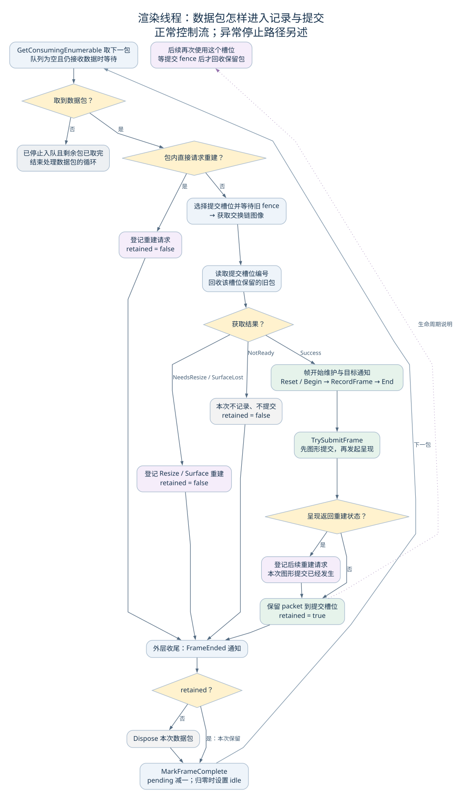
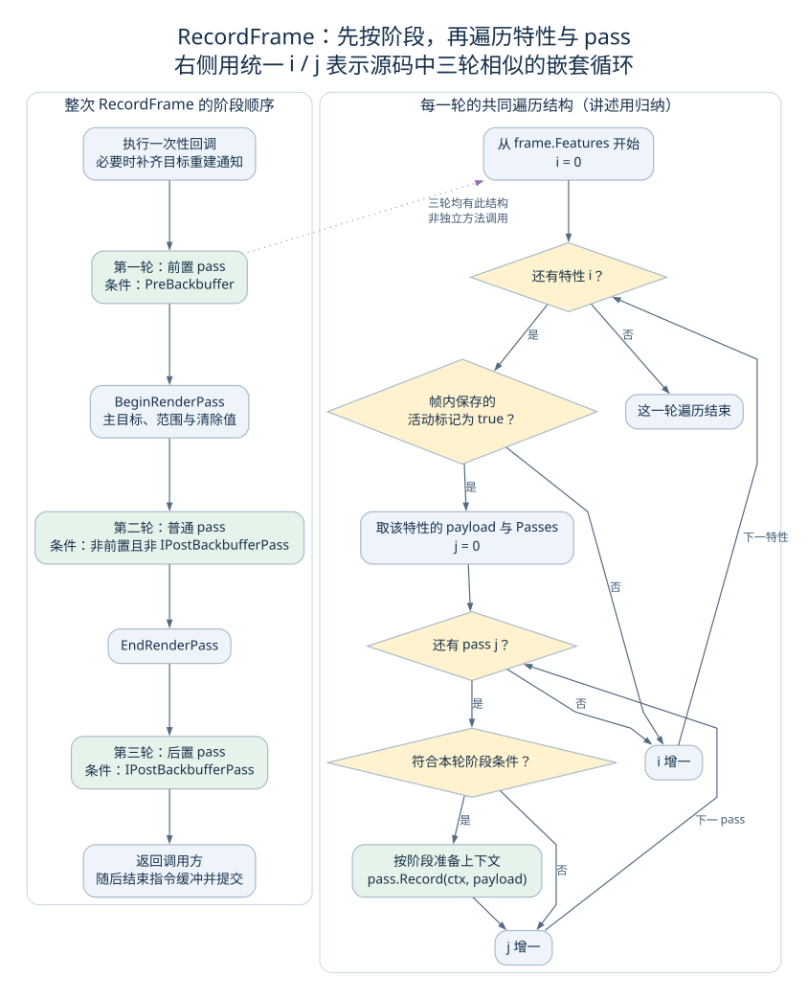

# 渲染模块：已有资料与后续研究

状态：范围与研究顺序已确定。详细研究安排在地图、空间和 UI 的解析完成之后；本文件先保存已查材料，供届时继续讨论与写作。

Waylith 篇说明引擎怎样调用渲染模块收集数据、将 RenderFrame 加入队列、由渲染线程记录并提交 Vulkan 指令。这里继续研究各模块返回什么数据、这些数据怎样形成、各 pass 怎样绘制，以及资源怎样管理。

## 后续要解释的问题

1. 渲染特性各自返回什么类型与结构，字段从哪里取得，哪些数据复制，哪些保留引用。
2. 地图与空间状态怎样形成地图、人物、世界视图等绘制数据；哪些变化要求重新生成数据。
3. UI 的输入、布局和重绘怎样形成 ImGuiDrawSnapshot，与地图画面怎样组合。
4. 各 pass 怎样读取数据、选择纹理和图形管线、记录具体绘制指令。
5. 提交槽位、交换链图像、指令缓冲、同步对象和跨帧资源的具体使用与释放规则。

这些问题需要结合前面模块的分析解释。现阶段保留已知调用关系和原有结论，待研究时回查源码。

## 已有源码阅读摘要

以下内容从 Waylith 汇总稿的绘制部分分出，保留此前的细节与图示，尚未按独立渲染模块重新组织。

### 一、主线程怎样采集绘制数据

OnUpdate 返回 RunLoop 后，主线程在可绘制路径执行准备、采集和入队：

```csharp
this.FrameRenderer.BeginMainThreadFrame(in frameTiming);
RenderFrame renderFrame = this.FrameRenderer.CaptureFrame(
    in frameTiming, this._clearValues, false);
this._renderThread.Enqueue(renderFrame);
```

BeginMainThreadFrame 保存本轮使用的特性数组，释放已经满足释放条件的旧渲染特性，再调用支持提前准备接口的特性。CaptureFrame 随后从同一数组逐个取得 payload，也就是该特性本轮提供的数据，将它们放入 RenderFrame；全部采集结束后，再读取各特性的 IsActive，保存活动标记。

不同渲染模块通过 IRenderFeature 接口与 FrameRenderer 配合：各特性提供本轮需要的数据，FrameRenderer 统一组织这些结果。payload 的具体类型、内部数据是否复制，以及相关资源怎样保留，由相应特性负责。帧容器保存了特性与 payload 的引用，并不是把整个游戏世界深复制了一份。

以界面为例，ImGuiRenderFeature.CaptureFrame 会调用 buildUi，将结果组成 ImGuiDrawSnapshot。这说明一部分可见内容的主线程准备发生在采集阶段；理解一次画面的形成，需要把 OnUpdate 与渲染采集都包括进来。

RenderFrame 还带走帧号与时间、清除值等信息。它通过池取得并在之后归还，容器的生命周期会跨过当前主线程调用。

源码定位：主线程准备（`Waylith.Rendering.FrameRenderer.cs:253`）、采集与活动标记（`Waylith.Rendering.FrameRenderer.cs:206`）、界面采集（`RimWorldWaylith.Imgui.ImGuiRenderFeature.cs:44`）、帧容器取得与初始化（`Waylith.Rendering.RenderFrame.cs:48`）。

#### 有界队列把两个线程联系起来

Enqueue 由调用它的主线程执行，将同一个 RenderFrame 引用放入 BlockingCollection。队列容量为 max(1, FramesInFlight)。有空位时可以加入；队列满时，主线程会停在 Add，等待渲染线程取走数据、腾出空位。

渲染线程则通过 GetConsumingEnumerable 取包，队列为空时等待数据。这里的“回应”可以理解为同步条件满足后调用返回：主线程等到空位，渲染线程等到数据。取走一个包就能让队列出现空位，而这个包此后的指令记录和 GPU 执行还可能没有完成。

这样，两条线程可以并行推进，也会相互影响。渲染线程处理数据包变慢、不能及时从队列取包时，队列逐渐填满，主线程继续加入新包的速度也会受到限制。队列容量只约束等待取出的包数，最终显示延迟还涉及其他阶段。

源码定位：队列与 Enqueue（`Waylith.Rendering.RenderThread.cs:19`）、取出并处理数据包的循环（`Waylith.Rendering.RenderThread.cs:159`）。

### 二、绘制资源获取与数据包处理

渲染线程取出数据包后，还需要取得本次记录使用的资源。窗口路径的 TryAcquireNextFrame 先选择提交槽位，等待其旧提交的 fence，再调用图像获取接口，取得交换链图像编号。fence 是供 CPU 等待的提交完成标记；交换链则组织供窗口呈现使用的一组图像。

两套编号分别选择不同的资源与同步对象：

| 编号 | 选择的内容 |
| --- | --- |
| SubmissionFrameIndex | 提交槽位中的指令缓冲、fence 等对象，也用于保存提交后的帧数据包 |
| FrameIndex | 交换链图像及其对应的 FrameResources |

成功取得后，AcquiredFrame 将当前图像的 FrameResources 与当前槽位的 CommandBuffer 组合起来。RenderFrame 提供要记录的内容，AcquiredFrame 则提供本次使用的资源，两者会在记录阶段汇合。

获取资源也可能要求等待或返回其他状态。渲染线程取出数据包之后，完整一点的处理过程如下：



图中的 retained 是讲述用名称，表示数据包是否进入提交后的保留路径。获取返回 NeedsResize、SurfaceLost 或 NotReady 时，本次可以跳过记录和提交，并由外层收尾释放当前包。已经取得旧槽位的 fence 后，旧槽位保存的包会在获取结果判断之前回收。

另一种情况发生在图形提交之后：呈现返回重建状态。这时提交已经发生，代码会登记重建请求，同时保留当前包，等待后续回收。这个区别决定了图中几条重建分支为什么通向不同的保留结果。

源码定位：获取槽位与图像（`Waylith.Graphics.RenderContext.cs:245`）、渲染线程的判断顺序（`Waylith.Rendering.RenderThread.cs:197`）。

### 三、RecordFrame 的阶段与 pass

成功取得资源后，渲染线程发出帧开始维护通知、处理目标变化通知，再 Reset 和 Begin 指令缓冲，构造 FrameContext，调用 FrameRenderer.RecordFrame。

指令缓冲可以理解为准备交给 GPU 的一份操作记录。Record 阶段往其中写入工作，后续 Submit 再把它交出去。Waylith 的 pass 则提供各自的记录入口，可以组织绘制、计算或复制等不同工作。

RecordFrame 从包里读取特性列表、活动标记和 payload，遍历各特性提供的 Passes。它把同一特性的 payload 交给该特性中符合条件的各个 pass，再由 pass 的 Record 方法组织具体指令。

这个过程有三轮相似的嵌套循环：



左边是三轮遍历的整体位置，右边归纳每一轮的共同结构。右边使用统一的 i、j 表示源码中不同的循环变量；紫色虚线表示讲述上的对应关系。

每轮先按特性数组顺序，再按相应 Passes 的列表顺序调用。筛选条件是：

| 阶段 | 条件与位置 |
| --- | --- |
| 前置 | PreBackbuffer 为 true，在主 render pass 开始之前记录 |
| 普通 | 非前置且未实现 IPostBackbufferPass，在主 render pass 内记录 |
| 后置 | 实现 IPostBackbufferPass，在主 render pass 结束后记录 |

这里的 IRenderPass 是 Waylith 的接口；多个普通 pass 可以共同在一段 Vulkan render pass 范围内记录。前置 pass 若有 Attachment，外层会为它派生 FrameContext；具体需要怎样开始和结束记录范围，仍由相应实现组织。

把已有实现放回这些位置，可以看到一段与画面直接对应的过程：地图 pass 先向场景目标记录内容，CompositePass 读取场景颜色纹理并记录合成绘制，随后记录界面；有截图请求时，后置截图 pass 再记录主颜色图像的复制。

CompositePass 的底层记录会绑定图形管线、设置视口、绑定输入和参数，最终调用 Draw。FrameRenderer 在这里负责顺序与分发，具体网格、管线和 shader 怎样决定像素，则由相应绘制模块继续解释。

源码定位：RecordFrame（`Waylith.Rendering.FrameRenderer.cs:316`）、特性安装顺序（`RimWorldWaylith.Bootstrap.cs:300`）、合成输入（`Waylith.Rendering.PostFx.CompositePass.cs:46`）、具体指令调用（`Waylith.Rendering.PostFx.PostEffectPass.cs:122`）。

### 四、提交、呈现与回收

RecordFrame 返回后，调用方结束主指令缓冲的记录，再进入 TrySubmitFrame。窗口实现组装同步参数，先提交图形工作，再发起呈现请求。

这里的 semaphore 用于协调图像获取、图形工作与呈现之间的先后关系。等待和发出信号被写进提交或呈现参数，相应参与方据此继续推进。

| 同步连接 | 本路径怎样使用 |
| --- | --- |
| 图像获取 → 图形提交 | 提交等待 ImageReadySemaphore，代码指定 ColorAttachmentOutputBit 作为对应等待阶段 |
| 图形工作 → 呈现 | 图形提交发出当前图像对应的完成 semaphore，PresentFrame 将它列为等待项 |
| 图形提交 → 后续 CPU 复用槽位 | 提交附带当前槽位的 fence，之后再使用该槽位时等待它 |

呈现使用的完成 semaphore 按交换链图像管理，指令缓冲和 fence 则按提交槽位管理。对应的使用周期不同，所以代码分别通过 FrameIndex 和 SubmissionFrameIndex 选择它们。

PresentFrame 指定 swapchain、图像编号和等待 semaphore，调用 PresentKHR。Vulkan 的接口语义区分了呈现请求的排队与呈现引擎实际处理，精确显示时点还取决于平台；提交 fence 则用于确认提交的指令缓冲完成执行。参见 [图形提交接口](https://docs.vulkan.org/refpages/latest/refpages/source/vkQueueSubmit.html)、[呈现接口](https://docs.vulkan.org/refpages/latest/refpages/source/vkQueuePresentKHR.html)与[呈现 semaphore 的复用说明](https://docs.vulkan.org/guide/latest/swapchain_semaphore_reuse.html)。

这时再看几种“结束”，就能明确它们的边界：

| 标记 | 表示的进度 |
| --- | --- |
| 主线程 EndFrame | 本轮主线程收尾，推进引擎计数 |
| 渲染线程 FrameEnded | 到达一个数据包的 CPU 处理收尾通知 |
| 提交 fence 触发 | 对应指令缓冲已经完成执行 |
| 图像显示 | 平台呈现路径将图像送到实际显示阶段 |

主线程在 Enqueue 返回后，可以完成自己的收尾和限速，进入后续更新。渲染线程则在本次 CPU 处理结束后减少 pending；提交后的包仍保存在槽位中。后续再次使用这个槽位，等待旧提交的 fence 后，才回收旧包。

RenderFrame.Dispose 会释放实现 IDisposable 的 payload、清空引用并归还容器，同时通知 FrameRenderer 将这个帧从尚未释放的帧列表中移除。等待释放的旧渲染特性也会检查这些记录，以免在仍有帧引用它时就将其释放。具体纹理、网格与其他 GPU 资源还有各自的管理规则。

等待与返回的详细交互已单独画成 [帧交接时序图](figures/waylith-frame-timeline.svg)：它区分队列空位、队列数据、GPU 提交完成和维护时的 CPU 空闲条件。各片段分别阅读，可以避免把所有等待想成每帧固定串行发生。

常规停止时，先停止接收新帧，等待渲染线程结束，再等待设备工作空闲并释放保留包。渲染线程发生故障时，会保存异常并停止继续接收；主线程在相应检查点重新抛出，进入退出处理。

源码定位：窗口提交与呈现（`Waylith.Graphics.WindowRenderContext.cs:415`）、队列提交调用（`Waylith.Graphics.GraphicsDevice.cs:533`）、渲染线程收尾（`Waylith.Rendering.RenderThread.cs:159`）、槽位包回收（`Waylith.Rendering.RenderThread.cs:314`）、帧包释放（`Waylith.Rendering.RenderFrame.cs:106`）、停止路径（`Waylith.Rendering.RenderThread.cs:64`）。

## 细读笔记与图源

- [主线程采集与 RenderFrame](08-waylith-frame-capture.md)
- [队列、渲染线程与数据包保留](09-waylith-render-enqueue.md)
- [提交槽位与交换链图像获取](10-waylith-frame-acquire.md)
- [RecordFrame、各阶段与 pass](11-waylith-frame-record.md)
- [Vulkan 提交、呈现与同步](12-waylith-frame-submit.md)
- [线程等待与完成条件](13-waylith-frame-timeline.md)

| 图 | SVG | 可编辑图源 |
| --- | --- | --- |
| 渲染线程的分支与数据包保留 | [SVG](figures/waylith-render-consumer-flow.svg) | [DOT](figures/waylith-render-consumer-flow.dot) |
| RecordFrame 阶段与嵌套循环 | [SVG](figures/waylith-record-phases.svg) | [DOT](figures/waylith-record-phases.dot) |
| 两条线程、GPU 与呈现的等待关系 | [SVG](figures/waylith-frame-timeline.svg) | [Mermaid](figures/waylith-frame-timeline.mmd) |
