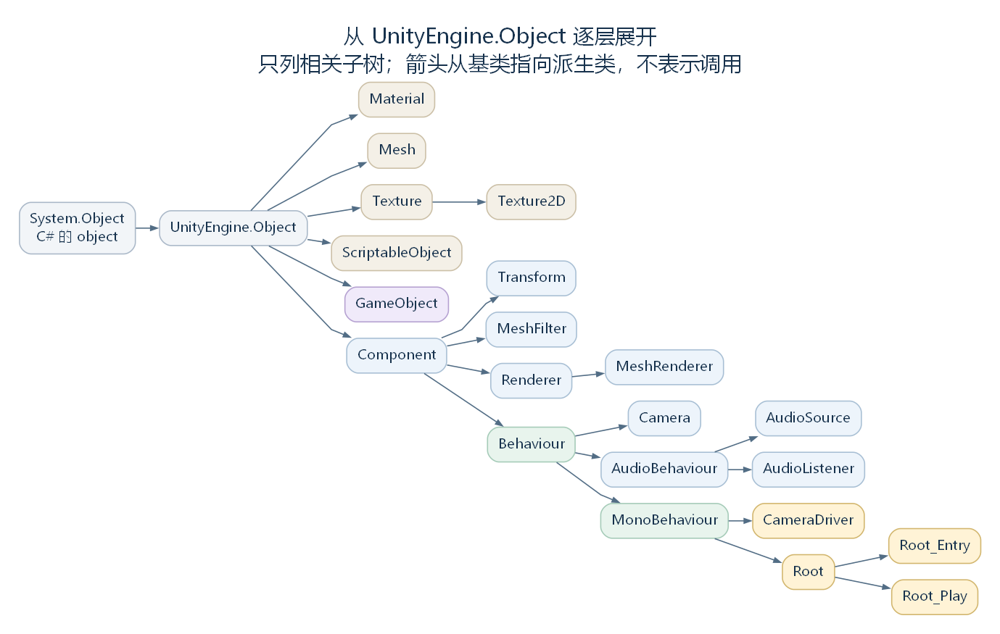

# 对象与组件模式：从 UnityWorld 到对象类型树（讨论稿）

状态：第一轮讨论材料，2026-10-23。依据工作区 RimWorld 1.7.4982 rev1280 的兼容层与游戏代码整理。先认识 UnityWorld 对对象与组件的管理，再从 UnityEngine.Object 出发，按树状结构逐层说明继承的内容、本层增加的内容及实际运行方式。

定稿阅读入口：[《从每一帧到对象与组件：UnityWorld 与 UnityEngine.Object》发布版 v1.0](chapters/02-UnityWorld&UnityObject/release.md) 与 [完整解析版 v1.0](chapters/02-UnityWorld&UnityObject/article.md)。两版按 Step → UnityWorld → 对象类型树展开，功能子类与协程保留必要说明；本文件继续作为逐类讨论和资料导航。

## 一、这一部分怎样展开

上一章沿主循环解释一次更新何时进入 UnityWorld，以及绘制数据怎样交给渲染线程。这一部分先说明 UnityWorld 如何登记、持有和管理对象，再沿类型树认识对象，逐步接回创建、查询、启停与更新流程。

讨论顺序为：

1. 先读 [UnityWorld 概览](19-unityworld-overview.md)，认识实际对象、管理记录、持有的引用与每帧调用入口。
2. 确认 System.Object 与 UnityEngine.Object 的边界，阅读 [UnityEngine.Object 的共同能力](17-unityengine-object.md)。
3. 进入 [GameObject 分支](18-gameobject.md)，说明它在共同对象接口之外增加的组件组成、Transform、场景与活动状态。
4. 回到同级的 [Component 分支](20-component.md)，说明组件的所属对象和相互查询，再沿 [Transform](21-transform.md)、[MeshFilter 与 Renderer 分支](22-mesh-renderer-components.md)、[Behaviour](23-behaviour.md) 等分支逐层展开。
5. 沿 [Behaviour](23-behaviour.md) 继续到 [Camera](24-camera.md)、[AudioBehaviour](25-audiobehaviour.md)、[MonoBehaviour](28-monobehaviour.md)，再进入具体相机、声音和游戏脚本组件。
6. 用实际对象组合与生命周期把各分支连接起来，说明不同组件怎样获得使用或调用机会。

UnityWorld 与被管理对象之间是管理和引用关系；后面的类型树描述继承关系。前置概览先讲清这个区别，完整的方法调度与生命周期判断在读到相关组件时展开。

每个节点都按同一方式讨论：父节点已经提供什么，本层新增哪些数据、属性与方法，哪些行为得到覆写或接入，以及这些接口实际由谁使用。若某个中间类没有增加成员，也应明确记录。

这里仍需分别画清两种关系：**继承关系描述类型从父节点取得哪些共同能力，组成关系描述一个 GameObject 实例附加了哪些组件实例。** 对象组成不改变类型的继承位置。

## 二、类型树：逐层说明相对于父节点的增量

下面只列与本轮讨论相关的子树。System.Object 是 C# 的基础对象；UnityEngine.Object 是兼容层在它之上提供的公共对象类型。图中也列出若干资源分支，帮助确定组件在整棵树中的位置；各分支的细节按讨论进度展开。箭头从基类指向派生类。



[SVG 矢量图](figures/component-inheritance-overview.svg)；[可编辑图源](figures/component-inheritance-overview.dot)。

先按“父节点 → 本层增加的内容”建立导航：

| 当前节点 | 父节点 | 首先要说明的增量 |
| --- | --- | --- |
| UnityEngine.Object | System.Object | 名称、实例编号、销毁与有效性判断、共同对象操作入口；详见 [根节点讨论](17-unityengine-object.md) |
| GameObject | UnityEngine.Object | 组件组成与查询、默认 Transform、场景与活动状态接口、层编号等 |
| Component | UnityEngine.Object | 所属 GameObject、Transform，以及组件查询接口 |
| [Transform](21-transform.md) | Component | 空间变换与父子关系 |
| [MeshFilter](22-mesh-renderer-components.md) | Component | 网格引用及其访问接口 |
| [Renderer](22-mesh-renderer-components.md) | Component | 材质、绘制状态及其访问接口，包含本类声明的 enabled |
| [Behaviour](23-behaviour.md) | Component | enabled、isActiveAndEnabled 两个属性，连接 UnityWorld 的相应状态管理 |
| [MonoBehaviour](28-monobehaviour.md) | Behaviour | 协程启动与停止等接口，供具体脚本继续派生 |
| [AudioBehaviour](25-audiobehaviour.md) | Behaviour | 当前类体为空；它建立音频组件的中间类型分支，具体功能在 [AudioSource](26-audiosource.md)、[AudioListener](27-audiolistener.md) 中继续增加 |
| [AudioSource](26-audiosource.md) | AudioBehaviour | 音频片段、主播放与额外播放、播放控制、空间更新、滤镜和输出读取 |
| [AudioListener](27-audiolistener.md) | AudioBehaviour | 活动监听器选择、监听位置与方向、静态总音量和后端连接 |
| [Camera](24-camera.md) | Behaviour | 相机参数、坐标转换与相关功能入口 |
| Mesh、Material、Texture、ScriptableObject 等 | UnityEngine.Object | 各自的数据与功能，按需要接入资源与表现模块 |

Start、Update 等约定方法的调用，还涉及 UnityWorld 的类型识别和方法查找；不能把它们全部写成 MonoBehaviour 在类声明中新增的虚方法。讨论子类时，需要区分类型本身声明的接口与管理代码按约定提供的调用机会。

这套继承结构不能简化成“所有组件都拥有并执行 Update”。UnityWorld 会识别 Behaviour 分支，安排相应的生命周期方法调用；其他组件可以由查询、外部驱动或具体功能入口使用。

一个需要特别说明的例子是 Renderer：它直接继承 Component，同时自己声明了 enabled 属性。这个同名属性并没有改变它的继承关系。当前 MeshRenderer 由专门的驱动代码在 PostLateUpdate 阶段调用 FrameUpdate，具体绘制工作再由相应路径继续。

源码定位：根节点（`UnityEngine.Object.cs:9`）、空的音频中间类（`UnityEngine.AudioBehaviour.cs:6`）、Component（`UnityEngine.Component.cs:8`）、Transform（`UnityEngine.Transform.cs:8`）、MeshFilter（`UnityEngine.MeshFilter.cs:6`）、Renderer 与其 enabled（`UnityEngine.Renderer.cs:9`、`UnityEngine.Renderer.cs:65`）、Behaviour（`UnityEngine.Behaviour.cs:7`）、MonoBehaviour（`UnityEngine.MonoBehaviour.cs:7`）、识别和登记组件（`Waylith.UnityCompat.UnityWorld.cs:877`、`Waylith.UnityCompat.UnityWorld.cs:911`）、网格绘制组件的阶段登记（`UnityStubs.Internal.MeshRendererDriver.cs:13`）。

## 三、GameObject 分支：通用结构说明

逐层阅读见 [GameObject：把组件组织到同一个对象上](18-gameobject.md)，其中按父类增量、管理记录、构造、添加与查询、活动状态和实际相机对象展开。以下保留结构总览，便于与 Component 分支对照。

GameObject 继承 UnityEngine.Object，已有的名称、编号和销毁入口继续沿用父节点。本节集中说明它增加的组成与管理关系。

GameObject 是兼容层管理的一种对象。通过它，可以将空间状态、观察参数、声音、绘制与脚本逻辑等功能关联到同一个对象上。具体具有哪些功能，取决于附加了哪些组件。

GameObject 和各组件分别是 C# 对象。GameObject 提供创建、附加、查询和控制活动状态的接口，组件则提供各自的数据与功能。GameObject 本身也可以作为没有地图外观的运行对象，例如承载游戏入口的 GameRoot。

下图先使用通用结构。图中的“组件实例 A”“组件实例 B”是讲解用占位描述，不是源码类型名，也不表示每个 GameObject 必须具有两个额外组件。实线表示附加关系，虚线表示对象与兼容层管理记录的对应关系；箭头均不表示执行顺序。


[SVG 矢量图](figures/gameobject-composition-overview.svg)；[可编辑图源](figures/gameobject-composition-overview.dot)。

### 3.1 一个 GameObject 涉及哪些内容

从使用接口和运行记录一起看，可以先认识以下内容：

| 内容 | 源码中的接口或记录 | 作用 |
| --- | --- | --- |
| 名称 | 继承自 Object 的 name；管理记录中的 Name | 为对象命名，并供按名称查找等代码使用 |
| 所属场景 | scene；管理记录中的 SceneName | 记录对象归属，参与场景管理与卸载 |
| 自身活动状态 | activeSelf、SetActive；管理记录中的 ActiveSelf | 记录对象自身是否设为活动 |
| 层级活动状态 | activeInHierarchy | 综合对象自身与父对象链的活动状态，判断它在层级中是否活动 |
| 空间与父子关系 | transform；Transform 的位置、旋转、缩放与父子接口 | 将对象放到空间和层级关系中 |
| 附加的组件 | AddComponent、GetComponent 等接口；管理记录中的 Components | 组合功能，并让代码取得所需组件 |
| 层编号 | GameObject.layer | 提供绘制层等用途所需的编号 |
| 实例身份与销毁状态 | UnityWorld 管理记录中的 InstanceId、Destroyed 等 | 区分和管理运行中的实例及其状态 |

这张表同时列出了公共接口与内部记录，不能把它直接当成 GameObject 类的字段声明。在当前兼容层中，很多属性会转向 UnityWorld 查询或修改相应记录。

例如，GameObject 的 transform 属性查询所属的 Transform，scene 属性查询场景名，SetActive 则调用 UnityWorld.SetGameObjectActive。layer 是 GameObject 自己声明的属性。了解这个区别之后，再读类文件，就能解释为何其中没有直接出现完整的组件列表和场景管理逻辑。

源码定位：GameObject 声明与 layer（`UnityEngine.GameObject.cs:12`）、transform / scene / activeInHierarchy（`UnityEngine.GameObject.cs:157`）、组件查询（`UnityEngine.GameObject.cs:188`）、activeSelf（`UnityEngine.GameObject.cs:232`）、SetActive（`UnityEngine.GameObject.cs:274`）、公共对象状态（`Waylith.UnityCompat.UnityWorld.cs:1658`）、GameObject 管理记录（`Waylith.UnityCompat.UnityWorld.cs:1694`）。

### 3.2 Transform 为什么已经存在

普通 GameObject 的构造过程会先创建 Transform，再继续添加要求的组件。下面保留源码中的名称与方法主体：

```csharp
public GameObject(string name, params Type[] components)
    : this(name, new Transform(), false)
{
    foreach (Type type in components)
    {
        this.AddComponent(type);
    }
}
```

因此，创建对象时即使没有显式写 AddComponent<Transform>，也已经准备了一个 Transform 实例。后面的私有构造函数会将 GameObject、Transform 和名称交给 UnityWorld.InitializeGameObject，建立它们之间的管理关系。

InitializeGameObject 会建立 GameObject 与 Transform 各自的状态记录，将 Transform 记录加入对象的 Components 列表，并保存到 UnityWorld 的对象查询表中。普通场景对象还会取得当前场景名，加入根对象记录。

这里先关注普通场景对象。构造过程中的 isAssetToken 是兼容层用于区分资源用途对象的标记，其创建、复制与场景归属规则，留到资源与实例化路径继续讨论。

源码定位：GameObject 构造过程（`UnityEngine.GameObject.cs:30`）、建立 GameObject 与 Transform 的管理记录（`Waylith.UnityCompat.UnityWorld.cs:149`）。

### 3.3 实际实例与管理记录

UnityWorld 为对象另建管理记录，用它们保存所属关系和运行状态。记录中的 Instance 指回实际 C# 对象。

| 管理记录类型 | 主要内容 |
| --- | --- |
| UnityObjectState | Instance、InstanceId、CreationIndex、Name、Destroyed 等共同信息 |
| UnityGameObjectState | Components、Transform、ActiveSelf、SceneName 等对象信息 |
| UnityComponentState | 组件所属的 GameObject 记录，以及约定方法的查找结果 |
| UnityBehaviourState | 在组件记录上增加 Enabled、HasAwoken、HasStarted、IsActiveInHierarchy 等标记 |
| UnityTransformState | 在组件记录上保存 Parent、Children 等层级关系 |

这些是管理记录的类型。实际脚本组件沿 Component、Behaviour、MonoBehaviour 等类型继承；其状态记录则沿另一套内部类型继承。后面讨论“组件是否活动”和“调用组件的方法”时，需要说明读取的是记录中的状态，还是使用实际组件实例。

源码定位：共同对象记录（`Waylith.UnityCompat.UnityWorld.cs:1658`）、对象记录（`Waylith.UnityCompat.UnityWorld.cs:1694`）、组件记录（`Waylith.UnityCompat.UnityWorld.cs:1740`）、Behaviour 记录（`Waylith.UnityCompat.UnityWorld.cs:1761`）。

## 四、Component 分支：共同接口说明

逐层阅读见 [Component：从组件找到所属对象与其他组件](20-component.md)，包含所属对象、共享 Transform、查询实现与 CameraDriver 案例。以下保留共同接口总览，便于与其他分支对照。

Component 同样直接继承 UnityEngine.Object。它在共同对象能力之外增加了所属关系与查询接口，组件附加到对象后便可沿这些关系协作。先认识本层提供的三组接口：

- gameObject：取得该组件所属的 GameObject。
- transform：取得所属对象的 Transform。
- GetComponent / GetComponents 等：查询同一对象上符合指定类型的组件；查询子对象则使用相应的 InChildren 接口。

Component.GetComponent 的泛型方法如下，保留源码命名与方法主体：

```csharp
public T0 GetComponent<T0>()
{
    if (UnityRuntime.Current == null)
    {
        return default(T0);
    }
    return (T0)((object)UnityRuntime.Current.World.GetComponent(this.gameObject, typeof(T0)));
}
```

它先取得当前组件的 gameObject，再让 UnityWorld 查询该对象的组件记录。查询逐项检查组件尚未销毁、实际实例符合所请求的类型，找到后返回已有实例；没有找到则返回 null。类型匹配也可以接受派生类型，并非只比较类型名称是否相同。

这让两个分别存在的组件可以合作。比如 CameraDriver 通过 GetComponent<Camera> 取得同一对象上的 Camera，并缓存下来；后续控制逻辑便可以使用这个相机实例。相机作为具体案例，放在通用结构与类型分支之后展开。

组件的所属关系由添加与登记流程建立；Component 本层通过这些关系提供查询接口。单个、多个和子对象查询的实现已在逐类讨论中说明，之后继续进入 Transform 的父子关系和空间变换。

源码定位：Component 的所属对象、Transform 与组件查询（`UnityEngine.Component.cs:8`）、按类型取得已有组件（`Waylith.UnityCompat.UnityWorld.cs:294`）、取得全部匹配组件（`Waylith.UnityCompat.UnityWorld.cs:307`）、CameraDriver 的相机查询与缓存（`Verse.CameraDriver.cs:29`）。

## 五、后续逐类讨论与游戏案例

逐类研究时，每个分支都回答同一组问题：保存什么，谁创建和附加，其他代码怎样取得它，谁在什么位置使用或调用它，以及启停、销毁时发生什么。

| 后续讨论 | 主要问题 | 可使用的实际案例 |
| --- | --- | --- |
| UnityWorld 前置概览 | 谁持有对象，管理记录保存什么，谁安排后续调用 | 创建相机的方法返回后，对象仍由 UnityWorld 持有；见 [管理关系概览](19-unityworld-overview.md) |
| UnityEngine.Object | 相对于 System.Object 增加了什么，共同接口实际交给谁处理 | 名称、实例编号、销毁标记与有效性判断；见 [根节点讨论](17-unityengine-object.md) |
| GameObject 与 Component | GameObject 与组件如何登记，依赖组件如何补齐，组件怎样相互取得 | 通用创建过程；随后对照相机对象 |
| [Transform](21-transform.md) | 本地与世界变换、父子关系、层级活动状态如何关联 | 相机位置与子相机层级 |
| [Behaviour](23-behaviour.md) | 组件启用、对象活动和父对象活动怎样共同决定运行状态 | 启停监听组件、脚本更新条件 |
| [MonoBehaviour](28-monobehaviour.md) | 约定方法如何找到与调用，协程由谁推进 | Root_Entry、Root_Play、CameraDriver、Delay.CoroutineRunner |
| [Camera](24-camera.md) 及控制组件 | 相机参数与控制逻辑怎样组合，子相机由谁管理 | 拖动、缩放、坐标转换与多相机协作 |
| [AudioBehaviour 与音频组件](25-audiobehaviour.md) | 播放对象与监听对象怎样建立并连接后端 | [AudioSource](26-audiosource.md)、[AudioListener](27-audiolistener.md) |
| [Renderer 分支](22-mesh-renderer-components.md) | 网格、材质、对象变换怎样交给绘制入口 | MeshFilter 与 MeshRenderer 的协作 |
| 场景与生命周期 | 切换场景时怎样卸载旧对象、建立新对象，哪些销毁需要等待处理位置 | Entry 到 Play 的 GameRoot 交接 |

分类和顺序用于组织讨论，不要求每个分支都独立成篇。渲染与音频在这里研究组件职责和调用连接；复杂绘制数据、具体 pass 与音频后端实现，仍留给对应模块。

还需区分游戏实体体系：Pawn、ThingWithComps、ThingComp 使用游戏层自己的对象与更新组织方式。当前讨论不会把每个 Pawn 等同于一个 GameObject，也不会将 ThingComp 归入 UnityEngine.Component 的继承树；它们的具体连接在游戏流程与实体模块继续追踪。

## 相关材料

- 上一章：[Waylith 发布版](chapters/01-waylith/release.md)、[完整解析版](chapters/01-waylith/article.md)。
- 已有的生命周期说明：[UnityRuntime.Step 前置笔记](06-waylith-runtime-step.md)。
- 已保留的游戏层接点：[GameRoot、Root 与游玩更新入口](07-waylith-root-play.md)。Game.UpdatePlay 的内部调度尚未在本轮展开。

当前进度：UnityWorld 前置概览、UnityEngine.Object 根节点、GameObject、Component、Transform、MeshFilter、Renderer、MeshRenderer、Behaviour 与本轮所选三条子分支已有第一轮讨论。AudioSource、AudioListener 已接回播放与监听；MonoBehaviour 已接回脚本方法调用、协程等待与帧阶段。后续可进入具体脚本，或先整理本轮组件讨论。
