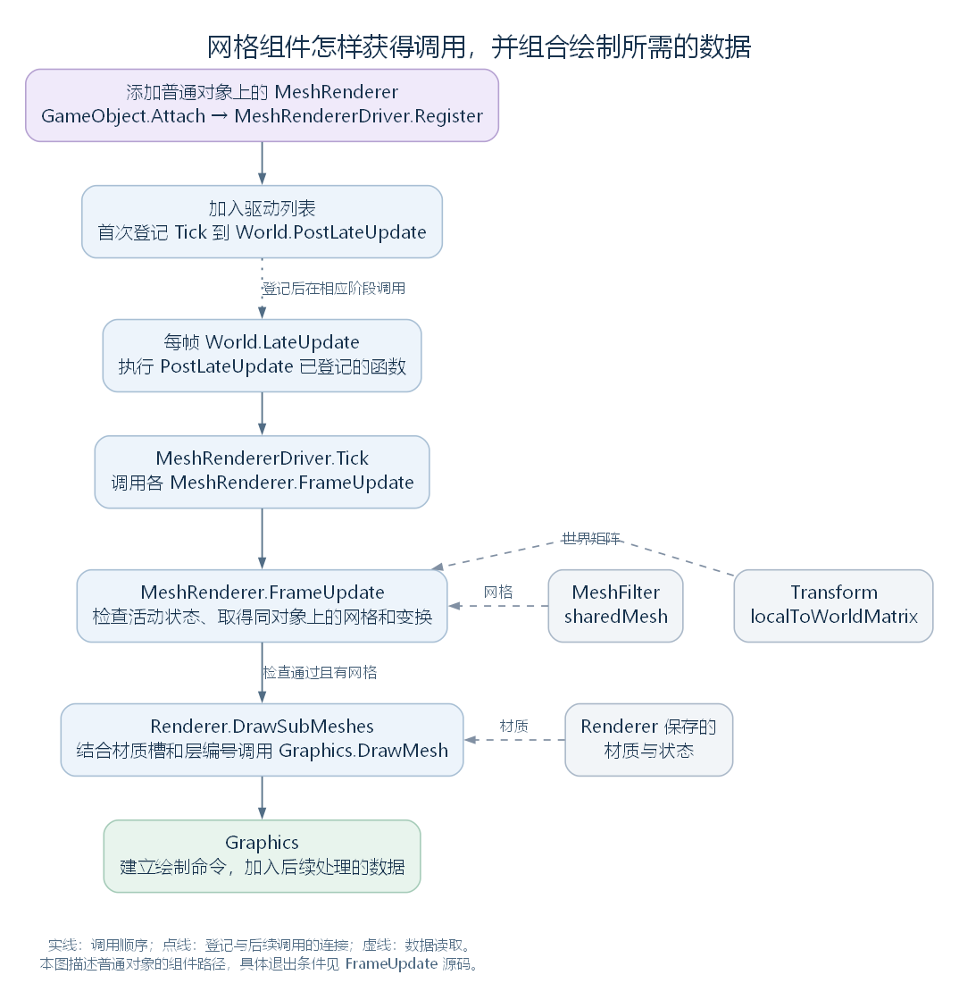

# 网格组件分支：MeshFilter、Renderer 与 MeshRenderer（讨论稿）

状态：Component 的网格与绘制相关分支，2026-10-24。依据工作区 RimWorld 1.7.4982 rev1280 的兼容层与游戏代码整理。前置阅读：[Component](20-component.md)、[Transform](21-transform.md)；类型树见 [对象与组件模式](16-gameobject-component-model.md)。本篇先研究各层新增的接口、组件协作与调用位置，绘制数据结构、具体 pass 和 Vulkan 工作留到渲染模块展开。

## 一、先将继承与组成关系放回各自的位置

本轮沿下面两条分支阅读：

```text
Component
├── MeshFilter
└── Renderer
    └── MeshRenderer
```

MeshFilter 和 Renderer 是同级类型；MeshRenderer 在 Renderer 之上继续增加网格绘制组件的入口。实际使用时，它们可以组合到同一个 GameObject 上，并取得该对象已有的 Transform。

| 类型 | 相对于父节点新增的主要内容 |
| --- | --- |
| MeshFilter | 一个 Mesh 引用，以及 sharedMesh、mesh 两组访问接口 |
| Renderer | 材质引用与相关访问接口、enabled 等状态，以及 DrawSubMeshes、CreateDefaultMaterial 两个方法 |
| MeshRenderer | FrameUpdate 中的网格组件协作；另有顶点流相关属性及固定返回 0 的 subMeshStartIndex |

这里的 Mesh、Material 是资源对象分支的类型。MeshFilter 是附加到 GameObject 上的组件，所保存的 Mesh 则是另一个实际对象。网格中的顶点、三角形索引等描述几何数据；Material 连接绘制所需的材质设置。具体资源内容在相应模块展开。

源码定位：三个组件类型（`UnityEngine.MeshFilter.cs:6`、`UnityEngine.Renderer.cs:9`、`UnityEngine.MeshRenderer.cs:6`）、网格的顶点与三角形接口（`UnityEngine.Mesh.cs:597`、`UnityEngine.Mesh.cs:431`）。

## 二、MeshFilter：在组件中保存网格引用

MeshFilter 自己只有一个 _sharedMesh 字段。sharedMesh 的 getter、setter 直接读写这个字段；mesh 的 getter 则多了一步：已有有效网格时返回它，没有时建立一个 Mesh，再存回该字段。

以下是 mesh 属性的原始实现，保留名称和主体，省略反编译标注：

```csharp
public Mesh mesh
{
    get
    {
        Mesh mesh;
        if ((mesh = this._sharedMesh) == null)
        {
            mesh = (this._sharedMesh = new Mesh());
        }
        return mesh;
    }
    set
    {
        this._sharedMesh = value;
    }
}
```

因此，当前兼容层中，这两个属性操作的是同一个字段。读取 mesh 并没有在已有网格的情况下另外复制它。若两个 MeshFilter 引用了同一个有效 Mesh，分别通过 mesh 取得的仍然可以是同一个资源实例；修改这份几何数据会影响继续使用它的代码。

MeshFilter 本层没有声明 Update 或绘制方法。它提供网格引用，让其他组件或代码取得并使用。

源码定位：sharedMesh（`UnityEngine.MeshFilter.cs:11`）、mesh（`UnityEngine.MeshFilter.cs:26`）、字段（`UnityEngine.MeshFilter.cs:44`）。

## 三、Renderer：管理材质与绘制状态

### 3.1 先列出本层新增的成员

Renderer 直接继承 Component。为方便后面追踪调用，先按职责列出本类显式声明的成员，再说明关键实现：

| 职责 | 本类声明的成员 | 保存或完成什么 |
| --- | --- | --- |
| 第一个材质槽的数据 | _sharedMaterial、_materialInstance | 保存共享材质和当前 Renderer 使用的实例材质引用 |
| 额外材质槽的数据 | _otherMaterials、_otherMaterialsInstanced | 保存后续材质引用，并记录是否已经走过建立额外材质实例的处理 |
| 材质访问 | sharedMaterial、material、内部 renderMaterial、sharedMaterials、materials | 根据不同访问规则取得或设置上述引用 |
| 绘制启用状态 | enabled | 保存本组件的绘制开关，默认 true |
| 由其他功能负责绘制的标记 | 内部字段 DrawnByOwner | 供 MeshRenderer.FrameUpdate 等检查，避免这条通用组件路径重复处理绘制 |
| 其他状态属性 | receiveShadows、shadowCastingMode、sortingOrder、lightProbeUsage | 保存相应设置；其效果还要查看实际使用路径 |
| 边界查询属性 | bounds | 当前实现记录未实现接口的提示并返回默认值 |
| 绘制辅助方法 | internal void DrawSubMeshes(Mesh mesh, Matrix4x4 matrix) | 将传入网格、变换矩阵与本组件的材质槽组合，调用 Graphics.DrawMesh |
| 默认材质创建方法 | private static Material CreateDefaultMaterial() | 供本类材质 getter 在需要时创建默认材质 |

这里也需要区分访问范围：DrawSubMeshes 声明为 internal，当前同在 UnityStubs 程序集中的 MeshRenderer 可以调用它；CreateDefaultMaterial 是 Renderer 内部使用的私有静态方法。后面会先解释这两个方法，再进入 MeshRenderer。

### 3.2 材质属性怎样使用字段

几组材质属性的主要行为如下：

| 属性 | 当前实现中的主要行为 |
| --- | --- |
| sharedMaterial | 返回共享材质字段；没有时调用本类 CreateDefaultMaterial。赋值时清除已有的实例材质引用 |
| material | 首次需要实例材质时，从已有共享材质建立一个 Material，或调用本类 CreateDefaultMaterial；后续返回保存的实例引用 |
| 内部 renderMaterial | 优先返回实例材质，否则返回共享材质；本 getter 不主动创建默认材质 |
| sharedMaterials、materials | 处理第一个材质与额外材质槽；materials 的 getter 还会按本类标记建立额外材质实例 |

material 的原始实现如下：

```csharp
public Material material
{
    get
    {
        if (this._materialInstance == null)
        {
            this._materialInstance = ((this._sharedMaterial != null) ? new Material(this._sharedMaterial) : Renderer.CreateDefaultMaterial());
        }
        return this._materialInstance;
    }
    set
    {
        this._materialInstance = value;
        this._sharedMaterial = value;
    }
}
```

读取 material 可能建立新的材质对象，读取已有的 MeshFilter.mesh 则没有相应复制步骤。分析资源是否共享时，需要分别查看各属性实现。这里的材质复制也不意味着它所引用的纹理等资源全部递归复制，资源内部关系另行研究。

绘制辅助方法后面使用的 renderMaterial，也是 Renderer 在本层声明的属性，其原始实现很短：

```csharp
internal Material renderMaterial
{
    get
    {
        return this._materialInstance ?? this._sharedMaterial;
    }
}
```

它优先选择实例材质，否则使用共享材质。这次读取不调用 CreateDefaultMaterial，所以本类“具有默认材质创建方法”，不代表每条绘制调用都会自动补齐材质。

### 3.3 CreateDefaultMaterial：供材质属性调用的辅助方法

这个方法建立一个材质对象，并将其 name 设为 "Default Renderer Material"。原始反编译片段如下：

```csharp
private static Material CreateDefaultMaterial()
{
    return new Material(null)
    {
        name = "Default Renderer Material"
    };
}
```

反编译说明：这里保留了 new Material(null) 的原始显示方式。已回查程序集 IL，该调用选择 Material(Shader shader) 构造函数；阅读时将 null 理解为 shader 参数。默认 shader 的后续处理属于 Material 的实现，留到资源分支展开。

这个函数只负责默认材质的创建，不负责取得网格、选择子网格或安排每帧调用。

### 3.4 DrawSubMeshes：将网格、变换和材质交给绘制入口

现在进入后面 MeshRenderer 会调用的父类方法。mesh 和 matrix 由调用者传入；材质槽保存于当前 Renderer 实例，层编号从其所属 GameObject 取得。以下保留原始签名、变量名和方法主体：

```csharp
internal void DrawSubMeshes(Mesh mesh, Matrix4x4 matrix)
{
    int subMeshCount = mesh.subMeshCount;
    if (subMeshCount == 0)
    {
        return;
    }
    int layer = base.gameObject.layer;
    for (int i = 0; i <= this._otherMaterials.Length; i++)
    {
        Material material = ((i == 0) ? this.renderMaterial : this._otherMaterials[i - 1]);
        if (material != null)
        {
            Graphics.DrawMesh(mesh, matrix, material, layer, null, Math.Min(i, subMeshCount - 1), null);
        }
    }
}
```

子网格是 Mesh 内可以分别指定索引数据的一组几何内容，这里的“子”与 GameObject 的父子层级无关。方法按下面的顺序工作：

1. 读取 mesh.subMeshCount；没有子网格时直接返回。
2. 从所属 GameObject 取得 layer。
3. 按材质槽循环：i 为 0 时使用 renderMaterial，其后使用 _otherMaterials 中的对应项。
4. 当前材质有效时，调用 Graphics.DrawMesh，传入网格、世界变换、材质、层编号和子网格索引；此处 Camera 和 MaterialPropertyBlock 两个参数传 null。

循环次数取决于材质槽数量。子网格索引使用 Math.Min(i, subMeshCount - 1)，所以多出的材质槽会继续对应最后一个子网格。例如，假定网格有两个子网格，三个材质槽均有效：

| i | 材质来源 | 传入 Graphics.DrawMesh 的子网格索引 |
| --- | --- | --- |
| 0 | renderMaterial | 0 |
| 1 | _otherMaterials[0] | 1 |
| 2 | _otherMaterials[1] | 1 |

若某槽材质为空，就跳过该槽的调用；若材质槽少于子网格数，这个循环也不会自动补出其他槽。这样才能准确解释“哪些几何内容以哪些材质形成绘制请求”。具体请求如何进入渲染流程，继续交给 Graphics 的实现。

### 3.5 其余状态接口

Renderer 自己还声明 enabled，默认值为 true。它是这里的自动属性，MeshRenderer 的绘制入口会检查它。Renderer 的父类是 Component，因而不能凭同名的 enabled，就把它归入 Behaviour 的生命周期管理。

其他接口也应按实现理解：receiveShadows、shadowCastingMode、sortingOrder、lightProbeUsage 在本类中有属性声明，但本节的 DrawSubMeshes 路径没有读取它们；bounds 则记录未实现接口的提示并返回默认值。属性名称本身不足以说明对应效果已经在这条路径生效。

源码定位：材质访问（`UnityEngine.Renderer.cs:14`、`UnityEngine.Renderer.cs:33`、`UnityEngine.Renderer.cs:44`）、材质数组（`UnityEngine.Renderer.cs:90`、`UnityEngine.Renderer.cs:119`）、enabled 等状态（`UnityEngine.Renderer.cs:65`）、DrawSubMeshes（`UnityEngine.Renderer.cs:152`）、bounds（`UnityEngine.Renderer.cs:172`）、CreateDefaultMaterial（`UnityEngine.Renderer.cs:182`）、字段（`UnityEngine.Renderer.cs:191`）、目标材质构造函数（`UnityEngine.Material.cs:78`）。

## 四、MeshRenderer：取得网格和空间变换，再请求绘制

MeshRenderer 在 Renderer 的基础上，增加下面这段 FrameUpdate。它使用前面已经介绍的 DrawnByOwner、enabled、DrawSubMeshes，再把 Component 的查询、所属对象接口和 Transform 的空间变换连接起来：

```csharp
internal void FrameUpdate()
{
    if (this.DrawnByOwner || !base.enabled || !base.gameObject.activeInHierarchy)
    {
        return;
    }
    MeshFilter component = base.GetComponent<MeshFilter>();
    Mesh mesh = ((component != null) ? component.sharedMesh : null);
    if (mesh != null)
    {
        base.DrawSubMeshes(mesh, base.transform.localToWorldMatrix);
    }
}
```

按本方法的工作顺序看：

1. 检查是否由其他所属功能负责绘制、Renderer 是否启用，以及所属 GameObject 在层级中是否活动。满足退出条件时直接返回。
2. 在同一个 GameObject 上查询 MeshFilter。
3. 取得其 sharedMesh。这里读取的是已有网格引用，没有为了绘制而通过 mesh getter 建立空网格。
4. 有有效网格时，取得同一对象的 Transform.localToWorldMatrix，将网格和世界变换交给父类的 DrawSubMeshes。

本段调用所用成员的声明位置可以逐项对照：

| 本段使用的成员 | 声明于哪个类 |
| --- | --- |
| DrawnByOwner、enabled、DrawSubMeshes | Renderer，见前节 |
| GetComponent、gameObject、transform | Component，见 [共同接口说明](20-component.md) |
| activeInHierarchy | GameObject，见 [对象活动状态](18-gameobject.md) |
| sharedMesh | MeshFilter，见本篇第二节 |
| localToWorldMatrix | Transform，见 [空间变换说明](21-transform.md) |

base.DrawSubMeshes 表示使用父类中可访问的实现；这次方法调用中的 this 仍然是当前 MeshRenderer 实例。它将刚取得的网格与世界矩阵传给前节的方法，再由该方法使用这个实例继承的材质字段完成组合。

Graphics 后续建立绘制命令并加入待处理数据，实际渲染工作继续沿此前 Waylith 篇的采集、线程交接与提交路径进行。本篇到这条调用连接为止。

MeshRenderer 另有 additionalVertexStreams、enlightenVertexStream 两个属性，但本方法没有使用它们；subMeshStartIndex 当前固定返回 0。后续若研究其实际作用，仍需另找使用这些接口的代码。

源码定位：FrameUpdate（`UnityEngine.MeshRenderer.cs:29`）、其他属性（`UnityEngine.MeshRenderer.cs:11`、`UnityEngine.MeshRenderer.cs:16`、`UnityEngine.MeshRenderer.cs:20`）、材质与绘制入口（`UnityEngine.Renderer.cs:152`）、Graphics 命令建立与加入待处理数据（`UnityEngine.Graphics.cs:194`、`UnityEngine.Graphics.cs:217`）。

## 五、谁在每帧调用 FrameUpdate

这里的驱动名 MeshRendererDriver 指一个静态辅助类。它由主线程的 UnityWorld.LateUpdate 路径调用。

普通 GameObject.AddComponent 完成组件登记后，会经过 GameObject.Attach。对 MeshRenderer、SkinnedMeshRenderer，且所属对象不是 IsAssetToken 标记的资源用途对象时，Attach 调用 MeshRendererDriver.Register。

Register 将组件加入 Renderers 列表，并在尚未登记时，把调用 Tick 的函数登记到 UnityWorld.PostLateUpdate。每帧到了这一位置，Tick 清理列表中已经失效的 Renderer，把现有列表复制到 Scratch，再逐个识别 MeshRenderer 或 SkinnedMeshRenderer，调用各自的 FrameUpdate。



[SVG 矢量图](figures/mesh-component-update-path.svg)；[可编辑图源](figures/mesh-component-update-path.dot)。实线表示调用顺序，点线连接登记与后续阶段调用，虚线表示该步骤读取的数据。

因此，这条路径既没有要求 MeshRenderer 继承 Behaviour，也没有要求它声明名为 Update 的约定方法。组件获得每帧调用机会，需要继续追踪实际登记和驱动代码。

源码定位：Attach 的特定类型处理（`UnityEngine.GameObject.cs:112`）、驱动登记（`UnityStubs.Internal.MeshRendererDriver.cs:13`）、Tick（`UnityStubs.Internal.MeshRendererDriver.cs:35`）、UnityWorld 阶段调用（`Waylith.UnityCompat.UnityWorld.cs:730`）。

## 六、哪些实际代码使用了这套组合

GameObject.CreatePrimitive 是一个完整而短的组成例子：

```csharp
public static GameObject CreatePrimitive(PrimitiveType type)
{
    GameObject gameObject = new GameObject(type.ToString());
    MeshFilter meshFilter = gameObject.AddComponent<MeshFilter>();
    gameObject.AddComponent<MeshRenderer>();
    meshFilter.sharedMesh = GameObject.GetOrCreatePrimitiveMesh(type);
    return gameObject;
}
```

它建立默认 Transform、MeshFilter 和 MeshRenderer，再把基本形状的网格交给 MeshFilter。这段方法没有设置材质；结合 DrawSubMeshes 对空材质的处理，单凭这一段组装代码不能认为屏幕上已经出现可见物体。

实际资源载入路径也有同样的分工。AssetBundleReader.BuildComponent 识别 MeshRenderer 数据时，添加对应组件、设置 enabled 和 sharedMaterials；识别 MeshFilter 数据时，添加组件并填写 sharedMesh。资源中的几何与材质就这样进入同一对象上的不同组件。

DrawnByOwner 还有一个具体案例：TextMeshPro 将生成的网格交给同对象上的 MeshFilter，并将 MeshRenderer.DrawnByOwner 设为 true。其后由自己的 LateUpdate 使用网格、材质和 Transform 请求绘制。这解释了 FrameUpdate 的第一项退出条件如何避免通用驱动再次处理这份绘制。

最后保留一个范围边界：RimWorld 游戏层也存在直接调用 Graphics.DrawMesh 的路径，例如 Graphic.DrawMeshInt。因此，MeshFilter 与 MeshRenderer 的组合说明了一种组件绘制组织方式，地图上的所有绘制对象仍需按实际入口分别追踪。

源码定位：基本形状组合（`UnityEngine.GameObject.cs:139`）、资源载入中的组件建立（`UnityStubs.Internal.AssetBundleReader.cs:527`）、文字组件设置 DrawnByOwner（`TMPro.TextMeshPro.cs:72`）、文字自己的绘制位置（`TMPro.TextMeshPro.cs:105`）、游戏层直接绘制入口（`Verse.Graphic.cs:331`）。

当前进度：MeshFilter、Renderer、MeshRenderer 的父类增量、资源引用、协作和每帧调用位置已完成第一轮讨论。资源内部结构与完整渲染路径留在对应模块，下一组回到 Component 的 [Behaviour 分支](23-behaviour.md)。
