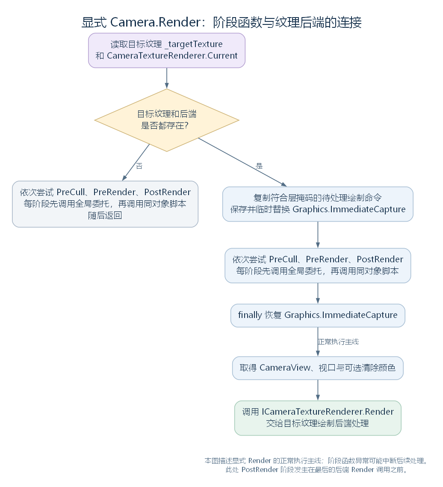

# Camera：观察参数怎样连接空间、输入与绘制（讨论稿）

状态：Behaviour 的 Camera 子节点，2026-10-24。依据工作区 RimWorld 1.7.4982 rev1280 的兼容层与游戏代码整理。上接 [Behaviour](23-behaviour.md)，空间接口见 [Transform](21-transform.md)，类型树见 [对象与组件模式](16-gameobject-component-model.md)。本篇说明相机本层的接口、参数计算和调用连接，具体渲染数据及 pass 仍留在 [渲染模块](15-rendering-module-notes.md)。

## 一、本层增加哪些能力

Camera 直接继承 Behaviour，因此已经能够使用 enabled、isActiveAndEnabled，以及更上层 Component 的 gameObject、transform 和组件查询接口。相机在这些共同能力之上，增加观察参数、投影与坐标转换、相机查询，以及相机阶段函数和显式绘制入口。

本类成员较多，先按职责列出属性和方法；后文沿主线展开关键实现，兼容接口另行标明实际行为。

| 职责 | 本类声明的属性或方法 |
| --- | --- |
| 投影范围 | orthographic、orthographicSize、fieldOfView、aspect、nearClipPlane、farClipPlane |
| 视口与输出 | rect、pixelRect、pixelWidth、pixelHeight、targetTexture、activeTexture、targetDisplay、SetTargetBuffers |
| 分类、层与清除设置 | cameraType、cullingMask、depth、clearFlags、backgroundColor、depthTextureMode |
| 观察与投影矩阵 | worldToCameraMatrix、cameraToWorldMatrix、projectionMatrix、cullingMatrix |
| 恢复自动计算 | ResetAspect、ResetProjectionMatrix、ResetWorldToCameraMatrix、ResetCullingMatrix |
| 相机查询 | main、current、allCameras、allCamerasCount |
| 从世界换算到画面 | WorldToViewportPoint、ViewportToScreenPoint、WorldToScreenPoint |
| 从画面换算到世界 | ScreenPointToRay、ViewportToWorldPoint、ViewportPointToRay；后两者各有带 eye 参数的重载 |
| 反向换算辅助 | 内部 ScreenPointToRay_Injected、私有 UnprojectViewport，以及它对应的编译器生成除法辅助函数 |
| 显式绘制与参数复制 | Render、RenderWithShader、CopyFrom |
| 相机阶段处理 | 内部 DispatchPreCullForScreenCameras、私有 InvokeCameraMessage |
| 命令缓冲接口 | commandBufferCount、AddCommandBuffer、AddCommandBufferAsync、RemoveCommandBuffer、RemoveCommandBuffers、RemoveAllCommandBuffers、GetCommandBuffers |
| 立体视图接口 | stereoActiveEye、stereoEnabled、GetStereoProjectionMatrix、GetStereoViewMatrix，以及嵌套枚举 StereoscopicEye、MonoOrStereoscopicEye |
| 其他兼容设置 | allowHDR、forceIntoRenderTexture、allowDynamicResolution、allowMSAA、opaqueSortMode、renderingPath、useOcclusionCulling |

Camera 本层没有声明 Update、OnEnable 或 OnDisable。它通过通用组件登记进入 UnityWorld，同时由后面介绍的专门入口读取或处理相机数据。

源码定位：类型声明（`UnityEngine.Camera.cs:13`）、普通参数与矩阵（`UnityEngine.Camera.cs:92`、`UnityEngine.Camera.cs:357`、`UnityEngine.Camera.cs:449`）、绘制与阶段入口（`UnityEngine.Camera.cs:571`、`UnityEngine.Camera.cs:631`）、坐标反向换算（`UnityEngine.Camera.cs:686`、`UnityEngine.Camera.cs:811`）。

## 二、参数和辅助状态保存在哪里

与 Behaviour 的状态管理记录不同，Camera 的观察参数主要由本类字段或自动属性保存。按字段分组如下：

| 字段 | 用途与部分初始值 |
| --- | --- |
| _orthographic、_orthographicSize、_fieldOfView | 投影类型、正交半高度、透视视角；默认分别为 false、5、60 |
| _aspect | 显式宽高比；非正值时 getter 按像素尺寸计算 |
| _nearClipPlane、_farClipPlane | 默认投影使用的近、远距离，初始 0.3 与 1000 |
| _rect、_targetTexture、_targetDisplay | 视口范围和输出设置；_rect 初始覆盖完整视口 |
| _cullingMask、_depth、_cameraType | 层掩码、特定路径中的相机排序值与相机分类；掩码初始为 -1，分类初始为 CameraType.Game |
| _clearFlags、_backgroundColor、_depthTextureMode | 清除设置、背景色与深度纹理设置；具体路径是否使用要继续看调用者 |
| _projectionOverride、_viewOverride、_cullingOverride | 手动指定的矩阵，使用可空类型记录是否覆盖自动计算 |
| onPreCull、onPreRender、onPostRender | 公共静态委托字段，保存相应阶段登记的函数；其类型是本类嵌套的 CameraCallback(Camera cam) |
| CameraMessageCache | 按脚本类型与方法名保存相机阶段方法的反射查找结果 |

本类还声明 kMaxAperture、kMinAperture、kMaxBladeCount、kMinBladeCount 四个常量，数值分别为 32、0.7、11、3；这里先记录其存在，不据此推断完整物理镜头功能已经实现。

CopyFrom 按源码逐项复制一组观察、输出与清除设置，并将自身 Transform 的世界位置和旋转设为另一相机的对应值。它没有复制或清除上述三个矩阵覆盖字段，也没有复制 Behaviour.enabled；不能将其理解为复制整个组件的全部状态。targetTexture 在这里复制的也是引用。

源码定位：复制设置（`UnityEngine.Camera.cs:21`）、字段与常量（`UnityEngine.Camera.cs:849`）、阶段委托字段与缓存（`UnityEngine.Camera.cs:915`）、嵌套枚举和委托（`UnityEngine.Camera.cs:927`、`UnityEngine.Camera.cs:936`、`UnityEngine.Camera.cs:948`）。

## 三、相机怎样登记，又怎样被找到

普通 GameObject.AddComponent<Camera> 仍经过此前读过的通用组件创建、登记流程。UnityWorld 根据继承关系为它建立 Behaviour 记录；Camera 本类没有另外声明一个将自己加入相机静态列表的构造函数。

main 的原始实现如下，保留命名和主体，省略反编译标注：

```csharp
public static Camera main
{
    get
    {
        GameObject gameObject = GameObject.Find("Camera");
        if (!(gameObject != null))
        {
            return null;
        }
        return gameObject.GetComponent<Camera>();
    }
}
```

它按对象名称 "Camera" 查找，再取得该对象上的 Camera 组件。current 则直接返回 Camera.main。这份实现没有在 current 中保存“目前正在执行 Render 的那个相机”。

allCameras 与 allCamerasCount 也通过 UnityEngine.Object 的类型查找进入 UnityWorld，不过两者的参数不同：

| 接口 | 查询时对不活动对象的处理 |
| --- | --- |
| allCameras | 使用 FindObjectsInactive.Exclude；Behaviour 查询读取管理记录中的活动标记 |
| allCamerasCount | 使用 FindObjectsInactive.Include，随后取得结果数组长度 |

所以，当前实现中的 allCamerasCount 不一定等于 allCameras.Length。它们都受通用查找的登记、销毁和资源用途对象筛选规则影响。

源码定位：main 与 current（`UnityEngine.Camera.cs:235`、`UnityEngine.Camera.cs:220`）、相机数组和计数（`UnityEngine.Camera.cs:500`、`UnityEngine.Camera.cs:81`）、通用查找及活动判断（`Waylith.UnityCompat.UnityWorld.cs:258`、`Waylith.UnityCompat.UnityWorld.cs:1335`）、Behaviour 记录分类（`Waylith.UnityCompat.UnityWorld.cs:877`）。

## 四、游戏相机的观察范围怎样确定

### 4.1 先对照游玩场景中的实际设置

Bootstrap.BuildPlayScene 的连续节选如下：

```csharp
GameObject gameObject = new GameObject("Camera", new Type[]
{
    typeof(Camera),
    typeof(AudioListener)
});
Camera component = gameObject.GetComponent<Camera>();
component.orthographic = true;
component.clearFlags = CameraClearFlags.Depth;
component.allowHDR = false;
```

之后代码还设置 cullingMask，将该对象的 Transform.rotation 设为 Quaternion.Euler(90f, 0f, 0f)，并添加 CameraDriver。这里 Camera 提供观察规则，Transform 提供位置和朝向，CameraDriver 则从游戏层计算这些规则应如何改变。

### 4.2 projectionMatrix：观察范围变成投影规则

projectionMatrix 的默认计算会先判断 _projectionOverride 是否存在，再选择正交或透视分支：

```csharp
public Matrix4x4 projectionMatrix
{
    get
    {
        if (this._projectionOverride != null)
        {
            return this._projectionOverride.Value;
        }
        if (this.orthographic)
        {
            float orthographicSize = this.orthographicSize;
            float num = orthographicSize * this.aspect;
            return Matrix4x4.Ortho(-num, num, -orthographicSize, orthographicSize, this.nearClipPlane, this.farClipPlane);
        }
        return Matrix4x4.Perspective(this.fieldOfView, this.aspect, this.nearClipPlane, this.farClipPlane);
    }
    set
    {
        this._projectionOverride = new Matrix4x4?(value);
    }
}
```

在默认正交投影中，orthographicSize 对应观察范围的垂直半高度，水平半宽是它乘以 aspect。若仅作数值示例，orthographicSize 为 10、aspect 为 16/9，则观察范围高为 20、宽约为 35.56 个世界单位。相同输出尺寸下，将 orthographicSize 加倍，就会把两倍宽高的范围放进画面，物体在画面中的尺寸随之缩小。

CameraDriver.ApplyPositionToGameObject 会将 RootSize 写入 MyCamera.orthographicSize，再将计算的位置写入 MyCamera.transform.position。这让缩放与移动分别接到投影参数和 Transform。对默认正交投影，距观察对象的距离不直接决定投影尺寸；位置仍影响观察位置、近远范围等其他关系。

透视分支则使用 fieldOfView。若已有手动 projectionMatrix 覆盖，getter 直接使用覆盖矩阵，此时修改上述普通参数并不足以改变它返回的矩阵；ResetProjectionMatrix 清除覆盖后才恢复自动计算。

### 4.3 输出尺寸怎样影响宽高比

pixelWidth、pixelHeight 有有效尺寸的 targetTexture 时使用其宽高；否则根据 Screen 与 rect 计算，并将结果至少限制为 1。aspect 在 _aspect 非正时由像素宽高比得出，ResetAspect 将 _aspect 设为 0 以恢复这条自动路径。

rect 保存归一化的视口矩形，pixelRect getter 则给出像素范围。输出到纹理时，其 getter 以 (0, 0) 为像素起点；pixelRect setter 当前仍用 Screen 尺寸换算并写回 rect，需要按源码方向分别理解。

targetTexture 保存目标 RenderTexture；activeTexture 在这里直接返回它。SetTargetBuffers 取颜色缓冲或深度缓冲所关联的 RenderTexture 写入目标字段，这条兼容入口没有在本方法中分别绑定两套独立目标。

源码定位：游玩相机建立（`RimWorldWaylith.Bootstrap.cs:785`）、投影（`UnityEngine.Camera.cs:357`）、宽高比与恢复（`UnityEngine.Camera.cs:92`、`UnityEngine.Camera.cs:109`）、像素尺寸与视口（`UnityEngine.Camera.cs:295`、`UnityEngine.Camera.cs:310`、`UnityEngine.Camera.cs:332`）、目标纹理和缓冲入口（`UnityEngine.Camera.cs:434`、`UnityEngine.Camera.cs:769`）、游戏层调整位置与范围（`Verse.CameraDriver.cs:418`）。

## 五、相机怎样使用 Transform 换算坐标

### 5.1 worldToCameraMatrix：从世界换算到相机空间

worldToCameraMatrix 读取 Transform 的世界位置和旋转，按相反方向建立观察变换：

```csharp
public Matrix4x4 worldToCameraMatrix
{
    get
    {
        Matrix4x4? viewOverride = this._viewOverride;
        if (viewOverride == null)
        {
            return Matrix4x4.Scale(new Vector3(1f, 1f, -1f)) * Matrix4x4.Rotate(Quaternion.Inverse(base.transform.rotation)) * Matrix4x4.Translate(-base.transform.position);
        }
        return viewOverride.GetValueOrDefault();
    }
    set
    {
        this._viewOverride = new Matrix4x4?(value);
    }
}
```

沿作用于点的顺序读这条乘法：先减去相机位置，再应用相机旋转的逆，最后翻转 z 轴以形成这里采用的相机空间约定。本 getter 没有使用 Transform 的缩放；不能把它直接替换成完整 transform.localToWorldMatrix 的逆。

cameraToWorldMatrix 提供对应的反向规则。ResetWorldToCameraMatrix 清除手动观察矩阵，cullingMatrix 默认组合 projectionMatrix * worldToCameraMatrix，ResetCullingMatrix 则清除其独立覆盖。

### 5.2 从世界位置得到画面位置

WorldToViewportPoint、WorldToScreenPoint 都先将世界点经 worldToCameraMatrix 转到相机空间，再通过 projectionMatrix 投影，处理 w 分量的除法，最后转换到视口或像素范围。ViewportToScreenPoint 则只负责视口到像素的这段换算。

可以将这段工作理解为：先确定“这个点相对于相机在哪里”，再确定“它应落在画面的什么位置”。WorldToScreenPoint 返回值的 z 取自相机空间深度，不是地图高度。

游戏层 UI.MapToUIPosition 正使用这条路径：调用 Find.Camera.WorldToScreenPoint 后按 Prefs.UIScale 缩放，并用 UI.screenHeight 调整 y 坐标。这是将地图中的世界位置接到 UI 位置的一个实际入口；屏幕像素与 UI 位置之间的约定还要继续沿 UI 模块阅读。

### 5.3 从画面位置得到世界射线

ScreenPointToRay 会去除相应视口偏移，将像素位置换成归一化坐标，再使用 projectionMatrix * worldToCameraMatrix 的逆，将近、远两端换回世界空间，最后构造 Ray。这里 Ray 的起点取近端点，方向由两点之差确定，并由 Ray 构造函数归一化。

ViewportPointToRay、ViewportToWorldPoint 通过本类私有 UnprojectViewport 取得近、远世界点。前者建立射线，后者按输入 z 与近远距离计算沿两点之间的位置。UnprojectViewport 中的除法由反编译器显示为 `<UnprojectViewport>g__Divide|156_0` 的编译器生成函数完成。

带 eye 参数的两个视口方法直接转调普通版本；内部 ScreenPointToRay_Injected 同样转调 ScreenPointToRay。这些入口在当前实现中没有使用 eye 来区分左右眼。

UI.UIToMapPosition 是另一个具体接点：它调用 ScreenPointToRay 后直接取 ray.origin 的 x、z，并将结果 y 设为 0。当前方法没有进行通用的射线与地面求交，应结合游戏的正交俯视设置理解，后续在输入与地图空间部分继续追踪。

源码定位：观察矩阵及恢复（`UnityEngine.Camera.cs:449`、`UnityEngine.Camera.cs:467`）、反向矩阵（`UnityEngine.Camera.cs:116`）、剔除矩阵（`UnityEngine.Camera.cs:475`、`UnityEngine.Camera.cs:493`）、正向坐标换算（`UnityEngine.Camera.cs:49`、`UnityEngine.Camera.cs:62`、`UnityEngine.Camera.cs:779`）、反向换算与辅助（`UnityEngine.Camera.cs:349`、`UnityEngine.Camera.cs:686`、`UnityEngine.Camera.cs:799`、`UnityEngine.Camera.cs:811`、`UnityEngine.Camera.cs:822`、`UnityEngine.Camera.cs:831`、`UnityEngine.Camera.cs:842`）、Ray 构造（`UnityEngine.Ray.cs:10`）、游戏层 UI 接点（`Verse.UI.cs:110`、`Verse.UI.cs:123`）。

## 六、相机怎样参与每一帧

### 6.1 屏幕相机的阶段函数由谁调用

先认识本类负责这些调用的成员：

| Camera 成员 | 作用 |
| --- | --- |
| onPreCull、onPreRender、onPostRender | 静态委托字段；调用时将相应 Camera 实例传给已经登记的函数 |
| InvokeCameraMessage(string method) | 查询同对象上的 MonoBehaviour，查找并调用指定名称的无参数实例方法，结果存入 CameraMessageCache |
| DispatchPreCullForScreenCameras() | 查询活动相机，筛选已启用且没有目标纹理的相机，调用 PreCull 阶段的两组入口 |

这里用“阶段函数”表示已经登记或按名称找到的函数；名称保留源码写法。InvokeCameraMessage 会先调用 GameObject.GetComponents<MonoBehaviour>，再使用反射查找。它没有在自己的循环中检查各脚本的 enabled；其查找实现也与 UnityWorld 逐层检查基类的 FindMessage 不同，应按各自的入口判断。

UnityRuntime.Step 在 World.Update、World.LateUpdate 之后调用 DispatchPreCullForScreenCameras，其原始实现为：

```csharp
internal static void DispatchPreCullForScreenCameras()
{
    foreach (Camera camera in Object.FindObjectsByType<Camera>(FindObjectsInactive.Exclude, FindObjectsSortMode.None))
    {
        if (camera != null && camera.enabled && camera._targetTexture == null)
        {
            Camera.CameraCallback cameraCallback = Camera.onPreCull;
            if (cameraCallback != null)
            {
                cameraCallback(camera);
            }
            camera.InvokeCameraMessage("OnPreCull");
        }
    }
}
```

这段代码调用全局 onPreCull，然后尝试同对象脚本的 OnPreCull；它没有在这里调用 Camera.Render、onPreRender 或 onPostRender。相机没有自己的 Update，也可以通过这种专门入口参与帧内处理。

### 6.2 渲染模块怎样取得相机参数

CameraViewFactory.GetView 是兼容相机数据进入渲染模块的一处连接。这个辅助方法读取观察矩阵、投影矩阵和层掩码，建立 CameraView：

```csharp
public static CameraView GetView(Camera cam)
{
    Matrix4x4 matrix4x = Matrix4x4.ToNumerics(cam.projectionMatrix);
    Matrix4x4 matrix4x2 = Matrix4x4.ToNumerics(cam.worldToCameraMatrix);
    return new CameraView(matrix4x2, matrix4x, matrix4x * matrix4x2, cam.cullingMask);
}
```

例如 MapRenderFeature.CaptureFrame 在地图绘制条件满足时，从 Current.CameraDriver.MyCamera 取得相机，再调用这个方法。它将这组观察参数用于本轮地图绘制数据，随后与 Waylith 的帧采集流程相接。这里先明确读数接口，具体渲染数据结构与 pass 的使用留到对应模块。

因此，Camera.enabled 的作用仍须结合具体入口。屏幕相机的 PreCull 筛选检查 enabled；MapRenderFeature 取得相机的这段代码没有直接检查它，显式 Render 也没有在方法开头加这个条件。继承 Behaviour 并不意味着所有显式调用都自动经过同一套筛选。

自动处理目标纹理相机的 CameraCaptureFeature 又是另一处入口：它筛选已启用、具有目标纹理且符合本模块掩码条件的相机，按 depth 排序，再处理相应目标。depth 在这条路径中有明确使用位置；整个帧的其他模块顺序仍由各模块的调用组织决定。

源码定位：Step 与屏幕阶段（`Waylith.UnityCompat.UnityRuntime.cs:106`、`UnityEngine.Camera.cs:631`）、本类脚本阶段调用（`UnityEngine.Camera.cs:648`）、CameraView 建立（`UnityStubs.Rendering.CameraViewFactory.cs:12`）、地图读取相机（`RimWorldWaylith.Rendering.MapRenderFeature.cs:57`）、目标纹理相机的筛选与排序（`RimWorldWaylith.Rendering.CameraCaptureFeature.cs:47`）。

## 七、显式 Camera.Render 做了什么

在进入本方法前，先说明它使用的几个外部成员：

| 外部成员 | 所属位置与作用 |
| --- | --- |
| CameraTextureRenderer.Current | UnityStubs.Rendering 中保存当前 ICameraTextureRenderer 后端的静态字段；Bootstrap 将 CameraTextureBaker 接到这里 |
| ICameraTextureRenderer.Render | 后端接口，接受目标纹理、绘制命令列表、CameraView、视口和可选清除颜色 |
| MeshDrawSubmission.CopyPendingCommands | 将符合层掩码的待处理绘制命令复制进给定列表 |
| Graphics.ImmediateCapture | 本次临时接收相应即时绘制命令的列表；Graphics.DrawMeshNow 等入口会读取它 |

Render 的主要分支如下：

1. 先取得 _targetTexture 与当前纹理绘制后端。
2. 如果其中任一为空，依次尝试全局阶段函数和同对象脚本的 OnPreCull、OnPreRender、OnPostRender，然后返回。本分支没有调用纹理绘制后端。
3. 两者都存在时，先复制符合 _cullingMask 的待处理命令到局部 list，保存并临时替换 Graphics.ImmediateCapture。
4. 执行上述三个阶段的函数，再在 finally 中恢复原来的即时命令列表。这里可以收集对应即时绘制入口产生的命令，不能据此认为所有 Graphics 调用都会自动改用这个列表。
5. 根据 clearFlags 决定是否传入背景色，再将目标纹理、命令列表、相机数据和视口交给后端 Render。



[SVG 矢量图](figures/camera-render-entry-flow.svg)；[可编辑图源](figures/camera-render-entry-flow.dot)。这是本方法的正常执行主线，阶段函数中的异常会影响后续执行。

这里的调用顺序有一个容易被名称掩盖的细节：本方法中的 onPostRender、OnPostRender 发生在最后那次后端 Render 调用之前。不能仅凭 PostRender 的名称，就将其理解为 GPU 已经完成本次图像绘制的通知。

<details>
<summary>Camera.Render 的完整原始方法</summary>

以下保留原始名称与主体，省略反编译标注。

```csharp
public void Render()
{
    RenderTexture targetTexture = this._targetTexture;
    ICameraTextureRenderer current = CameraTextureRenderer.Current;
    if (targetTexture == null || current == null)
    {
        Camera.CameraCallback cameraCallback = Camera.onPreCull;
        if (cameraCallback != null)
        {
            cameraCallback(this);
        }
        this.InvokeCameraMessage("OnPreCull");
        Camera.CameraCallback cameraCallback2 = Camera.onPreRender;
        if (cameraCallback2 != null)
        {
            cameraCallback2(this);
        }
        this.InvokeCameraMessage("OnPreRender");
        Camera.CameraCallback cameraCallback3 = Camera.onPostRender;
        if (cameraCallback3 != null)
        {
            cameraCallback3(this);
        }
        this.InvokeCameraMessage("OnPostRender");
        return;
    }
    List<MeshDrawCommand> list = new List<MeshDrawCommand>();
    MeshDrawSubmission.CopyPendingCommands(list, this._cullingMask);
    List<MeshDrawCommand> immediateCapture = Graphics.ImmediateCapture;
    Graphics.ImmediateCapture = list;
    try
    {
        Camera.CameraCallback cameraCallback4 = Camera.onPreCull;
        if (cameraCallback4 != null)
        {
            cameraCallback4(this);
        }
        this.InvokeCameraMessage("OnPreCull");
        Camera.CameraCallback cameraCallback5 = Camera.onPreRender;
        if (cameraCallback5 != null)
        {
            cameraCallback5(this);
        }
        this.InvokeCameraMessage("OnPreRender");
        Camera.CameraCallback cameraCallback6 = Camera.onPostRender;
        if (cameraCallback6 != null)
        {
            cameraCallback6(this);
        }
        this.InvokeCameraMessage("OnPostRender");
    }
    finally
    {
        Graphics.ImmediateCapture = immediateCapture;
    }
    Color? color = ((this._clearFlags == CameraClearFlags.Skybox || this._clearFlags == CameraClearFlags.Color) ? new Color?(this._backgroundColor) : null);
    current.Render(targetTexture, list, CameraViewFactory.GetView(this), this._rect, color);
}
```

</details>

RenderWithShader 在当前实现中直接调用 Render，没有使用传入的 shader 和 replacementTag 改写绘制规则。它保留了调用入口，具体行为应按这个方法主体理解。

源码定位：显式 Render（`UnityEngine.Camera.cs:571`）、RenderWithShader（`UnityEngine.Camera.cs:680`）、后端静态接点和接口（`UnityStubs.Rendering.CameraTextureRenderer.cs:9`、`UnityStubs.Rendering.ICameraTextureRenderer.cs:12`）、Bootstrap 连接后端（`RimWorldWaylith.Bootstrap.cs:310`）、复制命令（`Waylith.Rendering.MeshDrawSubmission.cs:297`）、即时网格入口（`UnityEngine.Graphics.cs:576`）。

## 八、哪些接口目前主要保留兼容形式

本类还有一组接口，不能仅根据名称推断完整功能：

| 接口 | 当前方法或属性的实际行为 |
| --- | --- |
| commandBufferCount | 固定返回 0 |
| AddCommandBuffer、AddCommandBufferAsync | 记录未实现接口的提示，没有在这里建立命令缓冲登记 |
| RemoveCommandBuffer、RemoveCommandBuffers、RemoveAllCommandBuffers | 空方法体 |
| GetCommandBuffers | 返回空数组 |
| stereoActiveEye、stereoEnabled | 记录未实现接口的提示，分别返回 Left、false |
| GetStereoProjectionMatrix、GetStereoViewMatrix | 记录未实现接口的提示，返回默认矩阵 |
| allowMSAA、opaqueSortMode | setter 为空 |
| allowHDR、allowDynamicResolution、forceIntoRenderTexture、renderingPath、useOcclusionCulling | 在本类中是自动属性；某个设置是否产生特定效果，还需继续查读取它的代码 |

其中带 eye 参数的坐标转换入口已在前文说明，它们转调普通版本。Camera 这一层同时包含实际计算、后端连接和兼容接口，逐项查看实现才能解释调用的结果。

源码定位：命令缓冲接口（`UnityEngine.Camera.cs:515`、`UnityEngine.Camera.cs:524`）、立体视图接口（`UnityEngine.Camera.cs:396`、`UnityEngine.Camera.cs:407`、`UnityEngine.Camera.cs:557`）、空 setter（`UnityEngine.Camera.cs:712`、`UnityEngine.Camera.cs:751`）、其他自动属性（`UnityEngine.Camera.cs:18`、`UnityEngine.Camera.cs:231`、`UnityEngine.Camera.cs:511`、`UnityEngine.Camera.cs:761`、`UnityEngine.Camera.cs:766`）。

当前进度：Camera 本层成员索引、观察参数、坐标转换、帧内读取与显式绘制入口已建立第一轮说明。相机控制的完整游戏逻辑、具体纹理绘制和各渲染 pass 在相应模块接回；接下来回到 Behaviour 分支，阅读 [AudioBehaviour](25-audiobehaviour.md)。
