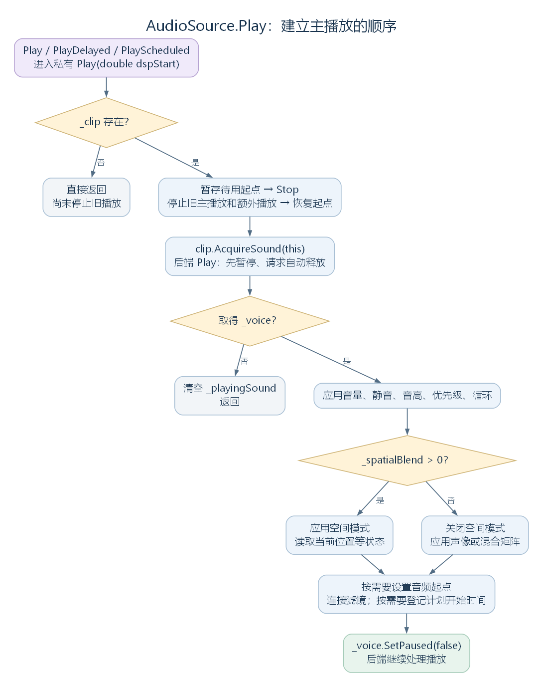

# AudioSource：声音怎样开始播放、持续更新与停止（讨论稿）

状态：AudioBehaviour 的 AudioSource 子节点，2026-10-24。依据工作区 RimWorld 1.7.4982 rev1280 的兼容层、Waylith 与游戏代码整理。上接 [AudioBehaviour](25-audiobehaviour.md)，另一子节点见 [AudioListener](27-audiolistener.md)。这里研究组件如何保存播放状态、使用 Transform 和调用音频后端；声音定义、样本选择、混音算法与资源解码留在音频模块继续展开。

## 一、本层新增哪些成员

AudioSource 继承了 Component 的 gameObject、transform 和组件查询能力，也继承了 Behaviour 的 enabled、isActiveAndEnabled。它自己开始增加声音的播放接口、参数和播放状态。

先把本类声明的成员列全，后面再沿播放过程展开。表中的访问器按当前代码列出；有些属性只有 setter，不能据熟悉的 Unity API 假定它同时提供 getter。

| 职责 | 本类声明的属性或方法 |
| --- | --- |
| 音频片段与状态 | clip、isPlaying、time |
| 主播放入口 | Play()、PlayDelayed、PlayScheduled，以及私有重载 Play(double dspStart) |
| 播放控制 | Pause、UnPause、Stop |
| 额外的一次性播放 | PlayOneShot 的两个重载、私有 StopOneShots 与 PruneOneShots；静态 PlayClipAtPoint 当前只记录未实现提示 |
| 音量与播放参数 | volume、pitch、priority、ignoreListenerVolume；只有 setter 的 loop、mute |
| 空间参数 | spatialBlend、spread；只有 setter 的 dopplerLevel、minDistance、maxDistance、panStereo、rolloffMode |
| 混音分组与输出读取 | outputAudioMixerGroup、GetOutputData；内部属性 Muted、OutputVolume、OutputGroup |
| 生命周期方法 | Update、私有 OnDestroy |
| 播放状态与资源复用辅助 | 内部 HoldsVoiceOf、私有 Invalidate |
| 参数应用辅助 | 私有 Rolloff 属性、ApplyNonSpatialMode、ApplyPan、ApplySpatialMode、ApplySpatialState、ApplyVolume；内部 OnListenerVolumeChanged |
| 同对象滤镜连接 | 私有 AttachFilters、DetachFilters |
| 当前只保存值的自动属性 | bypassEffects、bypassListenerEffects、bypassReverbZones、playOnAwake、ignoreListenerPause |

内部状态也需要先分清：

| 字段 | 保存的内容 |
| --- | --- |
| _clip、_outputAudioMixerGroup | 所选音频片段与输出分组 |
| _playingSound | 本次主播放取得的 IAudioSound，代表后端可使用的声音资源 |
| _voice | 主播放的 IAudioVoice，代表这一次播放及其控制接口；下文称为“主播放实例” |
| _oneShots | 额外播放的列表，每项同时保存 IAudioVoice 与 IAudioSound |
| _time、_startTimePending、_paused | 播放时间、是否预设了起点，以及主播放的暂停标记 |
| _volume、_pitch、_priority、_loop、_mute | 音量、音高、优先级、循环与静音设置；初值分别为 1、1、128、false、false |
| _panStereo、_spatialBlend、_minDistance、_maxDistance、_dopplerLevel、_spread、_rolloffMode | 声道与空间设置；初始 spatialBlend 为 0，距离为 1 和 500，dopplerLevel 为 1，rolloffMode 为 Logarithmic，其余数值为 0 |
| _ignoreListenerVolume、静态 IgnoringListenerVolume | 是否尝试抵消总音量，以及需要在总音量变化时重新应用参数的声源集合 |
| 静态 _spreadWarned | 控制特定未实现功能提示只记录一次 |
| 内部 VideoFeed | 视频播放器提供的音频输出读取入口 |

AudioClip、IAudioSound 和 IAudioVoice 处于不同层次：组件引用 AudioClip，AudioClip 提供后端声音资源，后端再为一次播放返回 IAudioVoice。一个组件可以持有一个主播放实例和多个额外播放实例。

源码定位：属性与播放入口（`UnityEngine.AudioSource.cs:18`、`UnityEngine.AudioSource.cs:91`、`UnityEngine.AudioSource.cs:218`）、空间及输出接口（`UnityEngine.AudioSource.cs:368`、`UnityEngine.AudioSource.cs:508`、`UnityEngine.AudioSource.cs:571`）、辅助方法（`UnityEngine.AudioSource.cs:639`、`UnityEngine.AudioSource.cs:654`、`UnityEngine.AudioSource.cs:758`）、字段（`UnityEngine.AudioSource.cs:794`、`UnityEngine.AudioSource.cs:864`）、衰减枚举（`UnityEngine.AudioRolloffMode.cs:6`）。

## 二、游戏怎样建立一个声源组件

游戏层的 AudioSourceMaker.NewAudioSourceOn 接收一个已有的 GameObject，查找或添加 AudioSource，再设置几个初值。完整方法如下：

```csharp
public static AudioSource NewAudioSourceOn(GameObject go)
{
    if (go.GetComponent<AudioSource>() != null)
    {
        Log.Warning("Adding audio source on " + ((go != null) ? go.ToString() : null) + " that already has one.");
        return go.GetComponent<AudioSource>();
    }
    AudioSource audioSource = go.AddComponent<AudioSource>();
    audioSource.rolloffMode = AudioRolloffMode.Linear;
    audioSource.dopplerLevel = 0f;
    audioSource.playOnAwake = false;
    return audioSource;
}
```

这里添加的是一个组件实例，它会使用所属 GameObject 的 Transform。这个方法尚未给 clip 赋值，也没有调用 Play；创建声源与开始播放是两个可分别发生的动作。

游戏还会提前建立可复用的声源对象：AudioSourcePoolCamera 创建 16 个随相机层级组织的声源，AudioSourcePoolWorld 创建 32 个世界声源，取用时寻找 isPlaying 为 false 的组件。这里的数量描述这两个对象池，不能据此断言整个游戏最多只能同时播放 48 个声音。

源码定位：声源创建方法（`Verse.Sound.AudioSourceMaker.cs:10`）、两个池的创建与取用（`Verse.Sound.AudioSourcePoolCamera.cs:11`、`Verse.Sound.AudioSourcePoolCamera.cs:32`、`Verse.Sound.AudioSourcePoolWorld.cs:11`、`Verse.Sound.AudioSourcePoolWorld.cs:25`）。

## 三、Play 如何建立一次主播放

无参数的 Play 调用本类私有重载 Play(-1.0)。PlayDelayed 把延迟换算成音频时钟上的目标时间，PlayScheduled 接收目标时间，最后也进入同一个重载。

先说明这段实现会用到的其他方法，避免只看到一串未解释的名字：

| 调用 | 声明位置与作用 |
| --- | --- |
| Stop | AudioSource：停止已有主播放和额外播放，并清理状态，见第四节 |
| AcquireSound | AudioClip：为调用者取得 IAudioSound；普通路径复用资源，需要独立实例的流式声音会选择可复用实例或另行加载 |
| AudioBackendAccess.Backend | 兼容层辅助属性：取得 AudioBackend.Current；没有当前后端时抛出异常 |
| backend.Play | Waylith.Audio.AudioBackend：接收声音资源、输出分组和播放选项，返回 IAudioVoice，失败时可以返回 null |
| ApplyVolume | AudioSource：计算主播放音量并设置给 _voice，见第七节 |
| ApplySpatialMode、ApplySpatialState | AudioSource：分别应用空间模式与当前位置等空间状态，见第六节 |
| ApplyNonSpatialMode、ApplyPan | AudioSource：关闭空间模式，并按声道情况设置声像或混合矩阵，见第六节 |
| AttachFilters | AudioSource：查找同对象上的 AudioFilterBehaviour 并连接主播放实例，见第八节 |

IAudioVoice 的 SetMuted、SetPitch、SetPriority、SetLoop、SetPaused 等方法，是后端播放控制接口。以下保留 Play(double dspStart) 的完整方法体，仅去掉反编译注释，变量名保持原样：

```csharp
private void Play(double dspStart)
{
    AudioClip clip = this._clip;
    if (clip == null)
    {
        return;
    }
    float num = (this._startTimePending ? this._time : 0f);
    this.Stop();
    this._time = num;
    this._startTimePending = num > 0f;
    this._playingSound = clip.AcquireSound(this);
    AudioBackend backend = AudioBackendAccess.Backend;
    IAudioSound playingSound = this._playingSound;
    AudioMixerGroup outputAudioMixerGroup = this._outputAudioMixerGroup;
    this._voice = backend.Play(playingSound, (outputAudioMixerGroup != null) ? outputAudioMixerGroup.Group : null, true, true);
    if (this._voice == null)
    {
        this._playingSound = null;
        return;
    }
    this._paused = false;
    this.ApplyVolume();
    this._voice.SetMuted(this._mute);
    this._voice.SetPitch(this._pitch);
    this._voice.SetPriority(this._priority);
    this._voice.SetLoop(this._loop);
    if (this._spatialBlend > 0f)
    {
        this.ApplySpatialMode();
        this.ApplySpatialState();
    }
    else
    {
        this.ApplyNonSpatialMode();
    }
    if (this._time > 0f)
    {
        this._voice.PositionFrames = (long)Math.Round((double)(this._time * (float)this._playingSound.Frequency));
    }
    this.AttachFilters();
    if (dspStart >= 0.0)
    {
        this._voice.ScheduleStart(dspStart - AudioSettings.dspTime);
    }
    this._voice.SetPaused(false);
}
```

这段代码依次完成六件事：

1. 没有 clip 就直接返回；此时也不会进入后面的 Stop。
2. 暂存通过 time 预设的起点，停止旧播放，再恢复此次需要的起点。
3. 从 clip 取得声音资源，交给后端建立播放实例。两个 true 对应 paused 与 autoRelease：先以暂停状态建立，并请求自动释放。
4. 应用音量、静音、音高、优先级、循环与空间或声像设置。
5. 按需要设置起点、连接滤镜，并登记计划开始时间。
6. 调用 SetPaused(false)，让后端按刚才的设置开始或等待计划时间。



[SVG 矢量图](figures/audio-source-play-flow.svg)；[可编辑图源](figures/audio-source-play-flow.dot)。图中省略异常中断，保留正常控制流程及两个提前返回的位置。

AudioSettings.dspTime 来自后端的 DspTime，单位与这些延迟接口使用的秒一致；后端未准备好时该属性返回 0。PlayDelayed 和 PlayScheduled 将等待交给后端的 ScheduleStart，没有在组件中建立“每帧减去剩余时间”的计时器。当前 MiniAudio 实现将正延迟换算到音频帧时钟后调用原生接口。

源码定位：播放入口与完整重载（`UnityEngine.AudioSource.cs:229`、`UnityEngine.AudioSource.cs:235`、`UnityEngine.AudioSource.cs:241`、`UnityEngine.AudioSource.cs:247`）、取得资源（`UnityEngine.AudioClip.cs:168`）、取得后端（`UnityStubs.Internal.AudioBackendAccess.cs:11`）、后端 Play 参数声明（`Waylith.Audio.AudioBackend.cs:134`）、音频时钟（`UnityEngine.AudioSettings.cs:11`）、MiniAudio 播放与计划开始接口（`Waylith.Audio.MiniAudio.MiniAudioBackend.cs:379`、`Waylith.Audio.MiniAudio.MiniAudioBackend.cs:766`）。

## 四、暂停、继续、时间与停止有什么区别

| 接口 | 当前实现做什么 |
| --- | --- |
| Pause | 有 _voice 时调用 SetPaused(true)，并将 _paused 设为 true |
| UnPause | 有 _voice 时调用 SetPaused(false)，并将 _paused 设为 false |
| time.get | 有主播放实例和声音资源时，用 PositionFrames 除以 Frequency 换算秒数，写回 _time 后返回 |
| time.set | 将秒数限制到不小于 0，记录待使用起点；已有主播放时，也立即修改其 PositionFrames |
| clip.set | 只替换 _clip 引用，本身没有重新开始播放 |
| Stop | 停止主播放和 _oneShots，清除主播放引用，重置暂停标记与时间状态 |

这里的 PositionFrames 是音频采样帧位置，与画面帧数不是同一个计数。Pause 后要从当前位置继续，应使用 UnPause；再次调用 Play 会重新经过第三节的停止和建立过程。

Stop 的完整实现如下。DetachFilters 是本类解除滤镜连接的方法；StopOneShots 会遍历 _oneShots，逐个调用其播放实例的 Stop，再清空列表。

```csharp
public void Stop()
{
    this.DetachFilters();
    this.StopOneShots();
    IAudioVoice voice = this._voice;
    if (voice != null)
    {
        voice.Stop();
    }
    this._voice = null;
    this._playingSound = null;
    this._paused = false;
    this._time = 0f;
    this._startTimePending = false;
}
```

isPlaying 还会检查额外播放列表：先用 PruneOneShots 从后往前移除已经不在播放的项，有剩余项就返回 true。随后才检查主播放；没有 _voice 或主播放被暂停时返回 false，后端报告主播放结束时调用 Invalidate 清理引用并返回 false。

Invalidate 会解除滤镜、停止并清除主播放引用、清除待用起点标记；它没有执行 Stop 的整套重置，也没有停止 _oneShots。HoldsVoiceOf 则用于询问组件是否仍持有指定声音资源的播放实例，供 AudioClip 的流式资源复用判断使用。

本类没有声明 OnDisable，也没有在 Play 中检查 enabled。沿当前兼容层路径，停用组件会影响 Behaviour 的每帧调用，但这里没有“停用时调用 Stop”的连接。销毁则不同：本类 OnDestroy 明确调用 Stop，并从 IgnoringListenerVolume 移除自己。

源码定位：暂停与继续（`UnityEngine.AudioSource.cs:218`、`UnityEngine.AudioSource.cs:619`）、时间与 clip（`UnityEngine.AudioSource.cs:157`、`UnityEngine.AudioSource.cs:91`）、Stop 与 OnDestroy（`UnityEngine.AudioSource.cs:595`、`UnityEngine.AudioSource.cs:612`）、状态查询与清理（`UnityEngine.AudioSource.cs:105`、`UnityEngine.AudioSource.cs:198`、`UnityEngine.AudioSource.cs:344`、`UnityEngine.AudioSource.cs:354`、`UnityEngine.AudioSource.cs:639`）。

## 五、PlayOneShot 怎样允许同一组件叠加播放

PlayOneShot(clip) 转调 PlayOneShot(clip, 1f)。后者从参数取得音频片段，独立建立播放实例，最后将它与声音资源一起加入 _oneShots。它没有调用 Stop，也没有替换 _voice，所以可以追加播放。

这条路径会复制当前音量、静音、音高、优先级与输出分组等设置，额外乘上 volumeScale 和音频片段的 NormalizeGain，并明确将循环设为 false。使用空间模式时，建立播放的当下还会设置空间参数与当前位置。

但要注意两条路径的实际差别：

| 操作或设置 | 主播放 _voice | 额外播放 _oneShots |
| --- | --- | --- |
| 再调用 Play | 先停止旧主播放和全部额外播放，再建立新主播放 | 会被这次 Stop 停止 |
| 调用 PlayOneShot | 保留 | 追加一个播放实例 |
| Pause、UnPause、time | 直接操作 | 这些方法没有遍历此列表 |
| volume、pitch、mute 等 setter | 有实例时应用新值 | setter 没有逐项更新已经建立的额外播放 |
| 每帧 Update 的位置更新 | 空间模式下更新 | 没有遍历此列表重新设置位置 |
| AttachFilters | Play 路径连接同对象滤镜 | PlayOneShot 路径没有调用它 |
| Stop、OnDestroy | 停止 | 一并停止 |
| isPlaying | 检查主播放状态 | 先清理并检查此列表，有剩余就返回 true |

因此，可以从此实现确认叠加播放，但不能将主播放路径的全部动态更新行为套到额外播放上。具体听感还需结合调用者实际使用哪条路径。

源码定位：两个 PlayOneShot 重载（`UnityEngine.AudioSource.cs:302`、`UnityEngine.AudioSource.cs:308`）、列表停止与清理（`UnityEngine.AudioSource.cs:344`、`UnityEngine.AudioSource.cs:354`）。

## 六、Update 怎样使用 Transform

UnityWorld.Update 会尝试调用活动 Behaviour 的 Update，AudioSource 在本类中声明了这个方法：

```csharp
public void Update()
{
    if (this._voice != null && this._spatialBlend > 0f)
    {
        this.ApplySpatialState();
    }
}
```

ApplySpatialState 是 AudioSource 自己的私有方法。它读取继承而来的 transform.position，通过 _voice.SetPosition 更新主播放的位置，同时调用 SetDoppler；_spread 大于 0 时还会调用 SetSpread，并对当前 MiniAudio 后端记录一次相关未实现提示。

这里的 transform 指向所属 GameObject 的 Transform。若声源对象自身移动，或者父对象移动导致其世界位置变化，下一次符合条件的 Update 就会读取变化后的位置。Update 中没有逐段读取音频样本；播放实例已经交给后端，组件在这里继续提供空间参数。

空间相关辅助方法分别承担以下工作：

| 成员 | 当前实现 |
| --- | --- |
| ApplySpatialMode | 调用 SetSpatial(true, ...)，传入 _minDistance、_maxDistance、Rolloff 与限制在 0～1 的 _spatialBlend |
| ApplySpatialState | 更新世界位置、多普勒参数，以及大于 0 的 spread 设置 |
| ApplyNonSpatialMode | 调用 SetSpatial(false, ...) 关闭空间模式，再调用 ApplyPan |
| ApplyPan | 限制声像值后计算左右权重；单声道，或需要合为单声道的立体声音频，使用相应混合矩阵；其他情况调用 SetPan |
| Rolloff | Linear 映射为后端 Linear，其他枚举值都映射为 Inverse；当前没有在这里实现独立的 Custom 曲线 |

spatialBlend 的 setter 在有 _voice 时立即切换模式；大于 0 时同时应用当前位置。距离与 rolloffMode 改变时重新应用空间模式，dopplerLevel 与 spread 则在符合条件时直接传给主播放实例。

兼容层把 spatialBlend 的数值传到了后端接口，但当前 MiniAudioBackend.Voice.SetSpatial 仅据 enabled 与 level 是否大于 0 决定空间模式开关，没有把 level 的连续数值继续传给原生接口。因此这里不能保证 0.5 就会形成预想中的“一半二维、一半三维”效果。该实现的 SetSpread 方法体也为空。

源码定位：UnityWorld 的每帧调用入口（`Waylith.UnityCompat.UnityWorld.cs:708`）、声源 Update（`UnityEngine.AudioSource.cs:630`）、空间模式及状态方法（`UnityEngine.AudioSource.cs:654`、`UnityEngine.AudioSource.cs:672`、`UnityEngine.AudioSource.cs:679`、`UnityEngine.AudioSource.cs:714`、`UnityEngine.AudioSource.cs:720`）、空间属性（`UnityEngine.AudioSource.cs:571`、`UnityEngine.AudioSource.cs:386`、`UnityEngine.AudioSource.cs:416`、`UnityEngine.AudioSource.cs:430`、`UnityEngine.AudioSource.cs:495`）、MiniAudio 空间模式与 spread（`Waylith.Audio.MiniAudio.MiniAudioBackend.cs:743`、`Waylith.Audio.MiniAudio.MiniAudioBackend.cs:761`）。

## 七、参数修改怎样传给已有主播放

大部分 setter 会先保存值，再在已有 _voice 时调用后端接口。因此，在开始播放之前设置参数，可以影响下一次主播放；开始之后修改相应参数，也可以沿该 setter 更新已有主播放。

| 参数 | 保存或应用方式 |
| --- | --- |
| volume | 将值限制到 0～1，随后 ApplyVolume |
| pitch、loop、mute | 保存后分别调用 SetPitch、SetLoop、SetMuted |
| priority | 限制到 0～256，保存后调用 SetPriority |
| outputAudioMixerGroup | 保存引用；新值非 null 且有主播放时调用 SetGroup；设置为 null 的路径没有为已有主播放调用 SetGroup(null) |
| panStereo | 保存值；已有主播放且未用空间模式时调用 ApplyPan |
| spread | 限制到 0～360；已有空间主播放时调用 SetSpread，后端实际支持情况见上一节 |
| ignoreListenerVolume | 保存标记，并加入或移出静态集合 IgnoringListenerVolume；已有主播放时重新 ApplyVolume |

ApplyVolume 的完整实现如下：

```csharp
private void ApplyVolume()
{
    float volume = this._volume;
    AudioClip clip = this._clip;
    float num = volume * ((clip != null) ? clip.NormalizeGain : 1f);
    if (this._ignoreListenerVolume && AudioListener.volume > 0f)
    {
        num /= AudioListener.volume;
    }
    this._voice.SetVolume(num);
}
```

NormalizeGain 是 AudioClip 针对特定导入、单声道处理情况取得的增益，其他路径可以返回 1。这个步骤得到的是交给主播放实例的音量值；后续还可能受到分组、总音量及空间处理的影响。

AudioListener.volume 是静态总音量。ignoreListenerVolume 为 true 且总音量大于 0 时，这里先除以总音量，尝试抵消后面的总音量乘法。总音量变化时，AudioListener 会遍历 IgnoringListenerVolume，调用这些声源的 OnListenerVolumeChanged，再应用主播放音量。总音量为 0 的情况没有执行除法，不能据接口名称推断它能绕过总静音；已有 _oneShots 也没有在这条通知路径中逐项重设音量。

Muted、OutputVolume、OutputGroup 是供其他内部代码读取的属性：分别提供静音值、考虑总音量抵消后的组件音量，以及输出分组的后端 IAudioGroup。OutputVolume 本身没有乘上 NormalizeGain。

源码定位：参数 setter（`UnityEngine.AudioSource.cs:43`、`UnityEngine.AudioSource.cs:64`、`UnityEngine.AudioSource.cs:133`、`UnityEngine.AudioSource.cs:181`、`UnityEngine.AudioSource.cs:368`、`UnityEngine.AudioSource.cs:400`、`UnityEngine.AudioSource.cs:444`、`UnityEngine.AudioSource.cs:460`、`UnityEngine.AudioSource.cs:475`）、内部输出属性（`UnityEngine.AudioSource.cs:531`、`UnityEngine.AudioSource.cs:541`、`UnityEngine.AudioSource.cs:555`）、音量通知与计算（`UnityEngine.AudioSource.cs:736`、`UnityEngine.AudioSource.cs:745`）、NormalizeGain（`UnityEngine.AudioClip.cs:205`）、总音量设置（`UnityEngine.AudioListener.cs:14`）。

## 八、滤镜怎样体现同对象上的组件协作

AudioFilterBehaviour 是直接继承 Behaviour 的另一条分支，它声明的 AttachToVoice 用来将滤镜连接到传入的播放实例。AudioSource.AttachFilters 会查询自己所属 GameObject 上的全部 AudioFilterBehaviour，而后调用每个滤镜的这个方法：

```csharp
private void AttachFilters()
{
    AudioFilterBehaviour[] components;
    try
    {
        components = base.gameObject.GetComponents<AudioFilterBehaviour>();
    }
    catch
    {
        return;
    }
    for (int i = 0; i < components.Length; i++)
    {
        components[i].AttachToVoice(this._voice);
    }
}
```

这里的 base.gameObject 是从父类继承的属性，取得的仍是当前 AudioSource 所属的 GameObject。components 保存同一对象上的其他组件实例；查询不会把这些实例变成 AudioSource 的父类或子类。

AttachToVoice 声明在 AudioFilterBehaviour：它先解除旧连接，检查滤镜自身 enabled 与传入的播放实例，满足条件才保存实例并调用 Push。Push 再调用具体滤镜实现的 Apply，把参数传给播放接口。Stop 或 Invalidate 使用的 DetachFilters 则同样查找这批组件，逐个调用 DetachFromVoice 解除连接。滤镜自身 OnDisable、OnDestroy 也会解除连接。

这让组件组合产生实际效果：声源负责播放，旁边的滤镜组件负责向这次主播放添加自己的处理设置。具体滤镜的参数与算法留到音频模块展开。

源码定位：查询并连接、解除滤镜（`UnityEngine.AudioSource.cs:758`、`UnityEngine.AudioSource.cs:776`）、滤镜父类及其连接方法（`UnityEngine.AudioFilterBehaviour.cs:8`、`UnityEngine.AudioFilterBehaviour.cs:11`、`UnityEngine.AudioFilterBehaviour.cs:14`、`UnityEngine.AudioFilterBehaviour.cs:26`、`UnityEngine.AudioFilterBehaviour.cs:37`、`UnityEngine.AudioFilterBehaviour.cs:51`）。

## 九、GetOutputData 取得什么

GetOutputData(samples, channel) 先检查内部 VideoFeed。有视频提供音频数据时，直接调用其 GetAudioOutput 后返回。普通声源路径会先清空调用者给出的数组；已有主播放时，再调用播放实例的 EnableOutputTap、ReadOutput 取得指定声道的数据，最后按静音状态或组件 _volume 乘一次。

这里没有遍历 _oneShots，也没有汇总全游戏所有声源。它提供的是这条读取路径的数据；读取位置与最终混音结果的关系，要结合后端和视频实现继续分析。

源码定位：GetOutputData（`UnityEngine.AudioSource.cs:508`）、VideoFeed 字段（`UnityEngine.AudioSource.cs:864`）。

## 十、哪些接口当前只保留了形式

| 接口 | 当前代码能够确认的行为 |
| --- | --- |
| PlayClipAtPoint | 记录未实现接口提示，没有在此创建或播放临时声源 |
| playOnAwake | 自动属性；本类没有 Awake，也没有读取此属性后自动调用 Play 的代码 |
| ignoreListenerPause | 自动属性；本类没有据此接入监听器暂停的分支 |
| bypassEffects、bypassListenerEffects、bypassReverbZones | 自动属性；本类的播放和滤镜连接路径没有读取这些值 |
| rolloffMode 的 Custom | 当前 Rolloff 属性仍映射到 Inverse |
| spread、连续 spatialBlend 值 | 兼容层保存并传递参数，当前 MiniAudio 实现的限制见第六节 |

游戏代码可以对这些属性赋值，但赋值本身不能证明对应功能已经完成。比如音乐创建代码设置几个 bypass 属性；就当前所读路径而言，尚不能把它们写成实际绕过滤镜或混响的原因。

源码定位：自动属性（`UnityEngine.AudioSource.cs:18`、`UnityEngine.AudioSource.cs:23`、`UnityEngine.AudioSource.cs:28`、`UnityEngine.AudioSource.cs:33`、`UnityEngine.AudioSource.cs:38`）、PlayClipAtPoint（`UnityEngine.AudioSource.cs:296`）、主菜单音乐的设置（`RimWorld.MusicManagerEntry.cs:50`）。

## 十一、把组件接口接回玩家听到的声音

游戏层的 SampleOneShot.TryMakeAndPlay 提供了一个具体接点。它先从声源池取得组件，再设置 clip、音量、音高、距离范围等参数。世界声音将声源对象放到声音发生的格子位置，并把 spatialBlend 设为 1；onCamera 分支将 spatialBlend 设为 0。最后调用的是 source.Play()。

因此，游戏层名为“一次性声音”的 SampleOneShot，可以使用本篇第三节的主播放路径。它与组件另一个接口 PlayOneShot 的名字接近，实际调用链需要分别识别。声源对象池也说明，地图中的一次声音不要求为每个 Pawn 或 Thing 各自常驻一个 AudioSource。

另一例是主菜单音乐：MusicManagerEntry 建立 MusicAudioSourceDummy，附加 AudioSource，引用 EntrySong.clip，设置 loop = true、spatialBlend = 0，再调用 Play。这把同一组件用于循环音乐；具体音乐切换仍由游戏层管理。

源码定位：一次性游戏声音的参数设置与播放（`Verse.Sound.SampleOneShot.cs:69`）、主菜单音乐的创建与播放（`RimWorld.MusicManagerEntry.cs:50`）。

当前进度：AudioSource 本层成员、主播放与额外播放、状态控制、空间更新、滤镜组合及兼容接口差异已有第一轮说明。接下来阅读 [AudioListener](27-audiolistener.md)，把另一侧的监听位置与逐帧调用顺序接完整。
