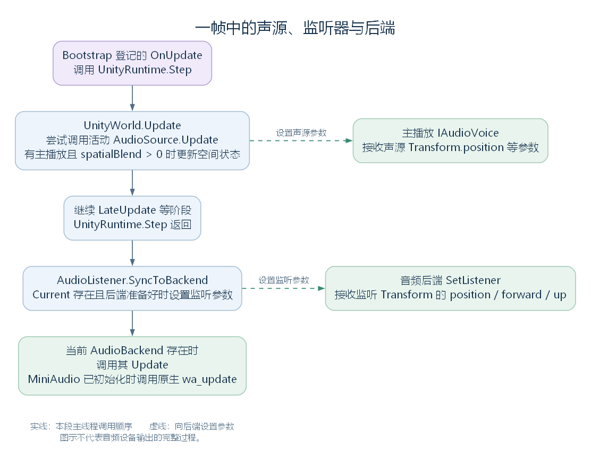

# AudioListener：监听位置与总音量怎样交给后端（讨论稿）

状态：AudioBehaviour 的 AudioListener 子节点，2026-10-24。依据工作区 RimWorld 1.7.4982 rev1280 的兼容层、Waylith 与游戏代码整理。上接 [AudioBehaviour](25-audiobehaviour.md)，配合 [AudioSource](26-audiosource.md) 阅读。本篇研究监听组件的成员、启停登记、Transform 读取和帧内调用位置。

## 一、本层新增哪些成员

AudioListener 与 AudioSource 都直接继承 AudioBehaviour。它也已经拥有 gameObject、transform、enabled 等能力，但本类增加的内容很少，可以完整列出：

| 成员 | 可见性与作用 |
| --- | --- |
| volume | public static 属性，保存总音量并通知音频后端及需要重新应用音量的声源 |
| Current | internal static 属性，从活动监听器列表选出当前使用的实例 |
| OnEnable | public 方法，将当前组件加入活动监听器列表 |
| OnDisable | public 方法，将当前组件从列表移除 |
| SyncToBackend | public static 方法，读取 Current 的 Transform，将位置和方向交给后端 |
| ToNumerics | private static 方法，将 UnityEngine.Vector3 的三个分量复制为后端使用的 System.Numerics.Vector3 |
| ActiveListeners | private static readonly 列表，保存活动监听组件的引用 |
| _volume | private static 字段，总音量初值为 1 |

本类没有声明 Update、LateUpdate 或声音录制接口。AudioListener 在这里提供监听参数和总音量入口；它没有一个“收集各个 AudioSource 后逐一调用播放”的列表。

源码定位：完整类与各成员（`UnityEngine.AudioListener.cs:9`、`UnityEngine.AudioListener.cs:14`、`UnityEngine.AudioListener.cs:36`、`UnityEngine.AudioListener.cs:50`、`UnityEngine.AudioListener.cs:59`、`UnityEngine.AudioListener.cs:65`、`UnityEngine.AudioListener.cs:76`、`UnityEngine.AudioListener.cs:82`、`UnityEngine.AudioListener.cs:85`）。

## 二、游戏把监听组件放在哪里

Bootstrap.BuildEntryScene 建立名为 Camera 的 GameObject 时，同时附加 Camera 与 AudioListener。下面是该方法中连续的创建与相机设置语句：

```csharp
Camera component = new GameObject("Camera", new Type[]
{
    typeof(Camera),
    typeof(AudioListener)
}).GetComponent<Camera>();
component.clearFlags = CameraClearFlags.Color;
component.backgroundColor = new global::UnityEngine.Color(0f, 0f, 0f, 0f);
component.allowHDR = false;
```

进入 Play 时，BuildPlayScene 也在新建的 Camera 对象上附加这两个组件。两者是同一个 GameObject 上的两个组件实例，各自通过继承的 transform 取得同一个 Transform。Camera 使用它计算观察位置与方向，AudioListener 使用它提供监听位置与方向。

这使得相机对象的位置、朝向变化能够同时影响观察与监听。两个组件在类型树上仍是 Behaviour 的不同后代，Camera 本身没有因此变成 AudioListener。

源码定位：Entry 与 Play 的相机对象创建（`RimWorldWaylith.Bootstrap.cs:769`、`RimWorldWaylith.Bootstrap.cs:785`）。

## 三、启用与停用怎样决定 Current

OnEnable 与 OnDisable 是本类自己声明的约定方法。UnityWorld 沿前面读过的 Behaviour 启停流程找到并调用它们，实际动作如下：

```csharp
public void OnEnable()
{
    if (!AudioListener.ActiveListeners.Contains(this))
    {
        AudioListener.ActiveListeners.Add(this);
    }
}

public void OnDisable()
{
    AudioListener.ActiveListeners.Remove(this);
}
```

随后，Current 的 getter 使用这个列表选择实例：列表为空就返回 null，否则返回列表最后一项。它没有在这里根据相机深度、监听器距离或名称重新排序，也没有在这里把多个监听位置混合起来。

用两个组件说明这个规则；“甲”“乙”是本例为便于讨论起的称呼：

| 操作 | 列表内容，按加入顺序 | Current |
| --- | --- | --- |
| 甲的 OnEnable 被调用 | 甲 | 甲 |
| 乙的 OnEnable 被调用 | 甲、乙 | 乙 |
| 甲仍在列表时再次调用其 OnEnable | 甲、乙 | 乙，Contains 检查避免重复加入 |
| 乙的 OnDisable 被调用 | 甲 | 甲 |
| 甲的 OnDisable 也被调用 | 空 | null |

因此，“最后加入活动列表的实例”比“最后创建的对象”更准确。创建、激活和重新启用可能发生在不同时间。

源码定位：列表维护与选择（`UnityEngine.AudioListener.cs:36`、`UnityEngine.AudioListener.cs:50`、`UnityEngine.AudioListener.cs:59`）；启停管理机制见 [Behaviour](23-behaviour.md)。

## 四、SyncToBackend 怎样读取监听参数

这个方法是 static：外部调用一次，它自己取得 Current，再读取被选中的实例。完整方法如下：

```csharp
public static void SyncToBackend()
{
    AudioListener audioListener = AudioListener.Current;
    if (audioListener == null || !AudioBackendAccess.Ready)
    {
        return;
    }
    AudioBackendAccess.Backend.SetListener(AudioListener.ToNumerics(audioListener.transform.position), AudioListener.ToNumerics(audioListener.transform.forward), AudioListener.ToNumerics(audioListener.transform.up));
}
```

AudioBackendAccess.Ready 检查是否存在当前音频后端，以及后端是否已经初始化。SetListener 声明在 AudioBackend，接收三个向量：

| 读取值 | 表示什么 |
| --- | --- |
| transform.position | 当前监听器在世界中的位置 |
| transform.forward | 当前监听器朝向的前方 |
| transform.up | 当前监听器的上方，和 forward 一起确定方向关系 |

这些量仍来自所属对象的 Transform。ToNumerics 只把三个数值分量复制到另一种 Vector3 类型中；当前 MiniAudio 后端接收参数后，还会做自身坐标约定的转换，再调用原生监听接口。

如果没有 Current，或者后端尚未准备好，SyncToBackend 直接返回。这里没有同时调用停止全部声源、设置总音量为 0 或清除后端旧监听参数的操作，因此不能把“列表为空”直接解释成“全游戏静音”。

源码定位：监听参数更新与向量转换（`UnityEngine.AudioListener.cs:65`、`UnityEngine.AudioListener.cs:76`）、后端准备状态（`UnityStubs.Internal.AudioBackendAccess.cs:26`）、后端监听接口（`Waylith.Audio.AudioBackend.cs:111`）、MiniAudio 参数转换与原生调用（`Waylith.Audio.MiniAudio.MiniAudioBackend.cs:188`）。

## 五、谁每帧调用它，与 AudioSource.Update 有什么先后关系

调用位置在 Bootstrap.Initialize 为 OnUpdate 登记的那段代码中。它先调用 UnityRuntime.Step，经过 UnityWorld 的 Update、LateUpdate 等阶段，再调用 AudioListener.SyncToBackend，随后调用当前音频后端的 Update。

下面是监听更新及后续调用的连续源码：

```csharp
AudioListener.SyncToBackend();
AudioBackend audioBackend = AudioBackend.Current;
if (audioBackend == null)
{
    return;
}
audioBackend.Update();
```

AudioBackend.Update 是 Waylith 的音频后端接口，当前 MiniAudio 实现在已初始化时调用原生 wa_update。它与组件的 Update 处于不同调用位置：



[SVG 矢量图](figures/audio-components-frame-flow.svg)；[可编辑图源](figures/audio-components-frame-flow.dot)。图中实线表示本段主线程调用的先后，虚线表示向后端设置参数。

AudioSource.Update 在 UnityWorld 的活动组件更新中读取声源位置，AudioListener.SyncToBackend 则在 Step 返回后读取监听位置和方向。后者能够读取 Step 内相机控制等代码已经写入 Transform 的结果。

这些调用让后端取得本帧相关参数。音频后端如何维持设备输出、处理音频缓冲与执行混音，还要沿后端和原生实现继续研究；不能仅凭这段帧循环描述音频设备的全部运行过程。

源码定位：OnUpdate 的登记与 Step、监听、后端调用（`RimWorldWaylith.Bootstrap.cs:73`、`RimWorldWaylith.Bootstrap.cs:95`、`RimWorldWaylith.Bootstrap.cs:103`）、UnityWorld.Update（`Waylith.UnityCompat.UnityWorld.cs:708`）、AudioSource.Update（`UnityEngine.AudioSource.cs:630`）、MiniAudioBackend.Update（`Waylith.Audio.MiniAudio.MiniAudioBackend.cs:161`）。

## 六、静态 volume 为什么会影响其他声源

AudioListener.volume 是一个静态属性，背后也是静态字段 _volume。因此它表示这一入口维护的共同总音量，并没有为每个监听器分别保存一份数值。完整实现如下：

```csharp
public static float volume
{
    get
    {
        return AudioListener._volume;
    }
    set
    {
        AudioListener._volume = value;
        if (AudioBackendAccess.Ready)
        {
            AudioBackendAccess.Backend.SetMasterVolume(value);
        }
        foreach (AudioSource audioSource in AudioSource.IgnoringListenerVolume)
        {
            audioSource.OnListenerVolumeChanged();
        }
    }
}
```

setter 先保存值；后端已准备好时，调用 SetMasterVolume。随后遍历 AudioSource.IgnoringListenerVolume，通知这些声源重新计算主播放音量。它没有要求每个普通声源都改写自己的 volume，因为总音量已经交给共同的后端入口。

ignoreListenerVolume 的计算在 [AudioSource 第七节](26-audiosource.md#七参数修改怎样传给已有主播放) 已展开：总音量大于 0 时，声源先除以这个值来尝试抵消后续影响。这里的通知正是保持该计算随总音量变化而更新的连接。

游戏设置也有具体调用者：PrefsData.Apply 在主线程执行时，将 volumeMaster 赋给 AudioListener.volume。于是玩家更改的主音量设置沿着“游戏设置 → 静态属性 → 音频后端”这条路径应用；各类声音的额外音量调节仍需分别追踪。

源码定位：完整总音量属性（`UnityEngine.AudioListener.cs:14`）、声源通知与计算（`UnityEngine.AudioSource.cs:736`、`UnityEngine.AudioSource.cs:745`）、游戏设置应用（`Verse.PrefsData.cs:13`、`Verse.PrefsData.cs:27`）、MiniAudio 的总音量接口（`Waylith.Audio.MiniAudio.MiniAudioBackend.cs:170`）。

## 七、把两个组件的协作接起来

现在可以沿着已读代码解释一次空间声音的主要连接：

1. 游戏代码取得 AudioSource，指定音频片段、声源位置与播放参数，再调用 Play。
2. AudioSource 从 AudioClip 取得后端资源，建立播放实例并设置参数；使用空间模式时，读取自身 Transform 的世界位置。
3. 后续活动组件更新继续为主播放提供声源空间状态。
4. AudioListener 从活动列表选出 Current，在 Step 返回后把它的世界位置与方向交给后端。
5. 后端同时拥有声音播放接口和这些空间参数，继续处理自己的更新与输出。

这里没有要求声源主动查找某个 AudioListener 实例，也没有要求监听器逐个收集场景中的 AudioSource。两侧分别向共同音频后端提供数据。Camera 与 AudioListener 放在同一对象上，则通过共享 Transform 将玩家的观察位置与监听位置连接起来。

对应到画面与听感，游戏层可以将一次世界声音放在某个格子上，让空间声源随对象更新；相机移动后，监听器也能提供变化后的观察位置。另一方面，设为非空间模式的音乐不使用同样的声源位置处理路径。距离衰减和左右声道的精确算法仍在后端，留给音频模块继续展开。

当前进度：AudioBehaviour 的两个直接子类已有第一轮讨论。AudioSource 的播放、状态与参数连接，以及 AudioListener 的启停选择、监听更新和总音量入口已接通；对象池调度、声音定义、具体滤镜和后端混音在音频模块继续研究。接下来回到 Behaviour 的 [MonoBehaviour 分支](28-monobehaviour.md)。
