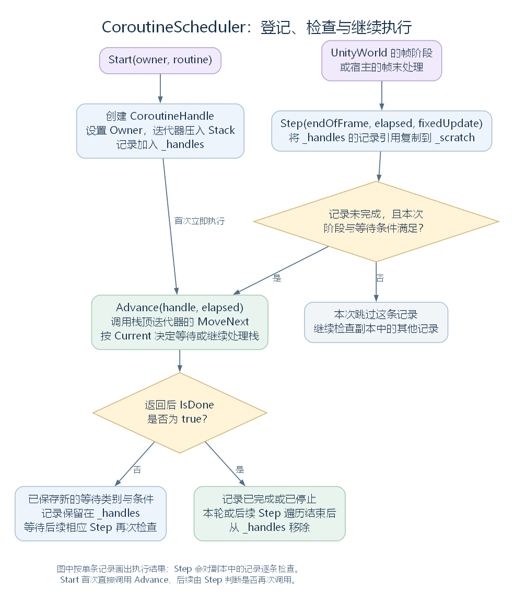
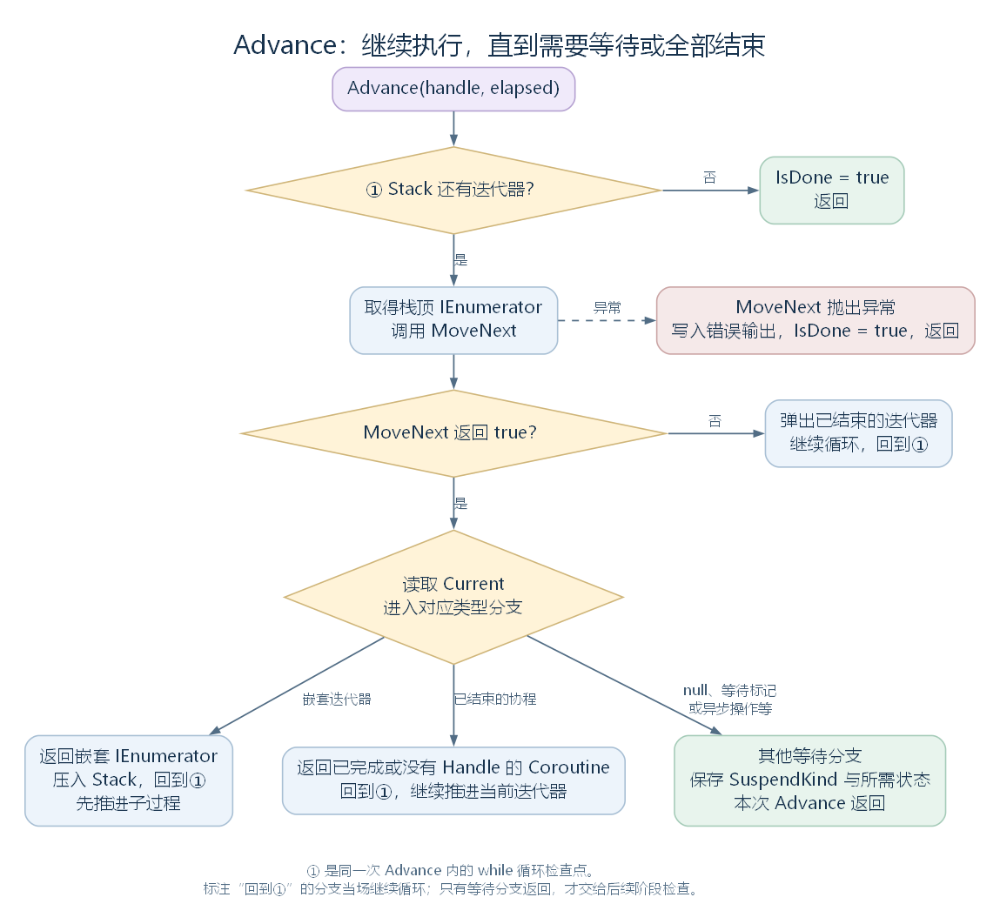
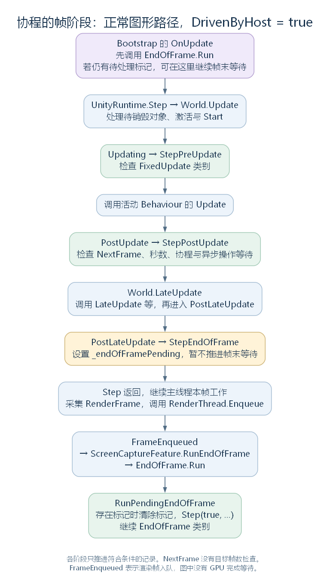

# MonoBehaviour：脚本入口与 CoroutineScheduler 的协程管理（讨论稿）

状态：本轮 Behaviour 子树的 MonoBehaviour 分支，2026-10-24。依据工作区 RimWorld 1.7.4982 rev1280 的兼容层与游戏代码整理。上接 [Behaviour](23-behaviour.md)，同级分支见 [Camera](24-camera.md) 与 [AudioBehaviour](25-audiobehaviour.md)。本篇说明 MonoBehaviour 本层的全部接口，以及它连接的协程管理流程；Root、CameraDriver 等具体脚本的完整游戏逻辑仍在相应模块展开。

这里的 coroutine 通常译为“协程”：**一段过程执行到指定位置时，可以先交回控制权，保存进度，稍后再从该位置继续。** 在当前兼容层中，它依靠迭代器和帧阶段函数实现；代码里的 Coroutine 类则是调用者取得的返回对象。下文简要区分这些对象，再以 CoroutineScheduler 为主线，按保存的数据、启动、检查与继续执行的顺序展开。

## 一、本层实际上只新增四个接口

MonoBehaviour 已经继承 Component 的 gameObject、transform、组件查询，以及 Behaviour 的 enabled、isActiveAndEnabled。当前兼容层中，它自己声明的接口只有四个：

| 成员 | 当前实现 |
| --- | --- |
| useGUILayout | 只有 setter，方法体为空 |
| StartCoroutine(IEnumerator routine) | 将当前组件与迭代器交给 CoroutineScheduler.Start，将返回的内部记录包装为 Coroutine |
| StopCoroutine(Coroutine coroutine) | 取出 Coroutine 内部的 Handle，交给 CoroutineScheduler.Stop；传入 null 时也向后者传 null |
| StopAllCoroutines() | 调用 CoroutineScheduler.StopAll(this)，停止归属于当前组件的协程 |

去掉 using 与反编译注释后，完整类声明如下，保留原变量名：

```csharp
namespace UnityEngine
{
    public class MonoBehaviour : Behaviour
    {
        public bool useGUILayout
        {
            set
            {
            }
        }

        public Coroutine StartCoroutine(IEnumerator routine)
        {
            CoroutineHandle coroutineHandle = CoroutineScheduler.Start(this, routine);
            return new Coroutine
            {
                Handle = coroutineHandle
            };
        }

        public void StopCoroutine(Coroutine coroutine)
        {
            CoroutineScheduler.Stop((coroutine != null) ? coroutine.Handle : null);
        }

        public void StopAllCoroutines()
        {
            CoroutineScheduler.StopAll(this);
        }
    }
}
```

这里没有 Awake、Start、Update、LateUpdate 等方法的声明，也没有新增实例字段。useGUILayout 的赋值目前也没有改变布局流程。协程的状态与执行工作，则放在独立的 CoroutineScheduler 和 CoroutineHandle 中。

源码定位：完整类型与四个接口（`UnityEngine.MonoBehaviour.cs:7`、`UnityEngine.MonoBehaviour.cs:11`、`UnityEngine.MonoBehaviour.cs:19`、`UnityEngine.MonoBehaviour.cs:29`、`UnityEngine.MonoBehaviour.cs:35`）。

## 二、游戏脚本为什么仍然能收到 Awake、Start、Update

这里需要把两个来源分开理解：类型继承提供组件接口，UnityWorld 的管理流程提供约定方法的调用机会。UnityWorld.GetMessages 为实际类型查找 Awake、OnEnable、Start、Update、LateUpdate 等无参数实例方法；FindMessage 从实际类型开始，逐级向父类查找，找到后建立可重复使用的调用函数。

因此，游戏脚本可以自己声明这些方法。它们是否使用 virtual 或 override，要看自己的类声明与父类声明，不能统一解释成覆写 MonoBehaviour 的同名虚方法：

| 游戏类型 | 当前代码中的关系 |
| --- | --- |
| Verse.Root | 继承 MonoBehaviour，并在自己这一层声明 virtual Start、virtual Update 和 OnGUI 等方法 |
| Verse.Root_Entry、Verse.Root_Play | 继承 Root，覆写的是 Root 声明的 Start、Update；需要执行父类逻辑时，方法内显式调用 base.Start()、base.Update() |
| Verse.CameraDriver | 继承 MonoBehaviour，自己声明 Awake、Update 等方法；这些方法由相应管理或调用路径找到 |

例如 CameraDriver 自己声明的 Awake 会调用本类的 ResetSize、ApplyPositionToGameObject，并访问 MyCamera：它们分别参与恢复相机大小、把控制状态写入对象变换，以及取得同对象的 Camera。Awake 的完整方法如下：

```csharp
public void Awake()
{
    this.ResetSize();
    this.reverbDummy = GameObject.Find("ReverbZoneDummy");
    this.ApplyPositionToGameObject();
    this.MyCamera.nearClipPlane = 0.5f;
    this.MyCamera.farClipPlane = 65.5f;
}
```

这里先用这个方法确认脚本声明与调用入口；相机控制的完整过程接在 [Camera 讨论](24-camera.md) 之后继续。

这种约定方法查找已经在 [Behaviour](23-behaviour.md) 中接回 UnityWorld；它覆盖的也不只 MonoBehaviour，前面的 AudioSource.Update、AudioListener.OnEnable 同样来自这个管理连接。

源码定位：方法缓存、逐级查找与实际调用（`Waylith.UnityCompat.UnityWorld.cs:1468`、`Waylith.UnityCompat.UnityWorld.cs:1482`、`Waylith.UnityCompat.UnityWorld.cs:1265`）、Root 的声明与方法（`Verse.Root.cs:14`、`Verse.Root.cs:27`、`Verse.Root.cs:113`、`Verse.Root.cs:155`）、派生 Root（`Verse.Root_Entry.cs:11`、`Verse.Root_Play.cs:13`）、CameraDriver 的声明与 Awake、Update（`Verse.CameraDriver.cs:11`、`Verse.CameraDriver.cs:230`、`Verse.CameraDriver.cs:332`）、相机辅助成员（`Verse.CameraDriver.cs:29`、`Verse.CameraDriver.cs:418`、`Verse.CameraDriver.cs:515`）。

## 三、进入管理器之前，先区分几个对象

协程的“分段继续执行”依靠迭代器保存进度。IEnumerator 提供 MoveNext 和 Current：前者执行到下一次 yield 或结束，后者提供这次 yield 返回的对象。CoroutineScheduler 读取这个对象，记录下一次继续执行所需的条件。

下面是教学示例，假设声明在某个 MonoBehaviour 子类中，**不是游戏源码摘录**。A、B、C 仅表示执行顺序：

```csharp
private IEnumerator ExampleRoutine()
{
    Log.Message("A");
    yield return null;
    Log.Message("B");
    yield return new WaitForSeconds(0.5f);
    Log.Message("C");
}
```

启动代码也是教学示例；routine、coroutine 是本例自行命名的局部变量：

```csharp
IEnumerator routine = ExampleRoutine();
Coroutine coroutine = StartCoroutine(routine);
```

第一行取得保存执行状态的迭代器；第二行通过 MonoBehaviour 将它交给管理器，并取得公开返回对象 Coroutine。在当前实现中，启动就会先执行到第一次等待。后续由帧阶段函数检查条件，继续执行剩下的部分。

| 对象 | 在这套管理中的位置 |
| --- | --- |
| IEnumerator | 提供可继续执行的过程，保存执行位置及后续需要的局部状态 |
| Coroutine | 返回给调用者的对象，内部 Handle 引用管理记录，可传给 StopCoroutine |
| CoroutineHandle | 管理记录，保存 Owner、迭代器栈、等待条件与完成标记 |
| CoroutineScheduler | 共同的管理类，保存记录列表，安排首次执行与后续条件检查 |

Coroutine 的完整类体如下：

```csharp
public class Coroutine : YieldInstruction
{
    internal CoroutineHandle Handle;
}
```

下文重点沿 CoroutineScheduler 解释这几个对象怎样配合。在通常的主线程调用路径上，各段协程代码会在主线程执行；yield 使本次推进返回，主线程随后继续处理其他工作。

源码定位：Coroutine（`UnityEngine.Coroutine.cs:6`）、管理记录（`UnityEngine.CoroutineHandle.cs:8`）、管理器（`UnityEngine.CoroutineScheduler.cs:12`）、空的 YieldInstruction 基类（`UnityEngine.YieldInstruction.cs:6`）。

## 四、CoroutineScheduler 怎样组织这些记录

CoroutineScheduler 是 UnityEngine 命名空间中的 internal static 类。它的静态字段共同保存已经登记的协程及帧阶段连接状态；每个 MonoBehaviour 启动的协程都通过相同的 Start 入口交给它。

### 4.1 管理器保存什么

| 字段 | 保存内容与用途 |
| --- | --- |
| _handles | List<CoroutineHandle>，保存已登记且尚未从列表清理的记录；等待中的记录保留在这里，供后续阶段检查 |
| _scratch | 另一个 List<CoroutineHandle>，每次 Step 先复制 _handles 中的引用，再遍历这一份列表 |
| _subscribed | 标记是否已成功向 UnityWorld 登记阶段函数 |
| _endOfFramePending | 标记宿主驱动的帧末处理是否还有一轮需要执行 |

_handles 与 _scratch 保存的是记录的引用。复制列表时，没有复制迭代器、执行进度或每条记录的内部数据；在这两份列表中访问同一条记录，仍能看到它最新的字段值。

每条 CoroutineHandle 则保存自己的状态：

| 字段 | 表示什么 |
| --- | --- |
| Owner | 启动这条协程的所属对象，供 StopAll 按归属查找 |
| Stack | Stack<IEnumerator>，顶端是当前应当继续执行的过程；嵌套过程可以压入，结束后弹出 |
| SuspendKind | 当前等待类别，例如 WaitSeconds、EndOfFrame 或 AwaitCoroutine |
| ResumeTime | 等待秒数时使用的累计时间截止值 |
| AwaitedHandle、AwaitedOperation | 等待中的另一条协程记录或异步操作 |
| IsDone | 已完成或已被停止，后续 Step 据此跳过并清理记录 |

因此，暂停后的工作分成两部分保存：迭代器保留“执行到哪里”，CoroutineHandle 保留“接下来满足什么条件才能继续”。

### 4.2 各方法怎样分工

| 方法 | 主要工作 |
| --- | --- |
| Start | 尝试连接帧阶段，建立记录、登记迭代器，并立即调用一次 Advance |
| EnsureSubscribed | 找到当前 World，登记 Updating、PostUpdate、PostLateUpdate 上的三个入口 |
| StepPreUpdate、StepPostUpdate、StepEndOfFrame | 在对应帧阶段调用 Step，或先登记稍后处理的帧末标记 |
| Step | 遍历记录副本，按本次阶段和等待状态筛选可以继续的记录，调用 Advance，最后清理完成记录 |
| Advance | 推进指定记录的迭代器栈，执行到再次等待、异常终止或整个栈结束 |
| Stop、StopAll | 设置一条记录，或同一 Owner 的各条记录的 IsDone 标记 |
| RunPendingEndOfFrame | 有待处理帧末标记时，清除标记并调用帧末类别的 Step |
| HasEndOfFrameWaiters | 查询是否存在未完成、正在等待 EndOfFrame 的记录，供外部功能判断 |



[SVG 矢量图](figures/coroutinescheduler-overview.svg)；[可编辑图源](figures/coroutinescheduler-overview.dot)。首次 Start 会直接执行一次 Advance；之后由帧阶段调用 Step，决定是否再次执行它。

接下来沿 Start → Step → Advance 逐个阅读，再把这些方法放回完整帧顺序中。源码中编译器生成的嵌套类 <>O 保存三个阶段入口的 Action<UnityFrame> 委托缓存；它们用于复用登记的函数引用，阶段职责仍由上表中的方法承担。

源码定位：管理器类型、字段与编译器生成缓存（`UnityEngine.CoroutineScheduler.cs:12`、`UnityEngine.CoroutineScheduler.cs:271`、`UnityEngine.CoroutineScheduler.cs:274`、`UnityEngine.CoroutineScheduler.cs:277`、`UnityEngine.CoroutineScheduler.cs:280`、`UnityEngine.CoroutineScheduler.cs:284`）、单条记录全部字段（`UnityEngine.CoroutineHandle.cs:8`）、等待类别（`UnityEngine.CoroutineSuspendKind.cs:6`）。

## 五、Start：登记记录，并先当场执行一段

MonoBehaviour.StartCoroutine 将 this 作为 owner 交给 CoroutineScheduler.Start。Start 的完整实现如下；EnsureSubscribed 负责尝试登记帧阶段函数，Advance 负责推进一条协程，二者在后面展开。

```csharp
internal static CoroutineHandle Start(object owner, IEnumerator routine)
{
    CoroutineScheduler.EnsureSubscribed();
    CoroutineHandle coroutineHandle = new CoroutineHandle
    {
        Owner = owner
    };
    coroutineHandle.Stack.Push(routine);
    CoroutineScheduler._handles.Add(coroutineHandle);
    CoroutineScheduler.Advance(coroutineHandle, Time.time);
    return coroutineHandle;
}
```

它先创建记录，将迭代器压入 Stack，加入共同的 _handles 列表，然后立即调用 Advance。因此，第一次等待之前的代码会在 StartCoroutine 返回之前执行；如果方法直接结束，此时记录也可能已经完成。

对照第三节的教学示例，这次 Advance 会使 routine 输出 A，遇到 null 后保存等待状态并返回。随后 MonoBehaviour.StartCoroutine 将内部记录包装为 Coroutine，才返回给外部的 coroutine 变量。这也解释了为什么“启动协程”本身就可能执行其中的一部分代码。

源码定位：立即创建与推进（`UnityEngine.CoroutineScheduler.cs:15`）、推进方法（`UnityEngine.CoroutineScheduler.cs:188`）、MonoBehaviour 的包装入口（`UnityEngine.MonoBehaviour.cs:19`）。

## 六、Step：先检查等待条件，再决定谁能继续

Step 的三个参数分别表示当前是否处理帧末类别、当前累计时间 elapsed，以及是否处理 FixedUpdate 类别。它收到的是当前时间值，等待秒数的判断直接比较截止时间，没有每次从剩余时间中减去一段。

一次 Step 按以下顺序工作：

1. 清空 _scratch，将 _handles 当前保存的记录引用复制进来。
2. 遍历 _scratch；IsDone 为 true 的记录不再推进。
3. 检查记录的 SuspendKind，与本次阶段、时间或等待对象的状态是否相符。
4. 符合条件时，调用 Advance(coroutineHandle, elapsed)，让这一条继续执行。
5. 遍历结束后，从 _handles 移除所有 IsDone 为 true 的记录。

Advance 如何执行一段代码、如何更新下一次等待条件，在第七节展开。先看 Step 自己的完整实现，保留原变量名和反编译标签：

```csharp
private static void Step(bool endOfFrame, float elapsed, bool fixedUpdate = false)
{
	CoroutineScheduler._scratch.Clear();
	CoroutineScheduler._scratch.AddRange(CoroutineScheduler._handles);
	foreach (CoroutineHandle coroutineHandle in CoroutineScheduler._scratch)
	{
		if (!coroutineHandle.IsDone)
		{
			CoroutineSuspendKind suspendKind = coroutineHandle.SuspendKind;
			bool flag;
			if (suspendKind != CoroutineSuspendKind.FixedUpdate)
			{
				if (fixedUpdate)
				{
					flag = false;
				}
				else
				{
					switch (suspendKind)
					{
					case CoroutineSuspendKind.NextFrame:
						flag = !endOfFrame;
						goto IL_00C9;
					case CoroutineSuspendKind.EndOfFrame:
						flag = endOfFrame;
						goto IL_00C9;
					case CoroutineSuspendKind.WaitSeconds:
						flag = !endOfFrame && elapsed >= coroutineHandle.ResumeTime;
						goto IL_00C9;
					case CoroutineSuspendKind.AwaitCoroutine:
						flag = !endOfFrame && (coroutineHandle.AwaitedHandle == null || coroutineHandle.AwaitedHandle.IsDone);
						goto IL_00C9;
					case CoroutineSuspendKind.AwaitOperation:
						flag = !endOfFrame && coroutineHandle.AwaitedOperation.isDone;
						goto IL_00C9;
					}
					flag = false;
				}
			}
			else
			{
				flag = fixedUpdate;
			}
			IL_00C9:
			if (flag)
			{
				CoroutineScheduler.Advance(coroutineHandle, elapsed);
			}
		}
	}
	CoroutineScheduler._handles.RemoveAll((CoroutineHandle h) => h.IsDone);
}
```

flag 表示这条记录本次是否可以继续；goto IL_00C9 将各个分支的结果汇合到共同的 flag 判断。这是当前反编译文本保留的控制流程，阅读时可以将判断归纳成下表：

| SuspendKind | 本次 Step 什么时候调用 Advance |
| --- | --- |
| FixedUpdate | fixedUpdate 为 true |
| NextFrame | fixedUpdate 为 false，并且 endOfFrame 为 false |
| EndOfFrame | fixedUpdate 为 false，并且 endOfFrame 为 true |
| WaitSeconds | 普通阶段，且 elapsed >= ResumeTime |
| AwaitCoroutine | 普通阶段，且 AwaitedHandle 为空或其 IsDone 为 true |
| AwaitOperation | 普通阶段，且 AwaitedOperation.isDone 为 true |

这里的“普通阶段”指 fixedUpdate 与 endOfFrame 均为 false，当前登记位置是 PostUpdate。NextFrame 的判断没有读取目标 FrameCount，所以实际可能在同帧稍后恢复；完整阶段顺序在第八节说明。

复制记录引用后再遍历，使遍历范围在本次 Step 开始时确定。协程执行中若启动了新的协程，Start 仍会先立即推进新记录一次；新记录没有自动加入已经复制好的 _scratch，后续检查需等另一次相应 Step。完成或停止的记录则通过 IsDone 标记，在本轮末尾或之后的清理位置移除。

源码定位：完整 Step（`UnityEngine.CoroutineScheduler.cs:134`）、立即启动（`UnityEngine.CoroutineScheduler.cs:15`）、等待类别（`UnityEngine.CoroutineSuspendKind.cs:6`）。

## 七、Advance：执行一条记录，并保存新的等待条件

Advance 接收一个 CoroutineHandle 和当前时间 elapsed，围绕该记录的 Stack 循环。每次取栈顶 IEnumerator，调用 MoveNext：

- 返回 false：这层迭代已经结束，将它弹出，继续处理下面一层。
- 返回 true：读取 Current，根据返回对象的类型决定等待、压入子迭代器，或继续当前迭代器。
- MoveNext 抛出异常：将异常写到 Console.Error，将记录标为 IsDone 后返回。这里的 try/catch 围绕的是 MoveNext 调用。

例如，“父过程 yield return 子过程的 IEnumerator”会把子过程压入同一记录的栈。子过程结束后弹出，父过程可以在同一次 Advance 内继续；它与另行 StartCoroutine 得到独立记录再等待的方式有所不同。



[SVG 矢量图](figures/monobehaviour-coroutine-advance.svg)；[可编辑图源](figures/monobehaviour-coroutine-advance.dot)。图中“记录等待后返回”包含下表中的各类等待分支；它不会阻塞线程等待条件成立。

Current 的主要分类规则为：

| yield 返回什么 | Advance 保存或执行什么 | 后续恢复条件 |
| --- | --- | --- |
| null | SuspendKind = NextFrame，返回 | 下一次符合条件的普通 Step，详见第六节 |
| WaitForFixedUpdate | SuspendKind = FixedUpdate，返回 | StepPreUpdate 对应的 Step |
| WaitForEndOfFrame | SuspendKind = EndOfFrame，返回 | 对应帧末处理位置的 Step |
| WaitForSeconds | SuspendKind = WaitSeconds，ResumeTime = elapsed + Seconds，返回 | 普通 Step 的 elapsed 达到 ResumeTime |
| 尚未完成的 Coroutine | 保存 AwaitedHandle，类别为 AwaitCoroutine，返回 | 普通 Step 看到被等待记录已经完成 |
| 已完成或 Handle 为 null 的 Coroutine | 直接继续 Advance 的循环 | 当场再次推进当前迭代器 |
| 未完成的 AsyncOperation | 保存 AwaitedOperation，类别为 AwaitOperation，返回 | 普通 Step 看到 isDone 为 true |
| 已完成的 AsyncOperation | 类别设为 NextFrame，返回 | 下一次符合条件的普通 Step |
| 其他 IEnumerator | 压入 Stack，继续循环 | 先执行子迭代器，由它决定何时等待或结束 |
| 其他未识别对象 | 类别设为 NextFrame，返回 | 下一次符合条件的普通 Step |

下面是 Advance 中从读取 Current 到处理几种常见等待对象的连续节选：

```csharp
object obj = enumerator.Current;
if (obj == null)
{
    handle.SuspendKind = CoroutineSuspendKind.NextFrame;
    return;
}
if (obj is WaitForEndOfFrame)
{
    handle.SuspendKind = CoroutineSuspendKind.EndOfFrame;
    return;
}
if (obj is WaitForFixedUpdate)
{
    handle.SuspendKind = CoroutineSuspendKind.FixedUpdate;
    return;
}
WaitForSeconds waitForSeconds = obj as WaitForSeconds;
if (waitForSeconds != null)
{
    handle.SuspendKind = CoroutineSuspendKind.WaitSeconds;
    handle.ResumeTime = elapsed + waitForSeconds.Seconds;
    return;
}
```

当整个 Stack 为空，Advance 将 IsDone 设为 true。这里的等待对象主要提供数据或类型标记；具体何时检查条件，由 CoroutineScheduler 决定。

源码定位：完整推进与分支判断（`UnityEngine.CoroutineScheduler.cs:188`）、等待数据与标记（`UnityEngine.WaitForSeconds.cs:6`、`UnityEngine.WaitForFixedUpdate.cs:6`、`UnityEngine.WaitForEndOfFrame.cs:6`）、异步操作状态接口（`UnityEngine.AsyncOperation.cs:21`）。

### 用一条记录串起 Start、Step 与 Advance

沿第三节的教学示例，假设引擎累计时间为 100 秒，某个组件在自己的 Update 中调用 StartCoroutine，并正常执行本帧后续阶段。以下时间值只用于说明字段变化：

| 时点与入口 | 管理器做什么 | 这条记录留下什么状态 |
| --- | --- | --- |
| 100 秒，Start | 创建并登记记录，立即 Advance；输出 A，遇到 null | Stack 保留迭代器，SuspendKind = NextFrame，IsDone 为 false |
| 同帧 PostUpdate，Step | NextFrame 满足本次阶段条件，调用 Advance；输出 B，遇到半秒等待 | SuspendKind = WaitSeconds，ResumeTime = 100.5 |
| 100.2 秒，PostUpdate 的 Step | 时间未达到 ResumeTime，跳过这条记录 | 记录和迭代器继续保留，没有重新执行 A、B |
| 100.5 秒或稍后，PostUpdate 的 Step | 时间条件满足，调用 Advance；输出 C，迭代器结束并弹出，Stack 为空 | IsDone = true；本轮 Step 遍历结束后，从 _handles 移除 |

这条记录每次都经过同样的交接：Step 检查旧等待条件，Advance 执行剩余代码并写入新状态；如果已经结束，Step 再清理记录。等待期间没有一直调用这条记录的 MoveNext。

## 八、谁在每帧的什么位置调用 Step

CoroutineScheduler.EnsureSubscribed 在首次成功找到 UnityRuntime.Current.World 后，向三个事件登记函数，并设置 _subscribed，避免重复登记：

| UnityWorld 事件 | 登记的函数 | 传给 Step 的参数与主要工作 |
| --- | --- | --- |
| Updating | StepPreUpdate | Step(false, frame.ElapsedTime, true)，处理 FixedUpdate 类别 |
| PostUpdate | StepPostUpdate | Step(false, frame.ElapsedTime, false)，检查普通等待类别 |
| PostLateUpdate | StepEndOfFrame | 检查是否由外部宿主安排帧末处理；直接处理或设置待处理标记，见下一节 |

UnityWorld.Update 的先后顺序为：处理待销毁对象、激活和 Start，然后调用 Updating，再遍历活动 Behaviour 的 Update，最后调用 PostUpdate。因此：

1. **NextFrame 没有保存目标 FrameCount。** Step 对这个类别的主要判断是 !endOfFrame，同时普通类别会跳过 fixedUpdate 阶段。如果在某个组件的 Update 中启动第三节的示例，A 会立即输出，B 有机会在同一画面帧稍后的 PostUpdate 输出；源码没有强制把它推迟到下一画面帧。
2. **FixedUpdate 类别接在每帧 Updating。** 当前这条实现用阶段布尔参数区分它，没有在这里按固定时间间隔补跑，也没有连接 RimWorld 的单 tick 循环。名称相近不能据此等同。

列表检查与清理已在第六节展开。首次 Start 时若还没有可用的 World，EnsureSubscribed 会直接返回；Start 本身仍会创建记录并推进一次。后续恢复依赖成功登记的阶段函数，不能据“已取得 Coroutine 返回值”断言它已经接入每帧处理。

源码定位：阶段登记与三个入口（`UnityEngine.CoroutineScheduler.cs:50`、`UnityEngine.CoroutineScheduler.cs:87`、`UnityEngine.CoroutineScheduler.cs:93`、`UnityEngine.CoroutineScheduler.cs:99`）、完整 Step 判断与列表处理（`UnityEngine.CoroutineScheduler.cs:134`）、World.Update 的调用顺序（`Waylith.UnityCompat.UnityWorld.cs:708`）。

## 九、WaitForEndOfFrame 怎样接回引擎帧末

StepEndOfFrame 的实现需要结合 Bootstrap 阅读：

```csharp
private static void StepEndOfFrame(UnityFrame frame)
{
    if (EndOfFrame.DrivenByHost)
    {
        CoroutineScheduler._endOfFramePending = true;
        return;
    }
    CoroutineScheduler.Step(true, frame.ElapsedTime, false);
}
```

DrivenByHost 为 false 时，它在 PostLateUpdate 的这个位置直接推进 EndOfFrame 类别。正常图形启动路径则由 Bootstrap 将 DrivenByHost 设为 true，并登记 FrameEnqueued 函数：渲染帧入队后，调用 ScreenCaptureFeature.RunEndOfFrame，再由它调用 UnityStubs.EndOfFrame.Run。

EndOfFrame.Run 在处理待写入截图后，调用 CoroutineScheduler.RunPendingEndOfFrame。后者检查 _endOfFramePending，存在标记才清除标记并调用 Step(true, Time.time, false)，继续对应等待的协程。



[SVG 矢量图](figures/monobehaviour-coroutine-stages.svg)；[可编辑图源](figures/monobehaviour-coroutine-stages.dot)。图示假设已经成功登记阶段函数，采用 DrivenByHost = true 的正常图形路径。

Bootstrap 登记的 OnUpdate 在 Step 之前也调用 EndOfFrame.Run，它同样能处理已有的待处理标记。正常图形路径中，前一轮的标记通常已在 FrameEnqueued 位置处理；这里仍需保留源码中实际存在的另一个调用入口。

帧末协程在这些主线程调用位置继续。FrameEnqueued 表示主线程已经将渲染帧交入队列，不能仅据这个事件推定 GPU 已完成该帧的全部绘制；协程若调用读取画面的具体接口，还要结合截图后端的处理。

源码定位：帧末标记、继续与等待者查询（`UnityEngine.CoroutineScheduler.cs:99`、`UnityEngine.CoroutineScheduler.cs:110`、`UnityEngine.CoroutineScheduler.cs:121`）、EndOfFrame.Run 与 HasWaiters（`UnityStubs.EndOfFrame.cs:15`、`UnityStubs.EndOfFrame.cs:23`）、宿主路径登记与帧前入口（`RimWorldWaylith.Bootstrap.cs:351`、`RimWorldWaylith.Bootstrap.cs:85`）、截图功能的帧末调用（`RimWorldWaylith.Rendering.ScreenCaptureFeature.cs:130`）、帧入队后的事件调用（`Waylith.EngineApplication.cs:797`）。

## 十、WaitForSeconds 与 WaitForSecondsRealtime 使用什么时间

WaitForSeconds 自己只保存 Seconds。Advance 将恢复时间设为 elapsed + Seconds，普通 Step 比较当前 elapsed 是否达到这个值。Start 首次推进传入 Time.time，后续阶段传入 frame.ElapsedTime。

这两个时间在当前运行时中连接到同一个引擎累计时间：UnityRuntime.Step 先调用 UnityTimeState.BeginFrame，将收到的 elapsedTime 写入 Time 与 UnscaledTime，再用它建立 UnityFrame。BeginFrame 完整实现为：

```csharp
internal void BeginFrame(float deltaTime, float elapsedTime)
{
    int frameCount = this.FrameCount;
    this.FrameCount = frameCount + 1;
    this.DeltaTime = deltaTime;
    this.UnscaledDeltaTime = deltaTime;
    this.Time = elapsedTime;
    this.UnscaledTime = elapsedTime;
}
```

当前兼容层 Time.timeScale 的 getter 固定返回 1，setter 记录未实现提示。因此，不能把这里的 WaitForSeconds 直接写成会随 RimWorld 游戏倍率缩放的 tick 等待；只要引擎帧与累计时间继续推进，它就仍能达到恢复条件。

WaitForSecondsRealtime 则沿另一条已支持的路径工作：它继承 CustomYieldInstruction，而 CustomYieldInstruction 实现 IEnumerator。Advance 会把它作为子迭代器压入 Stack。该类 MoveNext 的实现很短：

```csharp
public bool MoveNext()
{
    return this.keepWaiting;
}
```

CustomYieldInstruction.Current 总是返回 null。于是 keepWaiting 为 true 时，子迭代器先以 NextFrame 类别等待；后续普通阶段再次调用 MoveNext，直到 keepWaiting 返回 false，弹出子迭代器并继续父过程。

WaitForSecondsRealtime.keepWaiting 在首次检查时，用 Time.realtimeSinceStartup + waitTime 建立截止时间；后续比较真实计时，达到截止时间后重置 waitUntilTime。realtimeSinceStartup 来自运行时持有的 Stopwatch 起点。即使真实计时已到，剩余代码也仍要等到下一次管理代码检查，才会继续执行。

源码定位：秒数与恢复时间（`UnityEngine.WaitForSeconds.cs:9`、`UnityEngine.CoroutineScheduler.cs:188`、`UnityEngine.CoroutineScheduler.cs:134`）、Step 与时间写入（`Waylith.UnityCompat.UnityRuntime.cs:106`、`Waylith.UnityCompat.UnityTimeState.cs:55`）、Time.time、timeScale 与真实计时入口（`UnityEngine.Time.cs:84`、`UnityEngine.Time.cs:110`、`UnityEngine.Time.cs:54`）、CustomYieldInstruction（`UnityEngine.CustomYieldInstruction.cs:8`、`UnityEngine.CustomYieldInstruction.cs:16`、`UnityEngine.CustomYieldInstruction.cs:25`）、真实秒数等待与 Stopwatch（`UnityEngine.WaitForSecondsRealtime.cs:21`、`UnityEngine.WaitForSecondsRealtime.cs:39`、`Waylith.UnityCompat.UnityTimeState.cs:36`）。

## 十一、停止、停用与销毁在这里怎样连接

CoroutineScheduler.Stop 只在记录非 null 时将 IsDone 设为 true。StopAll 则遍历 _handles，按 Owner == owner 找到记录并设置相同标记。Step 随后跳过这些记录，并在列表清理时将它们移除。

因此，StopAllCoroutines 的范围是启动组件所对应的 Owner，并非整个 GameObject 上其他组件的协程，更不是场景内全部协程。StopCoroutine 则直接针对传入 Coroutine 所包装的记录；这里没有额外核对调用组件是否就是 Owner。

Step 与 Advance 没有根据 Owner.enabled 或对象活动状态筛选记录，MonoBehaviour 本身也没有声明在 OnDisable、OnDestroy 中自动 StopAll 的方法。当前 UnityRuntime 的 ObjectDestroyed 连接用于 Object.MarkDestroyed，没有在这个登记位置连接协程停止。沿所读实现，组件方法的活动管理与协程记录的继续条件是两套判断，不能直接将停用、销毁和停止协程视作同一个动作。

另外，这些停止与移除路径没有显式调用迭代器的 Dispose。不能只凭 StopCoroutine 的名字，就认定迭代器中的清理代码或 finally 一定会沿相同路径执行。

源码定位：停止单个与按所属对象停止（`UnityEngine.CoroutineScheduler.cs:29`、`UnityEngine.CoroutineScheduler.cs:38`）、Step 与 Advance 的条件（`UnityEngine.CoroutineScheduler.cs:134`、`UnityEngine.CoroutineScheduler.cs:188`）、MonoBehaviour 的停止入口（`UnityEngine.MonoBehaviour.cs:29`、`UnityEngine.MonoBehaviour.cs:35`）、销毁通知登记（`Waylith.UnityCompat.UnityRuntime.cs:55`）。

## 十二、除了显式 StartCoroutine，还有什么启动入口

UnityWorld.InvokeMessage 在调用找到的约定方法后，会检查返回结果是否为 IEnumerator。下面是它在 try 内的连续节选，func 是前面取得的方法调用函数：

```csharp
IEnumerator enumerator = func(component.Instance) as IEnumerator;
if (enumerator != null)
{
    Action<object, IEnumerator> messageCoroutineStarter = this.MessageCoroutineStarter;
    if (messageCoroutineStarter != null)
    {
        messageCoroutineStarter(component.Instance, enumerator);
    }
}
```

UnityRuntime 在构造时把 MessageCoroutineStarter 设为调用 CoroutineScheduler.Start 的函数，所以返回迭代器的约定方法也能进入同一个管理器。例如，若某个脚本提供无参数的 IEnumerator Start，World 调用它后，就会把得到的迭代器连同组件实例交给该入口。

这里仍要区分两件事：World 的 HasStarted 说明已经经过 Start 的调用阶段；返回的协程是否执行完，由 CoroutineHandle.IsDone 等状态继续决定。当前 InvokeMessage 的返回值判断写在共同调用方法中，也没有仅限定 Start 这一个名称。

源码定位：检查约定方法返回值（`Waylith.UnityCompat.UnityWorld.cs:1265`）、连接启动函数（`Waylith.UnityCompat.UnityRuntime.cs:67`）。

## 十三、游戏中的具体使用：Delay 与独立的运行组件

游戏的全局工具类 Delay 有一个私有 CoroutineRunner，继承 MonoBehaviour，类体为空。Delay.StartCoroutine 在需要时创建 GameObject 并附加这个组件，再使用继承来的 StartCoroutine：

```csharp
private static Coroutine StartCoroutine(IEnumerator coroutine)
{
    if (!Delay.coroutineRunner)
    {
        Delay.coroutineRunner = new GameObject("CoroutineRunner").AddComponent<Delay.CoroutineRunner>();
    }
    return Delay.coroutineRunner.StartCoroutine(coroutine);
}
```

Delay.AfterNSeconds 和 AfterNTicks 分别取得自己的内部 IEnumerator，再交给这个方法。这里不需要 CoroutineRunner 自己声明 Update：组件提供调用协程接口的实例，CoroutineScheduler 负责后续阶段推进。

重力飞船流程中有实际调用点：WorldComponent_GravshipController.OnGravshipCaptureComplete 在相机平移衔接代码中，将 0.5f 作为参数交给 Delay.AfterNSeconds，并传入后续安排生成工作的 Action。这个位置说明，普通游戏对象可以通过工具类请求协程处理，协程的 Owner 则是单独的 CoroutineRunner。Delay 两个内部迭代器的具体等待条件，可在展开该游戏流程时继续逐项核对；本例先确认从游戏调用到 MonoBehaviour 和管理器的连接。

源码定位：Delay 的组件创建与启动方法、两个公开入口、空的派生类（`Delay.cs:10`、`Delay.cs:20`、`Delay.cs:35`、`Delay.cs:53`）、重力飞船调用位置（`Verse.WorldComponent_GravshipController.cs:178`、`Verse.WorldComponent_GravshipController.cs:215`）。

当前进度：MonoBehaviour 本层的四个接口、约定方法调用、协程记录与栈、等待条件、帧阶段、时间与停止路径已有第一轮说明。本轮所选的 Behaviour 三条子分支已经接通；后续可继续阅读 Root、CameraDriver 等具体脚本，或先把这一轮对象与组件讨论整理为连贯章节。
