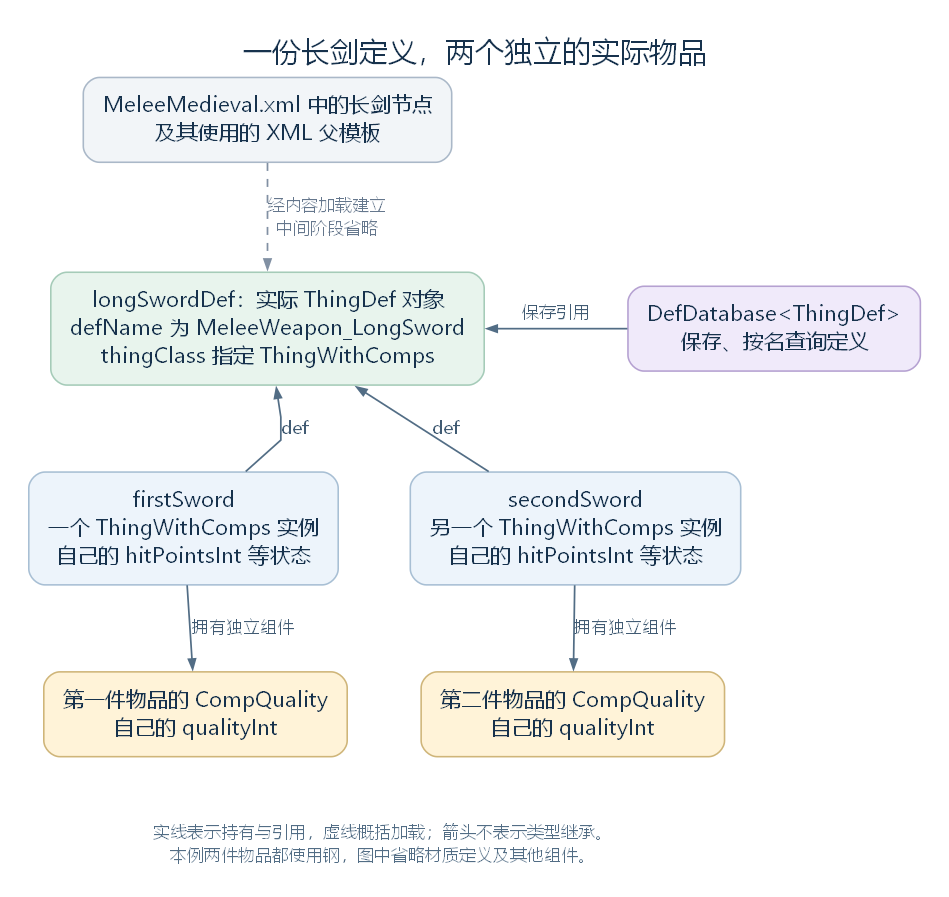

# 一份长剑定义与两件实际物品（讨论稿）

状态：Def 与定义系统的第一轮阅读，2026-10-24。依据工作区 RimWorld 1.7.4982 rev1280 的内容文件与游戏代码整理，范围见 [本部分大纲](29-def-xml-outline.md)。本篇先建立文件、类型、定义对象与实际物品之间的关系，加载算法和 Def 基类随后继续。

整合说明（2026-10-27）：本章保留文件、类型、共同定义与使用者的区别。下面的实际创建步骤、耐久与品质展开作为讨论记录保留，正式整合时压缩为引用关系说明，具体实现转入 [物品模块预备研究](42-thingmaker-and-instance-state.md)。

## 一、从原版长剑的 XML 开始

本轮选择原版长剑作为贯穿案例。它的内容位于项目本地的 `RimWorld/Data/Core/Defs/ThingDefs_Misc/Weapons/MeleeMedieval.xml`。这个文件还包含其他武器；下面只摘录长剑节点的开头，尚未展示其余字段和闭合标签：

```xml
<ThingDef ParentName="BaseMeleeWeapon_Sharp_Quality">
  <defName>MeleeWeapon_LongSword</defName>
  <label>longsword</label>
```

先认识这三个名字：

| 名称 | 在这里表示什么 |
| --- | --- |
| ThingDef | 该 XML 节点描述的定义类型；对应程序中的 C# 类型 Verse.ThingDef |
| BaseMeleeWeapon_Sharp_Quality | XML 父模板的名称，后续加载时据此处理继承内容 |
| MeleeWeapon_LongSword | 这份定义的 defName，用于识别和查找长剑定义 |

此处的 longsword 是原文件中的英文显示名称。游戏最终怎样显示所选语言的名称，涉及后续语言数据处理。

这段 XML 描述一种内容。文件被读取后，程序建立相应的 ThingDef 对象；玩家获得一件长剑时，再由另一条创建路径建立实际物品。**XML 节点、已经建立的定义对象和实际长剑，分别处在不同层次。**

文件定位：`RimWorld/Data/Core/Defs/ThingDefs_Misc/Weapons/MeleeMedieval.xml:120`。本地游戏文件不随仓库分发，因此这里使用文字定位。

## 二、Def 对象与 C# 类型也要分清

Def 中的“定义”是游戏的数据组织概念。它本身也有 C# 类型，也要建立实例：

| 层次 | 本例对应内容 | 作用 |
| --- | --- | --- |
| XML 数据 | 文件中的长剑节点 | 提供名称、属性、配置及关联内容的描述 |
| C# 类型 | ThingDef、ThingWithComps 等类 | 规定对象有哪些成员，以及代码能够怎样处理它 |
| 定义对象 | defName 为 MeleeWeapon_LongSword 的 ThingDef 实例 | 保存加载后供程序使用的长剑定义数据 |
| 实际物品 | 由这份定义创建的各个 ThingWithComps 实例 | 表示一件件实际存在、具有各自状态的长剑 |

ThingDef 这个类可以用于建立多种物品的定义；MeleeWeapon_LongSword 是其中一份定义的名字。实际物品使用哪个 C# 类，则由定义中的 thingClass 指定。

本例原文件的 XML 父模板链为：BaseMeleeWeapon_Sharp_Quality → BaseMeleeWeapon_Sharp → BaseMeleeWeapon → BaseWeapon。BaseWeapon 中指定了 `<thingClass>ThingWithComps</thingClass>`，因此原版配置下的这条创建路径会建立 ThingWithComps。

这条模板链是 XML 内容继承。C# 中 ThingDef 的父类是 BuildableDef，ThingWithComps 的父类是 Thing，两者使用各自的类型继承关系。

XML 在这里为已有类型提供数据并参与类型选择。游戏代码和 Mod 程序集提供相应的类；读取一个名为 MeleeWeapon_LongSword 的定义，并不要求同时存在一个同名物品类。

源码定位：类型声明（`Verse.ThingDef.cs:13`、`Verse.ThingWithComps.cs:11`）、实际物品类型字段（`Verse.ThingDef.cs:1554`）。模板定位：`RimWorld/Data/Core/Defs/ThingDefs_Misc/Weapons/BaseWeapons.xml:4`、`:114`、`:144`、`:179`。

## 三、创建物品时，定义怎样交给它

ThingMaker.MakeThing 接收 ThingDef 参数 def，以及可选的材质定义参数 stuff。Activator.CreateInstance 按指定的 C# 类型创建实例；PostMake、PostPostMake 则是随后调用的创建后处理方法。

经过前面的材质检查后，MakeThing 的末段如下，保留源码命名：

```csharp
Thing thing = (Thing)Activator.CreateInstance(def.thingClass);
thing.def = def;
thing.SetStuffDirect(stuff);
thing.PostMake();
thing.PostPostMake();
return thing;
```

第一行按 def.thingClass 创建实际物品，局部变量 thing 的静态类型为 Thing。本例实际创建的类型是 ThingWithComps。

第二行将传入的定义引用保存到 thing.def。**这里赋值的是同一个 ThingDef 的引用，后续物品可以继续读取这份定义。** 当前代码没有为每件物品复制一份长剑定义。

SetStuffDirect 保存材质定义引用。后面的创建后处理还会分配物品身份、初始化相关状态与组件；具体创建流程留在后续案例中展开。

源码定位：创建入口与本段代码（`Verse.ThingMaker.cs:10`、`Verse.ThingMaker.cs:43`）、物品持有的定义引用（`Verse.Thing.cs:2534`）、材质写入（`Verse.Thing.cs:2194`）、创建后处理（`Verse.Thing.cs:928`、`Verse.ThingWithComps.cs:105`）。

## 四、用同一份定义创建两件物品

`DefDatabase<ThingDef>.GetNamed` 可以按名称取得已经加载的 ThingDef。下面是教学示例，**不是游戏源码摘录，也未在游戏中执行**。假定使用本例的原版配置，内容已正常加载，当前 Game 及其 UniqueIDsManager 已可用，使用 Verse 命名空间中的相应类型：longSwordDef 保存长剑定义，steelDef 保存钢的材质定义，firstSword 与 secondSword 保存两次创建返回的物品引用。

```csharp
ThingDef longSwordDef = DefDatabase<ThingDef>.GetNamed("MeleeWeapon_LongSword");
ThingDef steelDef = DefDatabase<ThingDef>.GetNamed("Steel");
Thing firstSword = ThingMaker.MakeThing(longSwordDef, steelDef);
Thing secondSword = ThingMaker.MakeThing(longSwordDef, steelDef);
```

根据上面的创建代码，在这两次调用正常完成的前提下，可以得到：

| 表达式 | 结果 | 原因 |
| --- | --- | --- |
| ReferenceEquals(firstSword, secondSword) | false | 两次调用分别建立实际物品 |
| ReferenceEquals(firstSword.def, secondSword.def) | true | 两次都把同一个 longSwordDef 交给 MakeThing |
| ReferenceEquals(firstSword.def, longSwordDef) | true | 实例字段保存传入的定义引用 |

这里的“同一种物品”没有将两件长剑合并成一个对象。它们各有自己的实例，恰好通过 def 引用同一份内容定义。本例的材质引用也相同，但每件物品仍分别保存自己的材质选择。



[SVG 矢量图](figures/def-longsword-objects.svg)；[可编辑图源](figures/def-longsword-objects.dot)。图中的变量名沿用教学示例。虚线概括内容加载，实线表示持有与引用关系，均不表示 C# 类型继承；中间加载阶段和其他组件在图中省略。

MakeThing 返回后还没有完成地图放置。本例只用于解释对象建立与引用关系；物品何时进入地图、被持有或装备，后面沿各自调用继续。

源码定位：按名查询（`Verse.DefDatabase.cs:251`）。教学示例中的长剑与钢均使用本地原版内容的 defName；钢定义位于 `RimWorld/Data/Core/Defs/ThingDefs_Items/Items_Resource_Stuff.xml:135`。

## 五、耐久和品质保存在哪里

定义可以被共同读取，各件物品仍然保存自己的状态。当前例子中几项数据的落点如下：

| 内容 | 本例保存在哪里 | 两件长剑之间的关系 |
| --- | --- | --- |
| 长剑的名称及共同配置 | 共享 ThingDef 及其相关数据 | 都能通过 def 访问这份定义 |
| 当前耐久 | 各个 Thing 实例的 hitPointsInt，经过 HitPoints 属性读写 | 各自保存，第一件受损不会直接修改第二件的字段 |
| 材质选择 | 各个 Thing 的 stuffInt，值是材质 ThingDef 的引用 | 本例分别保存同一个钢定义的引用，也可以在允许的创建路径中选择其他材质 |
| 当前品质 | 各件物品自己拥有的 CompQuality 组件中的 qualityInt | 组件实例和品质状态各自独立 |

原版长剑所用的 BaseMeleeWeapon_Sharp_Quality 模板配置了 CompQuality。ThingWithComps.InitializeComps 根据定义中的组件配置，逐个建立实际 ThingComp，并将 parent 设为当前物品；因此，两件物品各有自己的品质组件。

这里再次出现了“组件”，它属于游戏层的 ThingComp 体系。CompQuality 继承 ThingComp，使用的是物品与组件的关系；前一章的 Component、Behaviour、MonoBehaviour 属于另一棵类型树。

还要区分当前耐久与最大耐久：HitPoints 读取本实例保存的值；MaxHitPoints 则调用属性计算入口取得结果。即便 XML 模板中写有 MaxHitPoints 的基础数值，也不能直接把它当成每件物品的最终最大耐久，更不能当成受损后的当前耐久。定义、材质、品质和具体计算怎样共同影响结果，后续再沿实际属性读取展开。

源码定位：当前与最大耐久接口（`Verse.Thing.cs:22`、`Verse.Thing.cs:36`）、实例字段（`Verse.Thing.cs:2555`、`Verse.Thing.cs:2564`）、组件建立（`Verse.ThingWithComps.cs:195`）、品质读取与字段（`RimWorld.CompQuality.cs:12`、`RimWorld.CompQuality.cs:72`）。品质配置定位：`RimWorld/Data/Core/Defs/ThingDefs_Misc/Weapons/BaseWeapons.xml:179`。

## 六、带着这组关系继续读 Def

现在已经可以把三件事接起来：XML 提供内容描述；加载流程建立可供程序使用的 ThingDef；物品创建代码再建立实例，并让它引用所用的定义。相同定义可以服务于多件物品，各件物品另有自己的状态。

这也解释了“静态定义”的用法：本例中的 ThingDef 是普通 C# 实例，静态类 `DefDatabase<T>` 保存对它的引用；“静态定义”描述的是它在游戏数据中的职责。定义本身还可能有方法、缓存和加载后整理的数据，具体需要逐类阅读。

接下来阅读 [Editable 与 Def](31-editable-and-def.md)，说明所有定义共同提供什么，再进入 ThingDef 所需分支与 DefDatabase。XML 怎样被整理和读入、父模板怎样合并、引用何时绑定，沿大纲中的加载流程继续。
