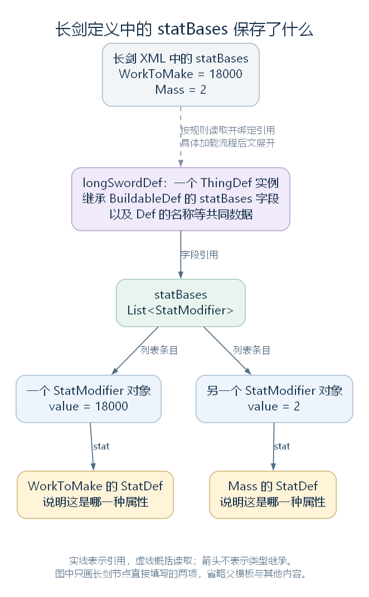

# BuildableDef：属性基础值、材料与放置相关的共同配置（讨论稿）

状态：Def 类型树的 BuildableDef 分支，2026-10-24。依据工作区 RimWorld 1.7.4982 rev1280 的游戏代码与原版内容整理。上接 [Editable 与 Def](31-editable-and-def.md)，范围见 [本部分大纲](29-def-xml-outline.md)。本篇认识本层新增内容，具体建造、配方、属性计算和渲染实现留到相应模块。

## 一、它在类型树上的位置

BuildableDef 的声明为 `public abstract class BuildableDef : Def, IEquatable<BuildableDef>`。它是抽象类，实际使用的是派生类型的实例；ThingDef 与 TerrainDef 都直接继承它。

因此，原版长剑的 ThingDef 也会取得本层字段和方法。阅读这个类时，需要看它实际提供的共同内容，而不能仅按类名把它理解为“只用于建筑的定义”。

| 相对于 Def 新增的内容 | 代表成员 | 本轮首先理解的作用 |
| --- | --- | --- |
| 属性基础值 | statBases | 按属性种类保存基础数值 |
| 成本与制作材料 | costList、costStuffCount、stuffCategories | 保存固定资源需求、可选材料用量和材料类别 |
| 空间与放置相关配置 | Size、passability、pathCost、fertility、terrainAffordanceNeeded | 为占地、通行、肥力和放置条件等判断提供数据 |
| 建造与研究相关条件 | designationCategory、researchPrerequisites、placeWorkers | 连接建造分类、研究检查与专门的放置规则 |
| 图形与界面准备 | graphic、uiIconPath、uiIcon、PostLoad、ResolveIcon | 保存或取得图形与图标相关对象 |

这些继承来的字段仍保存在同一个长剑定义实例中。创建 ThingDef 不会额外创建一份“父类 BuildableDef 对象”。

源码定位：类型声明（`Verse.BuildableDef.cs:9`）、直接子类（`Verse.ThingDef.cs:13`、`Verse.TerrainDef.cs:9`）。

## 二、长剑的 statBases 原来在这一层

原版长剑节点中有这样一段 XML：

```xml
<statBases>
  <WorkToMake>18000</WorkToMake>
  <Mass>2</Mass>
</statBases>
```

BuildableDef 对应声明的是 `List<StatModifier> statBases`。这里的 WorkToMake、Mass 是所引用属性定义的名字；本层没有因此声明两个同名字段。

StatModifier 是普通的配置对象，其核心字段为：

```csharp
public StatDef stat;
public float value;
```

也就是说，一个条目保存“哪一种属性”的定义引用，以及“对应数值”。Mass 对应的条目可以保存指向 Mass 属性定义的引用和数值 2。

该类提供 LoadDataFromXmlCustom 读取这种简写结构。下面的 DirectXmlCrossRefLoader 登记稍后需要绑定的引用，ParseHelper 则把文本转换为 float：

```csharp
public void LoadDataFromXmlCustom(XmlNode xmlRoot)
{
    DirectXmlCrossRefLoader.RegisterObjectWantsCrossRef(this, "stat", xmlRoot.Name, null, null, null);
    this.value = ParseHelper.FromString<float>(xmlRoot.FirstChild.Value);
}
```

因此，XML 的节点名用于登记属性引用，节点中的文本用于填写 value。引用怎样最终绑定、默认读取路径怎样接入自定义方法，沿后面的加载流程继续。



[SVG 矢量图](figures/buildabledef-stat-bases.svg)；[可编辑图源](figures/buildabledef-stat-bases.dot)。longSwordDef 沿用前篇教学示例中的讲解变量。图中只画长剑节点直接填写的两项，省略父模板及其他内容；实线表示引用，虚线概括读取与绑定。

这些仍然是基础数值。玩家最终看到的重量、工作量或其他属性，需要沿属性系统确认还应用了哪些规则。WorkToMake 的 18000 也不能仅凭这段 XML 直接解释为现实中的秒数。

源码定位：基础值列表（`Verse.BuildableDef.cs:284`）、条目的读取与字段（`RimWorld.StatModifier.cs:31`、`RimWorld.StatModifier.cs:48`、`RimWorld.StatModifier.cs:51`）。XML 定位：`RimWorld/Data/Core/Defs/ThingDefs_Misc/Weapons/MeleeMedieval.xml:136`。

## 三、成本与材料：三种数据分别保存什么

本层将固定资源需求与可选制作材料分开保存：

| 成员 | 保存什么 |
| --- | --- |
| costList | ThingDefCountClass 列表，条目主要指定物品定义与数量 |
| costStuffCount | 使用所选制作材料时的基础需求量 |
| stuffCategories | 允许使用的材料类别定义列表 |
| stuffCategorySummary | 供材料需求说明使用的可选文本 |
| costListForDifficulty | 在对应难度条件下提供另一组成本配置 |

这里的制作材料用源码名 stuff 表示，例如钢的 ThingDef；后面出现的 UnityEngine.Material 则是绘制材质，属于另一种对象。

长剑原文件将 costStuffCount 设为 100，并在 stuffCategories 中列出 Metallic、Woody。后两者是 StuffCategoryDef 的名字，表示材料类别；实际选择钢时，物品保存的材料引用仍然是钢的 ThingDef。

MadeFromStuff 的 getter 只根据材料类别列表判断：

```csharp
public bool MadeFromStuff
{
    get
    {
        return !this.stuffCategories.NullOrEmpty<StuffCategoryDef>();
    }
}
```

这个判断说明定义配置了材料类别。具体一种材料是否适合，还要由材料的 StuffProperties.CanMake 等使用位置继续检查。

CostList、CostStuffCount 是读取成本的属性。二者都会先判断 costListForDifficulty 是否存在且 Applies 为 true，满足时返回其中配置，否则使用普通字段。CostStuffCount 的完整实现如下：

```csharp
public int CostStuffCount
{
    get
    {
        if (this.costListForDifficulty != null && this.costListForDifficulty.Applies)
        {
            return this.costListForDifficulty.costStuffCount;
        }
        return this.costStuffCount;
    }
}
```

CostListForDifficulty.Applies 会结合当前难度对象读取配置指定的布尔字段，并考虑 invert。这里先认识它如何参与选择，具体难度选项与缓存更新规则留在使用处解释。

长剑的数据也会交给配方系统。RecipeDefGenerator.SetIngredients 读取 MadeFromStuff、CostStuffCount、CostList 等内容，将它们组织为配方原料需求。因此，保存了需求配置、生成了配方，以及 Pawn 实际收集和消耗材料，分别需要相应代码继续执行。

源码定位：材料判断（`Verse.BuildableDef.cs:23`）、成本属性（`Verse.BuildableDef.cs:120`、`Verse.BuildableDef.cs:134`）、难度条件（`Verse.CostListForDifficulty.cs:13`）、材料适配（`Verse.StuffProperties.cs:59`）、物品与数量条目（`Verse.ThingDefCountClass.cs:130`、`Verse.ThingDefCountClass.cs:133`）、配方原料入口（`RimWorld.RecipeDefGenerator.cs:98`）。XML 定位：`RimWorld/Data/Core/Defs/ThingDefs_Misc/Weapons/MeleeMedieval.xml:134`、`:142`。

## 四、名称相似的判断，需要看它实际读取什么

### 4.1 BuildableByPlayer 读取的是建造分类

这个 getter 的返回语句是：

```csharp
return this.designationCategory != null;
```

designationCategory 是建造分类定义的引用。该属性在这里并不检查配方、原料、生产技能或工作台，所以不能将它的名字直接理解为“玩家能否通过任意方式制造这件物品”。

长剑 XML 的 recipeMaker.researchPrerequisite 属于配方相关配置。它和本层的 researchPrerequisites 列表位于不同的数据位置；同样出现研究条件时，需要沿各自的使用者理解。

### 4.2 其他几个直接判断

| 属性 | 本层实现读取什么 |
| --- | --- |
| Size | 基类默认返回 IntVec2.One；ThingDef 覆写后返回自己的 size 字段 |
| IsResearchFinished | 列表中任一 researchPrerequisites 尚未完成就返回 false；未发现未完成项则返回 true |
| AffectsFertility | 判断 fertility 是否大于或等于 0，字段默认值为 -1 |
| Altitude | 将 altitudeLayer 交给 AltitudeFor，取得该绘制层的高度值 |
| DrawMatSingle | graphic 存在时取得它的 MatSingle，否则返回空引用 |

IsResearchFinished 也展示了定义如何参与运行中的判断：定义保存研究项目引用，getter 读取这些研究的当前完成状态。定义中的配置和 getter 本轮返回的结果，要分别理解。

本层提供的是这些属性的具体返回规则。玩家是否最终能够放置、制造或通行，还要继续查看调用它们的代码。

源码定位：建造分类判断（`Verse.BuildableDef.cs:33`）、占地（`Verse.BuildableDef.cs:13`、`Verse.ThingDef.cs:51`）、研究检查（`Verse.BuildableDef.cs:100`）、肥力与绘制相关属性（`Verse.BuildableDef.cs:43`、`Verse.BuildableDef.cs:58`、`Verse.BuildableDef.cs:68`）。配方研究条件的传递见 `RimWorld.RecipeDefGenerator.cs:28`。

## 五、PlaceWorkers：把专门放置规则接到定义上

placeWorkers 字段保存的是 C# Type 列表。PlaceWorker 是放置规则的共同基类，提供放置检查、预览和放置后处理等方法。PlaceWorkers 属性第一次取得这些对象时，会按列表建立实例并缓存：

```csharp
public List<PlaceWorker> PlaceWorkers
{
    get
    {
        if (this.placeWorkers == null)
        {
            return null;
        }
        if (this.placeWorkersInstantiatedInt == null)
        {
            this.placeWorkersInstantiatedInt = new List<PlaceWorker>();
            foreach (Type type in this.placeWorkers)
            {
                this.placeWorkersInstantiatedInt.Add((PlaceWorker)Activator.CreateInstance(type));
            }
        }
        return this.placeWorkersInstantiatedInt;
    }
}
```

placeWorkers 是配置的类型，placeWorkersInstantiatedInt 是已经建立的对象；后续读取这个属性，可以继续使用同一定义缓存的规则实例。它们与每件物品自己的 ThingComp 分别建立和使用。

BuildableDef.ForceAllowPlaceOver 会取得这份列表，逐个调用其中对象的同名方法；任意一项返回 true，本方法就返回 true，没有规则同意则返回 false。这个结果继续交给放置流程，其他条件仍由具体调用位置决定。

源码定位：规则基类（`Verse.PlaceWorker.cs:9`）、本属性与检查方法（`Verse.BuildableDef.cs:78`、`Verse.BuildableDef.cs:147`）；放置流程入口见 `RimWorld.GenConstruct.cs:333`。

## 六、PostLoad：读取后还要准备图标等内容

本层开始覆写 PostLoad。先认识其中会使用的内容：

| 成员或方法 | 在这里的作用 |
| --- | --- |
| uiIconPath | 单独指定的图标路径 |
| `ContentFinder<Texture2D>.Get` | 按路径取得纹理对象 |
| ResolveIcon | 在需要时从已有图形取得图标相关内容，是可以继续覆写的虚方法 |
| uiIconPathsStuff | 按材料外观配置的图标条目，每条提供 Appearance 与 IconPath |
| stuffUiIcons | 保存材料外观到纹理对象的对应关系 |
| LongEventHandler.ExecuteWhenFinished | 接收一段待执行函数，由长任务处理流程决定执行位置 |

PostLoad 的完整实现如下：

```csharp
public override void PostLoad()
{
    base.PostLoad();
    LongEventHandler.ExecuteWhenFinished(delegate
    {
        if (!this.uiIconPath.NullOrEmpty())
        {
            this.uiIcon = ContentFinder<Texture2D>.Get(this.uiIconPath, true);
        }
        else
        {
            this.ResolveIcon();
        }
        if (this.uiIconPathsStuff != null)
        {
            this.stuffUiIcons = new Dictionary<StuffAppearanceDef, Texture2D>();
            foreach (IconForStuffAppearance iconForStuffAppearance in this.uiIconPathsStuff)
            {
                this.stuffUiIcons.Add(iconForStuffAppearance.Appearance, ContentFinder<Texture2D>.Get(iconForStuffAppearance.IconPath, true));
            }
        }
    });
}
```

base.PostLoad 在这条继承链中继续使用 Editable 的默认空实现。后面的 delegate 保存了具体工作：取得通用图标，必要时再建立按材料外观选择图标的查询表。

ExecuteWhenFinished 先将函数加入自己的列表，满足当前执行条件时可以在这次调用中处理，其余由长任务流程后续推进。因此，这里要看函数实际在哪里被调用，不能只根据方法名认定它总会延后一帧或另开一个线程。

ResolveIcon 的本层实现先检查 graphic 是否可用，处理相关图形分支，再从绘制材质取得纹理与颜色，必要时准备 UI 使用的材质。ThingDef、TerrainDef 还会覆写该方法补充各自行为，资源与绘制细节在对应模块继续。

其他两个入口也使用这些已经准备的数据：GetUIIconForStuff 按材料外观查询图标，无法匹配时使用通用 uiIcon；GetColorForStuff 优先使用 colorPerStuff 中匹配的颜色，没有匹配项时使用材料自身的配置颜色。

源码定位：读取后处理（`Verse.BuildableDef.cs:164`）、函数登记与执行条件（`Verse.LongEventHandler.cs:224`）、图标处理入口（`Verse.BuildableDef.cs:189`、`Verse.BuildableDef.cs:226`、`Verse.BuildableDef.cs:237`）、外观图标条目（`Verse.IconForStuffAppearance.cs:6`）、子类补充（`Verse.ThingDef.cs:1351`、`Verse.TerrainDef.cs:326`）。

## 七、其余方法怎样延续父类能力

本层仍沿用 Def 的 ResolveReferences、ClearCachedData 等接口，并覆写或增加以下方法：

| 方法 | 本层需要认识的内容 |
| --- | --- |
| ConfigErrors | 先遍历父类错误，再检查 useStuffTerrainAffordance 为 true 时 MadeFromStuff 是否也为 true，以及难度成本配置是否指定了 difficultyVar |
| SpecialDisplayStats | 先提供父类条目，再在 BuildableByPlayer 为 true 时汇总地形需求、资源成本及相关定义链接 |
| ToString | 继续返回 defName |
| Equals(BuildableDef other) | 增加针对 BuildableDef 的类型化比较 |

SpecialDisplayStats 读取的字段和属性也需要分别看：可选制作材料的显示在这段实现中直接读取 costStuffCount，固定资源部分读取 CostList。具体界面显示什么，仍需核对实际走到的分支和具体类型的覆写。

Equals 的完整实现很短：

```csharp
public bool Equals(BuildableDef other)
{
    return this.defName == other.defName;
}
```

这里增加的是一个重载，参数为 BuildableDef；上一层的 Equals(Def other) 仍然存在。两段实现的规则不同：Def 版本比较名称哈希和实际类型，本版本直接比较 defName 字符串，也没有在这行代码前检查 other 是否为空。具体调用哪种比较，要看接收者、参数的静态类型与实际调用入口。

源码定位：检查和显示入口（`Verse.BuildableDef.cs:255`、`Verse.BuildableDef.cs:263`）、字符串与比较（`Verse.BuildableDef.cs:272`、`Verse.BuildableDef.cs:278`）。当前反编译文件只显示两种迭代方法的创建入口，实际逻辑已按本地程序集补查，定位见末尾。

## 八、回到长剑：哪些内容已经找到了归属

到这里，长剑的共同数据可以沿类型层次定位：

| 长剑定义中的内容 | 目前确认的声明位置 |
| --- | --- |
| defName、label、description、来源、编号等 | Def |
| statBases、costStuffCount、stuffCategories、图标与部分放置配置 | BuildableDef |
| thingClass、size、物品组件配置、攻击工具等 | 下一步进入 ThingDef |

这说明 XML 中看起来并列的内容，在 C# 中可以分别声明在不同父类。读取器需要沿类型结构找到字段，游戏系统再按自己的入口读取这些数据。接下来阅读 [ThingDef](33-thingdef.md)，按通用数据、功能配置与后处理分组认识，具体子系统继续留到对应模块。

### 补充字段导航

以下字段在本层还承担相应的数据入口，本轮先保留位置与分组，实际作用沿使用系统继续核对：

| 分组 | 相关字段 |
| --- | --- |
| 通行与空间 | passability、pathCost、pathCostIgnoreRepeat、blocksAltitudes、forcePassableByFlyingPawns |
| 放置准备与地面条件 | clearBuildingArea、defaultPlacingRot、forceMoveItemsBeforeConstruction、terrainAffordanceNeeded、useStuffTerrainAffordance |
| 建造前提 | buildingPrerequisites、discoveryPrerequisites、minMonolithLevel、constructionSkillPrerequisite、artisticSkillPrerequisite、minTechLevelToBuild、maxTechLevelToBuild、requireInspectedGravEngine |
| 分类、风格与菜单 | drawStyleCategory、dominantStyleCategory、isAltar、ideoBuilding、canGenerateDefaultDesignator、designatorDropdown、designationHotKey、uiOrder |
| 拆解与效果 | resourcesFractionWhenDeconstructed、repairEffect、constructEffect、specialDisplayRadius |
| 图标位置与颜色 | uiIconOffset、uiIconColor、uiIconColorTwo、uiIconForStackCount、colorPerStuff、uiIconMaterial、uiIconAngle |
| 蓝图与施工框架引用 | blueprintDef、installBlueprintDef、frameDef |
| 运行中准备的对象 | placeWorkersInstantiatedInt、graphic、uiIcon、stuffUiIcons |
| 临时显示列表 | 静态字段 tmpCostList、tmpHyperlinks |

这些字段表示配置或保存的位置；并非每一种 ThingDef 都会使用其中的每一项。蓝图、施工框架、菜单和效果如何建立，分别在定义生成、建造、界面与表现模块继续。

### 迭代实现的补充定位

| 方法 | 本地 Assembly-CSharp.dll 中的核对位置 |
| --- | --- |
| `Verse.BuildableDef+<ConfigErrors>d__82.MoveNext` | Token 0x0600ED15；IL_0034 起遍历父类错误，IL_0091 起检查材料地面条件，IL_00BE 起检查难度成本配置 |
| `Verse.BuildableDef+<SpecialDisplayStats>d__85.MoveNext` | Token 0x0600ED1E；IL_003A 起接入父类条目，IL_0097 起判断建造分类，IL_00A1 起汇总地形需求，IL_01BA 起组织成本与链接 |

这里记录实际核对依据，正文按功能说明其输入、判断和结果，不展开编译器生成的迭代器状态字段。
