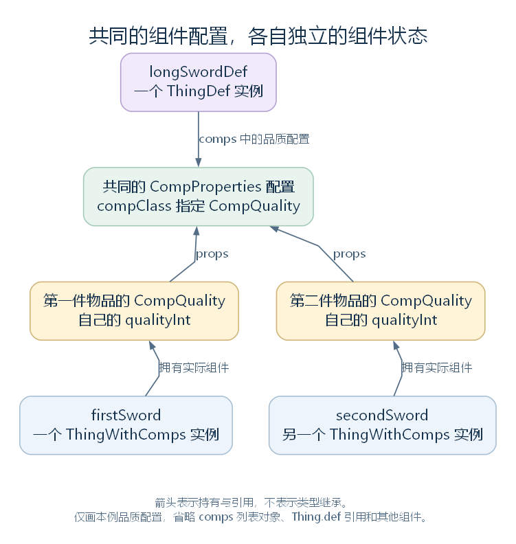

# ThingDef：把配置连接到具体游戏对象（讨论稿）

状态：ThingDef 的结构概览与长剑主线，2026-10-24。依据工作区 RimWorld 1.7.4982 rev1280 的游戏代码与原版内容整理。上接 [BuildableDef](32-buildabledef.md)，范围见 [本部分大纲](29-def-xml-outline.md)。本轮按用途认识数据，重点展开长剑所需的类型选择、组件配置、攻击工具与加载后处理；各专用系统的完整实现按后续模块继续。

整合说明（2026-10-27）：本章保留 ThingDef 与普通配置、其他 Def 的关系，以及配置查询和加载后整理。第三节用于区分配置与实际组件的创建节选仅作研究记录；InitializeComps 与实际组件状态转入 [物品模块](42-thingmaker-and-instance-state.md)，攻击执行与属性计算也留到各自系统。

## 一、ThingDef 覆盖哪些内容

ThingDef 直接继承 BuildableDef。它为 Thing 体系中的物品、建筑、植物、Pawn、弹射物等对象提供定义数据入口，范围比背包中的“物品”更广。

本例的长剑定义仍是一个 ThingDef 实例。它已经继承 Def 的名称、描述与来源，以及 BuildableDef 的属性基础值、材料和成本等数据；本层再增加实际对象类型、组件、图形、攻击和具体功能配置。

先按用途认识主要成员：

| 数据组 | 代表成员 | 首先要分清的关系 |
| --- | --- | --- |
| 类型与大类 | thingClass、category | 前者指定实际对象的 C# 类型，后者是 ThingCategory 枚举值 |
| 通用规则 | tickerType、stackLimit、size、useHitPoints、startingHpRange、destroyable、rotatable | 描述更新类别、堆叠、占地、耐久与其他通用条件，具体执行由使用者负责 |
| 组件配置 | comps | 列表保存 CompProperties 配置对象，实际 ThingComp 在物品创建等路径中建立 |
| 图形与显示 | graphicData、drawerType、inspectorTabs、drawGUIOverlay | 为图形准备、绘制入口和界面提供配置 |
| 攻击与装备 | tools、verbs、equipmentType、weaponClasses、weaponTags | 保存攻击工具、动作配置与装备相关分类 |
| 配方与产物 | recipeMaker、recipes、butcherProducts、smeltProducts、killedLeavings | 连接配方生成、可用配方和其他产物规则 |
| 专用配置块 | building、race、apparel、plant、ingestible、projectile、stuffProps 等 | 按对象用途保存相应配置，具体类型通常只使用其中一部分 |
| 关联与缓存 | entityDefToBuild、inspectorTabsResolved、allRecipesCached、concreteExamplesInt 等 | 连接其他定义，或保存后续准备的查询结果与对象 |

这些成员中，既有直接数值，也有对其他 Def 的引用，还有普通 C# 配置对象。它们没有全部处在同一条 Def 继承树中。

源码定位：类型（`Verse.ThingDef.cs:13`）、通用字段（`Verse.ThingDef.cs:1554`、`Verse.ThingDef.cs:1557`、`Verse.ThingDef.cs:1560`、`Verse.ThingDef.cs:1563`、`Verse.ThingDef.cs:1566`、`Verse.ThingDef.cs:1578`、`Verse.ThingDef.cs:1699`）、组件（`Verse.ThingDef.cs:1584`）、图形与功能配置（`Verse.ThingDef.cs:1814`、`Verse.ThingDef.cs:2038`、`Verse.ThingDef.cs:2041`、`Verse.ThingDef.cs:2103`）。

## 二、三种“类别”与几处类型选择

### 2.1 category、thingCategories、stuffCategories 分别是什么

| 成员 | 数据类型 | 本例与用途 |
| --- | --- | --- |
| category | ThingCategory 枚举 | 长剑从 BaseWeapon 取得 Item；多个通用判断读取这个大类 |
| thingCategories | ThingCategoryDef 列表 | 武器模板配置了 WeaponsMelee 等分类，IsWithinCategory 会沿其父分类继续查找 |
| stuffCategories | 从 BuildableDef 继承的 StuffCategoryDef 列表 | 长剑的 Metallic、Woody 等材料类别 |

XML 节点名、字段名和所引用的定义名需要分别看。这里出现了不同层次的分类，实际由不同查询入口使用。

### 2.2 Class、thingClass 与 compClass 决定哪个对象的类型

| 位置 | 决定什么 |
| --- | --- |
| 定义节点的 Class 属性 | 读取这份定义时使用的 C# 类型；本例长剑节点没有填写 Class，使用 ThingDef |
| ThingDef.thingClass | ThingMaker.MakeThing 为本例创建实际物品时使用的 C# 类型，原版模板指定 ThingWithComps |
| 组件配置节点的 Class 属性 | 选择该配置对象的 C# 类型，例如 CompProperties_Forbiddable |
| CompProperties.compClass | 实际组件创建时使用的 ThingComp 类型，例如 CompQuality |

Class 是 XML 中提供的类型选择信息，具体作用取决于当前正在读取哪个对象。thingClass、compClass 则是已经建立的配置对象中的 Type 字段，供后续创建代码使用。

例如，BaseWeapon 中真实存在的这一行：

```xml
<li Class="CompProperties_Forbiddable"/>
```

它要求建立 CompProperties_Forbiddable 配置。这个类的构造函数再把 compClass 设为 CompForbiddable，因此配置对象与实际组件分别有自己的类型。

源码定位：分类查询（`Verse.ThingDef.cs:1513`）、定义类型选择（`Verse.DirectXmlToObjectNew.cs:16`）、普通节点的类型选择（`Verse.DirectXmlToObjectNew.cs:1297`）、组件类型字段（`Verse.CompProperties.cs:60`）、专用配置示例（`RimWorld.CompProperties_Forbiddable.cs:10`）。XML 定位：`RimWorld/Data/Core/Defs/ThingDefs_Misc/Weapons/BaseWeapons.xml:25`。

## 三、comps 保存配置，物品创建自己的组件

ThingDef.comps 的声明是 `List<CompProperties>`。CompProperties 是普通配置对象的基类，提供 compClass 字段，以及供具体配置继续覆写的整理、检查等方法。

长剑使用的 BaseMeleeWeapon_Sharp_Quality 模板中，品质配置条目是：

```xml
<li>
  <compClass>CompQuality</compClass>
</li>
```

本条使用通用 CompProperties，设置实际组件类型为 CompQuality。其他配置可以像上一节的禁用配置一样，使用派生的 CompProperties 类型保存更多字段。

实际物品沿前篇的 ThingMaker.MakeThing 创建后，ThingWithComps.PostMake 会调用 InitializeComps。后者遍历定义中的配置，建立实际组件。下面摘出循环中的连续四行：this 是当前物品，i 是配置序号，thingComp 是准备保存新组件的局部变量；this.def.comps 是定义配置列表，this.comps 则是本物品的实际组件列表。

```csharp
thingComp = (ThingComp)Activator.CreateInstance(this.def.comps[i].compClass);
thingComp.parent = this;
this.comps.Add(thingComp);
thingComp.Initialize(this.def.comps[i]);
```

ThingComp.Initialize 的默认实现将传入配置保存到 props：

```csharp
public virtual void Initialize(CompProperties props)
{
    this.props = props;
}
```

具体组件可以覆写初始化，本例 CompQuality 沿用这个实现。因此，两件长剑各有自己的 CompQuality 和 qualityInt，但这些组件的 props 可以引用定义中同一个品质配置对象。



[SVG 矢量图](figures/thingdef-comp-properties.svg)；[可编辑图源](figures/thingdef-comp-properties.dot)。longSwordDef、firstSword、secondSword 沿用前篇教学示例的变量名。箭头表示持有与引用；图中仅画主要关系，省略定义和物品中的 comps 列表对象、Thing.def 引用及其他组件。

这里要分别认识 ThingDef、CompProperties 配置与 ThingComp 实际组件。它们分别负责定义、配置和每个物品中的实际功能与状态。ThingComp 也继续使用游戏层的组件体系，与上一章的 UnityEngine.Component 分别理解。

源码定位：组件配置列表（`Verse.ThingDef.cs:1584`）、创建后处理与组件建立（`Verse.ThingWithComps.cs:105`、`Verse.ThingWithComps.cs:195`）、默认初始化与引用字段（`Verse.ThingComp.cs:25`、`Verse.ThingComp.cs:462`、`Verse.ThingComp.cs:465`）、品质组件（`RimWorld.CompQuality.cs:8`）。XML 定位：`RimWorld/Data/Core/Defs/ThingDefs_Misc/Weapons/BaseWeapons.xml:179`。

## 四、定义级查询与实际组件查询

ThingDef 提供多种查看组件配置的方法。它们操作定义中的 comps，返回配置或判断结果；ThingWithComps.GetComp 才在相应物品上取得实际组件。

| 方法 | 类型条件与结果 |
| --- | --- |
| `CompDefFor<T>()` | T 是 ThingComp 类型；要求 compClass 与 T 完全相同，返回首个 CompProperties |
| `CompDefForAssignableFrom<T>()` | T 是 ThingComp 类型；允许匹配可赋给 T 的组件类型，返回首个配置 |
| HasComp(Type compType) | 要求 compClass 与传入类型完全相同 |
| `HasComp<T>()` | T 是 ThingComp 类型；允许相同类型及可赋给 T 的派生类型 |
| HasAssignableCompFrom(Type compType) | 按类型可赋值关系判断 |
| `GetCompProperties<T>()` | T 是 CompProperties 类型；按配置对象自己的类型查找首个匹配项 |
| `ThingWithComps.GetComp<T>()` | 在实际物品上查询 ThingComp 实例 |

例如，查询品质配置与查询某把长剑的 CompQuality，是在不同列表中查找不同对象。即使方法名相近，也要检查参数约束、比较规则和返回类型。

源码定位：定义级查询（`Verse.ThingDef.cs:1200`、`Verse.ThingDef.cs:1213`、`Verse.ThingDef.cs:1226`、`Verse.ThingDef.cs:1239`、`Verse.ThingDef.cs:1252`、`Verse.ThingDef.cs:1265`）、实际组件查询（`Verse.ThingWithComps.cs:119`）。

## 五、攻击工具：把长剑的配置接到动作定义

长剑本地节点的 tools 配置了 handle、point、edge 三个攻击条目。以下是 point 条目的完整 XML：

```xml
<li>
  <label>point</label>
  <capacities>
    <li>Stab</li>
  </capacities>
  <power>23</power>
  <cooldownTime>2.6</cooldownTime>
</li>
```

ThingDef.tools 保存 Tool 对象的列表。Tool 是普通配置对象，其中 capacities 是 ToolCapacityDef 引用列表，power 与 cooldownTime 保存数值；这些攻击条目没有各自成为一件 Thing 物品。

Tool.Maneuvers 会在 ManeuverDef 数据库中选择 requiredCapacity 被当前 capacities 包含的条目，Tool.VerbsProperties 再取得对应的 verb 配置。这样，本例的 Stab 能力配置接到了后续动作定义及 VerbProperties。

ThingDef 另有 verbs 字段，保存直接配置的 VerbProperties。当前字段为 private，公开的 Verbs 属性在字段存在时返回它，否则返回共享空列表。普通读取器怎样处理字段可见性，后面沿 XML 路径继续。

### 5.1 定义怎样判断“这是武器”

IsWeapon 的完整实现为：

```csharp
public bool IsWeapon
{
    get
    {
        return this.category == ThingCategory.Item && (!this.verbs.NullOrEmpty<VerbProperties>() || !this.tools.NullOrEmpty<Tool>()) && !this.IsApparel;
    }
}
```

这里读取大类、verbs 或 tools 是否有内容，以及服装判断；IsApparel 在本类中读取 apparel 是否存在。equipmentType、weaponTags 或类名本身，都没有直接出现在这条判断中。

IsRangedWeapon 先要求 IsWeapon 为 true，再检查配置的 verbs 中是否存在非近战动作；VerbProperties.IsMeleeAttack 又依据 verbClass 是否属于 Verb_MeleeAttack 分支判断。IsMeleeWeapon 则返回 IsWeapon 与非 IsRangedWeapon 的组合。

这些都还是定义上的分类与配置查询。23 是本条 Tool 的 power，2.6 是 cooldownTime；Tool 已提供将这些值与装备及材料属性结合的计算入口。实际攻击怎样被选中、命中、计算防护并造成伤害，留到动作与战斗模块。

源码定位：工具列表与动作字段（`Verse.ThingDef.cs:2038`、`Verse.ThingDef.cs:2041`）、Verbs 属性（`Verse.ThingDef.cs:324`）、工具关联和计算入口（`Verse.Tool.cs:27`、`Verse.Tool.cs:37`、`Verse.Tool.cs:46`）、分类（`Verse.ThingDef.cs:527`、`Verse.ThingDef.cs:667`、`Verse.ThingDef.cs:900`、`Verse.ThingDef.cs:924`）、动作类型判断（`Verse.VerbProperties.cs:64`）。XML 定位：`RimWorld/Data/Core/Defs/ThingDefs_Misc/Weapons/MeleeMedieval.xml:155`。

## 六、recipeMaker 怎样连接到另一份定义

recipeMaker 是 RecipeMakerProperties 配置对象。本例在其中填写 LongBlades 研究要求、Crafting 技能要求和显示顺序；父模板还提供其他制作相关配置。

RecipeDefGenerator.CreateRecipeDefFromMaker 取得这份配置，建立或取得 RecipeDef，填写其原料、产物、工作和研究条件等数据。进入这个生成方法时，它按 Make_ 加上输入定义的 defName 形成名字；对于本例输入，对应 Make_MeleeWeapon_LongSword。

其中产品列表会保存指向长剑 ThingDef 的引用。因此，“描述一种长剑”和“描述制造长剑的配方”可以分别由 ThingDef 与 RecipeDef 表示，再通过引用关联起来。自动生成定义的完整顺序在后面的加载部分继续。

还需分别认识 recipes 与 AllRecipes：AllRecipes 合并当前定义自己的 recipes，以及将当前定义列入 recipeUsers 的配方，并保存缓存。这条关系会在工作台与配方模块继续，不应只按属性名字推断它表示某件物品的全部制造方式。

源码定位：配方配置字段（`Verse.ThingDef.cs:1633`）、生成入口（`RimWorld.RecipeDefGenerator.cs:28`）、配方查询（`Verse.ThingDef.cs:184`）。XML 定位：`RimWorld/Data/Core/Defs/ThingDefs_Misc/Weapons/MeleeMedieval.xml:172`。

## 七、PostLoad 与 ResolveReferences 开始整理哪些内容

ThingDef 继承前面的处理体系，并给具体配置接上更多准备工作。

### 7.1 PostLoad 按什么顺序安排工作

| 源码顺序 | 本层工作 |
| --- | --- |
| graphicData 存在时 | 向 LongEventHandler 登记图形准备函数，取得 Graphic 等对象，并按相应分支处理图集 |
| tools 存在时 | 按本定义列表中的位置，为各 Tool 填写 id |
| 只有一个 verb 且没有 label 时 | 将定义 label 写入该动作配置 |
| 调用 base.PostLoad | 进入 BuildableDef 的图标等准备逻辑 |
| 建筑大类但缺少 building 时 | 建立 BuildingProperties 配置对象 |
| building、apparel、plant 存在时 | 调用各自的 PostLoadSpecial |
| comps 存在时 | 逐个调用 CompProperties.PostLoadSpecial，将当前 ThingDef 传入 |

图形准备先登记，之后才调用父类安排图标准备；执行时机仍由 LongEventHandler 的实际处理决定。本轮先看清配置如何接入这些位置，后端资源和绘制过程沿对应模块继续。

以下是 PostLoad 中处理工具、动作名称并进入父类的连续片段：

```csharp
if (this.tools != null)
{
    for (int i = 0; i < this.tools.Count; i++)
    {
        this.tools[i].id = i.ToString();
    }
}
if (this.verbs != null && this.verbs.Count == 1 && this.verbs[0].label.NullOrEmpty())
{
    this.verbs[0].label = this.label;
}
base.PostLoad();
```

工具 id 在这里是本定义工具列表中的位置标识，并非每件实际长剑的物品编号。PostLoadSpecial 此时处理的也仍是定义中的配置对象；每件物品的 ThingComp 在其创建路径中另外建立。

### 7.2 ResolveReferences 继续整理嵌套配置和引用

本方法先调用父类，沿继承关系进入 Def 的扩展处理。随后按配置是否存在，设置 ingestible、stuffProps 的 parent，调用建筑、图形、种族、材料与服装配置的 ResolveReferencesSpecial，补充默认声音，取得 inspectorTabs 对应的共享界面对象，并逐项调用组件配置的 ResolveReferences。

例如，末段处理的是同一份 comps 配置列表：

```csharp
if (this.comps != null)
{
    for (int j = 0; j < this.comps.Count; j++)
    {
        this.comps[j].ResolveReferences(this);
    }
}
```

因此，这个方法除了整理引用，也准备一些运行时查询要用的信息。它不等于单独建立一件长剑，更没有在这里完成玩家的制造任务。

源码定位：本层读取后处理（`Verse.ThingDef.cs:1279`）、图标补充（`Verse.ThingDef.cs:1351`）、引用整理（`Verse.ThingDef.cs:1403`）、组件配置入口（`Verse.CompProperties.cs:38`、`Verse.CompProperties.cs:49`）。

## 八、其他查询与后续研究入口

ThingDef 还有许多针对具体系统的属性和方法。以下按用途保留导航，本篇不逐项展开所有判断：

| 分组 | 代表入口与后续方向 |
| --- | --- |
| 通用信息与更新选择 | Size、EverHaulable、VolumePerUnit、HasThingIDNumber，及 tickerType 等字段；地图与 tick 模块继续解释使用方式 |
| 基础属性 | BaseMaxHitPoints、BaseFlammability、BaseMarketValue、BaseMass 通过属性系统查询定义相关的值，不是直接读取每件物品的当前状态 |
| 地图与存储 | BlocksPlanting、CanSpawnAt、EverStorable、CanOverlapZones、AffectsRegions、AffectsReachability 等 |
| 类型与功能分类 | IsApparel、IsStuff、IsIngestible、IsPlant、IsWorkTable 等分类属性，以及 projectile 等配置；各自按具体实现核对 |
| 显示与信息 | DescriptionDetailed、LabelAsStuff、ResolveIcon、SpecialDisplayStats 等 |
| 查询定义 | Named 是对 DefDatabase 按名查询的简短入口；IsWithinCategory 沿分类父链查找 |
| 解锁通知 | Notify_UnlockedByResearch 将通知继续交给各组件配置 |
| 示例与缓存 | GetConcreteExample 按材料缓存示例对象；它与前篇直接调用 MakeThing 建立两件独立物品的用途不同 |
| 配置检查与完整面板 | ConfigErrors、SpecialDisplayStats 在当前反编译文件中显示迭代器入口；具体检查和展示项目随相应功能研究继续 |

原版武器模板将 tickerType 配置为 Never，这是供相应 tick 管理读取的配置；被攻击、设置品质、执行攻击等入口要沿各自调用理解。它不能仅凭名字解释为“这个物品从此不会再执行任何代码”。

专用配置与配套方法分别留给建筑、Pawn、植物、食物、装备、材料、战斗、界面和渲染等模块。后续引用本篇时，以已展开的输入、输出和具体条件为准。

源码定位：基础信息与属性（`Verse.ThingDef.cs:17`、`Verse.ThingDef.cs:37`、`Verse.ThingDef.cs:51`、`Verse.ThingDef.cs:71`、`Verse.ThingDef.cs:106`）、地图和存储入口（`Verse.ThingDef.cs:1142`、`Verse.ThingDef.cs:1148`、`Verse.ThingDef.cs:1154`）、示例查询（`Verse.ThingDef.cs:1175`）、配置检查（`Verse.ThingDef.cs:1485`）、按名入口与解锁通知（`Verse.ThingDef.cs:1493`、`Verse.ThingDef.cs:1533`）、信息条目（`Verse.ThingDef.cs:1545`）。

## 九、这一步与后面的加载流程怎样衔接

现在已经能沿长剑找到几种不同的数据：父类的共同字段、Tool 等普通配置对象、组件配置对象、对其他定义的引用，以及加载后准备的图形和查询缓存。实际长剑再通过 def 和组件的 props 等关系使用这些共同内容，同时保存自己的状态。

下一步回到 [DefDatabase](34-defdatabase.md)，解释这些定义怎样按类型保存、怎样按名称取得，以及内容包中的定义如何进入全局数据库。随后沿内容来源和 XML 读取流程，追踪本篇这些字段、配置对象与引用是怎样建立的。
