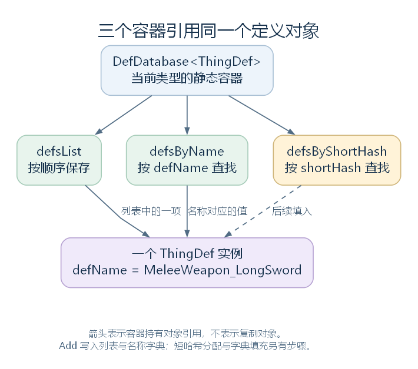
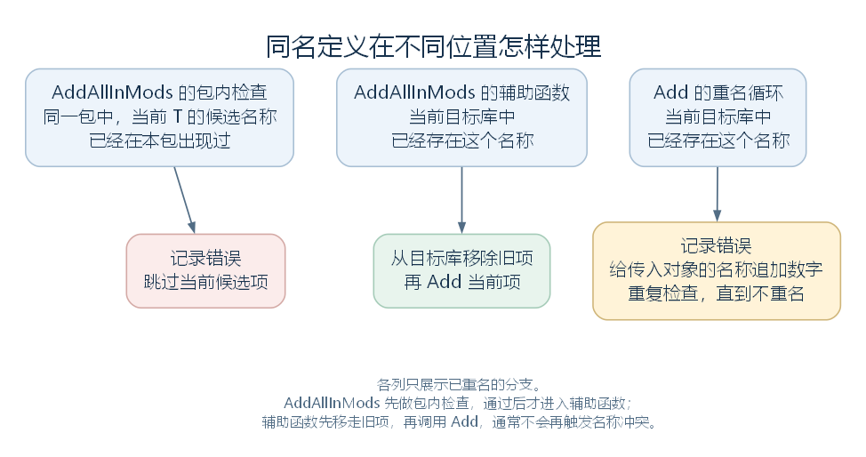

# DefDatabase：定义怎样保存、查询与替换（讨论稿）

状态：定义数据库的结构与普通启动时的入库行为，2026-10-24。依据工作区 RimWorld 1.7.4982 rev1280 的游戏代码整理。上接 [ThingDef](33-thingdef.md)，范围见 [本部分大纲](29-def-xml-outline.md)。本篇先认识已经建立的 Def 对象怎样被保存和取得；内容包与 XML 怎样建立这些对象，留到下一步沿加载流程展开。

## 一、DefDatabase 是什么

前面已经认识了长剑的 ThingDef。现在假设游戏完成了必要的定义加载，某段代码需要取得它，可以按名称查询。

下面是教学调用示例，longSwordDef 是本例声明的局部变量：

```csharp
ThingDef longSwordDef = DefDatabase<ThingDef>.GetNamed("MeleeWeapon_LongSword");
```

这次调用在内存中寻找已经保存的定义对象。它不会重新读取长剑 XML，也不会创建一件实际长剑。后者需要继续调用前面读过的 ThingMaker.MakeThing 等入口。

DefDatabase 的类型声明是：

```csharp
public static class DefDatabase<T> where T : Def
```

它是静态泛型类。T 必须是 Def 或其派生类型；将 T 换成 ThingDef、RecipeDef 等类型，就分别得到保存这些类型定义的静态成员。

例如，`DefDatabase<ThingDef>` 与 `DefDatabase<RecipeDef>` 各有自己的列表和字典，不是先创建一个数据库实例，再向实例传入类型。这里的“数据库”主要指这些内存容器及其操作方法。

源码定位：类型（`Verse.DefDatabase.cs:10`）、按名称查询（`Verse.DefDatabase.cs:251`）。

## 二、三个容器保存什么

DefDatabase 的主要数据只有三组：

| 字段 | 类型 | 用途 |
| --- | --- | --- |
| defsList | `List<T>` | 顺序保存定义，用于遍历、计数和按位置编号 |
| defsByName | `Dictionary<string, T>` | 以 defName 为键查找定义 |
| defsByShortHash | `Dictionary<ushort, T>` | 以 shortHash 为键查找定义，后续单独填充 |

同一个定义可以同时被这三个容器引用。列表和字典中保存的是对象引用，未因此复制出三份长剑定义。



图中省略其他定义与实际的数值、列表位置。虚线表示短哈希字典在后续阶段填充；单独调用 Add 不会完成这一步。[SVG](figures/defdatabase-object-indexes.svg) · [图源](figures/defdatabase-object-indexes.dot)

### 2.1 遍历入口返回原列表

AllDefs 以 `IEnumerable<T>` 的类型返回 defsList；AllDefsListForReading 则直接返回 `List<T>`。下面是后者的完整属性：

```csharp
public static List<T> AllDefsListForReading
{
    get
    {
        return DefDatabase<T>.defsList;
    }
}
```

二者都没有复制列表。ForReading 表达了使用意图，但返回类型没有强制禁止修改；直接改这份列表也不会自动同步名称字典。因此，理解调用方的行为时，要看它实际拿这个引用做了什么。

DefCount 返回 defsList.Count；GetRandom 从 defsList 中选择一项。

### 2.2 按名称或短哈希查询

| 方法 | 查哪里 | 找不到时的处理 |
| --- | --- | --- |
| GetNamed(defName) | defsByName | 默认记录错误，返回 null |
| GetNamed(defName, false) | defsByName | 返回 null，不记录该缺失错误 |
| GetNamedSilentFail(defName) | 调用上一行的方法 | 同上 |
| GetByShortHash(shortHash) | defsByShortHash | 返回 null |

源码返回的是 `default(T)`；由于 T 继承 Def，在这里就是 null。errorOnFail 控制的是缺失名称时是否记录错误，不是在这条缺失分支中抛出异常。

GetNamedSilentFail 的实现很短：

```csharp
public static T GetNamedSilentFail(string defName)
{
    return DefDatabase<T>.GetNamed(defName, false);
}
```

这也解释了一个实际现象：拼错 defName 后，查询无法按显示名称或描述“猜出”所需定义。字典查找使用的就是传入的名称键。

源码定位：三个字段（`Verse.DefDatabase.cs:346`、`Verse.DefDatabase.cs:349`、`Verse.DefDatabase.cs:352`）、遍历与计数（`Verse.DefDatabase.cs:14`、`Verse.DefDatabase.cs:24`、`Verse.DefDatabase.cs:34`）、查询（`Verse.DefDatabase.cs:251`、`Verse.DefDatabase.cs:285`、`Verse.DefDatabase.cs:291`、`Verse.DefDatabase.cs:312`）。

## 三、内容包与按类型的数据库怎样连接

内容包与 DefDatabase 从不同角度保存定义。

ModContentPack 的 AllDefs 返回该内容包保存的定义；AddDef 会填写定义的 modContentPack、fileName，再将它放入内容包自己的列表。一个包中可以同时有 ThingDef、RecipeDef 等不同类型。

DefDatabase 则按 T 组织定义。它从各包选出目标类型的项，再放到当前类型的列表和字典中。GenDefDatabase.DefsToGoInDatabase 的完整实现是：

```csharp
public static IEnumerable<T> DefsToGoInDatabase<T>(ModContentPack mod)
{
    return mod.AllDefs.OfType<T>();
}
```

OfType 的含义是“能作为 T 使用的对象”，因此也包含 T 的派生类型。这里不是只选 `GetType() == typeof(T)` 的对象。

普通启动的 DoPlayLoad 会对 Def 的各个子类调用对应的 AddAllInMods；这里使用的 AllSubclasses 也包含抽象子类。因此，同一个长剑 ThingDef 可以被 `DefDatabase<ThingDef>` 与 `DefDatabase<BuildableDef>` 引用。两套静态容器彼此独立，其中的对象仍可能相同。

这两个角度也解释了“替换”的范围：从某个目标数据库移除旧项，不等于从原内容包中删除它，更不等于把所有已经持有旧对象的引用都改成新对象。

源码定位：内容包优先级与内容列表（`Verse.ModContentPack.cs:95`、`Verse.ModContentPack.cs:125`）、内容包添加定义（`Verse.ModContentPack.cs:610`）、类型筛选（`Verse.GenDefDatabase.cs:63`）、启动入口（`Verse.PlayDataLoader.cs:94`）、子类枚举（`Verse.GenTypes.cs:96`）。

## 四、AddAllInMods：先后顺序与三种重名处理

AddAllInMods 将已经建立的定义收集到当前的 `DefDatabase<T>`。它不负责把 XML 节点读成 C# 对象。

### 4.1 先按什么顺序处理

当前代码先按 ModContentPack.OverwritePriority 升序排列内容包，再按它们在 RunningModsListForReading 中的位置排列。

OverwritePriority 对 Core 返回 0，对其他内容包返回 1。因此，这一步先处理 Core，再按运行中列表的顺序处理其他包。在这一轮入库中，后处理的包有机会替换目标库中已经存在的同名定义。

每开始一个内容包，方法都会清空本轮使用的 `HashSet<string>`，用它记录这个包中已经遇到的名称。完成各包后，还会处理 PatchedDefsForReading 中能作为 T 使用的定义对象。

这里的 PatchedDefsForReading 已经是 Def 对象集合。ParseAndProcessXML 在建立定义后，如果未找到对应的内容包来源，就将它放入 patchedDefs；不能把这段循环理解成“此时才开始执行所有 XML 补丁”。XML 补丁的执行位置将在加载流程中单独核对。

### 4.2 “同名”不是只有一种结果

| 出现位置 | 当前代码怎样处理 |
| --- | --- |
| 同一内容包中，为当前 T 筛出的候选项再次出现同名 | 记录错误，跳过后来这一项 |
| 通过 AddAllInMods 的辅助函数入库，目标库已有同名项 | 从目标库移除旧项，再添加当前项 |
| 直接调用 Add，名称已被目标库使用 | 记录错误，给传入对象的 defName 追加数字，重复检查直到不重名，再添加 |



图中各列只画已经发生重名的分支。前两列是在 AddAllInMods 内先后发生的检查，不能把它们看成三种可以任选的设置；PatchedDefsForReading 中的项直接进入辅助函数。[SVG](figures/defdatabase-name-conflicts.svg) · [图源](figures/defdatabase-name-conflicts.dot)

辅助函数在当前反编译文件中的名称为 `<AddAllInMods>g__AddDef|9_0`。这是编译器生成的名称。它先处理 defName 仍为 UnnamedDef 的情况，记录错误并生成临时名称；随后执行下面这个连续片段，def 是当前准备添加的定义，t 用来取得旧项：

```csharp
T t;
if (DefDatabase<T>.defsByName.TryGetValue(def.defName, out t))
{
    DefDatabase<T>.Remove(t);
}
DefDatabase<T>.Add(def);
```

所以，跨内容包覆盖时，进入 Add 前旧名称已经被移走，通常不会触发 Add 内部的重名改名循环。同包去重则发生得更早：被跳过的项根本不会进入这个辅助函数。

换成长剑的教学情境：一个后处理的内容包提供了另一个同名 ThingDef，通过辅助函数入库后，按 MeleeWeapon_LongSword 查询会取得后来入库的对象。但同一个包中重复提供两项同名定义，后一项会被跳过。直接在代码中 Add 一个同名定义，又会走追加数字的处理。

这些是当前阶段对已经建立的对象的处理规则。XML 模板继承、补丁如何修改节点，以及修改后到底建立了哪些对象，需要沿各自流程判断。

源码定位：收集与排序（`Verse.DefDatabase.cs:43`）、入库辅助函数（`Verse.DefDatabase.cs:319`）、直接添加（`Verse.DefDatabase.cs:90`）、移除（`Verse.DefDatabase.cs:118`）、优先级（`Verse.ModContentPack.cs:95`、`Verse.ModContentPack.cs:105`）、XML 对象分配来源（`Verse.LoadedModManager.cs:437`）。

## 五、Add 与 index：加入列表后怎样编号

Add(T def) 先拒绝 null；如果当前名称已经存在，就在循环中记录错误，给传入对象的 defName 追加随机数字，并调用 ResolveDefNameHash 更新名称哈希。

完成重名检查后，真正保存对象的是连续两行：

```csharp
DefDatabase<T>.defsList.Add(def);
DefDatabase<T>.defsByName.Add(def.defName, def);
```

随后，方法将 def.index 设为列表末项的位置，转换为 ushort。定义过多、列表 Count 超过 65535 时会记录错误；当前方法没有因为这条错误而撤销添加。

Add(IEnumerable<T> defs) 则遍历传入集合，逐个调用 Add(T def)。它没有另设一套重名规则。

### 5.1 index 会重新排列

private 方法 Remove 从名称字典和列表中移除目标，再调用 SetIndices。后者完整实现如下：

```csharp
private static void SetIndices()
{
    for (int i = 0; i < DefDatabase<T>.defsList.Count; i++)
    {
        DefDatabase<T>.defsList[i].index = (ushort)i;
    }
    for (int j = 0; j < DefDatabase<T>.defsList.Count; j++)
    {
        DefDatabase<T>.defsList[j].PostSetIndices();
    }
}
```

这是分开的两轮：先写完所有 index，再调用各定义的 PostSetIndices，让具体类型在这一轮编号完成后继续处理。

因此 index 会随重新排列而改变，不是永不变化的定义身份标识。此外，一个 Def 对象可能出现在多个兼容类型的库中，而对象本身只有一个 index 字段；每次 SetIndices 写入的都是当前列表的位置。理解某处实际使用的 index，还要结合加载阶段和调用顺序。

源码定位：集合添加与单项添加（`Verse.DefDatabase.cs:81`、`Verse.DefDatabase.cs:90`）、移除与编号（`Verse.DefDatabase.cs:118`、`Verse.DefDatabase.cs:210`）、基类的编号后入口（`Verse.Def.cs:59`）、index 字段（`Verse.Def.cs:157`）。

## 六、shortHash 在另一个阶段准备

到 Add 结束时，定义已经进入列表与名称字典；这个方法没有分配 shortHash，也没有将定义放入 defsByShortHash。

普通启动在后续调用 ShortHashGiver.GiveAllShortHashes。它按所选数据库类型，取出定义、按 defName 排序，再逐项分配短哈希，最后调用对应库的 InitializeShortHashDictionary。

分配时，以 defName 的 StableStringHash 计算一个 ushort 候选值。若候选值为 0，或在这一组中已经被占用，就不断加一寻找可用值，最后写入 def.shortHash。已经持有非零 shortHash 的对象在这个入口会被记录错误并跳过分配。

这里的分组也有筛选：GenDefDatabase.AllDefTypesWithDatabases 跳过抽象类，并排除那些在 Def 以下已有非抽象祖先的类型。例如 ThingDef 继承的 BuildableDef 是抽象类，因此选择 ThingDef；ThingDef 的进一步派生类则不会在这里另开一组短哈希。不能由“存在某个 `DefDatabase<T>`”推断短哈希分配入口会遍历它。

分配数值以后，数据库再填入查询字典：

```csharp
public static void InitializeShortHashDictionary()
{
    DefDatabase<T>.defsByShortHash.EnsureCapacity(DefDatabase<T>.defsList.Count);
    for (int i = 0; i < DefDatabase<T>.defsList.Count; i++)
    {
        DefDatabase<T>.defsByShortHash[DefDatabase<T>.defsList[i].shortHash] = DefDatabase<T>.defsList[i];
    }
}
```

这段方法读取已有的 shortHash，不负责产生它，也没有先清空字典。对应地，Add 和 private Remove 都没有同步修改短哈希字典。正常加载依赖阶段顺序完成这些准备，不能把单次 Add 理解成所有查询方式都立刻准备好了。

现在可以把前篇的几个名称分开：

| 成员 | 在这里的含义 |
| --- | --- |
| defName | 定义的名称字符串，用作名称字典的键 |
| index | 重新编号时写入的当前列表位置 |
| defNameHash | ResolveDefNameHash 使用字符串 GetHashCode 计算的名称哈希 |
| shortHash | 单独分配的 ushort 值，用作短哈希字典的键 |

shortHash 的候选值来自名称，最终还受同组中其他占用值影响。它不能仅凭名称就被当成跨所有 Mod 组合永远不变的编号；具体保存与传输用途，继续留给相应模块。

源码定位：短哈希分配（`Verse.ShortHashGiver.cs:14`、`Verse.ShortHashGiver.cs:48`）、字典填充（`Verse.DefDatabase.cs:302`）、分组入口（`Verse.GenDefDatabase.cs:57`）、启动中的分配调用所在方法（`Verse.PlayDataLoader.cs:94`）、名称哈希（`Verse.Def.cs:76`）。分组入口在当前反编译文件中仅显示迭代器创建；上述筛选已核对原程序集生成迭代器 MoveNext 的 IL，方法令牌为 0x0600EC8E，主要判断位于 IL_0052–IL_00AC。

## 七、数据库也统一调用定义的方法

前面读 Def、BuildableDef、ThingDef 时，见过 ResolveReferences、ConfigErrors 等方法。DefDatabase 提供了批量遍历这些定义的入口。

| 入口 | 主要动作 |
| --- | --- |
| ResolveAllReferences | 前后各执行一次 SetIndices，中间按条件调用定义的 ResolveReferences |
| ErrorCheckAllDefs | 遍历定义；未设置 ignoreConfigErrors 时，取得 ConfigErrors 返回的信息并记录错误 |
| ClearCachedData | 遍历定义，逐个调用其 ClearCachedData |
| Clear | 清空当前库的列表、名称字典和短哈希字典 |

ResolveAllReferences 默认参数为 `onlyExactlyMyType = true`、`parallel = false`。前者为 true 时，方法只对运行时类型恰好等于 T 的定义调用 ResolveReferences，跳过仅仅能作为 T 使用的派生对象；设为 false 才包含这些对象。这个限制针对中间的引用整理调用，前后的 SetIndices 仍遍历整个列表。

parallel 则选择中间遍历采用普通循环还是 GenThreading.ParallelForEach。每个定义内部究竟整理哪些引用与缓存，仍由具体的 ResolveReferences 实现决定；DefDatabase 没有把所有类型统一转换成一种处理。

ClearCachedData 与 Clear 也要分开：前者让定义自行清理缓存，后者把容器清空。清空容器不等于销毁所有 Def 对象；其他代码持有的对象引用不会因此自动消失。

源码定位：批量引用整理（`Verse.DefDatabase.cs:143`）、检查（`Verse.DefDatabase.cs:223`）、清空与清缓存（`Verse.DefDatabase.cs:126`、`Verse.DefDatabase.cs:134`）。

## 八、GenDefDatabase：类型在运行时才确定怎么办

`DefDatabase<ThingDef>.GetNamed(...)` 在代码里直接写明了 ThingDef。有时读取代码拿到的是一个 Type 变量，此时可以使用 GenDefDatabase.GetDef。

它根据传入的 defType，找到对应 `DefDatabase<T>` 的 GetNamed 方法，建立并缓存一个可调用的委托，再用 defName 与 errorOnFail 调用它。缓存的是查找方法的委托，不是另一份定义列表。

同类的 GetAllDefsInDatabaseForDef 取得目标类型库的 AllDefs。GenDefDatabase 因而主要提供“类型作为参数传入”的操作入口。

另外，GetDefSilentFail 默认对 SoundDef 转交 SoundDef.Named；后者还有声音名称的额外查找处理。因此不能仅凭这个包装方法的名称，就把所有分支都等同于普通的字典缺失返回。

源码定位：按运行时类型查询（`Verse.GenDefDatabase.cs:13`）、静默查询的声音分支（`Verse.GenDefDatabase.cs:30`）、取得全部定义（`Verse.GenDefDatabase.cs:51`）、声音按名入口（`Verse.SoundDef.cs:140`）。

## 九、回到长剑与下一步

从本篇开头的查询向下看，路径已经很清楚：代码指定 ThingDef 和 MeleeWeapon_LongSword，名称字典找到对应对象，将这个已经存在的 ThingDef 引用返回。后续使用者再读取其中的材料、属性、组件与攻击配置，或用它创建实际长剑。

从定义来源向上看，还留下一个问题：内容包的 AllDefs 是怎样得到这些对象的？下一步进入 [ModContentPack](35-modcontentpack.md) 与加载入口，先认识内容包的结构、目录选择与内容来源，再沿 XML 读取流程追踪对象建立的过程。
