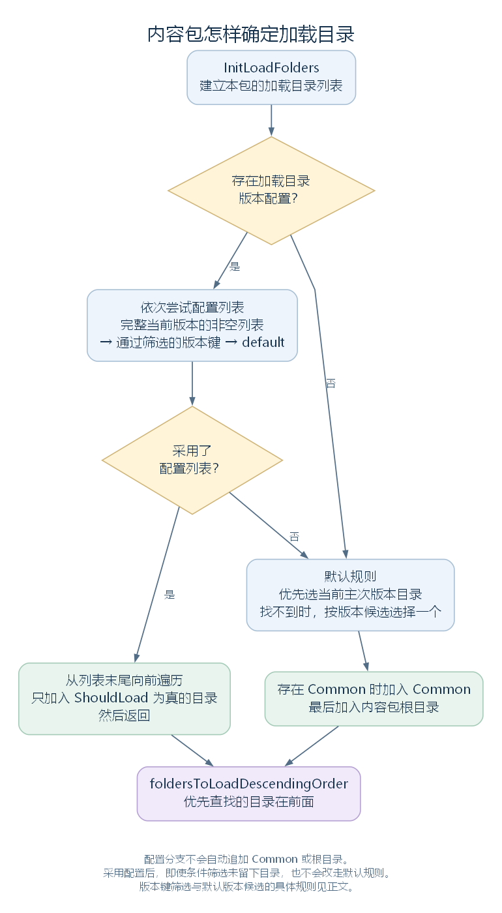
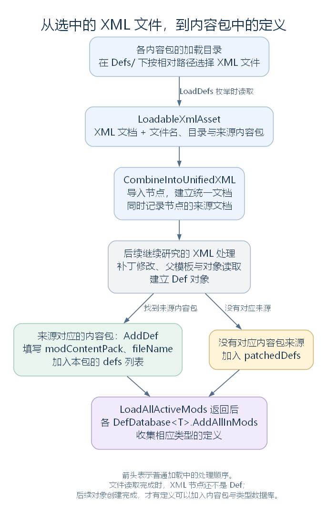

# ModContentPack：从内容包找到要读取的文件（讨论稿）

状态：内容包结构、加载目录与 XML 文件来源，2026-10-24。依据工作区 RimWorld 1.7.4982 rev1280 的游戏代码与原版内容整理。上接 [DefDatabase](34-defdatabase.md)，范围见 [本部分大纲](29-def-xml-outline.md)。本篇以普通启动为主，解释文件怎样被选中并成为 LoadableXmlAsset；统一 XML、补丁与父模板的具体处理留到下一步。

## 一、先把三个对象分开

ModContentPack 是一个正在加载、使用的内容包对象。虽然类型名中有 Mod，Core 与各个 DLC 也使用这套内容包结构。

它连接了几类内容：内容包的名称与目录、程序集、纹理和音频等资源、XML 补丁操作，以及已经建立的 Def 对象。它本身也不要求每个内容包必须同时提供所有这些内容。

先与前后两个对象比较：

| 对象 | 保存或表示什么 |
| --- | --- |
| ModMetaData | 内容包的元数据，例如名称、标识、根目录、支持版本与依赖等；也保存读取到的加载目录配置 |
| ModContentPack | 为活动内容包建立的对象，组织本次使用的目录与各类内容 |
| `DefDatabase<T>` | 按 T 保存已经建立的定义，提供遍历和名称等查询 |

例如，Core 的 About.xml 中有真实条目 `<packageId>Ludeon.RimWorld</packageId>`；ModContentPack 构造时把传入的 packageId 转成小写，PackageId 于是用 ludeon.rimworld 标识这个包。它与具体长剑的 defName 是不同层次的名称。

从文件角度说，长剑 XML 位于 Core 的内容目录中；从对象角度说，读取和后续处理建立 ThingDef 后，内容包的 defs 列表保存它，按类型的数据库再引用它。源文件与 Def 对象不应混为一项。

源码定位：内容包类型与标识（`Verse.ModContentPack.cs:16`、`Verse.ModContentPack.cs:30`、`Verse.ModContentPack.cs:181`）、元数据类型与初始化（`Verse.ModMetaData.cs:16`、`Verse.ModMetaData.cs:482`）。XML 定位：`RimWorld/Data/Core/About/About.xml:3`。

## 二、内容包有哪些主要成员

| 成员 | 内容与用途 |
| --- | --- |
| RootDir、FolderName | 内容包根目录的完整路径，以及该目录的名称 |
| PackageId、PackageIdPlayerFacing、Name | 程序使用的包标识、面向玩家的标识与名称 |
| loadOrder | 创建活动内容包时按遍历顺序写入的序号 |
| foldersToLoadDescendingOrder | 本次实际采用的加载目录列表，优先查找的目录排在前面 |
| assemblies | ModAssemblyHandler，负责本包的程序集加载与记录 |
| textures、audioClips、strings | 分别保存纹理、音频片段与字符串内容的 `ModContentHolder<T>` |
| assetBundles | 资源包处理对象，其具体读取与资源使用在资源模块继续 |
| defs、AllDefs | 本包已经建立的 Def 列表，以及返回这份列表的遍历入口 |
| patches、Patches | 本包的 PatchOperation 列表，以及需要时才读取它的属性入口 |

这里的 strings 是一个字符串内容容器，不能仅凭名字就把它等同于完整的语言与翻译系统。

ModContentHolder 内部按内容路径保存资源对象。它与 DefDatabase 的职责不同：一边按资源路径取得纹理等内容，另一边按定义类型和 defName 取得定义。图形配置中的资源路径要接到前一条线，而 Thing.def 则连接后一条线。

源码定位：路径与名称（`Verse.ModContentPack.cs:20`、`Verse.ModContentPack.cs:40`、`Verse.ModContentPack.cs:75`、`Verse.ModContentPack.cs:85`）、定义与补丁入口（`Verse.ModContentPack.cs:125`、`Verse.ModContentPack.cs:135`）、主要字段（`Verse.ModContentPack.cs:651`、`Verse.ModContentPack.cs:666`、`Verse.ModContentPack.cs:669`、`Verse.ModContentPack.cs:672`、`Verse.ModContentPack.cs:675`、`Verse.ModContentPack.cs:678`、`Verse.ModContentPack.cs:684`、`Verse.ModContentPack.cs:693`）、资源内容表（`Verse.ModContentHolder.cs:104`）。

## 三、活动内容包怎样建立

普通启动中，PlayDataLoader.DoPlayLoad 调用 LoadedModManager.LoadAllActiveMods(false)。后者先调用 InitializeMods；InitializeMods 再按 ModsConfig.ActiveModsInLoadOrder 的顺序，遍历活动内容包的元数据。

对根目录存在的项，它执行下面这个连续片段。modMetaData 是当前元数据，num 是创建成功后递增的序号，modContentPack 是本次新建的局部变量：

```csharp
ModContentPack modContentPack = new ModContentPack(modMetaData.RootDir, modMetaData.PackageId, modMetaData.PackageIdPlayerFacing, num, modMetaData.Name, modMetaData.Official);
num++;
LoadedModManager.runningMods.Add(modContentPack);
GenTypes.ClearCache();
```

这一段使用已经给出的活动顺序，没有在这里重新计算依赖关系。若根目录已经不存在，代码会停用该项并记录警告；初始化抛出异常时，也有记录错误与停用处理。

构造函数完整实现如下：

```csharp
public ModContentPack(DirectoryInfo directory, string packageId, string packageIdPlayerFacing, int loadOrder, string name, bool official)
{
    this.rootDirInt = directory;
    this.loadOrder = loadOrder;
    this.nameInt = name;
    this.official = official;
    this.packageIdInt = packageId.ToLower();
    this.packageIdPlayerFacingInt = packageIdPlayerFacing;
    this.audioClips = new ModContentHolder<AudioClip>(this);
    this.textures = new ModContentHolder<Texture2D>(this);
    this.strings = new ModContentHolder<string>(this);
    this.assetBundles = new ModAssetBundlesHandler(this);
    this.assemblies = new ModAssemblyHandler(this);
    this.InitLoadFolders();
    foreach (string text in this.foldersToLoadDescendingOrder)
    {
        ContentPacks.MountLoadFolder(text);
    }
}
```

可以按三步读它：保存本包信息，建立各类内容处理对象，确定加载目录并交给 ContentPacks.MountLoadFolder。此时建立的是组织内容的对象和读取入口，还没有在构造函数中把所有 Def 创建出来。

这里的 MountLoadFolder 会尝试打开所选目录中的 Assets.zip，并将可用的资源包交给底层资源查找。本文把“挂载”理解为登记这个资源包，让后续读取能够找到其中的内容。它不会把所有 XML 自动变成 Def；下面的 XML 入口仍有自己的文件查找代码。

源码定位：普通启动（`Verse.PlayDataLoader.cs:94`）、总入口与初始化（`Verse.LoadedModManager.cs:56`、`Verse.LoadedModManager.cs:183`）、构造函数（`Verse.ModContentPack.cs:181`）。兼容层源码定位：`UnityStubs.ContentPacks.cs:15`。

## 四、InitLoadFolders：这一包到底读取哪些目录

RootDir 只有一个，但实际采用的加载目录可以有多个。InitLoadFolders 将它们按优先查找的顺序放入 foldersToLoadDescendingOrder。

目录选择有两条路径：采用 LoadFolders.xml 中的一组配置，或使用默认目录规则。



图为 InitLoadFolders 的判断概览。配置版本的筛选细节见下文；采用配置列表以后，即使其中的条件最终没有留下目录，也不会因此自动补上 Common 和根目录。[SVG](figures/modcontentpack-load-folders.svg) · [图源](figures/modcontentpack-load-folders.dot)

### 4.1 采用 LoadFolders.xml 的配置

ModMetaData 初始化时会读取根目录的 LoadFolders.xml，将其保存为 ModLoadFolders。该对象按版本键保存 `List<LoadFolder>`，每个 LoadFolder 再保存目录名与条件。

下面是教学配置，用来展示数据关系，不是当前 Core 中存在的文件：

```xml
<loadFolders>
  <v1.7>
    <li>/</li>
    <li>Common</li>
    <li>1.7</li>
    <li IfModActive="ludeon.rimworld.biotech">Compat/Biotech</li>
  </v1.7>
</loadFolders>
```

自定义读取会去掉版本节点名开头的 v，将上面的 v1.7 保存为键 1.7；`/` 或 `\` 则表示内容包根目录，内部保存为空目录名。其他目录名相对于 RootDir。

InitLoadFolders 依次尝试：

1. 用 CurrentVersionString 查找列表，取得非空列表时采用它。当前快照中，这个字符串包含构建号，为 1.7.4982；它与目录常用的 1.7 不同。
2. 如果没有采用上一项，筛选能按 VersionFromString 解析、不高于当前版本的配置键，再按**字符串降序**取第一项，找到对应列表时采用它。default 不参加这一筛选。
3. 若仍未采用列表，尝试 default 对应的列表。
4. 以上都未采用时，进入下一节的默认目录规则。

第二项的排序直接使用字符串键，不能改写成“按数字版本严格选最大的键”。这里的筛选与默认目录分支使用的版本处理也不是同一段代码。

采用列表后，当前反编译名为 `<InitLoadFolders>g__AddFolders|58_0` 的辅助函数执行下面的循环。folders 是所选配置列表，没有另换变量名：

```csharp
for (int i = folders.Count - 1; i >= 0; i--)
{
    if (folders[i].ShouldLoad)
    {
        this.foldersToLoadDescendingOrder.Add(Path.Combine(this.RootDir, folders[i].folderName));
    }
}
```

它从列表末尾向前遍历，所以配置中后列出的目录优先。例如，本例在 Biotech 活动时，得到的目录顺序为 Compat/Biotech、1.7、Common、根目录；Biotech 未活动时则没有第一项。

ShouldLoad 同时检查三个可选条件，未配置的条件不限制读取：

| XML 属性 | 对应条件 |
| --- | --- |
| IfModActive | 列出的包中至少一个处于活动状态 |
| IfModActiveAll | 列出的包全部处于活动状态 |
| IfModNotActive | 列出的包都未处于活动状态 |

多个属性同时出现时，要同时满足；属性值可以用逗号分隔多个包标识。这是在选择目录，不是修改某个 Def 字段。

需要注意，采用配置分支会直接返回，不再自动追加 Common、根目录，也不会因为目录不存在或条件全部不满足而改走默认规则。需要这些目录时，应当让所采用的配置列表包含它们。

### 4.2 默认目录规则

未采用配置列表时，代码按下面的顺序准备目录：

| 顺序 | 处理 |
| --- | --- |
| 先选版本目录 | 优先查找与 CurrentVersionStringWithoutBuild 相同的目录；当前为 1.7 |
| 找不到精确目录时 | 从可解析的版本目录中选择；常规正版本候选中，优先取不高于当前版本的最高版本，若全都较新，也可能选到较新的版本 |
| 然后加入 Common | 存在这个目录时加入 |
| 最后加入根目录 | 加入 RootDir |

这个分支中的 TryParseVersionString 按主、次版本解析，再将选出的 Version 拼回目录路径。本文的目录示例使用 1.6、1.7 这类常规名称。

例如，教学目录同时存在根目录的 Defs、Common/Defs、1.6/Defs 与 1.7/Defs 时，这次采用的是 1.7、Common、根目录；1.6 不在本次选择中。选中一个目录只说明文件可能从这里读取，不等于其中的代码或内容已经通过版本兼容性检查。

当前工作区提供的 Core 目录没有 LoadFolders.xml，也没有 1.7、Common 子目录，按这条默认路径会使用 Core 根目录。长剑所在的 `RimWorld/Data/Core/Defs/ThingDefs_Misc/Weapons/MeleeMedieval.xml`，就是从该根目录下的 Defs/ 找到的文件之一。

ModContentPack 还提供了名为 AllLoadFolders 的静态方法，用于收集另一种范围的目录信息。普通构造路径调用的是本节的 InitLoadFolders，不能把二者当作同一个方法。

源码定位：目录选择（`Verse.ModContentPack.cs:302`）、配置列表辅助函数（`Verse.ModContentPack.cs:625`）、另一个目录收集入口（`Verse.ModContentPack.cs:398`）、元数据读取配置（`Verse.ModMetaData.cs:482`）、版本键与条目读取（`Verse.ModLoadFolders.cs:14`、`Verse.ModLoadFolders.cs:24`、`Verse.ModLoadFolders.cs:30`）、条件（`Verse.LoadFolder.cs:11`）、版本字符串与解析（`RimWorld.VersionControl.cs:24`、`RimWorld.VersionControl.cs:34`、`RimWorld.VersionControl.cs:183`、`RimWorld.VersionControl.cs:256`）。

## 五、选中目录以后，怎样选择 XML 文件

LoadedModManager.LoadModXML 按 runningMods 的顺序遍历内容包，调用各包的 LoadDefs，并将返回项加入一个总列表。

LoadDefs 返回 `IEnumerable<LoadableXmlAsset>`。实际枚举它时，会调用 DirectXmlLoader.XmlAssetsInModFolder，传入当前内容包与 Defs/。所以这里的 LoadDefs 还没有直接返回 ThingDef 等定义对象。

### 5.1 按相对路径选择文件

XmlAssetsInModFolder 按 foldersToLoadDescendingOrder 从前到后，检查每个加载目录下的 Defs/，递归寻找 XML 文件。以点开头的文件名会被跳过。

遇到一个候选文件时，使用的是下面这个连续片段。text 是当前加载目录，fileInfo 是文件；text2 是去掉这个加载目录前缀后得到的相对路径：

```csharp
string text2 = fileInfo.FullName.Substring(text.Length + 1);
dictionary.TryAdd(text2, fileInfo);
```

TryAdd 不会替换已有键，因此同一个包的多个加载目录提供相同相对路径时，先遇到的文件被保留。较低优先级目录中的那个文件不再单独进入这一轮 XML 读取。

下面仍是教学目录，三份文件的相对路径都是 Defs/Weapons/LongSword.xml：

```text
ExampleMod/
├─ 1.7/Defs/Weapons/LongSword.xml
├─ Common/Defs/Weapons/LongSword.xml
└─ Defs/Weapons/LongSword.xml
```

如果目录顺序是 1.7、Common、根目录，这一步只保留第一份文件。它不会合并三份文件的文本或节点。

若另一份文件位于 Defs/Other/LongSword.xml，相对路径不同，就不会被上面的键去重。单看文件名相同，不能判断哪份会被跳过。

这次文件选择只发生在当前包的当前扫描内；不同内容包各自调用扫描，不会因为相对路径相同就在此互相排除。之后出现相同 defName，再按 [上一节](34-defdatabase.md) 的对象入库规则处理。

| 比较发生在哪一层 | 比较什么 | 本层的动作 |
| --- | --- | --- |
| 同包加载目录中的 XML 文件选择 | 相对于各加载目录的文件路径 | 保留优先目录中的文件 |
| 同包或不同来源的定义入库 | Def 对象的 defName | 按具体入口跳过、替换或改名 |
| XML 补丁 | 操作指定的 XML 节点 | 下一步按 PatchOperation 具体实现展开 |

XML 文件入口本身没有显式按文件名排序，因此这里也不把“字母靠后的文件一定较晚入库”作为规则。

### 5.2 读取文件并等待完成

选出文件后，当前实现准备结果数组和共享待读取集合，启动两个读取线程；调用 XmlAssetsInModFolder 的线程也参与取项读取。每项按预先记录的数组位置写回，最后通过 Join 等待两个线程结束，再返回结果数组。

这是文件读取阶段的局部实现，不代表每份 XML 都有一个常驻线程。线程和长任务的完整调度继续留给运行模块；本处只需知道，返回前已等待这些文件读取工作完成。

LoadDefs 在当前反编译文件中仅显示生成迭代器的入口。本篇已核对原程序集的 MoveNext：它调用上述扫描、取得列表，再逐项返回 LoadableXmlAsset；普通加载时若 defs 已经非空，还会记录一次错误，但没有在这里把 defs 清空或创建新的 Def。

源码定位：各包 XML 收集（`Verse.LoadedModManager.cs:318`）、LoadDefs 入口（`Verse.ModContentPack.cs:293`）、扫描与读取（`Verse.DirectXmlLoader.cs:17`）。LoadDefs 生成迭代器的 MoveNext 方法令牌为 0x0600F39B，读取调用位于 IL_0054–IL_0065，逐项返回位于 IL_008B–IL_00A9。

## 六、LoadableXmlAsset 保存什么

一个 LoadableXmlAsset 表示一份已尝试读取的 XML 文档及其来源。在文件构造路径中，它先保存：

```csharp
this.mod = mod;
this.name = file.Name;
this.fullFolderPath = file.Directory.FullName;
```

| 字段或属性 | 内容 |
| --- | --- |
| mod | 来源 ModContentPack |
| name | 带扩展名的文件名，不是 defName |
| fullFolderPath | 文件所在目录的完整路径 |
| xmlDoc | 从文件读取的 XmlDocument |
| FullFilePath | 由目录与文件名组合出的完整路径 |

文件构造函数取得文件字节，去掉开头可能存在的 UTF-8 BOM，再按 UTF-8 解码，使用 XmlReader 将文档读入 XmlDocument。读取设置忽略注释和无关空白。

若读取过程中抛出异常，构造函数会记录警告并将 xmlDoc 设为 null；因此“有一个 LoadableXmlAsset 对象”不保证文档读取成功。

此时 xmlDoc 中仍然是 XML 节点。一个文件可以包含多个定义节点，也可以包含只作为父模板的节点；它们与实际 Def 对象的对应关系，要等后续节点处理决定。

源码定位：文件路径（`Verse.LoadableXmlAsset.cs:14`）、文件构造函数（`Verse.LoadableXmlAsset.cs:53`）、字段（`Verse.LoadableXmlAsset.cs:96`、`Verse.LoadableXmlAsset.cs:99`、`Verse.LoadableXmlAsset.cs:102`、`Verse.LoadableXmlAsset.cs:105`）、读取设置（`Verse.LoadableXmlAsset.cs:111`）。

## 七、程序集、资源和补丁在这里处于什么位置

普通加载的 LoadAllActiveMods 中，InitializeMods 之后依次进入 LoadModContent、CreateModClasses、LoadModXML，再进入统一 XML 与补丁等处理。这里要区分方法调用顺序和实际工作完成时间。

### 7.1 ReloadContent 并非所有内容同时读完

ModContentPack.ReloadContent 的完整实现为：

```csharp
public void ReloadContent(bool hotReload = false)
{
    LongEventHandler.ExecuteWhenFinished(delegate
    {
        this.ReloadContentInt(hotReload);
    });
    if (!hotReload)
    {
        this.assemblies.ReloadAll();
    }
}
```

这里传给 ExecuteWhenFinished 的是一段待执行函数。长任务处理会根据当前状态安排它执行；若当前没有需要等待的长任务等条件成立，也可能在登记时就执行。因此，不能仅按这段代码的行号认定所有资源一定先于或晚于程序集加载完成。

普通加载中，assemblies.ReloadAll 直接进入程序集读取；ReloadContentInt 则负责音频片段、纹理、字符串与资源包相关读取。LoadModContent 还安排资源预读与后续等待、提交等工作，完整资源生命周期在资源模块展开。

ModAssemblyHandler 从所选目录下的 Assemblies/ 寻找 DLL，调用 Assembly.LoadFrom，检查可用性后将程序集记入 loadedAssemblies。这让后续类型查找可以发现其中的 C# 类型。接下来的 CreateModClasses 会查找可实例化的 Mod 派生类型，定位它所属的内容包，再尝试建立对应 Mod 对象。

因此 ModContentPack、ModMetaData 与 Mod 派生对象也不相同：前两者组织内容与元数据，后者可以由程序集提供，用代码实现相应功能。

### 7.2 读取补丁操作与执行补丁是两步

ModContentPack.Patches 第一次被访问、且缓存列表尚未建立时，调用 LoadPatches。后者从所选目录下的 Patches/ 读取 XML，检查 Patch 根节点及其中的 Operation 节点，将 Operation 读成 PatchOperation，并记录 sourceFile。

到这里得到的是补丁操作对象列表。操作对统一 XML 做什么、按什么顺序执行，由后续 ApplyPatches 等代码负责，下一节再继续。

源码定位：总体顺序（`Verse.LoadedModManager.cs:56`）、内容加载与 Mod 对象创建（`Verse.LoadedModManager.cs:230`、`Verse.LoadedModManager.cs:282`）、内容包资源入口（`Verse.ModContentPack.cs:233`、`Verse.ModContentPack.cs:280`）、待执行函数登记（`Verse.LongEventHandler.cs:224`）、程序集加载（`Verse.ModAssemblyHandler.cs:21`）、补丁属性与读取（`Verse.ModContentPack.cs:135`、`Verse.ModContentPack.cs:464`）。

## 八、这些 XML 最后怎样回到内容包的 AllDefs

到 LoadModXML 返回时，得到的是来自各包的 LoadableXmlAsset 总列表。接下来的 CombineIntoUnifiedXML 将节点导入统一文档，同时用 assetlookup 记录导入节点对应的来源文档。

后面的补丁、父模板与对象读取沿各自入口继续处理。ParseAndProcessXML 在建立 Def 后，会尝试从来源文档找到内容包，再调用它的 AddDef；没有对应内容包来源时，进入 patchedDefs 集合。

AddDef 的完整实现是：

```csharp
public void AddDef(Def def, string source = "Unknown")
{
    def.modContentPack = this;
    def.fileName = source;
    this.defs.Add(def);
}
```

在当前 XML 调用点，source 传入 LoadableXmlAsset.name，所以 Def.fileName 保存的是文件名，不是完整路径；完整来源路径还要结合前面的文档来源信息理解。



灰色部分是下一步继续展开的处理。图中先后关系以普通加载为范围，未画热重载分支及后续多轮引用整理。[SVG](figures/modcontentpack-xml-to-def.svg) · [图源](figures/modcontentpack-xml-to-def.dot)

这样就接回了上一节：LoadAllActiveMods 返回以后，DoPlayLoad 才继续调用各类型库的 AddAllInMods，将内容包中的定义引用收集到按类型组织的数据库中。

源码定位：合并与来源记录（`Verse.LoadedModManager.cs:408`）、节点处理和定义归入来源（`Verse.LoadedModManager.cs:437`）、内容包添加定义（`Verse.ModContentPack.cs:610`）、回到普通启动的数据库收集（`Verse.PlayDataLoader.cs:94`）。

## 九、回到长剑，准备进入统一 XML

对本例长剑而言，现在可以沿来源解释：活动的 Core 被建立为内容包，确定加载目录，在 Defs/ 中选出包括 MeleeMedieval.xml 在内的文件，读取为带来源信息的 XML 文档。经过后续处理建立长剑 ThingDef 后，它进入内容包列表，再由 DefDatabase 提供查询。

其中最需要保留的区别是：选择哪个文件、修改哪些 XML 节点、建立什么类型的对象，以及入库时怎样处理同名定义，分别发生在不同位置。

下一步进入 [CombineIntoUnifiedXML 与 ApplyPatches](36-xml-merge-and-patches.md)，先看多个文件如何成为统一文档、补丁怎样修改节点，再接到 XmlInheritance 的父模板处理。这样才能解释，长剑原文件没有直接写出的字段，为什么仍然会进入最后建立的 ThingDef。
