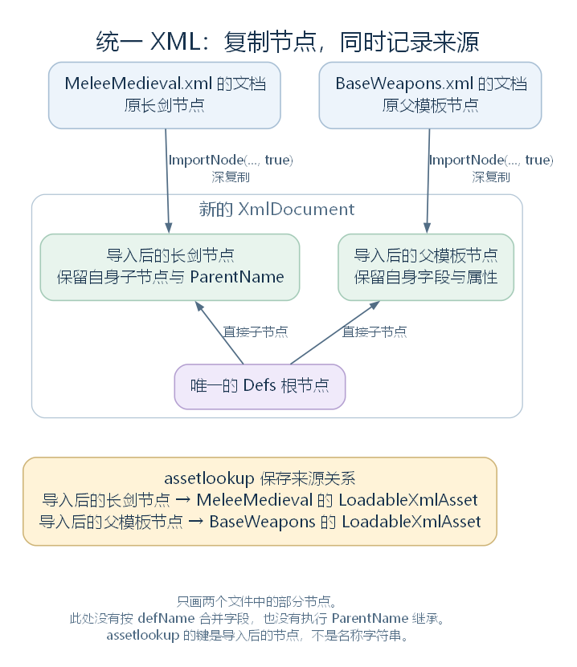
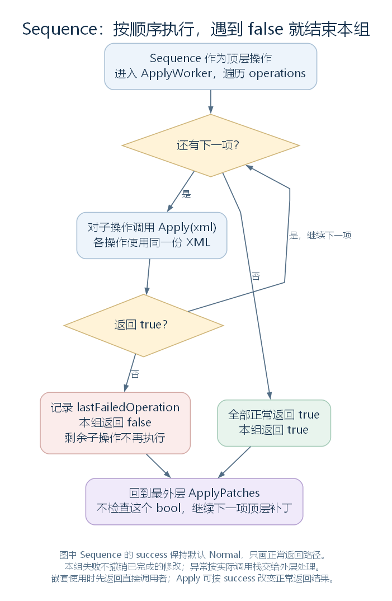

# 统一 XML 与补丁：定义对象建立以前发生的修改（讨论稿）

状态：CombineIntoUnifiedXML、ApplyPatches 与常见 PatchOperation 的执行方式，2026-10-27。依据工作区 RimWorld 1.7.4982 rev1280 的游戏代码与原版内容整理。上接 [ModContentPack](35-modcontentpack.md)，范围见 [本部分大纲](29-def-xml-outline.md)。本轮继续使用长剑案例，先停在父模板处理之前；具体的 XmlInheritance 规则留到下一步。

## 一、现在处理的仍然是 XML

上一节中，各个活动内容包的 LoadDefs 返回 LoadableXmlAsset：其中保存 XML 文档、文件名、目录与来源内容包。

接下来，普通启动的 LoadAllActiveMods 按下面的顺序继续：

| 阶段 | 主要动作 |
| --- | --- |
| CombineIntoUnifiedXML | 将各文档根节点下的内容导入统一的 Defs 文档，记录来源 |
| TKeySystem.Clear、Parse | 执行翻译键相关处理；这里只保留其位置，具体在语言模块继续 |
| ErrorCheckPatches | 遍历补丁操作的 ConfigErrors，记录配置问题 |
| ApplyPatches | 让各补丁操作修改同一份统一 XML |
| ParseAndProcessXML | 登记并处理父模板，再沿节点建立 Def 对象 |
| ClearCachedPatches | 调用补丁的 Complete，随后清除各包的补丁列表缓存 |

这一顺序意味着：补丁操作时，文件已经读成 XML 节点，但长剑 ThingDef 还没有由这里的节点建立。补丁修改的对象也不是运行中某件长剑的耐久、品质或组件。

源码定位：总调用顺序（`Verse.LoadedModManager.cs:56`）、翻译键入口（`Verse.TKeySystem.cs:34`）、配置检查（`Verse.LoadedModManager.cs:348`）、父模板与对象处理（`Verse.LoadedModManager.cs:437`）。

## 二、CombineIntoUnifiedXML：把各文档的子节点放到一起

这个方法接收两个参数：xmls 是上一阶段得到的文档来源列表；assetlookup 是由调用方创建的字典，用来记录**导入后的节点 → 原 LoadableXmlAsset** 的关系。

当前完整实现如下，变量保持源码原名：

```csharp
public static XmlDocument CombineIntoUnifiedXML(List<LoadableXmlAsset> xmls, Dictionary<XmlNode, LoadableXmlAsset> assetlookup)
{
    XmlDocument xmlDocument = new XmlDocument();
    xmlDocument.AppendChild(xmlDocument.CreateElement("Defs"));
    foreach (LoadableXmlAsset loadableXmlAsset in xmls)
    {
        if (loadableXmlAsset.xmlDoc == null || loadableXmlAsset.xmlDoc.DocumentElement == null)
        {
            Log.Error(string.Format("{0}: unknown parse failure", loadableXmlAsset.fullFolderPath + "/" + loadableXmlAsset.name));
        }
        else
        {
            if (loadableXmlAsset.xmlDoc.DocumentElement.Name != "Defs")
            {
                Log.Error(string.Format("{0}: root element named {1}; should be named Defs", loadableXmlAsset.fullFolderPath + "/" + loadableXmlAsset.name, loadableXmlAsset.xmlDoc.DocumentElement.Name));
            }
            foreach (object obj in loadableXmlAsset.xmlDoc.DocumentElement.ChildNodes)
            {
                XmlNode xmlNode = (XmlNode)obj;
                XmlNode xmlNode2 = xmlDocument.ImportNode(xmlNode, true);
                assetlookup[xmlNode2] = loadableXmlAsset;
                xmlDocument.DocumentElement.AppendChild(xmlNode2);
            }
        }
    }
    return xmlDocument;
}
```

### 2.1 复制的是哪些节点

方法先创建一份新的 XmlDocument，再给它创建唯一的 Defs 根节点。随后按 xmls 的顺序，遍历每份输入文档根节点的直接子节点。

xmlNode 是输入文档中的节点；ImportNode(xmlNode, true) 将它连同内部子节点一起复制到新文档，得到 xmlNode2。最后 AppendChild 将新节点追加到统一文档的 Defs 下。

因此，不是把若干个 Defs 根节点再套进另一个 Defs，也不是将磁盘文件直接拼成一个字符串。被导入节点的内部结构仍然保留，原文档中的节点也没有因为这次导入而被移走。



图中只选长剑与一个父模板节点说明复制和来源关系，省略两个文件中的其他节点。箭头不表示父模板继承已经执行。[SVG](figures/xml-unified-document.svg) · [图源](figures/xml-unified-document.dot)

### 2.2 这里没有按 defName 合并字段

CombineIntoUnifiedXML 没有查询 defName，也没有在两个同名 ThingDef 节点之间选择字段。两个节点即使具有相同 defName，在这里也可以先后进入统一文档。

同样，长剑节点上的 ParentName 只是随节点复制的属性。父模板中写着哪些字段、长剑还需要继承哪些内容，都不在这个方法里展开。

前一节按相对路径选择 XML 文件，本节复制选中文件的节点，下一步才处理 XML 父模板；DefDatabase 的同名处理又在对象建立以后。它们应当分别理解。

### 2.3 输入出错时怎么办

| 输入状态 | 当前实现 |
| --- | --- |
| xmlDoc 为 null，或没有根节点 | 记录错误，不从这一文档导入节点，继续后面的文档 |
| 根节点存在，但名字不是 Defs | 记录错误，随后仍遍历并导入它的子节点 |

第二种情况没有立即 return 或 continue。因此，根节点名字检查不能解释成“所有不符合格式的文档都被彻底排除”，更不能等同于完整的 XML 内容校验。

源码定位：统一文档、导入与来源记录（`Verse.LoadedModManager.cs:408`）。

## 三、补丁文件怎样成为 PatchOperation

补丁文件与 Def 文件分别从 Patches/、Defs/ 读取。ModContentPack.Patches 在尚无缓存列表时调用 LoadPatches，后者要求补丁文档使用 Patch 根节点，并将其中的 Operation 读成 PatchOperation。

下面这个连续片段位于 LoadPatches 内。xmlNode 是当前 Operation 节点，list[i] 是它所在的 LoadableXmlAsset：

```csharp
PatchOperation patchOperation = DirectXmlToObject.ObjectFromXml<PatchOperation>(xmlNode, false);
patchOperation.sourceFile = list[i].FullFilePath;
this.patches.Add(patchOperation);
this.loadedAnyPatches = true;
```

Operation 的 Class 属性选择具体的 C# 操作类型。例如 Class="PatchOperationReplace" 会让后面的 Apply 调用进入替换操作。这里建立操作对象使用 DirectXmlToObject；不能把定义读取默认采用新路径的结论推广到所有 XML 读取入口。

先认识几层结构：

| 类型 | 相对于父类提供的内容 |
| --- | --- |
| PatchOperation | Apply、ApplyWorker、成功状态、来源文件、检查与完成处理 |
| PatchOperationPathed | 继承 PatchOperation，增加 xpath 字符串，ToString 也附带路径 |
| PatchOperationAdd、Replace、Remove 等 | 继承带路径的基类，在 ApplyWorker 中选择并修改节点 |
| PatchOperationSequence | 直接继承 PatchOperation，保存按顺序执行的 operations 列表 |
| PatchOperationConditional | 继承带路径的基类，按节点是否存在选择 match 或 nomatch 操作 |

许多操作还有 value 字段，其类型是 XmlContainer。它的自定义读取只保存传入 XML 节点，供操作稍后取出其中的子节点。value 不是已经建立的 ThingDef 或属性数值对象。

源码定位：读取补丁（`Verse.ModContentPack.cs:135`、`Verse.ModContentPack.cs:464`）、操作基类（`Verse.PatchOperation.cs:9`）、带路径的基类（`Verse.PatchOperationPathed.cs:6`、`Verse.PatchOperationPathed.cs:15`）、XML 容器（`Verse.XmlContainer.cs:10`、`Verse.XmlContainer.cs:16`）、替换的数据字段（`Verse.PatchOperationReplace.cs:30`）。

## 四、ApplyPatches：按顺序修改同一份文档

ApplyPatches 的完整实现为：

```csharp
public static void ApplyPatches(XmlDocument xmlDoc, Dictionary<XmlNode, LoadableXmlAsset> assetlookup)
{
    foreach (PatchOperation patchOperation in LoadedModManager.runningMods.SelectMany<ModContentPack, PatchOperation>((ModContentPack rm) => rm.Patches))
    {
        try
        {
            patchOperation.Apply(xmlDoc);
        }
        catch (Exception ex)
        {
            string text = "Error in patch.Apply(): ";
            Exception ex2 = ex;
            Log.Error(text + ((ex2 != null) ? ex2.ToString() : null));
        }
    }
}
```

SelectMany 将 runningMods 中各包的 Patches 按遍历顺序接在一起。因此先处理前一个包的顶层操作，再处理后一个包的操作；同一文件中，Operation 按读取时的节点顺序加入列表。

这个入口没有使用上一节 DefDatabase 入库时的 OverwritePriority 排序，也没有在此重新按补丁文件名排序。文件之间的枚举来源仍接着上一节的读取方式理解。

所有操作拿到同一个 xmlDoc。后一个操作看到的是前面已经修改过的文档，不是每次重新取得一份原始 XML。后一个替换能否生效，还取决于它的 XPath 此时能否找到目标，而不是简单规定“最后一个 Mod 的所有字段都覆盖前面的”。

还有两点直接写在方法里：

- Apply 返回 bool，但最外层没有检查这个返回值；返回 false 不会让它停止后续顶层操作。
- 某次调用抛出异常时，catch 记录错误，循环继续。这里没有复制旧文档或恢复旧节点的代码。

源码定位：应用顺序与异常处理（`Verse.LoadedModManager.cs:390`）。

## 五、长剑案例：Replace 怎样把 Mass 从 2 改成 3

原版长剑节点中真实存在这一段：

```xml
<statBases>
  <WorkToMake>18000</WorkToMake>
  <Mass>2</Mass>
</statBases>
```

下面是教学补丁，不是原版已有文件，也不写入游戏内容目录：

```xml
<Patch>
  <Operation Class="PatchOperationReplace">
    <xpath>/Defs/ThingDef[defName="MeleeWeapon_LongSword"]/statBases/Mass</xpath>
    <value>
      <Mass>3</Mass>
    </value>
  </Operation>
</Patch>
```

XPath 是在 XML 树中选择节点的表达式。本例按以下几步找目标：

| 表达式部分 | 找什么 |
| --- | --- |
| /Defs | 统一文档的根节点 |
| /ThingDef[defName="MeleeWeapon_LongSword"] | 根节点下，defName 子节点内容等于这个名称的 ThingDef 节点 |
| /statBases/Mass | 该节点内部的 statBases，再找到其中的 Mass |

这是对当前节点结构的选择，不是 C# 属性访问，也没有调用 DefDatabase.GetNamed。表达式如果匹配多个节点，下面的 Replace 会逐个处理，不会自行要求它只命中一个定义。

PatchOperationReplace.ApplyWorker 的完整实现如下。node 是 value 保存的 XML 容器节点；xmlNode 是选中的目标，parentNode 是目标的父节点，xmlNode2 是 value 内准备导入的一个子节点：

```csharp
protected override bool ApplyWorker(XmlDocument xml)
{
    XmlNode node = this.value.node;
    bool flag = false;
    foreach (XmlNode xmlNode in xml.SelectNodes(this.xpath).Cast<XmlNode>().ToArray<XmlNode>())
    {
        flag = true;
        XmlNode parentNode = xmlNode.ParentNode;
        foreach (object obj in node.ChildNodes)
        {
            XmlNode xmlNode2 = (XmlNode)obj;
            parentNode.InsertBefore(parentNode.OwnerDocument.ImportNode(xmlNode2, true), xmlNode);
        }
        parentNode.RemoveChild(xmlNode);
    }
    return flag;
}
```

它先将匹配结果保存到数组，再逐个修改文档。对原来的 Mass 节点，先在前面插入从 value 中复制来的 Mass，再移除旧 Mass。value 这个包装节点本身不进入长剑节点。

结果是 statBases 内保留 WorkToMake，Mass 变为 3。后续建立 ThingDef 时，属性基础值读取才会取得这份修改后的数据；最终物品面板怎样结合材料和其他规则显示数值，仍要接到属性系统核对。

Replace 的 payload 可以有多个子节点；其实现并没有只取 value 内的第一项。没有匹配目标时，循环不执行，ApplyWorker 返回 false。

### 5.1 为什么有些“应该存在”的字段却匹配不到

补丁发生在 XmlInheritance.Resolve 之前。合并后的长剑节点仍只有自己写出的子节点和 ParentName 等属性，父模板尚未将共同字段补到它下面。

例如，BaseWeapon 模板写有 thingClass=ThingWithComps，长剑自身的原 XML 节点没有 thingClass。此时用 `/Defs/ThingDef[defName="MeleeWeapon_LongSword"]/thingClass` 选择，不会因为后续能继承到该配置就自动命中。

因此，匹配当前父模板，和匹配当前长剑节点，是两种不同的选择；某项最后出现在 ThingDef 中，也不保证它在应用补丁时已经存在于这条 XPath 下。

### 5.2 原版内容也使用这个入口

Biotech 的 Patches/Stats_Basics_General.xml 中，就有 PatchOperationReplace：选择 DeteriorationRate 等 StatDef 的 description，替换为包含 DLC 相关说明的文字。

这提供了一个直观例子：玩家看到的定义说明，既可能来自 Core 原文，也可能在定义对象建立前被活动 DLC 的补丁修改。最终语言显示还会接到翻译系统，不能将这里的英文 XML 文本直接等同于所有语言下的最终界面。

源码定位：替换（`Verse.PatchOperationReplace.cs:11`）、父模板处理入口（`Verse.LoadedModManager.cs:437`）。XML 定位：长剑基础值（`RimWorld/Data/Core/Defs/ThingDefs_Misc/Weapons/MeleeMedieval.xml:136`）、共同类型（`RimWorld/Data/Core/Defs/ThingDefs_Misc/Weapons/BaseWeapons.xml:4`）、真实 DLC 补丁（`RimWorld/Data/Biotech/Patches/Stats_Basics_General.xml:4`）。

## 六、其他常见操作与组合方式

### 6.1 Add、Remove、Test 与 Conditional

| 操作 | 主要行为 |
| --- | --- |
| PatchOperationAdd | 选中目标节点，将 value 的子节点加到目标内部；默认追加，也可指定放到子节点列表前部 |
| PatchOperationRemove | 先取得匹配节点数组，再从各自父节点移除目标 |
| PatchOperationTest | 只检查 XPath 是否至少找到一个节点，返回 bool，不修改文档 |
| PatchOperationConditional | 找到节点时执行 match；没找到时执行 nomatch |
| PatchOperationFindMod | 检查 mods 中是否至少有一个名称对应活动 Mod，再选择 match 或 nomatch |

Add 向目标内部添加，Replace 则用 value 的子节点替换目标本身，二者需要的 XPath 位置不同。Add 也没有自动合并同名字段的代码；重复添加节点是否符合后续读取要求，需要继续看对应字段的读取规则。

Conditional 并不是“没命中就一定失败”。选定分支存在时，返回那一操作的 Apply 结果；选定分支不存在时，返回 match、nomatch 是否至少配置了一个。如果两者都未配置，则返回 false。

FindMod 此处调用 HasActiveModWithName，比较活动 Mod 的 Name；这与上一节目录条件使用包标识的检查不同。选定分支不存在时，FindMod 返回 true。

Insert、AttributeAdd、AttributeRemove、AttributeSet、SetName、AddModExtension 等则继续提供节点附近插入、属性和扩展节点的操作。本轮先保留这些入口，不将名字相近的操作视为完全相同。

源码定位：添加（`Verse.PatchOperationAdd.cs:11`、`Verse.PatchOperationAdd.cs:47`）、移除（`Verse.PatchOperationRemove.cs:11`）、测试（`Verse.PatchOperationTest.cs:10`）、条件（`Verse.PatchOperationConditional.cs:10`）、Mod 名称判断（`Verse.PatchOperationFindMod.cs:11`、`Verse.ModLister.cs:256`）。

### 6.2 Sequence 内部遇到 false 会停止

Sequence 保存一个 operations 列表，将多个操作作为一组执行。它的 ApplyWorker 为：

```csharp
protected override bool ApplyWorker(XmlDocument xml)
{
    foreach (PatchOperation patchOperation in this.operations)
    {
        if (!patchOperation.Apply(xml))
        {
            this.lastFailedOperation = patchOperation;
            return false;
        }
    }
    return true;
}
```

这里实际检查了子操作的返回值：遇到 false，记录 lastFailedOperation，并停止剩余子操作。但它没有撤销前面已经执行的修改。



图按 Sequence 作为顶层操作、其 success 保持默认 Normal 的情况展示，只画正常返回 bool 的路径。异常仍按实际调用栈交给外层处理；嵌套使用时，本组先返回给它的直接调用者。Sequence 返回 false 以后，最外层 ApplyPatches 仍继续后面的顶层补丁。[SVG](figures/xml-patch-sequence.svg) · [图源](figures/xml-patch-sequence.dot)

例如，教学情境中，一组操作先成功修改长剑 Mass，再尝试移除一个不存在的节点。第二项返回 false，第三项不再运行；第一项写入的 Mass 仍留在当前文档中。补丁报错与部分修改已经生效，可以同时发生。

源码定位：顺序执行（`Verse.PatchOperationSequence.cs:11`）、完成处理与错误描述（`Verse.PatchOperationSequence.cs:25`、`Verse.PatchOperationSequence.cs:32`）。

## 七、Apply 返回 true 到底表示什么

PatchOperation.Apply 首先调用具体类型的 ApplyWorker，再根据 success 改写返回值，最后更新自己的成功记录。

| success | 怎样处理 ApplyWorker 正常返回的 bool |
| --- | --- |
| Normal | 保留原结果，默认值 |
| Always | 改为 true |
| Never | 改为 false |
| Invert | 取反 |

这些设置改变的是正常返回后的结果，不会跳过 ApplyWorker。比如 Never 仍然可以先修改文档，再返回 false；Always 也不会消除 ApplyWorker 抛出的异常。

最终结果为 true 时，Apply 将 neverSucceeded 设为 false。Complete 随后用这个字段判断该操作是否一直没有成功过。返回 true 也不能统一解释为“修改了数据”：Test 就可以仅因找到了节点而返回 true。

最后还要分清三个报错位置：

| 位置 | 处理什么 |
| --- | --- |
| ErrorCheckPatches | 记录 ConfigErrors 返回的配置问题；PatchOperation 基类默认返回空集合 |
| ApplyPatches 的 catch | 记录执行时抛出的异常，继续后续顶层操作 |
| ClearCachedPatches 中调用 Complete | 基类对 neverSucceeded 仍为 true 的操作记录失败，附带已登记的 sourceFile |

所以，没有命中节点而返回 false，与执行过程中抛出异常，是两条不同的路径；最外层也没有因为 ConfigErrors 返回过问题就自动过滤掉该操作。

普通加载在 ParseAndProcessXML 以后才调用 ClearCachedPatches。这个方法先对各包的顶层补丁调用 Complete，再令该包的 patches 缓存为 null；名字中的 Clear 并不表示撤销已应用的修改。

源码定位：结果转换与成功记录（`Verse.PatchOperation.cs:12`、`Verse.PatchOperation.cs:73`、`Verse.PatchOperation.cs:76`、`Verse.PatchOperation.cs:79`）、完成与检查（`Verse.PatchOperation.cs:50`、`Verse.PatchOperation.cs:64`）、调用与清缓存（`Verse.LoadedModManager.cs:594`、`Verse.ModContentPack.cs:598`）。

## 八、修改以后，节点来源会跟着补丁一起改变吗

CombineIntoUnifiedXML 记录的是导入到统一根节点下的那些节点与来源文档的关系，不是以 defName 为键，也没有给每一个内部字段单独登记来源。

虽然 ApplyPatches 的签名接收 assetlookup，当前方法体并没有使用它。上面展开的内置操作也只收到 XML 文档，不会自动把新节点登记进这张表。

因此要分两种情况：

| 修改 | 对本处来源查询的影响 |
| --- | --- |
| 替换原长剑节点内部的 Mass | 长剑顶层节点仍是原先导入的那个对象，仍能查到 Core 的来源文档 |
| 向 Defs 添加新的顶层定义节点，或用新节点替换整个旧顶层节点 | 新节点没有因为这些操作自动获得 assetlookup 记录 |

后续 ParseAndProcessXML 按当前顶层节点查询来源；找不到对应内容包时，建立的定义会进入 patchedDefs。这就接回了上一节的来源分支。

于是，定义的 modContentPack 和 fileName 不能简单理解成“最后修改过其中任意字段的 Mod”。操作的 sourceFile 则是另一个来源信息，用来指向补丁自身的文件。

源码定位：来源登记与未使用该参数的补丁入口（`Verse.LoadedModManager.cs:408`、`Verse.LoadedModManager.cs:390`）、后续按节点查询来源（`Verse.LoadedModManager.cs:437`）、补丁文件登记（`Verse.ModContentPack.cs:464`）。

## 九、下一步：这些节点怎样继承父模板

现在的统一文档，已经包含选中文件的节点，也已经经历按顺序执行的补丁操作。它仍然是一棵 XML 树，尚不能等同于完成所有字段与引用整理的 DefDatabase。

下一步沿 ParseAndProcessXML 进入 [XmlInheritance.TryRegister 与 Resolve](37-xml-inheritance.md)，追踪 Name、ParentName、Abstract，以及父子节点、列表的合并规则。长剑自己写出的 Mass，与从 BaseWeapon 等模板取得的共同配置，会在这一阶段接起来。
