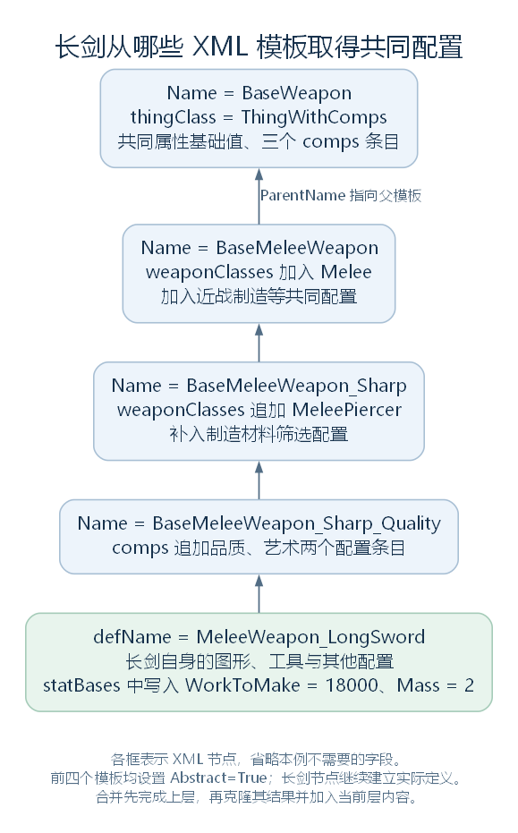

# XmlInheritance：父模板怎样补全定义节点（讨论稿）

状态：模板登记、父节点选择与递归合并，2026-10-27。依据工作区 RimWorld 1.7.4982 rev1280 的游戏代码与原版内容整理。上接 [统一 XML 与补丁](36-xml-merge-and-patches.md)，范围见 [本部分大纲](29-def-xml-outline.md)。本轮解释 XML 节点怎样取得父模板内容，继续使用长剑与原版武器模板作为主例；字段怎样变成 C# 对象，留到下一步。

## 一、这里的“继承”先发生在 XML 节点之间

补丁完成后，ParseAndProcessXML 先遍历统一文档中的顶层元素，调用 XmlInheritance.TryRegister，再调用 XmlInheritance.Resolve。等这些处理完成，才继续尝试建立 Def 对象。

先把几个名字分开：

| 写在哪里 | 含义 |
| --- | --- |
| XML 属性 Name="BaseWeapon" | 为这个节点提供模板查找名称，登记到 XmlInheritance |
| XML 属性 ParentName="BaseWeapon" | 要求从相应的命名节点取得父模板内容 |
| XML 属性 Abstract="True" | 后面的定义读取入口会跳过它，不为这个原始节点建立 Def |
| XML 子节点 defName | 定义对象的名称字段，之后用于数据库查询等 |
| C# 的 ThingDef : BuildableDef | C# 类型的父子关系，与上述 XML 模板关系分别存在 |

Name 本身不表示 Abstract；带 Name 的节点也可以作为非抽象定义使用。父模板查找使用 Name，不会拿 ParentName 去查询 DefDatabase 中同名的 defName。

同样，这些 XML 模板虽然都可以使用 ThingDef 元素名，却不代表每个模板都已经成为一个 ThingDef 实例。原版的 BaseWeapon 等节点设置 Abstract="True"，会参与模板处理，但不单独建立可入库的定义。

源码定位：调用顺序（`Verse.LoadedModManager.cs:437`）、登记（`Verse.XmlInheritance.cs:48`）、抽象节点的跳过（`Verse.DirectXmlToObjectNew.cs:16`、`Verse.DirectXmlLoader.cs:158`）。

## 二、XmlInheritance 用什么结构保存这些关系

XmlInheritance 是静态类。它用内部 XmlInheritanceNode 包装一个参与处理的 XML 节点：

| 内部成员 | 内容 |
| --- | --- |
| xmlNode | 补丁之后、等待处理的原始节点 |
| resolvedXmlNode | 已经整理好父模板内容的结果节点 |
| mod | 从文档来源取得的内容包，可能为 null |
| parent | 选定的父包装对象 |
| children | 依赖本包装对象作为父节点的子包装对象列表 |

外围再保存三组主要数据：

| 字段 | 类型与用途 |
| --- | --- |
| nodesByName | `Dictionary<string, List<XmlInheritanceNode>>`，一个 Name 对应一组候选模板 |
| unresolvedNodes | `List<XmlInheritanceNode>`，保存本轮登记的待处理项 |
| resolvedNodes | `Dictionary<XmlNode, XmlInheritanceNode>`，按原始节点取得处理结果 |

nodesByName 的值是列表，因为不同内容包可以提供相同 Name。resolvedNodes 则以原始节点对象为键，没有将 defName 当作这里的查询键。

这里的“原始”是相对于本轮模板合并而言，已经包括上一阶段的补丁修改。

源码定位：三个容器（`Verse.XmlInheritance.cs:457`、`Verse.XmlInheritance.cs:460`、`Verse.XmlInheritance.cs:463`）、内部包装类型与字段（`Verse.XmlInheritance.cs:481`、`Verse.XmlInheritance.cs:484`、`Verse.XmlInheritance.cs:487`、`Verse.XmlInheritance.cs:490`、`Verse.XmlInheritance.cs:493`、`Verse.XmlInheritance.cs:496`）。

## 三、TryRegister：哪些节点需要登记

TryRegister 开头的连续片段如下。node 是当前顶层元素，mod 是来源内容包：

```csharp
XmlAttribute xmlAttribute = node.Attributes["Name"];
XmlAttribute xmlAttribute2 = node.Attributes["ParentName"];
XmlAttribute xmlAttribute3 = node.Attributes["MayRequire"];
if (xmlAttribute == null && xmlAttribute2 == null)
{
    return;
}
if (xmlAttribute3 != null && !ModLister.AllModsActiveNoSuffix(xmlAttribute3.Value.Split(',', StringSplitOptions.None)))
{
    return;
}
```

因此，没有 Name、也没有 ParentName 的普通节点，不需要进入这一套模板关系。带有其中任意一个属性的节点，才继续登记；MayRequire 指定的活动包条件不满足时，也在这里返回。

登记成功后，方法为节点创建包装对象，加入 unresolvedNodes。如果有 Name，再把它加入该名称对应的候选列表。

同一个 Name 若在同一个来源内容包中已经登记过，当前项会被记录错误并拒绝登记；来源都是 null 也算这一种重复。不同来源内容包的同名项可以共存，稍后再选择父节点。

这次拒绝登记没有从统一 XML 中删除节点。它不能等同于“整份定义已经从后面的所有读取中排除”。

此外，TryRegister 本处检查的是 MayRequire；总读取流程稍后还检查 MayRequireAnyOf 等条件，不能把所有条件筛选都归到这几行中。

ParseAndProcessXML 已经逐个登记统一文档的顶层元素；XmlInheritance 另有 TryRegisterAllFrom，供从一份 LoadableXmlAsset 登记元素。它不是本条普通加载主线此处调用的入口。

源码定位：登记与重名（`Verse.XmlInheritance.cs:48`）、另一登记入口（`Verse.XmlInheritance.cs:29`）、主线登记与后续条件（`Verse.LoadedModManager.cs:437`）。

## 四、GetBestParentFor：同名父模板到底选择哪一份

Resolve 首先调用 ResolveParentsAndChildNodesLinks。后者读取各节点的 ParentName，用 GetBestParentFor 找父节点，再将子项加入父项的 children。

查找首先按 ParentName 取得 nodesByName 中的候选列表，再按来源选择：

| 子节点来源 | 父节点候选的选择规则 |
| --- | --- |
| 已知内容包 | 在来源非 null、loadOrder 不晚于子节点的候选中，选 loadOrder 最大的一个 |
| 已知内容包，但上一步没有候选 | 尝试来源为 null 的同名项 |
| 来源为 null | 优先选择来源同样为 null 的同名项 |
| 来源为 null，且没有同为 null 的项 | 在有来源的候选中选择 loadOrder 最小的一个 |

例如，三个包在 loadOrder 0、1、3 分别提供 Name="Shared" 的模板，而子定义来自 loadOrder 2。它会选择顺序 1 的候选，不会选择顺序 3 的那一份。这是对同名模板的来源选择，不是“所有定义总是使用最后出现的模板”。

同一来源包中的候选也在“不晚于”范围内；这里没有排除“节点将自己选为父节点”的特殊处理。因此，把同一个节点的 Name 与 ParentName 写成一样，并不能自动表达“继承其他包提供的旧版本模板”，可能形成循环。

结合上一节还要保留另一种情况：后加载包可以先用补丁直接修改早期模板的 XML。早期子定义随后仍可能使用那份已经被修改的模板。这与后来新增另一份同名模板，是两件不同的事。

若找不到父节点，方法记录错误并返回 null；接下来的解析会按无父节点处理该项，而不是在这里自动删除它。

源码定位：父子连接（`Verse.XmlInheritance.cs:145`）、候选选择与缺失错误（`Verse.XmlInheritance.cs:199`）。

## 五、Resolve：先完成父节点，再整理子节点

Resolve 本身很短：

```csharp
public static void Resolve()
{
    XmlInheritance.ResolveParentsAndChildNodesLinks();
    XmlInheritance.ResolveXmlNodes();
}
```

连接建立后，ResolveXmlNodes 从没有父节点，或父节点已经有结果的项开始，递归处理各项的 children。这样子节点使用的是父节点已经整理完的内容，而不是只取父模板最初自己写的字段。

真正为单个包装对象准备结果的是 ResolveXmlNodeFor：

```csharp
private static void ResolveXmlNodeFor(XmlInheritance.XmlInheritanceNode node)
{
    if (node.parent == null)
    {
        node.resolvedXmlNode = node.xmlNode;
        return;
    }
    if (node.parent.resolvedXmlNode == null)
    {
        Log.Error("XML error: Internal error. Tried to resolve node whose parent has not been resolved yet. This means that this method was called in incorrect order.");
        node.resolvedXmlNode = node.xmlNode;
        return;
    }
    XmlInheritance.CheckForDuplicateNodes(node.xmlNode, node.xmlNode);
    XmlNode xmlNode = node.parent.resolvedXmlNode.CloneNode(true);
    XmlInheritance.RecursiveNodeCopyOverwriteElements(node.xmlNode, xmlNode);
    node.resolvedXmlNode = xmlNode;
}
```

最关键的动作是最后三行：克隆父节点的结果，用当前子节点继续合并，将合并结果保存起来。没有父节点时，则直接用原节点作为结果。

因此，有父模板的长剑节点会得到另一个结果节点；这段代码没有把统一文档里的原长剑节点替换掉，也没有把它的来源字典键改成克隆节点。原始节点到结果节点的对应关系，保存在 resolvedNodes 中。

源码定位：整体入口（`Verse.XmlInheritance.cs:108`）、结果遍历与递归（`Verse.XmlInheritance.cs:162`、`Verse.XmlInheritance.cs:184`）、单项结果（`Verse.XmlInheritance.cs:265`）。

## 六、RecursiveNodeCopyOverwriteElements：字段与列表怎样合并

这是本轮判断最多的方法。先明确参数含义：child 是当前子定义提供的节点；current 是从父结果克隆而来的对应节点，合并将直接修改 current。递归进入字段内部时，两个参数也相应变为那一层的节点。

### 6.1 先检查 Inherit="False"

child 上的 Inherit 值转成小写后等于 false 时，方法先清空 current 的子节点，再复制 child 提供的内容，不继续做普通的逐字段合并。

下面是该分支清空内容的连续片段。nextSibling 在移除前先保存下一个节点，避免移除后丢失遍历位置：

```csharp
XmlNode nextSibling;
for (XmlNode xmlNode = current.FirstChild; xmlNode != null; xmlNode = nextSibling)
{
    nextSibling = xmlNode.NextSibling;
    current.RemoveChild(xmlNode);
}
```

这条规则只作用在当前块。例如在 weaponClasses 上设置它，就用本层列表内容替换从父模板得到的列表，不会顺带清空整份定义的 statBases、comps。

原版 BaseMeleeWeapon_Blunt_Quality 模板实际继承 BaseMeleeWeapon_Sharp，其中有真实片段：

```xml
<weaponClasses Inherit="False">
  <li>MeleeBlunt</li>
</weaponClasses>
```

经过这一块的处理，原来沿父链取得的 Melee、MeleePiercer 不再保留，列表只留下 MeleeBlunt。

“不继承”也不等于删除整个 XML 元素及其全部属性：这个分支没有先清空 current 的所有属性，只把 child 除 Inherit 以外的属性补写进去。父节点上未被同名属性替换的其他属性仍可能保留。

### 6.2 普通合并先处理属性与文本

没有进入上面的分支时，方法先清空 current 的属性，再复制 child 的属性。也就是说，普通路径不会将父节点属性全部照搬到最后；ParentName、Name、Class、Abstract 等 XML 属性也要按这里的实际路径理解。

随后按 child 的内容区分：

| child 的内容 | 当前实现的主要动作 |
| --- | --- |
| 存在普通 Text 节点 | 用子方文本替换当前内容；数值、枚举名等常见叶节点走这一路 |
| 没有 Text，但有元素子节点 | 逐个处理这些元素，规则见下一节 |
| 没有 Text，也没有元素子节点 | 若 current 有元素子节点则保留；否则清掉其内容 |

因此，子方明确写出的 `<Mass>3</Mass>` 会覆盖父方同层 Mass 的文本；但空节点的含义要看父方原本保存什么。

最常见的差别是：

| 子节点写法 | 父方已有内容 | 模板合并结果 |
| --- | --- | --- |
| `<comps/>` | 多个 li | 保留父方的元素列表 |
| `<comps Inherit="False"/>` | 多个 li | 清空这块内容 |
| `<description/>` | 一段普通文本 | 清掉父方文本 |

不能把所有空标签都理解成“清空这个字段”，也不能把它们都理解成“继续继承”。这里先说明 XML 内容的结果；空文本最终怎样被具体 C# 字段读取，下一步按读取类型核对。

### 6.3 元素子节点：追加、递归覆盖或直接补入

进入元素合并以后，算法对每个元素依次判断：

1. 是列表元素，就复制并追加到 current。
2. 不是列表元素，但 current 中有同名直接子元素，就继续递归合并这两个节点。
3. 没有同名元素，就复制并追加当前子元素。


图只展开已经进入“元素子节点”分支的处理；Inherit="False"、普通文本与空节点在进入此图之前判断。[SVG](figures/xml-inheritance-merge.svg) · [图源](figures/xml-inheritance-merge.dot)

这就解释了 statBases：父方已有 MaxHitPoints 等项目，子方只写 WorkToMake 与 Mass 时，父方其他项目保留，子方项目加入；同名 Mass 再由递归处理其文本，使用子方值。

列表元素的判断则在 IsListElement 中：

```csharp
private static bool IsListElement(XmlNode node)
{
    return node.Name == "li" || (node.ParentNode != null && XmlInheritance.allowDuplicateNodesFieldNames.Contains(node.ParentNode.Name));
}
```

最常见的是 li。它不按 Class、compClass 或条目内容去重，也不按这些值寻找“同一种旧组件”再覆盖；子方的 li 通常追加到父方已有条目后面。

另一个条件来自 XmlInheritanceAllowDuplicateNodes。XmlInheritance 的静态构造函数扫描字段上的这个标记，将字段名加入 allowDuplicateNodesFieldNames；例如 Def.descriptionHyperlinks 有这个标记。此处使用的是字段名集合，不是先解析每一个 XML 块对应的 C# 字段类型。

因此，不能仅因 C# 字段都是 List，就推断合并规则一样：comps 的 XML 使用 li，通常追加；statBases 虽然也是列表配置，却使用 Mass 等命名元素，普通同名项目会进入递归合并。

源码定位：全部合并分支（`Verse.XmlInheritance.cs:285`）、列表元素判断（`Verse.XmlInheritance.cs:451`）、标记扫描与集合（`Verse.XmlInheritance.cs:14`、`Verse.XmlInheritance.cs:466`）、标记类型（`Verse.XmlInheritanceAllowDuplicateNodes.cs:7`）、实际标记字段（`Verse.Def.cs:135`）、statBases 字段（`Verse.BuildableDef.cs:284`）。XML 定位：列表替换示例（`RimWorld/Data/Core/Defs/ThingDefs_Misc/Weapons/BaseWeapons.xml:192`）。

## 七、沿长剑的真实父模板链走一遍

原版长剑使用的链条如下，箭头从子节点指向 ParentName 指定的父模板，不是 C# 类型继承：



各框只列本例所需的部分内容。模板节点都设置 Abstract="True"；最后的长剑节点没有设置这个属性，会进入后续定义对象读取。[SVG](figures/xml-inheritance-longsword.svg) · [图源](figures/xml-inheritance-longsword.dot)

在不加入教学补丁的情况下，解析结果包含：

| 内容 | 结果与来源 |
| --- | --- |
| thingClass | BaseWeapon 的 ThingWithComps |
| category、tickerType | BaseWeapon 的 Item、Never |
| statBases | 保留 BaseWeapon 的 MaxHitPoints=100、Flammability=1.0 等；加入长剑的 WorkToMake=18000、Mass=2 |
| weaponClasses | BaseMeleeWeapon 的 Melee，加上 Sharp 模板的 MeleePiercer |
| comps | BaseWeapon 的三个配置条目，加上 Sharp_Quality 的品质与艺术两个条目，共五项 |
| graphicData | 保留 BaseWeapon 的 onGroundRandomRotateAngle=35，并合入长剑的 texPath、graphicClass |

这里 comps 的五项仍是 XML 配置条目：CompProperties_Forbiddable、指定 CompEquippable 的通用配置、CompProperties_Styleable，以及后面追加的品质、艺术配置。对应的 CompProperties 和实际物品组件，还要在后续各自的读取、创建路径中建立。

长剑自己没有 thingClass 节点，但解析后节点有了它；原始节点本身仍然没有被改写。这与上一节补丁直接修改统一文档中的原节点不同。

如果先执行上一节把 Mass 改成 3 的教学补丁，本阶段读取的子方 XML 已经是 3，合并后也会保留这次修改。原版默认值 2 与补丁后的结果要分别看。

源码与 XML 定位：模板合并入口（`Verse.XmlInheritance.cs:265`）、BaseWeapon（`RimWorld/Data/Core/Defs/ThingDefs_Misc/Weapons/BaseWeapons.xml:4`）、BaseMeleeWeapon（`RimWorld/Data/Core/Defs/ThingDefs_Misc/Weapons/BaseWeapons.xml:114`）、Sharp（`RimWorld/Data/Core/Defs/ThingDefs_Misc/Weapons/BaseWeapons.xml:144`）、Sharp_Quality（`RimWorld/Data/Core/Defs/ThingDefs_Misc/Weapons/BaseWeapons.xml:179`）、长剑（`RimWorld/Data/Core/Defs/ThingDefs_Misc/Weapons/MeleeMedieval.xml:120`）。

## 八、读取代码怎样取得结果，Abstract 又在哪里起作用

GetResolvedNodeFor 接收原始节点。带 ParentName 时，它从 resolvedNodes 查询处理结果；没有 ParentName 时，直接返回原节点。若带 ParentName 却找不到结果，会记录错误并退回原节点。

默认的 DefFromNodeNew 在开头有下面这个连续片段，node 仍是传入的原始节点：

```csharp
XmlAttribute xmlAttribute = node.Attributes["Abstract"];
if (xmlAttribute != null && xmlAttribute.Value.Equals("true", StringComparison.InvariantCultureIgnoreCase))
{
    return null;
}
XmlNode resolvedNodeFor = XmlInheritance.GetResolvedNodeFor(node);
```

因此，Abstract="True" 并没有阻止它作为父模板参与前面的登记与解析；它是在这里阻止本节点继续建立 Def。原始长剑没有 Abstract，所以能继续使用自己的解析结果。

这个入口随后用解析结果中的 Class 属性等信息选择读取类型；实际字段读取过程也接到 GetResolvedNodeFor。下一步再沿默认读取器，展开字符串、数值、列表、嵌套对象与定义引用怎样进入 C# 对象。

源码定位：取得结果与失败回退（`Verse.XmlInheritance.cs:115`）、默认定义入口（`Verse.DirectXmlToObjectNew.cs:16`）。

## 九、错误与清理：不要把日志当作自动修复

| 情况 | 当前代码的处理 |
| --- | --- |
| 同一来源重复 Name | 记录错误，拒绝本次模板登记；不从统一文档中删除节点 |
| 找不到父模板 | 记录错误，parent 留为 null；单项解析使用原节点 |
| 依赖环等原因导致结果没有得到解析 | ResolveXmlNodes 对仍无结果的项记录循环继承错误 |
| 有 ParentName，但读取时找不到缓存结果 | GetResolvedNodeFor 记录错误，返回原节点 |
| 子方存在重复普通元素 | 合并前调用 CheckForDuplicateNodes 做日志检查；该检查不修复或移除 XML |

这些错误不表示程序总会在原地终止，也不表示其余字段已经正确补全。需要按具体返回路径看，后面的对象读取拿到的是解析结果还是原节点。

ResolveXmlNodes 完成本轮后，把有结果的项加入 resolvedNodes，再清空 unresolvedNodes。Clear 则清空 resolvedNodes、unresolvedNodes、nodesByName；普通加载在本轮开始与结束等位置调用它。allowDuplicateNodesFieldNames 没有在 Clear 中一起清空。

本轮到这里，已经能说明长剑文件里没有直接写出的共同配置从哪里来。接下来进入 [DirectXmlToObjectNew.DefFromNodeNew 与具体字段读取](38-xml-to-objects.md)，解释这份 XML 怎样变成 ThingDef、CompProperties 等实际 C# 对象。

源码定位：结果收集与未解析项（`Verse.XmlInheritance.cs:162`）、重复检查（`Verse.XmlInheritance.cs:426`）、清空（`Verse.XmlInheritance.cs:137`）、清理调用所在流程（`Verse.LoadedModManager.cs:56`）。
