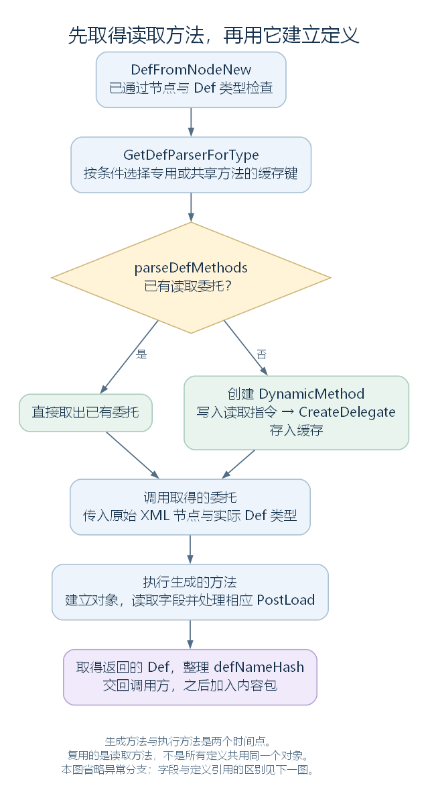

# 从 XML 到对象：DirectXmlToObjectNew 怎样读取定义（讨论稿）

状态：默认定义读取入口、读取方法的生成与缓存，以及长剑所需的主要字段分支，2026-10-27。依据工作区 RimWorld 1.7.4982 rev1280 的游戏代码与原版内容整理。上接 [XmlInheritance](37-xml-inheritance.md)，范围见 [本部分大纲](29-def-xml-outline.md)。本轮先解释对象怎样建立，定义引用怎样登记；引用的统一解析与后续生成、绑定另行展开。

## 一、这一步的输入和输出是什么

ParseAndProcessXML 在处理父模板以后，继续遍历统一文档中的原始顶层节点。默认未指定 legacy-xml-deserializer 时，它调用 DirectXmlToObjectNew.DefFromNodeNew；旧分支则调用 DirectXmlLoader.DefFromNode。

DefFromNodeNew 的两个参数是：node，即当前原始 XML 节点；loadingAsset，即已经查询到的来源文档信息，可能为 null。父模板结果仍通过上一节的 GetResolvedNodeFor 取得，没有要求先把原始节点替换掉。

返回值是 Def 引用。成功读取长剑时，实际对象类型为 ThingDef；它还带有 GraphicData、组件配置等普通配置对象，以及一些等待后续连接的定义引用。这次建立的仍然是共同定义，不是一件可以放在地图上的长剑。

源码定位：默认与旧分支（`Verse.LoadedModManager.cs:437`）、默认入口（`Verse.DirectXmlToObjectNew.cs:16`）。

## 二、DefFromNodeNew 怎样决定建立哪个 C# 类型

先看入口开头的连续片段，变量保持原名：

```csharp
if (node.NodeType != XmlNodeType.Element)
{
    return null;
}
XmlAttribute xmlAttribute = node.Attributes["Abstract"];
if (xmlAttribute != null && xmlAttribute.Value.Equals("true", StringComparison.InvariantCultureIgnoreCase))
{
    return null;
}
XmlNode resolvedNodeFor = XmlInheritance.GetResolvedNodeFor(node);
string text = node.Name;
XmlAttribute xmlAttribute2 = resolvedNodeFor.Attributes["Class"];
if (xmlAttribute2 != null)
{
    text = xmlAttribute2.Value;
}
Type typeInAnyAssembly = GenTypes.GetTypeInAnyAssembly(text, null);
```

非元素节点与原始节点上设置 Abstract="True" 的模板先被跳过。随后，默认使用原节点的元素名作为类型名；若解析后节点有 Class 属性，则使用 Class 的值。

本例的长剑使用 ThingDef 元素名，未另外指定根节点 Class，因而查找 ThingDef。typeInAnyAssembly 保存的是找到的 System.Type，不是刚建立的定义对象。

紧接着，代码要求该类型存在，并通过 GenTypes.IsDef 检查；不符合就记录错误并返回 null。普通根节点的名称、可选的 Class 与最终 C# 类型在这里连接起来。

进入后面的 try 后，方法先取得读取委托，再执行它。下面是实际调用与名称哈希整理的连续片段；defParserForType 已由 GetDefParserForType 取得：

```csharp
def = defParserForType(0, 0, node, typeInAnyAssembly);
DeepProfiler.End();
def.ResolveDefNameHash();
```

它仍传入原始 node；生成的复杂对象读取方法内部会再取得模板解析结果。两个 0 对应委托声明中的 unused、unused2，没有在这里传入帧号、定义编号等含义。

源码定位：入口与调用（`Verse.DirectXmlToObjectNew.cs:16`）、类型查找与 Def 检查（`Verse.GenTypes.cs:196`、`Verse.GenTypes.cs:290`）、委托声明（`Verse.DirectXmlToObjectNew.cs:1596`）、名称哈希（`Verse.Def.cs:76`）。

## 三、读取委托是什么，为什么先生成再缓存

委托在这里是可以调用的方法引用。读取器分别定义了三种用途：

| 委托类型 | 接收与完成的工作 |
| --- | --- |
| ParseValueAndReturnDefDelegate | 接收节点和实际 Def 类型，建立并返回 Def |
| ParseValueAndSetFieldDelegate | 接收目标对象、FieldInfo、节点与读取类型，解析并写入一个字段 |
| ParseValueAndAddListItemDelegate | 接收目标 IList、节点与条目类型，解析并添加一项 |

GetDefParserForType 的完整实现如下：

```csharp
public static DirectXmlToObjectNew.ParseValueAndReturnDefDelegate GetDefParserForType(Type type)
{
    if (DirectXmlToObjectNew.TypeCanBeDeserializedWithSharedBody(type))
    {
        type = typeof(Def);
    }
    DirectXmlToObjectNew.ParseValueAndReturnDefDelegate parseValueAndReturnDefDelegate;
    if (DirectXmlToObjectNew.parseDefMethods.TryGetValue(type, out parseValueAndReturnDefDelegate))
    {
        return parseValueAndReturnDefDelegate;
    }
    parseValueAndReturnDefDelegate = DirectXmlToObjectNew.CreateDefParserForType(type);
    DirectXmlToObjectNew.parseDefMethods[type] = parseValueAndReturnDefDelegate;
    return parseValueAndReturnDefDelegate;
}
```

第一次遇到相应类型时，CreateDefParserForType 用 DynamicMethod 建立运行中的方法，ILGenerator 写入这个方法应执行的指令，再调用 CreateDelegate，取得可调用的委托。以后可从 parseDefMethods 直接取得它。

下面是创建方法体时的连续节选。dynamicMethod 已经创建；localBuilder 是为将来执行时保存对象结果声明的局部变量位置：

```csharp
ILGenerator ilgenerator = dynamicMethod.GetILGenerator();
LocalBuilder localBuilder = ilgenerator.DeclareLocal(type);
DirectXmlToObjectNew.EmitIlToCreateAndPopulateComplexType(ilgenerator, type, localBuilder);
ilgenerator.Emit(OpCodes.Ldloc, localBuilder);
ilgenerator.Emit(OpCodes.Ret);
return (DirectXmlToObjectNew.ParseValueAndReturnDefDelegate)dynamicMethod.CreateDelegate(typeof(DirectXmlToObjectNew.ParseValueAndReturnDefDelegate));
```

这里要分清两个时间点：这段 C# 正在**生成读取方法**；等委托真正被调用时，生成的方法才建立对象、遍历 XML 并写入字段。源码中的 Emit、Label、LocalBuilder 因而不能直接当成“正在给当前长剑赋值”的动作。



图中省略根节点合法性检查与具体字段分支；后者在下一张图展开。[SVG](figures/xml-def-parser-cache.svg) · [图源](figures/xml-def-parser-cache.dot)

### 3.1 缓存的不一定是每个类型独占的方法

TypeCanBeDeserializedWithSharedBody 允许满足条件的引用类型共用一份读取方法。自定义读取、特定 PostLoad、泛型、值类型及 ParseHelper 支持的类型等会影响是否采用共享分支。

上面的 type=typeof(Def) 改变的是查找和生成方法使用的类型键；调用时仍传入实际 typeInAnyAssembly。生成的方法使用实际类型建立对象、查找字段，所以这不表示某个 Mod 的 Def 派生对象被改建成了普通 Def。

本例 ThingDef 自己覆写了 PostLoad，因此不满足该共享条件。字段写入与列表条目也分别通过 GetFieldSetterForType、GetListItemAdderForType 缓存读取委托。

此外，这套生成方法仍然使用 FieldInfo.SetValue 等调用。可以说它缓存和组合了读取步骤，不能因此说它已经完全消除了运行时反射。

源码定位：三个委托（`Verse.DirectXmlToObjectNew.cs:1588`、`Verse.DirectXmlToObjectNew.cs:1592`、`Verse.DirectXmlToObjectNew.cs:1596`）、缓存入口（`Verse.DirectXmlToObjectNew.cs:73`、`Verse.DirectXmlToObjectNew.cs:96`、`Verse.DirectXmlToObjectNew.cs:119`）、生成 Def 方法（`Verse.DirectXmlToObjectNew.cs:196`）、共享条件（`Verse.DirectXmlToObjectNew.cs:1378`）、缓存字段（`Verse.DirectXmlToObjectNew.cs:1578`、`Verse.DirectXmlToObjectNew.cs:1581`、`Verse.DirectXmlToObjectNew.cs:1584`）、普通字段写入（`Verse.DirectXmlToObjectNew.cs:346`）。

## 四、普通复杂对象怎样建立并逐个读取字段

EmitIlToCreateAndPopulateComplexType 生成的主要步骤是：取得模板解析结果；建立对象；遍历其直接子节点；找到相应字段，选择读取路径；最后处理 PostLoad。

对引用类型，建立对象会调用 MakeInstanceOfTypeForEmptyNode。这个名字虽然带 EmptyNode，但普通复杂对象路径也使用它：先解析实际类型，再通过 Activator.CreateInstance 创建对象。普通类在这里需要相应的无参构造函数，构造函数和字段初始化也会提供尚未被 XML 覆盖的初始值。

因此，不是每个字段都必须在 XML 中出现。比如 ThingDef.stackLimit 在声明处初始化为 1；没有相应赋值时，要沿初始值及后续方法继续理解，不能统一说缺失字段全是 0 或 null。

对值类型，生成代码使用初始化值类型、装箱后写字段等另外的步骤。本轮主要沿长剑需要的引用类型和配置对象继续。

### 4.1 节点名怎样找到 C# 字段

ResolveFieldForNode 转交 XmlToObjectUtils.DoFieldSearch。它按节点名查字段，并沿 C# 类型继承层级查找，所以 ThingDef 的 XML 既能写入本类字段，也能对应 Def、BuildableDef 中的字段。

查找还包含缓存、LoadAlias 等兼容名称，以及忽略特定缺失节点的处理。普通缺失字段会记录错误并返回 null；生成的循环会跳过该项，继续下一项。

当前实现也会尝试不区分大小写查找。找到大小写不一致的字段后，通常记录错误但仍返回字段；带相应 CaseInsensitiveXMLParsing 标记时另有处理。因此不能把所有大小写问题都概括成“完全没有读入”。

### 4.2 找到字段以后，先分清 Def 引用与普通数据

字段的默认读取类型来自 FieldInfo.FieldType。若当前 XML 节点有 Class 属性，ResolveTypeForNode 会尝试查找指定类型。

```csharp
public static Type ResolveTypeForNode(Type defaultType, XmlNode node)
{
    XmlAttributeCollection attributes = node.Attributes;
    XmlAttribute xmlAttribute = ((attributes != null) ? attributes["Class"] : null);
    if (xmlAttribute == null)
    {
        return defaultType;
    }
    Type typeInAnyAssembly = GenTypes.GetTypeInAnyAssembly(xmlAttribute.Value, defaultType.GetInnerIfNullable().Namespace);
    if (typeInAnyAssembly != null)
    {
        return typeInAnyAssembly;
    }
    throw new ArgumentException("Could not find type named " + xmlAttribute.Value + " from node " + node.OuterXml, "node");
}
```

这个帮助方法负责找到类型，没有在其中完成所有可赋值性检查。选择不适合目标字段的 Class，仍可能在后续读取或写入时报错。

如果选定类型是 Def，普通对象字段循环会把非空文本当作定义名称，登记待连接引用；文本为空时将字段设为 null。其他类型则取得字段读取委托，解析数据并写入字段。


图只展示普通复杂对象的主要循环，省略空引用、值类型装箱等细节。自定义读取方法有独立路径，见后文。[SVG](figures/xml-object-field-loop.svg) · [图源](figures/xml-object-field-loop.dot)

源码定位：复杂对象与字段循环（`Verse.DirectXmlToObjectNew.cs:1029`）、建立对象（`Verse.DirectXmlToObjectNew.cs:1325`）、初始值示例（`Verse.ThingDef.cs:1563`）、字段与类型帮助方法（`Verse.DirectXmlToObjectNew.cs:1285`、`Verse.DirectXmlToObjectNew.cs:1291`、`Verse.DirectXmlToObjectNew.cs:1297`）、字段查找（`Verse.XmlToObjectUtils.cs:15`、`Verse.XmlToObjectUtils.cs:118`、`Verse.XmlToObjectUtils.cs:165`）。

## 五、长剑里的几种字段，走的是哪些读取路径

下面以已经完成模板合并的长剑节点为准：

| XML 内容 | 对应数据 | 主要读取方式 |
| --- | --- | --- |
| label 的 longsword | Def.label，string | 读取字符串 |
| costStuffCount 的 100 | 从 BuildableDef 继承的 int | 通过 ParseHelper 转成数值，再写字段 |
| tickerType 的 Never | ThingDef.tickerType，枚举 | 通过相应文本解析取得枚举值 |
| thingClass 的 ThingWithComps | ThingDef.thingClass，Type | 查找并保存 System.Type |
| graphicData 内的多个字段 | GraphicData 配置对象 | 建立普通复杂对象，递归填入其字段 |
| comps 的各条 li | `List<CompProperties>` | 建立列表，按各条目类型建立配置 |
| statBases 的 Mass 等节点 | `List<StatModifier>` | 列表条目调用自定义读取方法 |
| recipeMaker/researchPrerequisite 的 LongBlades | ResearchProjectDef 引用 | 登记名称，后续连接已有定义 |

这里最容易混淆的是三种“类型”：定义根节点的 Class 决定 Def 对象类型，配置条目的 Class 决定配置对象类型，thingClass、compClass 字段中的文字则被读成 Type，供以后创建实际物品或组件使用。

### 5.1 字符串、数值、枚举与 Type

字段读取分派会先区分自定义读取、字符串、带 Flags 的枚举、列表、字典等类别，剩余类型再走一般路径。能用单一普通文本读取的类型，通过 ParseHelper.FromString 转换；ParseHelper 为 int、float、Type 等注册了各自的解析方法，普通枚举也有对应处理。

字符串有独立规则：没有子节点时得到空字符串；一个普通文本子节点会经 ParseHelper 的字符串处理；CDATA 则取其文本值。不能把非字符串的 CDATA 也自动推广为同样的读取方式。

thingClass=ThingWithComps 最后得到的是一个 Type 引用。这一步不调用 ThingMaker，也不因为读到这个名字就建立实际 ThingWithComps。

### 5.2 普通嵌套配置与空节点

graphicData 是普通嵌套配置的例子。读取器找到该字段后，建立 GraphicData，继续按 texPath、graphicClass、onGroundRandomRotateAngle 等子节点读取其字段。

因此，一次建立 ThingDef 可能递归建立多个普通配置对象；不能把“返回一个 Def”理解成整个过程只分配一个对象。

空节点还要按具体分支看：一般字段路径可以建立带初始值的对象，列表路径可以建立空列表，字符串路径得到空字符串。一般字段、列表等相关路径还检查 IsNull="True"，但这不是所有入口共用的一条统一规则；Def 引用、自定义读取和字符串都有各自实现。

上一节 `<comps/>` 是否保留父方条目，是模板合并的判断；本节列表读取拿到的已经是该判断之后的结果，二者不能混为一步。

源码定位：字段与条目分派（`Verse.DirectXmlToObjectNew.cs:136`、`Verse.DirectXmlToObjectNew.cs:166`）、一般字段（`Verse.DirectXmlToObjectNew.cs:346`）、字符串（`Verse.DirectXmlToObjectNew.cs:601`）、空节点与文本处理（`Verse.DirectXmlToObjectNew.cs:1182`、`Verse.DirectXmlToObjectNew.cs:1226`、`Verse.DirectXmlToObjectNew.cs:1255`）、基础解析（`Verse.ParseHelper.cs:448`、`Verse.ParseHelper.cs:459`、`Verse.ParseHelper.cs:529`）、Type 解析（`Verse.ParseHelper.cs:219`）。

## 六、列表里的条目怎样建立：先看 comps

普通列表读取先根据列表类型取得条目类型，建立新列表，遍历 XML 条目，调用 ValidateListNode 检查其形状。一般条目使用 li；带自定义读取方法的条目允许其他节点名称。

如果条目类型是 Def，就登记定义名称，等待稍后加入对应引用；如果不是 Def，就处理条目条件、Class 类型选择，取得条目读取委托，建立数据并添加到列表。

对长剑的 comps，默认条目类型是 CompProperties。原版 BaseWeapon 中真实存在：

```xml
<li Class="CompProperties_Forbiddable"/>
```

Class 让这个条目采用 CompProperties_Forbiddable。空节点路径仍会创建对象，构造函数把 compClass 设置为 CompForbiddable：

```csharp
public CompProperties_Forbiddable()
{
    this.compClass = typeof(CompForbiddable);
}
```

另一个条目来自品质模板：

```xml
<li>
  <compClass>CompQuality</compClass>
</li>
```

它没有指定 Class，建立通用 CompProperties，再将 compClass 字段读成 CompQuality 的 Type。两种写法都在准备组件配置，实际 ThingComp 仍在实际物品的组件创建路径中建立。

MayRequire、MayRequireAnyOf 在列表路径也有作用。普通非 Def 条目在本处检查活动包条件；Def 列表项将条件随待连接记录一起保存，不是所有条目都先用同一个判断直接过滤。

字典也有专门的创建与填充分支。本轮先保留入口，后面遇到需要字典的实际配置时再展开其键、值与引用处理。

源码定位：列表建立与遍历（`Verse.DirectXmlToObjectNew.cs:725`）、条目读取（`Verse.DirectXmlToObjectNew.cs:519`）、形状检查（`Verse.DirectXmlToObject.cs:458`）、配置构造与字段（`RimWorld.CompProperties_Forbiddable.cs:10`、`Verse.CompProperties.cs:60`）、字典入口（`Verse.DirectXmlToObjectNew.cs:862`）。XML 定位：禁用配置（`RimWorld/Data/Core/Defs/ThingDefs_Misc/Weapons/BaseWeapons.xml:25`）、品质配置（`RimWorld/Data/Core/Defs/ThingDefs_Misc/Weapons/BaseWeapons.xml:181`）。

## 七、statBases 为什么不用 li：自定义读取接管了条目

statBases 是 `List<StatModifier>`，但原文件写的是：

```xml
<Mass>2</Mass>
```

列表形状检查允许它，是因为 StatModifier 提供 LoadDataFromXmlCustom。字段和列表项的读取分派会优先采用这类自定义读取路径：建立相应对象，取得解析后的节点，再把节点交给这个方法，而不是按 Mass 去寻找 StatModifier.Mass 字段。

它的完整自定义方法只有两步：

```csharp
public void LoadDataFromXmlCustom(XmlNode xmlRoot)
{
    DirectXmlCrossRefLoader.RegisterObjectWantsCrossRef(this, "stat", xmlRoot.Name, null, null, null);
    this.value = ParseHelper.FromString<float>(xmlRoot.FirstChild.Value);
}
```

this 是刚建立的 StatModifier。第一行登记：它的 stat 字段需要连接到名为 Mass 的定义；第二行将节点里的 2 读成 float，立即写入 value。

也就是说，此时已经得到一个 StatModifier 对象与 value=2，但 stat 还要等待后续连接。节点名在这条特殊路径中用作定义名称，而不是普通字段名。

这一例也说明，不能只用通用读取器的字段规则解释所有 XML 形状。自定义方法可以决定怎样理解节点名、属性与内部文本；它与普通复杂对象逐字段读取是不同路径。

源码定位：自定义方法查找（`Verse.XmlToObjectUtils.cs:205`）、自定义字段与列表项分派（`Verse.DirectXmlToObjectNew.cs:136`、`Verse.DirectXmlToObjectNew.cs:166`）、对象建立与调用（`Verse.DirectXmlToObjectNew.cs:559`）、StatModifier 的方法与字段（`RimWorld.StatModifier.cs:31`、`RimWorld.StatModifier.cs:48`、`RimWorld.StatModifier.cs:51`）。XML 定位：`RimWorld/Data/Core/Defs/ThingDefs_Misc/Weapons/MeleeMedieval.xml:138`。

## 八、Def 引用先登记，PostLoad 则可能已经执行

普通对象字段遇到 Def 类型时，也采用类似的待连接方式。例如长剑 recipeMaker.researchPrerequisite 写着 LongBlades，读取器登记“这个 RecipeMakerProperties 对象的 researchPrerequisite 字段，需要连接名为 LongBlades 的 ResearchProjectDef”。它不会为该字段再从文本构造一个新的研究定义。

DirectXmlCrossRefLoader 保存待连接记录，包括需要引用的对象、字段、目标名称与相应条件。后续统一查询数据库并写入引用的过程，下一节展开。

与此同时，普通复杂对象的字段循环结束后，如果找到 PostLoad 方法，生成的方法会调用它。下面是生成这段调用的连续节选：

```csharp
MethodInfo methodInfo = XmlToObjectUtils.PostLoadMethodOf(typeBeingDeserialized);
if (methodInfo != null)
{
    il.Emit(OpCodes.Ldloc, instantiatedObjectLocal);
    il.Emit(OpCodes.Call, methodInfo);
    return;
}
```

这是生成阶段的判断；生成的方法运行到此时才实际调用对象的 PostLoad。自定义读取、空节点等分支有各自路径，不能把这次调用推广成所有对象都经过的统一步骤。

对本例 ThingDef，PostLoad 可以整理工具编号，并通过 LongEventHandler.ExecuteWhenFinished 安排图形等后续工作。因此既要区分“调用了 PostLoad”与“其中安排的工作全部完成”，也要区分它和后面统一调用的 ResolveReferences。

| 此时已发生或可能发生 | 仍需后续完成 |
| --- | --- |
| ThingDef、普通配置对象与列表已经建立 | Def 引用按加载流程继续解析 |
| 数值、字符串、枚举与 Type 等已经读入 | 部分生成定义、DefOf 绑定等后续步骤 |
| 普通复杂对象的 PostLoad 已按路径调用 | PostLoad 中安排的部分工作可能稍后执行 |
| DefFromNodeNew 返回后，调用方可将定义加入内容包 | 各 DefDatabase 的收集及后续多轮整理 |

源码定位：普通对象的引用登记与 PostLoad（`Verse.DirectXmlToObjectNew.cs:1029`）、方法查找（`Verse.XmlToObjectUtils.cs:218`）、引用登记（`Verse.DirectXmlCrossRefLoader.cs:29`、`Verse.DirectXmlCrossRefLoader.cs:58`、`Verse.DirectXmlCrossRefLoader.cs:145`）、ThingDef 的后处理（`Verse.ThingDef.cs:1279`）、回到内容包的调用方（`Verse.LoadedModManager.cs:437`）。XML 定位：长剑研究配置（`RimWorld/Data/Core/Defs/ThingDefs_Misc/Weapons/MeleeMedieval.xml:173`）。

## 九、读取失败时，究竟留下了什么

| 情况 | 当前路径中的主要处理 |
| --- | --- |
| 顶层节点不是元素，或设置 Abstract="True" | 入口返回 null |
| 根节点类型找不到，或不是 Def | 记录错误，返回 null |
| 普通字段找不到 | 字段查找返回 null，循环跳过本项，其他字段继续 |
| 文本转换、Class 查找、构造或字段写入抛出异常 | 可能沿调用栈到达 DefFromNodeNew 的 catch，记录异常 |
| 解析值是其他 Def 的名称 | 通常只是登记，不在本阶段把所有缺失引用都报告完 |

DefFromNodeNew 使用局部变量 def 保存结果。若委托尚未正常返回就抛出异常，赋值尚未完成，局部变量仍为 null；若已经赋值后，后面的处理再出错，最后返回的则是这个变量当时的值。因此不把“出现了读取错误”统一解释为整份加载立即终止，也不保证失败过程没有建立过任何临时对象或待连接记录。

本轮已经从父模板解析结果走到实际 ThingDef 及其配置对象。下一步回到 [DirectXmlCrossRefLoader 与 PlayDataLoader](39-def-cross-references.md)，追踪这些名称记录怎样在定义入库后被解析，以及为什么加载流程还会多次尝试连接和整理。

源码定位：入口的异常与返回（`Verse.DirectXmlToObjectNew.cs:16`）、字段查找（`Verse.XmlToObjectUtils.cs:15`）、引用记录（`Verse.DirectXmlCrossRefLoader.cs:29`）。
