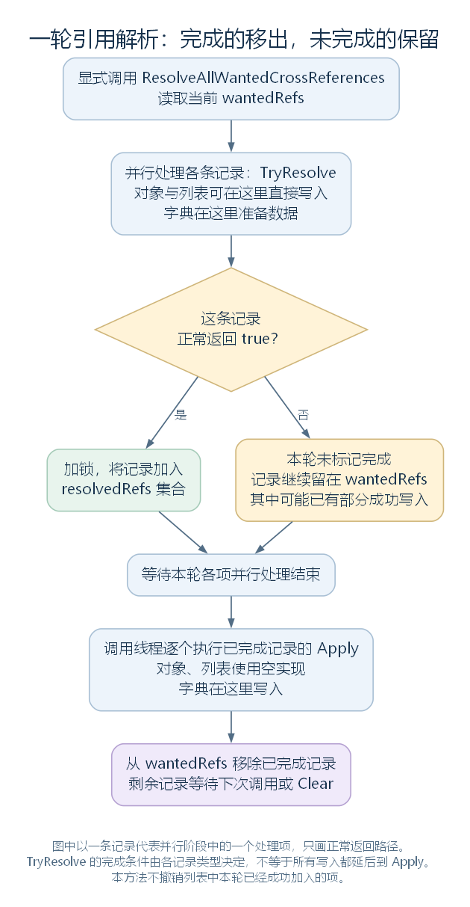
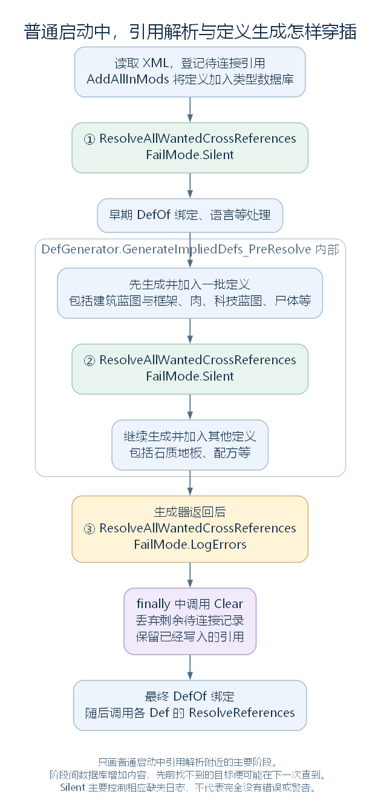

# 定义引用怎样连接：DirectXmlCrossRefLoader（讨论稿）

状态：待连接记录、对象与集合写入，以及普通启动中的主要解析调用，2026-10-27。依据工作区 RimWorld 1.7.4982 rev1280 的游戏代码整理。上接 [从 XML 到对象](38-xml-to-objects.md)，范围见 [本部分大纲](29-def-xml-outline.md)。本轮先完成名称到 Def 引用的连接；代码生成定义、DefOf 与各定义自己的 ResolveReferences，随后按独立步骤继续。

## 一、从长剑的 StatModifier 接着看

上一节读到 `<Mass>2</Mass>` 时，StatModifier 已经建立，value 已经是 2；它还登记了“自己的 stat 字段需要名为 Mass 的 StatDef”。

DirectXmlCrossRefLoader 保存的就是这种待连接记录：谁需要引用、写到哪里、目标定义叫什么，以及必要的类型和条件信息。到解析时，它按类型与名称查找已经入库的 Def，再把找到的对象引用写回。

同样，长剑 recipeMaker.researchPrerequisite 中的 LongBlades，需要连接一个 ResearchProjectDef；recipeUsers 中的 ElectricSmithy、FueledSmithy，则需要进入一个 ThingDef 列表。

这里通常取得的是数据库中已有对象的引用，不是按名称再复制一份定义。多个 StatModifier 都引用 Mass 时，可以连接到同一个 StatDef。

源码定位：StatModifier 的登记（`RimWorld.StatModifier.cs:31`）、登记入口（`Verse.DirectXmlCrossRefLoader.cs:29`、`Verse.DirectXmlCrossRefLoader.cs:58`、`Verse.DirectXmlCrossRefLoader.cs:145`）。XML 定位：长剑重量基础值（`RimWorld/Data/Core/Defs/ThingDefs_Misc/Weapons/MeleeMedieval.xml:138`）、研究配置（`RimWorld/Data/Core/Defs/ThingDefs_Misc/Weapons/MeleeMedieval.xml:173`）、制造场所列表（`RimWorld/Data/Core/Defs/ThingDefs_Misc/Weapons/BaseWeapons.xml:131`）。

## 二、记录怎样组织：它不是只有一个名称队列

类中有两个主要容器：

| 字段 | 用途 |
| --- | --- |
| wantedRefs | 保存本轮仍待处理的 WantedRef 记录 |
| wantedListDictRefs | 以目标列表或字典对象为键，找到该集合对应的记录，将多次登记收集到同一项中 |

记录基类 WantedRef 保存 wanter，即需要引用的目标对象，并定义 TryResolve 与 Apply。具体有三种子类：

| 记录类型 | 保存什么 | 主要写入发生在哪里 |
| --- | --- | --- |
| WantedRefForObject | 对象、字段、名称、可选类型与条件 | TryResolve 找到目标后，直接写字段 |
| `WantedRefForList<T>` | 目标列表、尚待查找的名称与条件 | TryResolve 中，找到一项就加入列表 |
| `WantedRefForDictionary<K, V>` | 目标字典、条目 XML，以及准备好的键值数据 | TryResolve 准备数据，Apply 再处理和写入字典 |

因此，不能仅凭 TryResolve、Apply 的命名，就把所有类型统一解释成“先只查找，最后才统一写回”。对象与列表已经在 TryResolve 中修改目标；它们没有覆写 Apply，使用基类的空实现。

也不能把每条记录理解成同样大小的一项任务：一个对象字段通常对应一条记录，一个列表记录则可能包含许多仍未找到的名称。

源码定位：容器（`Verse.DirectXmlCrossRefLoader.cs:280`、`Verse.DirectXmlCrossRefLoader.cs:283`）、基类（`Verse.DirectXmlCrossRefLoader.cs:286`、`Verse.DirectXmlCrossRefLoader.cs:289`、`Verse.DirectXmlCrossRefLoader.cs:292`、`Verse.DirectXmlCrossRefLoader.cs:297`）、三类记录（`Verse.DirectXmlCrossRefLoader.cs:301`、`Verse.DirectXmlCrossRefLoader.cs:412`、`Verse.DirectXmlCrossRefLoader.cs:511`）。

## 三、登记只保存需要什么，通常还不在这里查数据库

以普通对象字段为例，RegisterObjectWantsCrossRef 有直接接收 FieldInfo 的重载，也有接收字段名称、再查找 FieldInfo 的重载。它们建立 WantedRefForObject，并加入 wantedRefs。

记录构造函数完整实现如下，变量保持原名：

```csharp
public WantedRefForObject(object wanter, FieldInfo fi, string targetDefName, string mayRequireMod = null, string mayRequireAnyMod = null, Type overrideFieldType = null)
{
    this.wanter = wanter;
    this.fi = fi;
    this.defName = targetDefName;
    this.mayRequireMod = mayRequireMod;
    this.overrideFieldType = overrideFieldType;
    this.mayRequireAnyMod = ((mayRequireAnyMod != null) ? mayRequireAnyMod.ToLower().Split(',', StringSplitOptions.None) : null);
}
```

对前面的 Mass 案例，wanter 是 StatModifier，fi 指向其 stat 字段，defName 为 Mass。实际查询类型之后可从该字段的 StatDef 类型取得。

列表与字典的登记则先查 wantedListDictRefs：同一个集合已经有记录时，将新名称或条目加入原记录；第一次登记才建立记录，并放进两个容器。这里还没有为列表中的每个名称立即追加 Def。

另有接收 XmlNode 的对象字段重载，会从节点名及条件属性取得信息；它与直接传入 targetDefName 的重载要按实际调用区分。本文的 StatModifier 使用的是传入字符串名称的入口。

源码定位：对象登记重载（`Verse.DirectXmlCrossRefLoader.cs:29`、`Verse.DirectXmlCrossRefLoader.cs:58`、`Verse.DirectXmlCrossRefLoader.cs:88`）、记录构造（`Verse.DirectXmlCrossRefLoader.cs:314`）、集合登记（`Verse.DirectXmlCrossRefLoader.cs:145`、`Verse.DirectXmlCrossRefLoader.cs:171`）。

## 四、ResolveAllWantedCrossReferences：一次解析做哪些工作

完整方法如下：

```csharp
public static void ResolveAllWantedCrossReferences(FailMode failReportMode)
{
    DeepProfiler.Start("ResolveAllWantedCrossReferences");
    try
    {
        HashSet<DirectXmlCrossRefLoader.WantedRef> resolvedRefs = new HashSet<DirectXmlCrossRefLoader.WantedRef>();
        object resolvedRefsLock = new object();
        DeepProfiler.enabled = false;
        GenThreading.ParallelForEach<DirectXmlCrossRefLoader.WantedRef>(DirectXmlCrossRefLoader.wantedRefs, delegate(DirectXmlCrossRefLoader.WantedRef wantedRef)
        {
            if (wantedRef.TryResolve(failReportMode))
            {
                object resolvedRefsLock2 = resolvedRefsLock;
                lock (resolvedRefsLock2)
                {
                    resolvedRefs.Add(wantedRef);
                }
            }
        }, -1);
        foreach (DirectXmlCrossRefLoader.WantedRef wantedRef2 in resolvedRefs)
        {
            wantedRef2.Apply();
        }
        DirectXmlCrossRefLoader.wantedRefs.RemoveAll((DirectXmlCrossRefLoader.WantedRef x) => resolvedRefs.Contains(x));
        DeepProfiler.enabled = true;
    }
    finally
    {
        DeepProfiler.End();
    }
}
```

先把各记录交给 ParallelForEach，调用它们自己的 TryResolve。返回 true 的记录加入 resolvedRefs，加入集合时用锁保护这一个共享集合。

ParallelForEach 等待这一批工作结束后，调用线程遍历 resolvedRefs，逐个执行 Apply；最后从 wantedRefs 移除这些记录。正常返回 false 的记录仍留在 wantedRefs，供下一次显式调用继续尝试。



图中以一条记录代表并行阶段中的一个处理项。只画正常返回的主路径；并行调度与异常处理细节留给运行模块。[SVG](figures/def-crossref-round.svg) · [图源](figures/def-crossref-round.dot)

这里有两个范围限制：第一，resolvedRefs 是集合，不能把不同记录的 Apply 顺序当作登记顺序；第二，false 只表示这条记录没有被本轮标记完成，不保证它完全没有修改目标。列表的部分成功就是下一节的例子。

源码定位：一轮解析（`Verse.DirectXmlCrossRefLoader.cs:247`）、分批执行与等待（`Verse.GenThreading.cs:87`）。

## 五、对象字段：按类型找到定义，直接写入字段

WantedRefForObject.TryResolve 先检查 fi 是否存在，再执行查找处的连续两行：

```csharp
Type type = this.overrideFieldType ?? this.fi.FieldType;
this.resolvedDef = GenDefDatabase.GetDefSilentFail(type, this.defName, true);
```

没有覆盖类型时，就使用字段自己的类型。Mass 案例因此沿 StatDef 查询，LongBlades 案例沿 ResearchProjectDef 查询；相同文字放在不同类型字段中，不表示它们查询同一个数据库。

GenDefDatabase 再把运行时 Type 转接到相应 DefDatabase 的按名称查询。找到对象后，方法末尾直接执行：

```csharp
this.fi.SetValue(this.wanter, this.resolvedDef);
return true;
```

到这里，StatModifier.stat 才真正引用 Mass 的 StatDef。该记录随后会被本轮从 wantedRefs 移除；它的 Apply 没有额外写入工作。

找不到普通目标时返回 false。此方法没有先把目标字段清成 null，所以失败时是否为 null，要结合该对象此前的初始化与赋值看。

### 5.1 MayRequire 在这里主要改变缺失时的报错

BadCrossRefAllowed 在所需包不活动等情况下，允许这次缺失不记录普通错误。但是查询发生在前面：如果目标定义仍然存在，代码照样取得它并写入字段。

所以，在这条引用解析路径中，条件未满足不等于“永远不允许连接”，也不等于“自动删除这条记录”。若目标缺失，记录仍然返回 false，只是可能不报错。

当前快照的 MistypedMayRequire 方法直接返回 false，不能因为这里调用了它，就认为已经进行了有效的包标识拼写检查。

### 5.2 声音有额外的替代路径

GenDefDatabase.GetDefSilentFail 默认对 SoundDef 转交 SoundDef.Named。该方法找不到真实声音时，可以返回 isUndefined 的替代对象；对象字段解析对此记录警告，再写入替代引用并返回 true。

因此，“返回了非 null 对象”也不总能解释成原名称对应的真实声音已经找到。声音的完整行为仍放到音频模块继续。

源码定位：对象解析与写入（`Verse.DirectXmlCrossRefLoader.cs:325`）、条件（`Verse.DirectXmlCrossRefLoader.cs:305`）、当前拼写检查实现（`Verse.DirectXmlCrossRefLoader.cs:13`）、按类型查询（`Verse.GenDefDatabase.cs:30`）、声音入口（`Verse.SoundDef.cs:140`）。

## 六、列表：找到一项就加入，剩余名称以后再试

WantedRefForList 保存目标 List，以及仍然需要查找的 defNames。一次 TryResolve 会遍历这些名称，按条件决定报错模式，再调用 TryResolveDef<T>。

找到一项时执行下面这个连续片段。t 是本次找到的定义，i 是当前待查名称的位置：

```csharp
if (t != null)
{
    ((List<T>)this.wanter).Add(t);
    this.defNames.RemoveAt(i);
    if (this.mayRequireMods != null && i < this.mayRequireMods.Count)
    {
        this.mayRequireMods.RemoveAt(i);
    }
    i--;
}
```

成功项立即加入实际列表，并从待查名称中移除，所以下一轮不会因为它以前登记过，就再次追加同一项。这里说的是成功登记项已移除；如果原先本来就多次登记相同名称，方法没有替调用者统一去重。

只要还有本轮找不到的项，这条集合记录就返回 false，留到下次继续处理。已经成功写入的部分不会因此撤销。

### 6.1 多轮解析也可能改变最终顺序

下面用 A、B 两个教学名称说明，不对应原版中的具体定义：先登记 A，再登记 B；首轮只有 B 已入库。

| 时点 | 实际列表 | 记录中剩余名称 |
| --- | --- | --- |
| 刚登记 | 空 | A、B |
| 首轮只找到 B | B | A |
| A 后来入库，再执行一轮 | B、A | 空 |

因此，同一轮中按待查顺序追加，与跨多轮后一定维持最初 XML 顺序，是不同的结论。后找到的项会追加在已有内容之后。

本例长剑的 recipeUsers 可以连接 ElectricSmithy、FueledSmithy 等已有定义；这里仅说明连接关系，实际制造菜单和工作台怎样使用这些配方，在生成与游戏模块继续展开。

列表条件与对象字段类似：所需包不活动时，相关缺失查询可以使用 Silent；它仍会尝试查找，找到时仍加入列表，找不到的名称也没有因此自动删除。

源码定位：列表记录的构造与登记（`Verse.DirectXmlCrossRefLoader.cs:415`、`Verse.DirectXmlCrossRefLoader.cs:422`）、列表解析（`Verse.DirectXmlCrossRefLoader.cs:463`）、通用按类型查找（`Verse.DirectXmlCrossRefLoader.cs:197`）。

## 七、字典：准备键值对，再通过 Apply 写入

WantedRefForDictionary 保存的是条目 XML。TryResolve 区分键、值的类型：是 Def 时按名称查询；不是 Def 时先保留相应 XML 节点，再将准备的数据加入 makingData。

这条路径与对象、列表有两个明显差别：

- 它会将 failReportMode 改成 LogErrors，即使调用这一轮时传入的是 Silent。
- 正常走到方法末尾就返回 true，并不因为某个键或值没找到而统一返回 false。

随后，Apply 将目标字典清空，逐项处理 makingData。非 Def 的 XML 在这里再交给 DirectXmlToObject.ObjectFromXml 读取，之后调用 Dictionary.Add。单项写入有自己的 catch，会记录错误并继续其他项。

因此，字典的 TryResolve 返回 true，不能直接解释为“所有键和值都已正确找到”。例如缺失引用造成 null 键时，写入会失败；当字典的值可以为 null 时，也可能保存这样的值。此类记录正常完成 Apply 后就被外层移出，不能套用列表那套“失败名称留待下次补齐”的规则。

本轮保留这个分支，是为了说明基类接口背后的行为并不统一。具体字典配置的读取要求，后续随实际模块继续核对。

源码定位：字典登记（`Verse.DirectXmlCrossRefLoader.cs:171`、`Verse.DirectXmlCrossRefLoader.cs:521`）、准备数据（`Verse.DirectXmlCrossRefLoader.cs:527`）、实际写入（`Verse.DirectXmlCrossRefLoader.cs:579`）。

## 八、Silent 与 LogErrors 控制的是什么

FailMode 只有 Silent、LogErrors 两项。在普通缺失查询路径中，它主要控制是否记录错误，不会把数据库中尚不存在的定义变成存在，也不会因此自动创建普通 Def。

| 情况 | 主要结果 |
| --- | --- |
| 普通字段或列表项没找到，使用 Silent | 通常不记这条缺失错误，仍保留待处理状态 |
| 使用 LogErrors，且缺失不被相应条件允许 | 记录普通缺失错误；字段或列表中的失败记录仍可保留到清理前 |
| fi 本身缺失等结构问题 | 有自己的错误处理，不受普通缺失报错开关统一控制 |
| 声音替代对象、字典解析等分支 | 有另外的警告或模式处理，不能保证 Silent 下完全没有日志 |

所以，读取到了名称但暂时查不到，不一定立即意味着名称拼错；定义也可能还没由代码生成或入库。接下来需要回到调用顺序判断。

源码定位：模式枚举（`Verse.FailMode.cs:6`）、通用缺失日志（`Verse.DirectXmlCrossRefLoader.cs:197`）、对象、列表、字典的不同实现（`Verse.DirectXmlCrossRefLoader.cs:325`、`Verse.DirectXmlCrossRefLoader.cs:463`、`Verse.DirectXmlCrossRefLoader.cs:527`）。

## 九、为什么普通启动需要多次解析

普通启动主线中，相关解析不只是两次。DoPlayLoad 在 XML 定义入库以后调用一次，GenerateImpliedDefs_PreResolve 内部又调用一次，生成器返回后再调用一次：



图只画引用解析附近的主要阶段，省略部分语言、缓存与其他初始化。生成器内部的更多细节留到下一步。[SVG](figures/def-crossref-load-stages.svg) · [图源](figures/def-crossref-load-stages.dot)

| 位置 | 当前已具备的内容与目的 |
| --- | --- |
| XML 定义经 AddAllInMods 入库后：Silent | 先连接已经能找到的普通定义引用；缺失项不在这里一律报错 |
| PreResolve 生成器建立第一批定义后：Silent | 蓝图与框架、肉、科技蓝图、尸体等生成阶段增加了一批定义，再尝试原先留存及新登记的引用 |
| PreResolve 生成器继续建立地板、配方等并返回后：LogErrors | 再处理剩余记录，对相应缺失报告错误；随后清理登记容器 |

生成定义通过 AddImpliedDef 进入相应 DefDatabase，而不是等下一次重新执行所有包的 AddAllInMods。数据库在阶段之间增加内容，就是同一个待查名称后来可能找到目标的原因之一。

这也让引用连接与代码生成相互衔接：一部分生成逻辑要先使用已有定义的引用，而另外一些 XML 或代码登记的引用，又可能等待生成器提供目标。名称解析是显式调用，不是每帧自动反复查询。

第一次解析以后，主线还进行早期 DefOf 绑定、语言等处理；最后一轮之后，则清理待连接记录，再进行最终 DefOf 绑定和各定义的 ResolveReferences。这里先认识相对位置，下一步再读生成与绑定的方法。

### 9.1 ResolveReferences 与名称引用解析不是同一个入口

DirectXmlCrossRefLoader 主要按登记的名称找到对象、填写引用。后面的 DefDatabase.ResolveAllReferences 则调用各定义自身的 ResolveReferences：它们可以整理关联、建立派生数据或缓存，具体动作由各类型决定。

后者可以读取并继续处理已经建立的引用，但不能仅因名字相似，就把前面的待查列表和这个对象方法视为同一套操作。

源码定位：普通启动与各次调用（`Verse.PlayDataLoader.cs:94`）、生成器内部解析（`RimWorld.DefGenerator.cs:11`）、生成定义入库（`RimWorld.DefGenerator.cs:72`）、定义自身引用整理（`Verse.DefDatabase.cs:143`）。

## 十、Clear 清掉什么，LoadingInProgress 又表示什么

Clear 的主要动作只有清空两个登记容器：

```csharp
DirectXmlCrossRefLoader.wantedRefs.Clear();
DirectXmlCrossRefLoader.wantedListDictRefs.Clear();
```

已经写入的字段、列表项和字典内容不因为这两行而撤销；还没找到的记录则被丢弃，不再由原记录继续重试。普通启动在最后一轮 LogErrors 调用的 finally 中执行 Clear。

LoadingInProgress 的实现也很直接：

```csharp
public static bool LoadingInProgress
{
    get
    {
        return DirectXmlCrossRefLoader.wantedRefs.Count > 0;
    }
}
```

它表示待处理记录列表非空，不是在查询“是否还有一个后台加载线程正在运行”。Clear 以后为 false，也不能倒推所有引用原本都解析成功。

另一个实现边界是，单轮完成时只从 wantedRefs 移除成功记录，集合到记录的 wantedListDictRefs 仍保留到 Clear。对已经完成的同一集合再登记新项时，登记方法会找到旧记录，却没有在该分支把它重新加入 wantedRefs。不能把这套按加载阶段使用的设施，直接理解成可随时登记、自动恢复解析的通用服务。

本轮到这里，长剑配置中的数字、类型与 Def 引用已经分别接上了来源和处理时机。下一步进入 [DefGenerator 与 DefOfHelper](40-generated-defs-and-defof.md)，继续解释代码生成的定义怎样加入这条主线，以及 C# 静态字段怎样取得相应 Def。

源码定位：清空与状态属性（`Verse.DirectXmlCrossRefLoader.cs:232`、`Verse.DirectXmlCrossRefLoader.cs:20`）、成功项移除（`Verse.DirectXmlCrossRefLoader.cs:247`）、集合的再次登记路径（`Verse.DirectXmlCrossRefLoader.cs:145`、`Verse.DirectXmlCrossRefLoader.cs:171`）。
