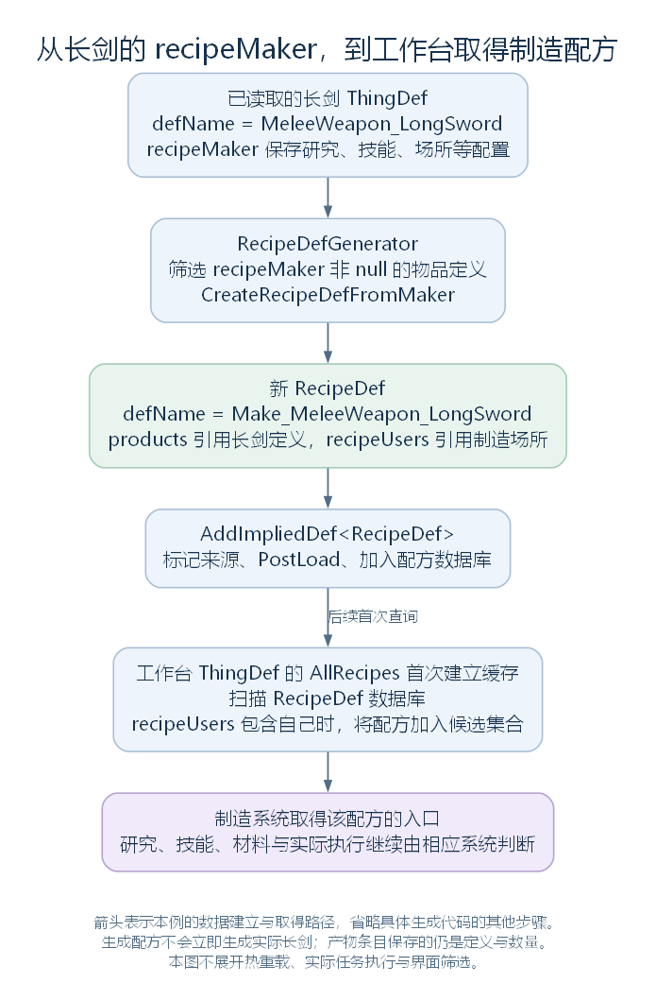
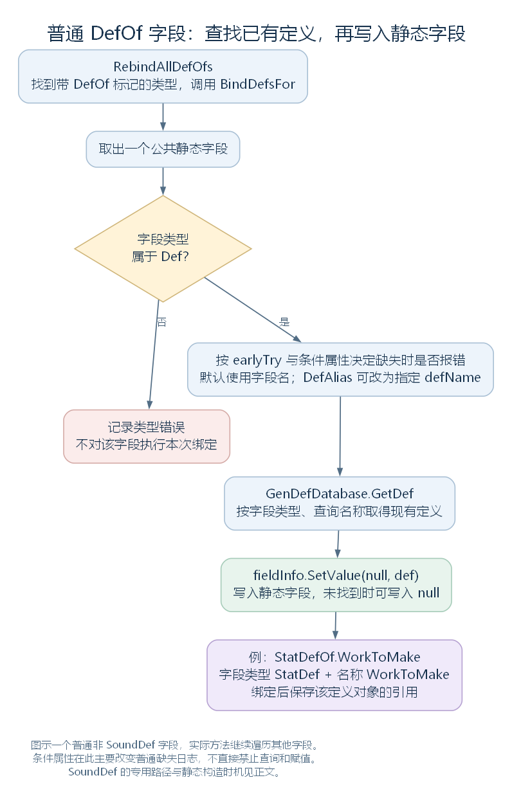

# 代码生成定义与 DefOf：新内容怎样入库，静态字段怎样取得定义（讨论稿）

状态：普通启动中的 DefGenerator、长剑制造配方与 DefOfHelper，2026-10-27。依据工作区 RimWorld 1.7.4982 rev1280 的游戏代码与原版内容整理。上接 [定义引用怎样连接](39-def-cross-references.md)，范围见 [本部分大纲](29-def-xml-outline.md)。本轮以普通启动 hotReload=false 为范围，接到工作台取得候选配方的入口；实际制造任务、属性计算和界面筛选留给相应模块。

## 一、先分清三件不同的工作

上一节的流程中，定义生成和 DefOf 绑定与名称引用解析穿插执行。它们的职责不同：

| 工作 | 输入与结果 |
| --- | --- |
| DefGenerator 组织代码生成 | 根据已有内容与规则建立新的 Def，再登记到数据库 |
| DirectXmlCrossRefLoader 解析引用 | 按登记的名称查找 Def，写入对象字段或集合 |
| DefOfHelper 绑定静态字段 | 查找已有 Def，写入带 DefOf 标记的类中的公共静态字段 |

例如，长剑 ThingDef 来自前面的 XML 读取；制造长剑的 RecipeDef 可以由代码生成；StatDefOf.WorkToMake 则取得已经存在的属性定义。它们不能都解释成“再次读取一份 XML”。

源码定位：生成入口（`RimWorld.DefGenerator.cs:11`）、引用解析（`Verse.DirectXmlCrossRefLoader.cs:247`）、静态绑定（`RimWorld.DefOfHelper.cs:12`）。

## 二、DefGenerator 的前后两组生成，放在哪里

DoPlayLoad 先完成 XML 定义入库、第一轮引用解析和早期 DefOf 绑定，再调用 GenerateImpliedDefs_PreResolve。各定义自身的 ResolveReferences 执行以后，才调用 GenerateImpliedDefs_PostResolve。

因此，这里的 PreResolve、PostResolve 主要相对于主流程中各定义自己的引用整理阶段；PreResolve 不表示此前完全没有执行名称引用解析。

| 入口 | 当前代码组织的主要生成类别 |
| --- | --- |
| GenerateImpliedDefs_PreResolve | 地毯地形；建筑蓝图与框架、肉、科技蓝图、尸体；之后继续石质地形、配方、Pawn 列、神经训练物品、基因及相关思想、飞行动画相关定义等 |
| GenerateImpliedDefs_PostResolve | 按键分类与按键定义 |

PreResolve 内部在前一批生成之后还调用一次 Silent 名称引用解析，位置见 [上一节的阶段图](39-def-cross-references.md)。各子生成器有自己的条件；列出一个生成类别，不等于每次都会生成该类别的所有可能对象。

Implied 在这里可以理解为“根据其他内容推导生成”。生成结果仍然是普通的 Def 派生对象，使用相应数据库与后续处理；不需要先写成新的 XML 文件再读回来。

源码定位：两组生成（`RimWorld.DefGenerator.cs:11`、`RimWorld.DefGenerator.cs:59`）、主线位置（`Verse.PlayDataLoader.cs:94`）。

## 三、AddImpliedDef：接收已有对象，再执行登记和后处理

真正建立各类对象的代码在对应子生成器中。AddImpliedDef 接收它们已经建立的对象，完整实现如下：

```csharp
public static void AddImpliedDef<T>(T def, bool hotReload = false) where T : Def, new()
{
    def.generated = true;
    def.ResolveDefNameHash();
    ModContentPack modContentPack = def.modContentPack;
    if (modContentPack != null)
    {
        modContentPack.AddDef(def, "ImpliedDefs");
    }
    def.PostLoad();
    if (hotReload && DefDatabase<T>.GetNamed(def.defName, false) != null)
    {
        return;
    }
    DefDatabase<T>.Add(def);
}
```

按普通启动路径读，主要是四步：标记 generated 并整理名称哈希；有来源包时加入内容包；调用 PostLoad；加入当前 T 的 DefDatabase。

这里的 ImpliedDefs 是传给内容包的来源文字，会成为 fileName，不是新建的磁盘 XML 文件名。T 上的 new() 约束也不表示这个方法内部自动执行 new T()；传入对象已经存在。

还有两个顺序值得保留：

- PostLoad 在当前方法的数据库添加之前调用，不能仅因它已执行，就认定对象已经能从这个数据库查到。
- 这里调用的是当前 T 的 Add，没有再次遍历全部父类型库执行 AddAllInMods。前面 XML 定义的那一轮按类型收集，不能直接套成每个新生成定义都会自动进入所有兼容类型库。

代码保留热重载分支；本篇只沿 hotReload=false 解释，不把普通启动结论直接推广到热重载。

源码定位：生成定义登记（`RimWorld.DefGenerator.cs:72`）、来源字段与标记（`Verse.Def.cs:161`、`Verse.Def.cs:165`、`Verse.Def.cs:177`）、内容包添加（`Verse.ModContentPack.cs:610`）。

## 四、长剑怎样取得自己的制造配方

原版长剑有 recipeMaker，其中写着 LongBlades 研究前提、Crafting 5 技能要求与显示优先级 420；从父模板还取得工作技能、制造场所和未完成物品等配置。

RecipeDefGenerator.ImpliedRecipeDefs 会接到 DefsFromRecipeMakers。后者遍历 ThingDef 数据库，选出 recipeMaker 非 null 的定义，先按 adjustedCount=1 调用 CreateRecipeDefFromMaker；若 bulkRecipeCount>0，还会额外按这个数量调用一次。本例 bulkRecipeCount 保持默认 -1，不生成这一额外版本。

这些入口在当前反编译文件中显示的是生成迭代器的外壳。本篇已核对原程序集中的实际循环与筛选，定位见本节末尾。

### 4.1 先建立 RecipeDef 并给它命名

CreateRecipeDefFromMaker 开头的连续片段如下，def 是输入的物品定义，recipeMaker 是其中的配置：

```csharp
RecipeMakerProperties recipeMaker = def.recipeMaker;
string text = "Make_" + def.defName;
if (adjustedCount != 1)
{
    text += "Bulk";
}
RecipeDef recipeDef = (hotReload ? (DefDatabase<RecipeDef>.GetNamed(text, false) ?? new RecipeDef()) : new RecipeDef());
recipeDef.defName = text;
```

普通长剑因此得到名为 Make_MeleeWeapon_LongSword 的 RecipeDef。这个名称由代码拼出，不要求原版目录中另有一份同名 RecipeDef XML。

生成的是制造规则，不是此刻已经制造好的长剑。

### 4.2 哪些内容进入这份配方

| 配方内容 | 当前生成方法从哪里取得 |
| --- | --- |
| label、jobString、description | 由物品名称、RecipeMake 等翻译键与产物信息组织；recipeMaker 也可提供指定 label |
| products | 加入指向输入 ThingDef 的 ThingDefCountClass，数量来自 productCount 与 adjustedCount |
| ingredients 与材料过滤 | SetIngredients 根据物品材料需求、成本等建立 |
| workAmount、workSpeedStat、workSkill | 从 recipeMaker 取得相应配置 |
| recipeUsers | 从 recipeMaker 取得制造场所列表的副本，条目仍引用相应 ThingDef |
| researchPrerequisite、skillRequirements | 使用已读取的研究与技能配置 |
| unfinishedThingDef、effectWorking、soundWorking | 使用未完成物品与效果、声音等配置 |
| modContentPack | 使用输入物品定义的来源包 |

例如，产物添加这一行直接保存输入的 def 引用：

```csharp
recipeDef.products.Add(new ThingDefCountClass(def, recipeMaker.productCount * adjustedCount));
```

本例 productCount 默认是 1，普通版本 adjustedCount 也是 1，所以该条目表示产出一件长剑。真正建立产物实例仍在实际制造完成等路径中进行。

有些配置直接赋值，有些列表使用 ListFullCopyOrNull。该帮助方法为非 null 输入建立新列表，逐项复制其中的值；不会因此为其中的 Def 引用复制出新的定义。这里不是将整份配置做一次统一的深拷贝。

长剑有材料类别，SetIngredients 会走 MadeFromStuff 分支，将 CostStuffCount 用作材料数量需求并设置过滤。本例原配置的 costStuffCount 为 100；最终允许哪些材料，还要结合定义与配方中的过滤规则，不能简单解释成任何一种材料都可以使用。



图只画定义层的数据建立与查找，未画实际制造任务或产物实例创建。[SVG](figures/generated-longsword-recipe.svg) · [图源](figures/generated-longsword-recipe.dot)

源码定位：配方生成入口（`RimWorld.RecipeDefGenerator.cs:12`、`RimWorld.RecipeDefGenerator.cs:20`）、具体建立与字段赋值（`RimWorld.RecipeDefGenerator.cs:28`）、材料（`RimWorld.RecipeDefGenerator.cs:98`）、材料类别条件（`Verse.BuildableDef.cs:23`）、配置初始值（`Verse.RecipeMakerProperties.cs:15`、`Verse.RecipeMakerProperties.cs:21`、`Verse.RecipeMakerProperties.cs:27`）、列表复制（`Verse.GenList.cs:35`、`Verse.GenList.cs:46`）。XML 定位：长剑制造配置（`RimWorld/Data/Core/Defs/ThingDefs_Misc/Weapons/MeleeMedieval.xml:172`）、成本（`RimWorld/Data/Core/Defs/ThingDefs_Misc/Weapons/MeleeMedieval.xml:134`）、父方制造场所（`RimWorld/Data/Core/Defs/ThingDefs_Misc/Weapons/BaseWeapons.xml:130`）。迭代器核对：DefsFromRecipeMakers.MoveNext 方法令牌 0x06011B85，筛选委托令牌 0x06011B7C；前者 IL_0028–IL_0087 接到 ThingDef 数据库与普通配方建立，IL_00A7–IL_00D7 处理额外数量；后者检查 recipeMaker 非 null。ImpliedRecipeDefs.MoveNext 令牌 0x06011B97 将这组结果与其他配方生成结果接在一起。

## 五、接到玩家现象：工作台怎样取得配方，18000 又在哪里

### 5.1 工作台的 AllRecipes 会查找 recipeUsers

ThingDef.AllRecipes 首次建立缓存时，先加入本定义 recipes 中直接列出的配方，再扫描 RecipeDef 数据库。扫描中的连续片段如下，this 是当前工作台的 ThingDef：

```csharp
if (allDefsListForReading[j].recipeUsers != null && allDefsListForReading[j].recipeUsers.Contains(this))
{
    this.allRecipesCached.Add(allDefsListForReading[j]);
}
```

生成的长剑配方已经入库，recipeUsers 又包括父模板配置的 ElectricSmithy、FueledSmithy，因此这些工作台能通过这条路径取得它，加入自己的候选配方集合。

这接上了“文件中写 recipeMaker，工作台为何能取得制造配方”的关系。玩家最终能否选择、添加或执行，还要由相应界面、研究、技能、材料与任务规则继续判断，不能单凭进入 AllRecipes 就断言所有条件都已满足。

AllRecipes 保存的是缓存，并非每次读取都重新扫描数据库。具体何时清理或重建缓存，要继续看使用阶段的调用。

### 5.2 WorkToMake 并没有在这里直接复制成 workAmount=18000

整合说明：本章保留生成配方时 workAmount 取值与配置来源的区别；下面的工作量查询仅作后续使用接点，正式整合时简述，计算细节留给属性与制造模块。

长剑 XML 的 statBases 中写着 WorkToMake=18000，但本例 recipeMaker.workAmount 保持默认 -1。普通配方建立时赋给 RecipeDef.workAmount 的也是这个值。

真正查询所需工作量时，RecipeDef.WorkAmountForStuff 的实现是：

```csharp
public float WorkAmountForStuff(ThingDef stuff)
{
    if (this.workAmount >= 0f)
    {
        return this.workAmount;
    }
    return this.products[0].thingDef.GetStatValueAbstract(StatDefOf.WorkToMake, stuff);
}
```

非负值直接使用；本例为 -1，则转到产物 ThingDef 的属性查询，以 StatDefOf.WorkToMake 指定所需属性，并传入材料信息。这也说明，XML 中的工作基础值、配方的查询结果与 Pawn 实际花费的时间，需要分层解释，不能简单画等号。

下面接着看，这里的 StatDefOf.WorkToMake 怎样获得那个 StatDef。

源码定位：候选配方集合（`Verse.ThingDef.cs:184`）、生成配方的工作配置（`RimWorld.RecipeDefGenerator.cs:28`）、工作量查询（`Verse.RecipeDef.cs:233`、`Verse.RecipeDef.cs:247`）。XML 定位：长剑工作基础值（`RimWorld/Data/Core/Defs/ThingDefs_Misc/Weapons/MeleeMedieval.xml:137`）。

## 六、DefOf 是标记，StatDefOf 是保存引用的类

StatDefOf 的类型声明带有 DefOf 标记，以下只摘出声明：

```csharp
[DefOf]
public static class StatDefOf
```

它内部有真实字段：

```csharp
public static StatDef WorkToMake;
```

DefOf 本身是 Attribute 类型。DefOfHelper 识别的是带这个标记的类，不是只按类名是否以 Of 结尾来猜测。随后它遍历公共静态字段，由字段类型决定查哪一种定义，由字段名称决定默认查询的 defName。

因此 StatDefOf.WorkToMake 通常查询 StatDef 类型下的 WorkToMake；StatDefOf.Mass 查询 StatDef 类型下的 Mass。容器类的名称用于代码组织，数据库类型由字段自己的类型决定。

这些静态字段保存的仍是对象引用。正常绑定后，StatDefOf.Mass 与前面 StatModifier.stat 可以指向数据库中同一个 Mass 定义，并没有因为多了静态入口就复制一份属性定义。

源码定位：标记类型（`RimWorld.DefOf.cs:7`）、实际静态类与字段（`RimWorld.StatDefOf.cs:7`、`RimWorld.StatDefOf.cs:46`、`RimWorld.StatDefOf.cs:52`）、查找规则（`RimWorld.DefOfHelper.cs:27`）。

## 七、RebindAllDefOfs 怎样找到类，再给字段赋值

入口完整实现如下：

```csharp
public static void RebindAllDefOfs(bool earlyTryMode)
{
    DefOfHelper.earlyTry = earlyTryMode;
    DefOfHelper.bindingNow = true;
    try
    {
        Parallel.ForEach<Type>(GenTypes.AllTypesWithAttribute<DefOf>(), new Action<Type>(DefOfHelper.BindDefsFor));
    }
    finally
    {
        DefOfHelper.bindingNow = false;
    }
}
```

它记录本轮是否为早期尝试，标记正在绑定，再对带 DefOf 标记的类型并行调用 BindDefsFor。AllTypesWithAttribute 的类型来源接到已经加载的程序集，因此 Mod 提供的相应类型也在这一套查找范围中。

BindDefsFor 遍历 `BindingFlags.Static | BindingFlags.Public` 的字段，先检查字段类型是否为 Def，再计算本次缺失时是否报错。查询名称默认取 fieldInfo.Name，也可以通过 DefAliasAttribute 改写：

```csharp
string text = fieldInfo.Name;
DefAliasAttribute defAliasAttribute = fieldInfo.TryGetAttribute<DefAliasAttribute>();
if (defAliasAttribute != null)
{
    text = defAliasAttribute.defName;
}
```

这里的 DefAlias 用于“静态字段对应哪个 defName”，与上一节 XML 字段读取时的 LoadAlias 是不同用途。

普通非 SoundDef 字段最后执行：

```csharp
Def def = GenDefDatabase.GetDef(fieldType, text, flag);
fieldInfo.SetValue(null, def);
```

fieldType 是当前字段类型，text 是查询名称，flag 控制普通缺失时是否报错。SetValue 的目标参数为 null，因为这里写的是静态字段，不需要某个 StatDefOf 实例。

找到定义就写入引用，普通查询没有找到则写入 null。这不是每次访问 StatDefOf.WorkToMake 都重新查数据库；正常 C# 调用读取的是已经赋值的静态字段。



图中展开普通非声音字段路径。SoundDef 使用 SoundDef.Named 的专用查找与替代处理，未画在本图中。[SVG](figures/defof-field-binding.svg) · [图源](figures/defof-field-binding.dot)

源码定位：总体绑定（`RimWorld.DefOfHelper.cs:12`）、字段绑定（`RimWorld.DefOfHelper.cs:27`）、带标记类型的查找（`Verse.GenTypes.cs:81`）、字段类型检查（`Verse.GenTypes.cs:303`）、别名类型（`RimWorld.DefAliasAttribute.cs:7`）、按类型查询（`Verse.GenDefDatabase.cs:13`）。

## 八、早期与最终绑定有什么不同

普通启动中，第一次 RebindAllDefOfs(true) 位于第一轮名称引用解析之后、PreResolve 生成之前。生成的定义逐渐入库，最后一轮名称引用解析及清理完成后，再执行 RebindAllDefOfs(false)。

| 调用 | 普通字段的主要区别 |
| --- | --- |
| earlyTryMode=true | 普通缺失查询不在这里记录该缺失错误；找到的引用仍写入字段 |
| earlyTryMode=false | 通常要求找不到时记录错误，再写入查询结果 |

两轮都会执行查询与赋值。最终绑定并不是只查看一个“已经绑定”的标记然后全部跳过，因此可以取得前一轮以后才生成并入库的定义。

这里的“最终”是这条主线中的最终 DefOf 绑定，不代表整个内容加载已经结束；之后仍有各定义的 ResolveReferences、PostResolve 生成、短哈希与校验等阶段。

### 8.1 MayRequire 等属性并不直接禁止查找

MayRequireAttribute 对应的包不活动时，BindDefsFor 会将 flag 设为 false；MayRequireAnyOf 则检查其中是否至少有一个活动包，不满足时同样关闭普通缺失报错。原版如 StatDefOf 的 Terror 字段就使用 MayRequireIdeology，其属性类型把包标识设为 ludeon.rimworld.ideology。

但是查询与 SetValue 仍在后面执行：目标存在时仍可绑定，目标缺失时通常写入 null。不能将这些属性解释成“条件不满足就绝不接触字段”。

字段类型不正确等错误有自己的日志；SoundDef 也有专门处理，所以 earlyTry 或条件属性并不是整个方法的全局静默开关。

源码定位：两轮调用的位置（`Verse.PlayDataLoader.cs:94`）、早期标记与条件处理（`RimWorld.DefOfHelper.cs:12`、`RimWorld.DefOfHelper.cs:27`）、条件属性（`RimWorld.MayRequireAttribute.cs:7`、`RimWorld.MayRequireAnyOfAttribute.cs:7`、`RimWorld.MayRequireIdeologyAttribute.cs:6`）。

## 九、EnsureInitializedInCtor 的名字不等于它会立即初始化

StatDefOf 的静态构造函数完整实现是：

```csharp
static StatDefOf()
{
    DefOfHelper.EnsureInitializedInCtor(typeof(StatDefOf));
}
```

EnsureInitializedInCtor 检查当前是否正在进行绑定。若 bindingNow 为 false，它会记录过早使用 DefOf 的警告，并附带能取得的读取或存档调试信息；还会检查传入类型是否可能写错。

它没有在这里调用 BindDefsFor 或 RebindAllDefOfs，也没有逐个检查并填入所有字段。因此，静态构造函数已经执行，不等于里面的定义字段此时已经准备好了。

### 9.1 为什么不宜在定义的字段初始值中提前读取 DefOf

下面是说明时机问题的教学字段，不是当前源码节选：

```csharp
public StatDef stat = StatDefOf.Mass;
```

如果定义对象在 XML 读取时建立，DefOf 绑定还没有发生，这次赋值可能取得 null。后来将 StatDefOf.Mass 设为正确引用，只改变那个静态字段，不会自动重新执行已经建立对象的字段初始化。

这与前面 XML 名称引用登记的路径不同：登记记录保存“以后要给哪个对象字段赋什么”，而上面的普通 C# 赋值只读取当时的值。

需要按定义名填写的 XML 字段可以沿前面的引用登记处理；需要在代码中整理的关联，则要选择依赖已经就绪的阶段。EnsureInitializedInCtor 的警告也明确提示，可在 ResolveReferences 等适当位置处理，而不是假定构造时所有 DefOf 都已可用。

源码定位：静态构造（`RimWorld.StatDefOf.cs:10`）、检查与警告（`RimWorld.DefOfHelper.cs:88`）、绑定状态字段（`RimWorld.DefOfHelper.cs:116`、`RimWorld.DefOfHelper.cs:119`）。

## 十、这一轮接上了哪些游戏现象

现在可以从同一条长剑主线解释几件事：

- 文件中的 recipeMaker 被读成配置，代码据此建立制造配方，故没有单独的配方 XML 也可以取得相应 RecipeDef。
- 配方通过 recipeUsers 与工作台的 AllRecipes 取得联系，物品配置逐步接到了玩家使用的制造系统入口。
- 工作量可以沿 WorkToMake 属性查询，而 StatDefOf.WorkToMake 提供了代码直接使用该属性定义的入口。
- XML 引用、代码生成、DefOf 绑定分别在不同位置起作用，构造函数或 PostLoad 已执行不意味着其他所有定义都已准备完整。

接下来回到 [DoPlayLoad 的后续整理与校验](41-def-final-preparation.md)：各 Def 的 ResolveReferences、短哈希与配置检查怎样收束这一轮准备。当前章节以定义可供查询和引用为终点；实际长剑创建、实例状态、制造任务与属性计算在后续模块继续。
