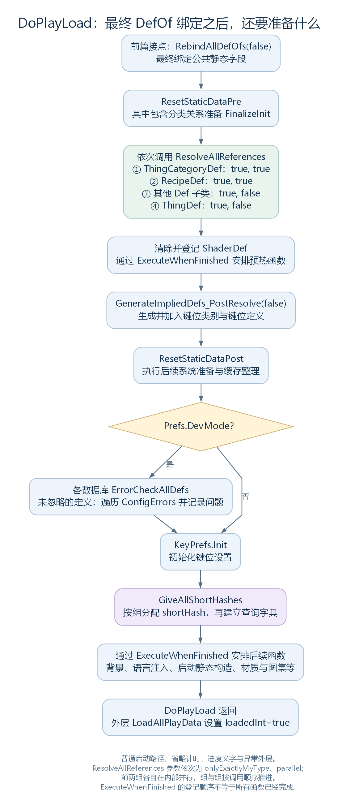
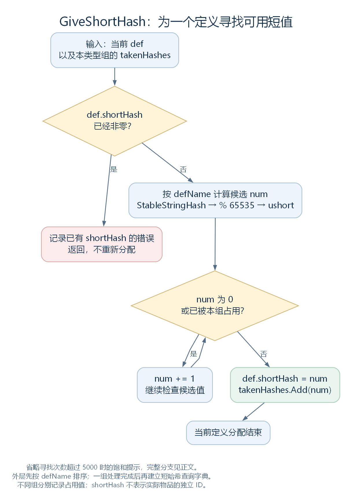

# 定义加载的收尾：自身整理、配置检查与短哈希（讨论稿）

状态：普通启动中 DoPlayLoad 的后半段，2026-10-27。依据工作区 RimWorld 1.7.4982 rev1280 的游戏代码与原版内容整理。上接 [代码生成定义与 DefOf](40-generated-defs-and-defof.md)，范围见 [本部分大纲](29-def-xml-outline.md)。本轮继续沿长剑与制造配方解释定义的准备过程；线程调度、资源初始化与存档只说明本处需要的接点。

## 一、名字已经连接，为什么还要 ResolveReferences

到上一节末尾，XML 已经变成对象，普通启动中的最后一轮名称引用解析已经执行，DefOf 静态字段也完成了最终绑定。但是，“有了指向其他定义的引用”与“使用这些引用整理出所需的数据”，仍是两件事。

例如，长剑的制造配方已经能引用材料筛选配置；筛选配置还要根据分类与排除项，整理出具体允许的物品。某些未填写的声音字段可以补上默认定义；用于检查物品的面板类型，还可以转成相应的面板对象。

这里进入各定义自己的 ResolveReferences。先把几个名字相近的过程放在一起：

| 过程 | 主要工作 | 谁决定具体行为 |
| --- | --- | --- |
| DirectXmlCrossRefLoader.ResolveAllWantedCrossReferences | 按先前登记的名称查找定义，写入对象字段或集合 | 不同种类的待解析记录 |
| DefOfHelper.RebindAllDefOfs | 查找定义，写入公共静态字段 | DefOfHelper 的字段绑定规则 |
| DefDatabase&lt;T&gt;.ResolveAllReferences | 遍历数据库，调用符合条件的定义的 ResolveReferences | 数据库控制遍历；具体定义类型决定怎样整理 |

因此，ResolveReferences 的含义不能只按方法名理解为“把所有字符串换成引用”。它是留给具体类型的整理入口，可以继续查询定义，也可以补值、准备缓存，或调用内部配置对象的方法。

最上层 Editable 的默认实现为空，Def 本层则继续调用各个 modExtensions 的 ResolveReferences。ThingDef、RecipeDef 等子类再增加自己的处理。这些继承与覆写关系已在 [Editable 与 Def](31-editable-and-def.md) 中介绍。

源码定位：默认入口（`Verse.Editable.cs:11`）、扩展整理（`Verse.Def.cs:38`）、数据库批量入口（`Verse.DefDatabase.cs:143`）。

## 二、先把 DoPlayLoad 的后半段接起来

下面按普通启动源码顺序展开，不把所有初始化都塞进 ResolveReferences：



图中“其他 Def 子类”指循环中排除了 ThingCategoryDef、RecipeDef、ThingDef 三个类型后的其余类型。它们各自的派生类仍可能在这个循环中处理。图的末尾只列出通过 ExecuteWhenFinished 安排的函数，具体何时执行由 LongEventHandler 决定。[SVG](figures/def-final-preparation.svg) · [图源](figures/def-final-preparation.dot)

几个容易忽略的顺序是：

- ResetStaticDataPre 在各数据库调用 ResolveAllReferences 之前；ResetStaticDataPost 在 PostResolve 生成之后。
- 物品分类和配方先处理，其他类型随后处理，ThingDef 库最后处理。前两组的 parallel 参数为 true，不代表这四组同时开始。
- 配置检查受 Prefs.DevMode 控制，而且在短哈希分配之前。
- PostResolve 生成的定义也赶在短哈希分配之前入库。它后面没有再安排一轮相同的全库 ResolveAllReferences 或 DefOf 最终绑定，不能假定“新增定义后总会自动重复所有阶段”。

这里的 ResetStaticDataPre、ResetStaticDataPost 都是总调用入口，其中包含多个系统的准备动作。Pre 中就有 ThingCategoryNodeDatabase.FinalizeInit；Post 中有 PawnWeaponGenerator.Reset、BuildingProperties.FinalizeInit、StatDef.SetImmutability、GenLabel.ClearCache 等。理解这些名称，需要继续看各自实现，不能一律解释成“清空一个静态变量”。

本轮只展开与定义和主例直接有关的部分。着色器登记、预热、键位设置等在图中标明位置，留到相应模块解释。

源码定位：总流程（`Verse.PlayDataLoader.cs:94`）、前后两组准备（`Verse.PlayDataLoader.cs:663`、`Verse.PlayDataLoader.cs:722`）、PostResolve 生成入口（`RimWorld.DefGenerator.cs:59`）。

## 三、数据库怎样调用每个定义

DefDatabase 的入口有两个参数：

```csharp
public static void ResolveAllReferences(bool onlyExactlyMyType = true, bool parallel = false)
```

onlyExactlyMyType 控制中间的调用是否只接收运行时类型恰好等于 T 的对象。方法内部建立 action 时，先执行这一段判断：

```csharp
if (onlyExactlyMyType && def.GetType() != typeof(T))
{
    return;
}
```

例如 `DefDatabase<ThingDef>.ResolveAllReferences(true, false)` 只对类型恰好为 ThingDef 的对象执行中间整理。一个继承 ThingDef 的 Mod 类型即使也出现在这个库里，仍会被这一条件跳过；总加载流程会在“其他 Def 子类”的循环中调用对应类型的数据库。

这一限制用于避免仅因对象同时出现在兼容父类型的库中，就重复执行同一轮整理。它不表示派生类的方法不调用父类：派生类自己的 ResolveReferences 仍然可以通过 base.ResolveReferences 接上父类实现。

真正调用的位置是：

```csharp
def.ResolveReferences();
```

这是一项虚方法调用。def 变量虽然声明为 T，最终进入的仍是该对象实际类型的覆写。单个定义在这里抛出异常时，数据库会捕获并记录错误，再继续其他对象；已经对该对象作出的修改不会因这个 catch 自动撤销。

parallel 决定这个 action 怎样逐个执行。下面是该分支的原样节选：

```csharp
if (parallel)
{
    GenThreading.ParallelForEach<T>(DefDatabase<T>.defsList, action, -1);
}
else
{
    for (int i = 0; i < DefDatabase<T>.defsList.Count; i++)
    {
        action(DefDatabase<T>.defsList[i]);
    }
}
```

当前普通加载中，ThingCategoryDef、RecipeDef 的两个调用分别使用并行遍历；其他类型及最后的 ThingDef 调用使用普通循环。GenThreading.ParallelForEach 会等待这批工作结束再返回，随后才继续后面的阶段。并行执行机制留给线程部分展开。

此外，ResolveAllReferences 的前后各调用一次 SetIndices。SetIndices 又分两轮：先按整个列表写入各定义的 index，再逐个调用 PostSetIndices。onlyExactlyMyType 不会让这些前后编号步骤跳过派生对象。关于一个对象可能出现在多个类型库、但自身只有一个 index 字段的问题，见 [DefDatabase](34-defdatabase.md)。

源码定位：遍历与异常处理（`Verse.DefDatabase.cs:143`）、编号（`Verse.DefDatabase.cs:210`）、并行遍历与等待（`Verse.GenThreading.cs:87`）、实际调用顺序所在方法（`Verse.PlayDataLoader.cs:94`）。

## 四、分类先准备，配方再整理材料

### 4.1 分类的引用与分类中的成员，是两个方向

长剑从近战武器模板继承了 thingCategories，其中包含 WeaponsMelee。名称引用解析以后，长剑 ThingDef 的这个列表已经可以指向相应 ThingCategoryDef。

可是，反过来询问“这个分类里有哪些物品”，还需要整理成员关系。ResetStaticDataPre 调用的 ThingCategoryNodeDatabase.FinalizeInit 会遍历分类，将子分类加入父分类的 childCategories；再遍历 ThingDef，将物品加入它所属分类的 childThingDefs。

其中后一步的源码节选是：

```csharp
foreach (ThingDef thingDef in DefDatabase<ThingDef>.AllDefs)
{
    if (thingDef.thingCategories != null)
    {
        foreach (ThingCategoryDef thingCategoryDef2 in thingDef.thingCategories)
        {
            thingCategoryDef2.childThingDefs.Add(thingDef);
        }
    }
}
```

这段使用的是已经连接好的定义引用。它没有再次读取长剑 XML，也没有据此建立实际长剑。

接下来 ThingCategoryDef.ResolveReferences 建立 allChildThingDefsCached，收集本分类及后代分类中的物品；另将直接子物品按 label 排序，保存到 sortedChildThingDefsCached。于是，分类本身也逐步具备后续查询所需的数据。

源码定位：长剑继承的近战分类（`BaseWeapons.xml:118`）、分类关系准备（`Verse.ThingCategoryNodeDatabase.cs:29`）、分类自身的缓存整理（`Verse.ThingCategoryDef.cs:88`）。XML 路径为 RimWorld/Data/Core/Defs/ThingDefs_Misc/Weapons/BaseWeapons.xml。

### 4.2 生成的 RecipeDef 仍要整理自己的配置

上一节已经得到 Make_MeleeWeapon_LongSword。代码生成时，它的 products 指向长剑定义，recipeUsers 指向工作台，材料与默认筛选等配置也已赋值。现在它与同库中的配方一起进入 RecipeDef.ResolveReferences。

这段方法的主要动作如下：

| 动作 | 实际处理 |
| --- | --- |
| 调用父类 | 接上 Def 对扩展数据的整理 |
| 补工作台属性 | workTableSpeedStat 为空时使用 StatDefOf.WorkTableWorkSpeedFactor；workTableEfficiencyStat 为空时使用 StatDefOf.WorkTableEfficiencyFactor |
| 处理 ingredients | 逐个调用 IngredientCount.ResolveReferences，继续进入其 filter |
| 处理固定材料范围 | fixedIngredientFilter 非空时调用其 ResolveReferences |
| 准备默认材料选择 | defaultIngredientFilter 为空时新建，并在固定筛选存在时复制其允许设置；最后调用默认筛选的 ResolveReferences |

这也给出了 DefOf 最终绑定在前面的一个具体用途：此处可以用已经绑定的 StatDefOf 字段补全默认值。代码没有在这里按字段名再次解析 XML。

需要区分的是：workTableSpeedStat 与前篇的 workSpeedStat 是不同字段；前者的默认值由这里补充，后者在长剑生成配方时已经从 recipeMaker 取得。实际怎样共同影响工作速度，留到制造系统与属性系统继续读。

源码定位：配方整理（`Verse.RecipeDef.cs:288`）、材料项继续调用筛选器（`Verse.IngredientCount.cs:97`）、生成时赋值（`RimWorld.RecipeDefGenerator.cs:28`）。

### 4.3 长剑的默认材料选择怎样得到

长剑继承的锐器模板中，recipeMaker 有下面这段原始 XML：

```xml
<defaultIngredientFilter>
  <categories>
    <li>Root</li>
  </categories>
  <disallowedThingDefs>
    <li>Silver</li>
    <li>Gold</li>
    <li>WoodLog</li>
  </disallowedThingDefs>
</defaultIngredientFilter>
```

这里的两种数据并不完全相同。categories 在 ThingFilter 中是字符串列表；disallowedThingDefs 则是 ThingDef 引用列表，其中的名称沿前面的待解析记录处理。因此，前一轮名称引用处理结束以后，并不是所有“看起来像定义名”的字符串都会消失。

ThingFilter.ResolveReferences 读到 categories 时，会自行查询分类：

```csharp
if (this.categories != null)
{
    for (int k = 0; k < this.categories.Count; k++)
    {
        ThingCategoryDef named = DefDatabase<ThingCategoryDef>.GetNamed(this.categories[k], false);
        if (named != null)
        {
            this.SetAllow(named, true, null, null);
        }
    }
}
```

SetAllow 的分类重载继续遍历该分类的后代物品，设置它们的允许状态；后面的 disallowedThingDefs 处理再将列出的物品设为不允许。设置单个 ThingDef 时，具体结果进入 allowedDefs 这个 HashSet。分类、标签、材料类别及其他规则可以依次参与这套整理，本例不需要逐项展开所有筛选选项。

所以，这份 XML 中“允许 Root、排除 Silver、Gold、WoodLog”的描述，最后会落实为具体允许哪些物品定义。对应的定义查询方法很短：

```csharp
public bool Allows(ThingDef def)
{
    return this.allowedDefs.Contains(def);
}
```

这个重载接收 ThingDef。接收实际 Thing 的另一个重载还有其他判断，不能把两者都概括为一次 HashSet 查询。

生成配方时，defaultIngredientFilter 直接取得 recipeMaker.defaultIngredientFilter 的对象引用；因此本例是在同一个筛选对象上继续整理，并非每到一个阶段就重新读取并复制 XML。

以下是留给制造模块的使用接点，Def 章节正式整合时只保留简短交接，不展开账单实例。Bill(RecipeDef recipe, ...) 构造函数会新建账单自己的 ingredientFilter，然后执行下面这一行：

```csharp
this.ingredientFilter.CopyAllowancesFrom(recipe.defaultIngredientFilter);
```

这就解释了默认材料设置怎样进入一份新账单。固定材料范围与账单当前选择仍是两份筛选；Bill.IsFixedOrAllowedIngredient 先检查特定固定材料项，未命中时才组合 fixedIngredientFilter 与 ingredientFilter 的允许结果。默认排除某种材料，也不能直接解释成配方永远不允许这种材料。

完整的材料界面、玩家修改设置与 Pawn 选料留到制造模块；这里已经能接上“模板描述 → 筛选整理 → 账单初始设置”。

源码定位：模板（`BaseWeapons.xml:149`）、筛选字段（`Verse.ThingFilter.cs:1011`、`Verse.ThingFilter.cs:1015`）、整理入口（`Verse.ThingFilter.cs:289`）、分类设置（`Verse.ThingFilter.cs:715`）、单项允许设置（`Verse.ThingFilter.cs:664`）、定义查询（`Verse.ThingFilter.cs:926`）、配方取得筛选引用（`RimWorld.RecipeDefGenerator.cs:28`）、新账单（`RimWorld.Bill.cs:208`）、材料判断（`RimWorld.Bill.cs:476`、`RimWorld.Bill.cs:490`）。

## 五、ThingDef 自己又整理什么

ThingDef 的 ResolveReferences 位于这组数据库调用的最后，其完整方法涉及多种物品配置。沿 [ThingDef](33-thingdef.md) 已认识的对象，可以将主要工作分成几类：

| 配置 | 本处的处理 |
| --- | --- |
| ingestible、stuffProps | 存在时，将其 parent 设为当前 ThingDef |
| building、graphicData、race、stuffProps、apparel | 存在时，调用各自的 ResolveReferencesSpecial |
| 声音引用 | soundImpactDefault、soundDrop、soundPickup、soundInteract 为空时，分别补上代码指定的默认 SoundDef |
| inspectorTabs | 按面板类型取得共享实例，放入新建的 inspectorTabsResolved 列表 |
| comps | 逐个调用组件配置的 ResolveReferences，并传入当前 ThingDef |

例如，补声音的两个原样分支是：

```csharp
if (this.soundDrop == null)
{
    this.soundDrop = SoundDefOf.Standard_Drop;
}
if (this.soundPickup == null)
{
    this.soundPickup = SoundDefOf.Standard_Pickup;
}
```

因此，一个定义不必将所有共同默认项都写在自己的 XML 里，代码也可以在这个阶段补足。当前调用只是在字段中保存声音定义引用；何时真的播放声音，要继续看物品操作与音频系统。

组件配置的接点则是：

```csharp
if (this.comps != null)
{
    for (int j = 0; j < this.comps.Count; j++)
    {
        this.comps[j].ResolveReferences(this);
    }
}
```

comps 中此时存放的是 CompProperties 配置对象。这里没有因为调用了它们的方法，就建立一把长剑及其 ThingComp。CompProperties 的基类实现为空，各具体配置类可以覆写；创建实际物品及实际组件的过程仍在后面。

inspectorTabsResolved 也有类似的层次区别：它保存供物品检查界面使用的共享面板实例。InspectTabManager.GetSharedInstance 按 Type 缓存对象，已有则返回，没有才创建；这不等于给每把实际长剑复制一个独立面板。

源码定位：物品定义整理（`Verse.ThingDef.cs:1403`）、组件配置默认入口（`Verse.CompProperties.cs:38`）、共享面板查询（`Verse.InspectTabManager.cs:10`）。

## 六、配置检查在哪里发生，报错以后怎样

DoPlayLoad 中的整批配置检查有一个明确条件：Prefs.DevMode。条件成立时，才遍历 Def 的各个子类，并调用对应数据库的 ErrorCheckAllDefs。

ErrorCheckAllDefs 又检查每个定义的 ignoreConfigErrors。没有跳过时，遍历该定义 ConfigErrors 返回的字符串，逐条写入日志。若检查本身抛异常，也会在这里捕获并记录。

可以将这一层的作用理解为：**调用类型自身的检查代码，并收集它报告的问题。** 它没有在这里维护一张“所有定义都检查成功”的准入表，也没有因为得到一条错误信息，就自动把定义从数据库移除。

| 观察到的情况 | 能从当前代码确认什么 |
| --- | --- |
| 关闭开发者模式 | 本处不执行整批 ErrorCheckAllDefs；XML 读取、引用解析、ResolveReferences 等位置仍可能报错 |
| ignoreConfigErrors 为 true | 数据库这次跳过该对象的 ConfigErrors；不因此关闭其他入口的日志 |
| ConfigErrors 返回错误字符串 | 数据库记录配置错误；这段代码没有据此删除定义或回滚加载 |
| 单个定义的 ConfigErrors 抛异常 | 记录检查异常，继续遍历其他定义 |

具体检查项目由类型决定，不是所有 Def 都检查同一组字段。ConfigErrors 的实现也可能带有整理动作或直接输出日志；前面 [Def 的配置检查](31-editable-and-def.md) 已见过这种情况，因此不能将整个检查过程当成绝对只读操作。

ConfigErrors 返回 IEnumerable，也不表示它作为协程交给下一帧执行。这里的 foreach 会在本次调用里继续取出检查结果。

如果异常没有在这些局部入口内处理，而是继续传到 LoadAllPlayData，则会进入另一层加载异常处理。是否重置 Mod 配置并重试，还受 ResetModsConfigOnCrash、是否正在恢复、活动内容包等条件影响；普通的 Log.Error 本身不会自动触发这条异常恢复路径。完整恢复机制留给加载流程专题。

源码定位：调用条件与异常外层（`Verse.PlayDataLoader.cs:94`、`Verse.PlayDataLoader.cs:32`）、逐定义检查与日志（`Verse.DefDatabase.cs:223`）、配置检查入口（`Verse.Def.cs:51`）、整体跳过字段（`Verse.Def.cs:141`）。

## 七、最后分配 shortHash，再建立查询字典

在前后的代码生成结束、配置检查分支经过、键位设置初始化之后，DoPlayLoad 调用 ShortHashGiver.GiveAllShortHashes。它给所选数据库中的定义分配 shortHash，然后建立按该值查询的字典。数据库的分组规则与名称、index 的区别见 [DefDatabase](34-defdatabase.md)，本节着重接上执行时机。

同组定义先按 defName 排序，再逐个处理。单个对象的分配核心如下，保留原有变量名：

```csharp
ushort num = (ushort)(GenText.StableStringHash(def.defName) % 65535);
int num2 = 0;
while (num == 0 || takenHashes.Contains(num))
{
    num += 1;
    num2++;
    if (num2 > 5000)
    {
        Log.Message("Short hashes are saturated. There are probably too many Defs.");
    }
}
def.shortHash = num;
takenHashes.Add(num);
```

num 是当前候选值；takenHashes 是本组已经占用的值。0 不会被分配；候选值撞到已用值，就继续寻找。num2 统计寻找次数，超过阈值时记录消息；这里没有因这条消息直接退出循环或扩充 ushort 的取值范围。



图中省略逐次寻找时的饱和提示，正文代码保留该分支。当前对象已经持有非零 shortHash 时，方法会记录错误并返回，不进入上面的分配代码。[SVG](figures/def-short-hash-allocation.svg) · [图源](figures/def-short-hash-allocation.dot)

一组分配完成后，调用对应数据库的 InitializeShortHashDictionary。它将各个定义已有的 shortHash 作为键，填入 defsByShortHash。以后 GetByShortHash 才能沿这个字典查找。

沿主例看，长剑 ThingDef 与生成的制造 RecipeDef 都能参加各自分组的分配。两者并不共享同一张“所有 Def 通用”的号码表；shortHash 相同也不能脱离类型组解释为同一个定义。

这里也没有创建新的游戏物品。shortHash 是定义对象上的另一个查找用值；不是一把实际长剑的独立 ID。其候选值虽由名字计算，最终仍受同组占用情况影响，不能假定它在不同 Mod 组合下永远不变。

也不宜由“短哈希很短”推断存档必定只保存它。例如 Scribe_Defs.Look 保存非空定义时，读取的是 value.defName，再将这个字符串交给 Scribe_Values。具体保存与传输方式仍要看调用方。

源码定位：按组分配与排序（`Verse.ShortHashGiver.cs:14`）、单项分配（`Verse.ShortHashGiver.cs:48`）、字典建立（`Verse.DefDatabase.cs:302`）、短哈希查询（`Verse.DefDatabase.cs:291`）、按名称保存的接点（`Verse.Scribe_Defs.cs:9`）。分组筛选的迭代器核对位置见 [数据库一节](34-defdatabase.md)。

## 八、DoPlayLoad 返回，不等于本处列出的函数全都执行完

后半段还有一些通过 LongEventHandler.ExecuteWhenFinished 交给长任务处理器的函数，包括加载人物背景、后期语言注入、清除标签缓存，以及集中调用启动静态构造、处理延后材质、制作纹理图集和清理资源等。

这里要把“把函数交给处理器”与“这个函数已经完成”分开。ExecuteWhenFinished 先加入待执行列表，在满足条件时也可能立即触发执行；不能只凭方法名，就断定每次都会推迟到 DoPlayLoad 返回以后。

相应地，LoadAllPlayData 在 DoPlayLoad 正常返回后设置 loadedInt=true。这个标记表示本入口已经走完加载过程，不是在这里逐项等待所有已登记函数、GPU 预热或后续资源工作后再作出的统一保证。相关等待与执行细节，在线程、长任务与渲染模块分别继续。

现在，定义准备这条线已经接到了使用之前：文件与模板提供配置，对象读取建立 Def，名称解析连接引用，代码生成补入新定义，DefOf 提供静态访问，各类型再整理默认值、筛选与缓存，最后经过配置检查分支和短哈希分配等阶段。

本章在这里停在定义准备及对外提供查询和引用的位置。对数据结构、加载顺序与各阶段职责的 [框架复核](43-def-framework-review.md) 已确认主线材料的覆盖，并记录整合取舍。已经展开的 [长剑创建研究](42-thingmaker-and-instance-state.md) 改列为物品模块预备笔记；MakeThing、实际组件初始化、耐久与品质状态及属性计算都在那个模块继续。

源码定位：后续函数的安排与内容（`Verse.PlayDataLoader.cs:94`）、外层加载标记（`Verse.PlayDataLoader.cs:32`）、登记与立即执行条件（`Verse.LongEventHandler.cs:224`）。
