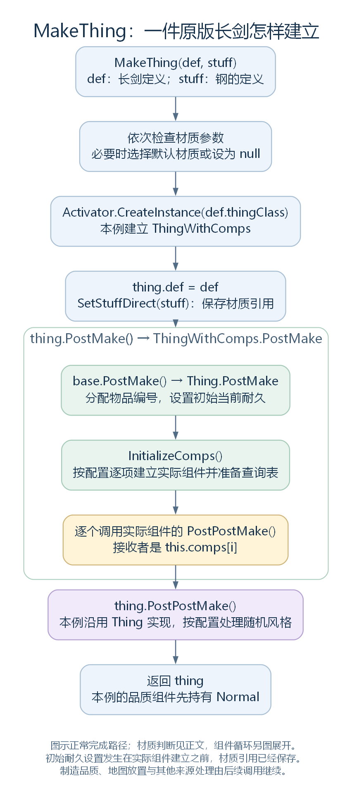
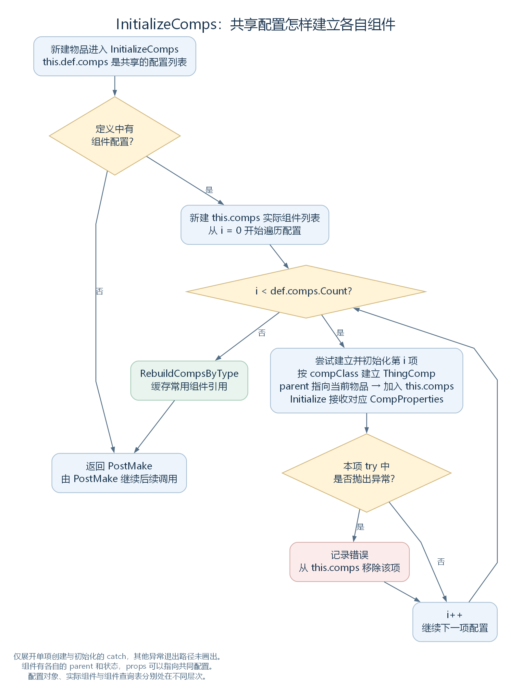

# 从定义到实际长剑：ThingMaker、组件与实例状态（物品模块预备笔记）

状态：物品模块预备研究，2026-10-27 调整归属，暂不纳入 Def 章节主线。依据工作区 RimWorld 1.7.4982 rev1280 的游戏代码与原版内容整理。本笔记曾沿 [定义加载的收尾](41-def-final-preparation.md) 继续展开；按模块边界调整，现保留给后续 Thing 与组件模块使用。内容包括长剑的普通创建路径、实际组件、制造品质与实例状态；地图放置、完整制造任务及属性计算留待该模块后续讨论。

## 一、创建入口接收的是什么

前面的内容加载已经准备了长剑 ThingDef、钢的 ThingDef、制造配方及相互引用。现在，其他游戏代码可以取得这些定义，调用 ThingMaker.MakeThing 创建实际物品。

先看入口声明：

```csharp
public static Thing MakeThing(ThingDef def, ThingDef stuff = null)
```

两个参数都是 ThingDef，却扮演不同角色：

| 参数 | 钢制长剑案例中的值 | 此处的作用 |
| --- | --- | --- |
| def | defName 为 MeleeWeapon_LongSword 的定义对象 | 提供实际类型、组件配置与共同规则 |
| stuff | defName 为 Steel 的定义对象 | 指定这件物品使用的材质 |

stuff 指向钢的定义，不是地图上的一堆钢。这个函数也没有 Pawn、RecipeDef、账单、工作量等参数。制造系统可以在相应步骤调用它，但“创建一件对象”和“完成一份制造账单”涉及不同范围的工作。

本例从已经有可用 Current.Game 的运行阶段出发：Thing.PostMake 会使用当前游戏的 UniqueIDsManager 分配编号。单是内容加载完成，并不保证任何时刻都能直接运行下面的长剑创建示例。

源码定位：入口（`Verse.ThingMaker.cs:10`）、当前游戏的 ID 管理器（`Verse.Find.cs:640`）、分配入口（`Verse.ThingIDMaker.cs:9`）。

## 二、先处理材质参数，再建立对象

### 2.1 材质检查是依次执行的三个 if

MakeThing 开头的三个判断按下面顺序执行。它们不是互相排斥的一组 else if，前一项修改的 stuff 会继续参与后一项判断。

| 顺序 | 条件 | 执行动作 |
| --- | --- | --- |
| 1 | stuff 非空，但 stuff.IsStuff 为 false | 记录错误，用 GenStuff.DefaultStuffFor(def) 替换 stuff |
| 2 | def.MadeFromStuff 为 true，但此时 stuff 为空 | 记录错误，再尝试取得默认材质 |
| 3 | def.MadeFromStuff 为 false，但此时 stuff 非空 | 记录错误，将 stuff 设为 null |

MadeFromStuff 在 BuildableDef 中检查 stuffCategories 是否非空；IsStuff 在 ThingDef 中检查 stuffProps 是否非空。前者描述目标是否按材质制作，后者描述传入的定义本身能否作为材质。

长剑的 stuffCategories 包含 Metallic、Woody，钢的 stuffProps.categories 包含 Metallic。正常传入这两份定义时，上面的纠正分支不需要改变 stuff。

若长剑没有传入材质，DefaultStuffFor 的近战武器分支会优先检查钢能否制作目标，满足时返回 ThingDefOf.Steel。这里的 CanMake 比较目标的 stuffCategories 与材质类别是否相交。

但是，MakeThing 的这三个判断没有对每个已经传入的合法材质都再调用 CanMake，也没有读取制造配方的默认筛选或研究要求。材质生成、配方选料与底层创建入口，需要沿各自规则理解，不能用其中一处的检查代替整条制造流程。

源码定位：依次检查与纠正（`Verse.ThingMaker.cs:10`）、是否按材质制作（`Verse.BuildableDef.cs:23`）、是否为材质（`Verse.ThingDef.cs:587`）、默认选择（`RimWorld.GenStuff.cs:33`）、类别匹配（`Verse.StuffProperties.cs:59`）。内容定位：长剑材料类别 `MeleeMedieval.xml:142`，钢材料类别 `Items_Resource_Stuff.xml:166`；两文件分别位于 RimWorld/Data/Core/Defs/ThingDefs_Misc/Weapons/ 与 RimWorld/Data/Core/Defs/ThingDefs_Items/。

### 2.2 thingClass 决定实际创建哪个 C# 类

材质处理后，MakeThing 的末段完整如下：

```csharp
Thing thing = (Thing)Activator.CreateInstance(def.thingClass);
thing.def = def;
thing.SetStuffDirect(stuff);
thing.PostMake();
thing.PostPostMake();
return thing;
```

长剑从 BaseWeapon 模板取得 thingClass=ThingWithComps。因此，第一行建立的是 ThingWithComps 对象，局部变量 thing 的静态类型为 Thing。

Activator.CreateInstance 会完成这个对象的字段初始化与相应构造过程。随后第二行才将定义交给 thing.def。若在这个创建路径的构造阶段就读取 def，不能假定 MakeThing 已经完成了下一行赋值。

thing.def 保存传入对象的引用。两次用同一个长剑定义创建物品，得到的是两个物品对象，它们的 def 字段仍可指向同一份 ThingDef。

SetStuffDirect 也只是保存引用，其完整实现是：

```csharp
public void SetStuffDirect(ThingDef newStuff)
{
    this.stuffInt = newStuff;
}
```

它没有在这里建立一堆钢，也没有扣除 100 个钢。成本与材料消耗要由实际制造等调用流程处理。此时保存材质的用途，是让后面的初始化、属性查询与表现代码能够知道“这件长剑由什么材质制成”。



图中展开原版长剑的 ThingWithComps 路径。组件的 PostPostMake 与物品自己的同名方法使用不同颜色标明；复杂组件循环另见下一张图。图示正常完成的调用顺序，省略构造与其他方法抛异常时的退出路径。[SVG](figures/thingmaker-longsword-creation.svg) · [图源](figures/thingmaker-longsword-creation.dot)

源码定位：创建与后续调用（`Verse.ThingMaker.cs:10`）、材质写入（`Verse.Thing.cs:2194`）、实例字段（`Verse.Thing.cs:2534`、`Verse.Thing.cs:2555`）。实际类型配置见 RimWorld/Data/Core/Defs/ThingDefs_Misc/Weapons/BaseWeapons.xml:5。

## 三、ThingWithComps.PostMake 先调用父类

thing.PostMake 是虚方法调用。本例实际进入 ThingWithComps 的覆写，完整实现如下：

```csharp
public override void PostMake()
{
    base.PostMake();
    this.InitializeComps();
    if (this.comps != null)
    {
        for (int i = 0; i < this.comps.Count; i++)
        {
            this.comps[i].PostPostMake();
        }
    }
}
```

它先执行 Thing.PostMake，再建立实际组件，最后逐个调用组件的创建后处理。这里的 base.PostMake 直接接到父类实现，不会再次绕回 ThingWithComps.PostMake。

### 3.1 先取得这件物品的编号

Thing.PostMake 完整如下：

```csharp
public virtual void PostMake()
{
    ThingIDMaker.GiveIDTo(this);
    if (this.def.useHitPoints)
    {
        this.HitPoints = Mathf.RoundToInt((float)this.MaxHitPoints * Mathf.Clamp01(this.def.startingHpRange.RandomInRange));
    }
}
```

GiveIDTo 先看 def.HasThingIDNumber。本地实现中，只要 category 不是 Mote，这个属性就返回 true；长剑的 category 为 Item，因此会分配编号。若物品已持有非 -1 的编号，它会先记录错误，随后仍从 Find.UniqueIDsManager 取得下一个 Thing ID 写入。

这个 thingIDNumber 属于实际物品，与前篇属于定义的 shortHash 不同。ThingID 属性在需要编号的情况下，将 def.defName 与 thingIDNumber 拼接成字符串；不能把这个字符串中的数字理解成长剑定义的数据库序号。

源码定位：物品初始化（`Verse.Thing.cs:928`）、编号分配（`Verse.ThingIDMaker.cs:9`）、是否需要编号（`Verse.ThingDef.cs:174`）、显示编号字符串（`Verse.Thing.cs:444`）、编号获取（`RimWorld.UniqueIDsManager.cs:10`）。

### 3.2 再设置初始当前耐久

长剑继承的 BaseWeapon 配置 useHitPoints=true，因此会进入耐久分支。它使用的是“本次查询取得的 MaxHitPoints × 初始耐久比例”，再四舍五入到整数，写入当前物品的 HitPoints。

startingHpRange 的默认值是 FloatRange.One，本例相关模板和长剑节点没有改写它，因此比例为 1。不过，这不表示代码直接将模板中的 MaxHitPoints=100 抄入当前耐久字段：MaxHitPoints 属性会调用属性系统。

```csharp
public int MaxHitPoints
{
    get
    {
        return Mathf.RoundToInt(this.GetStatValue(StatDefOf.MaxHitPoints, true, 10));
    }
}
```

HitPoints 则读写本对象的 hitPointsInt。前者是查询结果，后者是已经保存的当前状态。

顺序尤其需要保留：**材质引用已经写入，但 InitializeComps 还没有执行。** 这次初始耐久计算发生在这个时点，不能把之后的组件、品质设置和其他处理都提前放进这次调用。具体属性计算怎样使用定义、材质及组件，下一轮再沿实际查询展开。

源码定位：当前与最大耐久（`Verse.Thing.cs:22`、`Verse.Thing.cs:36`）、初始比例字段（`Verse.ThingDef.cs:1699`）、当前状态字段（`Verse.Thing.cs:2564`）。模板中的启用与基础值见 RimWorld/Data/Core/Defs/ThingDefs_Misc/Weapons/BaseWeapons.xml:13、:18。

## 四、InitializeComps 怎样把配置变成实际组件

这里有两个名为 comps 的列表，先把所属对象分清：

| 表达式 | 保存什么 | 归谁所有 |
| --- | --- | --- |
| this.def.comps | CompProperties 配置对象 | 长剑的共享 ThingDef |
| this.comps | ThingComp 实际组件 | 当前这一件 ThingWithComps |

InitializeComps 在定义包含组件配置时，新建本物品的组件列表，然后按配置顺序逐项处理。下面是其循环中的原样节选：

```csharp
ThingComp thingComp = null;
try
{
    thingComp = (ThingComp)Activator.CreateInstance(this.def.comps[i].compClass);
    thingComp.parent = this;
    this.comps.Add(thingComp);
    thingComp.Initialize(this.def.comps[i]);
}
catch (Exception ex)
{
    string text = "Could not instantiate or initialize a ThingComp: ";
    Exception ex2 = ex;
    Log.Error(text + ((ex2 != null) ? ex2.ToString() : null));
    this.comps.Remove(thingComp);
}
```

i 是当前配置的序号，thingComp 是这个循环项准备建立的实际组件。每一项包含四个连续动作：

1. 按配置的 compClass 建立实际组件对象。
2. 将组件 parent 设为当前物品。
3. 将组件加入当前物品的列表。
4. 把对应配置交给组件的 Initialize。

单项创建或初始化抛异常时，catch 记录错误，并将该项从物品列表移除，再继续循环。这个局部处理不等于整次 MakeThing 的所有错误都有恢复办法；图中只展开这里明确存在的 catch。



图示新建物品调用 InitializeComps 的路径。try 中任一步抛异常都会进入所示 catch；整个方法的其他异常路径未展开。[SVG](figures/thing-comps-initialization.svg) · [图源](figures/thing-comps-initialization.dot)

ThingComp.Initialize 的默认实现只是保存配置引用：

```csharp
public virtual void Initialize(CompProperties props)
{
    this.props = props;
}
```

具体组件可以覆写这个方法，继续做自己的初始化。以 CompQuality 为例，它没有另行覆写 Initialize，沿用这个默认实现；因此，各把长剑有各自的 CompQuality，组件的 props 却可以指向定义里同一个品质配置对象。两件物品的 parent 分别指回各自长剑，qualityInt 也各自保存。

这组引用关系已经画在 [共同配置与独立组件状态](33-thingdef.md) 中；这里补上了实际建立这些对象的执行过程。ThingComp 属于游戏物品的组件体系，与前一章 UnityEngine.Component 的类型树分别理解。

循环结束后，InitializeComps 调用 RebuildCompsByType，按组件实际类型准备查询表；又取得并缓存 compStyleable、compForbiddable、compQuality。后续代码查询组件时，就可以使用这些已经建立的对象。缓存并不是再次创建一批组件。

源码定位：创建循环（`Verse.ThingWithComps.cs:195`）、类型查询表（`Verse.ThingWithComps.cs:226`）、组件查询（`Verse.ThingWithComps.cs:119`）、组件默认初始化（`Verse.ThingComp.cs:25`）、parent 与 props 字段（`Verse.ThingComp.cs:462`、`Verse.ThingComp.cs:465`）、品质组件（`RimWorld.CompQuality.cs:8`）。

## 五、两个 PostPostMake 分别在哪里调用

InitializeComps 返回后，ThingWithComps.PostMake 还没有结束。它接着遍历实际组件，调用每个组件的 PostPostMake。这时，上一步的组件创建循环与类型查询表准备已经结束；它不是每创建一个组件，就立刻在同一个循环项中调用该组件的 PostPostMake。

ThingComp 的默认 PostPostMake 为空。具体组件可以覆写，例如 CompForbiddable 在 forbidOnMake 为 true 时，执行刚创建后的禁用处理。这些具体动作仍按组件实现和配置判断，不是所有组件统一做一件事。

等整个 ThingWithComps.PostMake 返回，MakeThing 才接着执行 thing.PostPostMake。原版 ThingWithComps 没有覆写物品的这一方法，因此进入 Thing.PostPostMake，按 randomStyle、randomStyleChance 等配置判断是否选择随机风格。

| 调用位置 | 接收者 | 当前主例进入哪里 |
| --- | --- | --- |
| ThingWithComps.PostMake 内部 | this.comps[i]，某个实际组件 | 该 ThingComp 类型的 PostPostMake |
| ThingMaker.MakeThing 后半段 | thing，实际物品 | 沿用 Thing.PostPostMake |

名称相同不能代替接收对象与调用位置。组件方法已经执行，也不意味着物品自己的同名方法已经执行。

源码定位：组件遍历（`Verse.ThingWithComps.cs:105`）、组件默认入口（`Verse.ThingComp.cs:61`）、禁用配置处理（`RimWorld.CompForbiddable.cs:97`）、物品风格处理（`Verse.Thing.cs:938`）、外层调用（`Verse.ThingMaker.cs:10`）。

## 六、品质是怎样从普通变成制造结果的

### 6.1 单独 MakeThing 不会按制作者技能抽取品质

CompQuality 的字段初始值是：

```csharp
private QualityCategory qualityInt = QualityCategory.Normal;
```

这个组件没有覆写 PostPostMake。原版长剑沿上面的创建流程正常完成后，组件先持有 Normal。MakeThing 没有制作者参数，也没有在这个入口调用技能品质生成方法。

其他来源可以继续修改这个结果：制造产物、商人物品、奖励等流程各自选择后续处理。看见一件高品质长剑，需要沿其来源继续找设置品质的代码。

源码定位：初始字段（`RimWorld.CompQuality.cs:72`）、组件默认创建后方法（`Verse.ThingComp.cs:61`）、商人物品另设品质的入口示例（`RimWorld.CompQuality.cs:46`）。

### 6.2 制造产物在创建之后继续处理

GenRecipe.MakeRecipeProducts 的普通 products 分支会根据产物定义及所用材质调用 MakeThing，继续设置产物数量等数据，随后进入 PostProcessProduct。本地反编译文件只显示 MakeRecipeProducts 创建迭代器的入口，这段先后关系已补查程序集 IL，定位见本节末尾。

PostProcessProduct 取得产物的 CompQuality。如果存在，就使用 worker 与 recipeDef.workSkill 生成品质，再写入组件。下面两行是其中的原样节选：

```csharp
QualityCategory qualityCategory = QualityUtility.GenerateQualityCreatedByPawn(worker, recipeDef.workSkill, true);
compQuality.SetQuality(qualityCategory, new ArtGenerationContext?(ArtGenerationContext.Colony));
```

长剑配方的 workSkill 从近战武器模板取得 Crafting，因此这条制造路径能够接上制作者的相应技能。GenerateQualityCreatedByPawn 还会处理灵感等条件，完整概率与相关 DLC 规则留到制造模块。

SetQuality 的第一项动作是修改当前组件的 qualityInt。它随后还可能初始化艺术信息，并调用物品及相关组件的品质设置后方法。因此，用这个接口设置品质与仅仅手动改一个整数的语义也有区别。

到这里，定义与实例状态的关系就很具体了：长剑定义决定它有品质组件，组件保存当前品质；制造产物的后续代码提供制作者条件并决定写入什么结果。整个过程不需要为了每种品质另建一份 MeleeWeapon_LongSword 定义。

源码定位：制造产物入口（`Verse.GenRecipe.cs:11`）、后处理（`Verse.GenRecipe.cs:37`）、品质生成（`RimWorld.QualityUtility.cs:294`）、品质设置（`RimWorld.CompQuality.cs:21`）。Crafting 配置见 RimWorld/Data/Core/Defs/ThingDefs_Misc/Weapons/BaseWeapons.xml:127。

补充 IL 定位：`Verse.GenRecipe+<MakeRecipeProducts>d__0.MoveNext`，Token 0x0601060E。普通 products 分支在 IL_00D6–IL_00F1 选择材质参数，IL_00FB 调用 ThingMaker.MakeThing，IL_0117 写入 stackCount，IL_018C 通知产物，IL_01B2 调用 PostProcessProduct，再将结果交给调用方。本节没有把编译器生成的局部变量改写成“原始源码”展示。

## 七、再比较两把长剑各自保存了什么

下面重新使用最早例子的变量名：longSwordDef 是长剑定义，steelDef 是钢定义，firstSword、secondSword 是两次创建返回的物品；新增 firstQuality、secondQuality，分别保存两件物品的品质组件。

这是教学示例，**不是游戏源码节选，也未在游戏中执行**。假设使用本例原版配置，所需内容已正常加载，当前 Game 及 UniqueIDsManager 可用，创建与组件初始化均正常完成；代码在已引用 Verse、RimWorld 的相应上下文中使用。

```csharp
ThingDef longSwordDef = DefDatabase<ThingDef>.GetNamed("MeleeWeapon_LongSword");
ThingDef steelDef = DefDatabase<ThingDef>.GetNamed("Steel");
Thing firstSword = ThingMaker.MakeThing(longSwordDef, steelDef);
Thing secondSword = ThingMaker.MakeThing(longSwordDef, steelDef);

CompQuality firstQuality = firstSword.TryGetComp<CompQuality>();
CompQuality secondQuality = secondSword.TryGetComp<CompQuality>();
firstQuality.SetQuality(QualityCategory.Good, null);
secondQuality.SetQuality(QualityCategory.Excellent, null);
firstSword.HitPoints -= 10;
```

这里主动设置品质并修改当前耐久，只用于分开观察状态；它不是一次完整制造或伤害事件。SetQuality 的 source 传 null，表示本例不通过这个参数请求初始化相应来源的艺术信息。

| 观察 | 结果及原因 |
| --- | --- |
| 两个物品对象 | 分别由两次 CreateInstance 建立，引用不同 |
| firstSword.def 与 secondSword.def | 都保存传入的 longSwordDef 引用 |
| 两件物品的 Stuff | 本例均指向 steelDef，分别保存各自材质选择 |
| 两个品质组件 | 各自建立，parent 分别指向各自物品 |
| 两个品质组件的 props | 沿本例配置指向同一个品质配置对象 |
| 当前品质 | firstQuality 为 Good，secondQuality 为 Excellent |
| 减少第一件的 HitPoints | 改写第一件的 hitPointsInt，不直接改写第二件的字段或定义中的基础值 |

TryGetComp 是扩展方法：接收 Thing 时，先尝试将其作为 ThingWithComps 使用，再调用 GetComp。这个查询返回已经建立的组件，不会在找不到品质组件时自动新建一个。

这也说明实际物品不需要把共同配置全部复制到自己的字段里：它保存定义与材质引用，又保存自己的耐久和组件状态。后面的查询可以按需要组合这些数据。

源码定位：组件查询扩展（`Verse.ThingCompUtility.cs:11`）、组件查询实现（`Verse.ThingWithComps.cs:119`）、材质读取（`Verse.Thing.cs:606`）、当前耐久读写（`Verse.Thing.cs:22`）、品质读写（`RimWorld.CompQuality.cs:12`、`RimWorld.CompQuality.cs:21`）。

## 八、创建完成以后，还要接上哪些过程

MakeThing 返回时，这条路径已经取得一个实际物品对象，完成对应创建后方法，并保存了定义、材质与本例组件。它没有在这里指定地图和格子；Thing 的 mapIndexOrState 初始为 -1，地图放置与登记要沿后续调用继续研究。

因此，本轮的终点是“物品对象已经建立，可以交给后续流程使用”。一把长剑可以随后进入地图、库存或装备容器；制造流程还可以继续设置品质、作者、风格等来源相关数据。这些过程各有入口，不都属于 ThingMaker 的职责。

后续进入物品模块时，再选取具体属性查询，将定义与材质、实例耐久或品质接到玩家读到的数值，并结合 Thing 生命周期继续核对。这里保留已有研究，当前 Def 章节回到 [定义框架大纲](29-def-xml-outline.md)，以内容加载、定义整理及查询引用收束。

源码定位：地图状态初值（`Verse.Thing.cs:2540`）、是否位于地图的判断（`Verse.Thing.cs:190`）、放置后处理入口（`Verse.Thing.cs:958`）。
