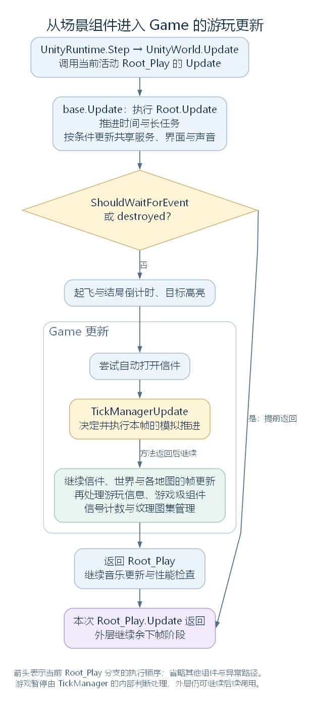

# 从场景入口到 Game.UpdatePlay：一帧怎样进入游戏（讨论稿）

状态：第一轮入口阅读，2026-11-03。依据工作区 RimWorld 1.7.4982 rev1280 的代码与兼容层整理。范围见 [游戏运行与调度大纲](44-runtime-scheduling-outline.md)，承接 [此前的 Root_Play 入口笔记](07-waylith-root-play.md)。

本轮从已经完成初始化、正常游玩的一帧开始，先解释谁取得调用、谁保存当前游戏，以及 Game.UpdatePlay 怎样按顺序交出工作。TickManager 先接到调用位置；其时间数据与模拟循环已在 [下一轮笔记](46-tickmanager-time-scheduling.md) 接续。

## 一、这一帧要完成什么

兼容层给活动脚本调用 Update 的机会，Root_Play 通过共同基类 Root 处理共享工作，条件允许时再调用当前 Game 的 UpdatePlay。Game 把这次帧级工作交给自己持有的管理对象，并在各次调用返回后继续下一项。

先认识三个位置：

| 位置 | 在本轮流程中承担什么 |
| --- | --- |
| UnityRuntime.Step、UnityWorld.Update | 组织兼容层的帧阶段，调用活动脚本 |
| Root.Update、Root_Play.Update | 处理场景入口、长任务检查及共享和游玩工作 |
| Game.UpdatePlay | 通过当前游戏持有的对象，组织这次游玩更新 |



图中只展开当前 Root_Play 这一条分支。箭头表示顺序调用；每次下游调用返回后，当前方法继续执行。其他组件与帧阶段仍由外层安排。[SVG](figures/runtime-play-frame-entry.svg) · [图源](figures/runtime-play-frame-entry.dot)

源码定位：帧阶段（`Waylith.UnityCompat.UnityRuntime.cs:106`）、共享更新（`Verse.Root.cs:113`）、游玩入口（`Verse.Root_Play.cs:63`）、游戏分派（`Verse.Game.cs:661`）。

## 二、先认识运行入口与当前游戏对象

GameRoot 是场景中一个 GameObject 的名字，它承载 Root_Entry 或 Root_Play 组件。Root 是二者的抽象基类，继承 MonoBehaviour，因而能够通过兼容层取得 Start、Update 等调用。

Current 是保存当前引用的静态类。场景切换时，它会找到对应的 Root 组件；Current.Game 则通过属性保存当前 Game 引用。以下是这个属性的完整实现，gameInt 是 Current 的私有静态字段：

```csharp
public static Game Game
{
    get
    {
        return Current.gameInt;
    }
    set
    {
        Current.gameInt = value;
    }
}
```

因此，Current.Game.UpdatePlay() 可以按两步理解：先取得 gameInt 指向的当前游戏对象，再调用这个对象的 UpdatePlay。后面方法中的 this，就是这次取得的 Game。

Game 是普通 C# 对象，集中保存当前世界、地图列表和一批管理器。先看与本轮有关的字段，以下按源码顺序节选，省略其他成员：

```csharp
private GameInfo info = new GameInfo();
public List<GameComponent> components = new List<GameComponent>();
// 省略其他成员。
private World worldInt;
private List<Map> maps = new List<Map>();
// 省略其他成员。
public LetterStack letterStack = new LetterStack();
// 省略其他成员。
public TickManager tickManager = new TickManager();
// 省略其他成员。
public SignalManager signalManager = new SignalManager();
```

这几个名字将在 UpdatePlay 中逐个出现：

| 成员 | 保存什么，或提供什么入口 |
| --- | --- |
| tickManager | 本局的 TickManager，决定模拟步的推进 |
| letterStack | 信件管理对象，保存和处理游戏信件 |
| worldInt；World | 世界对象及其属性入口 |
| maps；Maps | 本局已加载的地图列表及其属性入口 |
| info；Info | 游戏信息对象，包含互动游玩时间等记录 |
| components | 游戏级扩展对象 GameComponent 的列表 |
| signalManager | 本局信号管理对象 |

Find 也提供访问当前对象的静态属性。例如 Find.LetterStack 返回 Current.Game.letterStack，Find.TickManager 返回 Current.Game.tickManager。因此，稍后读到 Find.LetterStack 与 this.letterStack 时，它们沿这里的普通游玩路径访问同一个信件对象。

Root 自己还持有 uiRoot、soundRoot 和 destroyed：前两个连接场景的界面与声音入口，destroyed 标记当前 Root 应停止继续工作。Root_Play 另持有 musicManagerPlay，供游玩音乐更新使用。

源码定位：当前引用（`Verse.Current.cs:84`）、场景入口登记（`Verse.Current.cs:127`）、Game 的声明与字段（`Verse.Game.cs:12`、`Verse.Game.cs:881`）、属性入口（`Verse.Game.cs:32`、`Verse.Game.cs:253`、`Verse.Game.cs:278`）、Find 的访问入口（`Verse.Find.cs:480`、`Verse.Find.cs:560`）、Root 字段（`Verse.Root.cs:217`）。

## 三、先处理共享更新，再判断是否进入游玩工作

Root_Play.Update 先调用 base.Update，也就是 Root.Update。它在这一步处理时间、长任务和共享服务，再由派生方法检查是否继续进入游玩更新。

下面保留 Root_Play 的主要交接，省略 try/catch 和已经在前置笔记读过的其他调用；注释标明它们的位置。ShouldWaitForEvent 是长任务管理器提供的等待判断，destroyed 是上一节认识的 Root 字段：

```csharp
public override void Update()
{
    base.Update();
    if (LongEventHandler.ShouldWaitForEvent || this.destroyed)
    {
        return;
    }

    // 省略这里的结局倒计时与目标高亮调用。
    Current.Game.UpdatePlay();
    // 省略后续音乐更新与性能检查。
}
```

要理解这次检查发生在什么位置，可以继续看 base.Update 中的相关动作。

ResolutionUtility.Update 处理分辨率相关状态，RealTime.Update 更新真实时间记录；LongEventsUpdate 推进当前长任务，并通过输出参数 flag 带回本轮的场景切换标记。下面省略帧统计、其他共享服务、设置处理与异常日志：

```csharp
ResolutionUtility.Update();
RealTime.Update();
// 省略帧耗时统计。
bool flag;
LongEventHandler.LongEventsUpdate(out flag);
if (flag)
{
    this.destroyed = true;
}
else if (!LongEventHandler.ShouldWaitForEvent)
{
    // 省略其他共享服务。
    this.uiRoot.UIRootUpdate();
    // 省略设置处理。
    this.soundRoot.Update();
}
```

执行结果会影响随后 Root_Play 的检查：如果当前 Root 已被标记停止工作，或者长任务状态要求等待，这次派生 Update 提前返回；否则继续倒计时、目标高亮和 Current.Game.UpdatePlay，之后才处理音乐与性能检查。

ShouldWaitForEvent 按长任务和界面状态计算。它的具体判断、长任务怎样执行，以及场景何时切换，将在长任务部分展开；这里先记住等待检查由 Root 层安排。

源码定位：两层 Update（`Verse.Root_Play.cs:63`、`Verse.Root.cs:113`）、等待条件（`Verse.LongEventHandler.cs:17`）。前置细节见 [Root_Play 阅读笔记](07-waylith-root-play.md)。

## 四、按顺序分派一次游玩更新

通过 Root_Play 的条件检查后，Current.Game.UpdatePlay 开始组织当前游戏的一轮帧级工作。

前面已经认识其字段。下面还会出现几个调用：OpenAutomaticLetters 检查自动打开信件的条件；WorldUpdate 和 MapUpdate 接到世界、地图的帧级入口；GameComponentUtility 负责遍历游戏级扩展对象；GlobalTextureAtlasManager 管理全局纹理图集。i 是地图列表循环的下标。方法完整实现如下：

```csharp
public void UpdatePlay()
{
    try
    {
        Find.LetterStack.OpenAutomaticLetters();
    }
    catch (Exception ex)
    {
        Log.Error(ex.ToString());
    }
    this.tickManager.TickManagerUpdate();
    this.letterStack.LetterStackUpdate();
    this.World.WorldUpdate();
    for (int i = 0; i < this.maps.Count; i++)
    {
        this.maps[i].MapUpdate();
    }
    this.Info.GameInfoUpdate();
    GameComponentUtility.GameComponentUpdate();
    this.signalManager.SignalManagerUpdate();
    GlobalTextureAtlasManager.GlobalTextureAtlasManagerUpdate();
}
```

按正常路径读完，工作顺序与这一层可确认的结果是：

| 顺序 | 调用 | 本轮先读到什么 |
| --- | --- | --- |
| 1 | OpenAutomaticLetters | 当前窗口允许时，检查并尝试打开满足条件的一封信件 |
| 2 | TickManagerUpdate | 进入本帧的模拟推进安排，内部循环下一轮展开 |
| 3 | LetterStackUpdate | 处理信件悬停的高亮请求，移除不再允许显示的信件 |
| 4 | WorldUpdate | 将帧级更新交给世界对象 |
| 5 | 各 MapUpdate | 按 maps 列表逐个调用已加载地图 |
| 6 | GameInfoUpdate | 按最近输入和界面等条件累计互动游玩时间 |
| 7 | GameComponentUpdate | 逐个调用本局游戏级扩展对象的帧更新 |
| 8 | SignalManagerUpdate | 重置当前帧的信号计数 |
| 9 | GlobalTextureAtlasManagerUpdate | 按重建标记处理图集，并调用各图集的清理入口 |

这些调用按源码顺序执行。TickManagerUpdate 在这里是其中一次方法调用；它返回以后，方法继续走到信件、世界和地图等后续入口。具体入口内部处理什么，再在各自模块继续追踪。

最前面的自动打开信件有局部 try/catch，捕获异常后仍能继续下面的 TickManagerUpdate。后面的调用若抛出异常并传到 Root_Play，则会由外层捕获，跳过这次剩余调用。本轮后面的执行示意都按没有异常的路径理解。

源码定位：完整方法（`Verse.Game.cs:661`）、信件处理（`Verse.LetterStack.cs:149`、`Verse.LetterStack.cs:180`）、世界和地图入口（`RimWorld.Planet.World.cs:251`、`Verse.Map.cs:1152`）、互动时间（`Verse.GameInfo.cs:32`）、信号计数（`RimWorld.SignalManager.cs:69`）、图集处理（`Verse.GlobalTextureAtlasManager.cs:386`）。

## 五、通过列表更新游戏级扩展对象

Game.components 保存 GameComponent 对象。GameComponent 为游戏级扩展提供 GameComponentUpdate、GameComponentTick 等可覆写方法；各派生类型在自己的实现中增加功能。

这一轮 UpdatePlay 调用的是 GameComponentUtility.GameComponentUpdate。它取得 Current.Game.components，再逐项调用同名方法。下面 components 是这个列表，i 是本轮下标；完整方法为：

```csharp
public static void GameComponentUpdate()
{
    List<GameComponent> components = Current.Game.components;
    for (int i = 0; i < components.Count; i++)
    {
        try
        {
            components[i].GameComponentUpdate();
        }
        catch (Exception ex)
        {
            Log.Error(ex.ToString());
        }
    }
}
```

由此，扩展对象只要已经放在该列表中，就能从这一调用链取得帧更新机会。每项调用有各自的异常捕获，某一项失败后，循环仍能继续尝试下一项。

GameComponentTick 另有对应的遍历方法，它在 tick 分派的路径上取得调用；下一轮阅读模拟推进时再接上。

源码定位：基类方法（`Verse.GameComponent.cs:10`、`Verse.GameComponent.cs:15`）、两种列表遍历（`Verse.GameComponentUtility.cs:10`、`Verse.GameComponentUtility.cs:27`）。

## 六、对照一帧的执行结果

现在用两个小例子，把方法顺序对应到游戏状态。先看暂停判断的位置，再看地图列表怎样参与调用。

TickManagerUpdate 开头将 ticksThisFrame 清零，随后把模拟推进代码放在 !this.Paused 条件里。ticksThisFrame 记录本帧执行的模拟步数，Paused 是 TickManager 的暂停判断。下面节选这个外壳，省略内部推进过程：

```csharp
this.ticksThisFrame = 0;
if (!this.Paused)
{
    // 省略内部时间累加与模拟推进循环，下一轮展开。
}
```

**案例一：玩家暂停后的普通游玩帧。** 假设 Root_Play 的长任务与 destroyed 检查允许继续，本帧没有发生异常。进入 TickManagerUpdate 时 Paused 为 true，模拟推进分支被跳过，方法返回。于是后面的调用顺序仍然是：

```text
Game.UpdatePlay
  → TickManagerUpdate：本帧 ticksThisFrame = 0，跳过模拟推进
  → LetterStackUpdate
  → WorldUpdate
  → 各 MapUpdate
  → GameInfoUpdate、GameComponentUpdate
  → 信号计数与图集管理
```

这为暂停时仍然处理信件高亮、界面相关数据和其他帧级工作提供了调用位置。每个入口内部还可能有自己的条件，具体更新量需要继续看对应实现。

**案例二：本局持有两张已加载地图。** 假设 maps 在本次循环中保持为 [地图 A, 地图 B]，CurrentMap 选择地图 A。Game.UpdatePlay 中的循环按 maps.Count 和下标读取，因而先给地图 A 调用 MapUpdate，再给地图 B 调用 MapUpdate。CurrentMap 通过 currentMapIndex 取得选中的地图；这段遍历直接使用整个 maps 列表。

读到这里，我们已经能描述一轮 Game 更新的外部形状：先给模拟调度器一次推进机会，再继续按顺序处理其余帧级入口。每帧实际推进几个 tick，需要从 TickManager 的内部时间数据和循环取得答案。

源码定位：暂停分支（`Verse.TickManager.cs:375`）、Paused 属性（`Verse.TickManager.cs:145`）、地图循环（`Verse.Game.cs:674`）、当前地图属性（`Verse.Game.cs:51`）。

## 七、下一处阅读位置

接续阅读见 [TickManager：一帧怎样决定推进多少个 tick](46-tickmanager-time-scheduling.md)：先认识 ticksGameInt、curTimeSpeed、realTimeToTickThrough、ticksThisFrame 等字段与相关属性，再沿 TickManagerUpdate 阅读时间怎样进入循环、一次调用何时执行多个 tick，以及循环何时停止。

本轮保存的是入口与帧级分派。长任务内部、各地图和世界系统、游戏级扩展的具体功能，以及图集处理分别按后续模块展开。系列范围与顺序见 [调度大纲](44-runtime-scheduling-outline.md)。
