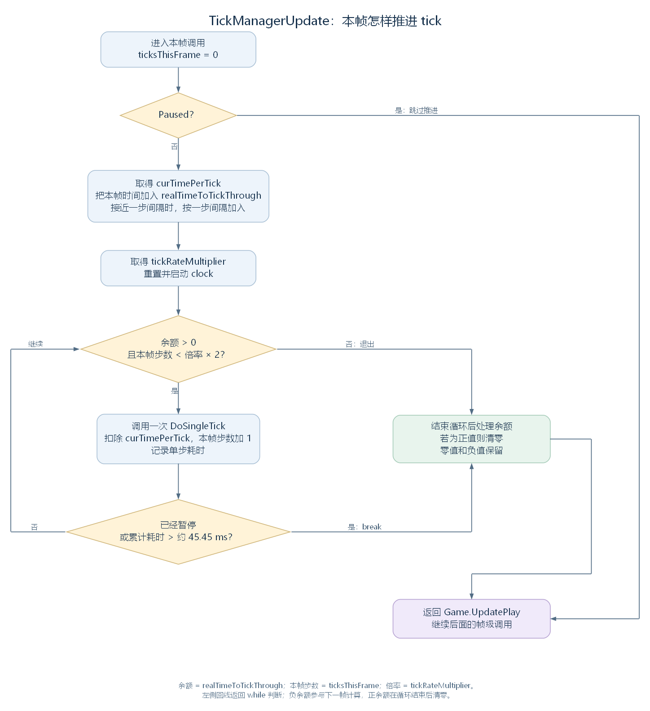

# TickManager：一帧怎样决定推进多少个 tick（讨论稿）

状态：第一轮时间与循环阅读，2026-11-03。依据工作区 RimWorld 1.7.4982 rev1280 的代码与兼容层整理。承接 [Game.UpdatePlay 的帧级分派](45-game-update-entry.md)，范围见 [游戏运行与调度大纲](44-runtime-scheduling-outline.md)。

本轮沿 TickManagerUpdate 读完一帧的模拟推进安排，停在 DoSingleTick 的调用处。一次 tick 怎样分派到地图、世界和各类对象，下一轮接着展开。

## 一、接到这一帧以后要做什么

Game.UpdatePlay 调用当前游戏持有的 tickManager.TickManagerUpdate。这组调用沿主线程顺序执行：TickManager 取得本帧的时间间隔，再根据当前速度，决定本次调用推进几个模拟步。每推进一步，就调用一次 DoSingleTick；调用返回以后，再判断要不要继续。

整段工作可以先记成四步：

1. 清零本帧 tick 计数，检查暂停状态。
2. 按速度计算推进间隔，把本帧时间加入余额。
3. 按余额、数量和耗时条件，逐次调用 DoSingleTick。
4. 处理剩余余额，返回 Game.UpdatePlay，继续后面的帧级工作。

这里的 **tick 是游戏模拟推进的一步**。正常路径中，DoSingleTick 让游戏 tick 计数加一，并把这一轮工作交给各系统。TickManagerUpdate 可以在一帧里调用它多次，也可以一次都不调用。

源码定位：调用入口（`Verse.Game.cs:671`）、本帧安排（`Verse.TickManager.cs:375`）、单步入口（`Verse.TickManager.cs:414`）。

## 二、先认识保存时间与进度的对象

TickManager 是 Game 持有的普通 C# 对象，实现 IExposable，供存档读写使用。下面按源码顺序摘出本轮涉及的成员；省略其他成员，命名保持原样：

```csharp
public sealed class TickManager : IExposable
{
    // 省略其他成员。
    private int ticksGameInt;
    public int gameStartAbsTick;
    private float realTimeToTickThrough;
    private TimeSpeed curTimeSpeed = TimeSpeed.Normal;
    public TimeSpeed prePauseTimeSpeed;
    // 省略其他成员。
    private Stopwatch clock = new Stopwatch();
    // 省略其他成员。
    public TimeSlower slower = new TimeSlower();
    // 省略其他成员。
    private int ticksThisFrame;
    private SimpleMovingAverage rawTickTimeAverage = new SimpleMovingAverage(720);
    private ExponentialMovingAverage smoothedTickTimeAverage = new ExponentialMovingAverage(0.1f);
    public const float WorstAllowedFPS = 22f;
    // 省略其他成员。
}
```

| 成员 | 保存什么，怎样参与本轮流程 |
| --- | --- |
| ticksGameInt；TicksGame | 游戏已经推进到的 tick 计数，以及读取它的属性 |
| gameStartAbsTick；TicksAbs | 开始时的绝对 tick 偏移；TicksAbs 把它与 ticksGameInt 相加，接到游戏日期 |
| realTimeToTickThrough | 以秒为单位的推进时间余额；加上帧时间，每执行一步就减去该速度下的一步间隔 |
| curTimeSpeed；CurTimeSpeed | 当前速度枚举及访问属性；TimeSpeed 包含 Paused、Normal、Fast、Superfast、Ultrafast |
| prePauseTimeSpeed | 玩家暂停前的速度，供恢复速度时使用 |
| slower | TimeSlower 对象，记录是否应暂时按正常速度推进 |
| ticksThisFrame；TicksThisFrame | 本次 TickManagerUpdate 已执行的 tick 数，以及读取它的属性 |
| clock | Stopwatch 计时器，测量本次推进循环已花的实际时间 |
| rawTickTimeAverage、smoothedTickTimeAverage | 记录单次 tick 耗时，并进一步计算平滑后的耗时统计 |

realTimeToTickThrough 会跨帧保存，而且可以小于零。先把它理解成一笔时间余额：帧时间增加余额，推进 tick 扣除余额。怎样出现负值、正值怎样处理，后面的循环会给出答案。

源码定位：类型声明（`Verse.TickManager.cs:11`）、时间属性（`Verse.TickManager.cs:15`、`Verse.TickManager.cs:25`）、速度属性（`Verse.TickManager.cs:203`）、字段（`Verse.TickManager.cs:590`）、存档读写（`Verse.TickManager.cs:318`）、速度枚举（`Verse.TimeSpeed.cs:6`）。

## 三、把暂停与速度换算成推进条件

这一部分先回答两个问题：当前是否允许推进，以及每推进一步要从时间余额中扣除多少。TickManager 分别通过 Paused、TickRateMultiplier 和 CurTimePerTick 取得这些结果。

### 3.1 检查当前是否暂停

Paused 读取玩家选择的速度，并检查 ForcePaused。后者汇总需要强制暂停的状态，包括要求暂停的窗口、长任务、世界地块选择，以及重力飞船过场或着陆确认等条件。

```csharp
public bool Paused
{
    get
    {
        return this.curTimeSpeed == TimeSpeed.Paused || this.ForcePaused;
    }
}
```

因此，即使 curTimeSpeed 仍是 Fast，只要 ForcePaused 为 true，TickManagerUpdate 也会跳过推进。暂停时后续帧级调用怎样继续，已在 [上一轮的暂停案例](45-game-update-entry.md#六对照一帧的执行结果) 中接到 Game.UpdatePlay。

源码定位：暂停属性（`Verse.TickManager.cs:145`）、强制暂停条件（`Verse.TickManager.cs:155`）。

### 3.2 取得速度倍率与每步间隔

TickRateMultiplier 根据速度和游戏状态返回倍率。它先检查 slower.ForcedNormalSpeed：若要求强制正常速度，玩家选择 Paused 时返回 0，其余速度返回 1。通过这一检查后，才按 curTimeSpeed 进入下表的分支：

| curTimeSpeed | TickRateMultiplier 的返回值 |
| --- | --- |
| Paused | 0 |
| Normal | 1 |
| Fast | 3 |
| Superfast | 没有已加载地图时为 18；有地图且 NothingHappeningInGame() 返回 true 时为 12；其余为 6 |
| Ultrafast | 调试开关 UltraSpeedBoost 开启时为 20000；否则，没有已加载地图时为 150，有地图时为 15 |

NothingHappeningInGame 检查所有已加载地图。它返回 true 时，地图上没有同时满足“玩家派系、HostFaction 为 null、类人、清醒、非食尸鬼”的已生成 Pawn，而且所有玩家基地的危险等级都低于 StoryDanger.Low。这里先用这些条件理解 12 倍速的选择；速度按钮怎样设置枚举、哪些事件要求恢复正常速度，可以沿实际调用位置继续研究。

取得倍率后，CurTimePerTick 按每秒 60 个 tick 的正常节奏换算间隔。下面是该属性的完整实现：

```csharp
private float CurTimePerTick
{
    get
    {
        if (this.TickRateMultiplier == 0f)
        {
            return 0f;
        }
        return 1f / (60f * this.TickRateMultiplier);
    }
}
```

例如，Normal 对应每步约 16.667 毫秒，Fast 对应每步约 5.556 毫秒。提高倍率会缩短从余额中扣除的一步间隔，让同样的帧时间能够安排更多 tick。这个间隔决定推进节奏；执行代码实际用了多久，由 clock 另外测量。

由此得到的每秒 60、180 等数值是目标推进速度。实际完成多少，要继续通过下面的循环、数量和耗时检查。

源码定位：倍率分支（`Verse.TickManager.cs:70`）、每步间隔（`Verse.TickManager.cs:131`）、平静状态检查（`Verse.TickManager.cs:278`）、强制正常速度（`Verse.TimeSlower.cs:11`）。

## 四、从兼容层取得本帧时间

TickManagerUpdate 通过 UnityEngine.Time.deltaTime 读取帧时间。沿前两章的入口回看，UnityRuntime.Step(deltaTime, elapsedTime) 先调用 UnityTimeState.BeginFrame，把传入的 deltaTime 保存到自己的 Time.DeltaTime，再进入 UnityWorld.Update。随后游戏代码读到的 Time.deltaTime 就来自这里。

下面是 Time.deltaTime 的完整属性。局部变量 unityRuntime 取得当前兼容层运行对象；maximumDeltaTime 是 Time 提供的可设置上限，默认约为 0.333 秒：

```csharp
public static float deltaTime
{
    get
    {
        UnityRuntime unityRuntime = UnityRuntime.Current;
        return Math.Min((unityRuntime != null) ? unityRuntime.Time.DeltaTime : 0f, Time.maximumDeltaTime);
    }
}
```

因此，接下来加入余额的是兼容层接口报告并经过上限处理的帧间隔，单位为秒。例如引擎报告间隔 0.016 秒，在默认上限下，这里就读到 0.016。

clock 则在进入推进循环前开始计时，测量**本次调用正在花费的时间**。读代码时分别跟住这两项，就能理解帧间隔为什么决定安排多少工作，而计时器为什么又能让这次工作提早结束。

源码定位：帧入口（`Waylith.UnityCompat.UnityRuntime.cs:106`）、保存时间（`Waylith.UnityCompat.UnityTimeState.cs:55`）、读取间隔（`UnityEngine.Time.cs:12`）、默认上限（`UnityEngine.Time.cs:165`）。

## 五、按余额、数量与耗时推进本帧

现在已经认识方法使用的字段和属性，可以把完整 TickManagerUpdate 接起来读。局部变量 curTimePerTick、tickRateMultiplier 分别保存本次调用取得的每步间隔与倍率；totalMilliseconds 和 totalMilliseconds2 记录一次 DoSingleTick 调用前后的计时读数。Mathf.Abs 返回绝对值。

```csharp
public void TickManagerUpdate()
{
    this.ticksThisFrame = 0;
    if (!this.Paused)
    {
        float curTimePerTick = this.CurTimePerTick;
        if (Mathf.Abs(Time.deltaTime - curTimePerTick) < curTimePerTick * 0.1f)
        {
            this.realTimeToTickThrough += curTimePerTick;
        }
        else
        {
            this.realTimeToTickThrough += Time.deltaTime;
        }
        float tickRateMultiplier = this.TickRateMultiplier;
        this.clock.Reset();
        this.clock.Start();
        while (this.realTimeToTickThrough > 0f && (float)this.ticksThisFrame < tickRateMultiplier * 2f)
        {
            double totalMilliseconds = this.clock.Elapsed.TotalMilliseconds;
            this.DoSingleTick();
            double totalMilliseconds2 = this.clock.Elapsed.TotalMilliseconds;
            this.realTimeToTickThrough -= curTimePerTick;
            this.ticksThisFrame++;
            this.rawTickTimeAverage.AddValue((float)(totalMilliseconds2 - totalMilliseconds));
            this.smoothedTickTimeAverage.AddValue(this.rawTickTimeAverage.GetAverage());
            if (this.Paused || (float)this.clock.ElapsedMilliseconds > 45.454544f)
            {
                break;
            }
        }
        if (this.realTimeToTickThrough > 0f)
        {
            this.realTimeToTickThrough = 0f;
        }
    }
}
```



图按正常执行路径绘制，左侧回线重新检查 while 条件，右侧汇合循环的退出路径。暂停分支直接返回；进入推进分支后，退出时只将正余额清零。[SVG](figures/tickmanager-update-loop.svg) · [图源](figures/tickmanager-update-loop.dot)

### 5.1 清零计数，再把本帧时间加入余额

方法每次先把 ticksThisFrame 设为 0。随后检查 Paused；若已经暂停，内部代码全部跳过，原有 realTimeToTickThrough 在这个方法中保持原值。本帧的时间也就没有加入余额。

允许推进时，代码比较 Time.deltaTime 与 curTimePerTick。如果两者的差小于每步间隔的 10%，就按一个完整间隔加入余额；否则按 Time.deltaTime 加入。这一步让接近一步间隔的帧时间按固定间隔记账。

**例如正常速度、帧间隔 16 毫秒。** 每步间隔约为 16.667 毫秒，二者只差约 0.667 毫秒，小于 1.667 毫秒，所以这次会给余额增加约 16.667 毫秒。若初始余额为零，随后执行一步再扣除同一个间隔，余额回到零。

### 5.2 余额大于零，就可以尝试推进一步

while 同时要求 realTimeToTickThrough > 0，以及本帧 tick 数小于倍率的两倍。满足时，先调用 DoSingleTick，再扣除一个 curTimePerTick，并给 ticksThisFrame 加一。

注意第一个条件只检查余额大于零。因此，余额即使只剩半步，也会先执行一步；扣除完整间隔后，余额就变成负数。负余额会留到下一帧，先与新加入的时间相抵，再判断是否推进。

**例如正常速度、稳定约 120 帧每秒。** 假设初始余额为零，每帧读取 1 / 120 秒，推进耗时很小。这个间隔超出前述 10% 范围，直接按帧时间相加：

| 帧 | 加入前余额 | 加入本帧时间后 | 执行 tick 数 | 扣除后的余额 |
| --- | --- | --- | --- | --- |
| 第 1 帧 | 0 毫秒 | 约 8.333 毫秒 | 1 | 约 −8.333 毫秒 |
| 第 2 帧 | 约 −8.333 毫秒 | 0 毫秒 | 0 | 0 毫秒 |
| 第 3 帧 | 0 毫秒 | 约 8.333 毫秒 | 1 | 约 −8.333 毫秒 |
| 第 4 帧 | 约 −8.333 毫秒 | 0 毫秒 | 0 | 0 毫秒 |

这样，连续两帧合起来推进一个 tick。进入 Game.UpdatePlay 的帧数与本次执行的 tick 数，可以由此直接对应起来。

### 5.3 完成一步后，检查数量和耗时

每次 DoSingleTick 前后的计时差会加入 rawTickTimeAverage，再把它的平均值交给 smoothedTickTimeAverage。这两项保存耗时统计；当前循环继续与否，由余额、计数、暂停和 clock 的累计时间判断。

数量上限放在 while 条件中：正常速度倍率为 1，本次最多执行 2 步；Fast 倍率为 3，本次最多执行 6 步。每一步返回后还会检查 Paused，以及本次循环累计耗时是否超过约 45.45 毫秒，满足任一条件就 break。

45.454544 毫秒约等于 1000 / 22，与类中 WorstAllowedFPS 的 22 对应。这项检查限制一帧里继续推进模拟的时间。由于检查发生在 DoSingleTick 返回之后，一步本身就可能超过这个时间；同一帧还有其他工作要做，所以实际帧率仍取决于整帧耗时。

### 5.4 结束循环，只清掉正余额

循环结束后，如果 realTimeToTickThrough 仍大于零，就将它设为零；零值和负值原样保留。于是数量或耗时限制留下的正余额，会在本次调用结束时被丢弃。

**例如正常速度，某一帧间隔达到 100 毫秒。** 假设初始余额为零、每步只花 1 毫秒，且期间没有暂停。方法会按 100 毫秒加入余额：

```text
起始余额：100 毫秒
执行第 1 步：余额约 83.333 毫秒，本帧计数 1
执行第 2 步：余额约 66.667 毫秒，本帧计数 2
达到数量上限，退出 while
将剩余正余额清零，方法返回
```

下一帧从零余额接收新的帧时间。由此可见，遇到较长的帧间隔时，模拟时间的推进会受到本帧工作上限约束。

源码定位：完整推进方法与退出处理（`Verse.TickManager.cs:375`）、帧数与耗时常量字段（`Verse.TickManager.cs:629`）。

## 六、再对照几种执行结果

下面沿同一个方法检查速度和耗时的影响。每行都是独立输入，初始余额为零，期间没有暂停；时间以毫秒展示，计算仍按源码中的 float 秒数进行。

| 输入条件 | 本次执行结果 | 结束余额与原因 |
| --- | --- | --- |
| Normal，帧间隔 16 毫秒，每步耗时 1 毫秒 | 1 步 | 帧间隔先按约 16.667 毫秒记账，扣除一步后为 0 |
| Fast，帧间隔 16 毫秒，每步耗时 1 毫秒 | 3 步 | 每步扣除约 5.556 毫秒，结束约 −0.667 毫秒，留给下一帧相抵 |
| Normal，帧间隔 100 毫秒，每步耗时 1 毫秒 | 2 步 | 达到数量上限，剩余约 66.667 毫秒被清零 |
| Normal，帧间隔 50 毫秒，一步耗时 50 毫秒 | 1 步 | 第一步完成后超过耗时阈值，剩余正余额被清零 |

这些是解释控制流的教学输入。已用原始 TickManagerUpdate 方法体、独立的时间与计时器替代对象核对；每步耗时是指定值，用于观察分支，并非游戏性能测量。浮点运算和实际帧间隔的变化会影响临界位置，表中按便于阅读的精度展示。

把过程接回画面，可以得到两个直接的观察方向：帧更新较频繁时，有些帧可以不推进 tick；某次帧间隔较长或模拟本身较慢时，本次调用会受数量或耗时限制，实际推进速度随之降低。后续性能讨论可以沿 ticksThisFrame 与单步耗时继续测量。

## 七、下一步进入一次 tick 的工作顺序

本轮已经确定 DoSingleTick 怎样取得调用，以及同一帧中为什么可能调用多次。接下来进入这个方法，按源码顺序读地图的 MapPreTick、游戏计数增加、三种 TickList，以及世界、地图和全局管理器的调用。

其中 ticksGameInt 在普通路径中加一；DebugSettings.fastEcology 开启时有另一条计数分支。接续阅读见 [从 DoSingleTick 到 TickList](47-single-tick-and-ticklists.md)，已展开单步顺序、对象登记、分组轮换与 Thing.DoTick 的交接。

源码定位：下一处入口（`Verse.TickManager.cs:414`）。
