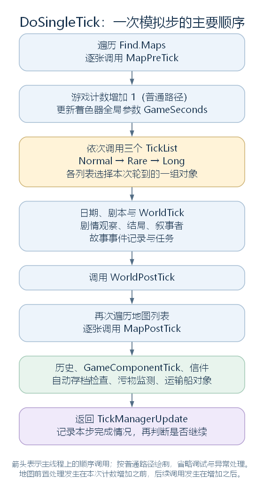
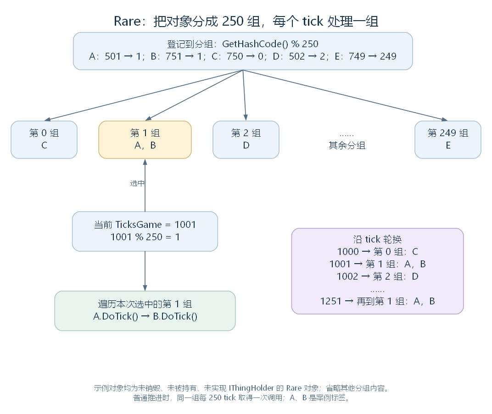

# 从 DoSingleTick 到 TickList：一次模拟步怎样分派工作（讨论稿）

状态：第一轮单步分派与对象分组阅读，2026-11-03。依据工作区 RimWorld 1.7.4982 rev1280 的代码整理，承接 [TickManager 的时间与循环](46-tickmanager-time-scheduling.md)，范围见 [游戏运行与调度大纲](44-runtime-scheduling-outline.md)。

本轮先沿 DoSingleTick 读完一次模拟步的主要顺序，再进入 TickList，解释对象怎样登记、分组并取得调用。读到 Thing.DoTick 后，先说明它接向哪些更新入口；具体物品、Pawn 与地图系统的内部行为继续由各自模块展开。下文数值案例均按 fastEcology 关闭、方法正常执行的路径理解。

## 一、把一个 tick 分派给地图、对象与全局系统

上一轮的 TickManagerUpdate 已经决定现在推进一步，于是在主线程上调用 DoSingleTick。这个方法依次完成地图前置处理、游戏计数推进、对象列表更新、世界与全局系统更新、地图后置处理和末尾管理工作。全部返回后，外层循环再决定是否推进下一步。

先按执行顺序看总图。这里的三个 TickList 都属于当前 Game 持有的 TickManager；它们保存已经登记的 Thing。Thing 是游戏实体的共同基类，涵盖 Pawn、建筑、植物和物品等对象。



箭头表示这一层在主线程上的调用顺序。图中每一项都要返回，上层方法才会继续下一项。[SVG](figures/single-tick-dispatch.svg) · [图源](figures/single-tick-dispatch.dot)

源码定位：单步方法（`Verse.TickManager.cs:414`）、三个列表字段（`Verse.TickManager.cs:614`）。

## 二、更新地图前置部分，再推进游戏计数

这一步先让所有已加载地图完成前置工作，再增加游戏 tick 计数，最后把游戏秒数交给着色器全局参数。Find.Maps 取得当前游戏的地图列表；局部变量 maps 保存这个列表引用，i 是遍历下标。Shader.SetGlobalFloat 设置供着色器读取的全局浮点参数，ShaderPropertyIDs.GameSeconds 指定这里要更新的参数。

下面连续摘录 DoSingleTick 的开头，保留源码命名：

```csharp
List<Map> maps = Find.Maps;
for (int i = 0; i < maps.Count; i++)
{
    maps[i].MapPreTick();
}
if (!DebugSettings.fastEcology)
{
    this.ticksGameInt++;
}
else
{
    this.ticksGameInt += 2000;
}
Shader.SetGlobalFloat(ShaderPropertyIDs.GameSeconds, this.TicksGame.TicksToSeconds());
this.tickListNormal.Tick();
this.tickListRare.Tick();
this.tickListLong.Tick();
```

MapPreTick 内部调用地图持有的管理对象，包括物品可用性、可搬运对象列表、屋顶、风、温度与寻路等入口。这里先明确它们取得调用的位置，后续地图与寻路模块再读内部处理。

正常路径中，ticksGameInt 加一。TicksToSeconds 将 tick 数除以 60，再更新 GameSeconds 参数。随后依次进入 Normal、Rare、Long 三个列表；它们怎样选中对象，第四节展开。

**例如本局有地图 A、B，进入时 TicksGame 为 999。** 若地图列表保持不变，两个 MapPreTick 都在计数增加前取得调用；之后计数变为 1000，三个 TickList 及后续入口沿这一计数继续工作。因而一次 tick 的地图前置部分和后续部分，处于计数增加的前后两个位置。

fastEcology 是调试分支：这里会让计数一次增加 2000，TickList 中也有配套的植物更新处理。它的执行另在第七节说明。

源码定位：地图与计数顺序（`Verse.TickManager.cs:416`）、地图前置入口（`Verse.Map.cs:927`）、地图列表属性（`Verse.Find.cs:335`）、秒数换算（`Verse.GenTicks.cs:87`）。

## 三、继续世界与全局系统，再完成地图后置部分

三个 TickList 返回以后，方法继续调用通过 Find 取得的当前游戏管理对象。这部分把一个 tick 交给日期、剧本、世界、叙事者与任务等系统，再让所有地图完成后置工作，最后处理历史、游戏级扩展和存档检查等事项。

先认识下面会出现的对象与入口，再看代码顺序：

| 对象或调用 | 这一层交给它的工作 |
| --- | --- |
| DateNotifier、Scenario | 日期通知与剧本规则的 tick 入口 |
| World | 世界更新 WorldTick，以及稍后的 WorldPostTick |
| StoryWatcher、GameEnder | 剧情状态观察与结局检查入口 |
| Storyteller、TaleManager、QuestManager | 叙事者、故事事件记录与任务系统的 tick 入口 |
| MapPostTick | 每张地图的后置更新入口 |
| History、GameComponentUtility | 历史记录与本局 GameComponent 扩展对象的 tick 入口 |
| LetterStack、Autosaver | 信件与自动存档检查入口 |
| FilthMonitor、TransportShipManager | 污物监测与运输船对象的 tick 入口 |

下面**按源码顺序摘出调用与地图循环**，省略包围各项的 try/catch、异常日志，以及调试截图和末尾控制台语句；j 保留源码中的地图下标名称：

```csharp
Find.DateNotifier.DateNotifierTick();
Find.Scenario.TickScenario();
Find.World.WorldTick();
Find.StoryWatcher.StoryWatcherTick();
Find.GameEnder.GameEndTick();
Find.Storyteller.StorytellerTick();
Find.TaleManager.TaleManagerTick();
Find.QuestManager.QuestManagerTick();
Find.World.WorldPostTick();
for (int j = 0; j < maps.Count; j++)
{
    maps[j].MapPostTick();
}
Find.History.HistoryTick();
GameComponentUtility.GameComponentTick();
Find.LetterStack.LetterStackTick();
Find.Autosaver.AutosaverTick();
// 省略这里的调试截图条件与调用。
FilthMonitor.FilthMonitorTick();
Find.TransportShipManager.ShipObjectsTick();
// 省略末尾的调试控制台设置。
```

MapPostTick 中继续调用野生动物与植物生成、电网、环境效果、临时地形、气体和地图其他管理对象；部分调用还有 DLC 或其他状态条件。对前面的两张地图，这里会先执行 A.MapPostTick，再执行 B.MapPostTick。

GameComponentUtility.GameComponentTick 与 [此前的帧更新遍历](45-game-update-entry.md#五通过列表更新游戏级扩展对象) 采用相同组织方式：取得 Current.Game.components，逐项调用 GameComponentTick。于是同一个扩展对象可以分别从 Game.UpdatePlay 的帧级路径和 DoSingleTick 的模拟路径接到更新。

这些入口内部还会判断具体工作是否到期。例如，AutosaverTick 每次增加距上次存档的计数，达到间隔且允许保存时，把执行存档的 DoAutosave 方法交给 LongEventHandler 排队。这里先接到任务登记，后续长任务部分再追踪执行与完成过程。读到这一层，可以先确定调用频率和顺序，再到各自模块研究触发规则。

异常处理按各处原有的 try/catch 生效。上面的大多数全局系统调用分别有自己的捕获，失败后可以继续下一项；开头的地图前置循环、三个 TickList 调用和地图后置循环，在 DoSingleTick 这一层都直接执行。内部方法还可能自行捕获异常。

源码定位：世界与全局入口顺序（`Verse.TickManager.cs:433`）、地图后置入口（`Verse.Map.cs:961`）、游戏级扩展遍历（`Verse.GameComponentUtility.cs:27`）、自动存档检查（`RimWorld.Autosaver.cs:40`）。

## 四、为不同更新间隔建立对象分组

现在回到 DoSingleTick 中的三个 TickList.Tick。TickManager 在创建字段时，给三个列表分别传入 TickerType.Normal、Rare、Long。TickerType 是更新类型枚举，另有 Never，供选择无需这种对象更新的情况使用。

一个 TickList 要保存“采用哪种间隔、对象分到哪一组、哪些对象待加入或移除”。先看相关字段，以下连续摘录，省略反编译标记：

```csharp
private TickerType tickType;
private List<List<Thing>> thingLists = new List<List<Thing>>();
private List<Thing> thingsToRegister = new List<Thing>();
private List<Thing> thingsToDeregister = new List<Thing>();
```

| 字段或属性 | 在这段流程中保存什么 |
| --- | --- |
| tickType | 本 TickList 使用的更新类型 |
| TickInterval | 由 tickType 计算出的间隔：Normal 为 1，Rare 为 250，Long 为 2000 |
| thingLists | 外层列表保存所有分组，每个内层 List<Thing> 保存该组的对象 |
| thingsToRegister | 待加入分组的对象列表 |
| thingsToDeregister | 待从分组移除的对象列表 |

构造函数按 TickInterval 创建这么多个分组。下面的 i 是创建分组时的下标：

```csharp
public TickList(TickerType tickType)
{
    this.tickType = tickType;
    for (int i = 0; i < this.TickInterval; i++)
    {
        this.thingLists.Add(new List<Thing>());
    }
}
```

这样，Normal 建立 1 组，Rare 建立 250 组，Long 建立 2000 组。每个普通 tick 都会调用这三个列表，每个列表随后只取出本次轮到的一组。

| TickList 类型 | 分组数 | 正常逐步推进时，同一组的调用间隔 | 折合游戏秒数 |
| --- | --- | --- | --- |
| Normal | 1 | 每 tick | 约 1 / 60 秒 |
| Rare | 250 | 每 250 tick | 约 4.167 秒 |
| Long | 2000 | 每 2000 tick | 约 33.333 秒 |

表中秒数按 60 tick 换算为一秒游戏时间。现实中经过多久，还要结合当前速度与实际推进量理解。

源码定位：列表创建（`Verse.TickManager.cs:614`）、间隔属性与构造函数（`Verse.TickList.cs:12`、`Verse.TickList.cs:31`）、字段（`Verse.TickList.cs:166`）、枚举（`Verse.TickerType.cs:6`）。

## 五、登记对象，再按编号选择它所在的组

这一步让一个 Thing 进入对应列表，并确定它以后在哪个 tick 取得调用。登记路径先经过 TickManager.RegisterAllTickabilityFor，再由 TickList 保存待加入对象；TickList.Tick 开头才会把这些对象放进分组。

### 5.1 先选择 TickList，再保存登记请求

RegisterAllTickabilityFor 中的参数 t 是要登记的 Thing，t.def 引用它的 ThingDef，定义中的 tickerType 字段给出更新类型。局部变量 tickList 保存 TickListFor 的选择结果。完整方法如下：

```csharp
public void RegisterAllTickabilityFor(Thing t)
{
    TickList tickList = this.TickListFor(t);
    if (tickList != null)
    {
        tickList.RegisterThing(t);
    }
}
```

TickListFor 先检查 t 是否实现 IThingHolder。这个接口供对象提供自己直接持有的 Thing 与子容器；实现它的 Thing 会先被选入 Normal 列表，供每个 tick 进入对象及持有内容的处理。对于其他 Thing，才按 t.def.tickerType 选择 Normal、Rare、Long；Never 对应 null，登记到此结束。

选出列表后，RegisterThing 先将对象加入 thingsToRegister。移除时，DeregisterThing 对应加入 thingsToDeregister。两者的完整实现为：

```csharp
public void RegisterThing(Thing t)
{
    this.thingsToRegister.Add(t);
}

public void DeregisterThing(Thing t)
{
    this.thingsToDeregister.Add(t);
}
```

例如 Thing.SpawnSetup 在对象进入地图的流程中调用登记入口，DeSpawn 调用移除入口。这里只接到调度登记的位置，实体创建与地图登记的完整流程在实体模块继续研究。

源码定位：登记与移除入口、列表选择（`Verse.TickManager.cs:327`、`Verse.TickManager.cs:337`、`Verse.TickManager.cs:347`）、持有接口（`Verse.IThingHolder.cs:7`）、待处理列表写入（`Verse.TickList.cs:63`、`Verse.TickList.cs:69`）、地图中的接点（`Verse.Thing.cs:1017`、`Verse.Thing.cs:1194`）。

### 5.2 处理登记，再计算对象所在分组

TickList.Tick 开头先应用待登记列表，再应用待移除列表，并分别清空。这时 i、j 是两个待处理列表的下标；BucketOf 返回指定对象应在的内层 List<Thing>。以下连续摘录这一段：

```csharp
for (int i = 0; i < this.thingsToRegister.Count; i++)
{
    this.BucketOf(this.thingsToRegister[i]).Add(this.thingsToRegister[i]);
}
this.thingsToRegister.Clear();
for (int j = 0; j < this.thingsToDeregister.Count; j++)
{
    this.BucketOf(this.thingsToDeregister[j]).Remove(this.thingsToDeregister[j]);
}
this.thingsToDeregister.Clear();
```

BucketOf 读取 t.GetHashCode()，处理负值后，对 TickInterval 取余，得到分组下标。局部变量 num、num2 保留源码命名，分别是这里使用的哈希值和分组下标：

```csharp
private List<Thing> BucketOf(Thing t)
{
    int num = t.GetHashCode();
    if (num < 0)
    {
        num *= -1;
    }
    int num2 = num % this.TickInterval;
    return this.thingLists[num2];
}
```

Thing 已有有效 thingIDNumber 时，其 GetHashCode 实现返回该编号。以 Rare 为例，编号 501 取余得到 1，编号 751 也得到 1，两个对象就进入同一组。

分组变更在 Tick 开头应用，后面遍历时，通过 RegisterThing、DeregisterThing 提出的新请求会留到同一列表的下次 Tick。例如某个 Normal 对象在 DoTick 中登记另一个对象，新对象到下一次 Normal 列表更新时加入；若一帧内推进多个 tick，这次加入也可能发生在同一帧里。

源码定位：登记应用（`Verse.TickList.cs:77`）、分组方法（`Verse.TickList.cs:154`）、对象哈希实现（`Verse.Thing.cs:2224`）。

## 六、按当前 tick 取出一组，逐个调用对象

登记与移除应用完毕后，TickList 按当前 TicksGame 对 TickInterval 取余，选择本次要更新的一组。局部变量 list2 是选中的 List<Thing>，m 是遍历下标，thing 保存当前对象。下面连续摘出选组与调用位置，末尾省略 catch 中的日志构造：

```csharp
List<Thing> list2 = this.thingLists[Find.TickManager.TicksGame % this.TickInterval];
for (int m = 0; m < list2.Count; m++)
{
    Thing thing = list2[m];
    if (!thing.Destroyed)
    {
        try
        {
            thing.DoTick();
        }
        catch (Exception ex)
        {
            // 省略源码中的错误信息构造与日志调用。
        }
    }
}
```

这里跳过已经销毁的对象，并为每次 DoTick 单独捕获异常。某个对象的更新抛出异常，被这一层捕获后，循环仍能继续后面的对象。

**用五个 Rare 对象对照。** 为方便叙述，把它们标作 A～E；这些字母是图中标签。假设它们都未销毁、未被持有，也未实现 IThingHolder，已经按下表的顺序登记：

| 对象标签 | GetHashCode 返回值 | 加入的分组 |
| --- | --- | --- |
| A | 501 | 1 |
| B | 751 | 1 |
| C | 750 | 0 |
| D | 502 | 2 |
| E | 749 | 249 |



图中省略没有画出的其他分组；A 与 B 在当前组内按列表顺序取得调用。[SVG](figures/ticklist-bucket-schedule.svg) · [图源](figures/ticklist-bucket-schedule.dot)

| 当前 TicksGame | 选中的分组 | 本次 DoTick 调用 |
| --- | --- | --- |
| 1000 | 1000 % 250 = 0 | C |
| 1001 | 1001 % 250 = 1 | A，然后 B |
| 1002 | 1002 % 250 = 2 | D |
| 1249 | 1249 % 250 = 249 | E |
| 1251 | 1251 % 250 = 1 | A，然后 B |

因此，A 和 B 在 tick 1001 取得调用，下次轮到同一组时是 tick 1251，相隔 250 tick。首次调用发生在登记应用后，游戏计数首次轮到该组时；之后每 250 tick 再轮到同一组。其他组的对象在中间各 tick 依次取得调用，低频更新的工作就这样分散到一轮连续推进中。

已用原始 TickList 与 TickerType 源码、独立的 Thing 和时间替代对象核对这组结果，同时检查了 Normal 更新过程中新增对象的延后登记、移除和 Long 分组轮换。核对用于确认调度顺序，未执行游戏实体的实际行为。

源码定位：选组与调用（`Verse.TickList.cs:102`）。

## 七、进入 Thing.DoTick，接到具体对象的更新

TickList 到这里已经把调用交给某个 Thing。Thing.DoTick 再按定义类型和对象状态，调用自身的更新入口，并在适用时继续处理持有内容。

| 定义与状态 | DoTick 中接到的工作 |
| --- | --- |
| tickerType 为 Normal | 调用 Tick，并按内部间隔条件调用 TickInterval |
| tickerType 为 Rare | 满足内部条件时调用 TickRare |
| tickerType 为 Long | 满足内部条件时调用 TickLong |
| 对象实现 IThingHolder | 自身处理完成后，按条件继续调用持有内容的更新 |

在前面的普通 Rare 案例里，这些对象未被持有、也未实现持有接口，选中后就会走到 TickRare。对于选入 Normal 列表的持有对象，DoTick 内部还会检查自身的 Rare、Long 间隔，并决定是否继续更新内容。这也接上了第五节中优先把持有对象登记到 Normal 的安排。

Normal 对象内部的 TickInterval、持有内容的遍历，以及各派生类覆写的 Tick、TickRare、TickLong，将分别在实体与运行间隔等后续内容中继续研究。本轮先保留“列表选中对象 → DoTick → 自身更新与持有内容”的主线。

fastEcology 开启时，DoSingleTick 让游戏计数增加 2000；各 TickList.Tick 的调试分支还会先清理世界温度缓存，遍历全部分组，对植物调用 TickLong，随后继续常规的选组代码。因此，本轮的分组间隔与数值案例均采用普通推进条件。

源码定位：对象更新入口（`Verse.Thing.cs:840`）、普通与间隔更新（`Verse.Thing.cs:854`）、Rare 与 Long 判断（`Verse.Thing.cs:879`）、持有内容处理（`Verse.Thing.cs:903`）、植物调试分支（`Verse.TickList.cs:87`）。

## 八、回到帧级循环，继续时间控制的阅读

至此，一帧调用怎样走到各对象已经接通：Game.UpdatePlay → TickManagerUpdate → DoSingleTick → TickList.Tick → Thing.DoTick。每次 DoSingleTick 返回后，TickManagerUpdate 继续扣除时间、记录本帧步数，并判断是否还要推进下一步。

接续阅读见 [从速度按钮到实际推进](48-time-controls-and-simulation-speed.md)：玩家怎样修改速度，哪些事件要求暂时恢复正常速度，以及帧数、每帧 tick 数和实际每秒 tick 数怎样共同表现为玩家感受到的游戏速度。地图、世界、叙事者与具体对象的实现保留在对应模块继续展开。
