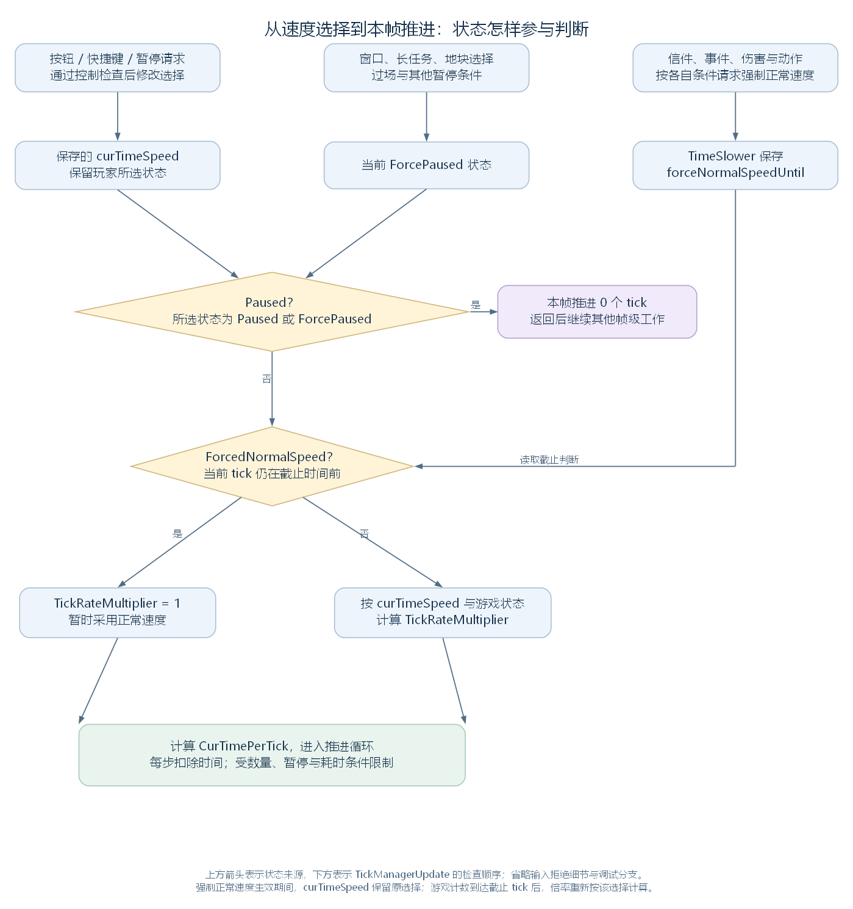

# 从速度按钮到实际推进：暂停、倍速与 FPS/TPS（讨论稿）

状态：第一轮速度控制与推进量阅读，2026-11-03。依据工作区 RimWorld 1.7.4982 rev1280 的代码与兼容层整理。承接 [TickManager 的时间与循环](46-tickmanager-time-scheduling.md) 及 [DoSingleTick 与 TickList](47-single-tick-and-ticklists.md)，范围见 [游戏运行与调度大纲](44-runtime-scheduling-outline.md)。

本轮从玩家操作速度按钮开始，沿速度保存、暂停判断、强制正常速度和本帧推进条件，解释玩家最后看到的运行节奏。数值案例采用同一局游戏的普通推进路径，关闭 fastEcology，期间不进行开发者单步推进或计数修改。

## 一、把速度选择接到每帧的推进安排

这条流程分为三步：界面把玩家选择交给 TickManager；游戏状态决定当前是否暂停、是否暂时按正常速度运行；TickManagerUpdate 再根据帧时间和工作限制安排实际 tick。

先回接涉及的对象与数据：

| 对象或成员 | 在这条流程中做什么 |
| --- | --- |
| TimeControls | 静态界面类，绘制速度按钮并处理相关按键事件 |
| CurTimeSpeed；curTimeSpeed | 属性和它保存的速度枚举，记录玩家选择的 Paused、Normal、Fast 等状态 |
| PlayerCanControl | TickManager 的控制检查，返回是否允许修改及可选的拒绝原因 |
| ForcePaused；Paused | 当前强制暂停状态，以及综合玩家选择后得到的暂停判断 |
| slower；TimeSlower | TickManager 持有的减速对象，保存强制正常速度的截止 tick |
| TickRateMultiplier；CurTimePerTick | 当前采用的倍率与每步时间间隔，供 TickManagerUpdate 使用 |



上方三路提供状态，下方按 TickManagerUpdate 的普通入口顺序检查。图中“按所选速度计算倍率”还包含地图与平静状态分支，详见 [倍率换算笔记](46-tickmanager-time-scheduling.md#32-取得速度倍率与每步间隔)。[SVG](figures/time-speed-control.svg) · [图源](figures/time-speed-control.dot)

源码定位：界面入口（`RimWorld.TimeControls.cs:63`）、速度属性（`Verse.TickManager.cs:203`）、暂停判断（`Verse.TickManager.cs:145`）、倍率换算（`Verse.TickManager.cs:70`）。

## 二、从按钮和按键提交速度选择

### 2.1 绘制按钮，处理点击

地图界面通过 GlobalControls.GlobalControlsOnGUI 调用 GlobalControlsUtility.DoTimespeedControls，后者确定屏幕上的矩形位置，再调用 TimeControls.DoTimeControlsGUI。

DoTimeControlsGUI 遍历缓存的 TimeSpeed 枚举值，绘制 Paused、Normal、Fast、Superfast 四个按钮。下面的局部变量 tickManager 是 Find.TickManager，timeSpeed 是本次循环的枚举值，rect 是当前按钮矩形，text2 是包含当前按键绑定的提示文字。Widgets.ButtonImage 绘制按钮并报告是否点击，TexButton.SpeedButtonTextures 保存各状态的按钮图像。

以下摘出点击处理分支，仅省略教程记录调用；PlaySoundOf 播放所选状态对应的时钟声音等反馈：

```csharp
if (Widgets.ButtonImage(rect, TexButton.SpeedButtonTextures[(int)timeSpeed], true, text2) && !tickManager.ForcePaused)
{
    if (timeSpeed == TimeSpeed.Paused)
    {
        tickManager.TogglePaused();
        // 省略教程记录调用。
    }
    else
    {
        tickManager.CurTimeSpeed = timeSpeed;
        // 省略教程记录调用。
    }
    TimeControls.PlaySoundOf(tickManager.CurTimeSpeed);
}
```

点击暂停按钮进入 TogglePaused，其他按钮通过属性赋值提交选择。这里先检查 ForcePaused；允许进入后，TickManager 自己还会检查玩家是否可以控制游戏。

源码定位：地图界面中的调用（`RimWorld.MapInterface.cs:58`）、全局控件（`RimWorld.GlobalControls.cs:25`）、按钮位置安排（`RimWorld.GlobalControlsUtility.cs:22`）、点击分支（`RimWorld.TimeControls.cs:79`）。

### 2.2 用绑定的按键进入相同入口

同一个 DoTimeControlsGUI 还处理按键事件。Event.current 是当前界面事件，KeyBindingDefOf 保存暂停、各档速度及增减速度等按键定义；KeyDownEvent 根据实际绑定判断本次按键是否匹配。

下面摘出 Fast 快捷键分支，省略教程记录。Event.current.Use() 将本次事件标记为已处理：

```csharp
if (KeyBindingDefOf.TimeSpeed_Fast.KeyDownEvent)
{
    Find.TickManager.CurTimeSpeed = TimeSpeed.Fast;
    TimeControls.PlaySoundOf(Find.TickManager.CurTimeSpeed);
    // 省略教程记录调用。
    Event.current.Use();
}
```

各输入分支在原方法中的条件是：

| 操作 | 进入的路径与条件 |
| --- | --- |
| 点击四个普通按钮 | ForcePaused 为 false 时，调用 TogglePaused 或设置 CurTimeSpeed |
| 暂停快捷键 | 按键匹配后调用 TogglePaused，再由方法内的控制检查决定能否修改 |
| Normal、Fast、Superfast 及增减速度快捷键 | 位于 !Find.WindowStack.WindowsForcePause 分支内；增减速度另有当前档位条件 |
| Ultrafast 快捷键 | 位于开发模式分支内，设置 CurTimeSpeed 为 Ultrafast |

KeyDownEvent 还检查当前是否有搜索输入框取得焦点等条件。本文沿识别到速度操作后的调用继续阅读，具体按键由玩家绑定决定。

源码定位：按键分支（`RimWorld.TimeControls.cs:111`）、Fast 分支（`RimWorld.TimeControls.cs:129`）、开发模式分支（`RimWorld.TimeControls.cs:162`）、按键识别（`Verse.KeyBindingDef.cs:44`）。

## 三、通过控制检查，保存速度与暂停前的状态

这一部分把界面提交的选择保存进 TickManager。CurTimeSpeed 的 setter 与 TogglePaused 都先查询 PlayerCanControl；允许修改后，才改变字段。

### 3.1 检查是否允许玩家控制

PlayerCanControl 返回 AcceptanceReport。这个结构保存是否接受和原因文字，并提供到 bool 的隐式转换，所以源码可以用 !this.PlayerCanControl 进行判断，再通过 Reason 取得拒绝原因。

检查涉及着陆区域确认和 Current.Game.PlayerHasControl。后者受到画面渐变与过场等状态影响。以下是 CurTimeSpeed 的完整属性；value 是本次赋值传入的 TimeSpeed，Messages.Message 用于显示存在的拒绝原因：

```csharp
public TimeSpeed CurTimeSpeed
{
    get
    {
        return this.curTimeSpeed;
    }
    set
    {
        if (!this.PlayerCanControl)
        {
            if (!this.PlayerCanControl.Reason.NullOrEmpty())
            {
                Messages.Message(this.PlayerCanControl.Reason, MessageTypeDefOf.RejectInput, false);
            }
            return;
        }
        this.curTimeSpeed = value;
    }
}
```

因此，按钮或快捷键提交 Fast 后，允许控制时，curTimeSpeed 被保存为 Fast。随后 TickManagerUpdate 读取速度相关属性时，就能使用这次选择。

源码定位：控制检查（`Verse.TickManager.cs:173`）、速度属性（`Verse.TickManager.cs:203`）、游戏控制状态（`Verse.Game.cs:119`）、接受结果结构（`Verse.AcceptanceReport.cs:6`）、隐式转换（`Verse.AcceptanceReport.cs:62`）。

### 3.2 暂停时记住原速度，恢复时取回来

TogglePaused 通过同样的控制检查后，处理 curTimeSpeed 与 prePauseTimeSpeed。前者保存当前选择，后者记住进入玩家暂停前的速度。

下面连续摘出状态切换部分，省略方法开头的控制检查和拒绝消息：

```csharp
if (this.curTimeSpeed != TimeSpeed.Paused)
{
    this.prePauseTimeSpeed = this.curTimeSpeed;
    this.curTimeSpeed = TimeSpeed.Paused;
    return;
}
if (this.prePauseTimeSpeed != this.curTimeSpeed)
{
    this.curTimeSpeed = this.prePauseTimeSpeed;
    return;
}
this.curTimeSpeed = TimeSpeed.Normal;
```

**例如玩家正在使用 Fast。** 第一次暂停会保存 prePauseTimeSpeed = Fast，再把 curTimeSpeed 设为 Paused；再次切换时取回 Fast。若保存的状态也为 Paused，最后一条赋值会恢复 Normal。

其他系统可以调用 Pause 请求进入暂停。它在 curTimeSpeed 已为 Paused 时直接结束，其余情况调用 TogglePaused，因而也经过控制检查。

源码定位：暂停切换（`Verse.TickManager.cs:244`）、请求暂停（`Verse.TickManager.cs:269`）。

### 3.3 综合当前状态，决定本次是否推进

当 TickManagerUpdate 开始安排本帧工作时，Paused 还会加入 ForcePaused 的结果。完整属性为：

```csharp
public bool Paused
{
    get
    {
        return this.curTimeSpeed == TimeSpeed.Paused || this.ForcePaused;
    }
}
```

ForcePaused 汇总要求暂停的窗口、长任务、世界地块选择、重力飞船过场或着陆确认，以及地图生成调试状态。某个这样的状态生效时，即使 curTimeSpeed 保存为 Fast，本次也会跳过模拟推进；状态解除以后，后续调用重新按当时保存的选择检查。

TimeControls 绘制按钮时也读取 ForcePaused：它生效时突出显示暂停按钮，并在运行速度按钮区域画横线。暂停后的其他帧级工作怎样继续，已在 [Game.UpdatePlay 的暂停案例](45-game-update-entry.md#六对照一帧的执行结果) 中接通。

源码定位：暂停与强制暂停（`Verse.TickManager.cs:145`、`Verse.TickManager.cs:155`）、按钮突出显示与横线（`RimWorld.TimeControls.cs:93`、`RimWorld.TimeControls.cs:104`）。

## 四、记录截止 tick，暂时采用正常速度

允许推进后，TickRateMultiplier 继续检查 slower.ForcedNormalSpeed。TimeSlower 用整数 forceNormalSpeedUntil 保存截止 tick；在该计数到来之前，要求暂时按正常速度运行。DebugViewSettings.neverForceNormalSpeed 是可以关闭这项要求的调试开关。

下面摘出有关的属性、方法与字段，保留源码顺序，省略末尾常量：

```csharp
public bool ForcedNormalSpeed
{
    get
    {
        return !DebugViewSettings.neverForceNormalSpeed && Find.TickManager.TicksGame < this.forceNormalSpeedUntil;
    }
}

public void SignalForceNormalSpeed()
{
    this.forceNormalSpeedUntil = Mathf.Max(new int[] { Find.TickManager.TicksGame + 800 });
}

public void SignalForceNormalSpeedShort()
{
    this.forceNormalSpeedUntil = Mathf.Max(this.forceNormalSpeedUntil, Find.TickManager.TicksGame + 240);
}

private int forceNormalSpeedUntil;
```

标准请求把截止时间写为当前 tick + 800。短请求从原截止时间与当前 tick + 240 中取较大值，因此保留已经存在的更晚截止时间。按正常推进换算，800 和 240 tick 分别约为 13.333 和 4 秒游戏时间。

TickRateMultiplier 的 getter 首先执行下面的分支，再继续原来的速度枚举判断。以下连续摘录这个分支：

```csharp
if (this.slower.ForcedNormalSpeed)
{
    if (this.curTimeSpeed == TimeSpeed.Paused)
    {
        return 0f;
    }
    return 1f;
}
```

**例如玩家选择 Superfast，当前通常采用 6 倍速。** 在 TicksGame = 10000 时收到短请求，截止时间变为 10240；假设期间没有新的减速请求、地图条件保持不变：

| 时点 | 保存的 CurTimeSpeed | ForcedNormalSpeed | TickRateMultiplier |
| --- | --- | --- | --- |
| 10000，刚记录截止时间 | Superfast | true | 1 |
| 10239 | Superfast | true | 1 |
| 10240 | Superfast | false | 6 |

玩家原有选择一直保存在字段中。到达截止 tick 后，比较自然变为 false，倍率计算重新走到 Superfast 的普通分支。若在中途暂停，游戏计数停止，截止进度也会停住；恢复推进后再继续接近截止 tick。

TimeControls 会在 ForcedNormalSpeed 生效时给加速按钮区域画横线；按钮的选择突出显示仍按 CurTimeSpeed 读取。这把“保留玩家选择、暂时采用正常倍率”的状态直接对应到了界面。

源码定位：截止判断与两种请求（`Verse.TimeSlower.cs:11`、`Verse.TimeSlower.cs:20`、`Verse.TimeSlower.cs:26`）、倍率优先检查（`Verse.TickManager.cs:74`）、界面横线（`RimWorld.TimeControls.cs:100`）。

## 五、从事件入口发出暂停或减速请求

游戏中的事件、伤害和动作代码在需要时调用前面的入口。这里选取几个位置，说明事件怎样把时间控制接回 TickManager。

先看信件。LetterStack.ReceiveLetter 已通过延迟与显示条件检查后，根据自动暂停设置和信件定义提出请求。let 是本次接收的 Letter，let.def 是其 LetterDef；pauseMode 表示信件的暂停设置，forcedSlowdown 表示是否要求减速。Prefs.AutomaticPauseMode 是玩家的自动暂停设置。

以下连续摘出这一段：

```csharp
if (Prefs.AutomaticPauseMode >= let.def.pauseMode)
{
    Find.TickManager.Pause();
}
else if (let.def.forcedSlowdown)
{
    Find.TickManager.slower.SignalForceNormalSpeedShort();
}
```

这段先尝试符合设置的自动暂停；进入后面的 else if 时，才根据信件定义发出短减速请求。信件到达后的时间控制，就这样由定义和玩家设置接到运行状态。

其他选取的调用位置为：

| 调用位置 | 何时提出请求 | 调用入口 |
| --- | --- | --- |
| IncidentWorker_RaidEnemy.TryExecuteWorker | 基类执行成功，且 parms.silent 为 false | SignalForceNormalSpeedShort |
| DamageWorker_Flame.Apply | 进入火焰伤害处理，victim 是玩家派系的 Pawn | SignalForceNormalSpeedShort |
| Verb.TryStartCastOn | 通过前面的施放检查，CausesTimeSlowdown(castTarg) 判定成立 | SignalForceNormalSpeed |

IncidentWorker_RaidEnemy 是敌方袭击的事件处理类，DamageWorker_Flame 处理火焰伤害，Verb 提供攻击等动作的执行入口。它们各自判断完条件后，只需调用前面读过的方法，截止时间就由当前游戏的 TimeSlower 保存；后续每次倍率计算继续读取这份状态。具体事件、伤害与攻击判定将在对应模块研究。

源码定位：信件接收（`Verse.LetterStack.cs:62`）、袭击请求（`RimWorld.IncidentWorker_RaidEnemy.cs:47`）、火焰伤害入口（`Verse.DamageWorker_Flame.cs:11`）、动作中的请求（`Verse.Verb.cs:534`）与条件方法（`Verse.Verb.cs:834`）。

## 六、交给逐帧循环，得到实际推进量

至此，玩家选择、强制暂停和减速截止时间已经接好。每次 TickManagerUpdate 读取 Paused，允许推进时取得当前倍率与每步间隔，再把帧时间加入余额，按数量与耗时限制逐步调用 DoSingleTick。

本次调用在 while 之前把倍率和间隔保存到局部变量，循环每步返回后重新检查 Paused。某一步中提出新的时间控制请求时，暂停可在这一步返回后结束循环，新的倍率则在后续重新读取属性时参与计算。

本轮只回接决定工作量的条件，完整代码与循环图见 [TickManagerUpdate 笔记](46-tickmanager-time-scheduling.md#五按余额数量与耗时推进本帧)。其中，循环开头的判断为：

```csharp
while (this.realTimeToTickThrough > 0f && (float)this.ticksThisFrame < tickRateMultiplier * 2f)
```

Fast 采用倍率 3，因此本帧最多完成 6 个 tick。每步返回后还会检查暂停与约 45.45 毫秒的累计耗时限制，循环结束时清掉正余额。

**例如给定稳定帧间隔，且单步执行很快。** 在没有暂停、减速或其他状态变化的条件下，把帧频与推进量放在一起看：

| 每秒帧数 | 速度 | 平均每帧推进量 | 每秒推进量 |
| --- | --- | --- | --- |
| 120 FPS | Normal | 约 0.5 tick，可以按 1、0 交替 | 约 60 tick |
| 60 FPS | Fast | 约 3 tick | 约 180 tick |
| 30 FPS | Fast | 6 tick | 约 180 tick |
| 20 FPS | Fast | 6 tick，达到数量上限 | 约 120 tick |

20 FPS 时，即使每步执行很快，一秒也只有约 20 次调用机会，每次最多推进 6 步。此时本帧没有处理完的正余额会清零，实际推进量就受到这一数量上限约束。若 tick 本身耗时较长，还会进一步遇到循环中的耗时退出条件。

因此，评估某一段运行时，可以先按真实经过的时间统计完成量。普通计数连续时，教学公式为：

```text
实际 TPS = 观察期间完成的 tick 数 / 真实经过秒数
         = (结束时 TicksGame - 开始时 TicksGame) / 真实经过秒数
```

TPS 表示每秒推进的 tick 数。在同一观察窗口中，实际 TPS 也等于“实测 FPS × 平均每帧 tick 数”。

表中是便于阅读的平均节奏。已用原始 TickManagerUpdate、速度属性、暂停切换和 TimeSlower 源码，配合独立的时间与对象替代实现核对：检查了暂停恢复、截止 tick 边界、暂停期间的截止状态，以及固定帧间隔下的推进量。有限观察窗口的首尾一步和浮点余额会带来细小差异；这些输入用于解释控制流，实际性能需要在游戏中计时。

源码定位：循环条件与退出（`Verse.TickManager.cs:392`）、计数增加（`Verse.TickManager.cs:421`）。

## 七、沿显示公式理解 FPS 与 TPS 计数器

最后接到屏幕上的数字。开启相应调试显示时，GlobalControls 调用 GlobalControlsUtility.DrawFpsCounter 和 DrawTpsCounter，把帧时间和单步时间统计转换成读数。

DrawFpsCounter 取得 Root.AverageFrameTime。Root.Update 先把兼容层报告的 RealTime.deltaTime 转为毫秒，再计算平滑统计，供该属性返回。下面连续摘出读数计算，averageFrameTime 是平均帧间隔，num 是换算出的 FPS：

```csharp
float averageFrameTime = Root.AverageFrameTime;
float num = 1000f / averageFrameTime;
```

DrawTpsCounter 则读取 TickManager.MeanTickTime，也就是此前循环记录的平滑单步耗时。下面 meanTickTime 的单位是毫秒；num 先按单步耗时估算每秒处理能力，num2 是当前倍率对应的目标量，最后取较小值显示：

```csharp
float meanTickTime = Find.TickManager.MeanTickTime;
float num = 1000f / meanTickTime;
float num2 = 60f * Find.TickManager.TickRateMultiplier;
num = Mathf.Min(num, num2);
```

例如平均每步 2 毫秒、当前采用 Fast 时，按耗时估算每秒可处理 500 步，目标为 180，显示公式得到 180。这个计算使用单步耗时与当前倍率；前面介绍的实际完成量，则可以在观察窗口中用游戏计数差和真实计时取得。

强制暂停也能帮助理解这条公式：如果 curTimeSpeed 仍保存 Fast，MeanTickTime 保留暂停前的 2 毫秒统计，TickRateMultiplier 仍可能返回 3。此时显示公式会得到 180，而 TickManagerUpdate 因 Paused 为 true 跳过推进，观察窗口中的实际完成量为零。结合计算来源，就能判断某个数字在描述哪一部分运行状态。

源码定位：调试显示入口（`RimWorld.GlobalControls.cs:48`）、FPS 与 TPS 公式（`RimWorld.GlobalControlsUtility.cs:61`、`RimWorld.GlobalControlsUtility.cs:79`）、平均帧间隔（`Verse.Root.cs:18`、`Verse.Root.cs:120`）、平均单步耗时（`Verse.TickManager.cs:235`）。

## 八、下一步接回长任务的执行与等待

现在，主线程怎样取得一次游玩更新、怎样安排 tick、怎样把调用交给各系统，以及速度选择怎样影响推进，已经形成一条连续主线。

接续阅读见 [从自动存档到长任务](49-long-event-queue-and-synchronous-save.md)：从自动存档登记出发，说明 Root.Update 每帧怎样检查任务，任务怎样排队、取得显示机会、由主线程执行并清理。随后再联系此前定义加载使用的长任务路径，展开后台线程与等待关系。
