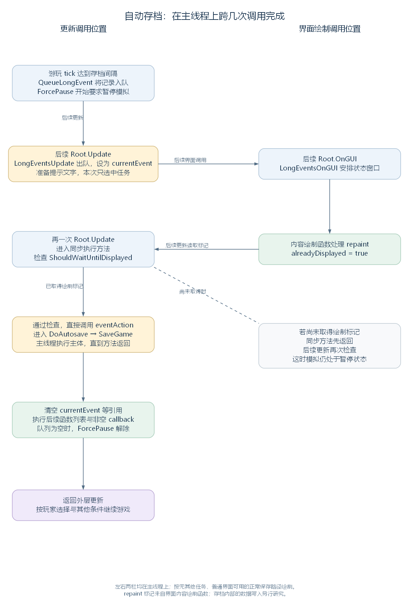

# 从自动存档到长任务：排队、显示与主线程执行（讨论稿）

状态：第一轮长任务登记与同步执行阅读，2026-11-04。依据工作区 RimWorld 1.7.4982 rev1280 的代码与兼容层整理，承接 [主线程更新入口](45-game-update-entry.md)、[单次 tick 分派](47-single-tick-and-ticklists.md) 和 [速度控制](48-time-controls-and-simulation-speed.md)。范围见 [游戏运行与调度大纲](44-runtime-scheduling-outline.md)。

本轮先沿普通自动存档读完一条长任务路径：登记任务、保存到队列、成为当前任务、取得窗口绘制机会、由主线程执行并清理。后台线程与迭代器任务先接到分支入口，后续逐段展开；存档内部的对象写入在存档模块研究。

## 一、让耗时工作按次序取得执行机会

DoSingleTick 每次调用 AutosaverTick，自动存档对象达到设定间隔后，会把 DoAutosave 方法交给 LongEventHandler 保存。后续 Root.Update 调用 LongEventsUpdate，任务才逐步从排队状态走到执行。

LongEventHandler 是静态类，通过静态字段保存队列与当前任务。它把一次任务的函数、提示文字、执行方式和完成处理保存在 QueuedLongEvent 记录中，再按每次更新的状态安排后续工作。

先看普通自动存档的整体过程。图中所有步骤都在主线程上，左右两栏表示更新和界面绘制的不同调用位置：



图按初始没有其他长任务、普通地图界面可用的一次正常保存绘制。后续更新若尚未取得绘制标记，会先返回，等以后的调用再次检查。[SVG](figures/long-event-sync-save.svg) · [图源](figures/long-event-sync-save.dot)

源码定位：自动存档登记（`RimWorld.Autosaver.cs:40`）、每帧推进入口（`Verse.LongEventHandler.cs:193`）、Root 调用（`Verse.Root.cs:122`）。

## 二、先认识管理器与任务记录保存的数据

### 2.1 保存排队任务与当前执行状态

下面摘出 LongEventHandler 的主要状态字段，保留源码顺序；省略绘制参数、锁对象及其他成员。QueuedLongEvent 是它内部定义的任务记录类型：

```csharp
private static Queue<LongEventHandler.QueuedLongEvent> eventQueue = new Queue<LongEventHandler.QueuedLongEvent>();
internal static LongEventHandler.QueuedLongEvent currentEvent = null;
private static Thread eventThread = null;
private static AsyncOperation levelLoadOp = null;
private static List<Action> toExecuteWhenFinished = new List<Action>();
private static bool executingToExecuteWhenFinished = false;
```

| 字段 | 保存什么 |
| --- | --- |
| eventQueue | 等待取得执行机会的任务记录，按入队次序取出 |
| currentEvent | 当前处理的任务记录；空值表示目前没有当前任务 |
| eventThread | 后台执行分支使用的 Thread 引用；普通自动存档路径中保持为空 |
| levelLoadOp | 异步场景加载操作的引用 |
| toExecuteWhenFinished | 由 ExecuteWhenFinished 等入口登记的待执行函数列表 |
| executingToExecuteWhenFinished | 标记管理器是否正在执行这份函数列表 |

Action 是可以保存一个无参数、无返回值方法的委托类型。任务可以先保存方法，之后再通过这份引用调用它。Action<Exception> 则保存一个接收 Exception 参数的处理方法。

源码定位：状态字段（`Verse.LongEventHandler.cs:505`）。

### 2.2 为一项任务保存函数、文字和执行条件

QueuedLongEvent 把同一项任务需要的数据放在一起。下面摘出它的字段，省略前面的属性，保持原有命名与顺序：

```csharp
public Action eventAction;
public Action callback;
public IEnumerator eventActionEnumerator;
public string levelToLoad;
public string eventTextKey = "";
public string eventText = "";
public bool doAsynchronously;
public Action<Exception> exceptionHandler;
public bool alreadyDisplayed;
public bool canEverUseStandardWindow = true;
public bool showExtraUIInfo = true;
public bool forceHideUI;
```

| 字段 | 在流程中怎样使用 |
| --- | --- |
| eventAction | 保存任务主体，本例会指向当前 Autosaver 的 DoAutosave 方法 |
| callback | 保存任务结束后由管理器调用的方法，下文说明实际调用位置 |
| eventActionEnumerator | 保存迭代器任务的 IEnumerator，供多次更新继续推进 |
| levelToLoad | 保存任务接下来需要加载的场景名称 |
| eventTextKey、eventText | 分别保存提示文字的翻译键和取得的显示文字 |
| doAsynchronously | 选择是否进入后台线程执行分支 |
| exceptionHandler | 保存异常处理方法，任务出错时按对应路径调用 |
| alreadyDisplayed | 记录状态窗口内容是否已处理过一次 repaint 绘制事件 |
| canEverUseStandardWindow | 保存登记时取得的标准窗口使用资格 |
| showExtraUIInfo、forceHideUI | 控制额外加载信息与状态界面的显示 |

“完成函数”在这里具体指 callback 保存的 Action。管理器执行完主体后，在下文的清理位置检查它是否为空，再决定是否调用。普通自动存档登记时给它传入 null。

源码定位：内部记录类（`Verse.LongEventHandler.cs:529`）、字段（`Verse.LongEventHandler.cs:562`）。

## 三、从自动存档登记一项任务

这一部分先让达到间隔的自动存档产生一条任务记录，再把记录加入队列。Autosaver 的 ticksSinceSave 保存距离上次发出存档任务以来的 tick 次数，AutosaveIntervalTicks 根据设置的游戏天数换算间隔；SavingIsTemporarilyDisabled 汇总当前暂时禁止保存的条件。

以下是 AutosaverTick 的完整实现：

```csharp
public void AutosaverTick()
{
    this.ticksSinceSave++;
    if (this.ticksSinceSave >= this.AutosaveIntervalTicks && !GameDataSaveLoader.SavingIsTemporarilyDisabled)
    {
        LongEventHandler.QueueLongEvent(new Action(this.DoAutosave), "Autosaving", false, null, true, false, null);
        this.ticksSinceSave = 0;
    }
}
```

new Action(this.DoAutosave) 保存当前 Autosaver 实例的 DoAutosave 方法。这里的调用依次给 QueueLongEvent 传入：

| 参数名 | 本次值 | 作用 |
| --- | --- | --- |
| action | 指向 this.DoAutosave 的 Action | 稍后要调用的任务主体 |
| textKey | "Autosaving" | 状态提示的翻译键 |
| doAsynchronously | false | 采用同步函数分支，由主线程直接调用主体 |
| exceptionHandler | null | 本次没有另行指定异常处理方法 |
| showExtraUIInfo | true | 允许显示额外加载信息，具体显示还受界面条件影响 |
| forceHideUI | false | 允许显示状态界面 |
| callback | null | 本次没有另行指定完成函数 |

这一重载建立 QueuedLongEvent，写入参数并入队。局部变量 queuedLongEvent 就是新建的记录；完整方法如下，仅将参数列表换行排版：

```csharp
public static void QueueLongEvent(Action action, string textKey, bool doAsynchronously,
    Action<Exception> exceptionHandler, bool showExtraUIInfo = true,
    bool forceHideUI = false, Action callback = null)
{
    LongEventHandler.QueuedLongEvent queuedLongEvent = new LongEventHandler.QueuedLongEvent
    {
        eventAction = action,
        eventTextKey = textKey,
        doAsynchronously = doAsynchronously,
        exceptionHandler = exceptionHandler,
        canEverUseStandardWindow = !LongEventHandler.AnyEventWhichDoesntUseStandardWindowNowOrWaiting,
        showExtraUIInfo = showExtraUIInfo,
        callback = callback,
        forceHideUI = forceHideUI
    };
    LongEventHandler.eventQueue.Enqueue(queuedLongEvent);
}
```

AnyEventWhichDoesntUseStandardWindowNowOrWaiting 检查当前及排队记录中是否已有无法使用标准窗口的任务。若有，这次登记的记录会把 canEverUseStandardWindow 设为 false；第五节再看这个资格怎样参与显示判断。

**对本例，假设原先没有其他任务。** 登记后 eventQueue 包含一条自动存档记录，currentEvent 仍为空，任务主体保存在记录的 eventAction 中。AutosaverTick 随后把 ticksSinceSave 清零并返回，DoSingleTick 继续余下的调用。

源码定位：自动存档间隔与登记（`RimWorld.Autosaver.cs:31`、`RimWorld.Autosaver.cs:40`）、Action 重载（`Verse.LongEventHandler.cs:61`）、已有窗口类型检查（`Verse.LongEventHandler.cs:37`）。

## 四、在 Root.Update 中取得当前任务

Root.Update 每帧调用 LongEventsUpdate(out flag)。输出参数带回本次是否切换场景，Root 据此决定当前入口能否继续。LongEventsUpdate 先处理已经存在的 currentEvent，随后才检查是否需要从队列取下一项。

下面是它的完整实现。sceneChanged 是场景切换结果；三个 UpdateCurrent 方法分别接到迭代器、后台线程和同步函数路径：

```csharp
public static void LongEventsUpdate(out bool sceneChanged)
{
    sceneChanged = false;
    if (LongEventHandler.currentEvent != null)
    {
        if (LongEventHandler.currentEvent.eventActionEnumerator != null)
        {
            LongEventHandler.UpdateCurrentEnumeratorEvent();
        }
        else if (LongEventHandler.currentEvent.doAsynchronously)
        {
            LongEventHandler.UpdateCurrentAsynchronousEvent();
        }
        else
        {
            LongEventHandler.UpdateCurrentSynchronousEvent(out sceneChanged);
        }
    }
    if (LongEventHandler.currentEvent == null && LongEventHandler.eventQueue.Count > 0)
    {
        LongEventHandler.currentEvent = LongEventHandler.eventQueue.Dequeue();
        if (LongEventHandler.currentEvent.eventTextKey == null)
        {
            LongEventHandler.currentEvent.eventText = "";
            return;
        }
        LongEventHandler.currentEvent.eventText = LongEventHandler.currentEvent.eventTextKey.Translate();
    }
}
```

继续自动存档案例：进入时 currentEvent 为空，方法跳过前半段，随后 Dequeue 取出自动存档记录，将其设为 currentEvent，并翻译 "Autosaving"。本次调用到此结束。下一次进入 LongEventsUpdate，才会从前半段选择同步函数路径。

若前一项在某次更新中已经结束并清空 currentEvent，同一次 LongEventsUpdate 的后半段可以立刻取出下一项。新取出的记录仍要等后续更新再进入执行分支。

源码定位：逐帧处理方法（`Verse.LongEventHandler.cs:193`）、Root 对场景结果的处理（`Verse.Root.cs:122`）。

## 五、给状态窗口留出绘制机会

同步函数在开始前先检查 ShouldWaitUntilDisplayed。这个属性根据是否已经绘制、是否使用标准窗口、是否有提示文字决定要不要继续等待。

下面是 QueuedLongEvent 的两个完整属性。UseStandardWindow 要求登记时保留使用资格、采用同步函数，并且没有迭代器主体；ShouldWaitUntilDisplayed 在这些条件下继续查看显示标记和文字：

```csharp
public bool ShouldWaitUntilDisplayed
{
    get
    {
        return !this.alreadyDisplayed && this.UseStandardWindow && !this.eventText.NullOrEmpty();
    }
}

public bool UseStandardWindow
{
    get
    {
        return this.canEverUseStandardWindow && !this.doAsynchronously && this.eventActionEnumerator == null;
    }
}
```

本例没有其他长任务，记录保留标准窗口资格；doAsynchronously 为 false，eventActionEnumerator 为空，而且已有非空提示文字。因此，窗口尚未取得绘制标记时，后续同步更新会先返回。

Root.OnGUI 每次先调用 LongEventsOnGUI，再按长任务状态决定是否继续通常的界面。LongEventsOnGUI 根据 UseStandardWindow 和界面可用状态，安排标准窗口或加载背景上的状态区域，最终接到 DrawLongEventWindowContents。

repaint 是界面系统中的绘制事件。内容绘制方法处理这个事件时，执行下面的原始片段：

```csharp
if (Event.current.type == EventType.repaint)
{
    LongEventHandler.currentEvent.alreadyDisplayed = true;
}
```

这样，状态窗口内容处理过一次 repaint 后，alreadyDisplayed 变为 true。后续 Root.Update 再进入同步方法时，就能通过开头的等待检查。这个安排为提示文字留出一次界面绘制机会，然后再开始耗时主体。

源码定位：等待与窗口属性（`Verse.LongEventHandler.cs:543`、`Verse.LongEventHandler.cs:553`）、界面入口（`Verse.Root.cs:163`、`Verse.LongEventHandler.cs:117`）、绘制标记（`Verse.LongEventHandler.cs:471`）。

## 六、暂停模拟，并按界面条件决定是否继续普通更新

现在把任务状态接回上一轮的时间控制。AnyEventNowOrWaiting 在 currentEvent 不为空或 eventQueue 中仍有记录时返回 true；ForcePause 直接返回这个结果。TickManager.ForcePaused 又把 LongEventHandler.ForcePause 纳入暂停条件。

因此，自动存档刚登记到队列，就会要求暂停模拟。若登记发生在 DoSingleTick 内，当前这一步继续返回；TickManagerUpdate 随后的 Paused 检查会结束后续推进。普通自动存档等待绘制期间，游戏的 tick 计数也就暂时停止。

Root.Update 与 Root_Play.Update 另外读取 ShouldWaitForEvent，决定是否继续共享服务和游玩帧级入口。以下是这个属性的完整实现：

```csharp
public static bool ShouldWaitForEvent
{
    get
    {
        return LongEventHandler.AnyEventNowOrWaiting && ((LongEventHandler.currentEvent != null && !LongEventHandler.currentEvent.UseStandardWindow) || (Find.UIRoot == null || Find.WindowStack == null));
    }
}
```

把几种状态代入，调用位置就清楚了：

| 当前状态 | ForcePause | ShouldWaitForEvent | 对外层流程的影响 |
| --- | --- | --- | --- |
| 当前与队列都没有任务 | false | false | 长任务条件允许继续 |
| 只有排队任务，普通界面可用 | true | false | 暂停模拟，普通帧级入口仍可继续 |
| 当前任务使用标准窗口，普通界面可用 | true | false | 暂停模拟，保留普通更新和界面路径 |
| 当前任务不使用标准窗口 | true | true | Root 跳过对应共享服务，Root_Play 提前返回 |
| 有任务，且 UIRoot 或 WindowStack 不可用 | true | true | 普通界面准备好以前，按长任务等待路径处理 |

自动存档在本例条件下走中间的标准窗口路径：暂停模拟的同时，仍能给界面提供绘制机会。后台线程任务由于 UseStandardWindow 为 false，会在成为当前任务后进入另一种等待状态，下一轮结合其线程执行展开。

这里的“等待”由每次调用的判断与返回实现。同步存档主体真正开始执行以后，主线程在这次方法调用中持续工作，直到主体返回才继续后面的步骤。

源码定位：是否存在任务、暂停与等待属性（`Verse.LongEventHandler.cs:27`、`Verse.LongEventHandler.cs:52`、`Verse.LongEventHandler.cs:17`）、TickManager 的暂停条件（`Verse.TickManager.cs:155`）、外层等待检查（`Verse.Root.cs:127`、`Verse.Root_Play.cs:66`）。

## 七、调用主体，再清理当前记录与完成函数

通过显示检查后，UpdateCurrentSynchronousEvent 直接调用 currentEvent.eventAction。本例因此进入 DoAutosave：它选择存档名称，再调用 GameDataSaveLoader.SaveGame。当前调度这一层沿主线程等待方法返回，存档数据怎样写入则留给存档模块。

下面是同步方法的完整实现。sceneChanged 带回场景切换结果；levelToLoad 是可选的场景名。局部变量 callback 先保留记录中的完成函数，使它能够在 currentEvent 清空后继续取得调用：

```csharp
private static void UpdateCurrentSynchronousEvent(out bool sceneChanged)
{
    sceneChanged = false;
    if (LongEventHandler.currentEvent.ShouldWaitUntilDisplayed)
    {
        return;
    }
    try
    {
        if (LongEventHandler.currentEvent.eventAction != null)
        {
            LongEventHandler.currentEvent.eventAction();
        }
        if (!LongEventHandler.currentEvent.levelToLoad.NullOrEmpty())
        {
            SceneManager.LoadScene(LongEventHandler.currentEvent.levelToLoad);
            sceneChanged = true;
        }
        Action callback = LongEventHandler.currentEvent.callback;
        LongEventHandler.currentEvent = null;
        LongEventHandler.eventThread = null;
        LongEventHandler.levelLoadOp = null;
        LongEventHandler.ExecuteToExecuteWhenFinished();
        if (callback != null)
        {
            callback();
        }
    }
    catch (Exception ex)
    {
        string text = "Exception from long event: ";
        Exception ex2 = ex;
        Log.Error(text + ((ex2 != null) ? ex2.ToString() : null));
        if (LongEventHandler.currentEvent != null && LongEventHandler.currentEvent.exceptionHandler != null)
        {
            LongEventHandler.currentEvent.exceptionHandler(ex);
        }
        LongEventHandler.currentEvent = null;
        LongEventHandler.eventThread = null;
        LongEventHandler.levelLoadOp = null;
    }
}
```

正常返回路径的顺序是：调用任务主体，按需要加载场景，保存 callback，清空当前记录及相关引用，执行 toExecuteWhenFinished 列表，再调用非空 callback。这个列表的执行方法逐项调用其中的 Action，并在结束后清空列表；ExecuteWhenFinished 具体何时立即执行、何时保留函数，后续再沿其登记入口展开。

本例的 levelToLoad 和 callback 均为空，所以省去对应动作。若没有新任务入队，currentEvent 清空后，ForcePause 也会恢复为 false；外层同一轮更新后续便可按其他条件继续游戏。

catch 负责记录传播到这一层的异常，按当前记录调用存在的异常处理方法并清理引用。自动存档的 SaveGame 内部也有自己的异常捕获，所以这里描述的是任务主体返回与管理器清理的顺序；一次方法正常返回后，具体存档结果仍要结合保存代码及日志理解。

源码定位：同步方法（`Verse.LongEventHandler.cs:350`）、存档主体（`RimWorld.Autosaver.cs:51`、`Verse.GameDataSaveLoader.cs:114`）、函数列表执行（`Verse.LongEventHandler.cs:426`）。

## 八、把一次自动存档放回连续更新中

最后用一组连续调用对照状态。假设初始没有其他长任务，普通界面可用，更新之间取得一次相应的 repaint，存档方法正常返回，期间没有额外暂停条件：

| 调用位置 | eventQueue 与 currentEvent | 本次发生什么 |
| --- | --- | --- |
| 某次游玩 tick 的 AutosaverTick | 队列加入存档记录，currentEvent 为空 | 保存方法引用，ForcePause 生效；本次 tick 返回后停止继续推进 |
| 后续一次 Root.Update | 队列取出记录，设为 currentEvent | 准备提示文字，本次只选中任务 |
| 后续 Root.OnGUI 的 repaint | 当前记录仍在，alreadyDisplayed 变为 true | 状态窗口内容取得一次绘制机会 |
| 再一次 Root.Update | 进入当前任务的同步分支 | 通过显示检查，直接调用 DoAutosave，直到它返回 |
| 同次更新的清理阶段 | currentEvent 清空，队列为空 | 执行函数列表与存在的完成函数，ForcePause 解除 |
| 后续游玩更新 | 没有长任务要求暂停 | 按当时的玩家速度与其他状态继续推进 |

已用原始 QueueLongEvent、LongEventsUpdate、同步执行方法和相关状态属性，配合独立对象核对上述路径：确认入队后先暂停、首次出队仅选中、未有绘制标记时返回、记录标记后调用主体，以及两项任务之间的完成与出队顺序。核对中手工模拟 repaint 写入标记，没有执行实际存档或游戏绘制。

这一轮接通了普通同步任务的生命周期。接续阅读见 [异步长任务：线程执行、完成检查与后续函数](50-asynchronous-long-events.md)，已展开 eventThread 的建立、线程入口、主线程完成检查，以及后续函数与可选场景加载。
