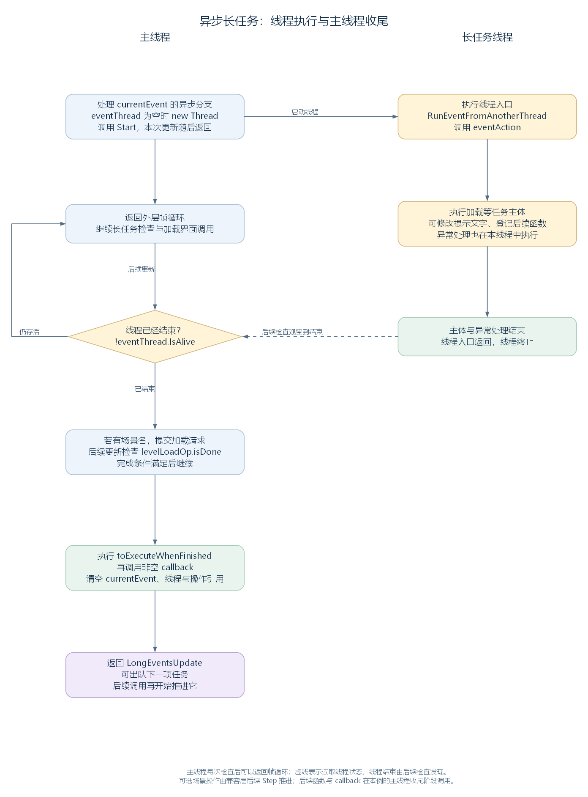

# 异步长任务：线程执行、完成检查与后续函数（讨论稿）

状态：第一轮长任务线程与完成交接阅读，2026-11-04。依据工作区 RimWorld 1.7.4982 rev1280 的代码与兼容层整理，承接 [长任务排队与同步执行](49-long-event-queue-and-synchronous-save.md)。范围见 [游戏运行与调度大纲](44-runtime-scheduling-outline.md)。

本轮沿 UpdateCurrentAsynchronousEvent 展开：主线程启动长任务线程后返回，在后续更新中检查它是否结束，再继续场景请求、后续函数和当前记录的清理。先用启动加载作为实际入口，读到任务主体内部的具体加载步骤时，回接 [定义加载篇](chapters/03-def-framework/02-def-loading-storage-query.md)。

## 一、由两个线程接续完成一项任务

上一轮已经认识 eventQueue、currentEvent 与 QueuedLongEvent。任务出队成为 currentEvent 后，LongEventsUpdate 按记录选择执行路径；doAsynchronously 为 true、没有迭代器主体时，调用 UpdateCurrentAsynchronousEvent。

异步任务的主体由新建的长任务线程执行。主线程在启动它后返回，继续帧循环，并在后续更新里检查线程状态。任务结束后的后续函数与可选场景处理，再由主线程沿管理器的代码继续执行。

本轮主要跟住这些状态：

| 对象或字段 | 保存什么，在哪里读取 |
| --- | --- |
| currentEvent.eventAction | 当前任务主体，由长任务线程进入 RunEventFromAnotherThread 后取得调用 |
| eventThread | 管理器持有的 Thread 引用，主线程通过 IsAlive 检查线程是否仍在执行 |
| currentEvent.levelToLoad；levelLoadOp | 可选的场景名与 AsyncOperation 操作记录，主线程等待操作报告完成 |
| toExecuteWhenFinished | 待执行的 Action 列表，本轮正常收尾时由主线程遍历调用 |
| currentEvent.callback | 本项任务的完成函数，在后续函数列表返回后调用 |
| CurrentEventTextLock | 修改和读取任务提示文字时共同使用的锁对象 |



实线表示线程内部的执行与启动关系；虚线表示主线程在后续更新中观察到线程已结束。线程启动后的具体执行交错由运行时安排。[SVG](figures/long-event-async-threads.svg) · [图源](figures/long-event-async-threads.dot)

源码定位：分支选择（`Verse.LongEventHandler.cs:204`）、线程与完成处理（`Verse.LongEventHandler.cs:305`）。

## 二、从启动加载登记异步主体与后续界面任务

Root.Start 在游戏数据尚未加载时登记一项异步任务，主体调用 PlayDataLoader.LoadAllPlayData(false)。随后再把局部变量 action 保存的界面初始化方法登记为另一项同步任务。

这里 action 是前面建立的 Action，其中创建 SoundRoot、选择并初始化 UIRoot 等界面相关对象；PlayDataLoader.Loaded 读取加载器保存的加载状态。下面连续摘出登记位置：

```csharp
if (!PlayDataLoader.Loaded)
{
    Application.runInBackground = true;
    LongEventHandler.QueueLongEvent(delegate
    {
        PlayDataLoader.LoadAllPlayData(false);
    }, null, true, null, true, false, null);
    LongEventHandler.QueueLongEvent(action, "InitializingInterface", false, null, true, false, null);
}
else
{
    action();
}
```

在尚未加载的路径上，队列先保存加载数据的异步任务，再保存界面初始化的同步任务。当前任务仍由 LongEventsUpdate 逐项取出；加载主体执行期间，界面初始化记录留在队列中。

第二项登记时，前面已经有不使用标准窗口的异步记录。因此按上一轮读过的资格计算，第二项的 canEverUseStandardWindow 也会为 false。这条启动路径持续使用对应的加载界面安排。

下文先假设主体正常返回、后续函数正常执行；第八节再接到任务异常的调用位置。

源码定位：界面初始化 Action 与任务登记（`Verse.Root.cs:35`、`Verse.Root.cs:63`）、窗口资格计算（`Verse.LongEventHandler.cs:69`）。

## 三、启动线程，再在后续更新中检查结束状态

UpdateCurrentAsynchronousEvent 先检查 eventThread。为空时建立 Thread 并启动，然后结束本次调用；已有线程时，再读取 IsAlive。它报告线程是否仍存活，包括主体内部还在等待的情况。

下面是该方法的完整实现。局部变量 flag 表示本次是否可以进入收尾：没有场景请求时，线程结束就可继续；有场景请求时，还要等 levelLoadOp 报告完成。callback 是从当前记录取得的完成函数：

```csharp
private static void UpdateCurrentAsynchronousEvent()
{
    if (LongEventHandler.eventThread == null)
    {
        LongEventHandler.eventThread = new Thread(delegate
        {
            LongEventHandler.RunEventFromAnotherThread(LongEventHandler.currentEvent.eventAction);
        });
        LongEventHandler.eventThread.Start();
        return;
    }
    if (!LongEventHandler.eventThread.IsAlive)
    {
        bool flag = false;
        if (!LongEventHandler.currentEvent.levelToLoad.NullOrEmpty())
        {
            if (LongEventHandler.levelLoadOp == null)
            {
                LongEventHandler.levelLoadOp = SceneManager.LoadSceneAsync(LongEventHandler.currentEvent.levelToLoad);
            }
            else if (LongEventHandler.levelLoadOp.isDone)
            {
                flag = true;
            }
        }
        else
        {
            flag = true;
        }
        if (flag)
        {
            LongEventHandler.ExecuteToExecuteWhenFinished();
            Action callback = LongEventHandler.currentEvent.callback;
            if (callback != null)
            {
                callback();
            }
            LongEventHandler.currentEvent = null;
            LongEventHandler.eventThread = null;
            LongEventHandler.levelLoadOp = null;
        }
    }
}
```

可以按连续几次更新理解这段代码：

1. 首次进入本分支，建立并启动线程，主线程返回。
2. 后续进入时，若 IsAlive 为 true，本次到方法末尾返回，保留当前任务。
3. 某次更新读到 IsAlive 为 false，进入可选场景处理与收尾阶段。

因此，即使主体很快执行完，管理器也在后续调用中检查结束状态。异步任务的 UseStandardWindow 为 false，currentEvent 存在期间，ShouldWaitForEvent 要求普通游玩入口等待；Root 的长任务检查与加载界面调用仍继续取得机会。

线程内的主体能够使用自己的并行工作机制，本轮先跟住管理器直接建立的这一条线程；定义文件的并行读取等处理按后续案例展开。

源码定位：完整方法（`Verse.LongEventHandler.cs:305`）、等待判断（`Verse.LongEventHandler.cs:17`）、Root 中的更新与绘制入口（`Verse.Root.cs:122`、`Verse.Root.cs:163`）。

## 四、在线程入口调用任务主体

新线程开始执行所登记的委托后，会从 currentEvent 取得 eventAction，传给 RunEventFromAnotherThread。该方法先调用 CultureInfoUtility.EnsureEnglish，将当前线程用于数字等格式处理的 Culture 设为 en-US，再调用主体。

以下连续摘出入口与主体调用部分，异常处理接到第八节：

```csharp
private static void RunEventFromAnotherThread(Action action)
{
    CultureInfoUtility.EnsureEnglish();
    try
    {
        if (action != null)
        {
            action();
        }
    }
    catch (Exception ex)
    {
        // 省略源码中的日志与异常处理，见第八节。
    }
}
```

上面保留入口与 try/catch 结构，省略 catch 内部语句。对启动加载案例，action() 就会进入前一节保存的委托，再调用 PlayDataLoader.LoadAllPlayData(false)。此前定义加载篇读过的主线，因而在这个入口取得长任务线程上的执行机会。

主体返回后，RunEventFromAnotherThread 随之返回，线程入口结束。主线程后续读到 IsAlive 为 false，才继续第三节方法中尚未执行的部分。

源码定位：线程入口（`Verse.LongEventHandler.cs:394`）、线程 Culture 设置（`Verse.CultureInfoUtility.cs:11`）、加载主入口（`Verse.PlayDataLoader.cs:32`）。

## 五、在执行期间更新界面提示文字

加载主体执行中，可以调用 SetCurrentEventText 修改 currentEvent.eventText。比如 PlayDataLoader 在加载定义时传入 "LoadingDefs" 的翻译文字。

SetCurrentEventText 的参数 newText 是新文字，局部变量 currentEventTextLock 取得共享锁对象。完整方法为：

```csharp
public static void SetCurrentEventText(string newText)
{
    object currentEventTextLock = LongEventHandler.CurrentEventTextLock;
    lock (currentEventTextLock)
    {
        if (LongEventHandler.currentEvent != null)
        {
            LongEventHandler.currentEvent.eventText = newText;
        }
    }
}
```

主线程的界面代码在计算和绘制这段文字时，也锁住同一个 CurrentEventTextLock。这样，任务线程修改文字与界面读取文字的这几行代码，会按取得锁的顺序执行。

从玩家画面看，主线程的后续界面调用读到新文字，再将它交给绘制流程。异步记录的 UseAnimatedDots 为 true，状态窗口也会采用随时间变化的省略号。这些界面调用与任务主体的持续执行，共同形成加载过程中更新提示的画面。

源码定位：文字设置（`Verse.LongEventHandler.cs:240`）、定义加载提示（`Verse.PlayDataLoader.cs:125`）、界面读取与省略号（`Verse.LongEventHandler.cs:491`、`Verse.LongEventHandler.cs:500`）、动画判断（`Verse.LongEventHandler.cs:533`）。

## 六、保存后续函数，再按当前状态安排执行

### 6.1 登记函数时，先检查是否立即执行列表

PlayDataLoader 除了执行加载主体，还会用 ExecuteWhenFinished 登记后续工作。例如它把 ShaderWarmup.KickPrewarmOnce 保存为 Action，后面又登记人物背景数据、语言数据注入等函数。这些内容已在定义加载篇接到登记位置，这里继续追踪谁来调用。

ExecuteWhenFinished 的参数 action 是本次登记的函数，toExecuteWhenFinished 是保存这些函数的 List<Action>。完整方法如下：

```csharp
public static void ExecuteWhenFinished(Action action)
{
    LongEventHandler.toExecuteWhenFinished.Add(action);
    if ((LongEventHandler.currentEvent == null || LongEventHandler.currentEvent.ShouldWaitUntilDisplayed) && !LongEventHandler.executingToExecuteWhenFinished)
    {
        LongEventHandler.ExecuteToExecuteWhenFinished();
    }
}
```

它总是先把函数加入列表，再决定是否立即进入列表执行方法：

| 调用时的状态 | 本次安排 |
| --- | --- |
| 没有 currentEvent，且当前未在执行列表 | 加入后立即由当前调用者执行列表；此时队列中仍可能有待选中的任务 |
| 当前任务的 ShouldWaitUntilDisplayed 为 true，且未在执行列表 | 加入后立即由当前调用者执行列表 |
| 已经处于列表执行中 | 先加入列表，由正在进行的遍历继续处理 |
| 其他当前任务状态，包括正在运行的异步任务 | 保存函数，等后续调用执行列表的方法 |

在启动加载的正常异步路径中，currentEvent 存在，UseStandardWindow 为 false，ShouldWaitUntilDisplayed 也为 false。因此，主体在线程中登记后续函数时，只增加列表内容；管理器在主线程发现任务结束后，再调用 ExecuteToExecuteWhenFinished。

这些条件也说明了线程归属：立即执行路径沿当前调用者的线程运行；本例完成阶段的执行由主线程发起。ForceExecuteToExecuteWhenFinished 则是直接调用同一个列表执行方法的另一个入口。

源码定位：登记条件（`Verse.LongEventHandler.cs:224`）、强制执行入口（`Verse.LongEventHandler.cs:234`）、加载中的登记案例（`Verse.PlayDataLoader.cs:293`、`Verse.PlayDataLoader.cs:346`）。

### 6.2 逐项调用列表，并处理执行期间的新登记

ExecuteToExecuteWhenFinished 使用 executingToExecuteWhenFinished 标记正在执行，并按下标逐项调用 Action。i 是列表下标；DeepProfiler 在这里记录各项调用的性能区段。

下面保留整个遍历结构与标记处理，省略性能记录和异常日志的具体内容：

```csharp
private static void ExecuteToExecuteWhenFinished()
{
    if (LongEventHandler.executingToExecuteWhenFinished)
    {
        // 省略源码中的警告日志。
        return;
    }
    LongEventHandler.executingToExecuteWhenFinished = true;
    // 省略性能记录开始。
    for (int i = 0; i < LongEventHandler.toExecuteWhenFinished.Count; i++)
    {
        // 省略当前函数的性能记录开始。
        try
        {
            LongEventHandler.toExecuteWhenFinished[i]();
        }
        catch (Exception ex)
        {
            // 省略错误信息构造与日志。
        }
        finally
        {
            // 省略当前函数的性能记录结束。
        }
    }
    // 省略性能记录结束。
    LongEventHandler.toExecuteWhenFinished.Clear();
    LongEventHandler.executingToExecuteWhenFinished = false;
}
```

每项 Action 有自己的异常捕获。某项函数运行时若又调用 ExecuteWhenFinished，新函数会追加到列表；执行标记使其保留在这次外层遍历中，for 条件又会读取最新 Count，因此能在后面的下标继续取得调用。

**例如列表中原先有函数 A。** A 运行中登记 B，再完成自己余下的语句。随后下标递增，遍历读到新增的 B 并调用它，最后清空列表。A、B 是这里的教学标签，表示两个 Action。

异步收尾方法等这份列表返回以后，再调用非空 currentEvent.callback，最后清空 currentEvent、eventThread、levelLoadOp。这条路径的列表与完成函数执行期间，currentEvent 仍然指向当前记录。

源码定位：列表执行（`Verse.LongEventHandler.cs:426`）、异步收尾顺序（`Verse.LongEventHandler.cs:334`）。

## 七、存在场景请求时，再等待兼容层操作完成

启动数据加载这个案例没有 levelToLoad。其他异步记录可以保存场景名；主线程发现线程结束后，先调用 SceneManager.LoadSceneAsync，保存返回的 AsyncOperation 为 levelLoadOp，后续更新再读取 isDone。

在当前兼容层中，这条调用接到下面的完整实现。局部变量 asyncOperation 是新建的操作记录，pendingOperations 是 SceneManager 保存未完成操作的列表：

```csharp
public static AsyncOperation LoadSceneAsync(string sceneName)
{
    SceneManager.LoadScene(sceneName);
    AsyncOperation asyncOperation = new AsyncOperation();
    SceneManager.pendingOperations.Add(asyncOperation);
    return asyncOperation;
}
```

LoadScene(sceneName) 把场景名保存到 pendingSceneName。后续 UnityRuntime.Step 先开始本帧时间，再调用 SceneManager.ProcessPendingLoad，之后才进入世界更新。ProcessPendingLoad 取出场景名，卸载旧场景、调用已登记的场景构建方法并通知场景变化，最后处理操作记录：

```csharp
foreach (AsyncOperation asyncOperation in SceneManager.pendingOperations)
{
    asyncOperation.MarkDone();
}
SceneManager.pendingOperations.Clear();
```

MarkDone 把操作的完成状态设为 true，再调用存在的完成通知。后续长任务检查读到 levelLoadOp.isDone 为 true，才进入函数列表、callback 和状态清理。

因此，这条路径有两个连续的完成条件：长任务线程先结束；场景操作再报告完成。提交场景请求的那次更新先保存操作记录，后续更新继续检查它。

源码定位：场景分支（`Verse.LongEventHandler.cs:319`）、兼容层请求（`UnityEngine.SceneManagement.SceneManager.cs:77`、`UnityEngine.SceneManagement.SceneManager.cs:134`）、逐帧处理（`Waylith.UnityCompat.UnityRuntime.cs:106`、`UnityEngine.SceneManagement.SceneManager.cs:83`）、操作完成（`UnityEngine.AsyncOperation.cs:107`）。

## 八、沿异常处理确认调用所在的线程

RunEventFromAnotherThread 的 try/catch 包围 action()。主体抛出异常后，长任务线程在 catch 中记录日志，再调用当前记录的 exceptionHandler。下面连续摘出内部处理分支，省略外围日志与捕获：

```csharp
if (LongEventHandler.currentEvent != null && LongEventHandler.currentEvent.exceptionHandler != null)
{
    LongEventHandler.currentEvent.exceptionHandler(ex);
}
```

这里 ex 是主体抛出的 Exception。异常处理函数本身若再次抛出异常，外围还有一层 catch 记录错误。处理结束、线程入口返回后，主线程仍按 IsAlive 继续检查；这个状态把线程是否结束接到收尾，任务结果则由主体、日志及具体异常处理逻辑表达。

把本轮调用位置放在一起：

| 操作 | 本例由谁调用 |
| --- | --- |
| 建立 Thread、调用 Start、检查 IsAlive | 主线程的 LongEventsUpdate 路径 |
| 调用 eventAction 与 SetCurrentEventText | 长任务线程中的加载主体 |
| 主体出错时调用 exceptionHandler | 长任务线程中的异常处理 |
| 发出场景请求、读取 isDone | 主线程 |
| 正常收尾时调用后续函数列表与 callback | 主线程 |

源码定位：线程入口的异常处理（`Verse.LongEventHandler.cs:404`）。

## 九、回到一次启动加载，并接到下一种任务

对第二节的正常启动案例，完整交接可以按以下顺序读：

1. Root.Start 先排入异步数据加载，再排入同步界面初始化。
2. LongEventsUpdate 取出加载记录；后续更新进入异步方法，建立并启动长任务线程。
3. 长任务线程调用 LoadAllPlayData，执行定义等加载主线，更新提示文字，并登记后续函数。
4. 主线程继续长任务检查与加载界面调用。线程结束以后，后续检查进入收尾。
5. 本例没有场景请求，主线程执行函数列表、检查 callback，再清空当前记录。
6. 同一次 LongEventsUpdate 可以取出下一项界面初始化记录，后续更新再推进它。

线程归属与顺序已用提取的管理器方法核对：主体由真实测试线程执行，场景操作使用独立替代对象；检查了主体存活期间的返回、结束后的主线程收尾、列表执行中的新登记、异常处理所在的线程，以及可选场景操作的完成条件。为编译反编译的匿名线程入口，核对代码显式补出了 ThreadStart 类型，其余相关控制流程沿原方法执行。实际游戏加载、绘制与场景构建由本地源码核对。

接续阅读见 [迭代器长任务：保存进度与按时间分段推进](51-iterator-long-events.md)，已展开 IEnumerator 的保存、MoveNext 与持续计时检查、结束清理，以及世界绘制层重建的实际登记位置。
