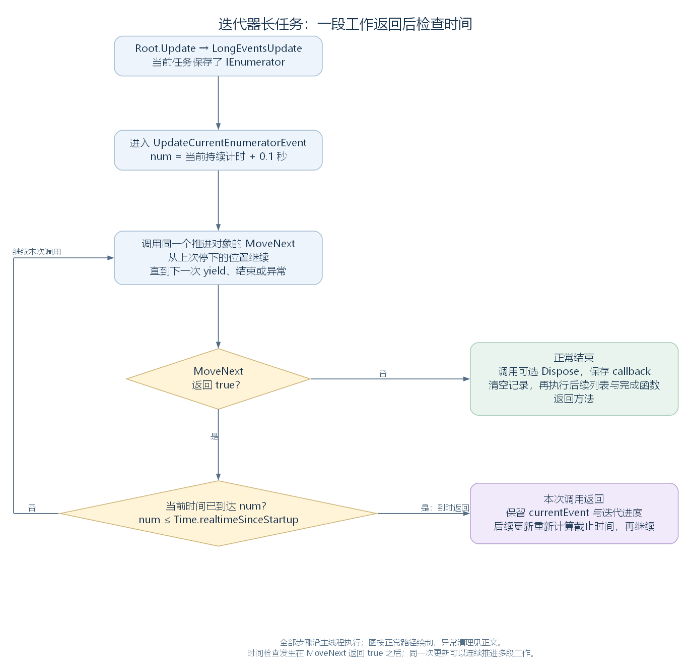

# 迭代器长任务：保存进度与按时间分段推进（讨论稿）

状态：第一轮迭代器长任务阅读，2026-11-04。依据工作区 RimWorld 1.7.4982 rev1280 的代码与兼容层整理，承接 [长任务登记](49-long-event-queue-and-synchronous-save.md) 和 [异步长任务与后续函数](50-asynchronous-long-events.md)。范围见 [游戏运行与调度大纲](44-runtime-scheduling-outline.md)。

本轮进入 LongEventHandler 的第三条执行路径：登记一个 IEnumerable，保存取得的 IEnumerator，在主线程的多次更新中继续推进。重点跟住进度、时间检查与结束清理，再将这条路径接到世界绘制层的实际登记位置。

## 一、在主线程上分几次推进一项任务

LongEventsUpdate 遇到 currentEvent.eventActionEnumerator 不为空时，先进入 UpdateCurrentEnumeratorEvent。这条方法沿当前主线程调用 MoveNext，推进一段任务代码，再根据本次调用的时间检查是否继续。

推进对象保存在 currentEvent 中。达到本次截止时间时，方法返回，记录继续保留；下次 Root.Update 再进入这个方法，重新计算截止时间，并从原有进度继续。

先认识本轮会跟住的几个对象与结果：

| 类型、成员或结果 | 在流程中做什么 |
| --- | --- |
| IEnumerable | 提供 GetEnumerator，供管理器取得任务的推进对象 |
| IEnumerator | 保存推进状态，通过 MoveNext 继续；Current 可以提供本次产生的值 |
| eventActionEnumerator | QueuedLongEvent 中保存上述 IEnumerator 的字段 |
| MoveNext 返回 true | 本次到达一个可交回控制的位置，管理器随后检查时间 |
| MoveNext 返回 false | 任务遍历结束，管理器进入正常清理与后续函数处理 |
| IDisposable | 可选的释放接口；推进对象实现它时，管理器在结束路径调用 Dispose |



左侧回线继续本次调用中的下一段；右侧分别是正常结束与保留进度的出口。图按正常执行绘制，异常处理在第七节接回。[SVG](figures/long-event-iterator-loop.svg) · [图源](figures/long-event-iterator-loop.dot)

源码定位：分支选择（`Verse.LongEventHandler.cs:198`）、推进方法（`Verse.LongEventHandler.cs:253`）、记录字段（`Verse.LongEventHandler.cs:568`）。

## 二、先用一个迭代函数认识进度保存

C# 的 yield 可以把函数写成逐段提供结果的迭代函数。编译器为它建立保存继续位置与局部变量的对象，调用者通过 MoveNext 让它继续执行。

下面是**教学代码**，方法名 PrepareInStages 与局部变量 completed 仅供本例使用。函数安排五段工作，每段完成后通过 yield return 交回一个计数：

```csharp
private static IEnumerable PrepareInStages()
{
    int completed = 0;
    while (completed < 5)
    {
        // 教学：在这里处理一小段工作。
        completed++;
        yield return completed;
    }
}
```

对这个函数，调用 PrepareInStages 并取得 IEnumerator 后，正文从第一次 MoveNext 开始执行。第一次到达 yield return 时，completed 为 1，MoveNext 返回 true，Current 可取得 1。下一次 MoveNext 从这个位置后继续，进入下一轮循环，保留的 completed 再增加到 2。

五次产生结果以后，再次调用 MoveNext，循环结束，返回 false。管理器只要持续保存同一个 IEnumerator，就能在多次调用之间延续进度。

这个例子用数字展示 Current 的含义。下面的长任务方法使用 MoveNext 的返回结果与当前时间安排推进，Current 的值未参与其条件判断。

## 三、登记推进对象，接到逐帧调用

接受 IEnumerable 的 QueueLongEvent 重载，在登记时调用 action.GetEnumerator，将返回对象保存到新记录中。action 是传入的可迭代任务，queuedLongEvent 是新建的 QueuedLongEvent；提示文字、异常处理和显示参数沿用前两轮读过的结构。

下面是完整重载，仅将参数列表换行排版：

```csharp
public static void QueueLongEvent(IEnumerable action, string textKey,
    Action<Exception> exceptionHandler = null, bool showExtraUIInfo = true,
    bool forceHideUI = false)
{
    LongEventHandler.QueuedLongEvent queuedLongEvent = new LongEventHandler.QueuedLongEvent
    {
        eventActionEnumerator = action.GetEnumerator(),
        eventTextKey = textKey,
        doAsynchronously = false,
        exceptionHandler = exceptionHandler,
        canEverUseStandardWindow = !LongEventHandler.AnyEventWhichDoesntUseStandardWindowNowOrWaiting,
        showExtraUIInfo = showExtraUIInfo,
        forceHideUI = forceHideUI
    };
    LongEventHandler.eventQueue.Enqueue(queuedLongEvent);
}
```

这一重载保留 callback 和 levelToLoad 的默认空值，任务主体保存到 eventActionEnumerator。随后仍按队列顺序出队成为 currentEvent；第一次出队只选中记录，后续 LongEventsUpdate 再调用推进方法。

LongEventsUpdate 首先检查 eventActionEnumerator，并在它非空时沿迭代器路径推进。这条记录的 doAsynchronously 为 false，实际工作由主线程的多次调用完成。

源码定位：登记重载（`Verse.LongEventHandler.cs:78`）、逐帧分派与出队（`Verse.LongEventHandler.cs:193`）。

## 四、循环推进，并在每段返回后检查时间

UpdateCurrentEnumeratorEvent 先以当前时间加 0.1 秒，得到本次推进的截止时刻。源码中的局部变量 num 就保存这个时刻，单位为秒。

随后 while 每次调用 MoveNext。返回 true 后，若已经到达或超过 num，本次方法直接返回；否则继续调用 MoveNext。返回 false 时离开循环，清理任务并执行后续工作。

下面是完整方法。disposable、disposable2 分别在正常与异常路径取得可选的 IDisposable；callback 保存完成函数，exceptionHandler 保存当前记录中的异常处理方法：

```csharp
private static void UpdateCurrentEnumeratorEvent()
{
    try
    {
        float num = Time.realtimeSinceStartup + 0.1f;
        while (LongEventHandler.currentEvent.eventActionEnumerator.MoveNext())
        {
            if (num <= Time.realtimeSinceStartup)
            {
                return;
            }
        }
        IDisposable disposable = LongEventHandler.currentEvent.eventActionEnumerator as IDisposable;
        if (disposable != null)
        {
            disposable.Dispose();
        }
        Action callback = LongEventHandler.currentEvent.callback;
        LongEventHandler.currentEvent = null;
        LongEventHandler.eventThread = null;
        LongEventHandler.levelLoadOp = null;
        LongEventHandler.ExecuteToExecuteWhenFinished();
        if (callback != null)
        {
            callback();
        }
    }
    catch (Exception ex)
    {
        string text = "Exception from long event: ";
        Exception ex2 = ex;
        Log.Error(text + ((ex2 != null) ? ex2.ToString() : null));
        if (LongEventHandler.currentEvent != null)
        {
            IDisposable disposable2 = LongEventHandler.currentEvent.eventActionEnumerator as IDisposable;
            if (disposable2 != null)
            {
                disposable2.Dispose();
            }
            Action<Exception> exceptionHandler = LongEventHandler.currentEvent.exceptionHandler;
            if (exceptionHandler != null)
            {
                exceptionHandler(ex);
            }
        }
        LongEventHandler.currentEvent = null;
        LongEventHandler.eventThread = null;
        LongEventHandler.levelLoadOp = null;
    }
}
```

把这里的 yield 与时间判断接起来：一段代码到达 yield 后，MoveNext 返回 true，控制回到管理器。时间还够时，管理器会在同一次 while 中立即推进下一段；到时后才把剩余工作留给后续更新。

因此，第二节示例中的五次 yield 可以分到几次更新，也可以在同一次更新中全部推进，取决于每段实际耗时。

源码定位：完整方法与循环（`Verse.LongEventHandler.cs:253`）。

## 五、用持续计时理解 0.1 秒的检查

### 5.1 在一次调用中也能读到时间变化

Time.realtimeSinceStartup 通过当前 UnityRuntime 取得 UnityTimeState.RealtimeSinceStartup。这个属性每次读取时，根据 Stopwatch 时间戳计算已经经过的秒数；_startTimestamp 保存 UnityTimeState 建立时的起始时间戳。

下面是该属性的完整实现：

```csharp
public float RealtimeSinceStartup
{
    get
    {
        return (float)Stopwatch.GetElapsedTime(this._startTimestamp).TotalSeconds;
    }
}
```

所以，即使仍在同一次主线程调用里，某段工作所花的时间也会反映在下一次读取中。游戏 tick 因长任务暂停时，这份持续计时仍然前进，管理器可以据此判断本次是否应该返回。

源码定位：兼容层时间入口（`UnityEngine.Time.cs:54`）、实际计时属性（`Waylith.UnityCompat.UnityTimeState.cs:36`）。

### 5.2 完成一段后，才能回到检查点

**沿用五段工作的教学例子。** 假设每段耗时 45 毫秒，第一次更新从计时 0 开始，num 约为 100 毫秒。下表中时间是指定的教学输入，管理器仍按秒数计算：

| 本次动作 | 读到的时间 | 管理器接下来怎样做 |
| --- | --- | --- |
| 第 1 段返回 true | 约 45 毫秒 | 未到截止时刻，继续 |
| 第 2 段返回 true | 约 90 毫秒 | 未到截止时刻，继续 |
| 第 3 段返回 true | 约 135 毫秒 | 已达到截止时刻，保留当前记录并返回 |
| 后续更新在计时 500 毫秒开始 | 新截止时刻约为 600 毫秒 | 从第 4 段继续 |
| 第 4、5 段返回 true | 约 545、590 毫秒 | 均未到新截止时刻，继续 |
| 再次 MoveNext 返回 false | 约 590 毫秒 | 正常结束，进入清理 |

这里第一次调用已经花到约 135 毫秒，因为时间检查在 MoveNext 返回之后。若单独一段就需要 180 毫秒，主线程也会先完成这次 MoveNext，再取得检查机会。任务编写者需要在合适位置提供 yield，管理器才能在这些返回点安排后续推进。

最后一次 MoveNext 返回 false 后，会直接进入结束处理。Dispose 与后续函数也在当前调用中执行，构成本次主线程工作的余下部分。

已用原始登记、分派与迭代器推进方法配合可控制的时间和任务对象核对：确认五段 45 毫秒工作的分配、单段超过检查间隔后的返回、空任务结束和异常清理顺序；同时让 Current 的读取在核对中报错，确认该管理器通过 MoveNext 与时间继续推进。数值用于解释控制流，实际游戏耗时需要另行测量。

## 六、接到世界绘制层的实际登记位置

WorldRenderer 管理世界绘制层。在可见行星层下，若地形绘制层被标记为需要重建，ShouldRegenerateDirtyLayersInLongEvent 返回 true。下面的 asynchronousRegenerationActive 记录已经进入这次重建过程；RegenerateDirtyLayersNow_Async 返回 IEnumerable，作为任务内容交给前面读过的重载。

以下是登记方法的完整实现：

```csharp
public bool RegenerateLayersIfDirtyInLongEvent()
{
    if (this.ShouldRegenerateDirtyLayersInLongEvent)
    {
        this.asynchronousRegenerationActive = true;
        LongEventHandler.QueueLongEvent(this.RegenerateDirtyLayersNow_Async(), "GeneratingPlanet", null, false, false);
        return true;
    }
    return false;
}
```

这里的五个参数依次是：可迭代任务、提示翻译键、异常处理方法、showExtraUIInfo、forceHideUI。本次没有指定异常处理方法，关闭额外加载信息，保留状态界面。

记录成为当前任务后，eventActionEnumerator 不为空，使 UseStandardWindow 为 false，UseAnimatedDots 为 true。ShouldWaitForEvent 因而要求普通游玩入口等待，Root.Update 中的长任务检查仍继续推进这个迭代器，Root.OnGUI 也继续调用长任务界面。

从运行过程看，就是重建任务推进一批工作、返回外层，让加载界面取得绘制机会，再从保存的进度接着做。这里先确认任务类型、登记和调用安排；世界绘制层内部怎样生成数据，在世界与渲染模块中继续研究。

源码定位：重建条件（`RimWorld.Planet.WorldRenderer.cs:15`）、迭代函数入口（`RimWorld.Planet.WorldRenderer.cs:155`）、登记位置（`RimWorld.Planet.WorldRenderer.cs:195`）、窗口与动画属性（`Verse.LongEventHandler.cs:533`、`Verse.LongEventHandler.cs:553`）、Root 调用（`Verse.Root.cs:122`、`Verse.Root.cs:163`）。

## 七、在结束或异常时释放推进对象

正常结束时，方法先对实现 IDisposable 的推进对象调用 Dispose，保存 callback，再清空 currentEvent、eventThread 与 levelLoadOp。随后主线程执行 toExecuteWhenFinished 列表，最后调用非空 callback。

若 MoveNext 抛出异常，catch 记录错误，在当前记录存在时尝试 Dispose，再调用非空 exceptionHandler，最后清理当前引用。这些调用都沿本次主线程更新执行。

三条出口可以放回同一个任务记录中理解：

| 到达的位置 | 当前进度与后续安排 |
| --- | --- |
| 某段返回 true，且达到本次截止时刻 | 保留同一个 IEnumerator 与 currentEvent，返回，后续更新继续 |
| MoveNext 返回 false | 按正常路径 Dispose、清理、执行后续列表与非空 callback |
| 推进期间出现异常 | 按 catch 路径记录错误、释放、调用异常处理并清理 |

对第二节的 C# yield 示例，局部变量和继续位置由迭代对象保存；到时返回的路径保持这个对象，结束路径才进入释放处理。当前任务清空后，LongEventsUpdate 同次调用还可以取出下一项记录。

源码定位：正常收尾与异常处理（`Verse.LongEventHandler.cs:265`、`Verse.LongEventHandler.cs:280`）、后续出队（`Verse.LongEventHandler.cs:211`）。

## 八、接回后续的并行工作与协程阅读

至此，LongEventHandler 的同步函数、长任务线程、迭代器三条路径都已接通。迭代器这一条把保存的进度接到主线程的一次次调用，MoveNext 返回后的时间检查决定本次是否继续。

后面的协程模块也会使用 IEnumerator，再由 CoroutineScheduler 读取 Current，形成下一帧、等待秒数或等待操作完成等恢复条件，初步材料见 [MonoBehaviour 与 CoroutineScheduler](28-monobehaviour.md)。届时沿实际的等待记录和帧阶段继续展开。

接续阅读见 [并行读取 XML](52-parallel-xml-reading.md)：从补丁加载接到文件任务，展开共同取文件、按预留下标写回，以及调用方等待读取线程后继续加载的过程。
