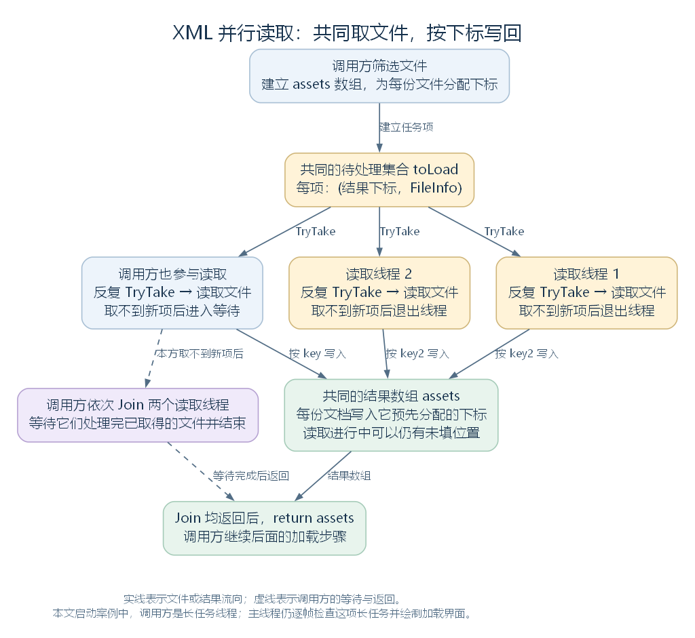

# 并行读取 XML：共同取文件、按下标写回与等待线程（讨论稿）

状态：第一轮并行读取与等待关系阅读，2026-11-06。依据工作区 RimWorld 1.7.4982 rev1280 的代码整理，承接 [异步长任务](50-asynchronous-long-events.md) 与 [迭代器长任务](51-iterator-long-events.md)。范围见 [游戏运行与调度大纲](44-runtime-scheduling-outline.md)，加载对象的背景可回看 [Def 加载篇](chapters/03-def-framework/02-def-loading-storage-query.md)。

本轮选取补丁 XML 的实际读取路径：ModContentPack.LoadPatches 调用 DirectXmlLoader.XmlAssetsInModFolder。先看文件怎样变成带下标的任务，再看两个新建线程与调用方怎样共同取文件，最后沿 Join 接回后续加载。

## 一、让多个执行者共同读取一批文件

XmlAssetsInModFolder 接收一个内容包和相对目录，先筛出要读的 XML 文件，再为每个文件分配结果数组下标。它建立两个读取线程，调用方自己也参加同一批读取；三个执行者不断取文件、读取并写回，直到取不到新任务。

调用方完成自己的取文件循环后，逐个等待两个读取线程结束，再返回结果数组。这里先把文件与结果的流向画出来：



实线表示文件或结果的流向，虚线表示调用方进入等待与返回的顺序。读取期间 assets 中可以仍有尚未填入的位置；Join 返回以后，调用方才交回这一批数组。[SVG](figures/parallel-xml-reading.svg) · [图源](figures/parallel-xml-reading.dot)

源码定位：完整读取方法（`Verse.DirectXmlLoader.cs:17`）、等待线程（`Verse.DirectXmlLoader.cs:87`）。

## 二、从补丁加载接到读取方法

前面读过的普通启动路径中，Root.Start 登记异步加载任务，长任务线程调用 PlayDataLoader.LoadAllPlayData，再进入 LoadedModManager.LoadAllActiveMods。加载管理器应用补丁时，遍历活动内容包的 Patches。

Patches 是 ModContentPack 的属性；patches 字段保存已经读出的 PatchOperation 列表。首次访问、字段仍为空时，属性先调用 LoadPatches：

```csharp
public IEnumerable<PatchOperation> Patches
{
    get
    {
        if (this.patches == null)
        {
            this.LoadPatches();
        }
        return this.patches;
    }
}
```

LoadPatches 建立列表后，调用下面的原始语句。this 是当前内容包，"Patches/" 指定要读取的相对目录，null 表示使用内容包平常选定的加载目录；局部变量 list 保存读取结果转成的列表：

```csharp
List<LoadableXmlAsset> list = DirectXmlLoader.XmlAssetsInModFolder(this, "Patches/", null).ToList<LoadableXmlAsset>();
```

这条调用返回以后，LoadPatches 才继续遍历各文档，读取 Patch 根元素下的 Operation，并建立 PatchOperation。本文沿普通启动理解：**调用这个读取方法的线程，是正在执行加载主体的长任务线程。**

源码定位：启动线程入口（`Verse.Root.cs:66`）、加载补丁阶段（`Verse.LoadedModManager.cs:147`、`Verse.LoadedModManager.cs:390`）、属性与读取调用（`Verse.ModContentPack.cs:135`、`Verse.ModContentPack.cs:469`）。

## 三、先选定文件，再分配结果位置

读取函数的前半段按选定目录搜集 XML，随后建立固定长度的结果数组。mod 是当前 ModContentPack，folderPath 是传入的相对目录，foldersToLoadDebug 是可选的替代目录列表。

FileInfo 是描述文件及其路径的信息对象，LoadableXmlAsset 保存读出的文档及其来源。先认识这几个局部变量，命名保持源码原样：

| 局部变量 | 保存什么 |
| --- | --- |
| list | 使用替代目录列表，或 mod.foldersToLoadDescendingOrder |
| dictionary | 从相对文件路径到 FileInfo 的映射，用于选定实际文件 |
| list2 | 选定 FileInfo 组成的本次文件列表 |
| assets | 与 list2 等长的 LoadableXmlAsset 结果数组 |
| toLoad | 可供多个线程同时取项的 ConcurrentBag；每项保存结果下标和文件信息 |
| array | 保存两个新建读取线程的 Thread 数组 |

目录扫描会跳过以点号开头的文件名，并用 dictionary.TryAdd 保留同一路径先选中的文件。内容包的目录优先级与文件组织已在加载篇讨论；本轮从选定文件继续往下读。

下面连续摘录文件列表、结果数组与待处理集合的建立。k 是文件下标，num 保存该下标，fileInfo2 是当前文件；KeyValuePair 的 Key 保存结果位置，Value 保存 FileInfo：

```csharp
List<FileInfo> list2 = dictionary.Values.ToList<FileInfo>();
LoadableXmlAsset[] assets = new LoadableXmlAsset[list2.Count];
ConcurrentBag<KeyValuePair<int, FileInfo>> toLoad = new ConcurrentBag<KeyValuePair<int, FileInfo>>();
for (int k = 0; k < list2.Count; k++)
{
    int num = k;
    FileInfo fileInfo2 = list2[k];
    toLoad.Add(new KeyValuePair<int, FileInfo>(num, fileInfo2));
}
Thread[] array = new Thread[2];
```

例如本次 list2 有六个文件，就建立六格 assets，并把六对“下标、文件”放进 toLoad。此时结果格尚未填入；后面哪个执行者取得某个文件，都将按它携带的下标写回。

若目录扫描没有选到文件，方法在这里之前直接返回共享的空数组。

源码定位：目录选择与扫描（`Verse.DirectXmlLoader.cs:19`）、空结果（`Verse.DirectXmlLoader.cs:37`）、任务与数组建立（`Verse.DirectXmlLoader.cs:41`）。

## 四、建立读取线程，重复取出下一份文件

外层循环为 array 的两个位置建立 Thread。每条线程运行同一类工作：调用 toLoad.TryTake 取得一项，读取该文件，再继续取下一项，直到 TryTake 返回 false。

下面摘出线程入口中的完整循环。keyValuePair2 保存本次取出的任务，key2 是其结果下标，value2 是文件信息：

```csharp
KeyValuePair<int, FileInfo> keyValuePair2;
while (toLoad.TryTake(out keyValuePair2))
{
    int key2 = keyValuePair2.Key;
    FileInfo value2 = keyValuePair2.Value;
    assets[key2] = new LoadableXmlAsset(value2, mod);
}
```

ThreadStart 是无参数、无返回值线程入口的委托类型，局部变量 threadStart 指向上述取文件入口。外层循环的 l 是线程数组下标，thread 保存新建的线程对象。下面摘出建立与启动调用，省略入口委托缓存、线程命名及保存到数组的语句：

```csharp
Thread thread = new Thread(threadStart);
// 省略线程命名及保存到 array 的语句。
array[l].Start();
```

两个线程都访问同一个 toLoad 与 assets，并重复取项。一次取出的任务由取得它的执行者处理；处理较快的执行者可以继续取得更多文件，具体分配随文件耗时与线程调度变化。

源码还为两条线程设置了 "DirectXmlLoader Thread 1 of 2"、"DirectXmlLoader Thread 2 of 2" 这样的名称，便于从线程信息中识别。

源码定位：线程数组与外层循环（`Verse.DirectXmlLoader.cs:50`）、取文件循环（`Verse.DirectXmlLoader.cs:61`）、建立、命名与启动（`Verse.DirectXmlLoader.cs:70`）。

## 五、读取文件并在原下标写入文档对象

每个执行者取得一项以后，都调用 LoadableXmlAsset(FileInfo file, ModContentPack mod)。这个构造函数保存来源信息，读取文件内容，按 UTF-8 解码，再用 XmlReader 和 XmlDocument 建立文档树。

这里先回接与调度有关的结果。file 是本次文件，mod 是所属包，xmlReader 是为文件文本建立的 XML 读取器。下面摘出来源赋值与文档建立，省略中间的文件映射、编码与读取器准备代码：

```csharp
this.mod = mod;
this.name = file.Name;
this.fullFolderPath = file.Directory.FullName;
// 省略文件映射、编码处理与 xmlReader 的建立。
this.xmlDoc = new XmlDocument();
this.xmlDoc.Load(xmlReader);
```

每份文件在自己的构造调用中建立 XmlDocument，然后将带有文档与来源的对象写到 assets[key2]。结果位置在读取之前已经选定，完成先后不会改变本次文件与数组下标的对应关系。

**例如本次列表顺序为 A.xml 到 F.xml。** 下标 5 对应 F.xml。即使它先读完，结果也写进 assets[5]；下标 0 对应的 A.xml 稍后完成时，仍写进 assets[0]。后续代码拿到的数组按这次预留的位置保存结果。

构造函数内部会捕获读取与 XML 解析异常，记录日志并把 xmlDoc 设为 null。因而处理完一份文件后，还需要结合对象中的文档结果判断后续能否使用；本轮的正常示例均按文档有效理解。

源码定位：文件构造函数（`Verse.LoadableXmlAsset.cs:53`）、文档加载与异常结果（`Verse.LoadableXmlAsset.cs:72`、`Verse.LoadableXmlAsset.cs:77`）、结果写入（`Verse.DirectXmlLoader.cs:66`）。

## 六、调用方也参加同一批读取

启动两条线程以后，调用方没有马上进入等待，而是继续执行自己的 TryTake 循环。下面是这段完整循环，keyValuePair、key 和 value 是调用方使用的局部变量，保留源码命名：

```csharp
KeyValuePair<int, FileInfo> keyValuePair;
while (toLoad.TryTake(out keyValuePair))
{
    int key = keyValuePair.Key;
    FileInfo value = keyValuePair.Value;
    assets[key] = new LoadableXmlAsset(value, mod);
}
```

因此，读取阶段最多有三个执行者：调用方、读取线程 1、读取线程 2。它们共同取一批带下标的文件项，每次完成后再尝试下一项。

在本文的启动路径里，调用方就是长任务线程。它继续读取本批文件时，主线程仍沿 LongEventHandler 的逐帧检查与加载界面路径运行。

源码定位：调用方的读取循环（`Verse.DirectXmlLoader.cs:80`）、长任务的主线程检查（`Verse.LongEventHandler.cs:305`）。

## 七、取不到新任务以后，等待两个读取线程结束

调用方的 TryTake 返回 false，说明它这次没有取到待处理项；已经由其他线程取出的文件，仍可能在读取。方法接下来逐个调用 Thread.Join，等待这两条线程结束，再返回数组。

array3 是 array 的另一个局部引用，m 是遍历下标。这一段连续源码为：

```csharp
Thread[] array3 = array;
for (int m = 0; m < array3.Length; m++)
{
    array3[m].Join();
}
return assets;
```

Join 会使当前调用者等待目标线程终止；若目标已经结束，这次等待就能直接完成。两次 Join 在同一个调用方上依次执行，读取线程则各自继续运行。

用六个文件的一次教学状态理解这个等待点。假设两个读取线程各取走一份文件，调用方处理余下四份：

| 到达的状态 | toLoad 与 assets | 调用方接下来做什么 |
| --- | --- | --- |
| 两条读取线程各持有一份尚未完成的文件 | 两项已离开待处理集合，对应结果格仍为空 | 调用方继续处理它取得的其他文件 |
| 调用方处理完另外四份，并取不到新项 | 待处理集合已空，数组仍有两个未完成位置 | 进入 Join，等待读取线程 |
| 两条读取线程读完、写回并退出循环 | 六个结果位置都已写入 | 两次 Join 均返回，方法交回数组 |

这个关系已用提取的读取方法和六份临时 XML 核对：受控地停住两个读取线程时，调用方写入四份结果，方法仍未返回；放行以后，六份文件各处理一次，数组位置与预分配下标一致。为编译反编译文本，核对代码展开了生成的委托缓存；文件取出、下标写入、调用方参与和 Join 顺序保持原流程。文件对象构造使用独立替代实现读取测试 XML，游戏中的具体构造过程由本地源码核对。

源码定位：等待与返回（`Verse.DirectXmlLoader.cs:87`）。

## 八、回到调用方，再继续补丁处理

数组返回后，LoadPatches 将它转成列表，再逐份读取根元素和 Operation，调用 DirectXmlToObject.ObjectFromXml<PatchOperation> 建立补丁对象。因此，文件读取阶段的并行工作在方法返回前汇合，后续补丁建立沿原来的调用方继续。

把本文启动路径里的两层等待放在一起，就能判断谁在等谁：

| 调用位置 | 谁在执行 | 怎样确认下一阶段可以继续 |
| --- | --- | --- |
| LongEventHandler 的逐帧检查 | 主线程 | 后续更新读取长任务线程的 IsAlive |
| XmlAssetsInModFolder 的结果汇合 | 长任务线程 | 自己取完文件后，Join 两个读取线程 |
| 单份 LoadableXmlAsset 的构造 | 三个文件读取执行者之一 | 构造返回，按下标写入，再取下一项 |
| 读取返回后的 LoadPatches | 原来的长任务线程 | 遍历本批文档，建立后续补丁对象 |

这样，一项长任务的主体内部又展开一批并行读取，等这一批返回后，主体继续自己的加载步骤。主线程的界面与结束检查则仍沿前两轮建立的外层运行。

接续阅读见 [线程池批次怎样完成](53-threadpool-batches-and-completion.md)：从交叉引用解析接到 GenThreading，展开批次切分、线程池执行、完成计数与等待对象，以及返回调用方后的处理。
