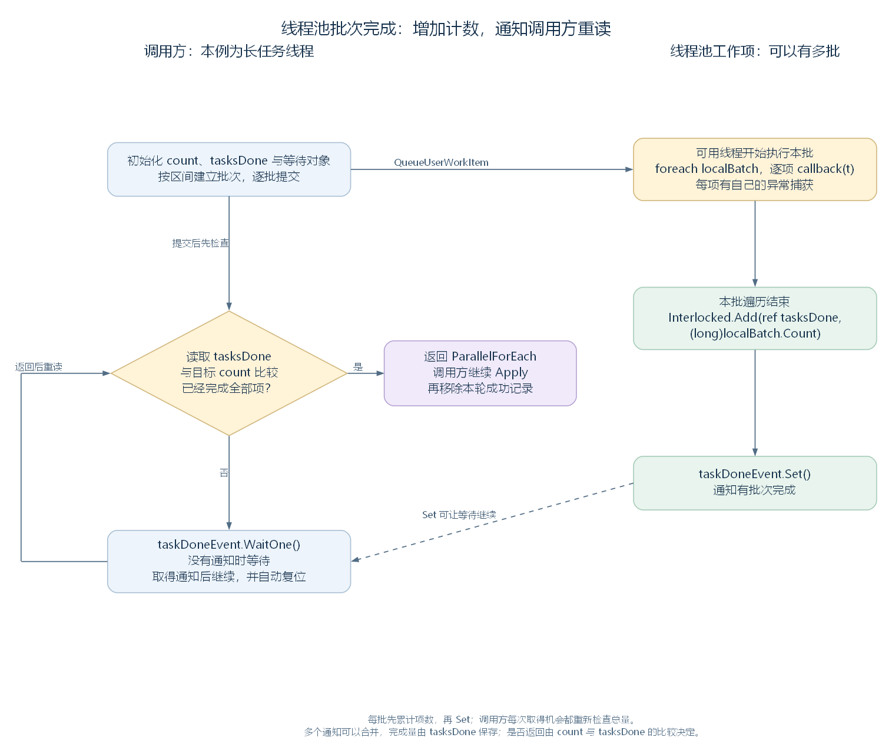

# 线程池批次怎样完成：GenThreading 的切分、计数与等待（讨论稿）

状态：第一轮线程池与完成等待阅读，2026-11-06。依据工作区 RimWorld 1.7.4982 rev1280 的代码整理，承接 [XML 并行读取](52-parallel-xml-reading.md)。范围见 [游戏运行与调度大纲](44-runtime-scheduling-outline.md)，待连接记录的背景见 [Def 引用连接笔记](39-def-cross-references.md)。

本轮从 DirectXmlCrossRefLoader.ResolveAllWantedCrossReferences 出发，进入 GenThreading.ParallelForEach：先按记录数量切出批次，再交给线程池，按整批数量累计完成量，最后唤醒并检查等待中的调用方。普通启动中，这里的调用方仍是执行数据加载的长任务线程。

## 一、先并行尝试连接，再处理本轮成功记录

DirectXmlCrossRefLoader 的 wantedRefs 保存待处理记录，每项共同类型是 WantedRef。TryResolve 按该记录的类型尝试完成引用连接，返回本轮是否完成；Apply 提供相应类型的后置处理入口。

解析方法先建立成功记录集合，再让 GenThreading 对各记录调用一段函数。等 ParallelForEach 返回，才继续遍历成功集合，调用 Apply 并从待处理列表移除这些记录。

先认识这段代码的局部变量与参数：

| 名称 | 保存什么 |
| --- | --- |
| failReportMode | 本次的缺失目标报告方式，例如 Silent 或 LogErrors |
| resolvedRefs | 本轮 TryResolve 返回 true 的记录集合，类型为 HashSet<WantedRef> |
| resolvedRefsLock | 多个工作项向这个集合加入记录时，共同使用的锁对象 |
| wantedRef | 线程池执行单项函数时取得的当前记录 |
| resolvedRefsLock2 | 匿名函数中取得的同一个锁对象引用 |
| wantedRef2 | 并行方法返回后，调用方遍历成功集合时取得的记录 |

以下摘出处理主线，省略性能记录和相关开关：

```csharp
HashSet<DirectXmlCrossRefLoader.WantedRef> resolvedRefs = new HashSet<DirectXmlCrossRefLoader.WantedRef>();
object resolvedRefsLock = new object();
// 省略性能记录开关设置。
GenThreading.ParallelForEach<DirectXmlCrossRefLoader.WantedRef>(DirectXmlCrossRefLoader.wantedRefs, delegate(DirectXmlCrossRefLoader.WantedRef wantedRef)
{
    if (wantedRef.TryResolve(failReportMode))
    {
        object resolvedRefsLock2 = resolvedRefsLock;
        lock (resolvedRefsLock2)
        {
            resolvedRefs.Add(wantedRef);
        }
    }
}, -1);
foreach (DirectXmlCrossRefLoader.WantedRef wantedRef2 in resolvedRefs)
{
    wantedRef2.Apply();
}
DirectXmlCrossRefLoader.wantedRefs.RemoveAll((DirectXmlCrossRefLoader.WantedRef x) => resolvedRefs.Contains(x));
// 省略性能记录开关恢复。
```

每次向共享 HashSet 加入成功记录时，工作项先取得同一把锁，让这些集合修改依次执行。TryResolve 本身则由各批次并行调用。

下面继续进入 ParallelForEach，确认它在什么条件下返回。这个返回位置决定了调用方何时能够遍历已经收集好的 resolvedRefs。

源码定位：实际调用与后续处理（`Verse.DirectXmlCrossRefLoader.cs:247`）、记录基类（`Verse.DirectXmlCrossRefLoader.cs:286`）、加载阶段的调用（`Verse.PlayDataLoader.cs:141`）。

## 二、准备工作总数、完成计数和等待对象

ParallelForEach 接收三个参数：list 是待处理列表；callback 是对每项执行的 Action<T>，本例就是上一节调用 TryResolve 的函数；maxDegreeOfParallelism 是切分时使用的批次数上限，默认值为 -1。

GetMaxDegreeOfParallelism 接收这个参数的引用，在值为 -1 时，用 GenThreading.ProcessorCount 替换。ProcessorCount 返回 Environment.ProcessorCount，即运行时报告的处理器数量。

下面连续摘出方法开头：

```csharp
GenThreading.GetMaxDegreeOfParallelism(ref maxDegreeOfParallelism);
int count = list.Count;
long tasksDone = 0L;
AutoResetEvent taskDoneEvent = new AutoResetEvent(false);
```

| 名称 | 在本轮推进中表示什么 |
| --- | --- |
| count | 这次输入的总项数，作为返回条件的目标值 |
| tasksDone | 各工作项已经遍历完的项数，按批次累计 |
| taskDoneEvent | 通知调用方重新检查完成量的 AutoResetEvent，初始没有通知 |
| maxDegreeOfParallelism | 默认替换后传给 SliceWork，限制这次最多切出多少批 |

批次数决定本次会提交多少个工作项。线程池在有可用线程时执行已提交的函数，实际同时运行的数量由运行时安排。相关 API 的约定见 [ThreadPool.QueueUserWorkItem](https://learn.microsoft.com/en-us/dotnet/api/system.threading.threadpool.queueuserworkitem)。

源码定位：默认参数与初始状态（`Verse.GenThreading.cs:87`）、处理器数量与默认替换（`Verse.GenThreading.cs:13`、`Verse.GenThreading.cs:22`）。

## 三、把列表切成连续批次

### 3.1 用起止下标描述一段列表

GenThreading.Slice 是一个结构体，用两个只读整数保存区间。fromInclusive 是起始下标，toExclusive 是结束边界；遍历包含起点，到结束边界之前停止。

下面摘出类型与字段，省略构造函数：

```csharp
public struct Slice
{
    // 省略给两个字段赋值的构造函数。
    public readonly int fromInclusive;
    public readonly int toExclusive;
}
```

列表重载从下标 0 到 list.Count 切分。SliceWorkNoAlloc 先计算元素数量除以批次数上限的商和余数；每批先取得商对应的项数，再把余下项分给前面的批次。若元素少于批次数上限，就为每项建立一批。

**例如有十项记录，批次数上限取 3。** 商为 3，余数为 1，所以切出 4、3、3 三批：

| 批次标签 | Slice 区间 | 包含的原列表下标 | 项数 |
| --- | --- | --- | --- |
| A | [0, 4) | 0、1、2、3 | 4 |
| B | [4, 7) | 4、5、6 | 3 |
| C | [7, 10) | 7、8、9 | 3 |

A、B、C 是本文的教学标签。若只有两项、上限取 8，这条路径产生两批，每批一项；空列表产生零批。

源码定位：区间结构（`Verse.GenThreading.cs:175`）、本轮从 0 开始使用的切分逻辑（`Verse.GenThreading.cs:31`、`Verse.GenThreading.cs:74`）。

### 3.2 为每个区间建立一份批次列表

SliceWork<T> 根据这些区间建立 List<List<T>>。slice 是当前区间，list2 保存全部批次，list3 保存当前批次，i 遍历原列表下标。完整实现如下：

```csharp
public static List<List<T>> SliceWork<T>(List<T> list, int maxBatches)
{
    List<List<T>> list2 = new List<List<T>>(maxBatches);
    foreach (GenThreading.Slice slice in GenThreading.SliceWork(0, list.Count, maxBatches))
    {
        List<T> list3 = new List<T>(slice.toExclusive - slice.fromInclusive);
        for (int i = slice.fromInclusive; i < slice.toExclusive; i++)
        {
            list3.Add(list[i]);
        }
        list2.Add(list3);
    }
    return list2;
}
```

对本例的引用类型 WantedRef，每个新列表保存原记录的对象引用。工作项随后取得这些批次，继续操作各记录。

源码定位：列表切分（`Verse.GenThreading.cs:71`）。

## 四、把每批工作交给线程池

ParallelForEach 遍历 SliceWork 返回的批次。enumerator 是外层批次列表的遍历对象，list2 取得当前批次，localBatch 为当前工作项保存这个列表引用。

下面连续摘出一批工作的登记与执行代码。匿名函数参数 _ 在这段工作中未使用；t 是本批当前元素，callback(t) 调用传入的单项处理函数：

```csharp
List<T> list2 = enumerator.Current;
List<T> localBatch = list2;
ThreadPool.QueueUserWorkItem(delegate(object _)
{
    foreach (T t in localBatch)
    {
        try
        {
            callback(t);
        }
        catch (Exception ex)
        {
            string text = "Error in ParallelForEach(): ";
            Exception ex2 = ex;
            Log.Error(text + ((ex2 != null) ? ex2.ToString() : null));
        }
    }
    Interlocked.Add(ref tasksDone, (long)localBatch.Count);
    taskDoneEvent.Set();
});
```

每个工作项在某条线程池线程上，顺序遍历自己这一批元素；不同工作项可以并行执行。单项调用各有 try/catch，记录错误以后，仍能继续本批后面的元素。

本批遍历结束，再用 Interlocked.Add 原子地把 localBatch.Count 加入 tasksDone，随后 Set 通知调用方。原子加法让多个工作项对共享完成计数的累加保持完整，API 约定见 [Interlocked.Add](https://learn.microsoft.com/en-us/dotnet/api/system.threading.interlocked.add)。

这里统计的是已遍历的项数，包含单项调用抛出异常并被捕获的情况。第一节的 resolvedRefs 则由 TryResolve 的返回值决定，后面只处理收集成功的那些记录。

源码定位：批次遍历、工作项提交与完成记录（`Verse.GenThreading.cs:93`）。

## 五、用通知取得检查机会，再按总数决定是否返回

### 5.1 先检查计数，未完成时再等待

调用方提交全部批次后，进入完成检查。反编译文本使用 IL_0083、IL_008F 两个跳转标签：先跳到 IL_008F 读取计数，达到 count 就返回；否则到 IL_0083 调用 WaitOne，取得通知后重新检查。

下面连续摘出原始等待段：

```csharp
IL_0083:
taskDoneEvent.WaitOne();
IL_008F:
if (Interlocked.Read(ref tasksDone) >= (long)count)
{
    return;
}
goto IL_0083;
```

WaitOne 在没有通知时等待；Set 可以释放等待者，或保留通知供稍后的 WaitOne 取得。取得通知后，AutoResetEvent 自动复位。多次 Set 可能合并为一次可观察通知，完成数量持续由 tasksDone 保存。相关约定见 [AutoResetEvent](https://learn.microsoft.com/en-us/dotnet/api/system.threading.autoresetevent)。

这解释了两者怎样配合：工作项先增加完成量，再通知；调用方每次取得运行机会，都重新读取总量。某些批次较早结束、通知已经保留时，WaitOne 能直接通过；若计数已经达到目标，开头的检查也能直接返回。



右侧可以有多个批次工作项，按各自结束时间增加同一计数并通知。左侧回线表示 WaitOne 返回后再次读取完成量。[SVG](figures/threadpool-completion-wait.svg) · [图源](figures/threadpool-completion-wait.dot)

源码定位：提交后的首次检查与等待循环（`Verse.GenThreading.cs:120`）。

### 5.2 把三批工作放回同一条时间线

继续十项、三批的教学例子。假设结束次序为 B、A、C，并且每次通知后调用方都取得了检查机会：

| 发生的动作 | tasksDone | 调用方检查后的安排 |
| --- | --- | --- |
| 所有批次已提交，尚未完成 | 0 | 小于 10，等待 |
| B 遍历结束，加 3 并 Set | 3 | 小于 10，继续等待 |
| A 遍历结束，加 4 并 Set | 7 | 小于 10，继续等待 |
| C 遍历结束，加 3 并 Set | 10 | 达到目标，返回 |

若前两批在调用方检查前已经结束，调用方可以一次读到 7。通知的合并不会改变已经累计的项数；后续仍按总数判断是否还需等待。

调用方的返回条件是所有项已遍历并累计完成。线程池线程执行完工作项后继续由运行时管理，本方法的条件跟住的是本次工作量。

已用提取的切分和 ParallelForEach 方法、真实线程池及受控批次核对：确认 4、3、3 的切分与覆盖、完成量 3→7→10 时的等待、单项异常后的计数，以及空输入返回。核对只加入完成计数与等待位置的观察记录，未执行游戏引用处理；另用 AutoResetEvent 检查了多次 Set 在等待前合并通知的情况。

## 六、回到调用方，继续 Apply 与待处理列表整理

ParallelForEach 返回以后，ResolveAllWantedCrossReferences 的调用方遍历 resolvedRefs，逐项调用 Apply，再从 wantedRefs 移除这批返回 true 的记录。剩余记录留在待处理列表中，供后续解析阶段继续处理。

TryResolve 可以包含实际写入：普通对象字段记录在其中调用 fi.SetValue，把找到的 Def 引用写入接收对象。需要后置处理的记录再通过 Apply 继续完成相应工作。各记录内部的字段和集合规则见 [引用连接笔记](39-def-cross-references.md)。

因此，在本文普通启动路径中，这些工作的位置是：

| 阶段 | 执行位置 |
| --- | --- |
| 建立批次、提交工作项、检查完成计数和 WaitOne | 加载调用方，也就是长任务线程 |
| 每批的 callback、TryResolve、成功记录加入集合 | 线程池线程 |
| Apply、移除本轮成功记录、继续加载 | 原来的长任务线程 |
| 外层长任务结束检查与加载界面 | 主线程 |

一次并行调用内部的等待，把批次处理接回了原来的串行加载步骤。外层 LongEventHandler 仍通过长任务线程的 IsAlive 判断整个加载主体何时结束。

源码定位：并行调用返回后的处理（`Verse.DirectXmlCrossRefLoader.cs:266`）、字段记录中的写入（`Verse.DirectXmlCrossRefLoader.cs:388`）、外层检查（`Verse.LongEventHandler.cs:305`）。

## 七、接回后续的线程交接阅读

现在已经沿实际加载代码读过两种分配方式：XML 读取让执行者共同取文件，再通过 Join 等待；引用解析先切好批次交给线程池，通过完成计数和等待对象接回调用方。两条路径都在交回本批处理以后，继续原来的加载主线。

接续阅读见 [加载完成以后：怎样接回主线程](54-loading-main-thread-handoff.md)，已从实际登记的后续函数追到主线程结束检查、列表执行与界面初始化，并整理整体交接图。
