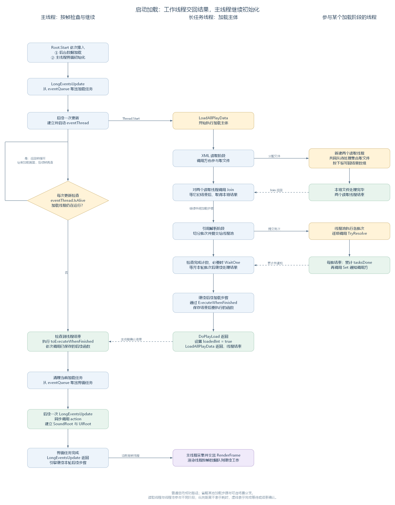

# 加载完成以后：怎样接回主线程

状态：逐段研究笔记，2026-11-06。依据工作区 RimWorld 1.7.4982 rev1280 的代码整理，承接 [线程池批次与完成等待](53-threadpool-batches-and-completion.md)。

前两节已经读过加载内部的并行工作：读取线程把 XML 写回结果数组，线程池完成一轮引用解析，调用方等齐结果以后继续加载。现在把这条主线接到结束位置：加载函数返回以后，谁来完成余下的初始化，又怎样进入界面？

这里沿普通启动中 PlayDataLoader.Loaded 为 false、加载成功的路径阅读。主线程先登记数据加载和界面初始化两项长任务；加载主体由长任务线程执行，期间把一些后续函数保存在 LongEventHandler 的列表里。主线程在之后的更新中确认加载线程结束，执行这些函数，再推进排在后面的界面初始化。



图按向下的顺序表示这条启动路径。右侧的读取线程与线程池工作项分别参与加载的不同阶段；主线程在此期间反复检查长任务，检查之间返回帧循环，继续绘制加载画面。图中的虚线标出等待完成或确认结束的位置，纵向距离不代表实际耗时。放大查看：[PNG](figures/loading-main-thread-handoff.png)、[SVG](figures/loading-main-thread-handoff.svg)；图源：[DOT](figures/loading-main-thread-handoff.dot)。

## 一、先排入加载，再排入界面初始化

Root.Start 先建立一个名为 action 的局部变量，类型是 Action，保存界面与声音入口的初始化函数。发现游戏数据尚未加载时，它依次调用两次 QueueLongEvent：

```csharp
LongEventHandler.QueueLongEvent(delegate
{
    PlayDataLoader.LoadAllPlayData(false);
}, null, true, null, true, false, null);
LongEventHandler.QueueLongEvent(action, "InitializingInterface", false, null, true, false, null);
```

第三个参数 doAsynchronously 决定任务主体的执行位置：第一项传 true，交给新建的长任务线程；第二项传 false，由主线程执行。两项的最后一个参数 callback 都是 null。

这时有三处与后续流程相关的存储位置：

| 名称 | 本例保存什么 | 后面怎样使用 |
| --- | --- | --- |
| eventQueue | 数据加载任务，以及排在其后的界面初始化任务 | LongEventsUpdate 从队首取出下一项 |
| currentEvent 与 eventThread | 正在进行的加载任务记录，以及执行它的线程 | 主线程检查 eventThread.IsAlive |
| toExecuteWhenFinished | 加载过程中通过 ExecuteWhenFinished 登记的 Action | 当前加载结束时，主线程依次调用 |

因此，启动时已经排好了“加载 → 界面初始化”的顺序。加载过程中登记的后续函数，会在结束当前加载任务的步骤中获得执行机会，然后才轮到下一项界面任务。

源码定位：初始化函数与两次排队（`Verse.Root.cs:35`、`Verse.Root.cs:63`）、任务登记参数（`Verse.LongEventHandler.cs:61`）、相关字段（`Verse.LongEventHandler.cs:505`）。

## 二、加载线程保存结束后要执行的函数

加载主体执行到需要安排后续工作的位置时，调用 ExecuteWhenFinished，把一个 Action 加入 toExecuteWhenFinished。这个列表保存的是稍后要调用的函数；函数体中的语句在实际调用这个 Action 时执行。

例如，DoPlayLoad 在末尾附近登记了语言数据处理。下面保留原来的函数体语句，省略性能记录的 try/finally：

```csharp
LongEventHandler.ExecuteWhenFinished(delegate
{
    // 省略 DeepProfiler 记录与相应的 try/finally。
    LanguageDatabase.activeLanguage.InjectIntoData_AfterImpliedDefs();
    GenLabel.ClearCache();
});
```

LanguageDatabase.activeLanguage 指向当前选择的语言数据；InjectIntoData_AfterImpliedDefs 把这一阶段的翻译内容写入游戏数据，随后 ClearCache 清理已有的标签缓存，使之后的标签生成能够使用更新后的内容。

在本例中，登记时 currentEvent 仍然是异步加载任务。该任务的 ShouldWaitUntilDisplayed 为 false，ExecuteWhenFinished 把函数加入列表后便返回，加载线程接着执行后面的加载步骤。

DoPlayLoad 自身登记的几组工作，按登记先后可以概括如下。加载途中其他方法也可以登记函数，它们一并保存在同一个列表中。

| 登记的工作 | 实际执行时做什么 |
| --- | --- |
| ShaderWarmup.KickPrewarmOnce | 检查开关和启动标记，需要时启动着色器后台预热 |
| 加载人物背景资料的函数 | 调用 SolidBioDatabase.LoadAllBios |
| 语言数据处理函数 | 注入后期翻译数据，清理标签缓存 |
| 静态初始化及资源整理函数 | 调用带启动标记的类型的静态构造函数，处理延后准备的材质，初始化相关菜单数据，烘焙静态图集并执行资源清理 |
| Log.ResetMessageCount | 重置日志消息计数 |

其中，StaticConstructorOnStartupUtility.CallAll 会查找带 StaticConstructorOnStartup 标记的类型，对它们调用 RuntimeHelpers.RunClassConstructor，让这些类型完成静态初始化。随后 Material.ResolveAllDeferred 从 PendingDeferredMaterials 取出此前登记的材质，逐个调用 EnsureResolved。材质可以先保存一个稍后执行的创建函数，这里再集中尝试完成其准备工作；具体的材质结构留到渲染模块展开。

ShaderWarmup.KickPrewarmOnce 启动的是后台预热，因此这一函数返回后，预热本身仍可能继续进行。

最后，LoadAllPlayData 在 DoPlayLoad 返回后把 loadedInt 设为 true，再结束本次调用。此时主线程还要在自己的更新中处理已登记的后续函数和界面任务。

源码定位：登记与立即执行条件（`Verse.LongEventHandler.cs:224`）、预热登记（`Verse.PlayDataLoader.cs:293`）、末尾几组函数（`Verse.PlayDataLoader.cs:346`）、加载标记（`Verse.PlayDataLoader.cs:85`）、静态构造函数调用（`Verse.StaticConstructorOnStartupUtility.cs:15`）、延后材质处理（`UnityEngine.Material.cs:130`）、后台预热入口（`Verse.ShaderWarmup.cs:19`）。

## 三、主线程确认结束，再执行保存的函数

主线程每次进入 Root.Update，都会调用 LongEventsUpdate。当前任务为异步长任务时，进一步进入 UpdateCurrentAsynchronousEvent，检查 eventThread.IsAlive。线程仍在运行时，这次检查返回；后续帧再检查。

检测到线程结束以后，方法还会处理任务可选的场景加载。我们正在读的启动任务没有填写 levelToLoad，因此源码直接把局部变量 flag 设为 true，进入以下完成分支：

```csharp
if (flag)
{
    LongEventHandler.ExecuteToExecuteWhenFinished();
    Action callback = LongEventHandler.currentEvent.callback;
    if (callback != null)
    {
        callback();
    }
    LongEventHandler.currentEvent = null;
    LongEventHandler.eventThread = null;
    LongEventHandler.levelLoadOp = null;
}
```

这段代码的调用者已经是主线程。因此，ExecuteToExecuteWhenFinished 在这里取出并调用保存的函数，这些函数就在主线程上执行。callback 是当前任务记录单独保存的完成函数，本例为 null；随后三次赋 null 清除当前任务、线程及场景操作的引用。

ExecuteToExecuteWhenFinished 的主体按下标遍历列表。以下摘出遍历与清空部分，省略每项周围的性能记录和异常捕获：

```csharp
for (int i = 0; i < LongEventHandler.toExecuteWhenFinished.Count; i++)
{
    // 省略性能记录，以及本次调用周围的 try/catch/finally。
    LongEventHandler.toExecuteWhenFinished[i]();
}
// 省略性能记录结束。
LongEventHandler.toExecuteWhenFinished.Clear();
LongEventHandler.executingToExecuteWhenFinished = false;
```

进入遍历前，executingToExecuteWhenFinished 已被设为 true，避免函数执行期间再次进入同一个遍历过程。每项调用有各自的异常捕获，某一项抛出异常会记录错误，随后仍可继续下一项。循环每次重新读取 Count，所以执行过程中追加到列表的函数也能在这一轮取得执行机会。

由此，加载末尾形成了明确的顺序：长任务线程结束 → 主线程检查到结束 → 主线程执行后续函数列表 → 调用当前任务的 callback（若有）→ 清除当前任务引用。

源码定位：帧内调用位置（`Verse.Root.cs:122`）、异步任务检查与完成分支（`Verse.LongEventHandler.cs:305`）、列表遍历（`Verse.LongEventHandler.cs:426`）。

## 四、取出下一项，再初始化界面

完成分支返回 LongEventsUpdate 以后，currentEvent 已经为空，而 eventQueue 中还有界面初始化任务。方法接着从队首取出这项记录：

```csharp
if (LongEventHandler.currentEvent == null && LongEventHandler.eventQueue.Count > 0)
{
    LongEventHandler.currentEvent = LongEventHandler.eventQueue.Dequeue();
    if (LongEventHandler.currentEvent.eventTextKey == null)
    {
        LongEventHandler.currentEvent.eventText = "";
        return;
    }
    LongEventHandler.currentEvent.eventText = LongEventHandler.currentEvent.eventTextKey.Translate();
}
```

本次调用在取出任务、设置显示文字后结束。等后续一次 LongEventsUpdate 到来，才会进入这项任务的同步执行分支，调用 eventAction，也就是 Root.Start 中的 action。

它在排队时跟在异步加载之后，canEverUseStandardWindow 已被设为 false，因此这条启动路径的界面任务会直接进入同步函数调用。窗口显示等待的判断过程见 [同步长任务笔记](49-long-event-queue-and-synchronous-save.md)。

action 保存的主要工作如下，省略性能记录与相应的 try/finally，成员名称保持源码原样：

```csharp
this.soundRoot = new SoundRoot();
// 省略 Instantiate UIRoot 的性能记录。
if (GenScene.InPlayScene)
{
    this.uiRoot = new UIRoot_Play();
}
else if (GenScene.InEntryScene)
{
    this.uiRoot = new UIRoot_Entry();
}
// 省略 Instantiate UIRoot 的性能记录结束。
this.uiRoot.Init();
Messages.Notify_LoadedLevelChanged();
if (Current.SubcameraDriver != null)
{
    Current.SubcameraDriver.Init();
}
```

这里的 this 是执行 Start 的 Root 实例。soundRoot 保存声音管理入口，uiRoot 保存当前场景的界面管理入口；GenScene 根据当前处于 Play 还是 Entry 场景，选择相应的 UIRoot。建立对象以后，代码调用 Init，通知消息系统场景已经变化，并在存在 SubcameraDriver 时初始化它。

这样，加载完成后的数据与资源准备先获得执行机会，随后 Root 才取得可供帧更新使用的界面对象。这些函数依次占用主线程，返回后，调用它们的 Root.Update 才能继续后面的步骤。

源码定位：取出下一项（`Verse.LongEventHandler.cs:211`）、同步调用（`Verse.LongEventHandler.cs:350`）、排队时的窗口条件（`Verse.LongEventHandler.cs:61`）、界面初始化函数（`Verse.Root.cs:35`）。

## 五、把这次交接放回引擎的一帧

这次主线程后续工作的实际调用路线，可以接回我们已经读过的帧顺序：

```text
EngineApplication.RunLoop
  → BeginFrame
  → MainThreadSynchronizationContext.Pump
  → OnUpdate
      → UnityRuntime.Step
          → UnityWorld.Update
              → Root.Update
                  → LongEventsUpdate
                      → 检查长任务线程
                      → 执行已保存的后续函数
  → 返回本轮后续工作，采集绘制数据并交给渲染线程
```

这张调用链摘出与交接相关的步骤，Step 内部的其他阶段仍按原有顺序执行。主线程待执行函数队列的 Pump 位于 OnUpdate 之前；本次加载的后续函数则保存在 LongEventHandler 的 toExecuteWhenFinished 中，由 Root.Update 内的完成检查调用。两处具体的存储位置与执行时机，在这条帧链中都能找到。

渲染线程继续按 [Waylith 章节](chapters/01-waylith/article.md) 中的帧数据队列工作。这里的加载结束判断读取 eventThread.IsAlive，后续函数的调用也发生在主线程。至于资源准备过程中怎样触及渲染设备，以及资源何时可以参与绘制，留到相应资源与渲染模块跟踪。

源码定位：Pump 与 OnUpdate 的先后（`Waylith.EngineApplication.cs:760`）、游戏更新函数（`RimWorldWaylith.Bootstrap.cs:73`）、兼容层的一帧（`Waylith.UnityCompat.UnityRuntime.cs:106`）。

## 六、用等待点串起整条加载路径

回顾这几个案例，每次等待都有明确的调用方，等待结束以后也各有一段代码继续执行：

| 环节 | 谁等待、怎样等待 | 完成以后谁继续 |
| --- | --- | --- |
| 一组 XML 文件读取 | 长任务线程参与取文件，随后对两个读取线程调用 Join | 长任务线程取得结果数组，继续加载 |
| 一轮交叉引用解析 | 长任务线程提交批次，通过完成计数与 WaitOne 等待 | 长任务线程处理成功记录，继续后续加载 |
| 整个后台加载主体 | 主线程每次更新检查 IsAlive，检查之间继续帧循环 | 主线程执行后续函数列表，结束当前长任务 |
| 排在后面的界面任务 | 在 eventQueue 中等待前一项结束，再被选为 currentEvent | 主线程在后续一次更新调用初始化函数 |

这些连接说明了普通启动怎样把不同线程的工作组织成有先后关系的流程：加载线程在内部等齐当前步骤需要的数据，主线程从外层观察整个任务，并在它结束后继续完成初始化。主线程、长任务线程和参与某个阶段的工作线程，因而可以分别标出执行内容、等待位置和继续执行的位置。

长任务与这两个并行加载案例的主线至此已经接通。下一步回到 UnityWorld 的帧阶段，展开 CoroutineScheduler：先认识它保存的协程记录，再追踪 Start、Step 与 Advance 怎样让一段函数分次继续执行。
