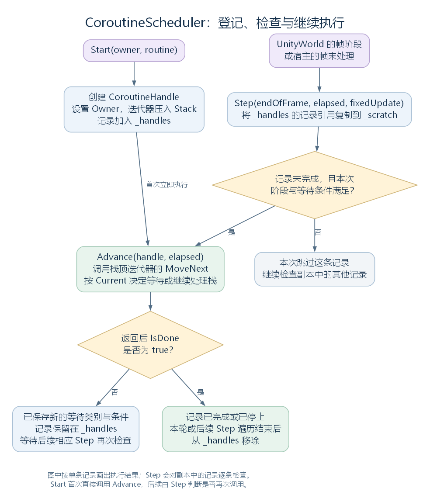

# 从 StartCoroutine 开始：保存进度与第一次执行

状态：逐段研究笔记，2026-11-06。依据工作区 RimWorld 1.7.4982 rev1280 的兼容层代码整理，承接 [加载完成后的主线程交接](54-loading-main-thread-handoff.md)，回接对象与组件章节中的 [MonoBehaviour](28-monobehaviour.md)。

这一部分研究协程怎样分段执行：调用者交来一个 IEnumerator，CoroutineScheduler 建立记录并先执行一段；遇到等待条件以后保存状态，在后续帧阶段获得继续执行的机会。

本节先沿 StartCoroutine → Start → Advance 追到第一次等待，再用一个嵌套过程解释记录中为什么保存迭代器栈。每种等待条件的检查与完整帧顺序，下一节继续展开。



图复用对象与组件研究中的总览。左侧表示启动时建立记录并立即执行，右侧表示后续帧阶段检查等待条件，两条路径都调用 Advance。放大查看：[PNG](figures/coroutinescheduler-overview.png)、[SVG](figures/coroutinescheduler-overview.svg)；图源：[DOT](figures/coroutinescheduler-overview.dot)。

## 一、先取得迭代器，再交给管理器执行

在这里，协程是一段能够保存进度、分次继续执行的过程。C# 的迭代器方法提供了这种进度保存方式：调用方法取得 IEnumerator，随后每次调用它的 MoveNext，才执行到下一次 yield 或方法结束。返回 true 表示这次提供了一个值，可从 Current 读取；返回 false 表示迭代已经结束。

下面是教学用的实例方法，放在一个 MonoBehaviour 派生组件中；方法与局部变量名称为本例自行命名：

```csharp
private IEnumerator Example()
{
    Log.Message("A");
    yield return null;
    Log.Message("B");
}
```

同一个组件中的另一段代码这样启动它：

```csharp
IEnumerator routine = Example();
Log.Message("登记前");
Coroutine coroutine = StartCoroutine(routine);
Log.Message("登记后");
```

第一行取得的 routine 保存这次 Example 调用的执行状态，此时还没有输出 A。StartCoroutine 会把 routine 交给管理器，并在返回前推进一次，因此这几行调用先输出“登记前 → A → 登记后”。B 留在 yield 之后，等管理器后续再次推进。

暂停期间，routine 继续保存下一次应从哪里执行，以及跨越 yield 仍需使用的局部数据。管理器还要保存什么时候可以再次调用它；这部分由下面的记录负责。

## 二、用一条记录保存归属、迭代器与等待条件

这条路径中有三个相互引用的对象：

| 对象或变量 | 主要用途 |
| --- | --- |
| routine，类型为 IEnumerator | 保存具体过程的执行进度，提供 MoveNext 和 Current |
| CoroutineHandle | 管理器的内部记录，保存迭代器、所属对象、等待条件及完成标记 |
| coroutine，类型为 Coroutine | StartCoroutine 返回给调用者的对象，内部引用该记录，可交给 StopCoroutine |

Coroutine 类自身的完整类体很短，以下删除反编译标记注释：

```csharp
public class Coroutine : YieldInstruction
{
    internal CoroutineHandle Handle;
}
```

YieldInstruction 是兼容层提供的空基类。实际的管理数据放在 Handle 指向的 CoroutineHandle 中，其完整字段如下，同样删除反编译标记注释：

```csharp
internal sealed class CoroutineHandle
{
    internal readonly Stack<IEnumerator> Stack = new Stack<IEnumerator>();
    internal CoroutineSuspendKind SuspendKind;
    internal float ResumeTime;
    internal CoroutineHandle AwaitedHandle;
    internal AsyncOperation AwaitedOperation;
    internal bool IsDone;
    internal object Owner;
}
```

先按用途认识这些字段：

| 字段 | 保存什么 |
| --- | --- |
| Owner | 启动该记录的所属对象；从 MonoBehaviour.StartCoroutine 进入时就是当前组件实例，StopAll 可按它查找记录 |
| Stack | 迭代器栈，栈顶是当前要继续的过程；子过程可以压入，结束后弹出 |
| SuspendKind | 当前等待类别，类型为 CoroutineSuspendKind |
| ResumeTime | 等待秒数时使用的累计时间截止值 |
| AwaitedHandle、AwaitedOperation | 正在等待的另一条协程记录，或异步操作 |
| IsDone | 记录已经完成或被停止；Step 据此跳过推进，并从管理列表清理 |

CoroutineSuspendKind 有 NextFrame、FixedUpdate、EndOfFrame、WaitSeconds、AwaitCoroutine 和 AwaitOperation 六个值。它告诉管理器下一次应检查哪种条件，相关截止时间或等待对象由其他字段补充。

因此，进度由栈中的 IEnumerator 保存；再次执行所需的条件由 CoroutineHandle 保存。一次等待结束后，管理器仍会取出同一份执行进度继续调用。

源码定位：公开返回对象（`UnityEngine.Coroutine.cs:6`）、空基类（`UnityEngine.YieldInstruction.cs:6`）、内部记录（`UnityEngine.CoroutineHandle.cs:8`）、等待类别（`UnityEngine.CoroutineSuspendKind.cs:6`）。

## 三、建立记录，并在返回前先推进一次

MonoBehaviour.StartCoroutine 接收 routine，把 this 作为 owner 交给 CoroutineScheduler.Start。取得内部记录以后，再建立一个 Coroutine 返回：

```csharp
public Coroutine StartCoroutine(IEnumerator routine)
{
    CoroutineHandle coroutineHandle = CoroutineScheduler.Start(this, routine);
    return new Coroutine
    {
        Handle = coroutineHandle
    };
}
```

CoroutineScheduler 是静态管理类，_handles 是共同保存协程记录的 List<CoroutineHandle>。其 Start 方法依次尝试连接帧阶段、建立记录、登记迭代器、加入列表，并立即调用 Advance：

```csharp
internal static CoroutineHandle Start(object owner, IEnumerator routine)
{
    CoroutineScheduler.EnsureSubscribed();
    CoroutineHandle coroutineHandle = new CoroutineHandle
    {
        Owner = owner
    };
    coroutineHandle.Stack.Push(routine);
    CoroutineScheduler._handles.Add(coroutineHandle);
    CoroutineScheduler.Advance(coroutineHandle, Time.time);
    return coroutineHandle;
}
```

这里的 coroutineHandle 是本次新建的内部记录。Stack.Push 把传来的 routine 放到栈顶；加入 _handles 以后，后续的阶段检查就能够找到它。Time.time 提供当前累计时间，Advance 在遇到等待秒数的对象时会据此计算截止值。

EnsureSubscribed 会尝试取得当前 UnityWorld，并向 Updating、PostUpdate 和 PostLateUpdate 登记管理器的阶段函数。成功登记后用 _subscribed 标记，避免重复登记。具体阶段顺序随后展开。

第一次 Advance 沿 StartCoroutine 的当前调用线程执行。在通常的主线程调用路径上，协程的第一段代码也就占用主线程的这次调用时间；执行到保存等待条件并返回以后，外层调用才继续向下走。

对第一节的 Example，这次调用顺序是：

| 顺序 | 发生什么 |
| --- | --- |
| 1 | Start 建立记录，Owner 指向当前组件，Stack 中放入 routine |
| 2 | 记录加入 _handles，随后调用 Advance |
| 3 | Advance 调用 routine.MoveNext，输出 A，并到达 yield return null |
| 4 | MoveNext 返回 true，Current 为 null；记录改为 NextFrame 等待，Advance 返回 |
| 5 | Start 返回记录，MonoBehaviour 将其包装成 Coroutine，调用者随后输出“登记后” |

源码定位：组件入口（`UnityEngine.MonoBehaviour.cs:19`）、建立与首次推进（`UnityEngine.CoroutineScheduler.cs:15`）、阶段登记（`UnityEngine.CoroutineScheduler.cs:50`）、记录列表（`UnityEngine.CoroutineScheduler.cs:271`）、首次时间参数的来源（`UnityEngine.Time.cs:84`）。

## 四、推进到等待位置，再保存状态返回

Advance 围绕 handle.Stack 循环。handle 是当前内部记录；每轮用 Peek 取得栈顶 IEnumerator，局部变量名为 enumerator，然后调用 enumerator.MoveNext，将返回结果保存在 bool 变量 flag 中。

下面是 MoveNext 调用及其异常处理之后的连续源码节选：

```csharp
if (!flag)
{
    handle.Stack.Pop();
    continue;
}
object obj = enumerator.Current;
if (obj == null)
{
    handle.SuspendKind = CoroutineSuspendKind.NextFrame;
    return;
}
```

flag 为 false 时，当前这层过程已经结束，Pop 把它从栈中移除，continue 回到循环开头。只要栈里还有其他迭代器，Advance 就继续处理新的栈顶。

flag 为 true 时，obj 保存本次 Current 返回的对象。第一节的 Example 返回 null，因此 Advance 把 SuspendKind 设为 NextFrame，并直接返回。routine 仍在 Stack 中，IsDone 仍为 false；下一次推进会从 yield 后面继续。

当所有迭代器都结束、Stack 为空时，Advance 才在循环之后把 handle.IsDone 设为 true。若 MoveNext 抛出异常，周围的 catch 会记录异常、设置 IsDone 并返回。

这使一次推进有了明确的结束位置：保存新的等待条件后返回，或者把整条记录标为完成后返回。遇到 yield 之前执行的代码，仍需在本次调用中完成。

源码定位：栈循环与异常处理（`UnityEngine.CoroutineScheduler.cs:188`）、结束一层与 null 等待（`UnityEngine.CoroutineScheduler.cs:208`）、整条记录完成（`UnityEngine.CoroutineScheduler.cs:267`）。

## 五、遇到子迭代器时，先把它压入栈

Stack 允许一个过程通过 yield return 把子过程交给同一条记录。Advance 先检查已支持的等待对象；进入子迭代器判断时，下面的 enumerator2 保存把 obj 转成 IEnumerator 后的结果：

```csharp
IEnumerator enumerator2 = obj as IEnumerator;
if (enumerator2 == null)
{
    handle.SuspendKind = CoroutineSuspendKind.NextFrame;
    return;
}
handle.Stack.Push(enumerator2);
continue;
```

取得子迭代器以后，Push 将它放到原过程上面，continue 使同一次 Advance 立即开始推进这个子过程。子过程结束时，上一节的 Pop 会把它移除，栈顶重新变成父过程，随后可以继续推进父过程。

下面仍是教学用实例方法，名称为本例自行命名：

```csharp
private IEnumerator Outer()
{
    Log.Message("父：开始");
    yield return Inner();
    Log.Message("父：结束");
}

private IEnumerator Inner()
{
    Log.Message("子：开始");
    yield return null;
    Log.Message("子：结束");
}
```

组件调用 StartCoroutine(Outer()) 后，这条记录的变化如下。表中栈按左侧为栈底、右侧为栈顶书写：

| 执行位置 | 输出或动作 | Stack 的内容 |
| --- | --- | --- |
| 首次 Advance | 父过程输出“父：开始”，返回 Inner 的迭代器 | Outer |
| 同一次 Advance | 把 Inner 压栈，立即推进它，输出“子：开始” | Outer → Inner |
| 遇到子过程的 null | 记录 NextFrame，返回，保留两层进度 | Outer → Inner |
| 后续一次符合条件的推进 | Inner 输出“子：结束”，返回 false，然后被 Pop | Outer |
| 同一次后续推进 | Outer 继续，输出“父：结束”，返回 false，然后被 Pop | 空，IsDone 设为 true |

这个例子只建立了一条 CoroutineHandle，两个 IEnumerator 依次占据它的栈顶。每次暂停保留整份栈，因而子过程结束以后仍能找到父过程的进度。

源码定位：子迭代器识别与压栈（`UnityEngine.CoroutineScheduler.cs:246`）、结束后的弹栈与继续（`UnityEngine.CoroutineScheduler.cs:208`）。

## 六、把等待记录交给后续帧阶段

第一次推进返回以后，_handles 仍保存等待中的记录。后续阶段函数调用 Step，由它检查 SuspendKind 及相应条件；符合条件的记录才会再次交给 Advance，遍历结束后再清理已完成的记录。

管理器还有三个与后续检查有关的字段，先认识它们在流程中的位置：

| 字段 | 用途 |
| --- | --- |
| _scratch | Step 开始时，从 _handles 复制记录引用，再遍历这一份列表 |
| _subscribed | 标记是否已经成功登记 UnityWorld 的阶段函数 |
| _endOfFramePending | 标记是否有一轮帧末协程检查，留待主机调用帧末处理时执行 |

Start 负责登记与第一次执行，Step 负责后续条件检查，Advance 则执行具体的过程并留下下一次等待状态。图中的两条进入 Advance 的路径，到这里就接在了一起。

对于 NextFrame，当前实现会在普通 PostUpdate 检查中继续推进。若第一节的调用发生在组件 Update 中，本帧稍后的 PostUpdate 就可能输出 B。下一节会把这个结果接到 Step 的实际判断与 UnityWorld 的阶段顺序，逐项解释何时取得继续执行的机会。

游戏代码也有现成的调用入口：Delay.StartCoroutine 在需要时建立一个挂有 CoroutineRunner 组件的 GameObject，再调用该组件继承的 StartCoroutine。CoroutineRunner 是空的 MonoBehaviour 派生类，具体进度仍交给上述管理器处理。这个入口的已有说明见 [MonoBehaviour 笔记中的实际调用](28-monobehaviour.md#十三游戏中的具体使用delay-与独立的运行组件)。

源码定位：后续检查（`UnityEngine.CoroutineScheduler.cs:134`）、管理字段（`UnityEngine.CoroutineScheduler.cs:271`）、普通阶段入口（`UnityEngine.CoroutineScheduler.cs:93`）、World 的 Update 顺序（`Waylith.UnityCompat.UnityWorld.cs:708`）、游戏工具类入口（`Delay.cs:10`、`Delay.cs:53`）。

接续阅读见 [协程怎样继续：帧阶段与等待条件检查](56-coroutine-phases-and-wait-checks.md)，已由 EnsureSubscribed 接到 Step、同帧恢复、时间与完成状态检查，并追到引擎的帧末调用位置。
