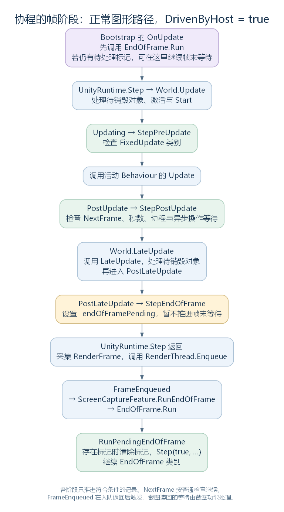
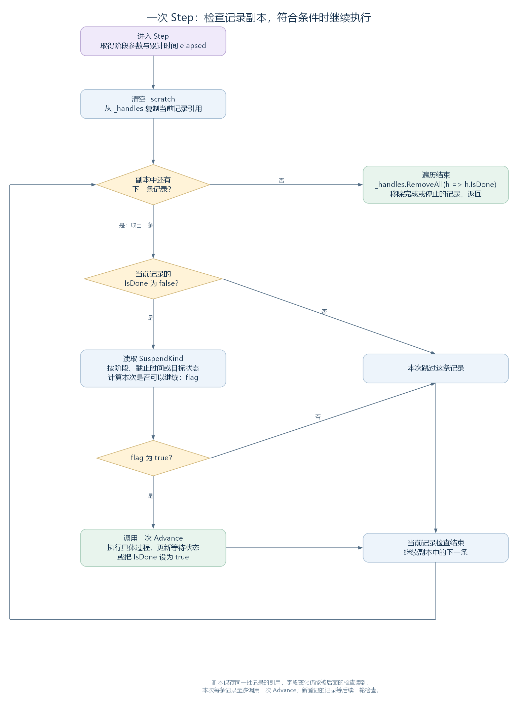

# 协程怎样继续：帧阶段与等待条件检查

状态：逐段研究笔记，2026-11-06。依据工作区 RimWorld 1.7.4982 rev1280 的兼容层代码整理，承接 [保存进度与第一次执行](55-coroutine-records-and-first-advance.md)。

上一节读到，Advance 在遇到等待条件时把状态保存在 CoroutineHandle 中，然后返回。接下来需要回答：这条记录什么时候再次被找到，管理器怎样判断它可以继续？

这一节先把管理器登记到 UnityWorld 的帧阶段，再进入 Step：取得本次要检查的记录，逐项判断等待条件，调用 Advance，最后移除完成记录。随后用一个跨阶段例子串起 null 等待与秒数等待，并接通另一条协程、异步操作及帧末等待。

## 一、把检查函数登记到每帧的调用位置

Start 首先调用 EnsureSubscribed。它检查 _subscribed：已经成功登记就返回；否则取得 UnityRuntime.Current 及其 World，找到后向三个事件登记函数，并把 _subscribed 设为 true。若当前还没有 World，这次登记尝试直接返回。

UnityWorld 的事件在预定位置调用已登记的函数，因此管理器可以在组件更新前、组件更新后与 LateUpdate 后获得执行机会。

下面用等价写法展示登记关系。原文的 unityWorld2、unityWorld3、unityWorld4 都引用同一个 unityWorld；action、action2、action3 分别保存三个方法的 Action<UnityFrame> 委托。此处省略这些委托的缓存代码，直接写出方法名：

```csharp
unityWorld.Updating += CoroutineScheduler.StepPreUpdate;
unityWorld.PostUpdate += CoroutineScheduler.StepPostUpdate;
unityWorld.PostLateUpdate += CoroutineScheduler.StepEndOfFrame;
CoroutineScheduler._subscribed = true;
```

在 UnityWorld.Update 中，待处理的销毁、激活和 Start 先被处理，然后依次执行 Updating、活动组件的 Update、PostUpdate。UnityRuntime.Step 随后调用 World.LateUpdate，再进入 PostLateUpdate 等位置。



图复用此前的阶段总览，表示已成功登记函数、DrivenByHost 为 true 的正常图形路径。先沿 Updating 和 PostUpdate 阅读；底部的帧末交接在第六节接通。[PNG](figures/monobehaviour-coroutine-stages.png)、[SVG](figures/monobehaviour-coroutine-stages.svg)；图源：[DOT](figures/monobehaviour-coroutine-stages.dot)。

Step 接收三个参数：

| 参数 | 表示什么 |
| --- | --- |
| endOfFrame | 本次是否检查 EndOfFrame 类别 |
| elapsed | 本次使用的累计时间，单位为秒 |
| fixedUpdate | 本次是否检查 FixedUpdate 类别，省略时默认为 false |

前两个阶段入口的完整实现如下。frame 是 UnityWorld 传来的 UnityFrame，ElapsedTime 保存本帧的累计时间：

```csharp
private static void StepPreUpdate(UnityFrame frame)
{
    CoroutineScheduler.Step(false, frame.ElapsedTime, true);
}

private static void StepPostUpdate(UnityFrame frame)
{
    CoroutineScheduler.Step(false, frame.ElapsedTime, false);
}
```

因此，Updating 检查 FixedUpdate 类别，PostUpdate 检查普通等待。下文把 fixedUpdate 与 endOfFrame 都为 false 的检查称为“普通检查”。当前 FixedUpdate 类别每次在 Updating 取得一次检查机会，这里的参数用于选择等待类别，调用次数由 UnityWorld 的帧更新安排。

源码定位：登记条件与三个事件（`UnityEngine.CoroutineScheduler.cs:50`）、两个入口（`UnityEngine.CoroutineScheduler.cs:87`、`UnityEngine.CoroutineScheduler.cs:93`）、World 更新顺序（`Waylith.UnityCompat.UnityWorld.cs:708`）、兼容层的一帧（`Waylith.UnityCompat.UnityRuntime.cs:106`）。

## 二、取得本次记录，逐项判断并推进

一次 Step 先把 _handles 中的记录引用复制进 _scratch，再遍历这份列表。每条记录先检查 IsDone，尚未完成的记录再按等待类别判断；满足条件时调用一次 Advance。遍历结束以后，从 _handles 移除所有已完成或已停止的记录。

这里复制的是引用，同一条 CoroutineHandle 的最新状态仍能被读到。复制动作确定了本次要检查哪些记录；协程执行期间新登记的记录，留待另一轮检查。

先认识完整方法中的局部名称：coroutineHandle 是当前记录，suspendKind 是它的等待类别，flag 表示这条记录本次是否可以继续；末尾移除条件中的 h 指向正在检查是否移除的记录。IL_00C9 是反编译文本保留的标签，各判断通过 goto 汇合到共同的 flag 检查。

下面保留原变量名与控制流程：

```csharp
private static void Step(bool endOfFrame, float elapsed, bool fixedUpdate = false)
{
    CoroutineScheduler._scratch.Clear();
    CoroutineScheduler._scratch.AddRange(CoroutineScheduler._handles);
    foreach (CoroutineHandle coroutineHandle in CoroutineScheduler._scratch)
    {
        if (!coroutineHandle.IsDone)
        {
            CoroutineSuspendKind suspendKind = coroutineHandle.SuspendKind;
            bool flag;
            if (suspendKind != CoroutineSuspendKind.FixedUpdate)
            {
                if (fixedUpdate)
                {
                    flag = false;
                }
                else
                {
                    switch (suspendKind)
                    {
                    case CoroutineSuspendKind.NextFrame:
                        flag = !endOfFrame;
                        goto IL_00C9;
                    case CoroutineSuspendKind.EndOfFrame:
                        flag = endOfFrame;
                        goto IL_00C9;
                    case CoroutineSuspendKind.WaitSeconds:
                        flag = !endOfFrame && elapsed >= coroutineHandle.ResumeTime;
                        goto IL_00C9;
                    case CoroutineSuspendKind.AwaitCoroutine:
                        flag = !endOfFrame && (coroutineHandle.AwaitedHandle == null || coroutineHandle.AwaitedHandle.IsDone);
                        goto IL_00C9;
                    case CoroutineSuspendKind.AwaitOperation:
                        flag = !endOfFrame && coroutineHandle.AwaitedOperation.isDone;
                        goto IL_00C9;
                    }
                    flag = false;
                }
            }
            else
            {
                flag = fixedUpdate;
            }
            IL_00C9:
            if (flag)
            {
                CoroutineScheduler.Advance(coroutineHandle, elapsed);
            }
        }
    }
    CoroutineScheduler._handles.RemoveAll((CoroutineHandle h) => h.IsDone);
}
```

这段循环可以按下图阅读：



[PNG](figures/coroutine-step-wait-checks.png)、[SVG](figures/coroutine-step-wait-checks.svg)；图源：[DOT](figures/coroutine-step-wait-checks.dot)。图中的等待条件判断由下表展开。

| SuspendKind | 本次可以继续的条件 |
| --- | --- |
| FixedUpdate | fixedUpdate 为 true |
| NextFrame | 普通检查 |
| EndOfFrame | fixedUpdate 为 false，且 endOfFrame 为 true |
| WaitSeconds | 普通检查，且 elapsed 已达到 ResumeTime |
| AwaitCoroutine | 普通检查，且 AwaitedHandle 为空或已经 IsDone |
| AwaitOperation | 普通检查，且 AwaitedOperation.isDone 为 true |

Advance 返回后，foreach 接着检查下一条记录。同一条记录即使又进入一种当前阶段可以处理的等待，本轮遍历也已经经过它，后续要由另一轮 Step 检查。

源码定位：完整 Step（`UnityEngine.CoroutineScheduler.cs:134`）、记录列表与副本（`UnityEngine.CoroutineScheduler.cs:271`、`UnityEngine.CoroutineScheduler.cs:274`）。

## 三、从 null 等待接到下一次普通检查

Advance 读到 Current 为 null 时，会把 SuspendKind 设为 NextFrame 并返回。Step 随后处理这个类别时，检查的是阶段条件；它没有保存或比较目标 FrameCount。

如果协程在组件 Update 中启动，Start 当场推进到 null，之后本帧的 PostUpdate 才到来，此时这条记录就能被普通检查选中。如果启动发生在正在进行的 Step 内，它的记录没有加入本轮已经复制好的 _scratch，下一次检查机会则要等后续相应阶段。

下面延续上一节的教学实例方法，名称为本例自行命名，放在 MonoBehaviour 派生组件中：

```csharp
private IEnumerator Example()
{
    Log.Message("A");
    yield return null;
    Log.Message("B");
    yield return new WaitForSeconds(0.5f);
    Log.Message("C");
}
```

假设组件在累计时间 100 秒的 Update 中调用 StartCoroutine(Example())，后续帧阶段正常执行：

| 位置与时间 | 执行动作 | 留下的状态 |
| --- | --- | --- |
| 本帧 Update，100 秒 | Start 立即推进，输出 A，返回 null | NextFrame |
| 本帧 PostUpdate，100 秒 | 普通检查允许继续，输出 B，返回半秒等待 | WaitSeconds，ResumeTime = 100.5 |
| 后续某帧 PostUpdate，100.3 秒 | 当前时间尚未到截止值，跳过 | 继续保留原进度与截止值 |
| 第一次达到截止值的 PostUpdate，例如 100.52 秒 | 输出 C，迭代结束，Advance 标记 IsDone | 本轮遍历末尾移除记录 |

若在 Step 推进另一条协程时启动这个 Example，A 仍会当场输出；B 则要等后续一轮普通检查。首次立即执行由 Start 安排，后续检查范围由 _scratch 决定，两步在这里共同决定实际顺序。

源码定位：null 转为 NextFrame（`UnityEngine.CoroutineScheduler.cs:214`）、普通检查条件（`UnityEngine.CoroutineScheduler.cs:154`）、记录副本建立（`UnityEngine.CoroutineScheduler.cs:136`）。

## 四、保存截止时间，等普通检查达到它

WaitForSeconds 自身只保存 Seconds。Advance 的局部变量 waitForSeconds 指向本次返回的等待对象；处理代码如下：

```csharp
WaitForSeconds waitForSeconds = obj as WaitForSeconds;
if (waitForSeconds != null)
{
    handle.SuspendKind = CoroutineSuspendKind.WaitSeconds;
    handle.ResumeTime = elapsed + waitForSeconds.Seconds;
    return;
}
```

所以 Example 在累计时间 100 秒返回 0.5 秒等待以后，记录中保存的是 100.5 这个截止值。以后每次普通检查直接比较 elapsed >= ResumeTime；达到条件的那一次才继续执行。因此，实际恢复时刻取决于后续检查何时到来。

Start 首次调用 Advance 时传入 Time.time；阶段函数传入 frame.ElapsedTime。它们连接到同一个引擎累计时间：UnityRuntime.Step 收到 elapsedTime，先通过 UnityTimeState.BeginFrame 写入 Time，再用这个值建立 UnityFrame。当前兼容层的 Time.timeScale getter 固定返回 1，setter 只记录未实现提示。

由此，在引擎帧与累计时间继续前进的情况下，游戏暂停期间仍能达到秒数等待的截止值；游戏倍率则由 TickManager 参与模拟步数安排。这个行为也让“暂停游戏时等待一段时间再继续”的代码有了具体的时间来源。

源码定位：等待对象的数据（`UnityEngine.WaitForSeconds.cs:6`）、截止值写入（`UnityEngine.CoroutineScheduler.cs:229`）、时间比较（`UnityEngine.CoroutineScheduler.cs:160`）、时间来源（`UnityEngine.Time.cs:84`、`Waylith.UnityCompat.UnityTimeState.cs:55`）、时间倍率接口（`UnityEngine.Time.cs:110`）、模拟速度与暂停判断（`Verse.TickManager.cs:375`）。

## 五、读取等待对象的完成状态

协程还可以通过 yield 返回另一条 Coroutine 或一个 AsyncOperation。Advance 根据返回对象的当前状态，决定立即继续，还是在记录里保存等待目标；后续 Step 读取该目标的完成标记。

Coroutine 内的 Handle 指向另一条管理记录。AsyncOperation 的 isDone 则提供相应操作的完成状态；本段讨论的是管理器怎样读取这个状态，操作本身仍由其所属功能推进。

| Advance 收到的对象 | 当场怎样处理 | 后续检查 |
| --- | --- | --- |
| Handle 存在且尚未完成的 Coroutine | 保存到 AwaitedHandle，设为 AwaitCoroutine，返回 | 普通检查读取目标的 IsDone |
| Handle 为空或已完成的 Coroutine | 继续 Advance 的循环，推进当前过程 | 当场继续到后面的代码或等待位置 |
| 尚未完成的 AsyncOperation | 保存到 AwaitedOperation，设为 AwaitOperation，返回 | 普通检查读取目标的 isDone |
| 已完成的 AsyncOperation | 保存操作引用，设为 NextFrame，返回 | 后续一轮普通检查继续 |

Step 按 _scratch 中的顺序检查记录，而其中保存的仍是同一批对象的引用。因此，另一条协程在本轮完成后，排在它后面的等待者可以当场读到更新后的 IsDone：

| 本轮检查顺序 | 发生的结果 |
| --- | --- |
| 先处理被等待记录，再处理等待者 | 前者完成并标记 IsDone，后者在同一轮读到完成状态，可以继续 |
| 先处理等待者，再处理被等待记录 | 等待者检查时目标尚未完成，本轮跳过；目标随后完成，等待者在后续一轮再取得机会 |

这条顺序也解释了为什么“目标刚刚完成”以后，等待者的后续代码有时已经执行，有时还要等下一次普通检查：决定它的是目标状态与等待者的实际检查位置。

源码定位：保存异步操作（`UnityEngine.CoroutineScheduler.cs:239`）、保存协程目标或立即继续（`UnityEngine.CoroutineScheduler.cs:257`）、两个完成条件（`UnityEngine.CoroutineScheduler.cs:163`、`UnityEngine.CoroutineScheduler.cs:166`）、操作状态接口（`UnityEngine.AsyncOperation.cs:21`）。

## 六、把帧末检查接回引擎

PostLateUpdate 登记的是 StepEndOfFrame。EndOfFrame.DrivenByHost 表示由引擎安排后面的帧末调用；为 true 时，这里先设置 _endOfFramePending 标记，等待那个调用位置。否则直接检查帧末类别：

```csharp
private static void StepEndOfFrame(UnityFrame frame)
{
    if (EndOfFrame.DrivenByHost)
    {
        CoroutineScheduler._endOfFramePending = true;
        return;
    }
    CoroutineScheduler.Step(true, frame.ElapsedTime, false);
}
```

正常图形初始化中，Bootstrap 将 DrivenByHost 设为 true，并在 FrameEnqueued 上登记函数。引擎把 RenderFrame 入队后调用该事件，随后经 ScreenCaptureFeature.RunEndOfFrame → EndOfFrame.Run 进入管理器的 RunPendingEndOfFrame。

后者看到 _endOfFramePending 为 true，就清除标记，再调用 Step(true, Time.time, false)。这时等待 EndOfFrame 的记录可以继续执行。

因此，图中的正常路径是：PostLateUpdate 留下标记 → 主线程完成后续采集与帧入队 → 帧末入口检查并推进。Bootstrap 的 OnUpdate 在 Step 之前也会调用 EndOfFrame.Run，可处理尚留着的标记；标记已清除时，RunPendingEndOfFrame 直接返回。

这些调用位置都在主线程，帧末协程的代码也在这里执行。FrameEnqueued 的触发点是主线程的帧入队返回处，对应帧的渲染与 GPU 执行按渲染流程推进。

源码定位：帧末登记与待处理标记（`UnityEngine.CoroutineScheduler.cs:99`、`UnityEngine.CoroutineScheduler.cs:110`）、初始化登记与帧前入口（`RimWorldWaylith.Bootstrap.cs:351`、`RimWorldWaylith.Bootstrap.cs:85`）、入队后的事件（`Waylith.EngineApplication.cs:797`）、帧末连接（`RimWorldWaylith.Rendering.ScreenCaptureFeature.cs:130`、`UnityStubs.EndOfFrame.cs:15`）。

至此，一条记录可以沿“写入等待状态 → 相应阶段检查 → 再次 Advance → 写入下一状态或结束”的顺序反复获得执行机会。接续阅读见 [自定义等待与协程结束：条件检查、停止和清理](57-custom-yield-and-coroutine-ending.md)，已接通 CustomYieldInstruction、条件与真实计时等待，并追踪停止、组件停用及对象销毁后的管理动作。

核对方式：提取原有 Start、Step、Advance 及相关数据类，在独立环境中使用可控时间与阶段调用验证首次执行、同帧普通检查、截止时间、执行中新登记、等待顺序、异步操作及两种专用阶段。事件登记使用替代入口；UnityWorld 的事件顺序和引擎帧末位置由源码核对。
