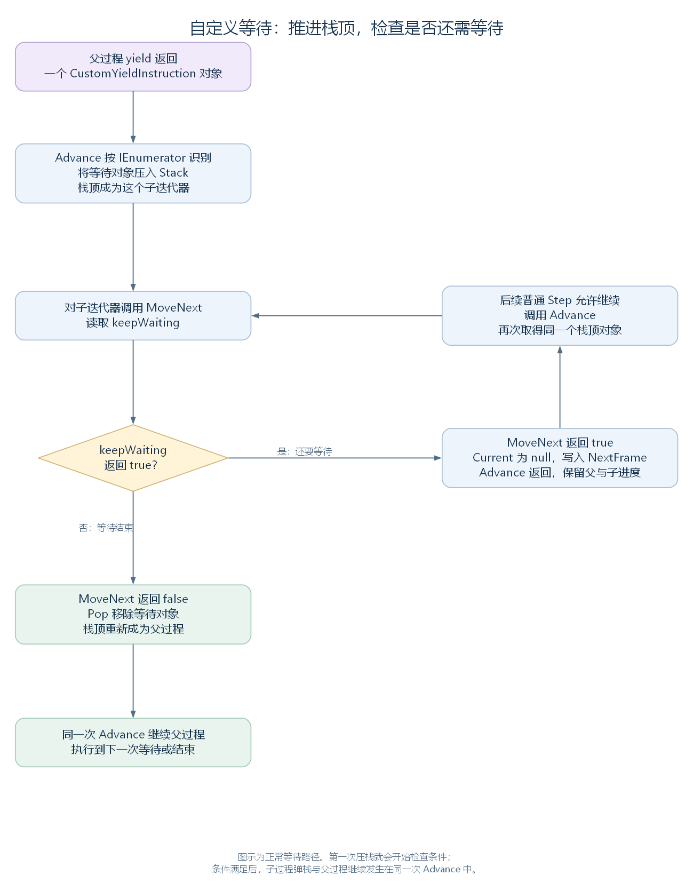

# 自定义等待与协程结束：条件检查、停止和清理

状态：逐段研究笔记，2026-11-06。依据工作区 RimWorld 1.7.4982 rev1280 的兼容层代码整理，承接 [帧阶段与等待条件检查](56-coroutine-phases-and-wait-checks.md)。

上一节已经接通 Step 的等待类别判断。自定义等待沿同一条主线工作：把一个能够判断条件的对象压入迭代器栈，每次轮到它继续时读取条件，决定保留等待还是回到父过程。

本节先读 CustomYieldInstruction、WaitUntil 和 WaitForSecondsRealtime，再沿停止接口追到 IsDone 与列表移除，最后接回组件停用、对象销毁和迭代器清理的位置。

## 一、把等待条件放进一个子迭代器

CustomYieldInstruction 是实现 IEnumerator 的抽象类。派生类提供 keepWaiting 属性，表示现在是否还要等待；基类通过 MoveNext 返回这个结果，Current 则始终返回 null。

下面保留相关成员，省略 Reset 方法与反编译标记注释：

```csharp
public abstract class CustomYieldInstruction : IEnumerator
{
    public abstract bool keepWaiting { get; }

    public object Current
    {
        get
        {
            return null;
        }
    }

    public bool MoveNext()
    {
        return this.keepWaiting;
    }
    // 省略 Reset。
}
```

当父过程 yield 返回这类对象时，Advance 会通过 IEnumerator 判断识别它，将它压入当前记录的 Stack。随后，同一次 Advance 就开始调用这个子迭代器的 MoveNext：

| 条件结果 | 子迭代器返回什么 | Advance 接着做什么 |
| --- | --- | --- |
| keepWaiting 为 true | MoveNext 返回 true，Current 为 null | 写入 NextFrame 等待并返回，栈保留父过程与等待对象 |
| keepWaiting 为 false | MoveNext 返回 false | 弹出等待对象，继续循环，推进父过程 |

等待期间，每次普通 Step 允许这条记录继续，Advance 都会再次读取栈顶，重新调用 MoveNext，也就重新读取一次 keepWaiting。



图表示正常等待路径；条件在第一次压栈时就会检查，后续检查次数由实际推进位置决定。[PNG](figures/custom-yield-condition-loop.png)、[SVG](figures/custom-yield-condition-loop.svg)；图源：[DOT](figures/custom-yield-condition-loop.dot)。

源码定位：基类、Current 与 MoveNext（`UnityEngine.CustomYieldInstruction.cs:8`、`UnityEngine.CustomYieldInstruction.cs:16`、`UnityEngine.CustomYieldInstruction.cs:25`）、子迭代器压栈（`UnityEngine.CoroutineScheduler.cs:246`）、结束弹栈与 null 等待（`UnityEngine.CoroutineScheduler.cs:208`）。

## 二、用一段函数判断是否可以继续

WaitUntil 接收一个 Func<bool>，也就是无参数、返回 bool 的函数。构造参数名为 predicate，保存在只读字段 _predicate 中；每次读取 keepWaiting，就调用这个函数，并把结果取反。

其完整类体如下，删除反编译标记注释：

```csharp
public class WaitUntil : CustomYieldInstruction
{
    public WaitUntil(Func<bool> predicate)
    {
        this._predicate = predicate;
    }

    public override bool keepWaiting
    {
        get
        {
            return !this._predicate();
        }
    }

    private readonly Func<bool> _predicate;
}
```

因此，predicate 返回 true 表示条件满足，keepWaiting 随之返回 false，等待对象就能结束这一层迭代。

下面是 MonoBehaviour 派生组件中的教学字段与方法，名称为本例自行命名：

```csharp
private bool ready;

private IEnumerator Example()
{
    Log.Message("开始等待");
    yield return new WaitUntil(() => ready);
    Log.Message("条件已满足");
}
```

组件调用 StartCoroutine(Example()) 时，ready 假设仍为 false；之后某段代码把它设为 true：

| 执行位置 | 取得的条件结果 | 记录怎样变化 |
| --- | --- | --- |
| 首次 Advance | ready 为 false，keepWaiting 为 true | 栈中保留 Example → WaitUntil，记录 NextFrame |
| 后续普通检查，ready 仍为 false | 再次读取 ready，仍需等待 | 保留两层进度，再次返回 |
| 某段代码把 ready 设为 true | 此时改变字段值 | 等待下次实际检查 |
| 下一次推进到 WaitUntil | keepWaiting 为 false | 弹出 WaitUntil，在同一次 Advance 中继续 Example，输出“条件已满足” |

条件函数在每次检查时读取当前值。因此，字段变化与后续检查的位置共同决定了恢复时刻；若条件第一次就满足，首次 Advance 也能直接回到父过程。

源码定位：条件函数的保存与调用（`UnityEngine.WaitUntil.cs:6`）、迭代器栈推进（`UnityEngine.CoroutineScheduler.cs:188`）。

## 三、用真实计时建立截止值

WaitForSecondsRealtime 也继承 CustomYieldInstruction。它提供的条件是“真实计时是否还未达到截止值”，因此沿同一个子迭代器流程推进。

先认识它保存的数据：

| 名称 | 内容 |
| --- | --- |
| waitTime | 公开的秒数属性，由构造参数 time 初始化 |
| waitUntilTime | 私有截止时间字段，初值为 -1，表示尚未建立截止值 |
| flag | keepWaiting 内的局部 bool，表示本次是否还需等待 |

下面是 keepWaiting 与它调用的 Reset，保留原成员名：

```csharp
public override bool keepWaiting
{
    get
    {
        if (this.waitUntilTime < 0f)
        {
            this.waitUntilTime = Time.realtimeSinceStartup + this.waitTime;
        }
        bool flag = Time.realtimeSinceStartup < this.waitUntilTime;
        if (!flag)
        {
            this.Reset();
        }
        return flag;
    }
}

public new void Reset()
{
    this.waitUntilTime = -1f;
}
```

截止值在第一次读取 keepWaiting 时建立。假设一个两秒等待对象在真实计时 10 秒时创建，直到 20 秒才第一次被推进，那么它建立的截止值就是 22 秒。之后的检查继续比较这个截止值；例如 21.8 秒仍返回 true，22.1 秒返回 false，重置字段并结束子迭代器，父过程随后继续。

Time.realtimeSinceStartup 连接到 UnityTimeState 的持续计时：运行时建立时保存 Stopwatch 起点，每次读取属性时计算到现在经过的秒数。到达截止时间以后，父过程仍需在管理器取得下一次推进机会时继续执行。

这里的 Reset 是 WaitForSecondsRealtime 自己声明的成员，会把截止值恢复为 -1。一次等待完成后，再使用这个对象时便能在首次检查中建立新的截止值。

源码定位：构造与等待条件（`UnityEngine.WaitForSecondsRealtime.cs:9`、`UnityEngine.WaitForSecondsRealtime.cs:21`）、截止字段重置（`UnityEngine.WaitForSecondsRealtime.cs:39`）、真实计时入口（`UnityEngine.Time.cs:54`）、Stopwatch 计时与起点（`Waylith.UnityCompat.UnityTimeState.cs:36`、`Waylith.UnityCompat.UnityTimeState.cs:66`）。

## 四、通过停止接口标记记录，再由 Step 移除

MonoBehaviour 提供两个停止入口：StopCoroutine 取出传入 Coroutine 的 Handle，交给管理器；StopAllCoroutines 将当前组件 this 作为 owner 传入管理器。

下面是管理器的两个完整方法。handle 是指定记录，owner 是本次要匹配的所属对象，coroutineHandle 是遍历 _handles 时取得的当前记录：

```csharp
internal static void Stop(CoroutineHandle handle)
{
    if (handle != null)
    {
        handle.IsDone = true;
    }
}

internal static void StopAll(object owner)
{
    foreach (CoroutineHandle coroutineHandle in CoroutineScheduler._handles)
    {
        if (coroutineHandle.Owner == owner)
        {
            coroutineHandle.IsDone = true;
        }
    }
}
```

Stop 针对传入的那一条记录；StopAll 按 Owner 匹配。假设组件 A 启动两条协程、组件 B 启动一条，那么 A 调用 StopAllCoroutines 后，A 的两条记录被标记为 IsDone，B 的记录继续按原来的等待条件管理。

后续 Step 先检查 IsDone，已经标记的记录跳过推进；遍历结束后，RemoveAll 从 _handles 移除这些记录。若在 Step 执行期间完成标记，本轮末尾就可以移除；在两次 Step 之间标记的记录，留到下一次 Step 清理。

停止调用本身沿当前函数的执行顺序返回。如果正在执行的协程调用 StopAllCoroutines，标记完成以后，本段代码仍会继续到 yield、返回或异常；管理器之后跳过这条记录的推进。

记录中的内嵌子迭代器随这条记录一起停止推进。另行 StartCoroutine 建立的记录，由它自己的 IsDone 继续管理；Stop 的方法体只处理传入记录，StopAll 则按上述 Owner 条件逐条匹配。

源码定位：组件停止入口（`UnityEngine.MonoBehaviour.cs:29`、`UnityEngine.MonoBehaviour.cs:35`）、单条与按归属标记（`UnityEngine.CoroutineScheduler.cs:29`、`UnityEngine.CoroutineScheduler.cs:38`）、跳过与列表移除（`UnityEngine.CoroutineScheduler.cs:140`、`UnityEngine.CoroutineScheduler.cs:184`）。

## 五、沿组件停用与对象销毁追踪默认行为

接下来把组件状态变化接回已经读过的 UnityWorld。这里关注状态改变后，哪些方法被调用，以及协程的停止接口是否出现在这条路径中：

| 触发动作 | 默认路径中的主要工作 |
| --- | --- |
| Behaviour.enabled 设为 false | 修改 World 中的 Enabled，刷新活动状态；原本活动的组件收到 OnDisable |
| GameObject.SetActive(false) | 修改 ActiveSelf，刷新自身及子对象的活动状态；受影响的活动组件收到 OnDisable |
| 销毁组件或 GameObject | 销毁组件时调用相应的 OnDisable、OnDestroy，从组件和对象管理记录中移除，并发出 ObjectDestroyed 通知 |

UnityRuntime 给 ObjectDestroyed 登记的处理函数是 Object.MarkDestroyed，用于设置兼容对象的销毁标记。沿这些默认调用，协程管理器的 Stop 或 StopAll 没有被接入。

CoroutineScheduler 的 Step 与 Advance 继续依据 IsDone、等待类别和目标状态处理记录；Owner 在这里用于保存归属与 StopAll 匹配。所以沿当前兼容层的默认路径，组件停用或对象销毁以后，已有的协程记录仍可被推进。

具体脚本可以在 OnDisable 或 OnDestroy 中显式调用停止接口，将对象事件接到协程结束。讨论某个脚本的实际行为时，还需要继续读它自己的这些方法。

源码定位：启停入口（`UnityEngine.Behaviour.cs:12`、`UnityEngine.GameObject.cs:274`）、World 状态修改（`Waylith.UnityCompat.UnityWorld.cs:451`、`Waylith.UnityCompat.UnityWorld.cs:475`）、活动刷新（`Waylith.UnityCompat.UnityWorld.cs:944`）、组件与 GameObject 销毁（`Waylith.UnityCompat.UnityWorld.cs:1112`、`Waylith.UnityCompat.UnityWorld.cs:1144`）、销毁通知连接（`Waylith.UnityCompat.UnityRuntime.cs:55`）、对象标记（`UnityEngine.Object.cs:31`）。

## 六、追踪结束以后执行的清理

正常执行结束时，MoveNext 返回 false，Advance 弹出这一层迭代器；整个 Stack 为空以后，将记录标为 IsDone。停止时则先设置 IsDone，后续 Step 跳过该记录并从列表移除。

在这些管理器路径中，Pop 与 RemoveAll 都没有显式调用迭代器的 IDisposable.Dispose，列表移除也没有清空 Handle 中的 Stack。调用者保存的 Coroutine.Handle 仍可引用原记录。

用下面这个教学实例方法观察 finally，名称为本例自行命名：

```csharp
private IEnumerator WithCleanup()
{
    try
    {
        Log.Message("开始");
        yield return null;
        Log.Message("继续");
    }
    finally
    {
        Log.Message("清理");
    }
}
```

假设它已经第一次执行，停在 null 等待处：

| 后续路径 | 本例输出 | 对应的代码动作 |
| --- | --- | --- |
| 正常继续到结束 | 开始 → 继续 → 清理 | 再次 MoveNext，执行 try 剩余部分和 finally，再结束迭代 |
| 在等待期间 StopCoroutine，随后 Step 清理 | 开始 | 记录已标记，后续跳过 MoveNext；管理器移除列表项时没有调用 Dispose |

自然走完时，finally 由迭代器自己的执行控制流程运行。上表中的停止路径则停在已保存的进度上，管理器不会借由列表移除执行剩下的 finally。

如果自定义条件在求值时抛出异常，异常会经过子迭代器的 MoveNext，进入 Advance 周围的 catch。它记录错误并设置整条记录的 IsDone，随后也由 Step 移除；停在栈中的父迭代器同样没有在这条路径里被显式 Dispose。

源码定位：MoveNext 异常与弹栈（`UnityEngine.CoroutineScheduler.cs:188`）、停止标记（`UnityEngine.CoroutineScheduler.cs:29`）、列表移除（`UnityEngine.CoroutineScheduler.cs:184`）、栈与完成字段（`UnityEngine.CoroutineHandle.cs:8`）。

现在，协程这条主线已从记录建立、首次执行，接到帧阶段检查、自定义等待与结束处理。下一步可以回到本组大纲，检查主线程更新、长任务与线程协作、协程三篇的衔接，为整合准备。

核对方式：提取原有 Start、Step、Advance、Stop、StopAll 和等待对象，在独立环境中验证条件反复检查、真实计时截止值及重用、自然完成与停止时的 finally、Owner 匹配、执行中停止和条件异常。时间与事件登记使用替代入口；组件停用、销毁通知及其与管理器的连接由源码核对。
