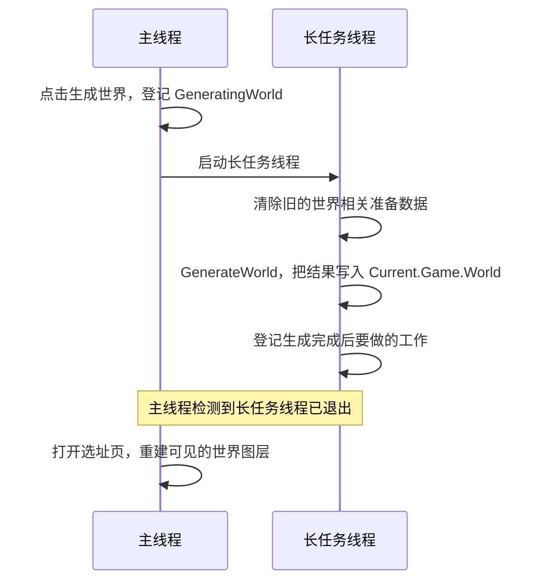

# 从种子到落点（一）· 点击「生成世界」以后

逐段研究笔记，2026-11-16。依据工作区 RimWorld 1.7.4982 rev1280 的代码，沿正常手动选址的开局展开。[系列结构图](00-series-outline.md#系列结构图) · [长任务与线程协作](chapters/05-threads/article.md)

玩家填好种子、选好覆盖率和气候，点击「生成世界」。游戏把生成工作交给后台线程。生成完成后，主线程打开选址页，玩家便可以在世界地图上挑选落点。这一段先追清楚参数从哪里来、生成的 `World` 放在哪里、选址页何时打开。



## 一、进入世界参数页时，游戏已经有了哪些对象

确认剧本后，`Page_SelectScenario.BeginScenarioConfiguration` 创建 `Game`，放入 `Current.Game`，为它创建 `GameInitData`，然后把选中的 `Scenario` 交给这个 `Game`。`GameInitData` 保存开局准备阶段要用的数据，例如起始落点和候选殖民者。

剧本的 `GetFirstConfigPage()` 建立后续页面。普通开局先用 `Page_SelectStoryteller` 选择叙事者，再进 `Page_CreateWorldParams` 设置世界参数，之后是 `Page_SelectStartingSite`。`PageUtility.StitchedPages` 按这个顺序写好各页的 `prev` 和 `next`。带 `ScenPart_ForcedMap` 的剧本会跳过选址页，因此后面的 `this.next` 具体指向哪页由剧本配置决定。

源码位置见 `RimWorld.Page_SelectScenario.cs:215`、`RimWorld.Scenario.cs:221` 和 `RimWorld.PageUtility.cs:13`。

## 二、页面把玩家的选择存成生成参数

`Page_CreateWorldParams.PreOpen()` 在页面首次打开时调用 `Reset()`，建立默认种子、覆盖率和其他选项。之后每次改动都会写回当前页面的字段。例如，下面这行代码用 `rect3` 指定种子输入框的位置和大小，用原来的 `seedString` 显示文字，再把输入结果写回同一个字段。

```csharp
this.seedString = Widgets.TextField(rect3, this.seedString);
```

玩家点击随机种子按钮时，同一个 `seedString` 会改写为 `GenText.RandomSeedString()` 的结果。

| 玩家在界面决定什么 | 页面保存什么 |
| --- | --- |
| 种子 | `seedString`，输入框里的字符串，交给生成器后再转换为随机数种子 |
| 星球覆盖率 | `planetCoverage`，例如界面上的 30% 保存为 `0.3f` |
| 整体降雨、气温和人口 | `rainfall`、`temperature` 和 `population`，分别保存滑杆选中的档位 |
| 派系列表 | `factions`，元素是 `FactionDef`。默认设置会按各派系的起始数量重复加入对应的定义 |
| 地标密度、污染 | `landmarkDensity` 和 `pollution`。对应滑杆分别在启用 Odyssey 和 Biotech 时显示 |

源码位置见 `RimWorld.Page_CreateWorldParams.cs:23`、`:43`、`:56` 和 `:96`。

## 三、点击按钮后，先排队生成世界

参数页调用基类的 `DoBottomButtons`，把底部前进按钮的文字设为 `WorldGenerate`。收到点击时，`Page.DoBottomButtons` 先调用 `CanDoNext()`，只有得到 `true` 才接着调用 `DoNext()`。这个页面重写了 `CanDoNext()`。它通过基类检查后，把生成工作排入队列，随后返回 `false`，将打开下一页的时机留给长任务结束时的处理。

下面保留 `Page_CreateWorldParams.CanDoNext()` 的完整逻辑。`this` 是参数页，`this.next` 是剧本串好的下一页。排队时把大段代码作为函数交给 `LongEventHandler`，`"GeneratingWorld"` 提供任务的提示文字键，其后的 `true` 传给 `doAsynchronously`，选择后台线程执行。

```csharp
protected override bool CanDoNext()
{
    if (!base.CanDoNext())
    {
        return false;
    }
    LongEventHandler.QueueLongEvent(delegate
    {
        Find.GameInitData.ResetWorldRelatedMapInitData();
        Current.Game.World = WorldGenerator.GenerateWorld(this.planetCoverage, this.seedString, this.rainfall, this.temperature, this.population, this.landmarkDensity, this.factions, this.pollution);
        LongEventHandler.ExecuteWhenFinished(delegate
        {
            if (this.next != null)
            {
                Find.WindowStack.Add(this.next);
            }
            MemoryUtility.UnloadUnusedUnityAssets();
            Find.World.renderer.RegenerateAllLayersNow();
            this.Close(true);
        });
    }, "GeneratingWorld", true, null, true, false, null);
    return false;
}
```

长任务线程先通过 `ResetWorldRelatedMapInitData()` 清空先前的 `Game.World`、候选殖民者列表和开局的玩家派系引用，再将 `startingTile` 设为无效。这样，从选址页退回去改种子再生成时，新世界会重新走一遍开局准备。

随后 `GenerateWorld` 接收参数页保存的八个值。生成器先转换种子字符串，创建 `World`，再把设置写进其中的 `WorldInfo`。生成期间，这个世界放在 `Current.CreatingWorld`。此时 `Current.Game.World` 还是空的，生成步骤通过 `Find.World` 便能取到正在建立的世界。`GenerateWorld` 返回后，调用方把返回的对象接到 `Current.Game.World`。

源码位置见 `RimWorld.Page.cs:77`、`RimWorld.Page_CreateWorldParams.cs:187`、`Verse.GameInitData.cs:30`、`RimWorld.Planet.WorldGenerator.cs:29` 和 `Verse.Find.cs:321`。

## 四、把生成好的世界交回选址页

后台线程写入 `Current.Game.World` 后，通过 `ExecuteWhenFinished` 把剩余的工作登记到完成列表。主线程在 `Root.Update` 里推进长任务，发现后台线程已经退出，就取出这些函数依次执行。

这段代码先用 `Find.WindowStack.Add(this.next)` 打开下一页。随后登记清理未使用资源的工作，调用 `RegenerateAllLayersNow()` 更新可见的世界绘制图层，最后关闭参数页。选址页使用的是已经接入 `Current.Game` 的新世界，玩家接下来点击的是这个世界里的地块。

源码位置见 `Verse.Root.cs:122`、`Verse.LongEventHandler.cs:224`、`:305`、`Verse.Profile.MemoryUtility.cs:14` 和 `RimWorld.Planet.WorldRenderer.cs:143`。

下一段沿 `WorldGenerator.GenerateWorld` 继续，追到选址地形页如何读取一个地块的降雨量。[从生成步骤到地块降雨量](59-world-generation-steps.md)
