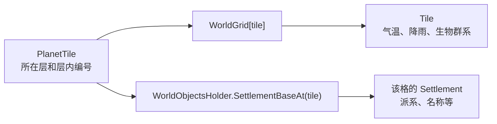

# 从种子到落点（三）· 世界数据与开局选址

逐段研究笔记，2026-11-16。依据工作区 RimWorld 1.7.4982 rev1280 的源码，承接[生成步骤和地块降雨量](59-world-generation-steps.md)。本节沿普通手动选址的开局展开。

选址时，玩家可以先查看一个地块的地形，再点附近的定居点查看它属于哪个派系。两种信息都能用 `PlanetTile` 定位。到了按「下一步」的时候，游戏又会用这个位置检查当地是否适合建立据点。

## 一、World 怎样组织地块和世界对象

`WorldGenerator` 返回的 `World` 里有三组和选址直接相关的数据。生成参数页填写的设置进入 `info`，逐格生成的地形进入 `grid`，定居点等世界对象登记在 `worldObjects`。

| `World` 的字段 | 在选址时提供什么 |
| --- | --- |
| `info`，类型为 `WorldInfo` | 世界名称、种子和生成参数，例如整体降雨档位。 |
| `grid`，类型为 `WorldGrid` | 各个 `PlanetLayer` 和层内地块数据。气温、降雨和生物群系都可以从具体的 `Tile` 读取。 |
| `worldObjects`，类型为 `WorldObjectsHolder` | 登记在世界里的对象，以及按类型维护的列表，例如定居点列表。一个定居点用自身的 `Tile` 属性记录它在哪一格。 |

地表先经 `Terrain` 步骤建立地块，再由较后的 `Factions` 步骤创建派系及其定居点。普通定居点的生成路径会选中一个派系，创建世界对象，为它写入派系和位置，然后调用 `Find.WorldObjects.Add(worldObject)`。登记时，`WorldObjectsHolder` 把对象加入总列表，并把 `Settlement` 加入相应的定居点列表。这样，选址页初次出现时，就已经可以显示这些定居点。

源码位置见 `RimWorld.Planet.World.cs:169`、`:531`、`RimWorld.Planet.WorldGenStep_Factions.cs:20`、`RimWorld.FactionGenerator.cs:23` 和 `RimWorld.Planet.WorldObjectsHolder.cs:260`、`:315`。

## 二、同一个 PlanetTile 怎样查到地块和定居点

`PlanetTile` 记录层编号 `layerId` 和层内的地块编号 `tileId`。例如，同样编号为 42 的地表地块和轨道地块，要由各自的层来定位。方法参数 `tile` 带着这两个信息，因而可以交给地块查询，也可以交给定居点查询。



查地形时，选址界面用 `Find.WorldGrid[tile]`。这个索引器先通过 `tile.Layer` 取得所在层，再直接用 `tileId` 取出那一项。

```csharp
public Tile this[PlanetTile tile]
{
    get
    {
        return tile.Layer.Tiles[tile.tileId];
    }
}
```

检查这格是否已有据点时，选址规则调用 `Find.WorldObjects.SettlementBaseAt(tile)`。它逐一比较 `settlementBases` 列表中的定居点位置，遇到相同位置就返回该定居点。下面的 `i` 是正在检查的列表下标。

```csharp
public Settlement SettlementBaseAt(PlanetTile tile)
{
    for (int i = 0; i < this.settlementBases.Count; i++)
    {
        if (this.settlementBases[i].Tile == tile)
        {
            return this.settlementBases[i];
        }
    }
    return null;
}
```

因此一个地形适合定居的地块，也可能因为已有定居点而被拒绝。此时 `TileFinder` 能使用查到的 `Settlement.Faction`，在拒绝提示里显示占据该地块的派系名称。

源码位置见 `RimWorld.Planet.PlanetTile.cs:22`、`:172`、`RimWorld.Planet.WorldGrid.cs:165`、`RimWorld.Planet.WorldObjectsHolder.cs:564`、`RimWorld.Planet.TileFinder.cs:85` 和 `Verse.Find.cs:810`。

## 三、从浏览地块到确认落点

普通点击选中地块时，`WorldSelector` 将鼠标指到的位置存入 `selectedTile`，`WorldInterface.SelectedTile` 让选址页读到它。点击定居点图标时，`WorldSelector.Select` 会改为记录选中的世界对象，并把地块选择置为无效。检查面板就能根据选中了对象还是地块，选择显示相应信息。

`Page_SelectStartingSite.DoWindowContents()` 在显示页面期间就会把当前位置写入 `GameInitData.startingTile`。如果选中的是定居点，页面取它的 `Tile`。这个字段在浏览过程中会随着选择变化。真正进入下一页还需要经过下面两步。

1. **检查地块能否开局。** `CanDoNext()` 读取 `WorldInterface.SelectedTile`。普通路径要求选中一个有效地块，然后调用 `TileFinder.IsValidTileForNewSettlement`。它先查生物群系能否建基地、地形是否为不可通行山脉，再查这一格与相邻地块是否有据点等条件。比如只选中了另一个派系的定居点图标时，页面虽然能知道它在哪一格，`CanDoNext()` 仍会要求玩家选定一个有效地块。
2. **确认并翻页。** `DoNext()` 先将所选位置存入 `selTile`，把接下来要执行的函数交给 `CheckConfirmSettle`。有需要确认的提示时，等玩家同意后再执行。函数最后把 `selTile` 写入 `startingTile`，调用基类的 `Page.DoNext()` 打开后续页面。

下面是 `DoNext()` 的等价写法。反编译文件中的 `this.<>n__0()` 是编译器生成的包装方法，程序集里它直接调用 `Page.DoNext()`，这里还原为 `base.DoNext()`。

```csharp
protected override void DoNext()
{
    PlanetTile selTile = Find.WorldInterface.SelectedTile;
    SettlementProximityGoodwillUtility.CheckConfirmSettle(selTile, delegate
    {
        Find.GameInitData.startingTile = selTile;
        base.DoNext();
    }, null, null);
}
```

源码位置见 `RimWorld.Planet.WorldSelector.cs:240`、`:413`、`RimWorld.WorldInterface.cs:13`、`RimWorld.Planet.WorldInspectPane.cs:281`、`RimWorld.Page_SelectStartingSite.cs:171`、`:209`、`:240` 和 `RimWorld.Planet.SettlementProximityGoodwillUtility.cs:151`。

## 四、开始游戏时，落点成为玩家据点的位置

选址完成后，玩家还可以继续配置殖民者等开局选项。等最后一页调用 `PageUtility.InitGameStart()`，游戏才登记准备进入 `Play` 场景的长任务。这个任务先准备初始殖民者等数据，再调用剧本的 `PreMapGenerate()`。

剧本里的 `ScenPart_PlayerFaction` 会在这个阶段读取 `startingTile` 并创建玩家的 `Settlement`。此时玩家派系已经在生成世界后的 `PostWorldGenerate()` 建好。`startingTile.LayerDef.SettlementWorldObjectDef` 则指定这个层使用哪种世界对象定义来创建据点。

```csharp
public override void PreMapGenerate()
{
    PlanetTile startingTile = Find.GameInitData.startingTile;
    Settlement settlement = (Settlement)WorldObjectMaker.MakeWorldObject(startingTile.LayerDef.SettlementWorldObjectDef);
    settlement.SetFaction(Find.GameInitData.playerFaction);
    settlement.Tile = startingTile;
    settlement.Name = SettlementNameGenerator.GenerateSettlementName(settlement, Find.GameInitData.playerFaction.def.playerInitialSettlementNameMaker);
    Find.WorldObjects.Add(settlement);
}
```

`Settlement` 继承 `MapParent`，可以和一张局部地图建立关联。进入 `Play` 后，`Game.InitNewGame()` 从世界对象列表里找到玩家的据点，另外把开局的 `startingTile` 抄进 `GameInfo`，然后把这座据点传给 `MapGenerator.GenerateMap()`。世界章在这里交给下一篇。下一篇从这个入口看地块和据点怎样变成一张能游玩的殖民地地图。

源码位置见 `RimWorld.PageUtility.cs:35`、`RimWorld.Scenario.cs:313`、`RimWorld.ScenPart_PlayerFaction.cs:55`、`:62`、`RimWorld.Planet.Settlement.cs:10`、`RimWorld.Planet.MapParent.cs:45`、`Verse.Root_Play.cs:45` 和 `Verse.Game.cs:473`、`:510`。
