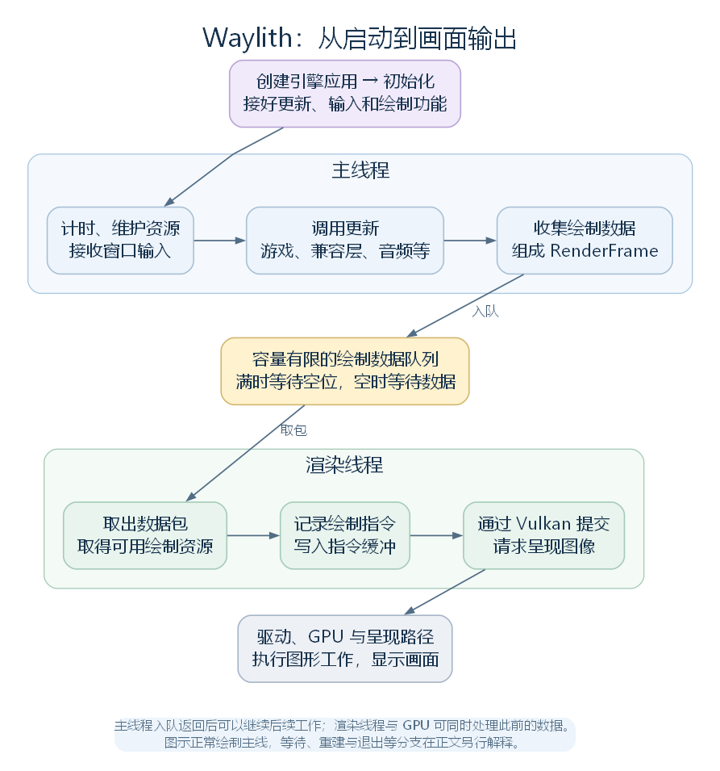
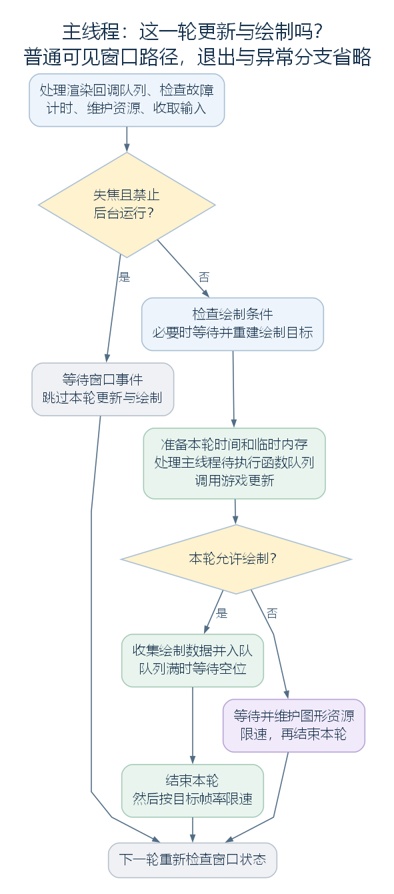
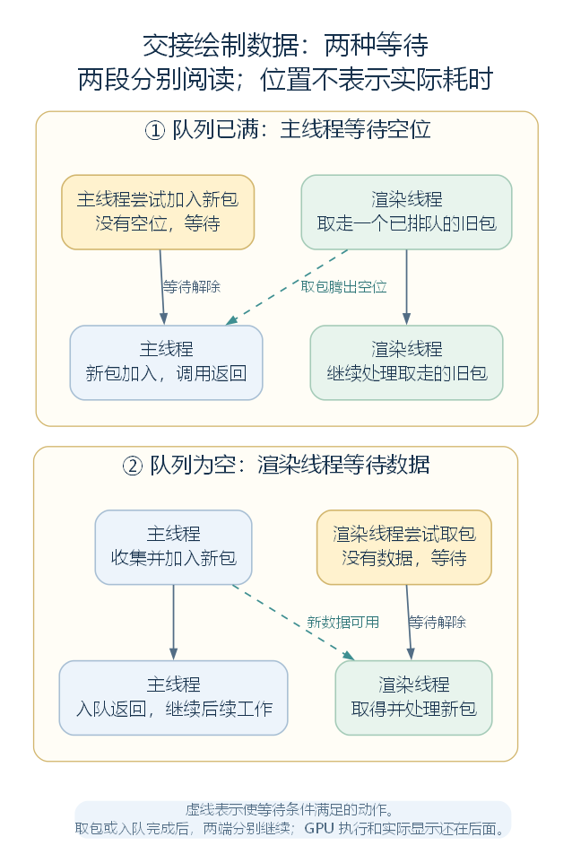

# 从启动到每一帧：Waylith 怎样驱动 RimWorld

在 RimWorld 的菜单里进行一次鼠标操作，程序要先收到输入，让界面判断如何响应，再准备绘制内容，最后把结果显示出来。进入殖民地后，地图、人物、界面和声音也需要不断获得更新的机会。

Waylith 将这些工作组织到持续运行的循环中。顺着一次启动和一轮更新往下看，就能理解游戏怎样持续运行，以及游戏状态怎样接上屏幕上的画面。

**省流速览**

- **游戏更新与渲染可以同时推进。** 主线程更新状态、收集绘制数据，渲染线程记录并提交绘制指令。这种分工本身，不能说明殖民者 AI、寻路等模拟工作使用了多少 CPU 核心。
- **渲染变慢也可能拖住后续更新。** 两条线程之间的队列容量有限，填满之后，主线程需要等待空位。
- **更新完成后，还要经过绘制、提交和显示。** 入队返回、GPU 完成工作和玩家看到画面，对应不同的进度。
- **最小化和失焦时，程序可能选择不同路径。** 引擎是否调用更新，要看窗口状态和后台运行设置；殖民地模拟是否推进，还受游戏自身的暂停状态影响。
- **画面帧率与殖民地模拟速度需要分别看。** 每秒显示多少帧（FPS），与每秒推进多少个游戏 tick（TPS），是两个不同的指标。

## 一、Waylith 总览：把更新与绘制接起来

Waylith 为游戏提供窗口、输入、计时、图形设备和持续运行的主循环。游戏侧通过相应入口，将地图、界面、音频等功能接到这个运行环境上。

正常窗口模式下，主线程先接收输入、调用更新，再收集本轮绘制需要的数据。渲染线程取得这些数据，记录绘制指令，并通过 Vulkan 提交给图形设备。Vulkan 是程序与图形设备交互的接口；提交之后，驱动、GPU 和呈现系统继续完成后面的工作。

[查看 SVG 矢量图](../../figures/waylith-release-overview.svg)。两条线程可以重叠推进：渲染线程处理上一份绘制数据时，主线程可以准备后续更新。

这里需要区分三种进度：主循环走完一轮、准备好一份绘制数据，以及游戏模拟向前推进一步，也就是一个 tick。主循环有时只等待窗口事件，有时更新但不绘制；游戏 tick 的安排还要继续进入游戏层研究。

## 二、引擎创建：先准备运行环境

程序从 `Program.Main` 开始，先读取启动配置，再创建 `EngineApplication`。这个应用对象组织窗口、计时、输入和渲染等工作，后面的主循环也由它执行。

普通启动会建立本机窗口和图形设备，并准备面向窗口的绘制目标。处理窗口与输入事件使用 GLFW，图形工作使用 Vulkan。窗口起初处于隐藏状态，进入主循环时再按配置显示。

应用创建时，还会建立负责组织绘制的 `FrameRenderer`。初始化阶段继续向它加入地图、世界和界面等模块的绘制功能。

启动配置中还有一种无窗口模式，称为 Headless。选择它时，程序跳过窗口与图形设备的建立，之后进入独立循环，保留更新入口，不创建普通窗口路径中的渲染线程，也不向它发送绘制数据。这个选择发生在启动时，最小化窗口不会自动切换成 Headless。

## 三、初始化：让 RimWorld 接上引擎

创建好应用，程序接着调用 `Bootstrap.Initialize`。Bootstrap 可以理解为 RimWorld 的启动配置代码：引擎已经提供了运行位置，这里再接好游戏要执行的功能。

初始化主要完成四类工作：

1. **建立兼容运行环境。** 游戏代码仍然会使用 GameObject、组件、Update 等 Unity 风格的接口。兼容层负责管理这些对象，并将它们接到 Waylith 的更新流程中。
2. **保存以后要调用的函数。** 例如，每轮更新要执行的代码被保存到 OnUpdate，收取输入之前要做的工作也登记到相应位置。
3. **配置具体功能。** 设置路径和资源入口，连接输入与音频，向 FrameRenderer 加入世界、地图、界面等绘制功能。
4. **准备初始场景。** 登记 Entry、Play 两个场景的构建方法，并立即建立 Entry 的基础对象。

这里的“登记”只是先保存函数。执行初始化时，程序会记下以后更新需要做什么；等主循环走到指定位置，才调用已经保存的函数。这种交给另一段代码、由它在相应位置调用的函数，通常称为回调函数。

场景则是兼容层按名称组织的一组运行对象。Entry 对应启动、菜单和进入游玩前的准备阶段；Play 对应新游戏或存档中的游玩阶段。建立场景时先准备相机、音频监听和游戏入口组件，地图与存档内容由后续游戏代码继续建立或载入。

因此，初始化结束说明更新和绘制的入口已经接好、初始场景的基础对象已经存在。游戏数据载入、菜单建立等工作，还会通过随后得到调用的游戏代码继续完成。

## 四、两条线程与三个队列

接下来的主线围绕主线程和渲染线程展开。主线程从程序入口延续下来，执行初始化、输入处理、游戏更新和绘制数据采集；渲染线程专门处理取得绘制资源、记录指令和提交等工作。计算任务、音频等还可以使用其他线程。

这两条线程附近会遇到三个用途不同的队列：

| 队列 | 保存什么 | 怎样得到处理 |
| --- | --- | --- |
| 主线程待执行函数队列 | 需要主线程执行的函数与参数 | 主线程在更新前取出并调用 |
| 渲染回调队列 | 通过相应接口保存的函数 | 主线程在一轮循环开头取出并调用 |
| 绘制数据队列 | 主线程收集好的本轮绘制数据 | 渲染线程逐包取出并处理 |

前两个队列让代码先保存函数，再在主线程的指定位置执行。第三个队列负责交接绘制数据，连接主线程与渲染线程。

渲染回调队列的保存与执行机制已经确认，但当前语料中尚未定位实际向它加入函数的位置。因此，不能仅凭这个名称推断渲染线程每帧都会向主线程返回一条结果。

## 五、主线程：一轮工作怎样推进

初始化返回后，主线程进入 `RunLoop`。在普通窗口路径里，它先启动渲染线程，再反复检查窗口是否请求关闭，并根据当前状态决定这一轮怎样继续。

### 5.1 先计时、维护资源，再接收输入

每轮开头，主线程处理渲染回调队列，检查渲染线程是否发生故障，然后读取计时器，取得两个值：从应用计时器启动起累计经过的时间，以及与上轮采样之间的时间差。

例如，上轮采样是 12.000 秒，本轮是 12.020 秒，本轮累计时间约为 12.020 秒，时间差约为 0.020 秒。后面的更新会读取这些已经保存的值。

它们表示现实经过的时间。上一轮更新、队列等待和限速都可能影响两次采样的间隔；某些轮次只等待事件，没有调用游戏更新，因此这个时间差也不能一概理解为两次游戏更新之间的间隔。

随后，主线程维护纹理等资源，执行输入轮询前登记的函数，再收取窗口事件。菜单中的鼠标按下，就是在这一阶段经输入桥接代码记录下来，供后面的界面处理使用。

### 5.2 根据窗口状态选择路径

普通可见窗口失去焦点，而且禁止后台运行时，主线程会等待窗口事件，跳过本轮更新与绘制。若没有走失焦等待路径，却因最小化等原因无法绘制，程序仍可以调用更新，只跳过新的绘制数据采集。

[查看 SVG 矢量图](../../figures/waylith-release-mainloop.svg)。图中简化了正常运行的一轮，退出与异常路径省略。

调整窗口大小时，已有绘制目标也可能需要重建。在 Vulkan 中，Surface 表示窗口的呈现目标，交换链围绕它提供一组可绘制、可呈现的图像。窗口尺寸变化后，这些图像及依赖资源可能需要重新建立。

重建前，主线程先等待渲染线程处理完待处理数据；替换资源时，再等待设备结束相关工作。如果取得的状态表明 Surface 已经丢失，还要重新创建 Surface。若当前尺寸为零，则推迟重建，等条件允许后再处理。

这也解释了为什么“窗口没有产生新画面”和“游戏没有得到更新机会”要结合具体路径判断。进入更新入口之后，模拟是否继续推进，仍受暂停等游戏层条件影响。

### 5.3 准备本轮环境，执行待处理函数

继续更新时，引擎调用 BeginFrame，保存本轮时间，开启临时内存的管理范围，并进行计算任务的帧维护。之后，主线程从自己的待执行函数队列中取出函数并依次调用，这个处理动作在源码中叫 Pump。

将函数加入队列，与实际执行函数，发生在不同位置。主线程走到这里才调用它们，执行过程中新增的函数也不保证本轮就处理到。

与 BeginFrame 对应，EndFrame 负责本轮收尾：结束临时内存范围、释放其中相应的临时分配，并推进引擎帧计数。正常绘制路径在数据入队后收尾，再进入限速；不能绘制、更新后请求退出或中途异常等路径，则按相应的收尾分支处理。

### 5.4 调用游戏更新，并推进兼容层

处理完待执行函数，主线程调用初始化时保存到 OnUpdate 的代码。它依次同步窗口尺寸、处理此前的截图与临时绘制资源、处理界面输入，再进入兼容层更新，随后完成启动状态检查、画面参数和音频更新。

在菜单输入的例子中，界面代码此时取得本轮鼠标状态，处理按下、抬起等事件，判断按钮是否响应。当前界面所需的绘制内容，会在后面的采集阶段准备。

兼容层的逐帧入口是 `UnityRuntime.Step`。它先保存时间、处理待切换的场景，再让 UnityWorld 调用组件的 Update 和 LateUpdate，最后执行屏幕相机相关的准备函数。

**这里的组件是什么？** 一个 GameObject 可以附加多个组件，将不同功能组合起来。例如 Transform 保存位置和父子关系，Camera 提供相机功能，脚本组件保存需要执行的代码。UnityWorld 管理这些对象及其运行状态，决定哪些组件应当得到调用。

继承 Behaviour 的组件拥有启用状态。脚本常用的 MonoBehaviour 又继承 Behaviour，提供协程等接口。组件的 Update 不会仅凭这个名字自行运行，需要由兼容层查找相应方法，并在状态符合条件时调用。

UnityWorld 的主要顺序可以这样读：

1. **准备对象状态。** 处理此前的销毁请求，继续激活组件，并安排尚未启动的组件调用 Start。Awake、OnEnable 等激活调用也可能已经在添加或启用组件时发生。
2. **执行 Update。** 先调用这一阶段登记的函数，再按执行顺序遍历当前活动组件，调用它们的 Update，随后执行更新后的阶段函数。
3. **执行 LateUpdate。** 重新取得此时的组件名单，调用下一阶段的函数与组件 LateUpdate，再处理一批销毁请求，执行后续阶段函数。
4. **返回外层。** 完成相机准备，返回 OnUpdate，继续音频等工作，最后回到 RunLoop。

两次组件名单分别取得，轮到每个组件时也会检查当前状态。因此，A 的 Update 如果先禁用了尚未轮到的 B，B 可以跳过本次 Update；如果 A 添加并激活了 C，C 不在已经取得的 Update 名单中，却可能进入随后重新取得的 LateUpdate 名单。

游玩场景中的 Root_Play 也是通过组件更新取得调用机会，再继续进入游戏的 UpdatePlay。殖民者、地图和游戏 tick 怎样推进，由这一入口后面的游戏代码组织。

### 5.5 更新返回后，收集绘制数据

本轮更新返回，没有退出请求且允许绘制时，FrameRenderer 先让各绘制模块做准备，再逐个收集它们提供的数据。地图、世界和界面通过共同接口参与这一过程，最后组成一份名为 `RenderFrame` 的数据包。

这份数据包保存本轮绘制所需的信息。将它交给渲染线程后，后者还要据此记录实际绘制指令。

菜单输入的例子在这里接上画面：前面的输入处理已经让界面判断如何响应；采集界面内容时，界面绘制功能调用已登记的构建函数，先处理布局，再准备重绘所需的内容，最后将结果交回 FrameRenderer。

输入处理和绘制准备因此位于主线程的不同位置。按钮怎样响应、菜单怎样改变，由界面代码决定；引擎负责安排这些调用，并把生成的绘制数据交给后续流程。

### 5.6 用限速安排主循环节奏

绘制数据入队、完成本轮收尾之后，主线程根据目标帧率判断是否还需要等待。算法从本轮前部的时间采样点计时，用目标时长减去已经花费的时间，只补足剩余部分。

目标为 60 帧时，每轮预算约为 16.67 毫秒。若到限速位置只用了 8 毫秒，还有约 8.67 毫秒可以等待；若已经用了 20 毫秒，就直接继续。队列里多等了几毫秒，末尾可等待的时间也会相应减少。

等待时间较长时，算法先让线程睡眠大部分剩余时间，再反复检查时钟，补足末尾的一小段。实际唤醒时间受线程调度影响，所以这并不保证画面严格每 16.67 毫秒显示一次。

目标值最初没有启用，游戏的 Root 公共初始化随后会按当前显示模式的刷新率设置目标帧率。这里控制的是主循环的节奏，游戏暂停和倍速怎样影响 tick，则由游戏层的调度继续决定。

## 六、渲染线程：把绘制数据变成指令

主线程将 RenderFrame 加入队列后，渲染线程逐包取出并处理。它先取得本次需要的图像、指令缓冲和相关绘制资源。指令缓冲可以理解为准备交给 GPU 执行的一份操作记录。

这些资源可能仍被此前的图形工作使用，所以取得资源时可能需要等待。若窗口或 Surface 状态要求重建，渲染线程会登记请求，由主线程在前面介绍的位置处理。

成功取得资源后，渲染线程开始记录指令。FrameRenderer 根据数据包，调用各绘制模块，将相应操作写入指令缓冲。记录结束，再进入图形提交和呈现过程。

处理完一个包，渲染线程继续取下一个。队列为空时，它等待新数据；提交后仍需保留的数据与资源，则按后续复用和清理条件回收。

## 七、交接与显示：为什么几种“完成”要分开看

主线程与渲染线程之间使用容量有限的队列。加入时有空位，主线程就能完成入队；没有空位，就等待渲染线程取包。反过来，渲染线程取包时没有数据，就等待主线程加入新包。

[查看 SVG 矢量图](../../figures/waylith-release-handoff.svg)。两种情形分别阅读；图中位置不表示实际耗时，也不限定入队返回与另一端取得数据之间的调度先后。

**取走一个包，就能腾出队列空位。** 这个包此时还可能需要等待绘制资源、记录指令，再由 GPU 执行。因此，主线程可以在渲染线程处理旧包时继续准备后续更新；但如果渲染线程处理不过来，队列填满后，主线程也会被拖住。

渲染线程记录完指令后，通过 Vulkan 的图形队列提交，并请求呈现指定的交换链图像。提交参数中的同步条件规定相关绘制阶段和呈现工作的先后关系；GPU 和呈现路径继续按这些条件推进。提交或呈现调用返回时，对应画面未必已经显示出来。

沿这条链路，可以区分几种完成位置：

| 到达的位置 | 此时完成了什么 |
| --- | --- |
| 主线程入队返回 | 绘制数据已交给队列，主线程可以继续后续工作 |
| 主线程 EndFrame | 本轮临时内存与帧计数收尾完成 |
| 渲染线程处理收尾 | 一个包的 CPU 处理走到收尾位置，相关 GPU 工作仍可能继续 |
| GPU 对应提交完成 | 相应指令已经执行完成，后续可按完成条件复用相关资源 |
| 画面显示 | 呈现路径已将图像送到实际显示阶段 |

回到开头的鼠标操作：窗口事件先被记录，界面在更新入口处理输入；绘制采集准备当前菜单的内容，RenderFrame 将它们交给渲染线程，再经过指令记录、提交、GPU 执行和呈现，成为玩家看到的画面。

主线程、渲染线程和图形设备分别在这些位置推进，相互之间通过队列与完成条件协调。Waylith 就这样把游戏获得更新机会、准备绘制内容和输出画面的过程连接起来。

---

发布版 v1.0。本文依据 RimWorld 1.7.4982 rev1280 的静态源码解析整理；方法、分支与源码节选的详细对照，见 [完整解析版](article.md)。
