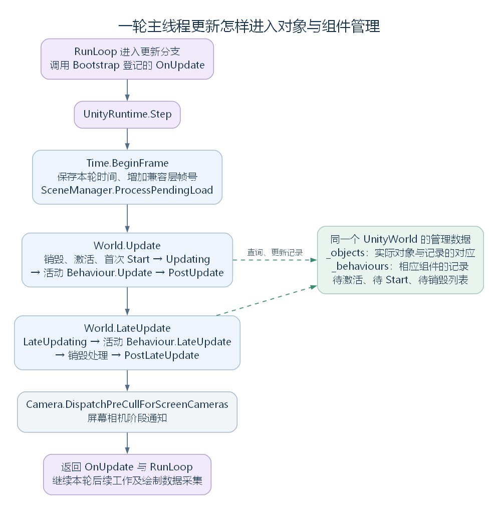
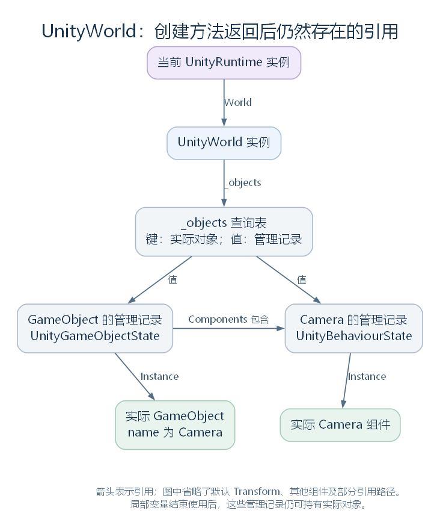
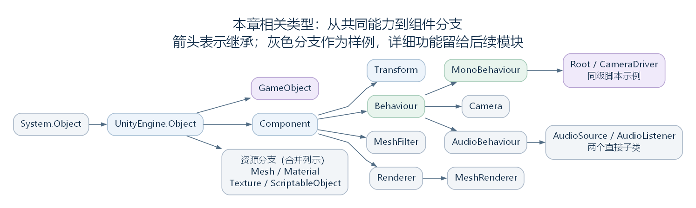
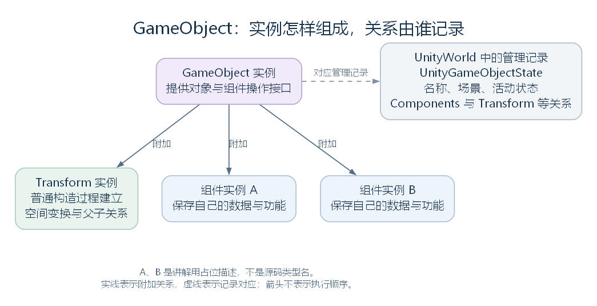
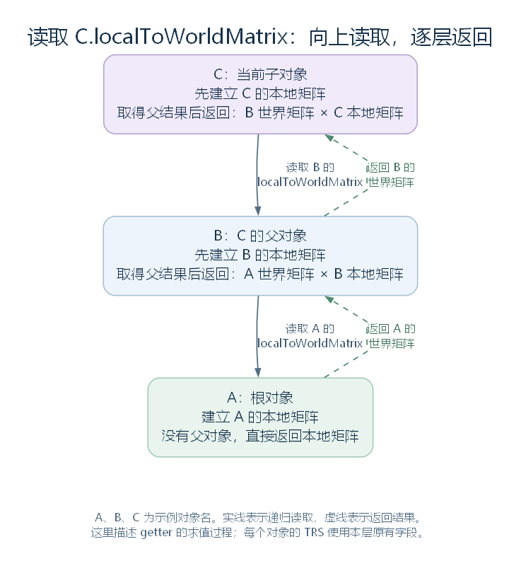
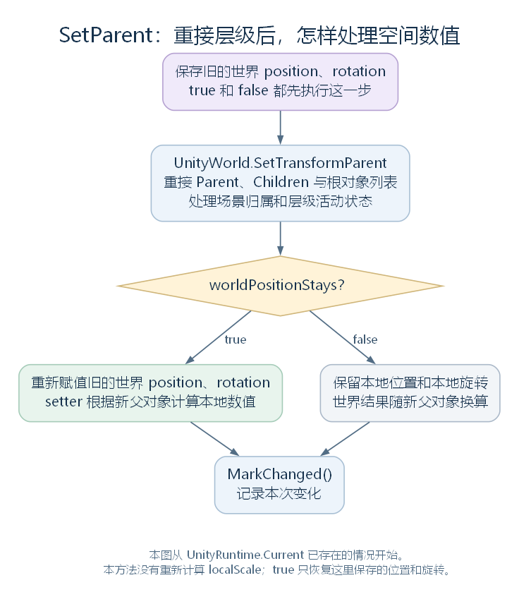
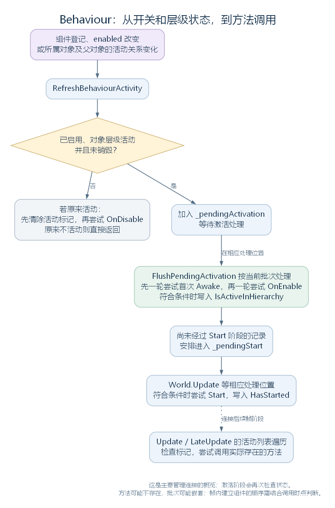

# 从每一帧到对象与组件：UnityWorld 与 UnityEngine.Object

版本：整合草稿 v0.1｜整理日期：2026-10-24

> 本稿保留为整合底稿。已定稿的阅读入口为 [完整解析版 v1.0](article.md) 与 [发布版 v1.0](release.md)。

本文依据 RimWorld 1.7.4982 rev1280 的兼容层与游戏代码，解释主线程的一次更新怎样进入对象管理，场景对象和组件怎样建立关系，以及各级类型分别增加了哪些能力。

**阅读前可以先记住五点：**

- **创建对象，还需要接入管理。** 普通场景对象通过 UnityWorld 登记，后续查询、启停和相应的方法调用才有了共同的管理关系。
- **继承与组件组成是两种关系。** Camera 与 AudioListener 可以附加在同一个 GameObject 上；它们各自沿类型树继承能力，也各自是独立实例。
- **局部变量结束使用，对象可以继续存在。** UnityWorld 及其记录保留着对象引用，之后的代码仍可查询并使用这些实例。
- **名字叫 Update，还需要有人调用它。** UnityWorld 识别相应组件分支，查找约定方法，再按当前状态与顺序执行。其他组件也可能使用专门的驱动入口。
- **这套组件管理只是游戏运行的一层。** Root_Play 等脚本通过它进入游戏流程；Pawn、ThingComp 和单 tick 的工作还使用游戏层自己的组织方式。

本文保留理解主线所需的源码节选和定位。代码中的类型、方法和变量沿用原名；讲解用例会单独注明。定位写成 `Waylith.UnityCompat.UnityWorld.cs:708`，行号对应当前本地反编译文件，供核对使用；语料不随仓库上传。

Camera、音频、网格绘制等分支在这里用于说明组件如何协作，其具体功能留给各自模块。协程也只保留理解 MonoBehaviour 与帧更新连接所需的内容。

## 一、从 UnityRuntime.Step 再次进入每帧更新

上一章已经走到主线程的更新入口：EngineApplication.RunLoop 进入执行更新的分支后，调用 OnUpdate 中登记的函数。Bootstrap.Initialize 事先登记的那段代码，会调用兼容运行时：

```csharp
Bootstrap._unityRuntime.Step(global::Waylith.Time.DeltaTime, global::Waylith.Time.Elapsed);
```

_unityRuntime 是当前使用的 UnityRuntime 实例。DeltaTime 表示这次采样的时间间隔，Elapsed 表示引擎采样的累计时间；它们以秒为单位，传给兼容层保存和使用。

先认识 Step 会用到的几个对象：

| 对象或类型 | 在这里的职责 |
| --- | --- |
| UnityRuntime | 组织兼容层的时间、场景对象管理与逐帧推进 |
| UnityTimeState，即运行时的 Time 属性 | 保存兼容层帧号、本轮时间间隔与累计时间 |
| SceneManager | 处理 Entry、Play 等兼容层场景的建立与切换 |
| UnityFrame | 将本轮帧号和时间组成一份数据，传给管理阶段及其登记函数 |
| UnityWorld，即运行时的 World 属性 | 管理 GameObject、组件及其状态，组织 Update、LateUpdate 等调用 |

Step 的完整实现很短：

```csharp
public void Step(float deltaTime, float elapsedTime)
{
    this.Time.BeginFrame(deltaTime, elapsedTime);
    SceneManager.ProcessPendingLoad();
    UnityFrame unityFrame = new UnityFrame(this.Time.FrameCount, deltaTime, elapsedTime);
    this.World.Update(in unityFrame);
    this.World.LateUpdate(in unityFrame);
    Camera.DispatchPreCullForScreenCameras();
}
```

按执行顺序，这次调用完成以下连接：

1. BeginFrame 增加兼容层帧号，并保存传入的时间数据。
2. ProcessPendingLoad 处理此前登记的场景切换请求，必要时卸载旧场景、建立新场景。
3. 创建 UnityFrame，将本轮时间交给同一个 World 的 Update 和 LateUpdate。
4. 最后由 Camera.DispatchPreCullForScreenCameras 尝试执行屏幕相机相关的阶段通知。

最后一步的具体相机处理留在相机模块。这里先明确：Step 按顺序安排兼容层的工作，绘制数据采集与交给渲染线程仍在后续主循环位置继续。



[SVG 矢量图](figures/step-and-world.svg)；[可编辑图源](figures/step-and-world.dot)。

UnityFrame 传给的是 World 的阶段方法及相应登记函数。具体组件仍可以声明无参数的 Update()；World 会通过后文说明的方法查找与调用机制执行它。

源码定位：Bootstrap 中的调用（`RimWorldWaylith.Bootstrap.cs:95`）、Step（`Waylith.UnityCompat.UnityRuntime.cs:106`）、兼容层时间写入（`Waylith.UnityCompat.UnityTimeState.cs:55`）、场景请求处理（`UnityEngine.SceneManagement.SceneManager.cs:83`）、相机通知入口（`UnityEngine.Camera.cs:631`）。

## 二、UnityWorld：先认识对象的管理者

### 2.1 World 在这里指什么

UnityWorld 是 Waylith.UnityCompat 命名空间中的管理类，负责登记场景对象与组件，记录它们的所属关系、状态和调用信息。玩家存档中的星球、地图等世界数据，属于游戏层的其他类型。

UnityRuntime 在属性初始化时建立它：

```csharp
public UnityWorld World { get; } = new UnityWorld();
```

因此，反复出现的 UnityRuntime.Current.World 可以逐段理解：取得当前兼容运行时，再取得它持有的对象管理实例。创建、查询、启停与每帧调用沿各自入口使用这个 World。

UnityWorld 没有继承 UnityEngine.Object，也不是可附加到 GameObject 上的组件。**它与实际对象建立管理和引用关系；后面的 UnityEngine.Object 类型树才描述继承关系。**

### 2.2 实际对象与管理记录

例如，一个实际 Camera 组件会有相应的管理记录。记录是另一个 C# 对象，保存编号、状态、所属对象和已找到的方法；记录中的 Instance 再指回实际 Camera。

UnityWorld 中最重要的查询表声明为：

```csharp
private readonly ConcurrentDictionary<object, UnityWorld.UnityObjectState> _objects = new ConcurrentDictionary<object, UnityWorld.UnityObjectState>(ReferenceEqualityComparer.Instance);
```

键是实际对象，值是对应的管理记录。ReferenceEqualityComparer.Instance 让查询表按引用身份区分对象。World 能通过实例查到状态，也能通过状态中的 Instance 取得原来的实例并调用其方法。

与本章有关的成员可以先这样分组：

| 成员 | 保存什么 | 主要用途 |
| --- | --- | --- |
| _objects | 实际对象到管理记录的对应关系 | 取得名称、编号、所属关系和状态 |
| _rootGameObjects | 根 GameObject 的管理记录 | 作为层级管理、场景卸载和递归销毁的起点 |
| _behaviours | Behaviour 分支组件的管理记录 | 安排相应约定方法的调用顺序 |
| _pendingActivation | 待激活的 Behaviour 记录 | 在相应位置处理 Awake、OnEnable 等阶段 |
| _pendingStart | 等待 Start 的 Behaviour 记录 | 安排首次 Start 阶段 |
| _pendingDestroy | 待销毁对象的记录 | 将销毁请求连接到实际处理位置 |

这里的待处理列表保存“接下来需要处理哪些记录”，没有把组件的方法体复制进去。执行时仍需取得记录中的实际实例及相应方法。

管理记录也有自己的继承层次：

| 内部记录类型 | 在共同记录之上增加什么 |
| --- | --- |
| UnityObjectState | 共同的 Instance、InstanceId、Name、CreationIndex、Destroyed |
| UnityGameObjectState | Components、Transform、ActiveSelf、SceneName 等对象组成与状态 |
| UnityComponentState | GameObject 所属记录与 Messages 方法缓存 |
| UnityTransformState | Parent 与 Children 父子关系 |
| UnityBehaviourState | Enabled、IsActiveInHierarchy、HasAwoken、HasStarted 等运行状态 |

这张表描述 World 内部的数据组织。它和后面的 GameObject、Component、Transform 等公共类型是相互对应、相互引用的两套对象。



[SVG 矢量图](../../figures/unityworld-object-references.svg)；[可编辑图源](../../figures/unityworld-object-references.dot)。箭头表示引用关系。

### 2.3 创建方法返回后，对象为什么还在

创建代码中的 gameObject、component 等局部变量只在相应调用中使用。方法返回后，World 的查询表和记录仍然持有实际对象的引用，后续查询依然可以取得它们。

局部变量名、对象的 name，以及对象何时被销毁，是三件不同的事。将局部变量改名，不会改动已创建对象的名称；局部变量结束使用，也不会自动触发兼容层销毁。

引擎的销毁处理会更新关系、移除登记并调用相应通知。C# 内存何时回收，还取决于其他存活对象是否继续持有引用，由垃圾回收器另行决定。

这一说明主要针对经 World 登记的场景对象与组件。其他资源对象还可能由 AssetRegistry 等类型登记，不能将所有 UnityEngine.Object 的存活方式都归为同一条路径。

源码定位：World 声明与创建（`Waylith.UnityCompat.UnityWorld.cs:20`、`Waylith.UnityCompat.UnityRuntime.cs:42`）、查询表与列表（`Waylith.UnityCompat.UnityWorld.cs:1577`、`Waylith.UnityCompat.UnityWorld.cs:1592`、`Waylith.UnityCompat.UnityWorld.cs:1595`、`Waylith.UnityCompat.UnityWorld.cs:1618`、`Waylith.UnityCompat.UnityWorld.cs:1624`、`Waylith.UnityCompat.UnityWorld.cs:1630`）、内部记录（`Waylith.UnityCompat.UnityWorld.cs:1658`、`Waylith.UnityCompat.UnityWorld.cs:1694`、`Waylith.UnityCompat.UnityWorld.cs:1740`、`Waylith.UnityCompat.UnityWorld.cs:1761`、`Waylith.UnityCompat.UnityWorld.cs:1798`）。

### 2.4 Update 怎样组织一轮工作

先将源码中即将出现的方法说明清楚：

| 方法或阶段 | 作用 |
| --- | --- |
| ProcessPendingDestroy | 处理已经登记的销毁请求 |
| FlushPendingActivation | 检查待激活 Behaviour，尝试调用 Awake、OnEnable，并安排尚未经过的 Start 阶段 |
| FlushPendingStart | 对仍符合条件的记录尝试调用首次 Start |
| InvokeMessagesForActiveBehaviours | 遍历相应组件记录，尝试执行指定的约定方法 |
| Updating、PostUpdate 等事件 | 保存其他代码登记的阶段函数，在这里直接传入 UnityFrame 调用 |
| FrameProfiler.Scope | 为性能统计标记当前执行范围 |

World.Update 的完整方法如下：

```csharp
public void Update(in UnityFrame frame)
{
    using (FrameProfiler.Scope("World.Update"))
    {
        this.ProcessPendingDestroy();
        this.FlushPendingActivation();
        this.FlushPendingStart();
        Action<UnityFrame> updating = this.Updating;
        if (updating != null)
        {
            updating(frame);
        }
        this.InvokeMessagesForActiveBehaviours(UnityWorld.UnityMessageType.Update);
        Action<UnityFrame> postUpdate = this.PostUpdate;
        if (postUpdate != null)
        {
            postUpdate(frame);
        }
    }
}
```

因此，这一阶段先处理对象状态与首次启动，再执行更新前登记的函数，之后才尝试调用活动 Behaviour 的 Update，最后执行更新后登记的函数。

阶段事件是一组在固定位置调用的函数。它们可以让协程管理、组件驱动等功能接入这一轮工作；登记顺序与组件列表的类型执行顺序是不同的组织方式。

### 2.5 LateUpdate 在整轮 Update 之后

Step 完成整个 World.Update 调用后，才进入 World.LateUpdate：

```csharp
public void LateUpdate(in UnityFrame frame)
{
    using (FrameProfiler.Scope("World.LateUpdate"))
    {
        Action<UnityFrame> lateUpdating = this.LateUpdating;
        if (lateUpdating != null)
        {
            lateUpdating(frame);
        }
        this.InvokeMessagesForActiveBehaviours(UnityWorld.UnityMessageType.LateUpdate);
        this.ProcessPendingDestroy();
        Action<UnityFrame> postLateUpdate = this.PostLateUpdate;
        if (postLateUpdate != null)
        {
            postLateUpdate(frame);
        }
    }
}
```

这里先调用 LateUpdating，再尝试执行活动 Behaviour 的 LateUpdate，接着处理等待销毁的对象，最后调用 PostLateUpdate 中登记的函数。

Update 与 LateUpdate 是两次阶段遍历：先完成这一轮 Update 阶段，再进入 LateUpdate 阶段。两次遍历之间可以有对象创建、活动状态变化或销毁，不能假定两次面对完全相同的组件。

到这里，已经知道 World 怎样安排工作；哪些组件会进入 _behaviours、方法怎样被找到，留在 Behaviour 分支结合具体类型继续解释。

源码定位：两次阶段调用（`Waylith.UnityCompat.UnityWorld.cs:708`、`Waylith.UnityCompat.UnityWorld.cs:730`）、激活与 Start（`Waylith.UnityCompat.UnityWorld.cs:994`、`Waylith.UnityCompat.UnityWorld.cs:1042`）、待销毁处理（`Waylith.UnityCompat.UnityWorld.cs:1078`）、组件遍历入口（`Waylith.UnityCompat.UnityWorld.cs:1178`）。

## 三、沿类型树阅读：每一级增加什么

接下来从实际对象的类型继承出发。C# 的 System.Object 提供 GetType、Equals、GetHashCode、ToString 等基础接口；UnityEngine.Object 在它之上增加兼容层共同能力，然后分出场景对象、组件与资源等分支。



[SVG 矢量图](figures/object-type-tree.svg)；[可编辑图源](figures/object-type-tree.dot)。图中箭头从基类指向派生类，只列本章相关子树；灰色分支在正文说明职责与接点，详细功能留到后续模块。

阅读时可以分别问三个问题：

| 关系 | 要问什么 | 例子 |
| --- | --- | --- |
| 类型继承 | 这个类从父类取得什么，自己又增加什么 | Camera 继承 Behaviour 的状态接口 |
| 对象组成 | 一个 GameObject 上附加了哪些实际组件 | Camera 与 AudioListener 可以属于同一个对象 |
| 管理与调用 | 谁持有这些实例，在何时调用它们 | UnityWorld 按记录与约定方法安排更新 |

后文每一级都先说明相对于父节点增加的内容，再接回创建、查询或更新。资源分支在此只确定类型位置，其数据与加载留给对应模块。

## 四、UnityEngine.Object：名称、编号与共同对象操作

### 4.1 这一层提供哪些共同能力

UnityEngine.Object 直接建立在 System.Object 之上，主要增加：

| 内容 | 相关成员与作用 |
| --- | --- |
| 名称 | name、_fallbackName 与 OnNameChanged，连接自身名称和管理记录 |
| 实例编号 | GetInstanceID 与 fallbackInstanceId，提供运行中的对象识别值 |
| 销毁标记 | _destroyed 与 MarkDestroyed，记录已经完成的销毁状态 |
| 有效性判断 | ==、!=、隐式 bool 转换，让判断考虑销毁状态 |
| 共同操作入口 | Destroy、DestroyImmediate、Instantiate、FindObjects、DontDestroyOnLoad 等 |
| 资源登记 | 构造函数为 GameObject、Component 分支之外的实例登记资源弱引用 |

本层尚未声明组件所属关系、Transform、活动开关或 Update。后面的分支继承这些共同接口，再各自补充相应功能。

### 4.2 名称与实例编号为什么要访问 World

name 的 getter 先尝试读取 World 中的记录名称，取得 null 时返回自身 _fallbackName。setter 先保存这个后备名称，再尝试修改 World 记录，最后调用 OnNameChanged；后者是本类中主体为空的 protected virtual 方法，供派生类处理名称变化。

GetInstanceID 也优先使用 World 的登记值，完整实现如下：

```csharp
public int GetInstanceID()
{
    if (UnityRuntime.Current == null)
    {
        return this.fallbackInstanceId;
    }
    int instanceId = UnityRuntime.Current.World.GetInstanceId(this);
    if (instanceId != 0)
    {
        return instanceId;
    }
    return this.fallbackInstanceId;
}
```

每个 Object 还会通过本类静态计数器取得递减的后备编号。没有兼容运行时或没有相应 World 记录时，就返回这个后备值。实例编号用于运行中的识别，不是变量名、对象名称或引用的内存地址。

### 4.3 构造时的资源登记

AssetRegistry 是资源实例的登记类，Register 会保存资源的弱引用。Object 的构造函数按类型分支选择是否交给它登记：

```csharp
public Object()
{
    if (!(this is Component) && !(this is GameObject))
    {
        AssetRegistry.Register(this);
    }
}
```

GameObject、Component 及其后代继续通过场景对象流程登记；其他 Object 实例在这里加入 AssetRegistry。后者保存弱引用，登记本身不会用强引用一直保住资源实例。

这个构造函数没有独自完成场景组件的所属关系，也没有安排 Start、Update。还需要继续看 GameObject 构造、AddComponent 与 World 补上的步骤。

源码定位：Object 的声明与构造（`UnityEngine.Object.cs:9`、`UnityEngine.Object.cs:22`）、名称、编号与后备字段（`UnityEngine.Object.cs:145`、`UnityEngine.Object.cs:165`、`UnityEngine.Object.cs:288`）、名称变化入口（`UnityEngine.Object.cs:283`）、资源登记（`UnityStubs.Internal.AssetRegistry.cs:12`）。

### 4.4 销毁完成，与引用变量仍然存在

Destroy 与 DestroyImmediate 接收 Object，再按运行时和登记情况选择路径：

| 情况 | 继续做什么 |
| --- | --- |
| 目标已经被相应空值判断判为无效 | 直接返回 |
| 没有运行时，或目标没有 World 登记编号 | 若实现 IDisposable，先调用 Dispose，再设置自身 _destroyed |
| 目标已由 World 登记 | 交给 World.DestroyObject，分别请求延后处理或立即处理 |

World 仍会判断目标是否允许销毁。对允许销毁的普通场景对象，处理涉及所属关系、组件及子对象、停用和销毁方法，以及移除登记。完成时，ObjectDestroyed 通知已经接上的 Object.MarkDestroyed，更新实际对象的销毁标记。

因此，需要区分“发出请求”“兼容层完成销毁”和“托管内存可以回收”三个时点。普通 Destroy 刚登记请求时，不保证已经完成后两项。

UnityEngine.Object 还重载了比较和 bool 转换。以一个已设置销毁标记、但 C# 引用仍然非空的实例为例，假定下表中的讲解变量 obj 静态类型为 UnityEngine.Object：

| 表达式 | 此例结果 | 检查内容 |
| --- | --- | --- |
| obj == null | true | 本类运算符将已销毁实例视为无效 |
| ReferenceEquals(obj, null) | false | 引用仍指向实际实例 |
| obj is null | false | 引用本身没有变成 null |
| if (obj) | 不进入分支 | bool 转换考虑引用和销毁状态 |

这组行为不自动扩展到所有比较方式。表达式的静态类型会影响运算符选择；本类也没有覆写 Equals 和 GetHashCode。

源码定位：销毁入口与标记（`UnityEngine.Object.cs:47`、`UnityEngine.Object.cs:77`、`UnityEngine.Object.cs:31`）、下游目标检查（`Waylith.UnityCompat.UnityWorld.cs:666`）、实际销毁（`Waylith.UnityCompat.UnityWorld.cs:1112`、`Waylith.UnityCompat.UnityWorld.cs:1144`）、通知连接（`Waylith.UnityCompat.UnityRuntime.cs:55`）、有效性运算符（`UnityEngine.Object.cs:253`、`UnityEngine.Object.cs:267`）。运算符反编译文本中直接引用比较的显示歧义，及先前的 IL 核对说明，保留在 [Object 逐类阅读笔记](../../17-unityengine-object.md)。

### 4.5 其他共同入口先保留到哪一步

| 接口 | 本章需要知道的连接 |
| --- | --- |
| Instantiate | 通过 World 查找登记的创建函数；带变换参数的重载还会取得结果的 Transform 并应用设置 |
| FindObjectsOfType、FindObjectsByType | 将类型与活动筛选条件交给 World，具体查找范围由实现决定 |
| DontDestroyOnLoad | 取得相应 GameObject，递归修改层级的场景归属，影响卸载处理 |
| hideFlags | 当前 setter 记录未实现提示，不能只根据接口名称推断完整效果 |

当前 World.InstantiateObject 没有找到原对象对应的创建函数时，会返回原对象。这说明公共入口还依赖具体登记与实现；不能从一个熟悉的方法名推导任意实例都已支持完整复制。资源模板与创建函数在资源模块继续研究。

源码定位：实例化与各重载（`UnityEngine.Object.cs:180`）、World 的创建函数选择（`Waylith.UnityCompat.UnityWorld.cs:213`）、查找接口（`UnityEngine.Object.cs:12`、`UnityEngine.Object.cs:123`）、跨场景保留（`UnityEngine.Object.cs:113`、`Waylith.UnityCompat.UnityWorld.cs:602`）、hideFlags（`UnityEngine.Object.cs:274`）。

## 五、GameObject：将组件组织到同一个对象上

### 5.1 相对于 Object 新增什么

GameObject 继续使用父类的名称、编号、销毁和有效性判断，并增加以下组成接口：

| 新增能力 | 主要入口 |
| --- | --- |
| 取得默认空间组件 | transform |
| 附加功能组件 | AddComponent，以及接收组件类型的构造函数 |
| 查询已有组件 | GetComponent、GetComponents、TryGetComponent、InChildren 系列 |
| 控制对象活动状态 | activeSelf、activeInHierarchy、SetActive |
| 取得场景归属 | scene |
| 保存对象层编号 | layer |
| 按用途创建与查找 | CreatePrimitive、CreateAssetToken、Find |

GameObject 和它的每个组件分别是实际 C# 对象。当前兼容层中，组件列表主要保存在 World 的 UnityGameObjectState.Components；组件的管理记录再指回所属对象的记录。



[SVG 矢量图](../../figures/gameobject-composition-overview.svg)；[可编辑图源](../../figures/gameobject-composition-overview.dot)。图中占位名称用于说明多个独立实例怎样对应。

### 5.2 构造先建立默认 Transform 和所属关系

接受名称和组件类型的构造函数是：

```csharp
public GameObject(string name, params Type[] components)
    : this(name, new Transform(), false)
{
    foreach (Type type in components)
    {
        this.AddComponent(type);
    }
}
```

冒号后的调用先建立 Transform，再将它和名称交给私有构造函数；false 对应 isAssetToken，表示普通场景对象。随后才逐个添加传入的额外组件。

私有构造函数调用 World.InitializeGameObject，为实际 GameObject 和 Transform 分别建立记录、编号和相互关系，写入 _objects。普通对象还会记录当前活动场景，并进入根对象列表。没有传入其他组件类型，也仍然有这个默认 Transform。

### 5.3 AddComponent 如何建立具体组件

先认识它将调用的辅助方法：AddRequiredComponents 根据 RequireComponent 特性补齐所需类型；World.AddComponent 创建实例并登记所属关系；GameObject.Attach 为部分表现组件接入专门驱动。

泛型入口的完整实现如下：

```csharp
public T0 AddComponent<T0>()
{
    if (UnityRuntime.Current == null)
    {
        return default(T0);
    }
    this.AddRequiredComponents(typeof(T0));
    return (T0)((object)this.Attach(UnityRuntime.Current.World.AddComponent(this, typeof(T0))));
}
```

通常路径中，World.AddComponent 使用 Activator.CreateInstance 建立组件，建立相应管理记录并登记。请求已有默认 Transform 的相应路径会复用实例。属于 Behaviour 分支的组件会进一步插入 _behaviours，并检查活动条件。

在允许立即处理激活的情况下，Awake、OnEnable 可能在 AddComponent 返回之前就被调用；Start 则另行安排。因此，调用方在 AddComponent 后才设置的字段，不一定早于组件的首次初始化方法。

Attach 处理的另一种连接，是将 MeshRenderer 等登记到相应组件驱动。这个方法的名字并不表示它才开始建立通用所属关系，后者已经在 World 中完成。

### 5.4 查询取得已有实例，变量名只属于调用处

World.GetComponent 遍历所属对象的 Components，跳过已销毁记录，按 Type.IsInstanceOfType 检查实际实例，返回第一个匹配者；GetComponents 收集全部匹配实例。请求基类也可以匹配其派生实例。

普通查询不要求组件已启用，也不要求对象当前活动。TryGetComponent 同时报告是否找到，InChildren 系列再沿 Transform 层级扩展范围。它们都没有在查询缺失时自动创建目标组件。

游戏中的一段创建代码能将这些关系放在一起。以下摘自 BuildPlayScene 开头，保留原名：

```csharp
GameObject gameObject = new GameObject("Camera", new Type[]
{
    typeof(Camera),
    typeof(AudioListener)
});
Camera component = gameObject.GetComponent<Camera>();
```

执行后已有四个实际对象：GameObject、默认 Transform、Camera 组件、AudioListener 组件。最后一行取得已经附加的 Camera，并将引用保存到本函数局部变量 component 中。

gameObject、component 是变量名；GameObject、Camera 是类型；"Camera" 是传入的对象名称。局部变量名相同或不同，不会改变类型继承，也不会因为方法返回就自动移除这些对象。

源码定位：构造与额外组件（`UnityEngine.GameObject.cs:30`、`UnityEngine.GameObject.cs:42`）、World 初始化（`Waylith.UnityCompat.UnityWorld.cs:149`）、添加与辅助方法（`UnityEngine.GameObject.cs:64`、`UnityEngine.GameObject.cs:86`、`UnityEngine.GameObject.cs:112`）、World 中的创建与登记（`Waylith.UnityCompat.UnityWorld.cs:171`、`Waylith.UnityCompat.UnityWorld.cs:911`）、组件查询（`Waylith.UnityCompat.UnityWorld.cs:294`、`Waylith.UnityCompat.UnityWorld.cs:307`）、游戏创建案例（`RimWorldWaylith.Bootstrap.cs:785`）。

### 5.5 自身开关、父对象开关与场景

activeSelf 表示自身活动开关；activeInHierarchy 还考虑父对象链和销毁状态。假定当前对象未销毁：

| activeSelf | 父对象链 | activeInHierarchy |
| --- | --- | --- |
| true | 全部活动且未销毁，或没有父对象 | true |
| false | 任意 | false |
| true | 存在不活动或已销毁的父对象 | false |

SetActive 修改自身开关，让 World 重新检查本对象及子对象上的 Behaviour 状态。子对象自身的 activeSelf 可以继续保持原值，但它受父对象影响后的活动结果会改变。

scene 查询的是兼容层场景归属。Entry、Play 的卸载处理会从所属根对象开始，销毁相应层级与组件；一张 RimWorld 地图的创建和卸载还属于另一套游戏层流程。

源码定位：对象活动与场景接口（`UnityEngine.GameObject.cs:157`、`UnityEngine.GameObject.cs:232`、`UnityEngine.GameObject.cs:274`）、World 的状态设置与父链判断（`Waylith.UnityCompat.UnityWorld.cs:451`、`Waylith.UnityCompat.UnityWorld.cs:1318`）、场景名与卸载（`Waylith.UnityCompat.UnityWorld.cs:635`、`Waylith.UnityCompat.UnityWorld.cs:641`）。

## 六、Component：从组件找回所属对象

Component 是 UnityEngine.Object 的另一个直接子节点。它增加 gameObject、transform 和组件查询接口；当前本层没有新增字段，也没有声明 enabled 或 Update。

World.GetGameObject 根据 this 查到组件记录，再沿 GameObject 取得所属对象记录，最后返回其 Instance。Component 的 gameObject 属性通过这个方法取得所属对象：

```csharp
public GameObject gameObject
{
    get
    {
        return (GameObject)UnityRuntime.Current.World.GetGameObject(this);
    }
}
```

这个属性由管理关系取得所属对象；Component 本身没有另存一个同名字段。

World.GetTransform 对组件取得其所属对象的默认 Transform。transform 属性使用这条管理连接：

```csharp
public Transform transform
{
    get
    {
        return (Transform)UnityRuntime.Current.World.GetTransform(this);
    }
}
```

因此，同一 GameObject 上的 Camera、AudioListener 和 CameraDriver，读取各自 transform 时可以取得同一个 Transform 实例。

组件之间的查询也经过所属对象：GetComponent、GetComponents、TryGetComponent 找同对象上的已有组件，InChildren 系列沿所属对象的 Transform 层级继续查找。接受 List 参数的重载会清空调用者提供的列表，再填入查询结果，避免旧内容混在本次结果中。

这些接口以实例已经登记为前提。单独 new Component() 只建立一个 C# 对象，随后访问它的 gameObject 时，World 没有对应记录可以使用。正常的创建与组合路径是通过 GameObject 添加组件，再使用返回实例。

到这里，组成关系已经可以双向访问：GameObject 找自己的组件，组件找所属 GameObject 或同对象上的其他组件。具体子类再决定如何使用这种能力。

源码定位：类型与所属接口（`UnityEngine.Component.cs:8`、`UnityEngine.Component.cs:12`、`UnityEngine.Component.cs:22`）、查询与列表重载（`UnityEngine.Component.cs:31`、`UnityEngine.Component.cs:53`、`UnityEngine.Component.cs:67`）、World 的所属对象与 Transform 查询（`Waylith.UnityCompat.UnityWorld.cs:366`、`Waylith.UnityCompat.UnityWorld.cs:372`）、组件记录查找（`Waylith.UnityCompat.UnityWorld.cs:1376`）。

## 七、Transform：空间数据与父子层级

### 7.1 相对于 Component 新增什么

Transform 增加本地与世界空间的访问接口、位置与方向换算、父子关系、层级查询和变化标记。它也实现 IEnumerable，允许遍历直接子 Transform。

这里再次出现的“父子”是对象层级：一个 Transform 可以连接到另一个 Transform。Transform 在类型树上的父类仍是 Component。

当前实现将空间数据分成两处保存：

| 数据 | 保存或取得方式 |
| --- | --- |
| _localPosition、_localRotation、_localScale | 实际 Transform 实例自己的字段，初值分别为零位置、单位旋转、各轴 1 倍缩放 |
| Parent、Children | World 的 UnityTransformState 记录，连接父对象与直接子对象 |
| 世界位置、世界旋转与世界矩阵 | 读取时结合本地数据与父对象链计算 |
| hasChanged 所需计数 | Transform 自己的变化与清除计数，结合父链判断 |

因此，World 保存了层级关系，但不是所有位置数值都集中保存在 World。

### 7.2 本地位置如何换算到世界

localPosition 描述对象原点相对于父对象坐标系的位置；没有父对象时，它直接决定世界位置。position 则提供世界坐标下的位置读写。

先用只含平移的讲解例子：父对象位于 (10, 0, 20)，子对象 localPosition 为 (2, 0, 3)，世界位置就是 (12, 0, 23)。父对象再沿 x 轴移动 5，子对象的本地位置可以不变，读取世界位置时得到 (17, 0, 23)。

父对象有旋转或缩放时，还要将这些因素加入换算。Matrix4x4.TRS 将本地平移、旋转与缩放组合成矩阵；Transform 的私有 GetParentTransform 通过管理关系取得父 Transform。localToWorldMatrix 的完整 getter 为：

```csharp
public Matrix4x4 localToWorldMatrix
{
    get
    {
        Matrix4x4 matrix4x = Matrix4x4.TRS(this._localPosition, this._localRotation, this._localScale);
        Transform parentTransform = this.GetParentTransform();
        if (!(parentTransform == null))
        {
            return parentTransform.localToWorldMatrix * matrix4x;
        }
        return matrix4x;
    }
}
```

可以将矩阵理解为坐标换算规则：当前对象的本地规则先把一个本地点换算到父空间，再由父对象的世界规则继续换算。父对象的 getter 又会读取更上层，直到根对象。



[SVG 矢量图](../../figures/transform-matrix-chain.svg)；[可编辑图源](../../figures/transform-matrix-chain.dot)。A、B、C 是图中的讲解对象名称。

这个 getter 按需递归计算，本类没有保存一份必须等 Update 才刷新的世界矩阵缓存。父对象本地字段变化后，后续读取即可沿当前父链计算新结果。

position 的 getter 从世界矩阵取得平移部分。setter 走反向换算：若有父对象，将传入的世界位置通过父对象的 worldToLocalMatrix 换成本地位置，再保存到 _localPosition。

例如，父对象仍在 (10, 0, 20)，没有旋转，缩放变为 (2, 1, 2)。子对象 localPosition 为 (2, 0, 3) 时，世界位置是 (14, 0, 26)；将 position 指定为 (18, 0, 30)，setter 会把新的本地值保存为 (4, 0, 5)。这里假定变换可逆，使用正常非零缩放。

### 7.3 改变父对象时，哪些量会保留

parent 赋值与单参数 SetParent 默认请求保留世界位置。下面的方法会调用 World.SetTransformParent 修改 Parent、Children 和根对象列表等关系，并通过本类 MarkChanged 更新变化计数。双参数实现为：

```csharp
public void SetParent(Transform parent, bool worldPositionStays)
{
    if (UnityRuntime.Current == null)
    {
        return;
    }
    Vector3 position = this.position;
    Quaternion rotation = this.rotation;
    UnityRuntime.Current.World.SetTransformParent(this, parent);
    if (worldPositionStays)
    {
        this.position = position;
        this.rotation = rotation;
    }
    this.MarkChanged();
}
```

父关系改完之后，若 worldPositionStays 为 true，就将旧世界位置与旋转写回；setter 会按新父对象计算应保存的本地值。



[SVG 矢量图](../../figures/transform-set-parent-flow.svg)；[可编辑图源](../../figures/transform-set-parent-flow.dot)。

假定子对象原先没有父对象，位置为 (12, 0, 23)；新父对象仅平移到 (10, 0, 20)：

| worldPositionStays | 新 localPosition | 新世界位置 |
| --- | --- | --- |
| true | (2, 0, 3) | (12, 0, 23) |
| false | (12, 0, 23) | (22, 0, 43) |

当前方法没有重新计算 localScale，因而 true 不能推广为保留整个世界变换中的缩放。重接父对象也会影响场景归属与层级活动状态，World 会沿这条关系继续处理相应记录。

### 7.4 方向、查询和变化标记

其余接口先按作用分类：

| 接口 | 本章需要理解的作用 |
| --- | --- |
| localRotation、rotation | 分别提供本地与世界旋转，世界旋转按父链组合 |
| eulerAngles、localEulerAngles | 以三个角度读写旋转，实际仍通过 Quaternion 表示 |
| forward、right、up | 由世界旋转得到方向，不附加位置平移或缩放 |
| TransformPoint、TransformVector、TransformDirection 及各自 Inverse 方法 | 分别换算位置点、含长度的位移向量与方向；参与的平移、旋转和缩放不同 |
| childCount、GetChild、foreach | 访问直接子 Transform |
| GetSiblingIndex、SetSiblingIndex、Find、IsChildOf | 查询或调整层级关系，具体规则按调用需要继续查实现 |
| hasChanged | 用计数比较自己及父链的变化，清除标记后仍能识别之后的变化 |
| Translate、Rotate、RotateAround、LookAt | 在相关入口中计算并修改本地或世界空间状态 |

Transform 本层没有声明 Update。其他组件读取它的世界位置、方向或矩阵，才把这些空间状态用于观察、声音与绘制。更深入的空间计算在后续模块展开。

源码定位：Transform 类型与字段（`UnityEngine.Transform.cs:8`、`UnityEngine.Transform.cs:530`）、矩阵、位置与旋转（`UnityEngine.Transform.cs:95`、`UnityEngine.Transform.cs:112`、`UnityEngine.Transform.cs:139`、`UnityEngine.Transform.cs:253`）、父关系与 SetParent（`UnityEngine.Transform.cs:238`、`UnityEngine.Transform.cs:277`、`Waylith.UnityCompat.UnityWorld.cs:566`）、变化标记（`UnityEngine.Transform.cs:35`、`UnityEngine.Transform.cs:57`）、转换接口（`UnityEngine.Transform.cs:310`、`UnityEngine.Transform.cs:316`、`UnityEngine.Transform.cs:382`、`UnityEngine.Transform.cs:388`）、父子管理记录（`Waylith.UnityCompat.UnityWorld.cs:1798`）。

## 八、Component 的其他分支：用网格组件说明协作

Component 的后代可以直接增加具体功能。网格组件可以用来说明“保存数据”“使用数据”和“取得运行机会”怎样分开：

| 类型 | 父类 | 在组合中的职责 |
| --- | --- | --- |
| MeshFilter | Component | 保存 Mesh 引用，通过 sharedMesh、mesh 取得或设置网格 |
| Renderer | Component | 保存材质与绘制状态，提供组合网格、矩阵和材质槽的 DrawSubMeshes 方法 |
| MeshRenderer | Renderer | 在 FrameUpdate 中查询同对象的 MeshFilter，取得网格与 Transform 矩阵，再使用继承的绘制辅助方法 |

其中 Mesh、Material 属于 UnityEngine.Object 的资源分支。它们与 MeshFilter、MeshRenderer 是不同对象：前者提供资源数据，后者是附加在 GameObject 上的组件。

GameObject.CreatePrimitive 就会创建 GameObject、附加 MeshFilter 和 MeshRenderer，再给 MeshFilter 指定基本形状的网格。这个组合让多个组件围绕同一个 Transform 工作。

MeshRenderer 的每帧入口由 MeshRendererDriver 登记到 World.PostLateUpdate。驱动的 Tick 继续调用登记组件的 FrameUpdate。由此可以看出，组件获得调用机会还可以通过专门驱动实现。

Renderer.enabled 也由 Renderer 自己声明，供这条绘制路径读取；它的含义与下一节 Behaviour.enabled 的 World 启停管理需要分别看。材质如何实例化、DrawSubMeshes 如何组织各材质槽，以及绘制数据后续怎样提交，留到渲染模块。

源码定位：三个组件（`UnityEngine.MeshFilter.cs:6`、`UnityEngine.Renderer.cs:9`、`UnityEngine.MeshRenderer.cs:6`）、Renderer 的状态与辅助方法（`UnityEngine.Renderer.cs:65`、`UnityEngine.Renderer.cs:152`）、MeshRenderer 的入口（`UnityEngine.MeshRenderer.cs:29`）、基本形状组合（`UnityEngine.GameObject.cs:139`）、驱动登记与执行（`UnityStubs.Internal.MeshRendererDriver.cs:13`、`UnityStubs.Internal.MeshRendererDriver.cs:35`）。

## 九、Behaviour：组件开关怎样接入生命周期

### 9.1 本层只增加两个属性，状态由 World 管理

Behaviour 直接继承 Component，自己声明 enabled 与 isActiveAndEnabled。前者读写组件自身的启用开关，后者取得当前管理流程写入的活动组合结果；本类没有新增实例字段。

World.CreateComponentState 根据实际类型是否属于 Behaviour 分支，建立 UnityBehaviourState。RegisterComponent 把这种记录加入 _behaviours，并调用 RefreshBehaviourActivity 检查活动条件。

| 记录成员 | 保存什么 |
| --- | --- |
| Enabled | 组件自身开关，默认 true |
| IsActiveInHierarchy | 当前启停流程写入的组件活动标记 |
| HasAwoken | 是否已经经过首次 Awake 阶段处理 |
| HasStarted | 是否已经经过首次 Start 阶段处理 |
| GameObject、Instance、Messages | 所属对象、实际组件及约定方法的调用信息 |

isActiveAndEnabled 使用的 World 方法如下：

```csharp
public bool IsBehaviourActiveAndEnabled(object behaviour)
{
    UnityWorld.UnityBehaviourState behaviourState = this.GetBehaviourState(behaviour);
    return behaviourState.Enabled && behaviourState.IsActiveInHierarchy;
}
```

GetBehaviourState 用实际组件查到相应记录。这个 getter 直接读取管理标记，没有每次重新遍历父对象链。在普通、未销毁且启停处理已经完成的状态下，可以用下面的表理解最终结果：

| enabled | 所属 GameObject 自身与父链是否活动 | isActiveAndEnabled |
| --- | --- | --- |
| true | 是 | true |
| false | 任意 | false |
| true | 否 | false |

等待激活或正在执行启停方法时，仍要按标记的实际写入顺序判断。

### 9.2 开关修改如何变成 Awake、OnEnable 与 OnDisable

Behaviour.enabled 的 setter 调用 World.SetBehaviourEnabled。值改变时，World 先写入 Enabled，再重新检查活动条件；允许立即处理激活时，还会在这次赋值返回前执行激活处理。

三个入口先放在一起认识：

| World 内部方法 | 作用 |
| --- | --- |
| RefreshBehaviourActivity | 检查组件启用、对象父链活动与销毁状态；需要停用时调用 OnDisable，需要激活时登记记录 |
| FlushPendingActivation | 按当前批次处理待激活记录，尝试 Awake、OnEnable，并安排尚未经过的 Start |
| FlushPendingStart | 在相应处理位置检查尚未启动、未销毁且活动的记录，尝试调用 Start |

下面用到的 IsGameObjectActiveInHierarchy 检查所属对象的父链；InvokeMessage 尝试执行已经找到的约定方法，目标方法不存在时直接返回；_pendingActivationSet 避免重复登记。RefreshBehaviourActivity 的完整实现为：

```csharp
private void RefreshBehaviourActivity(UnityWorld.UnityBehaviourState behaviour)
{
    if (!behaviour.Enabled || !this.IsGameObjectActiveInHierarchy(behaviour.GameObject) || behaviour.Destroyed)
    {
        if (behaviour.IsActiveInHierarchy)
        {
            behaviour.IsActiveInHierarchy = false;
            this.InvokeMessage(behaviour, UnityWorld.UnityMessageType.OnDisable);
        }
        return;
    }
    if (this._pendingActivationSet.Add(behaviour))
    {
        this._pendingActivation.Add(behaviour);
    }
}
```

活动条件不满足时，原先活动的组件先清除标记，再尝试 OnDisable；满足条件时，记录进入待激活列表，之后仍会重新检查状态。



[SVG 矢量图](../../figures/behaviour-activation-overview.svg)；[可编辑图源](../../figures/behaviour-activation-overview.dot)。

当前批次的 FlushPendingActivation 先用一轮尝试首次 Awake，再用一轮尝试 OnEnable，并为符合条件的记录登记 Start。嵌套添加组件时另有单条记录的处理入口；各阶段也会重新检查状态。因此，“先 Awake 后 OnEnable”描述的是相应处理流程，不能扩大为所有场景对象都一次性完成同一阶段。

HasAwoken 与 HasStarted 表示经过相应首次阶段。实际类型可以没有对应方法，管理代码仍完成阶段标记。普通停用不清除这两个标记，所以再次激活通常只重新尝试 OnEnable。

这套实现的 Awake 也受启用和对象活动条件检查影响；AddComponent、enabled 赋值等操作还可能立即进入激活处理。具体建立时点会影响首次调用顺序，不能只套用一张固定的整场景初始化顺序表。

源码定位：Behaviour 的两个属性（`UnityEngine.Behaviour.cs:12`、`UnityEngine.Behaviour.cs:31`）、记录分类与登记（`Waylith.UnityCompat.UnityWorld.cs:877`、`Waylith.UnityCompat.UnityWorld.cs:911`）、开关与活动 getter（`Waylith.UnityCompat.UnityWorld.cs:475`、`Waylith.UnityCompat.UnityWorld.cs:493`）、活动检查与两种激活入口（`Waylith.UnityCompat.UnityWorld.cs:944`、`Waylith.UnityCompat.UnityWorld.cs:962`、`Waylith.UnityCompat.UnityWorld.cs:994`）、Start（`Waylith.UnityCompat.UnityWorld.cs:1042`）。

### 9.3 方法名怎样变成对实例的实际调用

Behaviour 的类体没有声明 Awake、Start、Update 等虚方法。World 通过实际类型查找这些约定名称，再保存可调用的函数：

| World 方法 | 主要工作 |
| --- | --- |
| GetMessages | 按类型取得或建立 Awake、OnEnable、Start、Update、LateUpdate、OnDisable、OnApplicationQuit、OnDestroy、OnGUI 的调用信息 |
| FindMessage | 从实际类型开始向基类查找无参数实例方法 |
| CompileMessage | 将找到的方法转换为可以接收实例并执行的函数 |
| InvokeMessage | 从记录的 Messages 选出函数，传入实际 Instance；没有方法就返回 |

FindMessage 的实现把查找范围写得很清楚：

```csharp
private static Func<object, object> FindMessage(Type type, string name)
{
    Type type2 = type;
    while (type2 != null)
    {
        MethodInfo method = type2.GetMethod(name, BindingFlags.DeclaredOnly | BindingFlags.Instance | BindingFlags.Public | BindingFlags.NonPublic, null, Type.EmptyTypes, null);
        if (method != null)
        {
            return UnityWorld.CompileMessage(method);
        }
        type2 = type2.BaseType;
    }
    return null;
}
```

它允许查找 public 与非 public 的无参数实例方法，当前类型未找到才继续向上。找到一个后立即返回，不会自动将继承链上的同名方法全部调用一遍。

查找结果按类型缓存，后续阶段重复使用这些调用函数。实际类型若自己声明 virtual 方法，子类仍按普通 C# 规则覆写；例如 Root_Play 覆写 Root.Update。需要父类逻辑时，具体实现自行调用 base.Update()。

### 9.4 每帧从哪些记录中选择

World 使用 InvokeMessagesForActiveBehaviours 遍历相应记录。CopyBehaviours 是本类清空目标列表、准备容量并复制引用的辅助方法：

```csharp
private void InvokeMessagesForActiveBehaviours(UnityWorld.UnityMessageType messageType)
{
    using (this._gate.EnterScope())
    {
        UnityWorld.CopyBehaviours(this._behaviours, this._behaviourDispatchScratch);
    }
    foreach (UnityWorld.UnityBehaviourState unityBehaviourState in this._behaviourDispatchScratch)
    {
        if (unityBehaviourState.IsActiveInHierarchy && !unityBehaviourState.Destroyed)
        {
            this.InvokeMessage(unityBehaviourState, messageType);
        }
    }
    this._behaviourDispatchScratch.Clear();
}
```

当前遍历范围由临时列表确定，再按记录当时的活动和销毁标记决定是否尝试调用。顺序优先比较登记的类型执行顺序，同值再比较 CreationIndex；没有专门值的类型使用默认顺序值。

Bootstrap 给 CameraDriver、WorldCameraDriver 登记 -103，给 Root_Entry 登记 -50，给 Root_Play 登记 -20。这让相应组件在同时参与同一阶段排序时取得指定先后；不同场景中的脚本不因此自动同时存在。

这一遍历的直接条件没有 HasStarted。World.Update 开头通常先处理 Start，但若组件在帧内其他时点才创建或激活，仍要按后续列表读取时点判断首次调用，不能由常规顺序推出所有情况都先 Start 后首次 Update 或 LateUpdate。

源码定位：查找、缓存与调用（`Waylith.UnityCompat.UnityWorld.cs:1468`、`Waylith.UnityCompat.UnityWorld.cs:1482`、`Waylith.UnityCompat.UnityWorld.cs:1499`、`Waylith.UnityCompat.UnityWorld.cs:1265`）、活动遍历与复制（`Waylith.UnityCompat.UnityWorld.cs:1178`、`Waylith.UnityCompat.UnityWorld.cs:1460`）、顺序比较（`Waylith.UnityCompat.UnityWorld.cs:1432`）、游戏顺序登记（`RimWorldWaylith.Bootstrap.cs:701`）。

### 9.5 功能子类只在这里建立接点

Behaviour 之后的功能分支，可以先按下面的职责认识：

| 类型 | 相对父类首先增加什么 | 本章使用的接点 |
| --- | --- | --- |
| Camera | 观察参数、坐标转换、相机阶段与绘制入口 | 读取同对象 Transform，使用脚本写入的观察参数 |
| AudioBehaviour | 当前类体为空，保留音频组件的共同中间类型 | AudioSource 与 AudioListener 继续由它派生 |
| AudioSource | 音频片段、播放控制与声源参数 | 用所属 Transform 提供空间声音的位置，并调用后端播放接口 |
| AudioListener | 当前监听器选择、监听位置与总音量入口 | 从所选实例的 Transform 读取位置和方向，交给音频后端 |

第五节的相机对象就组合了 Camera 与 AudioListener。之后 Bootstrap 还为它添加 CameraDriver；脚本能通过 GetComponent<Camera> 找到并缓存已有相机，然后通过相机参数和共享的 Transform 改变观察状态。

例如，CameraDriver.ApplyPositionToGameObject 中有下面两条连续语句：

```csharp
this.MyCamera.orthographicSize = this.RootSize;
this.MyCamera.transform.position = this.rootPos + this.shaker.ShakeOffset;
```

MyCamera 是 CameraDriver 查询并缓存 Camera 的属性，RootSize、rootPos 和 shaker 提供控制状态。这里先看清结果写到哪里：大小交给 Camera 参数，世界位置交给同对象的 Transform。怎样读取玩家操作、计算目标位置和处理抖动，留在相机模块。

音频也可用一个短例子解释启停管理的用途：AudioListener 自己声明 OnEnable、OnDisable，将当前实例加入或移出活动监听列表。World 提供调用机会，子类方法把状态变化转成具体工作。后端怎样选择监听位置、处理距离衰减或持续播放，在音频模块继续展开。

这些样例只说明共同组件能力如何被使用。相机的投影与纹理绘制、AudioSource 的各种播放路径，以及渲染后端的详细数据，都不在本章展开。

源码定位：功能类型（`UnityEngine.Camera.cs:13`、`UnityEngine.AudioBehaviour.cs:6`、`UnityEngine.AudioSource.cs:13`、`UnityEngine.AudioListener.cs:9`）、相机组件组合（`RimWorldWaylith.Bootstrap.cs:785`）、脚本查询与写入（`Verse.CameraDriver.cs:29`、`Verse.CameraDriver.cs:418`）、监听器启停（`UnityEngine.AudioListener.cs:50`、`UnityEngine.AudioListener.cs:59`）。

## 十、MonoBehaviour：脚本入口与必要的协程支持

### 10.1 本层增加什么，哪些方法来自具体脚本

MonoBehaviour 直接继承 Behaviour。当前兼容层中，本类只声明四个接口：

| 接口 | 作用 |
| --- | --- |
| useGUILayout | 当前 setter 为空 |
| StartCoroutine(IEnumerator routine) | 将迭代器及当前组件交给 CoroutineScheduler，并返回 Coroutine |
| StopCoroutine(Coroutine coroutine) | 请求停止所传 Coroutine 对应的记录 |
| StopAllCoroutines() | 请求停止所属对象为当前组件的协程记录 |

本类没有自己声明 Awake、Start、Update。游戏里的 Root 从 MonoBehaviour 继承共同组件能力，再自己声明 virtual Start、virtual Update 与 OnGUI；Root_Entry、Root_Play 继续派生并覆写相应方法。CameraDriver 则自己声明 Awake、Update 等接口，由相应路径取得调用。

所以，读到 Root_Play.Update 中的 base.Update()，它调用的是 Root 的实现，当前实例仍然是这个 Root_Play。继承的方法不会另建一个“父类组件实例”。

### 10.2 协程在本章只保留必要的管理连接

这里的协程可以先理解为保存进度、分段继续执行的过程。IEnumerator 提供 MoveNext 继续执行，Current 返回本次 yield 提供的对象；CoroutineScheduler 读取返回值，记录等待条件，在相应阶段继续推进。

Coroutine 是返回给调用者的对象，内部 Handle 指向 CoroutineHandle 管理记录。记录保存 Owner、迭代器栈、等待条件与完成标记；管理器使用这些信息连接前后的执行过程。

只为读通本章，需要区分管理器的三项工作：

| 方法 | 本章保留的职责 |
| --- | --- |
| Start | 建立并登记记录，立即推进一次 |
| Step | 在对应阶段检查记录的等待条件，选择能继续的协程 |
| Advance | 推进指定记录，执行到新的等待或结束，再保存状态 |

有了这些对象与方法的职责，再读 StartCoroutine 的完整方法体：

```csharp
public Coroutine StartCoroutine(IEnumerator routine)
{
    CoroutineHandle coroutineHandle = CoroutineScheduler.Start(this, routine);
    return new Coroutine
    {
        Handle = coroutineHandle
    };
}
```

管理器向 World 的 Updating、PostUpdate、PostLateUpdate 登记阶段函数，因而获得后续检查和执行机会。若约定方法返回 IEnumerator，World 也能通过运行时登记的 MessageCoroutineStarter 将它交给同一管理器。

在通常的主线程路径上，这些过程由主线程分段执行，每段仍占用当前线程的时间。组件的 enabled、协程是否等待和是否已被停止，是不同记录与判断的连接，详细条件需要继续查调度实现。

协程的嵌套栈、各种等待类型、帧末处理、停止与清理，以及等待时间和游戏 tick 的关系，将在进程与运行模块展开。本轮已经读过的详细材料保留在 [MonoBehaviour 与 CoroutineScheduler 笔记](../../28-monobehaviour.md)。

源码定位：本类全部接口（`UnityEngine.MonoBehaviour.cs:7`、`UnityEngine.MonoBehaviour.cs:11`、`UnityEngine.MonoBehaviour.cs:19`、`UnityEngine.MonoBehaviour.cs:29`、`UnityEngine.MonoBehaviour.cs:35`）、协程返回对象与记录（`UnityEngine.Coroutine.cs:6`、`UnityEngine.CoroutineHandle.cs:8`）、管理器入口（`UnityEngine.CoroutineScheduler.cs:15`、`UnityEngine.CoroutineScheduler.cs:134`、`UnityEngine.CoroutineScheduler.cs:188`）、阶段登记（`UnityEngine.CoroutineScheduler.cs:50`）、约定方法返回值的连接（`Waylith.UnityCompat.UnityWorld.cs:1265`、`Waylith.UnityCompat.UnityRuntime.cs:67`）。

### 10.3 从场景组件到游戏流程，停在入口

BuildPlayScene 还会建立名为 GameRoot 的 GameObject，并附加 Root_Play。它使用本章同一套登记、状态管理与方法查找，之后由 World 尝试调用其 Start、Update 等方法。

这里已经能把开头的 Step 接到游戏层：主线程进入 World.Update，World 选择活动的 Root_Play 记录，再调用实际实例的 Update，游戏流程由这个方法继续向下。

但 Pawn 并不沿 MonoBehaviour 继承；ThingComp 也不属于 UnityEngine.Component 这棵树。它们的运行由游戏层进一步组织。读通 World 的组件更新，只是找到进入游戏的一个入口，后续的 tick、地图与实体更新仍需按各自调用链解释。

Root 的共享更新、Root_Play 的游玩流程以及 Game.UpdatePlay 的内部调度，在进程与运行模块继续；此前进度保留在 [游戏入口笔记](../../07-waylith-root-play.md)。

源码定位：GameRoot 与脚本创建（`RimWorldWaylith.Bootstrap.cs:785`）、Root 继承与共同方法（`Verse.Root.cs:14`、`Verse.Root.cs:27`、`Verse.Root.cs:113`）、派生脚本更新（`Verse.Root_Play.cs:63`）、游戏实体与组件类型（`Verse.Pawn.cs:16`、`Verse.ThingComp.cs:12`）。

## 十一、本章之后，各条功能分支在哪里继续

本章建立的是更新与对象组织的共同基础。后续模块沿具体使用者继续，而不必重新解释对象所属关系、公共属性和约定方法怎样获得调用。

| 后续模块 | 已建立的接点 | 后面展开的内容 | 保留的讨论材料 |
| --- | --- | --- | --- |
| 相机与空间、输入 | CameraDriver 写入相机参数与 Transform；Camera 读取观察状态 | 拖动、缩放、坐标转换、子相机及观察范围 | [Camera](../../24-camera.md)、[Transform](../../21-transform.md) |
| 音频 | AudioSource、AudioListener 使用共同组件能力连接播放与监听 | 游戏声音选择、对象池、播放路径、音量、空间声音与后端 | [AudioBehaviour](../../25-audiobehaviour.md)、[AudioSource](../../26-audiosource.md)、[AudioListener](../../27-audiolistener.md) |
| 渲染与资源 | MeshFilter 保存网格，Renderer 保存材质，专门驱动调用绘制入口 | 网格与材质数据、绘制采集、具体 pass 与后端提交 | [网格组件](../../22-mesh-renderer-components.md)、[渲染模块笔记](../../15-rendering-module-notes.md) |
| 进程与运行 | World 调用脚本；CoroutineScheduler 接入帧阶段；Root_Play 进入游戏流程 | 协程详细调度、游戏初始化、更新、暂停与 tick | [MonoBehaviour 与协程](../../28-monobehaviour.md)、[游戏入口](../../07-waylith-root-play.md) |

本章基础部分的逐类核对材料仍保留：[UnityWorld](../../19-unityworld-overview.md)、[UnityEngine.Object](../../17-unityengine-object.md)、[GameObject](../../18-gameobject.md)、[Component](../../20-component.md)、[Transform](../../21-transform.md)、[Behaviour](../../23-behaviour.md)。这些材料保留较完整的成员索引与阅读过程，正文按本章主线选取需要的说明。

本文目前为整合草稿，供接下来逐段阅读和共同修订。上一章的引擎与线程主线见 [Waylith 完整解析](../01-waylith/article.md)，章节入口与范围说明见 [本章目录](README.md)。
