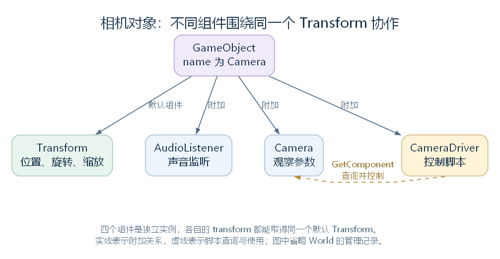

# 从每一帧到对象与组件：UnityWorld 与 UnityEngine.Object

拖动 RimWorld 的地图时，我们看到的是观察位置改变。代码里，这件事需要脚本获得更新机会，计算新的位置，再把结果写给相机及其空间组件。相机、脚本和空间数据分别由哪些对象负责，它们又怎样找到彼此？

上一章解释了 Waylith 怎样持续运行，并将绘制数据交给渲染线程。这一章从主线程的一次更新继续，认识兼容层中的对象与组件，以及负责管理它们的 UnityWorld。

**省流速览**

- **一个 GameObject 可以组合多个独立组件。** 相机、声音监听器和控制脚本可以属于同一个对象，共用它的 Transform。
- **方法返回后，创建的对象可以继续存在。** UnityWorld 的管理记录仍然持有引用，后续代码能够查到并使用这些对象。
- **Update 需要明确的调用来源。** World 为 Behaviour 分支查找并执行约定方法；其他组件也可以由专门的驱动调用。
- **对象活动与组件启用是两层开关。** 父对象不活动时，子对象上的相关组件也会受到影响。
- **这套组件管理只解释游戏运行的一层。** 殖民者、ThingComp 和游戏 tick 的调度，还要继续进入游戏层研究。

本文为发布版 v1.0，定稿于 2026-10-24，依据 RimWorld 1.7.4982 rev1280 的兼容层与游戏代码。保留的源码节选沿用原名；更完整的实现、边界和源码定位见 [完整解析版](article.md)。

## 一、一轮更新怎样来到组件这里

Waylith 主循环执行更新时，会调用 Bootstrap 事先向 OnUpdate 登记的函数。这段函数再调用 UnityRuntime.Step，将本轮时间交给兼容层。UnityRuntime 是组织兼容层时间、场景与对象管理的运行时对象。

这里的 Time 保存兼容层时间，World 是运行时持有的对象管理实例，SceneManager 处理场景请求。Step 的完整实现可以直接读下来：

```csharp
public void Step(float deltaTime, float elapsedTime)
{
    this.Time.BeginFrame(deltaTime, elapsedTime);
    SceneManager.ProcessPendingLoad();
    UnityFrame unityFrame = new UnityFrame(this.Time.FrameCount, deltaTime, elapsedTime);
    this.World.Update(in unityFrame);
    this.World.LateUpdate(in unityFrame);
    Camera.DispatchPreCullForScreenCameras();
}
```

deltaTime 是这次传入的时间间隔，elapsedTime 是累计时间，单位都是秒。Time.BeginFrame 保存它们并增加兼容层帧号；SceneManager 处理此前登记的场景切换请求。UnityFrame 将本轮帧号与时间组成一份数据，交给同一个 World 的两个阶段方法。

World.Update 先处理待销毁、待激活和首次 Start，再执行更新前登记的函数，尝试调用活动 Behaviour 的 Update，最后执行更新后登记的函数。整轮 World.Update 返回后，Step 才进入 World.LateUpdate。


[查看 SVG 矢量图](figures/step-and-world.svg)。图中的 Behaviour 是支持启停、由 World 安排约定方法调用的组件分支，后文会展开。

LateUpdate 同样有前后阶段：先执行 LateUpdating 中登记的函数，再尝试调用活动 Behaviour 的 LateUpdate，处理待销毁对象，最后执行 PostLateUpdate 中登记的函数。

这些事件让其他功能接入固定位置：先登记函数，World 到达该位置时再调用它们。协程管理和部分组件驱动都使用这种方式。UnityFrame 传给阶段函数；具体组件的 Update、LateUpdate 仍可以是无参数方法。

因此，这里的顺序是先完成整个 Update 阶段，再进入 LateUpdate 阶段。两者之间可能创建、停用或销毁组件，参与两次遍历的对象可以不同。Step 最后尝试执行屏幕相机的阶段通知，返回后，主循环继续后续工作与绘制数据采集。

## 二、UnityWorld 管理的是哪些对象

UnityWorld 负责登记场景对象和组件，保存所属关系与运行状态，安排相应方法的调用。它是兼容层中的管理类。存档中的星球、地图等世界数据，使用游戏层的其他类型。

UnityRuntime 持有一个 World。代码中的 UnityRuntime.Current.World，就是先取得当前兼容运行时，再取得它的对象管理实例。

理解它的结构，需要分清实际对象和管理记录。以一个 Camera 为例：实际 Camera 保存观察参数并提供相机功能；World 另建一份记录，保存它的编号、所属 GameObject、活动状态和已经找到的方法。记录中的 Instance 引用原来的 Camera，调用时仍然操作这个实际实例。

| World 保存的主要内容 | 用途 |
| --- | --- |
| 实际对象与管理记录的对应表 | 根据实例查到编号、所属关系与状态 |
| 根 GameObject 和组件组成关系 | 管理层级、场景归属与销毁；根对象的 Transform 没有父 Transform |
| Behaviour 记录列表 | 按相应顺序安排约定方法调用 |
| 待激活、待 Start、待销毁的记录列表 | 在规定位置继续处理状态变化 |

**管理记录与组件是两个不同的 C# 对象。** 记录引用实际组件；World 并没有把所有组件的数据和方法体搬进记录，位置数值、相机参数等数据仍可保存在实际组件中。

这也回答了一个常见疑问：创建函数返回后，局部变量结束使用，为什么相机还在？因为 World 的查询表和记录仍然持有引用。后续代码可以重新查询，取得同一个实例。局部变量名、对象的 name 和对象的存活时间，分别属于不同的事情。

UnityWorld 本身没有继承 UnityEngine.Object，也不能附加到 GameObject 上。接下来这棵类型树，才是在说明被管理对象之间的继承关系。

## 三、从 UnityEngine.Object 看类型树

C# 的 System.Object 提供 GetType、Equals 等基础接口。UnityEngine.Object 在它之上增加兼容层的共同对象能力，再分出 GameObject、Component 和资源等分支。


[查看 SVG 矢量图](figures/object-type-tree.svg)。箭头由基类指向派生类；图中只列相关分支，灰色功能分支的详细实现留给后续模块。

UnityEngine.Object 增加的共同能力主要有：对象名称 name、实例编号 GetInstanceID、销毁入口，以及考虑销毁状态的有效性判断。已登记的场景对象会通过 World 读取名称和编号；没有相应记录时，本类还提供后备值。

其中要特别区分三个时点：请求销毁、兼容层完成销毁、C# 内存可以被垃圾回收。普通场景对象的 Destroy 通常先登记请求，到 World 的处理位置再清理关系、移除登记并调用相应方法；其他代码仍持有引用时，托管对象还可能存在。

以已完成销毁、但引用仍非空的实例为例，下面的 obj 是讲解用变量，静态类型为 UnityEngine.Object：

| 判断 | 结果 | 原因 |
| --- | --- | --- |
| obj == null | true | UnityEngine.Object 的运算符把已销毁实例视为无效 |
| ReferenceEquals(obj, null) | false | 实际引用仍然存在 |
| obj is null | false | 引用本身没有变为 null |
| if (obj) | 不进入分支 | 本类的 bool 转换也检查销毁状态 |

这些结果依赖本类的运算符与静态类型，不能推广到任意比较方式。

Mesh、Material 等资源也沿 UnityEngine.Object 继承，却没有因此成为场景组件。Object 的构造函数会将 GameObject、Component 分支以外的实例交给 AssetRegistry 登记弱引用；弱引用本身不会一直保住对象。资源的持有、加载和释放，留在资源模块继续解释。

Object 还提供 Instantiate、查找对象、跨场景保留等入口。它们的具体效果依赖相应登记和实现；例如当前 World 没找到对应创建函数时，InstantiateObject 会返回原对象。阅读这套兼容层时，还需要沿调用继续确认熟悉接口的实际行为。

## 四、GameObject 与 Component 怎样组成一个对象

GameObject 与 Component 是 UnityEngine.Object 的两个直接分支。前者组织组件，后者提供访问所属对象及其他组件的共同接口。

游戏建立游玩场景时，有这样一段代码：

```csharp
GameObject gameObject = new GameObject("Camera", new Type[]
{
    typeof(Camera),
    typeof(AudioListener)
});
Camera component = gameObject.GetComponent<Camera>();
```

GameObject 构造时会先建立默认 Transform，并让 World 为两者登记记录和所属关系，然后依次添加传入的组件类型。执行这段代码后，已经有四个实际对象：GameObject、Transform、Camera、AudioListener。

最后一行查询已有 Camera，把引用存入本函数的局部变量 component。GameObject、Camera 是类型名，gameObject、component 是变量名，字符串 "Camera" 是对象名称；它们分别起作用。GetComponent 取得已有实例，找不到时返回空值，不会自动补建一个组件。

Bootstrap 随后还会添加 CameraDriver 控制脚本，形成下面的组合：



[查看 SVG 矢量图](figures/release-camera-composition.svg)。实线表示附加关系，虚线表示脚本查询并控制相机；它们不表示类型继承。

组件从 Component 继承的 gameObject 属性，可以找回所属对象；transform 属性则取得所属对象的默认 Transform。因此，这里的 Camera、AudioListener 和 CameraDriver 读取 transform 时，能取得同一个实例。

这也是组合的用途：控制脚本改变空间位置，相机使用它决定观察位置，声音监听器也能使用它确定监听位置。它们各自提供功能，通过共同的所属关系协作。

| 操作入口 | 实际作用 |
| --- | --- |
| GameObject.AddComponent | 创建并登记组件；还可能补齐所需组件或连接专门驱动 |
| GetComponent、GetComponents | 查找同对象上第一个或全部匹配实例；请求基类也可匹配派生实例 |
| Component.gameObject | 经 World 的记录取得所属 GameObject |
| GameObject.transform、Component.transform | 取得这个对象的默认 Transform |

普通组件查询不要求组件已启用或对象当前活动。单独 new Component() 则只创建了 C# 实例，没有建立 World 所需的所属记录；正常使用路径是通过 GameObject 添加组件。

此外，AddComponent 在符合条件时可能直接调用组件的 Awake、OnEnable，再返回给调用者。首次初始化并不一定等到下一帧；这会影响调用方添加组件后再设置字段的时机。

## 五、Transform 怎样表示空间与父子关系

Transform 在 Component 之上增加位置、旋转、缩放和对象层级。这里的父子关系指一个 Transform 连接到另一个 Transform；Transform 这个类型的父类仍然是 Component。

实际 Transform 保存本地位置、旋转和缩放；父对象与子对象的引用关系由 World 的记录保存。读取世界位置时，再将本地数值与父对象的空间变换组合起来。

先看一个只含平移的讲解例子：

| 状态 | 父对象世界位置 | 子对象 localPosition | 子对象世界位置 position |
| --- | --- | --- | --- |
| 初始 | (10, 0, 20) | (2, 0, 3) | (12, 0, 23) |
| 父对象沿 x 轴移动 5 | (15, 0, 20) | (2, 0, 3) | (17, 0, 23) |

子对象的本地位置保持不变，但读取世界位置时，父对象的移动已经参与计算。加入旋转和缩放后，代码使用变换矩阵逐层换算：当前对象的本地矩阵与父对象的世界矩阵组合，父对象再向上读取，直到没有父对象的根。

设置 position 时会反过来计算。如果父对象有正常、可逆的变换，Transform 先将指定的世界位置换算到父对象坐标系，再保存本地位置。

改变父对象则需要选择保留哪种位置。假定子对象原先没有父对象，位置为 (12, 0, 23)，新父对象仅平移到 (10, 0, 20)：

| SetParent 的 worldPositionStays | 修改后的本地位置 | 修改后的世界位置 |
| --- | --- | --- |
| true | (2, 0, 3) | (12, 0, 23) |
| false | (12, 0, 23) | (22, 0, 43) |

parent 赋值与单参数 SetParent 默认使用 true。当前实现保留的是世界位置和旋转，没有重新计算 localScale，因而不能把它理解为连世界缩放也完整保持。

Transform 本身没有声明 Update。它提供可以读写和换算的空间状态，由相机、声音、绘制组件与脚本在各自获得调用时使用。

## 六、Component 的其他分支怎样使用这些关系

并非所有功能组件都沿 Behaviour 继承。网格组件正好可以说明另一种组合：

| 类型 | 父类 | 在组合中做什么 |
| --- | --- | --- |
| MeshFilter | Component | 保存 Mesh 网格引用 |
| Renderer | Component | 提供材质、绘制状态与 DrawSubMeshes 等共同方法 |
| MeshRenderer | Renderer | 查询同对象的 MeshFilter，结合 Transform 矩阵，使用继承的绘制方法 |

GameObject.CreatePrimitive 会建立 GameObject，附加 MeshFilter、MeshRenderer，再为前者指定基本形状的网格。Mesh、Material 是资源实例；MeshFilter、MeshRenderer 才是附加在场景对象上的组件。

MeshRenderer 的 FrameUpdate 由专门的 MeshRendererDriver 调用。驱动向 World.PostLateUpdate 登记函数，在这个阶段继续处理已登记的渲染组件。由此，组件获得了运行机会，也使用了共同的对象查询和 Transform。

这条路径中的 Renderer.enabled 由 Renderer 自己声明，供绘制逻辑使用。接下来 Behaviour.enabled 的启停管理，需要沿另一条分支理解。网格数据、材质以及绘制指令的具体组织，留在渲染模块。

## 七、Behaviour 怎样获得启停与更新

Behaviour 直接继承 Component，主要增加 enabled 和 isActiveAndEnabled 两个属性。实际状态保存在 World 的 Behaviour 记录中；属于这一分支的组件，也会进入对应列表，接受约定方法的管理。

先分清两个开关：GameObject.activeSelf 是对象自身的活动开关，activeInHierarchy 还考虑父对象链；Behaviour.enabled 是单个组件的启用开关。

在对象未销毁、启停处理已经完成的普通状态下，可以这样看：

| 组件 enabled | 所属对象及父链是否活动 | 组件 isActiveAndEnabled |
| --- | --- | --- |
| true | 是 | true |
| false | 任意 | false |
| true | 否 | false |

例如，把一个父对象设为不活动，子对象原有的 activeSelf 可以仍然为 true，但其 activeInHierarchy 会受父链影响，相关 Behaviour 也需要停用。只关闭一个组件的 enabled，则由它自己的启停流程继续处理。

### 活动状态怎样变成方法调用

组件登记、开关改变或父子关系变化时，World 重新检查活动条件，并在相应位置处理：

| 方法阶段 | 本实现的主要含义 |
| --- | --- |
| Awake | 符合激活条件时，尝试首次初始化；这里也受组件启用和对象活动条件影响 |
| OnEnable | 激活时尝试调用；普通重新启用会再次进入这一阶段 |
| Start | 单独安排，在符合条件的首次启动处理时尝试调用 |
| Update、LateUpdate | 对应帧阶段遍历时，按当前活动与销毁标记选择实例 |
| OnDisable | 原先活动的组件需要停用时，清除活动标记并尝试调用 |

“尝试”表示具体类型可能没有声明这个方法，World 仍可以完成相应阶段标记。普通停用也不会清除已经经过的首次 Awake、Start 标记，因此重新启用通常只需再次调用 OnEnable。

批量激活时，World 先用一轮尝试首次 Awake，再用一轮尝试 OnEnable。过程中可能嵌套创建组件、改变状态，因此不能将它推广为整场景所有对象共享的一张固定调用顺序表。帧内新增组件的首次 Update、LateUpdate，也要结合实际创建时点判断，不能一概保证此前已执行 Start。

isActiveAndEnabled 的 getter 读取管理流程已经写入的标记。正在执行启停方法时，应结合标记的写入顺序判断，不能简单套用上面的稳定状态表。

### 名字叫 Update，谁来找到它

Behaviour 本身没有声明一组可覆写的 Awake、Start、Update 虚方法。World 会从组件实际类型开始，使用反射查找这些约定名称：寻找 public 或非 public 的无参数实例方法，当前类型没有才向基类继续查找。找到后保存可调用的函数，后面的帧阶段重复使用。

调用时，World 从记录取得实际组件实例，再执行缓存的函数。找到一个同名方法后，不会自动把整条继承链上的同名方法再调用一遍。Root_Play.Update 中需要父类逻辑，仍由代码明确调用 base.Update()。

列表顺序也由 World 安排：先比较登记的类型执行顺序，再比较创建顺序。Bootstrap 为 CameraDriver、WorldCameraDriver 登记 -103，为 Root_Entry 登记 -50，为 Root_Play 登记 -20；这些值只决定相应实例共同参与某一阶段时的先后。

因此，一个类拥有 Update 方法，还需要被相应机制纳入管理。普通 C# 实例不会仅凭方法名称就自动获得逐帧调用。

### 相机与声音怎样使用这一分支

Camera 直接继承 Behaviour。AudioBehaviour 也是 Behaviour 的子类，当前自身不增加成员；AudioSource 和 AudioListener 再从它派生，分别提供播放与监听功能。

回到前面的相机对象：CameraDriver 能查询并缓存同对象的 Camera。它的 MyCamera 属性取得该相机，RootSize 提供观察大小，rootPos 提供位置，shaker.ShakeOffset 提供抖动偏移。ApplyPositionToGameObject 中的两条连续语句，就是把这些控制结果写到组件：

```csharp
this.MyCamera.orthographicSize = this.RootSize;
this.MyCamera.transform.position = this.rootPos + this.shaker.ShakeOffset;
```

第一条修改 Camera 的观察参数，第二条修改同对象 Transform 的世界位置。我们在画面中看到的观察变化，便与这里的对象状态相连；输入、位置计算及后续投影留到相机模块继续追踪。

AudioListener 则声明 OnEnable、OnDisable，分别将自身加入、移出活动监听列表。World 提供启停时的方法调用，监听器把这些调用转成声音系统需要的状态变化。具体空间声音和后端播放路径留到音频模块。

## 八、MonoBehaviour 继续增加什么

MonoBehaviour 从 Behaviour 继承启停与约定方法管理，再提供协程启动、停止等接口。当前类体中的 useGUILayout setter 为空；Awake、Start、Update 仍由具体脚本声明。

例如，Root 从 MonoBehaviour 继承，再声明 virtual Start、virtual Update 和 OnGUI，Root_Play 继续继承并覆写相关方法。继承这些方法不需要另建一个“父类组件实例”，执行时仍然操作当前 Root_Play。

协程可以先理解为保存进度、分段继续执行的过程。IEnumerator 的 MoveNext 推进一段执行，Current 给出本次 yield 返回的内容；CoroutineScheduler 读取它，保存等待条件，并在后续合适的阶段继续推进。

Coroutine 是返回给调用者的对象，其 Handle 指向 CoroutineHandle 管理记录，后者保存组件归属、执行进度和等待条件。CoroutineScheduler.Start 建立这份记录并立即推进一次。认识这些对象后，再看 StartCoroutine 的完整方法体：

```csharp
public Coroutine StartCoroutine(IEnumerator routine)
{
    CoroutineHandle coroutineHandle = CoroutineScheduler.Start(this, routine);
    return new Coroutine
    {
        Handle = coroutineHandle
    };
}
```

this 将当前组件交给管理器，routine 提供迭代器，返回的 Coroutine 供后续停止入口使用。StopCoroutine 根据它找到对应记录并标记结束，StopAllCoroutines 则针对归属于当前组件的记录。

管理器向 World 的 Updating、PostUpdate、PostLateUpdate 登记函数，取得后续检查机会；帧末等待还会与主循环的相应位置衔接。这些阶段对应前面 Step 图中的入口，在通常的主线程路径上，每段协程也占用主线程时间。

组件是否启用、协程是否等待、协程是否已停止，由不同状态与条件管理，不能仅凭 enabled 推断协程进度。各种等待、嵌套和停止清理的详细规则，会在进程与运行模块展开。

## 九、由组件更新进入游戏流程

BuildPlayScene 还会建立名为 GameRoot 的 GameObject，并添加 Root_Play。它经过本章解释的组件登记、状态管理与方法查找，之后由 World 获得实际实例并调用 Update，游戏流程再从这里继续向下。

这样，开头的运行链就能接起来：主循环调用登记的更新函数，Step 推进 UnityWorld，World 找到活动脚本，脚本使用 GameObject 的组成关系访问其他组件，或者进入游戏层的更新流程。

Pawn 并不沿 MonoBehaviour 继承，ThingComp 也不属于 UnityEngine.Component 这棵树。殖民者及其附加功能怎样运行、暂停如何影响模拟、每个 tick 更新哪些内容，都需要继续沿游戏层调用链研究。

相机、音频、网格与协程在本章说明了共同能力的用法，各自的详细实现留在对应模块。逐类笔记和后续研究材料见 [完整解析版末尾](article.md#十一本章之后各条功能分支在哪里继续)，版本与范围说明见 [本章目录](README.md)。
