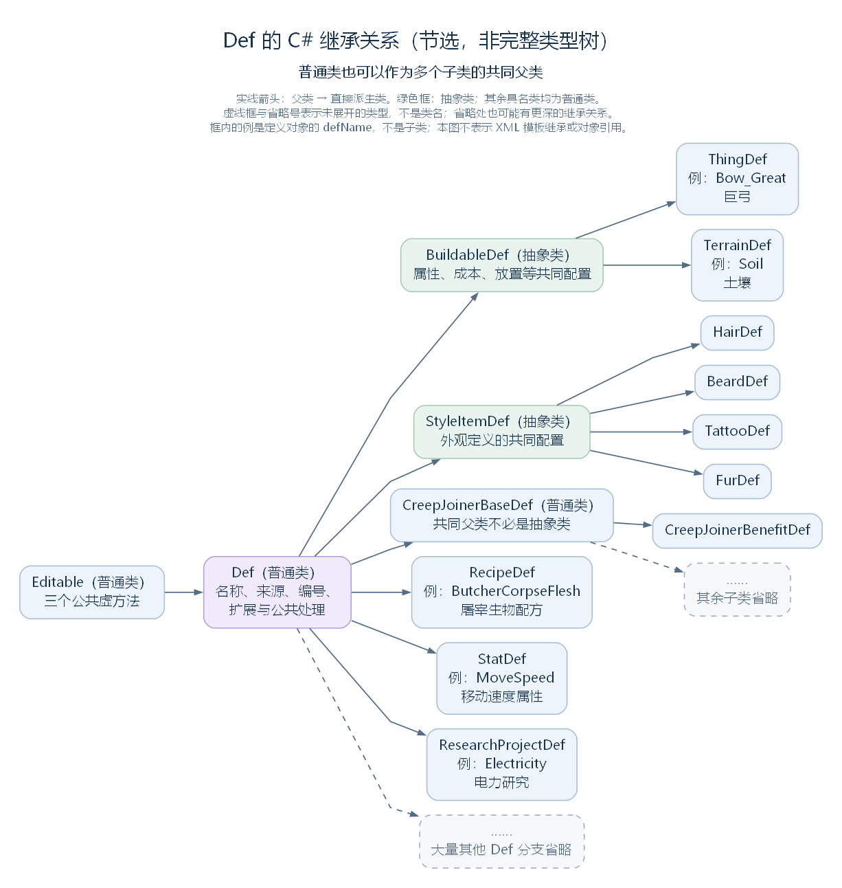
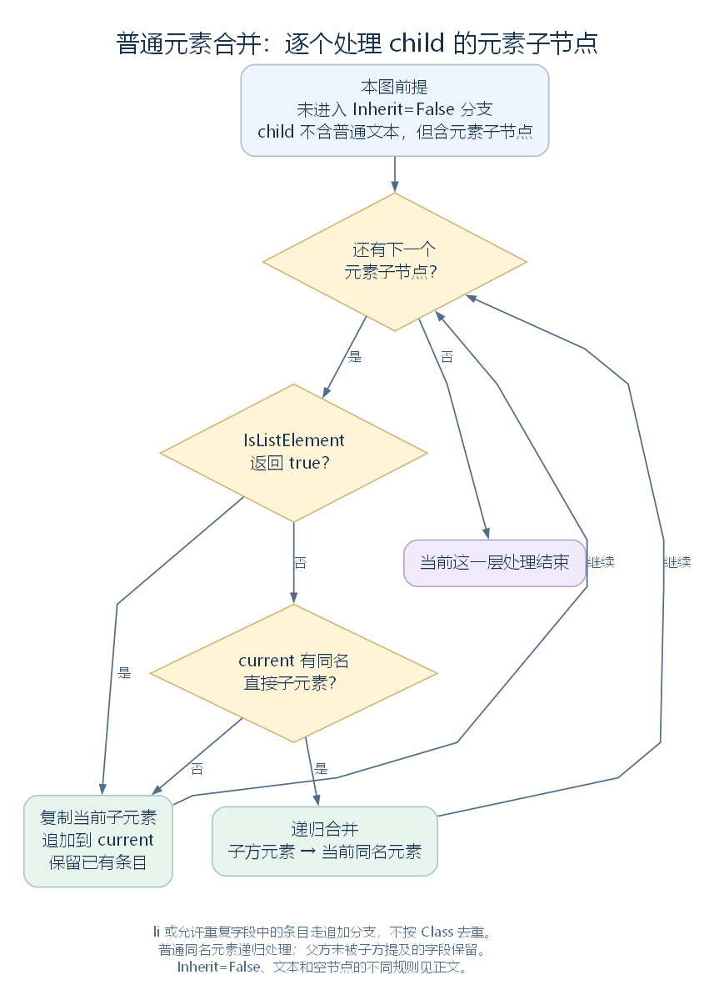
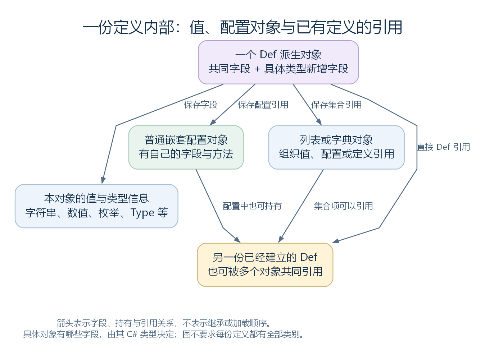
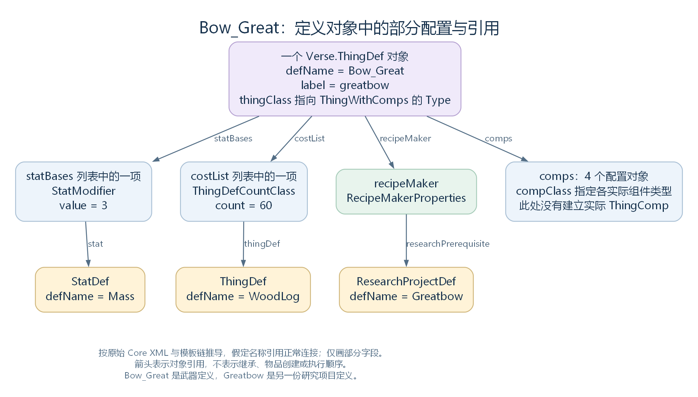

# XML 与 Def 结构：游戏内容怎样被描述

版本：整合草稿 v0.3｜整理日期：2026-10-28

本文依据 RimWorld 1.7.4982 rev1280 的代码，解释游戏内容的文件表示、C# 类型与定义对象之间的关系。先认识 Def 的类型结构，再阅读 XML 与模板合并，随后对照定义对象中的字段、配置和引用，最后认识公共方法与扩展。正文以通用框架为主，用不同类型的原版定义和巨弓案例帮助理解；实际的加载顺序另见 [《Def 的加载、存储与查询》](02-def-loading-storage-query.md)。

阅读前先记住三个区别：**XML 是内容的文件表示，Def 是程序中的定义对象，使用定义的系统还有自己的对象与运行状态。** 同时，Def 不是所有配置对象的共同父类；一个定义中可以有普通数值、嵌套配置、类型信息，以及对其他定义的引用。

## 一、先分清文件、类型与对象

RimWorld 用 Def 组织多种游戏内容。定义可以描述属性种类、研究项目、配方、地形，以及各种实体的共同配置。它们分别使用不同的 C# 类型，再通过引用连接起来。

| 层次 | 表示什么 | 与其他层次的关系 |
| --- | --- | --- |
| XML 文档与节点 | 文件中的结构化描述 | 提供字段、模板关系、条件与类型选择信息 |
| C# 类型 | 类声明规定的数据与方法 | 决定对象能够保存什么、怎样处理这些数据 |
| Def 对象 | 某种 Def 类型的一个实例 | 保存一份已经进入程序的定义，可被查询和引用 |
| 普通配置对象 | 定义内部使用的数据对象 | 可以包含自己的字段、引用与方法，不必继承 Def |
| 定义的使用者 | 查询或持有定义的系统、对象与代码 | 读取配置，结合自身状态决定具体行为 |

“Def”既可以指 Verse.Def 这个基类，也常用于统称其派生类型的定义对象。讨论某份数据时，需要看清指的是类型，还是由这个类型建立的实例。

一个类型可以建立多份定义；一份定义也可以被多个对象引用。把同一个 Def 引用存入列表、字典或其他字段，不会因此再复制一份定义。

所谓“静态定义”，主要描述内容配置与运行状态的分工。Def 本身是普通 C# 对象，可以有方法、缓存和加载后生成的数据；它不等于 C# 的 static，也不意味着所有字段永远不变。

源码定位：共同基类（`Verse.Def.cs:9`）、类型数据库（`Verse.DefDatabase.cs:10`）、来源内容包中的定义登记（`Verse.ModContentPack.cs:610`）。

## 二、Def 的 C# 类型结构

### 2.1 从共同基类到具体内容类型

Editable 提供读取后处理、引用整理和配置检查的公共方法。Def 继承 Editable，在此基础上增加名称、显示信息、来源、编号与扩展配置；具体内容类型再补充各自需要的数据。

Def 的声明是：

```csharp
public class Def : Editable, IEquatable<Def>
```

它继承 Editable，并提供针对 Def 的类型化相等比较。ThingDef、RecipeDef、StatDef 等类型沿各自的继承关系取得这些公共成员，分别描述不同种类的内容。

### 2.2 类型树节选：普通类与抽象类

**下面是选取部分分支的继承关系示意，不是完整的 Def 类型树，也不是全部内容类型的分类表。** Def 有大量直接派生类；其中一部分还会继续派生出子类。这里选取几种不同结构，说明定义类型怎样共享字段与方法。



实线箭头从父类型指向直接派生类型；虚线框与省略号表示没有展开的类型，不是类名。各分支框内的“例”是该类型定义对象的 defName，不是新的派生类。图中没有表示 XML 模板继承，也没有表示两个定义对象互相引用。[SVG](figures/def-type-tree.svg) · [图源](figures/def-type-tree.dot)

| 类型 | 是否为 C# 抽象类 | 相对于上层的主要职责 |
| --- | --- | --- |
| Editable | 否 | 提供读取后处理、引用整理和配置检查入口 |
| Def | 否 | 提供定义共有的数据与方法 |
| BuildableDef | 是 | 增加属性基础值、成本、空间与放置等共同配置 |
| ThingDef、TerrainDef | 否 | 在 BuildableDef 基础上增加各自领域的数据 |
| StyleItemDef | 是 | 提供发型、胡须、纹身、毛皮等外观定义的共同配置与方法 |
| HairDef、BeardDef、TattooDef、FurDef | 否 | 在 StyleItemDef 基础上实现各自的外观定义 |
| CreepJoinerBaseDef | 否 | 提供异常加入者相关定义的共同配置，仍可继续派生出不同子类 |
| RecipeDef、StatDef、ResearchProjectDef | 否 | 直接从 Def 派生，分别描述不同种类的内容 |

一个类成为共同父类，不代表它一定是抽象类。Editable、Def、CreepJoinerBaseDef 都是普通类；BuildableDef、StyleItemDef 的声明才带有 abstract，不能直接建立这两种类型的实例。按本文所依据的程序集，Def 的抽象派生类就是这两个；但它们并不能涵盖其余所有分支，大量普通内容类型直接继承 Def。

BuildableDef → ThingDef 只是其中一条分支。不同种类的定义有不同数据结构，也可以彼此关联；图中没有画出的类型仍然遵循相应的 C# 继承关系。

源码定位：共同基类与内容类型声明（`Verse.Editable.cs:8`、`Verse.Def.cs:9`、`Verse.BuildableDef.cs:9`、`Verse.ThingDef.cs:13`、`Verse.TerrainDef.cs:9`、`Verse.RecipeDef.cs:12`、`RimWorld.StatDef.cs:10`、`Verse.ResearchProjectDef.cs:11`）；外观分支声明（`RimWorld.StyleItemDef.cs:9`、`RimWorld.HairDef.cs:8`、`RimWorld.BeardDef.cs:8`、`RimWorld.TattooDef.cs:8`、`RimWorld.FurDef.cs:9`）；普通中间父类示例（`Verse.CreepJoinerBaseDef.cs:7`、`Verse.CreepJoinerBenefitDef.cs:9`）；字段查找（`Verse.XmlToObjectUtils.cs:15`）。

### 2.3 同一种框架中的不同定义

| C# 类型 | 原版 defName | 对应内容 | XML 来源，位于 RimWorld/Data/Core/Defs/ 下 |
| --- | --- | --- | --- |
| ThingDef | Bow_Great | 巨弓，英文 label 为 greatbow | ThingDefs_Misc/Weapons/RangedNeolithic.xml:286 |
| TerrainDef | Soil | 土壤，英文 label 为 soil | TerrainDefs/Terrain_Natural.xml:36 |
| RecipeDef | ButcherCorpseFlesh | 屠宰生物的配方，英文 label 为 butcher creature | RecipeDefs/Recipes_Butchery.xml:4 |
| StatDef | MoveSpeed | 移动速度这一种属性，英文 label 为 move speed | Stats/Stats_Pawns_General.xml:4 |
| ResearchProjectDef | Electricity | 电力研究，英文 label 为 electricity | ResearchProjectDefs/ResearchProjects_2_Electricity.xml:4 |

中文列用于帮助理解；defName 与英文 label 对照原版文件。这里列的是不同类型建立的定义对象。MoveSpeed 描述“移动速度这一种属性”的规则，不是某个 Pawn 当时的速度值；Electricity 是研究项目定义，不是已经完成研究的运行状态。

表中选取的是能够建立定义对象的具体内容类型。巨弓与土壤分别使用 ThingDef 和 TerrainDef，也都具有从 BuildableDef、Def 继承来的字段。BuildableDef 本身不能直接实例化，因此这里不为它列一份独立定义。

知道一份定义使用什么 C# 类型，就能继续追问：文件里怎样选择这个类型，又怎样填写它的字段？

## 三、XML 怎样描述一份定义

### 3.1 元素、属性与文本分别是什么

C# 类型规定定义能够保存哪些数据，XML 则提供这些数据的文件表示。XML 文档可以看成一棵树：元素由标签界定，可以包含其他元素或文本；属性写在元素的开始标签中，为该元素提供额外信息。读取代码决定它们在游戏中的含义。

下面只用于说明常见语法关系。DefType、TemplateName、DefinitionName 都是占位名称，**不是游戏中实际存在的内容，也不是可以直接加载的完整文件**：

```xml
<Defs>
  <!-- Name 为模板提供查找名称；Abstract 让本节点不单独建立 Def 对象。 -->
  <DefType Name="TemplateName" Abstract="True">
    <label>...</label>
  </DefType>

  <!-- ParentName 指向上方的命名模板，用于取得共同内容。 -->
  <DefType ParentName="TemplateName">
    <!-- defName 是建立后的定义名称，用于定义查询。 -->
    <defName>DefinitionName</defName>
  </DefType>
</Defs>
```

Defs 是内容文档的根元素。其下可以放多份顶层定义描述，也可以放供其他节点继承的模板。一个文件不必只对应一个 Def；一个顶层模板节点也不一定产生 Def 对象。

普通字段通常通过子元素表示。读取器按节点名寻找 C# 字段，再依字段类型处理文本或内部结构。XML 属性则由相应框架代码解释，不能把它们都当成 Def 中的同名字段。

### 3.2 几个容易混淆的名字

| 名称 | 写在什么位置 | 主要含义 |
| --- | --- | --- |
| 顶层元素名 | Defs 下的节点名称 | 默认提供定义的 C# 类型名 |
| Class | XML 属性 | 在支持它的读取位置，指定所建立对象的实际 C# 类型 |
| defName | 通常是定义节点的子元素 | 写入定义名称，供后面的名称查询等使用 |
| Name | XML 属性 | 给模板关系提供查找名称 |
| ParentName | XML 属性 | 指定要取得内容的命名父节点 |
| Abstract | XML 属性 | 让后面的定义读取入口跳过本节点的 Def 建立 |
| Inherit | XML 属性 | 在模板合并的当前块上控制是否沿普通规则继承 |
| MayRequire、MayRequireAnyOf | XML 属性 | 提供所需内容包条件；具体动作取决于处理位置 |

Name 与 defName 分别服务于模板查找和定义查询，不能互换。具有 Name 不意味着节点一定抽象；Abstract="True" 也不会阻止该节点参与模板登记与合并。

条件属性同样需要结合位置。顶层定义、普通列表项、待连接的 Def 引用各有处理规则；不能将 MayRequire 统一解释为“条件不满足就删除所有对应数据”。具体条件判断在加载篇接回。

源码定位：顶层条件与读取选择（`Verse.LoadedModManager.cs:437`）、根节点类型选择与 Abstract 检查（`Verse.DirectXmlToObjectNew.cs:16`）、模板登记（`Verse.XmlInheritance.cs:48`）。

### 3.3 对照一份完整的原版定义：巨弓

下面完整摘录原版巨弓的 ThingDef 节点，保留原有结构、名称与数值，没有省略其中字段。为方便阅读，补入了中文 XML 注释（`<!-- ... -->`）；这些注释不属于原文件。该节点位于 RangedNeolithic.xml 的 Defs 根节点下，同一文件还包含其他定义。

这里的“完整”指这个原始节点完整，不表示父模板已经展开。ParentName 指向的 BaseWeaponNeolithic 仍在别处提供共同内容；箭矢也由另一份 ThingDef 描述。

```xml
<!-- ThingDef 选择定义的 C# 类型；ParentName 指定 XML 父模板。 -->
<!-- Name 是模板登记名，与下方用于定义查询的 defName 分别起作用。 -->
<ThingDef ParentName="BaseWeaponNeolithic" Name="Bow_Great">
  <!-- 定义名称，以及面向玩家的名称和说明。 -->
  <defName>Bow_Great</defName>
  <label>greatbow</label>
  <description>A powerful greatbow. Fires a heavy arrow long distances.</description>

  <!-- 嵌套的 GraphicData 配置：贴图路径，以及图形对象的 C# 类型名。 -->
  <graphicData>
    <texPath>Things/Item/Equipment/WeaponRanged/BowGreat</texPath>
    <graphicClass>Graphic_Single</graphicClass>
  </graphicData>

  <!-- 声音定义引用：Bow_Large 是 SoundDef 的名称。 -->
  <soundInteract>Bow_Large</soundInteract>

  <!-- 成本配置：WoodLog 是材料的 ThingDef 名称，60 是数量。 -->
  <costList>
    <WoodLog>60</WoodLog>
  </costList>

  <!-- 内容生成相关的字符串标签；每个 li 表示一个列表项。 -->
  <thingSetMakerTags>
    <li>RewardStandardQualitySuper</li>
  </thingSetMakerTags>

  <!-- 属性基础值：元素名指定 StatDef，文本提供对应数值。 -->
  <!-- 例如 Mass 这一项读成 StatModifier 配置，value 为 3。 -->
  <statBases>
    <WorkToMake>9000</WorkToMake>
    <Mass>3.0</Mass>
    <AccuracyTouch>0.65</AccuracyTouch>
    <AccuracyShort>0.85</AccuracyShort>
    <AccuracyMedium>0.75</AccuracyMedium>
    <AccuracyLong>0.50</AccuracyLong>
    <RangedWeapon_Cooldown>1.5</RangedWeapon_Cooldown>
  </statBases>

  <!-- 武器分类使用的字符串标签。 -->
  <weaponTags>
    <li>NeolithicRangedHeavy</li>
    <li>NeolithicRangedChief</li>
  </weaponTags>

  <!-- 这里是 WeaponClassDef 名称引用列表，不是普通字符串标签列表。 -->
  <weaponClasses>
    <li>Ranged</li>
    <li>RangedHeavy</li>
  </weaponClasses>

  <!-- 攻击动作的配置列表，每个 li 读成一个 VerbProperties 配置对象。 -->
  <verbs>
    <li>
      <!-- C# 类型名，读入后保存为 Type，供后续代码使用。 -->
      <verbClass>Verb_Shoot</verbClass>
      <hasStandardCommand>true</hasStandardCommand>
      <!-- 弹射物定义引用：Arrow_Great 是另一份 ThingDef 的名称。 -->
      <defaultProjectile>Arrow_Great</defaultProjectile>
      <warmupTime>2.0</warmupTime>
      <range>29.9</range>
      <soundCast>Bow_Large</soundCast>
    </li>
  </verbs>

  <!-- 近战攻击配置列表，每个 li 读成一个 Tool 配置对象。 -->
  <tools>
    <li>
      <label>limb</label>
      <!-- 这些名称引用 ToolCapacityDef，描述该工具的攻击能力。 -->
      <capacities>
        <li>Blunt</li>
        <li>Poke</li>
      </capacities>
      <power>9</power>
      <cooldownTime>2</cooldownTime>
    </li>
  </tools>

  <!-- RecipeMakerProperties 配置，供后续代码生成制造配方。 -->
  <recipeMaker>
    <!-- 可使用配方的 ThingDef 名称；合并后还会保留父模板中的条目。 -->
    <recipeUsers>
      <li>CraftingSpot</li>
    </recipeUsers>
    <!-- 研究项目定义名 Greatbow，与武器定义名 Bow_Great 不同。 -->
    <researchPrerequisite>Greatbow</researchPrerequisite>
    <!-- 技能要求：Crafting 指定 SkillDef，6 是要求的技能等级。 -->
    <skillRequirements>
      <Crafting>6</Crafting>
    </skillRequirements>
    <!-- 生成配方时使用的显示顺序参数。 -->
    <displayPriority>530</displayPriority>
  </recipeMaker>

  <!-- 布尔字段，控制是否在货架上旋转显示。 -->
  <rotateInShelves>false</rotateInShelves>
</ThingDef>
```

先只按结构读它，就能辨认几种不同内容：

| 写法 | 在这里描述什么 |
| --- | --- |
| ThingDef | 这份定义使用的 C# 类型 |
| ParentName="BaseWeaponNeolithic" | XML 父模板关系 |
| Name="Bow_Great"、defName 中的 Bow_Great | 分别是模板登记名与定义名；相同字符串仍承担不同职责 |
| label、description、rotateInShelves | 文本或布尔字段 |
| graphicData、recipeMaker | 嵌套配置对象 |
| statBases、verbs、tools | 组织配置条目的列表 |
| defaultProjectile 中的 Arrow_Great | 对另一个 ThingDef 的名称引用 |
| researchPrerequisite 中的 Greatbow | 对一个 ResearchProjectDef 的名称引用 |

此处 Bow_Great 是武器定义名，Greatbow 是研究定义名，二者不是同一份对象。原节点也没有 thingClass、category、comps 等共同字段；接下来先看父模板怎样补齐这些内容，再与读取后的对象字段对照。

内容定位：巨弓节点为 `RimWorld/Data/Core/Defs/ThingDefs_Misc/Weapons/RangedNeolithic.xml:286`，至第 350 行闭合；同文件中的箭矢定义从第 351 行开始。研究定义见 `RimWorld/Data/Core/Defs/ResearchProjectDefs/ResearchProjects_1.xml:491`。

## 四、XML 模板怎样补全内容

### 4.1 模板节点与定义对象分别存在

巨弓的原始节点通过 ParentName 取得共同配置。按父模板到子节点的方向，它的模板链为：

**BaseWeapon → BaseWeaponNeolithic → Bow_Great。**

这三个节点都使用 ThingDef；沿模板链补充字段不会产生新的 C# 派生类。XmlInheritance 用 Name 登记命名节点，再用 ParentName 查找父节点；它处理的仍是 XML，不是在 C# 中创建一个父 Def，让子 Def 继承那个实例。

同一个 Name 可以在不同来源内容包中出现。内部 nodesByName 因而保存“名称到候选列表”的关系；单个包装对象另保存原节点、解析结果、来源内容包、父项和子项。

| 关系 | 连接的是什么 |
| --- | --- |
| C# 类继承 | 类型与父类型，决定成员与方法 |
| XML 模板继承 | 子节点与命名父节点，整理内容 |
| Def 引用 | 一个对象中的字段或集合，与已有定义对象 |

这三种关系可以同时出现在一份内容中，连接的对象与作用分别不同。

这里的 C# 抽象类也要与 XML 的 Abstract="True" 分开理解。前者限制某个 C# 类型能否直接实例化；后者把 XML 节点标为供其他节点继承的模板。使用 ThingDef 这种普通 C# 类型的节点，同样可以是抽象 XML 模板。

### 4.2 同名模板按来源选择

| 子节点来源 | 主要选择规则 |
| --- | --- |
| 来源内容包已知 | 在来源已知、loadOrder 不晚于子节点的候选中，选 loadOrder 最大的一项 |
| 来源已知，但没有上述候选 | 尝试来源为 null 的同名项 |
| 子节点来源为 null | 优先同为 null 的项，否则选有来源候选中 loadOrder 最小的一项 |

同一来源重复登记同一个 Name 会记录错误并拒绝本次登记，但不会据此把 XML 节点从统一文档删除。选择父模板也不能简单概括为“总是最后加载的一份”。

若节点把自己选为父节点，可能形成循环；这里没有通过同名自动表达“继承旧版本模板”的特殊含义。

### 4.3 合并规则取决于当前节点

有父节点时，解析器先取得父方已经处理好的结果，克隆它，再用子方节点继续合并；没有父节点时使用原节点。结果通过原节点保存对应关系，并未因此直接替换统一文档中的原节点。

| 当前情况 | 主要处理 |
| --- | --- |
| 子方设置 Inherit="False" | 清除当前块的子节点，再复制子方内容，跳过普通逐项合并 |
| 普通文本 | 使用子方文本 |
| 元素被判断为列表条目 | 复制并追加 |
| 普通元素已有同名项 | 继续递归合并 |
| 普通元素没有同名项 | 复制并追加 |
| 子方为空、父方有元素子节点 | 普通合并路径保留父方元素内容 |
| 子方为空、父方仅有普通文本 | 清掉父方内容 |



图只展开普通元素分支；Inherit、文本与空节点在其他判断位置处理。[SVG](../../figures/xml-inheritance-merge.svg) · [图源](../../figures/xml-inheritance-merge.dot)

列表判断主要识别 li，也识别 XmlInheritanceAllowDuplicateNodes 标记收集到的字段名。它不是先确认每个字段的 C# 类型为 List，再采用同一套规则。因此，允许命名元素的配置列表与 li 列表可以具有不同的合并表现。

普通路径会清除当前节点属性并复制子方属性；Inherit="False" 分支则没有先清空所有父方属性。把该属性理解为“当前块的内容不按普通方式继承”，比理解为“删掉父方的一切信息”更准确。

Abstract 的跳过检查发生在后面的定义读取入口，检查的是原始顶层节点。抽象模板可以先参与合并，但不因此自己成为一份可入库定义。

### 4.4 对照巨弓的列表合并

巨弓节点的 recipeMaker.recipeUsers 只写了 CraftingSpot，父模板中还提供了另外两项。对照这条模板链，可以看到：

| 所处位置 | recipeUsers 中的 li 内容 |
| --- | --- |
| BaseWeaponNeolithic | ElectricSmithy、FueledSmithy |
| Bow_Great | CraftingSpot |
| 合并结果 | ElectricSmithy、FueledSmithy、CraftingSpot |

本例中的 li 追加到父方已有条目后面。因此，完整摘录一个原始节点，与查看模板合并后的节点，是不同的观察层次。这一步整理的仍是 XML 节点和名称；把这些名称连接为具体 ThingDef 引用，是后续加载工作。

内容定位：基础模板为 `RimWorld/Data/Core/Defs/ThingDefs_Misc/Weapons/BaseWeapons.xml:4`；新石器武器模板与巨弓节点分别为 `RimWorld/Data/Core/Defs/ThingDefs_Misc/Weapons/RangedNeolithic.xml:4`、`RimWorld/Data/Core/Defs/ThingDefs_Misc/Weapons/RangedNeolithic.xml:286`。

源码定位：登记与内部结构（`Verse.XmlInheritance.cs:48`、`Verse.XmlInheritance.cs:481`）、父节点选择（`Verse.XmlInheritance.cs:199`）、结果准备与递归合并（`Verse.XmlInheritance.cs:265`、`Verse.XmlInheritance.cs:285`）、列表判断（`Verse.XmlInheritance.cs:451`）、定义读取检查（`Verse.DirectXmlToObjectNew.cs:16`）。

## 五、定义对象内部保存什么

模板合并准备好 XML 内容之后，读取器根据相应 C# 类型建立定义对象、读取字段。派生类型继承来的字段与新增字段保存在同一个对象中，不会额外建立一份“父类对象”。

### 5.1 各类定义共有的字段

Def 为不同类型的定义提供以下共同数据：

| 数据组 | 主要成员 | 含义 |
| --- | --- | --- |
| 程序使用的名称 | defName | 定义名称，初始值为 UnnamedDef |
| 面向玩家的文本 | label、description | 显示名称与说明，可以在语言处理阶段继续改变 |
| 相关说明链接 | descriptionHyperlinks | 保存指向相关定义的链接数据 |
| 附加配置 | modExtensions | 保存 DefModExtension 对象 |
| 来源 | modContentPack、fileName | 内容包与来源名称，由登记等代码填写 |
| 查询与编号 | index、defNameHash、shortHash | 各自服务于位置、名称哈希和短哈希使用 |
| 生成与检查 | generated、ignoreConfigErrors、ignoreIllegalLabelCharacterConfigError | 记录生成状态，或参与相应检查 |
| 缓存与调试 | cachedLabelCap、debugRandomId | 保存处理后的名称或调试值 |

这些字段并不全由 XML 填写。modContentPack、fileName 可以在定义登记时补充；index 在入库和重新编号时写入；shortHash 由专门流程分配；generated 由相应生成入口设置。定义的最终数据来自文件、字段初值、构造过程与后续处理的共同作用。

字段上的 NoTranslate、MustTranslate、Unsaved 等特性提供相应处理信息。它们由具体读取、翻译或其他代码解释，不能仅根据一个特性名称推断所有入口的行为。

### 5.2 数值、配置对象、类型与引用

一个 Def 派生对象中，可以同时包含下面几类数据：

| 数据形式 | 在程序中的含义 | XML 读取时需要做的事 |
| --- | --- | --- |
| 字符串、数值、枚举等 | 直接保存的值 | 按对应规则转换文本并赋值 |
| 普通配置对象 | 一组嵌套字段与方法 | 建立对象，再继续读取内部字段 |
| 列表或字典 | 一组条目或键值关系 | 建立或填写集合，并按条目类型继续处理 |
| 对其他 Def 的引用 | 指向另一份已有定义 | 通常先登记名称，再在后续查找并连接 |
| System.Type | 指向一个 C# 类型 | 将类型名称解析为 Type，供后续代码使用 |

因此，XML 层级和对象组成可以相互对应，但不能只凭标签形状判断对象类型。一个嵌套块可能是普通配置，某段文字可能是枚举值、C# 类型名，也可能是另一份定义的名称。



箭头表示持有或引用关系。普通配置对象也可以持有 Def 引用；多个字段可以指向同一个目标定义。[SVG](figures/def-object-structure.svg) · [图源](figures/def-object-structure.dot)

CompProperties、GraphicData、StatModifier 等类型属于普通配置，并未因此都继承 Def。它们被建立在定义内部时，仍有各自的 C# 类型与对象实例。相反，一个 Def 引用通常要求查找已有定义，而不是根据文本再复制一个目标。

Class 与 Type 字段也要分别理解。XML 的 Class 选择本次读取要建立的对象类型；某个配置字段保存的 Type，则可供后续代码建立其他对象。读取一个 Type 字段，不等于当场执行了那个类型的功能。

### 5.3 XML 形状与字段类型需要一起看

普通复杂对象通常按子节点名寻找字段；一般列表条目使用 li。某些类型提供 LoadDataFromXmlCustom，自行解释节点名、属性和文本，因而可以使用不同的 XML 形状。

这意味着，不能要求所有列表都具有相同标签形状，也不能假定每个 XML 元素名都对应一个同名 C# 字段。自定义读取会在相应入口接管解释；具体流程在下一篇展开。

空节点同样需要结合类型。字符串、列表、普通对象、Def 引用和自定义读取有各自规则；IsNull="True" 也不是所有入口共用的一条判断。这里先保留“节点结构需要交给相应读取规则”的关系，不将所有空标签都归为 null 或默认值。

源码定位：普通配置声明（`Verse.CompProperties.cs:10`、`Verse.GraphicData.cs:10`、`RimWorld.StatModifier.cs:8`）、字段与类型解析（`Verse.DirectXmlToObjectNew.cs:1285`、`Verse.DirectXmlToObjectNew.cs:1297`）、列表读取（`Verse.DirectXmlToObjectNew.cs:725`）、自定义读取分派（`Verse.DirectXmlToObjectNew.cs:559`）。

### 5.4 名称、位置和哈希承担不同职责

| 成员 | 作用 | 需要区分什么 |
| --- | --- | --- |
| defName | 名称字典中的字符串键 | 与显示名称 label、模板名称 Name 不同 |
| index | 某次编号时的列表位置 | 重新排列后可改变，对象只有一个这个字段 |
| defNameHash | 根据 defName.GetHashCode 保存的值 | 供 Def.GetHashCode 及相应比较使用 |
| shortHash | 单独分配的 ushort 值 | 配合对应类型组的查询字典使用 |

ushort 是 16 位无符号整数，取值范围为 0—65535。使用同一种数值类型，不表示 index 与 shortHash 具有相同含义；前者记录列表位置，后者按另一套规则分配。

哈希值与对象身份也不同。Def.Equals(Def other) 检查名称哈希和实际类型，没有在这里逐字比较名称；ReferenceEquals 则检查是否为同一个对象。需要判断引用身份时，不能仅以名称或哈希相同代替。

修改定义名称也不会自动更新数据库里的所有键、已保存哈希与其他引用关系。定义字段和管理容器分别保存数据，相应修改必须看具体入口。

源码定位：名称与显示字段（`Verse.Def.cs:119`、`Verse.Def.cs:125`、`Verse.Def.cs:131`）、扩展与编号字段（`Verse.Def.cs:149`、`Verse.Def.cs:153`、`Verse.Def.cs:157`、`Verse.Def.cs:161`、`Verse.Def.cs:165`、`Verse.Def.cs:169`）、名称哈希与比较（`Verse.Def.cs:76`、`Verse.Def.cs:82`、`Verse.Def.cs:111`）。

## 六、对照巨弓：从 XML 到 ThingDef 字段

前面已经认识巨弓的原始 XML、父模板关系和配置类型，现在将这些内容对照到一份 ThingDef 的字段。

下面按原始 Core 文件、这条模板链与对应读取代码整理部分字段。为看清引用关系，采用“名称引用已正常连接、来源已登记”的状态；label 保留原始英文，不叠加其他内容包补丁或翻译改写。这是静态推导的结构对照，**不是在游戏中抓取的内存转储，也不是整个对象的全部字段**。

| 字段或对象信息 | 本例的值 | 来源 |
| --- | --- | --- |
| 实际 C# 类型 | Verse.ThingDef | 根元素 ThingDef，未另外指定 Class |
| defName | Bow_Great | 本节点 |
| label | greatbow | 本节点 |
| thingClass | 指向 Verse.ThingWithComps 的 Type | BaseWeapon |
| category | ThingCategory.Item | BaseWeapon |
| tickerType | TickerType.Never | BaseWeapon |
| techLevel | TechLevel.Neolithic | BaseWeaponNeolithic |
| costList | 一项 ThingDefCountClass：thingDef 指向 WoodLog，count 为 60 | 本节点，按自定义读取建立条目 |
| statBases | 12 项 StatModifier；其中 Mass 的 value 为 3，WorkToMake 的 value 为 9000 | 父模板的 5 项与本节点的 7 项合并 |
| graphicData.texPath | Things/Item/Equipment/WeaponRanged/BowGreat | 本节点 |
| graphicData.graphicClass | 指向 Verse.Graphic_Single 的 Type | 本节点 |
| graphicData.onGroundRandomRotateAngle | 35 | BaseWeapon |
| comps | 4 个组件配置，compClass 依次为 CompForbiddable、CompEquippable、CompStyleable、CompQuality | BaseWeapon 的 3 项与 BaseWeaponNeolithic 的 1 项 |
| verbs | 一项 VerbProperties；verbClass 为 Verb_Shoot 的 Type，defaultProjectile 指向 Arrow_Great，range 为 29.9，warmupTime 为 2 | 本节点 |
| weaponTags | 字符串列表：Neolithic、NeolithicRangedHeavy、NeolithicRangedChief | 父模板与本节点追加的 li |
| weaponClasses | 指向 Neolithic、Ranged、RangedHeavy 三份 WeaponClassDef 的列表 | 父模板与本节点追加的 li |
| recipeMaker.workSkill | 指向 Crafting 的 SkillDef | BaseWeaponNeolithic |
| recipeMaker.researchPrerequisite | 指向 Greatbow 的 ResearchProjectDef | 本节点 |
| recipeMaker.recipeUsers | 指向 ElectricSmithy、FueledSmithy、CraftingSpot 三份 ThingDef | 父模板与本节点追加的 li |
| modContentPack | 指向 Core 的 ModContentPack | 来源登记 |
| fileName | RangedNeolithic.xml | 来源登记 |

这里没有给对象另造一个“Mass 字段”。statBases 的对应条目仍然是 StatModifier，其 stat 指向 Mass 的 StatDef，value 保存 3。costList 也不是一堆实际木材，而是定义引用与数量配置。

同样，thingClass 保存的是 Type；comps 保存的是 CompProperties 配置。此处尚未因为展示这份定义，就建立一把实际巨弓或一批 ThingComp。



图只画上表中的部分关系，箭头表示对象引用。数字是定义与配置中的值；未展开实际制造、攻击和最终属性计算。[SVG](figures/greatbow-def-structure.svg) · [图源](figures/greatbow-def-structure.dot)

第四节已经说明 recipeUsers 为什么由一项变成三项；到这里，条目中的名称进一步对应到已有 ThingDef 的引用。statBases 和 comps 也保留父模板提供的条目，再加上当前模板或节点补充的内容。对象表因此需要结合整条模板链阅读，不能只与巨弓原始节点逐项比较。

index、shortHash 等运行时整理值没有在这里填写具体号码；它们依赖本次实际加载的定义集合与后续阶段。名称哈希也不需要为了展示结构而假定一个固定数值。

内容定位：基础模板为 `RimWorld/Data/Core/Defs/ThingDefs_Misc/Weapons/BaseWeapons.xml:4`；新石器武器模板为 `RimWorld/Data/Core/Defs/ThingDefs_Misc/Weapons/RangedNeolithic.xml:4`。本例模板合并已用本地 XmlInheritance 实现与最小辅助类型单独核对；这不等于运行了完整游戏加载流程。

源码定位：属性基础值与成本（`Verse.BuildableDef.cs:284`、`Verse.BuildableDef.cs:299`）、实际类型、组件及配置字段（`Verse.ThingDef.cs:1554`、`Verse.ThingDef.cs:1584`、`Verse.ThingDef.cs:1633`、`Verse.ThingDef.cs:1814`、`Verse.ThingDef.cs:2038`、`Verse.ThingDef.cs:2056`、`Verse.ThingDef.cs:2060`）、配置条目（`RimWorld.StatModifier.cs:48`、`RimWorld.StatModifier.cs:51`、`Verse.ThingDefCountClass.cs:130`、`Verse.ThingDefCountClass.cs:133`）、来源登记（`Verse.ModContentPack.cs:610`）。

## 七、公共方法与附加配置怎样参与处理

### 7.1 Editable 与 Def 提供哪些公共方法

定义不只有字段。Editable 为后代提供三个共同的处理位置，去掉反编译注释后的完整类为：

```csharp
public class Editable
{
    public virtual void ResolveReferences()
    {
    }

    public virtual void PostLoad()
    {
    }

    public virtual IEnumerable<string> ConfigErrors()
    {
        return Enumerable.Empty<string>();
    }
}
```

virtual 允许后代覆写；方法声明本身不安排调用时机。需要父类处理时，覆写实现还要自行调用 base。

| 方法 | 为具体类型提供什么 |
| --- | --- |
| PostLoad | 对读取后的数据作相应处理，或安排后续工作 |
| ResolveReferences | 整理关联、默认值、内部配置或缓存 |
| ConfigErrors | 向调用者逐项提供配置问题 |
| PostSetIndices | 在数据库完成一轮编号后继续处理，Def 本层默认为空 |
| ClearCachedData | 清理类型自身缓存，Def 本层清除 cachedLabelCap |

LabelCap 则展示了普通查询与缓存：需要时从 label 生成处理后的文本，保存到 cachedLabelCap，之后复用。清理缓存不等于删除定义；单独修改 label 也不会自动清理其他字段保存的结果。

ConfigErrors 返回 `IEnumerable<string>`，表示调用者逐项遍历检查结果。它不因此成为下一帧才执行的协程；某些实现也会整理列表或直接记录日志，所以不能假定检查绝对没有副作用。

源码定位：共同方法（`Verse.Editable.cs:8`）、扩展整理（`Verse.Def.cs:38`）、编号后入口与清缓存（`Verse.Def.cs:59`、`Verse.Def.cs:64`）、名称缓存（`Verse.Def.cs:13`）、检查入口（`Verse.Def.cs:51`）。

### 7.2 modExtensions 怎样附加数据与方法

modExtensions 是 Def 共有的附加配置列表。条目继承 DefModExtension，可以为不同功能增加需要的数据与处理方法，而不要求每个 Def 类型都预先声明这些字段。

DefModExtension 的共同入口包括 ConfigErrors 与 ResolveReferences(Def parentDef)，默认实现分别返回空序列和执行空方法。parentDef 表示该扩展所属的定义，与 XML 父模板或 C# 父类不是同一种关系。

Def 自己的 ResolveReferences 会遍历 modExtensions，将当前定义交给各扩展。不同派生类还可以继续处理其他配置；不能把所有 ResolveReferences 都理解为同一段名称查询代码。

`Def.GetModExtension<T>()` 的完整实现如下：

```csharp
public T GetModExtension<T>() where T : DefModExtension
{
    if (this.modExtensions == null)
    {
        return default(T);
    }
    for (int i = 0; i < this.modExtensions.Count; i++)
    {
        if (this.modExtensions[i] is T)
        {
            return this.modExtensions[i] as T;
        }
    }
    return default(T);
}
```

T 受 DefModExtension 约束，这里的 default(T) 表示空引用。方法查找已有扩展，is T 也可以匹配派生类型；它不会在找不到时补建一个扩展对象。

保存扩展数据与执行相应游戏功能仍是两件事。使用者需要主动查询或读取它；扩展对象不会仅因出现在列表中，就自动取得每帧更新。

源码定位：扩展基类（`Verse.DefModExtension.cs:8`）、两个共同入口（`Verse.DefModExtension.cs:11`、`Verse.DefModExtension.cs:17`）、查询与存在判断（`Verse.Def.cs:88`、`Verse.Def.cs:105`）。

这些入口说明定义除了保存数据，也能参与读取后的整理和检查。方法声明本身不安排执行；谁调用它们、与入库和引用连接有什么先后关系，将在下一篇按实际加载顺序解释。

## 八、从结构进入加载过程

一份定义可以从几个角度认识：C# 类型规定成员与方法，XML 提供文本与结构，模板合并补齐共同内容，建立后的 Def 对象保存字段与内部配置，引用再把不同定义连接起来。后续游戏系统取得这些定义，才会结合自身状态使用相应配置。

本篇到这里完成结构说明。下一篇进入 [Def 的加载、存储与查询](02-def-loading-storage-query.md)，沿普通启动追踪这些对象何时建立、由谁保存、名称怎样连接，以及不同查询方式何时具备所需数据。

范围与材料说明见 [本组目录](README.md)。
