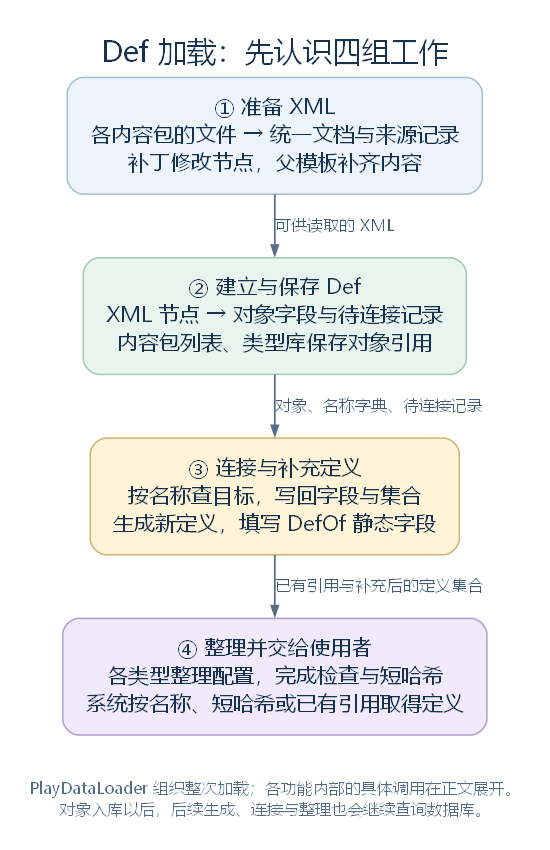
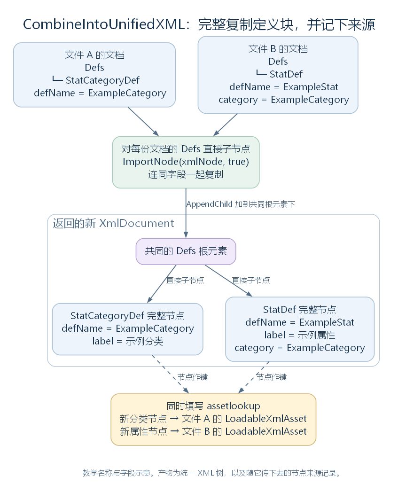
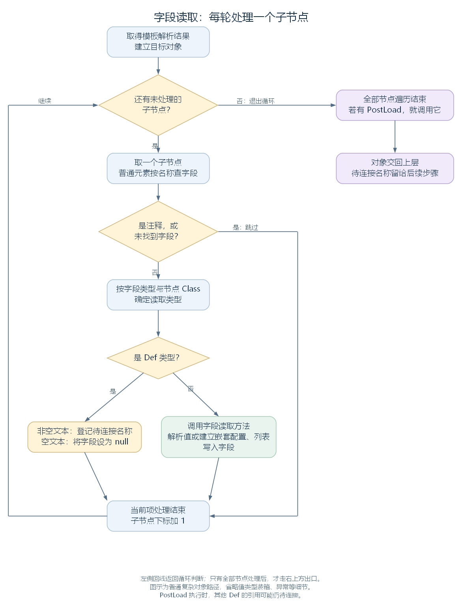
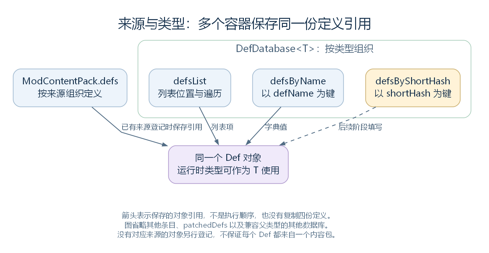
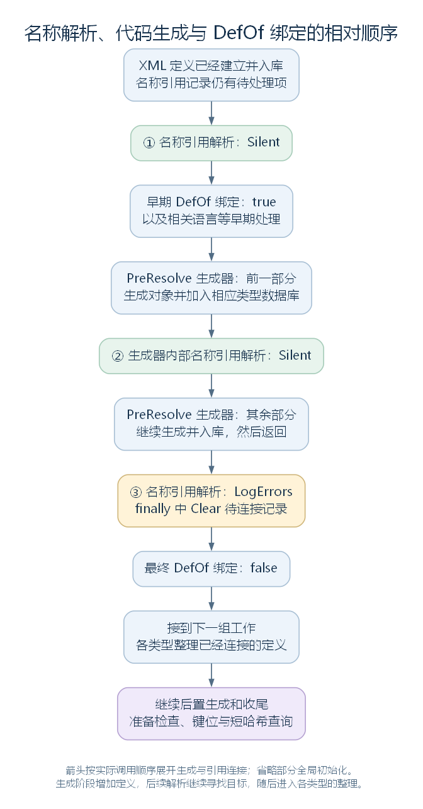

# Def 的加载、存储与查询：定义怎样进入程序

版本：发布版 v1.0｜定稿日期：2026-11-02

上一篇 [《XML 与 Def 结构》](01-xml-and-def-structure-release.md) 介绍了游戏内容怎样写在文件中。本篇继续解释：程序如何读取这些描述，建立 Def 对象，再把它们连接起来，交给游戏系统使用。

先记住这条主线：**文件读成 XML → 补丁与模板准备内容 → 建立 Def 并保存 → 按名称连接引用 → 整理数据并提供查询。** 同一份 Def 可以被多个列表、字典和字段引用。

本文依据 RimWorld 1.7.4982 rev1280 的普通启动路径。源码节选保留原有命名，省略处另行注明；教学补丁和调用示意会明确标注。各部分先讲处理流程，再用原版研究速度对照结果。

## 一、加载流程总览

定义加载由 PlayDataLoader 组织。它先通过 LoadedModManager 准备活动内容包、读取 XML 并建立定义，再继续入库、连接和收尾。整次加载要完成四组工作：

| 工作 | 处理什么 | 得到什么 |
| --- | --- | --- |
| 准备 XML | 读取文件、组合文档、执行补丁和父模板处理 | 可供读取的定义节点及来源 |
| 建立与保存 Def | 选定 C# 类型、读取字段、登记来源并入库 | 定义对象、查询集合与待连接记录 |
| 连接与补充定义 | 按名称找到目标，填写引用与静态字段，生成更多定义 | 相互关联的对象 |
| 整理并交给使用者 | 整理配置和缓存，检查问题，准备短哈希查询 | 后续系统可查询和使用的数据 |

**贯穿案例。** 研究速度对应 StatDef 类型的定义，defName 为 ResearchSpeed。它使用名为 IntellectualSkillBase 的 XML 父模板，所属工作分类则由另一个 StatCategoryDef 定义描述，名称为 PawnWork。



后文会一直追踪这几个名字，观察文件内容怎样成为对象与引用。图中的 0.2 来自下文的教学补丁。

## 二、准备 XML：读取、组合、补丁与模板解析

这一部分先取得各包的文件，再集中处理它们的内容。补丁在统一文档上修改节点，父模板为定义补齐共同字段，结果交给下一部分的对象读取器。

### 2.1 读取文件并保留来源

游戏用 ModContentPack 管理一个活动内容包。这个对象保存包标识、目录、加载顺序，以及程序集、补丁和定义的入口。Core、DLC 与启用的 Mod 都通过它参与加载。

LoadedModManager 先建立这些包对象、加载程序集等内容，再建立参与初始化的 Mod 对象。随后各包按本次选定的目录读取 Defs 文件。读入内存时，有三个对象需要认识：

| 对象 | 保存或组织什么 |
| --- | --- |
| ModContentPack | 一个内容包及其来源、加载信息和内容 |
| LoadableXmlAsset | 一份 XML 文档，以及文件名、目录和来源包 |
| XmlDocument | 内存中的 XML 树，包含元素、属性与文本节点 |

LoadModXML 汇总各包返回的 LoadableXmlAsset。下一步可以从每项的 xmlDoc 取得文档，也可以通过 mod 找到来源包。

**案例对照。** 本例关注 Core 中的两份文件：StatCategories.xml 提供工作分类，Stats_Pawns_WorkGeneral.xml 提供父模板和研究速度。原版工作分类的完整定义块是：

```xml
<StatCategoryDef>
  <defName>PawnWork</defName>
  <label>Work</label>
  <displayOrder>140</displayOrder>
</StatCategoryDef>
```

父模板与研究速度的原版节选如下，注释标明省略字段：

```xml
<StatDef Abstract="True" Name="IntellectualSkillBase">
  <defaultBaseValue>1</defaultBaseValue>
  <toStringStyle>PercentZero</toStringStyle>
  <category>PawnWork</category>
  <!-- 省略 statFactors、skillNeedFactors、capacityFactors、scenarioRandomizable。 -->
</StatDef>

<StatDef ParentName="IntellectualSkillBase">
  <defName>ResearchSpeed</defName>
  <label>research speed</label>
  <description>How fast this person performs research and how quickly they can find things using scanning equipment.</description>
  <minValue>0.1</minValue>
  <displayPriorityInCategory>4500</displayPriorityInCategory>
</StatDef>
```

父模板提供默认基础值 1、百分比显示格式 PercentZero，以及分类名称 PawnWork；研究速度写入自身名称、描述和下限 0.1。此时这些仍是 XML 节点与文本，尚待读成对象。

### 2.2 组合统一文档并记录节点来源

CombineIntoUnifiedXML 创建新的 XmlDocument 和 Defs 根元素，把各文件 Defs 下的直接子节点完整复制进去。每个定义或模板连着自己的字段，作为一项被导入。

下面的 xmlDocument 是新文档，obj 是本轮取得的子节点，转成 XmlNode 后由 xmlNode 接收，xmlNode2 保存副本；loadableXmlAsset 是当前文件对象，assetlookup 是记录“新节点 → 来源 LoadableXmlAsset”的字典。节选循环中处理一项的代码：

```csharp
XmlNode xmlNode = (XmlNode)obj;
XmlNode xmlNode2 = xmlDocument.ImportNode(xmlNode, true);
assetlookup[xmlNode2] = loadableXmlAsset;
xmlDocument.DocumentElement.AppendChild(xmlNode2);
```

ImportNode 的 true 表示连同后代一起复制，AppendChild 把副本加入新根元素。

处理完成后，程序得到统一文档和来源字典。补丁、模板和逐项读取可以围绕同一份文档工作；建立 Def 时，还能沿字典找回来源包。

**案例对照。** 工作分类、父模板和研究速度进入同一个 Defs 根元素。它们各自保留原有字段；分类节点的来源指向 StatCategories.xml，另外两个节点的来源指向 Stats_Pawns_WorkGeneral.xml。



### 2.3 执行补丁并解析父模板

ApplyPatches 依次取得各包的补丁，让每个操作修改统一文档。替换、添加和删除等操作通过 XPath 按路径与条件寻找目标，后面的补丁继续处理前面留下的结果。

补丁完成后，ParseAndProcessXML 登记节点的 Name、ParentName 和来源，再由 XmlInheritance 解析父子关系，保存模板合并结果。后面的读取器据此取得要填写的字段。

**案例对照。** 加入一个教学补丁，把研究速度的 minValue 从 0.1 改为 0.2。假设某个启用的 Mod 提供它，且没有后续补丁再修改这一字段。PatchOperationReplace 表示替换，xpath 选择研究速度的 minValue，value 放新节点：

```xml
<Patch>
  <Operation Class="PatchOperationReplace">
    <xpath>/Defs/StatDef[defName="ResearchSpeed"]/minValue</xpath>
    <value>
      <minValue>0.2</minValue>
    </value>
  </Operation>
</Patch>
```

补丁修改的是内存中的统一文档。随后，研究速度按 ParentName 找到 IntellectualSkillBase，取得模板字段。只展开本篇关注的部分，读取器获得的内容相当于：

```xml
<StatDef ParentName="IntellectualSkillBase">
  <defaultBaseValue>1</defaultBaseValue>
  <toStringStyle>PercentZero</toStringStyle>
  <category>PawnWork</category>
  <!-- 省略模板提供的其他字段。 -->
  <defName>ResearchSpeed</defName>
  <label>research speed</label>
  <!-- 省略自身的 description 与 displayPriorityInCategory。 -->
  <minValue>0.2</minValue>
</StatDef>
```

因此，接下来要建立的对象将取得默认基础值 1、百分比格式、分类名称 PawnWork，以及补丁后的下限 0.2。后文继续沿用这一教学修改。

## 三、建立与保存 Def：类型选择、字段读取与入库

准备好节点以后，程序先确定要建立的 C# 类型，再逐个读取字段。对象建立后登记到来源包，随后按类型进入数据库，形成名称查询入口。

### 3.1 确定类型并逐项读取字段

DirectXmlToObjectNew.DefFromNodeNew 接收一个顶层节点。它跳过非元素节点与 Abstract="True" 的模板项，默认用元素名查找 C# 类型；Class 属性可以进一步指定类型。找到类型后，程序取得可复用的读取方法，建立对象并填写字段。

普通复杂对象路径先让字段初值和构造函数提供起始数据，再逐个处理 XML 子节点：按名称找字段，确定读取类型，选择对应方法。字符串、数值、枚举、列表和嵌套配置各有相应读法。

Def 引用字段会先登记目标名称。此时定义仍在逐项建立，查询集合尚未收集完；记录接收对象、字段、目标类型与名称，就能等入库后继续连接。



每轮处理或跳过一个子节点，再继续下一项；全部遍历完成后，这条路径调用适用的 PostLoad，处理刚读到的数据，再把对象交回上层。

**案例对照。** IntellectualSkillBase 作为抽象模板被跳过，ResearchSpeed 则建立为 StatDef。几个字段的结果是：

| XML 内容 | 读取后的结果 |
| --- | --- |
| defName 的 ResearchSpeed | 字符串字段保存 "ResearchSpeed" |
| defaultBaseValue 的 1 | float 字段保存 1f |
| toStringStyle 的 PercentZero | 枚举字段保存相应显示格式 |
| minValue 的 0.2 | float 字段保存 0.2f |
| category 的 PawnWork | 先登记分类的待连接记录 |

分类记录记下：给研究速度对象的 category 字段，查找 StatCategoryDef 类型中名为 PawnWork 的定义。此时该字段仍为 null，等待后面的引用解析。

### 3.2 登记来源并加入类型数据库

对象读出后，ParseAndProcessXML 通过节点来源字典找到内容包，调用它的 AddDef。下面 def 是新建定义，source 是来源文件名，this 是当前内容包：

```csharp
public void AddDef(Def def, string source = "Unknown")
{
    def.modContentPack = this;
    def.fileName = source;
    this.defs.Add(def);
}
```

这一步填写定义的来源信息，并将引用加入该包的 defs 列表。对补丁新建且没有节点来源记录的定义，程序另存到 patchedDefs，供后面一并收集。

随后，DoPlayLoad 调用各个类型数据库的 AddAllInMods。每个 `DefDatabase<T>` 收集能作为 T 使用的定义，处理同名项，再把引用加入列表与名称字典。下面 T 是当前数据库采用的定义类型，def 是正在加入的对象；节选保存动作：

```csharp
DefDatabase<T>.defsList.Add(def);
DefDatabase<T>.defsByName.Add(def.defName, def);
```

defsList 便于遍历和编号，defsByName 用 defName 提供查询。数据库按内容包优先级和活动顺序收集；同包重复名称会记录并跳过，跨来源同名项按收集规则在当前库中替换。

**案例对照。** Core 的 defs 保存研究速度和工作分类。`DefDatabase<StatDef>` 的名称字典加入 "ResearchSpeed"，`DefDatabase<StatCategoryDef>` 的名称字典加入 "PawnWork"。各容器通过引用指向已有对象。



本例的教学补丁只替换 minValue，研究速度的顶层节点仍有原来的来源记录，因此登记到 Core。

## 四、连接与补充定义：引用、静态字段与代码生成

入库让名称查找有了目标。这一部分按待连接记录查找定义，再把对象写回字段；同时准备常用静态入口，并在代码生成前后继续处理新增关联。

### 4.1 按名称连接字段引用

DirectXmlCrossRefLoader 处理前面留下的记录。对普通字段，记录提供接收对象、字段信息与目标名称；程序按相应类型查数据库，找到后写回原位置，移出完成的记录。列表与字典也有对应的记录和处理方法。

**案例对照。** 程序按 StatCategoryDef 与 PawnWork 找到工作分类，再将它写入研究速度的 category：

```text
研究速度 StatDef（defName = "ResearchSpeed"）
  category → 工作分类 StatCategoryDef（defName = "PawnWork"）
               label = "Work"
               displayOrder = 140
```

现在，后续代码从研究速度读取 category，就能继续读取分类名称和显示顺序。XML 中的名称文本已经接成对象之间的引用。

### 4.2 绑定静态字段并穿插生成定义

带 DefOf 标记的类通过公共静态字段保存常用定义。DefOfHelper 读取字段类型和名称，查询已有对象，再写入该字段。

下面 fieldInfo 是当前静态字段的信息，fieldType 是其类型，text 是查询名称，flag 控制普通缺失日志；静态字段无需接收实例，所以 SetValue 的第一个参数为 null：

```csharp
Def def = GenDefDatabase.GetDef(fieldType, text, flag);
fieldInfo.SetValue(null, def);
```

整次加载还会生成更多定义，例如根据建筑配置补出蓝图和框架定义。新增对象继续加入数据库，后面的解析才能查到它们。因此主流程分几轮推进：

1. 先连接已有定义，并尝试绑定常用静态字段。
2. 生成一批新定义，加入数据库。
3. 在生成器内部再连接一轮引用，继续生成其余定义。
4. 返回主流程，完成最后一轮引用解析，报告仍找不到的目标，清理记录并最终绑定静态字段。

图中 Silent 表示相应缺失问题暂不报告，LogErrors 表示最后一轮报告；静态绑定的 true、false 分别表示早期尝试与最终绑定。



**案例对照。** 原版静态字段 `StatDefOf.ResearchSpeed` 的类型是 StatDef，名称与 defName 一致。绑定后，它和名称字典中的 "ResearchSpeed" 指向同一个对象。研究速度与工作分类都来自 XML，入库后就具备在首轮解析中连接 category 的条件。

## 五、整理与收尾：准备数据、缓存与短哈希查询

定义接上引用以后，各类型继续整理自己的配置。PlayDataLoader 安排相应系统准备，再通过各类型数据库调用定义的 ResolveReferences，完成默认值、集合或缓存等处理。

主流程先处理内容分类和配方，再处理其他类型，最后处理 ThingDef。随后进行后置生成与全局准备。收尾主要完成：

| 工作 | 作用 |
| --- | --- |
| 类型与系统整理 | 让已经读取、连接的数据按各自规则准备好 |
| 后置生成 | 根据整理后的内容补入键位相关定义 |
| 开发者模式下的配置检查 | 将各定义报告的问题写入日志 |
| 键位初始化 | 准备键位设置 |
| 短哈希分配 | 为定义填写 shortHash，并建立按该数值查询的字典 |

shortHash 是保存在 Def 中的 ushort 数值。程序按选定类型组整理定义，从名称的稳定哈希取得候选，避开零和本组已用数值，再填写“短哈希 → 定义引用”的字典。

DoPlayLoad 还会把后续语言和资源等函数交给 LongEventHandler 安排执行，然后返回加载入口，记录本次加载状态。

**案例对照。** 研究速度已取得父模板中的技能、身体能力等因素配置，属性系统可以据此准备缓存策略；短哈希字典也增加一条取得它的入口。具体人物的属性计算，会在后续属性模块展开。

## 六、使用定义：从查询入口取得对象

后续代码可以按类型与 defName 查询，也可以读取已有字段或按相应分组的 shortHash 查找。名称查询使用 `DefDatabase<T>.GetNamed`：T 确定数据库，defName 确定名称，方法从名称字典取出对象引用。

**案例对照。** 下面是加载并完成相应绑定后的教学调用。stat 接收研究速度，category 接收它的工作分类，sameDef 检查查询结果与静态字段是否指向同一对象：

```csharp
StatDef stat = DefDatabase<StatDef>.GetNamed("ResearchSpeed");
StatCategoryDef category = stat.category;
bool sameDef = object.ReferenceEquals(stat, StatDefOf.ResearchSpeed);
```

沿用本文的教学补丁，读取结果包括：

```text
stat.defName = "ResearchSpeed"
stat.defaultBaseValue = 1f
stat.minValue = 0.2f
category.defName = "PawnWork"
category.displayOrder = 140
sameDef = true
```

文件里的名称、数值和分类关系，至此已经成为代码可以读取的数据。游戏系统取得这些定义，再结合自己的对象与状态执行计算、任务和显示。

需要查看类结构、读取器分支和源码定位时，可接着阅读 [完整解析版](02-def-loading-storage-query.md)。文章目录见 [Def 框架目录](README.md)。
