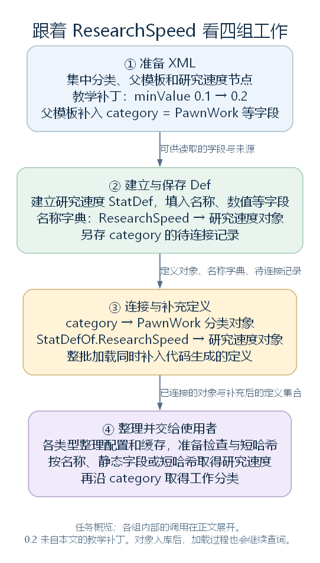
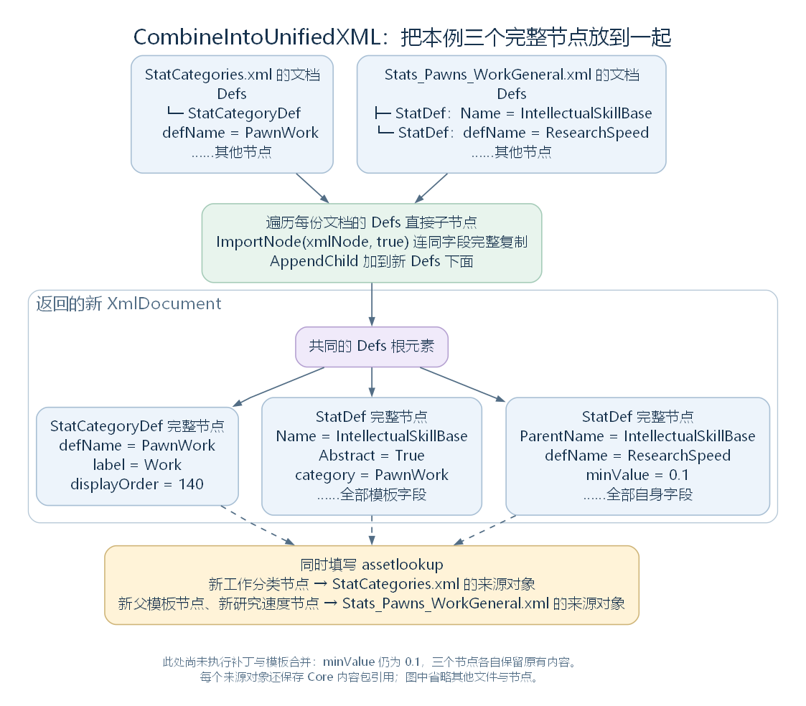
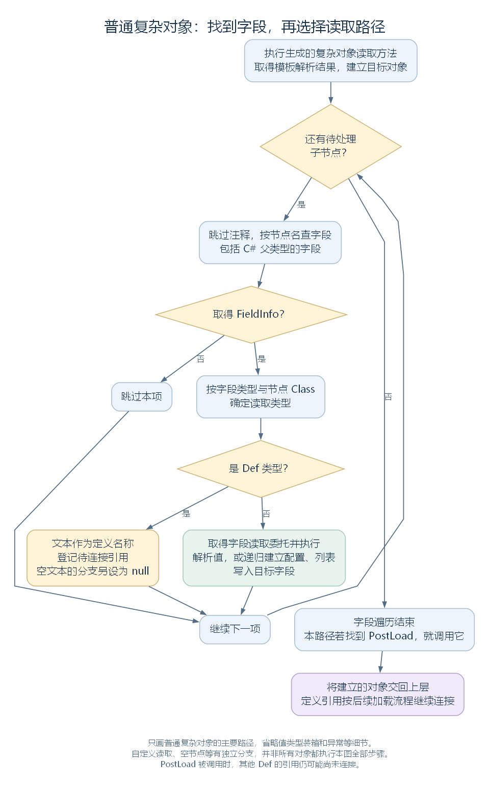
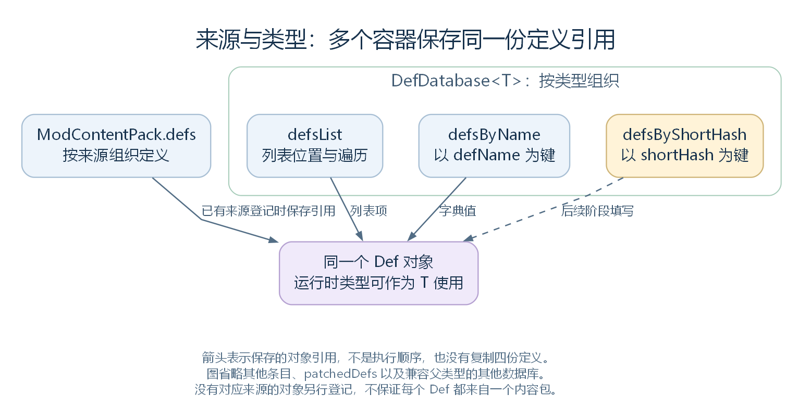
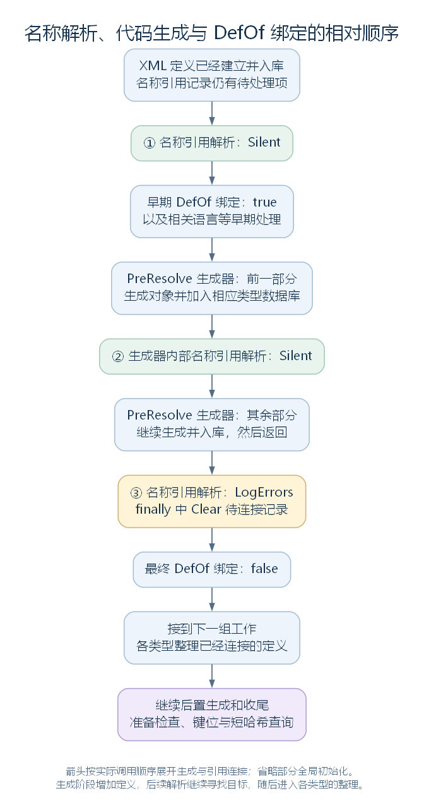

# Def 的加载、存储与查询：定义怎样进入程序

版本：整合草稿 v0.5｜整理日期：2026-10-31

上一篇 [《XML 与 Def 结构》](01-xml-and-def-structure.md) 介绍了定义由哪些字段和配置组成。本篇继续解释：文件里的描述，怎样成为游戏代码可以找到和使用的对象。

各小节先说明当前步骤的任务、输入与输出，再结合源码解释执行过程，最后用原版“研究速度”对照具体结果。案例会贯穿全文，帮助观察同一份数据在各步骤中的变化。

本文依据 RimWorld 1.7.4982 rev1280 的普通启动路径，hotReload 为 false。原版 XML 与源码节选保留原有命名，省略处另行注明；中间结果按源码推导，只展示本次关注的部分。补丁和调用示意会明确标注为教学内容。

## 一、加载流程总览

定义加载要为后续系统准备三类结果：填好字段的 Def 对象、定义之间的引用，以及查询这些对象的入口。整个过程可以按任务分成四组：

| 工作 | 主要处理过程 | 完成后的结果 |
| --- | --- | --- |
| 准备 XML | 读取各包文件，集中节点，执行补丁，解析父模板 | 可供读取的 XML 节点及来源记录 |
| 建立与保存 Def | 选择类型，建立对象，读取字段，登记来源并按类型入库 | 定义对象、名称字典与待连接记录 |
| 连接与补充定义 | 按名称查找目标，写入引用和静态字段，穿插生成更多定义 | 已连接的对象关系与补充后的定义集合 |
| 整理并交给使用者 | 整理配置和缓存，检查问题，准备短哈希查询 | 后续代码可以查询和使用的数据 |

负责组织整次加载的是 PlayDataLoader：LoadAllPlayData 是入口，DoPlayLoad 安排具体步骤。它首先调用 LoadedModManager.LoadAllActiveMods，取得各内容包的文件并读成定义；这个调用返回以后，再继续安排入库、引用连接和收尾。

**贯穿案例。** 玩家熟悉研究速度这项属性。在定义系统中，它由一个 StatDef 对象描述：这个对象保存名称、默认基础值、显示格式、参与计算的配置等。后续属性系统再结合具体人物使用这些配置。

本篇先认识三个名字，后面会一直用到：

| 名称 | 在例子中是什么 | 接下来会用它做什么 |
| --- | --- | --- |
| ResearchSpeed | 研究速度定义的 defName | 按这个名称找到研究速度对象 |
| IntellectualSkillBase | 研究速度使用的 XML 父模板名 | 为它补上共同字段 |
| PawnWork | “工作”属性分类的 defName | 找到分类对象，写入研究速度的 category 字段 |

其中，StatDef 表示“一种属性的定义”，StatCategoryDef 表示“属性分类的定义”。原版 XML 使用英文 label，正文用“研究速度”和“工作分类”称呼它们。



这张图先标出任务范围，各组内部的具体顺序在后文展开。[SVG](figures/def-load-overview.svg) · [图源](figures/def-load-overview.dot)

源码定位：加载入口（`Verse.PlayDataLoader.cs:32`）、主流程（`Verse.PlayDataLoader.cs:94`）、内容加载（`Verse.LoadedModManager.cs:56`）、案例类型（`RimWorld.StatDef.cs:10`、`RimWorld.StatCategoryDef.cs:7`）。

## 二、准备 XML：读取、组合、补丁与模板解析

这一部分把分散的文件变成一批可读取的节点。文件先成为内存中的 XML 文档，再集中到同一棵树；补丁修改其中的内容，父模板处理补齐定义所需的字段。

### 2.1 初始化内容包与程序集

程序用 ModContentPack 管理一个活动内容包，保存它的目录、加载顺序、程序集、资源入口和定义列表。Core、DLC 与启用的 Mod 都通过这类对象参与加载。

LoadedModManager 先完成三项准备。InitializeMods 按活动顺序建立内容包对象；LoadModContent 加载各包内容，其中的程序集让后面能够找到 C# 类型；CreateModClasses 建立 Mod 派生对象，让相应 Mod 代码参与初始化。普通启动路径中的相关调用为：

```csharp
LoadedModManager.InitializeMods();
LoadedModManager.LoadModContent(hotReload);
LoadedModManager.CreateModClasses();
```

这三项准备完成后，程序已经持有活动内容包及其代码，可以继续确定目录并读取定义文件。

源码定位：内容加载入口（`Verse.LoadedModManager.cs:56`）、内容包建立（`Verse.LoadedModManager.cs:183`）。

### 2.2 读取 XML 文件并保存来源

各包通过 InitLoadFolders 确定本次加载目录，再由 LoadDefs 读取其中的 Defs 文件。目录可以受版本和活动 Mod 条件影响。读取结果用 LoadableXmlAsset 保存：xmlDoc 是内存中的 XML 树，mod 指向来源内容包，name、fullFolderPath 保存文件来源信息。

LoadModXML 负责汇总各包返回的文件对象。下面的 runningMods 是活动内容包列表，modContentPack 是本轮处理的包，list 是结果列表；AddRange 将当前包返回的一批对象追加进去。节选正常读取路径，省略计时和异常处理：

```csharp
List<LoadableXmlAsset> list = new List<LoadableXmlAsset>();
for (int i = 0; i < LoadedModManager.runningMods.Count; i++)
{
    ModContentPack modContentPack = LoadedModManager.runningMods[i];
    // 省略计时和异常处理。
    list.AddRange(modContentPack.LoadDefs(hotReload));
}
return list;
```

循环结束时，list 中的每一项都能交出一份文档和它的来源。下一步从这些对象的 xmlDoc 取得节点。

**案例对照。** 本例追踪 Core 中的两份文件，下面展示它们在 Core 中的位置：

```text
Core/
  Defs/Stats/StatCategories.xml          包含工作分类
  Defs/Stats/Stats_Pawns_WorkGeneral.xml  包含父模板和研究速度
```

**StatCategories.xml 中的工作分类，以下是原版完整定义块：**

```xml
<StatCategoryDef>
  <defName>PawnWork</defName>
  <label>Work</label>
  <displayOrder>140</displayOrder>
</StatCategoryDef>
```

这里，PawnWork 是查找用的名称，Work 是显示名称，displayOrder 配置分类的显示顺序。

**Stats_Pawns_WorkGeneral.xml 中的父模板与研究速度，以下保留原版字段，注释标明省略部分：**

```xml
<StatDef Abstract="True" Name="IntellectualSkillBase">
  <defaultBaseValue>1</defaultBaseValue>
  <toStringStyle>PercentZero</toStringStyle>
  <category>PawnWork</category>
  <!-- 省略 statFactors、skillNeedFactors、capacityFactors、scenarioRandomizable。 -->
</StatDef>

<StatDef ParentName="IntellectualSkillBase">
  <defName>ResearchSpeed</defName>
  <label>research speed</label>
  <description>How fast this person performs research and how quickly they can find things using scanning equipment.</description>
  <minValue>0.1</minValue>
  <displayPriorityInCategory>4500</displayPriorityInCategory>
</StatDef>
```

父模板提供默认基础值 1、百分比显示格式 PercentZero，以及分类名称 PawnWork。子节点用 ParentName 指向这个模板，再写入研究速度自己的名称、描述、下限与分类内显示优先级。

这时我们看到的仍是 XML。比如 `<category>PawnWork</category>` 保存的是一段名称文本；后面还需要找到实际的分类对象。

读入内存后，这两份文件分别成为以下来源对象；实际结果列表还包含其他文件：

```text
一个 LoadableXmlAsset
  xmlDoc → StatCategories.xml 的文档
  mod    → Core 的 ModContentPack

另一个 LoadableXmlAsset
  xmlDoc → Stats_Pawns_WorkGeneral.xml 的文档
  mod    → 同一个 Core 的 ModContentPack
```

源码定位：目录选择（`Verse.ModContentPack.cs:302`）、文档收集（`Verse.LoadedModManager.cs:318`）、文件扫描（`Verse.DirectXmlLoader.cs:17`）、来源对象（`Verse.LoadableXmlAsset.cs:53`）。

XML 定位（相对于游戏目录）：分类 `Data/Core/Defs/Stats/StatCategories.xml:213`；父模板与研究速度 `Data/Core/Defs/Stats/Stats_Pawns_WorkGeneral.xml:209`、`:238`。

### 2.3 组合统一 XML 并记录节点来源

CombineIntoUnifiedXML 接收前一步的文件对象列表，创建一份新的 XmlDocument，建立 Defs 根元素，再把各文件根元素下的直接子节点完整复制过来。后面的补丁、模板登记和逐项读取就可以围绕同一份文档工作。

这里的“顶层节点”指 Defs 的直接子节点。每个定义或模板节点都连着自己的字段，按这个层级复制，就能保留完整的内容描述。

先认识源码中的对象与局部变量：xmls 接收前一步的 LoadableXmlAsset 列表，loadableXmlAsset 是本轮处理的文件；xmlDocument 是新文档。obj 暂存当前子节点，转成 XmlNode 后由 xmlNode 接收，xmlNode2 保存复制到新文档的节点。

另一个参数 assetlookup 是调用者传入的字典。它以新节点为键，记录该节点来自哪个 LoadableXmlAsset。下面的 DocumentElement 取得根元素，ChildNodes 取得其直接子节点；ImportNode(xmlNode, true) 复制节点及其后代，AppendChild 把节点加入指定父节点。节选有效文档的处理路径：

```csharp
public static XmlDocument CombineIntoUnifiedXML(
    List<LoadableXmlAsset> xmls,
    Dictionary<XmlNode, LoadableXmlAsset> assetlookup)
{
    XmlDocument xmlDocument = new XmlDocument();
    xmlDocument.AppendChild(xmlDocument.CreateElement("Defs"));

    foreach (LoadableXmlAsset loadableXmlAsset in xmls)
    {
        // 省略文档检查和日志，保留有效文档的处理路径。
        foreach (object obj in loadableXmlAsset.xmlDoc.DocumentElement.ChildNodes)
        {
            XmlNode xmlNode = (XmlNode)obj;
            XmlNode xmlNode2 = xmlDocument.ImportNode(xmlNode, true);
            assetlookup[xmlNode2] = loadableXmlAsset;
            xmlDocument.DocumentElement.AppendChild(xmlNode2);
        }
    }
    return xmlDocument;
}
```

方法先建立新根元素，外层循环逐份取文档，内层循环逐个取顶层节点；每取一项，就复制整个节点、登记副本来源，再把副本加到新根元素下。返回值是统一文档，assetlookup 则保存与新节点对应的来源记录。

**案例对照。** 组合后，工作分类、父模板和研究速度成为共同 Defs 下的三个节点。下面只展开它们，实际文档还包含其他导入内容，排列仅用于展示层级：

```text
新 XmlDocument
  Defs
    StatCategoryDef
      defName = PawnWork
      label = Work
      displayOrder = 140
    StatDef（Name = IntellectualSkillBase，Abstract = True）
      defaultBaseValue = 1
      toStringStyle = PercentZero
      category = PawnWork
      ……其余模板字段
    StatDef（ParentName = IntellectualSkillBase）
      defName = ResearchSpeed
      label = research speed
      minValue = 0.1
      ……其余自身字段
    ……其他节点
```

循环处理到研究速度时，xmlNode2 就是包含 ResearchSpeed、label、minValue 等字段的完整副本。程序先登记它的来源，再把它放到新 Defs 下面。

与统一文档一起得到的来源记录，在本例中是：

```text
新文档中的工作分类节点 → StatCategories.xml 的 LoadableXmlAsset
新文档中的父模板节点   → Stats_Pawns_WorkGeneral.xml 的 LoadableXmlAsset
新文档中的研究速度节点 → Stats_Pawns_WorkGeneral.xml 的 LoadableXmlAsset
```



统一文档交给补丁和模板处理，来源字典留给后面的定义登记。[SVG](figures/xml-unified-example.svg) · [图源](figures/xml-unified-example.dot)

源码定位：文档组合（`Verse.LoadedModManager.cs:408`）。

### 2.4 按顺序执行 XML 补丁

ApplyPatches 接收统一文档，按活动内容包顺序取得补丁对象，再逐个调用 Apply。每项操作都修改传入的文档，后面的操作继续处理前面留下的结果。

下面的 runningMods 保存活动包，rm 是取得各包 Patches 时使用的参数，Patches 提供该包的补丁；SelectMany 把各包的补丁接成一组供遍历。patchOperation 是当前操作，xmlDoc 是统一文档。节选执行路径，省略异常处理：

```csharp
foreach (PatchOperation patchOperation in LoadedModManager.runningMods.SelectMany<ModContentPack, PatchOperation>((ModContentPack rm) => rm.Patches))
{
    // 省略异常处理。
    patchOperation.Apply(xmlDoc);
}
```

具体操作由 PatchOperation 的派生类实现。以替换操作 PatchOperationReplace 为例，它按 XPath 选择目标，把替换内容插到目标位置，再移除原节点。XPath 是按路径与条件选择 XML 节点的表达式。

**案例对照。** 加入一个教学补丁，把研究速度的 minValue 从 0.1 改成 0.2。 假设某个启用的 Mod 提供这份补丁，并且没有后续补丁再改它。后文的数据结果继续沿用这次修改。

PatchOperationReplace 表示替换操作；xpath 提供目标路径和条件；value 放替换进去的新节点。这里的 XPath 会沿 Defs → StatDef 查找，筛选 defName 为 ResearchSpeed 的定义，再选择它的 minValue：

```xml
<Patch>
  <Operation Class="PatchOperationReplace">
    <xpath>/Defs/StatDef[defName="ResearchSpeed"]/minValue</xpath>
    <value>
      <minValue>0.2</minValue>
    </value>
  </Operation>
</Patch>
```

PatchOperationReplace 找到原有 minValue，将 value 中的新元素插入原位置，再移除旧元素。研究速度节点因此发生如下变化：

```text
补丁前：minValue 元素的文本为 "0.1"
补丁后：minValue 元素的文本为 "0.2"
```

修改发生在内存中的统一文档上。后面建立 Def 时，将读到 0.2。父模板处理也会接着使用这份已修改的 XML。

源码定位：补丁安排（`Verse.LoadedModManager.cs:390`）、替换实现（`Verse.PatchOperationReplace.cs:11`）。

### 2.5 登记并解析 XML 父模板

ParseAndProcessXML 先遍历统一文档的顶层元素，调用 TryRegister 登记模板信息，再统一调用 XmlInheritance.Resolve。登记阶段收集节点的 Name、ParentName 与来源；解析阶段建立父子关系，并按父模板和子节点准备合并结果。

登记时，list 是从统一文档取得的顶层节点列表，i 是当前位置；loadableXmlAsset 是通过来源字典找到的文件对象，它的 mod 给出来源包。以下节选两处调用，省略列表准备、遍历和计时：

```csharp
XmlInheritance.TryRegister(
    list[i],
    (loadableXmlAsset != null) ? loadableXmlAsset.mod : null);

// 所有节点登记结束后，再统一解析模板关系。
XmlInheritance.Resolve();
```

解析一个有父模板的节点时，程序先取得父模板已准备的内容，复制后再合入子节点字段，保存与原始节点对应的结果。后面的读取器通过 GetResolvedNodeFor 取得这份结果。

**案例对照。** Name 为 IntellectualSkillBase 的节点被登记为可查找的模板，研究速度的 ParentName 指向它。GetResolvedNodeFor 返回的合并结果，只展开本篇关注的字段，相当于：

```xml
<StatDef ParentName="IntellectualSkillBase">
  <defaultBaseValue>1</defaultBaseValue>
  <toStringStyle>PercentZero</toStringStyle>
  <category>PawnWork</category>
  <!-- 省略模板提供的其他字段。 -->
  <defName>ResearchSpeed</defName>
  <label>research speed</label>
  <!-- 省略自身的 description 与 displayPriorityInCategory。 -->
  <minValue>0.2</minValue>
</StatDef>
```

到这里，研究速度要读取的内容已经确定：默认基础值 1、百分比格式、分类名称 PawnWork，加上自己的名称和补丁后的下限 0.2。接下来可以按这些字段建立 C# 对象。

模板合并的字段与列表规则见上一篇的 [XML 模板说明](01-xml-and-def-structure.md#四xml-模板怎样补全内容)。

源码定位：登记与读取安排（`Verse.LoadedModManager.cs:437`）、取得合并结果（`Verse.XmlInheritance.cs:115`）、合并处理（`Verse.XmlInheritance.cs:265`）。

## 三、建立与保存 Def：类型选择、字段读取与入库

这一部分把 XML 中的元素名、文本和字段配置读成 C# 对象，再保存到来源包和类型数据库中。完成后，程序能够按类型和名称查询定义；字段中的 Def 名称则交给待连接记录继续处理。

### 3.1 确定定义类型并调用读取方法

ParseAndProcessXML 遍历顶层节点，检查内容包条件后，把需要读取的节点交给 DirectXmlToObjectNew.DefFromNodeNew。入口跳过非元素节点和带 Abstract="True" 的模板项，再为需要建立对象的节点选择 C# 类型与读取方法。

先认识片段中的名称：

| 名称 | 在这一阶段保存什么 |
| --- | --- |
| node | 传入的原始顶层 XML 节点 |
| resolvedNodeFor | GetResolvedNodeFor 返回的模板合并结果 |
| text | 用来查找 C# 类型的名称，默认取元素名 |
| xmlAttribute2 | 合并结果中的 Class 属性 |
| typeInAnyAssembly | 按名称找到的 C# Type |
| defParserForType | 会建立和填写这种对象的读取委托，即可以调用的方法引用 |
| def | 读取方法返回的定义对象 |

类型名默认取元素名，Class 属性可以进一步指定。GetDefParserForType 取得相应读取方法，并缓存起来供同类节点复用。其委托前两个参数在签名中名为 unused、unused2，本入口传 0；后两个参数提供节点和实际类型。沿成功路径，代码为：

```csharp
XmlNode resolvedNodeFor = XmlInheritance.GetResolvedNodeFor(node);
string text = node.Name;
XmlAttribute xmlAttribute2 = resolvedNodeFor.Attributes["Class"];
if (xmlAttribute2 != null)
{
    text = xmlAttribute2.Value;
}
Type typeInAnyAssembly = GenTypes.GetTypeInAnyAssembly(text, null);

// 省略类型校验与日志。
Def def = null;
DirectXmlToObjectNew.ParseValueAndReturnDefDelegate defParserForType =
    DirectXmlToObjectNew.GetDefParserForType(typeInAnyAssembly);
def = defParserForType(0, 0, node, typeInAnyAssembly);
def.ResolveDefNameHash();
```

读取方法接收原始 node，在内部取得合并后的字段内容并填写对象。最后的 ResolveDefNameHash 根据对象的 defName 填写名称哈希，返回这个定义。

**案例对照。** IntellectualSkillBase 带有 Abstract="True"，会在入口作为模板项跳过。研究速度节点的元素名是 StatDef，合并结果也未指定 Class，因此 text 为 StatDef，typeInAnyAssembly 对应 `RimWorld.StatDef`，读取成功后 def 指向新建的研究速度对象。

### 3.2 遍历字段并选择读取方式

普通复杂对象路径先建立对象，让字段初值和构造函数提供起始数据，再逐个处理 XML 子节点：按名称找到字段，确定读取类型，选择读取方法，将结果写入对应位置。

普通字段的读取方法由 CreateFieldSetterForType 按类型选择并建立，返回的委托供字段循环调用。下面的 type 是当前选择的字段读取类型；字符串和列表分别取得专用方法，其余一般类型进入通用路径。节选字符串、列表与一般类型分支，其他专门分支省略：

```csharp
if (type == typeof(string))
{
    return DirectXmlToObjectNew.CreateFieldSetterForString();
}
// 省略 Flags 枚举分支。
if (GenTypes.IsList(type))
{
    return DirectXmlToObjectNew.CreateFieldSetterForList(type);
}
// 省略字典分支。
return DirectXmlToObjectNew.CreateFieldSetterForGeneralType(type);
```

字符串可以写入文本；一般路径可以把单一文本转成数值、枚举等值，也可以继续建立嵌套对象。Def 引用字段另行登记目标名称：此时所有定义还在逐项建立，可查询目标尚未收集完，先保存“接收对象、字段、目标类型与名称”，等入库后再查找并赋值。



图中每一轮处理一个 XML 子节点，再继续下一项；字段循环由读取器生成的方法执行。[SVG](../../figures/xml-object-field-loop.svg) · [图源](../../figures/xml-object-field-loop.dot)

字段读取结束后，适用的 PostLoad 会处理刚读到的数据，随后定义返回给 ParseAndProcessXML。

**案例对照。** 研究速度的几个字段，可以观察到字符串写入、数值与枚举转换，以及引用登记三种结果：

| XML 内容 | 找到的 C# 字段类型 | 这次读取的结果 |
| --- | --- | --- |
| `<defName>ResearchSpeed</defName>` | string | defName = "ResearchSpeed" |
| `<label>research speed</label>` | string | label = "research speed" |
| `<defaultBaseValue>1</defaultBaseValue>` | float | defaultBaseValue = 1f |
| `<toStringStyle>PercentZero</toStringStyle>` | ToStringStyle 枚举 | toStringStyle = ToStringStyle.PercentZero |
| `<minValue>0.2</minValue>` | float | minValue = 0.2f |
| `<category>PawnWork</category>` | StatCategoryDef | 登记一条目标类型为 StatCategoryDef、名称为 PawnWork 的待连接记录 |

因此，字段读取后的局部结果是：

```text
研究速度 StatDef 对象
  defName = "ResearchSpeed"
  label = "research speed"
  defaultBaseValue = 1f
  toStringStyle = ToStringStyle.PercentZero
  minValue = 0.2f
  category = null，等待连接

另存的待连接记录
  接收对象：上面的研究速度对象
  需要填写的字段：category
  目标类型：StatCategoryDef
  目标名称："PawnWork"
```

DirectXmlCrossRefLoader 保存分类的待连接记录，后面继续处理。研究速度父模板中的因素列表也通过相应的列表与对象读取路径进入定义。

源码定位：默认入口（`Verse.DirectXmlToObjectNew.cs:16`）、读取委托与签名（`Verse.DirectXmlToObjectNew.cs:119`、`Verse.DirectXmlToObjectNew.cs:1596`）、读取分派（`Verse.DirectXmlToObjectNew.cs:136`）、字段循环（`Verse.DirectXmlToObjectNew.cs:1029`）、引用登记（`Verse.DirectXmlCrossRefLoader.cs:29`）、案例字段（`RimWorld.StatDef.cs:312`、`RimWorld.StatDef.cs:415`、`RimWorld.StatDef.cs:436`、`RimWorld.StatDef.cs:469`）。

### 3.3 登记定义来源并加入内容包列表

ParseAndProcessXML 用原始顶层节点在 assetlookup 中查找来源文件对象，从它的 mod 取得内容包，再把新建定义交给该包的 AddDef。这样，定义保存了来源关系，内容包也取得下一步批量收集所需的列表。

源码用 loadableXmlAsset2 接收来源查找结果，用 modContentPack2 接收其 mod，def 接收新建对象，然后调用 `modContentPack2.AddDef(def, loadableXmlAsset2.name)`。AddDef 的参数 source 在这里接收来源文件名，this 表示当前内容包。完整实现如下：

```csharp
public void AddDef(Def def, string source = "Unknown")
{
    def.modContentPack = this;
    def.fileName = source;
    this.defs.Add(def);
}
```

方法先把内容包和文件名写入定义，再将对象引用追加到本包的 defs 列表。对补丁新建且没有来源记录的顶层节点，程序会把读出的定义放入 LoadedModManager.patchedDefs，供下一步一并收集。

**案例对照。** 研究速度的来源对象对应 Stats_Pawns_WorkGeneral.xml，它的 mod 指向 Core。登记后，研究速度保存 Core 与来源文件信息，Core 的 defs 列表则保存研究速度引用；工作分类也按自身来源登记到这个包。带 Abstract="True" 的父模板在读取入口被跳过。

教学补丁替换的是研究速度内部的 minValue，顶层研究速度节点仍保留原来的来源记录。

所有节点处理结束后，LoadAllActiveMods 完成后续处理并返回 DoPlayLoad。接下来，定义从来源列表进入按类型组织的查询集合。

### 3.4 按类型收集定义并建立名称索引

`DefDatabase<T>` 为每种 T 保存静态列表与查询字典。T 指定本次收集和查询采用的定义类型。

DoPlayLoad 在完成语言元数据初始化后，遍历 Def 子类并调用各库的 AddAllInMods。下面，defType 是本轮的类型，GenGeneric.InvokeStaticMethodOnGenericType 将这个类型填进 `DefDatabase<>`，再调用指定名字的方法；Parallel.ForEach 等各类型的处理完成后再继续：

```csharp
Parallel.ForEach<Type>(typeof(Def).AllSubclasses(), delegate(Type defType)
{
    GenGeneric.InvokeStaticMethodOnGenericType(
        typeof(DefDatabase<>), defType, "AddAllInMods");
});
```

AddAllInMods 从各包取得能作为 T 使用的定义，处理同名项后调用 Add。Add 把对象引用写入 defsList 和 defsByName，并填写列表位置 index；节选这三行：

```csharp
DefDatabase<T>.defsList.Add(def);
DefDatabase<T>.defsByName.Add(def.defName, def);
// 省略数量检查。
def.index = (ushort)(DefDatabase<T>.defsList.Count - 1);
```

AddAllInMods 按内容包优先级和活动顺序收集定义；同包重复名称会被记录并跳过，跨来源的同名项按收集规则在当前库中替换。更细的重名规则见 [数据库研究笔记](../../34-defdatabase.md)。

**案例对照。** 当 defType 为 StatDef 时，外层调用对应 `DefDatabase<StatDef>.AddAllInMods()`，收集研究速度在内的属性定义；`DefDatabase<StatCategoryDef>` 则收集工作分类等分类定义。它们在来源列表和类型库中形成如下关系：

```text
Core 的 defs 列表
  → 工作分类对象
  → 研究速度对象
  → ……其他定义

DefDatabase<StatCategoryDef>
  defsByName["PawnWork"] → 工作分类对象

DefDatabase<StatDef>
  defsList 中的一项 → 研究速度对象
  defsByName["ResearchSpeed"] → 同一个研究速度对象
```



这些容器通过引用访问已有对象。来源列表便于按包组织，类型库便于查询和遍历。[SVG](figures/def-storage-views.svg) · [图源](figures/def-storage-views.dot)

到本部分结束，定义已有相应名称查询入口，待连接记录可以开始查找目标。

源码定位：来源登记（`Verse.LoadedModManager.cs:437`、`Verse.ModContentPack.cs:610`）、入库安排（`Verse.PlayDataLoader.cs:94`）、类型收集与保存（`Verse.DefDatabase.cs:43`、`Verse.DefDatabase.cs:90`）、泛型静态调用（`Verse.GenGeneric.cs:29`）。

## 四、连接与补充定义：引用写入、静态绑定与代码生成

这一部分沿待连接记录查找目标，把结果写回对象字段；也会把常用定义写入静态字段，供其他代码直接访问。加载过程中还要补入由代码生成的定义，因此引用查找和静态字段绑定会分几轮执行。

### 4.1 解析待连接记录并写回引用字段

DirectXmlCrossRefLoader 将待处理记录保存在 wantedRefs 列表中。每条记录的 TryResolve 负责查找和相应处理；需要后置写入的部分由 Apply 完成。整批方法先并行处理记录，再调用完成项的 Apply，移出已完成项。

对普通字段记录，程序从记录中取得字段类型和目标名称，查询相应数据库，再把目标写入接收对象。下面这段位于普通字段记录的 TryResolve 中，this 是当前记录：fi 保存字段信息，wanter 保存接收对象，defName 保存目标名称，resolvedDef 保存查询结果。overrideFieldType 若已指定就作为查询类型，否则取 fi.FieldType；GetDefSilentFail 的最后一个参数启用声音定义的专门查询规则。节选查找并写入成功的路径：

```csharp
Type type = this.overrideFieldType ?? this.fi.FieldType;
this.resolvedDef = GenDefDatabase.GetDefSilentFail(type, this.defName, true);
// 省略条件、缺失目标检查与声音专门分支，继续成功路径。
this.fi.SetValue(this.wanter, this.resolvedDef);
return true;
```

SetValue 将查到的对象写到 fi 描述的字段上，接收对象由 wanter 给出。后续代码读取该字段，就能直接取得目标定义。

**案例对照。** 分类记录中的接收对象是研究速度，字段是 category，目标类型是 StatCategoryDef，名称是 PawnWork。解析时查到工作分类并写回，得到：

```text
研究速度 StatDef 对象（defName = "ResearchSpeed"）
  category → 工作分类 StatCategoryDef 对象（defName = "PawnWork"）
               label = "Work"
               displayOrder = 140
```

后面的代码读 category，就能继续读到分类的 label、displayOrder。XML 中的名称文本，由此成为了两个对象之间的引用。

列表和字典字段也有对应记录，具体写入过程见 [引用连接研究笔记](../../39-def-cross-references.md)。

### 4.2 查询并绑定 DefOf 静态字段

带 DefOf 标记的类通过公共静态字段保存常用定义。DefOfHelper 遍历这些字段，取得字段类型与名称，查询数据库并完成赋值；DefAlias 可以另行指定目标名称。

下面 fieldInfo 描述当前静态字段，fieldType 是字段类型，text 是查询名称，flag 控制普通缺失日志。GetDef 查到对象，SetValue 写入字段；静态字段无需接收实例，因此其第一个参数为 null：

```csharp
Def def = GenDefDatabase.GetDef(fieldType, text, flag);
fieldInfo.SetValue(null, def);
```

赋值完成后，代码可以直接从该静态字段取得定义引用。

**案例对照。** 原版 StatDefOf 中声明了研究速度字段：

```csharp
public static StatDef ResearchSpeed;
```

处理这个字段时，fieldType 为 StatDef，text 为 "ResearchSpeed"。绑定器按名称查到已有对象，再将同一个引用写入 StatDefOf.ResearchSpeed：

```text
DefDatabase<StatDef> 的名称字典["ResearchSpeed"] ─┐
                                              ├→ 研究速度对象
StatDefOf.ResearchSpeed ────────────────────────┘
```

因此，名称查询与静态字段可以取得同一个研究速度对象。

### 4.3 穿插定义生成与多轮引用连接

代码生成会向数据库补入新的定义，后续步骤需要继续找到这些对象，因此加载流程会在生成前后安排引用解析与静态字段绑定。

先认识这几项调用的任务：

| 调用 | 做什么 |
| --- | --- |
| ResolveAllWantedCrossReferences | 按记录查找定义，完成引用写入 |
| RebindAllDefOfs | 为 DefOf 静态字段赋值；true 表示早期尝试，false 表示最终绑定 |
| GenerateImpliedDefs_PreResolve | 在各类型自身整理前，调用生成器补充定义 |
| Clear | 清理本轮剩余的待连接记录 |

FailMode 决定相应缺失问题如何报告，Silent 用于前面的尝试，LogErrors 用于最后一轮报告。DoPlayLoad 的相关安排如下，省略中间的语言等准备：

```csharp
DirectXmlCrossRefLoader.ResolveAllWantedCrossReferences(FailMode.Silent);
DefOfHelper.RebindAllDefOfs(true);

// 省略语言等早期准备。
DefGenerator.GenerateImpliedDefs_PreResolve(false);

try
{
    DirectXmlCrossRefLoader.ResolveAllWantedCrossReferences(FailMode.LogErrors);
}
finally
{
    DirectXmlCrossRefLoader.Clear();
}
DefOfHelper.RebindAllDefOfs(false);
```

PreResolve 生成器内部还穿插一轮 Silent 解析，再继续生成。它补入新定义，后面的解析就可以继续寻找新出现的目标：



图中保留了这几轮的实际相对顺序。[SVG](figures/def-binding-stages.svg) · [图源](figures/def-binding-stages.dot)

新定义也要进入现有数据库。具体生成器先建立对象，再把它交给 AddImpliedDef。这里 def 是生成对象，T 是相应定义类型；generated 记录生成标记，ResolveDefNameHash 填写名称哈希，PostLoad 处理新建数据，Add 把它加入类型库。节选普通启动路径的主要动作：

```csharp
def.generated = true;
def.ResolveDefNameHash();
// 省略可用来源的登记。
def.PostLoad();
// 省略热重载分支；本次 hotReload 为 false。
DefDatabase<T>.Add(def);
```

经过这组处理，XML 读出的对象和代码补出的对象都能参加后续查询，再交给各类型整理。

**案例对照。** 研究速度和工作分类都来自 XML，入库后就具备连接条件，可以在首轮解析中接上 category。整批内容还包括根据建筑配置生成的蓝图、框架等定义，后面的解析会继续处理与这些新增目标有关的记录。

源码定位：名称连接与外层顺序（`Verse.PlayDataLoader.cs:94`）、记录处理（`Verse.DirectXmlCrossRefLoader.cs:247`）、字段写入（`Verse.DirectXmlCrossRefLoader.cs:333`、`Verse.DirectXmlCrossRefLoader.cs:388`）、静态字段与绑定（`RimWorld.StatDefOf.cs:259`、`RimWorld.DefOfHelper.cs:27`）、生成安排和入库（`RimWorld.DefGenerator.cs:11`、`RimWorld.DefGenerator.cs:72`）。

## 五、整理与收尾：准备各类型的数据和查询入口

对象之间接上引用以后，各类型还要整理自身规则和缓存；整个加载过程还要完成后置生成、配置检查、键位设置与短哈希准备。下面按任务说明这些调用的位置与结果。

### 5.1 执行类型整理与缓存准备

DoPlayLoad 先执行 ResetStaticDataPre，集中准备分类节点、研究坐标等系统数据，再调用各类型数据库的 ResolveAllReferences。这个数据库方法会重新填写 index，遍历相应定义，调用对象的 ResolveReferences，最后再次编号。

外层先处理 ThingCategoryDef 和 RecipeDef，再处理其他类型，最后处理 ThingDef。它们分别涉及内容分类、配方和实体配置；这样的安排让各类按主流程指定的顺序处理自己依赖的数据。类型方法可以补默认值、整理配置集合或建立缓存，Def 基类还会调用 modExtensions 的相应方法。

后面，GenerateImpliedDefs_PostResolve 根据整理后的内容补入键位相关定义，ResetStaticDataPost 则组织建筑配置、统计属性等后置准备。

后置准备还包括属性缓存策略。ResetStaticDataPost 会调用 StatDef.SetImmutability。它先收集可能变化的属性，再检查各个 StatDef 的技能、身体能力、其他属性因素等配置，为属性计算准备缓存策略。

下面 statDef 是列表中当前的属性定义，IsImmutable 判断它是否符合按不变属性处理的条件，结果写入 immutable；Worker 是该属性的处理对象，SetCacheability 根据配置准备相应缓存。节选 SetImmutability 末尾的循环：

```csharp
foreach (StatDef statDef in DefDatabase<StatDef>.AllDefsListForReading)
{
    statDef.immutable = statDef.IsImmutable();
    statDef.Worker.SetCacheability(statDef.immutable);
}
```

**案例对照。** 研究速度继承了技能、身体能力和其他属性因素列表，因此这次判断得到 immutable = false。到这里，定义里的这些因素既已被读取和连接，也参与了属性系统使用前的准备；具体人物的研究速度计算留到属性模块展开。

### 5.2 检查配置并建立短哈希查询字典

后置准备之后，程序继续完成下面几项工作：

| 调用或条件 | 结果 |
| --- | --- |
| Prefs.DevMode 为 true 时，调用各库的 ErrorCheckAllDefs | 遍历定义的 ConfigErrors，把配置问题写入日志 |
| KeyPrefs.Init | 初始化键位设置 |
| ShortHashGiver.GiveAllShortHashes | 给定义分配 shortHash，并建立对应查询字典 |

shortHash 是保存在 Def 中的 ushort 数值。分配器按选定类型组取出定义，按 defName 排序，从名称的稳定哈希取得候选；遇到零或本组已占用的值，就继续寻找可用数值。

分配结束后，相应数据库的 InitializeShortHashDictionary 遍历 defsList，把每项的 shortHash 和对象引用写进 defsByShortHash。EnsureCapacity 先按条目数量预留容量：

```csharp
public static void InitializeShortHashDictionary()
{
    DefDatabase<T>.defsByShortHash.EnsureCapacity(DefDatabase<T>.defsList.Count);
    for (int i = 0; i < DefDatabase<T>.defsList.Count; i++)
    {
        DefDatabase<T>.defsByShortHash[DefDatabase<T>.defsList[i].shortHash] =
            DefDatabase<T>.defsList[i];
    }
}
```

**案例对照。** 对研究速度而言，又增加了一条查询入口：它本次取得的 shortHash 数值，可以在相应字典中找到同一个研究速度对象。实际数值由本次定义集合和分配过程决定。

### 5.3 结束本次定义加载并记录状态

DoPlayLoad 将后续语言、资源等函数交给 LongEventHandler.ExecuteWhenFinished，由它按当前长任务状态安排执行。定义加载主流程返回后，外层 LoadAllPlayData 记录本次加载状态。

下面 loadedInt 是 PlayDataLoader 保存加载状态的布尔字段。节选普通启动正常返回路径，省略计时与异常恢复：

```csharp
PlayDataLoader.DoPlayLoad();
// 省略计时与异常恢复。
PlayDataLoader.loadedInt = true;
```

DoPlayLoad 的这次调用结束后，外层将 loadedInt 设为 true，再完成正常返回。后续使用者可以通过已建立的入口取得定义。

**案例对照。** 研究速度已经从文件中的一段 XML，变成了有字段、有分类引用、能通过名称、静态字段与短哈希访问的对象。下一部分站在使用者一侧，看这些入口怎样交回数据。

源码定位：整理与收尾顺序（`Verse.PlayDataLoader.cs:94`）、前后准备（`Verse.PlayDataLoader.cs:663`、`Verse.PlayDataLoader.cs:722`）、逐项整理（`Verse.DefDatabase.cs:143`）、属性缓存准备（`RimWorld.StatDef.cs:271`、`RimWorld.StatDef.cs:277`、`RimWorld.StatWorker.cs:22`）、配置检查（`Verse.DefDatabase.cs:223`）、短哈希分配（`Verse.ShortHashGiver.cs:14`、`Verse.ShortHashGiver.cs:48`）、字典建立（`Verse.DefDatabase.cs:302`）、加载状态（`Verse.PlayDataLoader.cs:32`）。

## 六、使用定义：查询与已有引用的访问

这一部分接到的是已经准备好的定义。使用者可以按类型和名称查询，也可以直接读取已经绑定的字段，再沿对象之间的引用取得其他配置。

### 6.1 按类型与名称查询定义

`DefDatabase<T>.GetNamed` 用 T 确定数据库，用参数 defName 确定名称。方法在 defsByName 中用 TryGetValue 查找，找到时将引用放进局部变量 t，再返回给调用者。节选成功路径：

```csharp
T t;
if (DefDatabase<T>.defsByName.TryGetValue(defName, out t))
{
    return t;
}
```

这个入口交回第三部分入库时保存的对象。调用者取得它后，可以继续读取普通字段或已经连接的定义引用。

**案例对照。** 下面是加载并完成相应绑定后的教学调用。stat 接收研究速度对象，category 接收它已连接的工作分类；sameDef 用引用比较检查查询结果和静态字段是否指向同一个对象：

```csharp
StatDef stat = DefDatabase<StatDef>.GetNamed("ResearchSpeed");
StatCategoryDef category = stat.category;
bool sameDef = object.ReferenceEquals(stat, StatDefOf.ResearchSpeed);
```

按本文的配置与教学补丁，相关结果为：

```text
stat.defName       = "ResearchSpeed"
stat.defaultBaseValue = 1f
stat.minValue      = 0.2f
category.defName   = "PawnWork"
category.displayOrder = 140
sameDef            = true
```

XML 里的 ResearchSpeed 对应名称字典中的键，PawnWork 对应 category 所指对象的名称。补丁后的 0.2 也已经进入 float 字段。现在这些内容都可以由后续代码直接读取。

### 6.2 按已有信息选择查询与访问入口

除了名称查询，程序还提供按 Type、短哈希与已有引用访问定义的方式。使用者手头的信息决定采用哪一个入口：

| 已经具备的信息 | 常用入口 | 得到什么 |
| --- | --- | --- |
| 定义类型和 defName | `DefDatabase<T>.GetNamed` | 名称字典中的定义引用 |
| 运行时取得的 Type 和 defName | GenDefDatabase.GetDef | 对应类型库中的查询结果 |
| 需要遍历某类定义 | AllDefs、AllDefsListForReading | 供逐项读取的定义集合 |
| 相应分组中的 shortHash | GetByShortHash | 短哈希字典中的定义引用 |
| 已绑定的静态字段或其他对象中的 Def 字段 | 直接读取字段 | 已经保存在该处的定义引用 |

例如，GetByShortHash 使用前面建立的 defsByShortHash 字典。参数 shortHash 是待查数值，t 接收查到的定义；查找失败时返回 default(T)。完整实现为：

```csharp
public static T GetByShortHash(ushort shortHash)
{
    T t;
    if (DefDatabase<T>.defsByShortHash.TryGetValue(shortHash, out t))
    {
        return t;
    }
    return default(T);
}
```

**案例对照。** 已知 ResearchSpeed 时可以按名称查；已经持有 StatDefOf.ResearchSpeed 时可以直接读取；已经取得研究速度对象时，还能沿 category 取得工作分类。这几种入口接回同一组已经建立并连接的数据。

从文件读取到代码访问，本例经历了几次具体变化：XML 先集中并修改，父模板补齐字段；读取器建立对象和待连接记录，数据库保存查询入口；引用解析把名称接成对象关系，后置处理准备配置与缓存。后续游戏系统取得这些定义，再执行自己的计算、任务和显示逻辑。

源码定位：名称查询（`Verse.DefDatabase.cs:251`）、按 Type 查询（`Verse.GenDefDatabase.cs:13`）、遍历入口（`Verse.DefDatabase.cs:14`、`Verse.DefDatabase.cs:24`）、短哈希查询（`Verse.DefDatabase.cs:291`）。

目录与版本状态见 [本组目录](README.md)。目录选择、补丁组合、读取器分支与引用记录的详细研究，保留在 [研究笔记索引](../../29-def-xml-outline.md#逐段研究进度)中。
