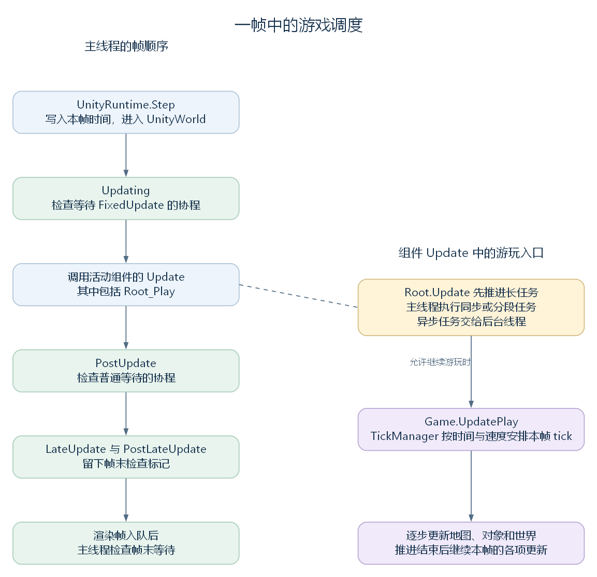

# 游戏运行与调度：tick、线程、协程

第四章于 2026-11-08 定稿，提供发布版与完整解析版 v1.0。第五章为整合草稿 v0.2，第六章为整合草稿 v0.1。各章依据 RimWorld 1.7.4982 rev1280 的代码整理。

## 运行总览

引擎把本帧的时间交给 `UnityRuntime.Step`，再由 `UnityWorld` 按顺序更新组件。在游玩场景中，`Root_Play` 先让 `Root.Update` 推进当前长任务。允许继续游玩时，`Game.UpdatePlay` 调用 `TickManager`，安排本帧推进零个、一个或多个 tick。每个 tick 都把模拟向前推进一步。

已经登记的协程随帧阶段检查条件。`Updating` 在组件更新前处理 `FixedUpdate` 类别，`PostUpdate` 在组件更新后处理普通等待。正常图形路径上，`PostLateUpdate` 留下帧末标记，主线程在渲染帧入队后检查帧末等待。

左栏从上到下是一帧的顺序。右栏展开组件 `Update` 中的游玩入口，长任务与 tick 调用都发生在组件更新阶段。图示采用已经接入协程检查的普通图形路径。[SVG](../figures/runtime-scheduling-overview.svg) · [图源](../figures/runtime-scheduling-overview.dot)

| 工作 | 怎样决定何时执行 | 本次结束后留下什么 |
| --- | --- | --- |
| 推进 tick | `TickManager` 用帧时间、速度和本帧限制安排步数 | 游戏计数、地图与对象状态，以及留给下一帧的时间余额 |
| 处理长任务 | `LongEventHandler` 从队列选出任务，由主线程直接执行、分段推进，或交给后台线程 | 未结束的任务保留执行状态。完成时按相应入口清理并接续后续函数 |
| 继续协程 | `CoroutineScheduler` 在相应阶段检查等待条件，再推进迭代器 | 暂停的记录保留栈和等待条件。已完成的记录从管理列表移除 |

以使用标准窗口的自动存档为例。某个 tick 达到存档条件时，会把保存操作加入长任务队列。当前 tick 返回后，暂停条件使模拟循环停下来。后续帧里的 `Root.Update` 取出任务，等存档提示取得绘制机会后再执行保存。任务清理后，游戏按当时的状态重新判断能否推进 tick。

## 章节入口

| 章节 | 阅读主线 | 阅读入口 |
| --- | --- | --- |
| 第四章 · tick | 游戏帧入口 → 速度与时间余额 → 推进循环 → 单步分派 → 对象分组与实际完成量 | [发布版](04-tick/release.md) · [完整解析版](04-tick/article.md) |
| 第五章 · 线程 | 共用队列 → 同步、异步与迭代器 → 自动存档 → 启动资源加载与主线程交接 | [长任务与线程协作 · 草稿](05-threads/draft.md) |
| 第六章 · 协程 | 迭代进度与记录 → 首次执行 → 帧阶段检查 → 自定义等待 → 停止与清理 | [协程怎样分段执行 · 草稿](06-coroutines/draft.md) |

## 文章的组织方式

每个大的功能部分先说明任务与输入结果，再介绍主线对象和变量，随后给出源码与案例。保留时间余额、Rare 分组、自动存档、启动加载、并行 XML、线程池批次及协程等待等已有案例；图示复用系列通用图目录中的 PNG、SVG 与 DOT。

源码节选保留原有命名；等价写法会先说明调整，教学代码另行注明。源码采用 `命名空间.类型名.cs:行号` 的文字定位，文档与图片使用相对链接。

第四章两版都从暂停、倍速和 TPS 等游玩现象切入。发布版用文字和顺序表交代各阶段的逻辑，配合关键代码解释推进循环和对象轮换。完整解析版提供更多源码节选与定位。逐段研究材料可从各章的完整解析版或草稿末尾查阅。

背景：[Waylith](01-waylith/README.md)、[UnityWorld 与对象组件](02-UnityWorld&UnityObject/README.md)、[XML 与 Def](03-def-framework/README.md)。研究范围和讨论进度见 [运行与调度大纲](../44-runtime-scheduling-outline.md)，全系列见 [章节目录](README.md)。
