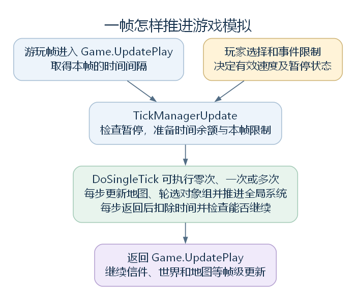
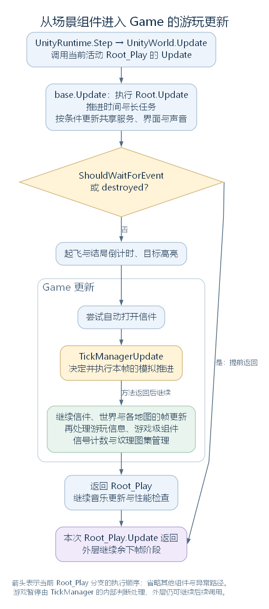
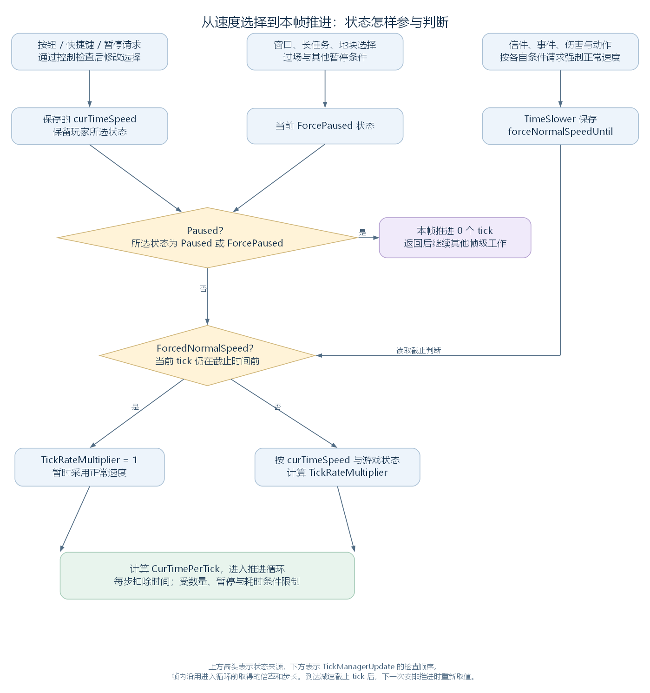
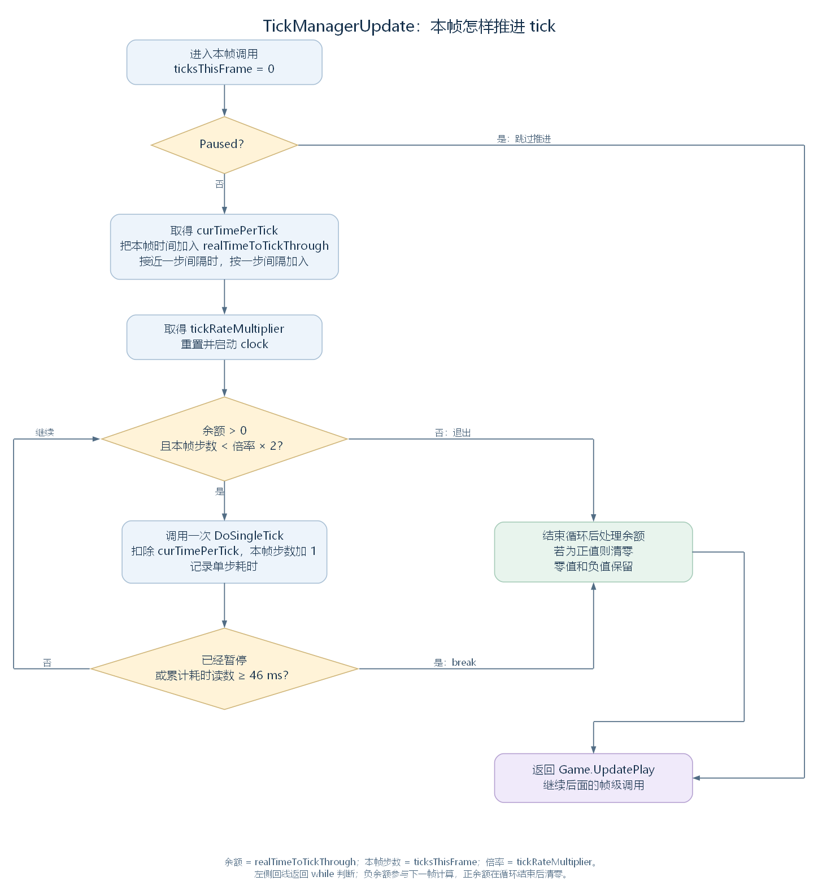
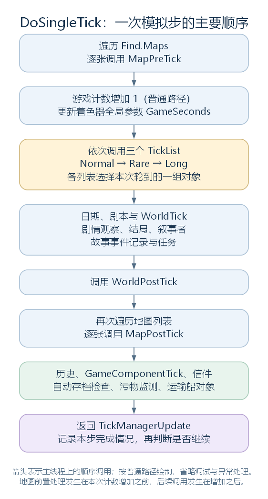
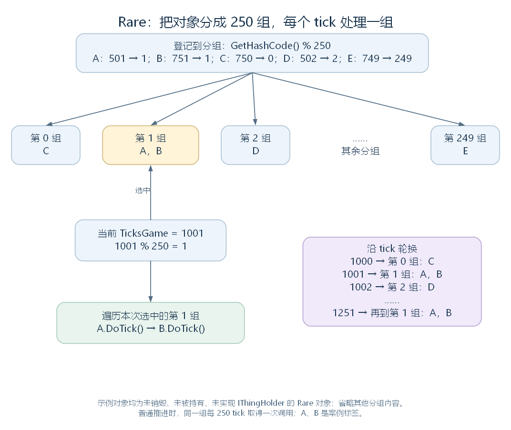

# 游戏时间怎样前进：从每帧更新到 tick 分派

版本：完整解析版 v1.0｜定稿日期：2026-11-08

殖民者移动、工作、伤口变化和事件推进，都随游戏模拟向前。一次 tick 是模拟推进的一步。正常速度以每秒 60 tick 为目标，主线程每帧根据时间与游戏状态安排这一步何时执行。

本文依据 RimWorld 1.7.4982 rev1280 的代码，沿普通游玩路径展开。源码节选保留原名，省略处注明。教学数值用于解释控制流。地图、物品和各玩法系统在本章读到更新入口，具体行为由后续模块展开。

## 游玩中能看到的现象

- **暂停时界面仍可以刷新。** 只要这一帧进入游玩更新，游戏可以跳过模拟步，继续执行后面的帧级更新。
- **横跨两个加速按钮的短线标记临时限速。** 游戏仍记得玩家选中的档位，推进时的目标速度暂时回到 Normal。
- **低帧率会压低加速档能达到的速度。** 以 Fast 档为例，目标是每秒 180 tick。帧率稳定在每秒 20 帧（20 FPS）时，即使每步执行得很快，每帧最多跑六步，一秒也只能完成约 120 步。
- **调试栏显示的每秒 tick 数（TPS）是估算值。** 它用单步平均耗时和当前速度倍率计算。实际推进了多少，可以看同一局游戏在一段真实时间内，游戏计数 `TicksGame` 增加了多少。

## 模拟推进总览

游玩场景中，`Root_Play` 在组件更新阶段接到这一帧。当前状态允许游玩更新时，它调用 `Game.UpdatePlay`，再由 `TickManager` 根据帧时间和有效速度决定推进量。玩家的速度选择、事件要求的临时减速和暂停状态，都在这一步参与判断。

| 环节 | 主要处理过程 | 完成后的结果 |
| --- | --- | --- |
| 准备时间余额 | 未暂停时，将本帧间隔折算后加到已有余额。当前速度决定每推进一步要扣去多少时间 | 余额参与判断本帧能否开始推进 |
| 循环推进 tick | 余额仍为正且步数未达上限时，调用 `DoSingleTick`。每步返回后扣除时间，再检查暂停与实际耗时 | 本帧完成零步、一步或多步。退出循环时清掉剩余正余额，负余额留到后续帧 |
| 分派循环中的每一步 | `DoSingleTick` 先处理地图前置工作，再增加游戏计数。`TickList` 按当前计数轮选对象组，随后推进世界、全局系统与地图后置工作 | 模拟计数和各系统状态向前推进一步 |
| 继续帧级更新 | `TickManager` 返回后，`Game.UpdatePlay` 继续信件、世界、地图与游戏级扩展对象的帧级调用 | 游玩更新完成，控制权回到兼容层的后续帧阶段 |



[SVG](../../figures/tick-chapter-overview.svg) · [图源](../../figures/tick-chapter-overview.dot)

假设这一帧推进两步，一张已加载地图会取得两次 `MapPreTick` 和两次 `MapPostTick`，随后取得一次 `MapUpdate`。游戏暂停时，只要仍进入 `Game.UpdatePlay`，`TickManager` 就会跳过模拟循环，后面的帧级调用照常取得机会。

## 一、从兼容层的一帧进入当前游戏

前两章已经读到 UnityRuntime.Step：它调用 UnityWorld.Update，由后者处理待销毁、激活与 Start，再调用组件的 Update。Play 场景中的 GameRoot 挂有 Root_Play 组件，于是这一帧接到 Root_Play.Update。

`Root_Play` 先调用基类的 `Root.Update`。基类更新帧时间，再调用 `LongEventsUpdate(out flag)`。如果这次调用报告场景切换，基类将旧入口的 `destroyed` 设为 `true`。如果场景保持且长任务允许继续，基类会调用界面、声音等共享入口。

基类返回后，`Root_Play.Update` 通过 `ShouldWaitForEvent` 和 `destroyed` 判断能否继续。下面保留这段交接的主要语句，省略外层异常处理和其他帧级调用。

```csharp
public override void Update()
{
    base.Update();
    if (LongEventHandler.ShouldWaitForEvent || this.destroyed)
    {
        return;
    }

    // 省略这里的结局倒计时与目标高亮调用。
    Current.Game.UpdatePlay();
    // 省略后续音乐更新与性能检查。
}
```

`ShouldWaitForEvent` 由长任务管理器提供。检查通过后，`Current.Game` 取得当前游戏对象，再调用 `UpdatePlay`。

Game 是保存本局数据与管理器的普通 C# 对象。Current 是保存当前引用的静态类，Find 则提供许多访问入口，例如 Find.TickManager 返回 Current.Game.tickManager。先认识 UpdatePlay 使用的成员：

| 成员或入口 | 保存什么、连接什么 |
| --- | --- |
| tickManager | 本局的模拟时间与 tick 管理器 |
| letterStack；Find.LetterStack | 本局信件管理对象 |
| worldInt；World | 世界对象及其属性入口 |
| maps；Maps | 已加载地图列表及其属性入口 |
| info；Info | 游戏信息与互动游玩时间等记录 |
| components | 游戏级 GameComponent 扩展对象列表 |
| signalManager | 本局的信号管理对象 |

下面是完整 UpdatePlay。地图下标 i 按 maps 的顺序遍历；GameComponentUtility 负责遍历游戏级扩展对象；GlobalTextureAtlasManager 接到图集的帧级整理：

```csharp
public void UpdatePlay()
{
    try
    {
        Find.LetterStack.OpenAutomaticLetters();
    }
    catch (Exception ex)
    {
        Log.Error(ex.ToString());
    }
    this.tickManager.TickManagerUpdate();
    this.letterStack.LetterStackUpdate();
    this.World.WorldUpdate();
    for (int i = 0; i < this.maps.Count; i++)
    {
        this.maps[i].MapUpdate();
    }
    this.Info.GameInfoUpdate();
    GameComponentUtility.GameComponentUpdate();
    this.signalManager.SignalManagerUpdate();
    GlobalTextureAtlasManager.GlobalTextureAtlasManagerUpdate();
}
```



[SVG](../../figures/runtime-play-frame-entry.svg) · [图源](../../figures/runtime-play-frame-entry.dot)

`TickManagerUpdate` 返回以后，`UpdatePlay` 还会继续调用信件、世界、各地图和扩展对象的帧级入口。比如有两张已加载地图时，两个 `MapUpdate` 都按列表取得调用。

因此，暂停时 TickManagerUpdate 可以跳过模拟推进，外围的 UpdatePlay 仍能继续。长任务是否要求跳过整个游玩更新，则由进入这里以前的 Root 检查决定。下一章会展开那条检查路径。

源码定位：场景组件与共享更新（`Verse.Root_Play.cs:63`、`Verse.Root.cs:113`）、长任务返回场景切换结果（`Verse.LongEventHandler.cs:193`、`Verse.LongEventHandler.cs:366`）、当前引用（`Verse.Current.cs:84`）、游玩分派（`Verse.Game.cs:661`）。

## 二、保存游戏进度、速度与时间余额

TickManager 由 Game 持有，实现 IExposable，以便参与存档读写。它需要保存游戏推进到哪里、当前选择什么速度，以及本次还可以安排多少模拟工作。

下面节选相关字段，省略其他成员：

```csharp
public sealed class TickManager : IExposable
{
    // 省略其他成员。
    private int ticksGameInt;
    public int gameStartAbsTick;
    private float realTimeToTickThrough;
    private TimeSpeed curTimeSpeed = TimeSpeed.Normal;
    public TimeSpeed prePauseTimeSpeed;
    // 省略其他成员。
    private Stopwatch clock = new Stopwatch();
    // 省略其他成员。
    public TimeSlower slower = new TimeSlower();
    // 省略其他成员。
    private int ticksThisFrame;
    private SimpleMovingAverage rawTickTimeAverage = new SimpleMovingAverage(720);
    private ExponentialMovingAverage smoothedTickTimeAverage = new ExponentialMovingAverage(0.1f);
    public const float WorstAllowedFPS = 22f;
    // 省略其他成员。
}
```

| 名称 | 怎样参与推进 |
| --- | --- |
| ticksGameInt；TicksGame | 已推进的游戏 tick 计数，以及读取它的属性 |
| gameStartAbsTick；TicksAbs | 开始时的绝对 tick 偏移；与游戏计数相加后接到日期 |
| realTimeToTickThrough | 以秒计的时间余额，加入帧时间，每执行一步扣除相应间隔 |
| curTimeSpeed；CurTimeSpeed | 当前速度枚举与访问属性 |
| prePauseTimeSpeed | 玩家暂停前的速度，供恢复时使用 |
| slower | TimeSlower，记录暂时采用正常速度的截止 tick |
| ticksThisFrame；TicksThisFrame | 本次 TickManagerUpdate 已经执行的步数 |
| clock | Stopwatch，测量本次推进循环花费的实际时间 |
| rawTickTimeAverage、smoothedTickTimeAverage | 单步耗时及其平滑统计 |

realTimeToTickThrough 跨帧保留，也可以为负。后面可以把它当作一笔时间账：每帧入账，执行 tick 扣账；数量和耗时限制决定本次何时停下。

源码定位：时间属性与字段（`Verse.TickManager.cs:15`、`Verse.TickManager.cs:25`、`Verse.TickManager.cs:590`）、存档接口（`Verse.TickManager.cs:318`）。

## 三、把玩家选择与事件请求换成推进速度

`TimeControls.DoTimeControlsGUI` 接收速度按钮和快捷键的输入。各入口先检查当前界面状态，再把请求交给 `TickManager`。

| 输入方式 | 界面入口的检查 | 交给 TickManager 的操作 |
| --- | --- | --- |
| 点击速度或暂停按钮 | `ForcePaused` 为 `false` | 速度按钮设置 `CurTimeSpeed`，暂停按钮调用 `TogglePaused` |
| `Normal`、`Fast`、`Superfast` 快捷键 | 当前为 `keyDown` 事件，且 `WindowStack.WindowsForcePause` 为 `false` | 设置 `CurTimeSpeed` |
| 暂停快捷键 | 当前为 `keyDown` 事件，且匹配暂停绑定 | 调用 `TogglePaused` |

`KeyBindingDefOf` 提供按键定义，`KeyDownEvent` 表示本次按下了对应按键，`PlaySoundOf` 播放速度切换声音。下面摘出快速键分支，外层是上表中的按键事件与窗口检查。

```csharp
if (KeyBindingDefOf.TimeSpeed_Fast.KeyDownEvent)
{
    Find.TickManager.CurTimeSpeed = TimeSpeed.Fast;
    TimeControls.PlaySoundOf(Find.TickManager.CurTimeSpeed);
    // 省略教程记录调用。
    Event.current.Use();
}
```

`CurTimeSpeed` 的 setter 接到请求后，再检查 `PlayerCanControl`。正在确认着陆区域时，这项检查会返回拒绝和提示文字，其余情况读取 `Current.Game.PlayerHasControl`。返回值 `AcceptanceReport` 保存是否允许控制和可选的拒绝原因，并能转换为 `bool`。允许修改时，`value` 才写入 `curTimeSpeed`。

```csharp
public TimeSpeed CurTimeSpeed
{
    get
    {
        return this.curTimeSpeed;
    }
    set
    {
        if (!this.PlayerCanControl)
        {
            if (!this.PlayerCanControl.Reason.NullOrEmpty())
            {
                Messages.Message(this.PlayerCanControl.Reason, MessageTypeDefOf.RejectInput, false);
            }
            return;
        }
        this.curTimeSpeed = value;
    }
}
```

TogglePaused 也先通过控制检查。进入玩家暂停时，它将原速度写入 prePauseTimeSpeed，再把 curTimeSpeed 设为 Paused；恢复时取回原速度，必要时使用 Normal。

实际是否暂停，由 Paused 同时读取玩家选择与 ForcePaused：

```csharp
public bool Paused
{
    get
    {
        return this.curTimeSpeed == TimeSpeed.Paused || this.ForcePaused;
    }
}
```

`ForcePaused` 汇总要求暂停的窗口和长任务，也读取地块选择、重力飞船过场、着陆确认和地图生成调试状态。任一条件生效时，`Paused` 为 `true`，原速度仍保存在 `curTimeSpeed` 中。比如在 `Fast` 档打开要求暂停的窗口，模拟会暂停。关闭窗口后，如果其余暂停条件也已解除，后续更新就能按当时保存的档位推进。

### 3.1 根据速度与地图状态取得倍率

TickRateMultiplier 先处理强制正常速度，再按 curTimeSpeed 取得倍率。未受强制正常速度影响时：

| 速度枚举 | 倍率 |
| --- | --- |
| Paused | 0 |
| Normal | 1 |
| Fast | 3 |
| Superfast | 没有地图时 18；有地图且 NothingHappeningInGame 为 true 时 12；其余 6 |
| Ultrafast | UltraSpeedBoost 调试开关启用时 20000；否则没有地图时 150，有地图时 15 |

`NothingHappeningInGame` 检查所有已加载地图。没有同时满足玩家派系、`HostFaction` 为空、类人、清醒、非食尸鬼条件的已生成 Pawn，而且各玩家基地的危险等级都低于 `StoryDanger.Low` 时，它才返回 `true`。`lastNothingHappeningCheckTick` 保存最近一次检查的游戏计数，同一 `TicksGame` 内的再次读取会复用结果。

倍率再换算成每步使用的时间间隔。CurTimePerTick 的完整实现为：

```csharp
private float CurTimePerTick
{
    get
    {
        if (this.TickRateMultiplier == 0f)
        {
            return 0f;
        }
        return 1f / (60f * this.TickRateMultiplier);
    }
}
```

Normal 每步约扣除 16.667 毫秒，Fast 每步约扣除 5.556 毫秒，分别对应每秒 60 和 180 tick 的目标节奏。代码实际执行多久，另外由 clock 测量。

### 3.2 用截止 tick 暂时采用正常速度

TimeSlower 以 forceNormalSpeedUntil 保存截止计数。下面是相关成员，省略末尾常量：

```csharp
public bool ForcedNormalSpeed
{
    get
    {
        return !DebugViewSettings.neverForceNormalSpeed && Find.TickManager.TicksGame < this.forceNormalSpeedUntil;
    }
}

public void SignalForceNormalSpeed()
{
    this.forceNormalSpeedUntil = Mathf.Max(new int[] { Find.TickManager.TicksGame + 800 });
}

public void SignalForceNormalSpeedShort()
{
    this.forceNormalSpeedUntil = Mathf.Max(this.forceNormalSpeedUntil, Find.TickManager.TicksGame + 240);
}

private int forceNormalSpeedUntil;
```

ForcedNormalSpeed 为 true 时，TickRateMultiplier 对非 Paused 选择返回 1。玩家原有选择仍保存在字段中，到达截止 tick 后，倍率自然重新走到普通分支。

例如选择 `Superfast`、通常采用 6 倍速，在 tick 10000 收到短请求后，截止值为 10240。在 tick 10239 读取倍率属性时，结果仍为 1。计数到达 10240 后，再读该属性就会走普通倍率分支。暂停会让游戏计数停止，恢复后再继续接近截止值。强制正常速度生效期间，`TimeControls` 在加速按钮区域画横线。

标准请求将截止值写为当前 tick + 800。短请求从原截止值和当前 tick + 240 中取较大值。`LetterStack.ReceiveLetter` 可以调用 `Pause` 或 `SignalForceNormalSpeedShort`，火焰伤害入口 `DamageWorker_Flame.Apply` 也可以提交短减速请求。



[SVG](../../figures/time-speed-control.svg) · [图源](../../figures/time-speed-control.dot)

源码定位：界面输入（`RimWorld.TimeControls.cs:79`、`RimWorld.TimeControls.cs:111`）、控制与暂停（`Verse.TickManager.cs:145`、`Verse.TickManager.cs:173`、`Verse.TickManager.cs:203`、`Verse.TickManager.cs:244`）、倍率与间隔（`Verse.TickManager.cs:70`、`Verse.TickManager.cs:131`）、平静判断（`Verse.TickManager.cs:278`）、截止请求（`Verse.TimeSlower.cs:11`、`Verse.TimeSlower.cs:20`、`Verse.TimeSlower.cs:26`）、事件入口（`Verse.LetterStack.cs:62`、`Verse.DamageWorker_Flame.cs:11`）。

## 四、按帧时间增加余额，再循环推进

游戏读取的 Time.deltaTime 来自 UnityRuntime.Step 写入的本帧间隔。兼容层 getter 还按 maximumDeltaTime 取上限，默认约 0.333 秒：

```csharp
public static float deltaTime
{
    get
    {
        UnityRuntime unityRuntime = UnityRuntime.Current;
        return Math.Min((unityRuntime != null) ? unityRuntime.Time.DeltaTime : 0f, Time.maximumDeltaTime);
    }
}
```

`TickManagerUpdate` 每次先清零 `ticksThisFrame`。允许推进时增加时间余额，随后循环调用 `DoSingleTick`。局部变量 `curTimePerTick` 与 `tickRateMultiplier` 在进入循环前取值，分别用于扣减余额和限制本帧步数。`totalMilliseconds`、`totalMilliseconds2` 是单步调用前后的计时读数。

```csharp
public void TickManagerUpdate()
{
    this.ticksThisFrame = 0;
    if (!this.Paused)
    {
        float curTimePerTick = this.CurTimePerTick;
        if (Mathf.Abs(Time.deltaTime - curTimePerTick) < curTimePerTick * 0.1f)
        {
            this.realTimeToTickThrough += curTimePerTick;
        }
        else
        {
            this.realTimeToTickThrough += Time.deltaTime;
        }
        float tickRateMultiplier = this.TickRateMultiplier;
        this.clock.Reset();
        this.clock.Start();
        while (this.realTimeToTickThrough > 0f && (float)this.ticksThisFrame < tickRateMultiplier * 2f)
        {
            double totalMilliseconds = this.clock.Elapsed.TotalMilliseconds;
            this.DoSingleTick();
            double totalMilliseconds2 = this.clock.Elapsed.TotalMilliseconds;
            this.realTimeToTickThrough -= curTimePerTick;
            this.ticksThisFrame++;
            this.rawTickTimeAverage.AddValue((float)(totalMilliseconds2 - totalMilliseconds));
            this.smoothedTickTimeAverage.AddValue(this.rawTickTimeAverage.GetAverage());
            if (this.Paused || (float)this.clock.ElapsedMilliseconds > 45.454544f)
            {
                break;
            }
        }
        if (this.realTimeToTickThrough > 0f)
        {
            this.realTimeToTickThrough = 0f;
        }
    }
}
```



[SVG](../../figures/tickmanager-update-loop.svg) · [图源](../../figures/tickmanager-update-loop.dot)

先按工作顺序读这次调用：

1. 已经暂停时，跳过推进部分，本帧时间不入账，原余额保留。
2. 帧间隔与每步间隔相差不足后者的 10% 时，按一个完整步间隔入账；否则加入 Time.deltaTime。
3. 余额大于零且本帧数量未达到倍率的两倍时，执行一步，再扣除完整间隔。
4. 每步返回后记录耗时。如果此时已暂停，或者累计耗时的整数毫秒读数至少为 46，就退出循环。
5. 循环结束时，只将仍为正的余额清零；零值和负值保留。

在上一节的减速例子中，如果本次调用从 tick 10239 开始，它会以倍率 1 进入循环，每步扣约 16.667 毫秒。第一步返回时计数到达 10240。若条件允许本帧再走一步，仍会使用已取得的倍率和步长。下一次进入 `TickManagerUpdate` 的推进分支时，才会按当时状态重取这两个值。`Paused` 则在每步返回后都会重新检查。

源码中的耗时阈值 `45.454544f` 约为 `1000 / 22` 毫秒。与它比较的是 `ElapsedMilliseconds` 的整数读数，所以最早在一步返回且读数达到 46 毫秒时触发耗时退出。整帧还包含模拟之外的工作，实际帧率取决于整帧耗时。

### 4.1 高频画面帧怎样安排模拟步

假设正常速度、初始余额为零、稳定约 120 FPS，且每步执行很快。每帧约加入 8.333 毫秒：

| 帧 | 入账后的余额 | 执行步数 | 扣除后的余额 |
| --- | --- | --- | --- |
| 1 | 约 8.333 毫秒 | 1 | 约 −8.333 毫秒 |
| 2 | 约 0 毫秒 | 0 | 约 0 毫秒 |
| 3 | 约 8.333 毫秒 | 1 | 约 −8.333 毫秒 |
| 4 | 约 0 毫秒 | 0 | 约 0 毫秒 |

while 只要求余额大于零，所以不足一步也会先执行，再留下负余额。下一帧先用新时间抵消它，由此形成每两帧约一步的节奏。实际 float 运算及有限观察窗口会让边界有细小差异。

### 4.2 较长帧间隔怎样受到数量限制

正常速度下，假设本帧入账 100 毫秒，每步仅花 1 毫秒。循环最多执行两步，剩下约 66.667 毫秒正余额清零，下一帧从零重新入账。Fast 则每帧最多六步。

因此，较长帧间隔带来的工作量会受到本帧数量与耗时检查约束。需要理解“加速后实际有多快”时，必须接着统计真正完成的步数。

源码定位：完整循环与退出（`Verse.TickManager.cs:375`）、时间接口（`UnityEngine.Time.cs:12`）、时间写入（`Waylith.UnityCompat.UnityTimeState.cs:55`）。

## 五、把一次 tick 分派给地图和全局系统

DoSingleTick 先取得当前地图列表，再逐张调用 MapPreTick，推进游戏计数，最后进入三种对象列表。maps 是 Find.Maps 返回的列表，i 是地图下标；GameSeconds 是供着色器读取的游戏秒数参数。

下面是开头的连续节选：

```csharp
List<Map> maps = Find.Maps;
for (int i = 0; i < maps.Count; i++)
{
    maps[i].MapPreTick();
}
if (!DebugSettings.fastEcology)
{
    this.ticksGameInt++;
}
else
{
    this.ticksGameInt += 2000;
}
Shader.SetGlobalFloat(ShaderPropertyIDs.GameSeconds, this.TicksGame.TicksToSeconds());
this.tickListNormal.Tick();
this.tickListRare.Tick();
this.tickListLong.Tick();
```

普通路径中 ticksGameInt 加一；fastEcology 调试分支一次加 2000。若进入时计数为 999，地图 A、B 的前置工作都先取得调用，随后计数变为 1000，再执行对象列表和后续系统。



[SVG](../../figures/single-tick-dispatch.svg) · [图源](../../figures/single-tick-dispatch.dot)

三种 TickList 返回以后，后续调用依次接到：

| 顺序 | 交给哪些入口 |
| --- | --- |
| 1 | DateNotifier、Scenario，以及 World.WorldTick |
| 2 | StoryWatcher、GameEnder、Storyteller、TaleManager、QuestManager |
| 3 | World.WorldPostTick，再遍历每张地图的 MapPostTick |
| 4 | History、GameComponentUtility.GameComponentTick、LetterStackTick、AutosaverTick |
| 5 | 调试截图条件、FilthMonitor、TransportShipManager 及末尾调试控制台设置 |

这些入口把一次模拟步分派到各系统。相同的 GameComponent 既能取得 UpdatePlay 中的帧级调用，也能从这里取得 GameComponentTick。AutosaverTick 则在达到条件时登记存档长任务，接到下一章。

源码中的多数全局系统调用分别有异常捕获；地图前置、三个 TickList 调用与地图后置循环在这一层直接执行。具体系统仍可能在内部自行处理异常。

源码定位：单步入口与计数（`Verse.TickManager.cs:414`）、后续系统顺序（`Verse.TickManager.cs:433`）、地图前后入口（`Verse.Map.cs:927`、`Verse.Map.cs:961`）、游戏级 tick（`Verse.GameComponentUtility.cs:27`）。

## 六、先登记对象，再轮流更新分组

TickManager 分别建立 Normal、Rare、Long 三个 TickList。Thing 表示游戏中的实体对象；每个列表保存更新类型、分组列表，以及等待加入和移除的对象：

```csharp
private TickerType tickType;
private List<List<Thing>> thingLists = new List<List<Thing>>();
private List<Thing> thingsToRegister = new List<Thing>();
private List<Thing> thingsToDeregister = new List<Thing>();
```

| 更新类型 | TickInterval | 分组怎样使用 |
| --- | --- | --- |
| Normal | 1 | 每步取同一组 |
| Rare | 250 | 每步取一组，250 步轮完 |
| Long | 2000 | 每步取一组，2000 步轮完 |

`TickList` 构造时按 `TickInterval` 建立各组。对象进入地图时，`Thing.SpawnSetup` 在有 `TickManager` 的情况下调用 `RegisterAllTickabilityFor(this)`。对象离开地图时，`Thing.DeSpawn` 调用 `DeRegisterAllTickabilityFor(this)`。这两个入口都先用 `TickListFor` 选择目标列表，再把加入或移除请求交给它。

`TickListFor` 先检查 `IThingHolder`，匹配的对象进入 Normal 表，让持有内容取得后续更新机会。其余对象按定义中的 `tickerType` 选择 Normal、Rare 或 Long。遇到 `Never` 时返回 `null`，登记入口随即结束。整张地图卸载时，`MapDeiniter.Deinit` 还会调用 `TickManager.RemoveAllFromMap`，从三个列表及其待处理队列清除对应地图的对象。

### 6.1 把加入请求保存到列表中

RegisterThing 接收当前 Thing t，记录加入请求；DeregisterThing 则记录移除请求：

```csharp
public void RegisterThing(Thing t)
{
    this.thingsToRegister.Add(t);
}

public void DeregisterThing(Thing t)
{
    this.thingsToDeregister.Add(t);
}
```

TickList.Tick 开头处理这些请求。i、j 分别遍历加入和移除列表，BucketOf 返回对应对象所在的组；处理完以后清空请求列表：

```csharp
for (int i = 0; i < this.thingsToRegister.Count; i++)
{
    this.BucketOf(this.thingsToRegister[i]).Add(this.thingsToRegister[i]);
}
this.thingsToRegister.Clear();
for (int j = 0; j < this.thingsToDeregister.Count; j++)
{
    this.BucketOf(this.thingsToDeregister[j]).Remove(this.thingsToDeregister[j]);
}
this.thingsToDeregister.Clear();
```

BucketOf 用对象的 GetHashCode 结果计算组下标。num 保存哈希值，num2 保存取余后的下标：

```csharp
private List<Thing> BucketOf(Thing t)
{
    int num = t.GetHashCode();
    if (num < 0)
    {
        num *= -1;
    }
    int num2 = num % this.TickInterval;
    return this.thingLists[num2];
}
```

请求在目标列表的下一次 `Tick` 开头生效。比如 Normal 表更新对象时登记了一个 Rare 对象，而本次 `DoSingleTick` 还未执行 Rare 表，这条请求就能在同一个模拟步内加入分组。对象本步是否取得调用，随后由当前计数选出的分组决定。

### 6.2 根据当前 tick 选组并调用对象

待登记与移除请求处理完以后，TickList 用当前 TicksGame 对 TickInterval 取余，取得这一组。下面 list2 是当前组，m 是下标，thing 是当前对象；省略的 catch 只移除了错误信息构造和日志：

```csharp
List<Thing> list2 = this.thingLists[Find.TickManager.TicksGame % this.TickInterval];
for (int m = 0; m < list2.Count; m++)
{
    Thing thing = list2[m];
    if (!thing.Destroyed)
    {
        try
        {
            thing.DoTick();
        }
        catch (Exception ex)
        {
            // 省略源码中的错误信息构造与日志调用。
        }
    }
}
```



[SVG](../../figures/ticklist-bucket-schedule.svg) · [图源](../../figures/ticklist-bucket-schedule.dot)

图中 A、B 的哈希值分别为 501 和 751，除以 250 后的余数都是 1，所以同属第 1 组。tick 1000 先调用第 0 组的 C，tick 1001 调用 A、B，tick 1002 调用第 2 组的 D。到 tick 1249 轮到 E，tick 1250 回到第 0 组，tick 1251 再调用 A、B。Rare 对象的工作由此分散在连续的 tick 中。

被选中的对象随后进入 `Thing.DoTick`。这个入口按定义和状态接到 `Tick`、`TickInterval`、`TickRare` 或 `TickLong`，需要更新持有内容时还会调用 `ThingOwner.DoTick`。

源码定位：地图进出入口（`Verse.Thing.cs:1017`、`Verse.Thing.cs:1194`）、选表与地图卸载（`Verse.TickManager.cs:327`、`Verse.TickManager.cs:347`、`Verse.TickManager.cs:559`、`Verse.MapDeiniter.cs:114`）、列表间隔与分组（`Verse.TickList.cs:12`、`Verse.TickList.cs:31`、`Verse.TickList.cs:75`、`Verse.TickList.cs:154`）、取组与实体入口（`Verse.TickList.cs:102`、`Verse.Thing.cs:840`）。

## 七、从完成量理解加速与屏幕计数

把前面的循环放回连续画面帧，就能从目标速度走到实际推进量。以下假设每步很快、没有暂停和减速，帧间隔稳定：

| 帧频与速度 | 平均每帧推进量 | 约每秒完成量 |
| --- | --- | --- |
| 120 FPS，Normal | 0.5 tick | 60 tick |
| 60 FPS，Fast | 3 tick | 180 tick |
| 30 FPS，Fast | 6 tick | 180 tick |
| 20 FPS，Fast | 6 tick，达到数量上限 | 120 tick |

20 FPS 时，每秒约有 20 次调用机会，每次最多六步，剩余正余额清零。单步更耗时时，还会进一步触及耗时退出条件。

普通计数连续时，可以用观察窗口内的计数差除以真实经过秒数，取得实际 TPS：

```text
实际 TPS = 观察期间完成的 tick 数 / 真实经过秒数
         = (结束时 TicksGame - 开始时 TicksGame) / 真实经过秒数
```

游戏调试显示采用自己的公式。FPS 使用平均帧间隔；下面 averageFrameTime 的单位是毫秒，num 为换算结果：

```csharp
float averageFrameTime = Root.AverageFrameTime;
float num = 1000f / averageFrameTime;
```

TPS 显示读取 MeanTickTime，也就是平滑后的单步毫秒耗时。num 先估算每秒处理能力，num2 是倍率对应的目标，再取较小值：

```csharp
float meanTickTime = Find.TickManager.MeanTickTime;
float num = 1000f / meanTickTime;
float num2 = 60f * Find.TickManager.TickRateMultiplier;
num = Mathf.Min(num, num2);
```

例如平均一步 2 毫秒、Fast 目标 180，显示公式得到 180。若本局因其他条件强制暂停，curTimeSpeed 和旧耗时统计仍可能保留，显示公式仍可能算出这个值，而观察期间实际推进量为零。沿数字的来源阅读，就能理解它反映的是哪一部分运行状态。

源码定位：调试计数公式（`RimWorld.GlobalControlsUtility.cs:61`、`RimWorld.GlobalControlsUtility.cs:79`）、平均帧间隔（`Verse.Root.cs:18`）、平均单步耗时（`Verse.TickManager.cs:235`）。

## 八、从模拟步接到长任务

到这里，一帧从 Root_Play 进入 Game，TickManager 把时间换成有限的模拟步，每一步又交给地图、对象和全局系统。与此同时，帧级入口继续处理自己的工作。

当 AutosaverTick 等入口提出耗时任务时，后续执行顺序交给 LongEventHandler。下一章 [《长任务与线程协作》](../05-threads/draft.md) 将从登记、执行和等待展开，继续追踪任务完成后由谁接下去。

逐段研究材料：[游玩帧入口](../../45-game-update-entry.md)、[TickManager 循环](../../46-tickmanager-time-scheduling.md)、[单步与对象分组](../../47-single-tick-and-ticklists.md)、[速度与计数](../../48-time-controls-and-simulation-speed.md)。
