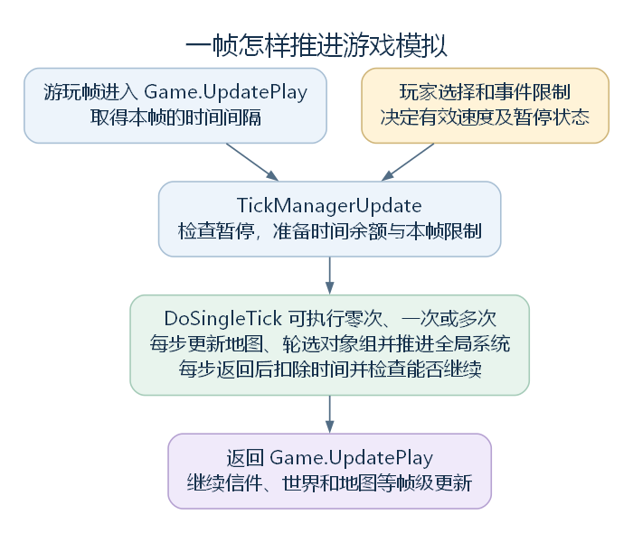
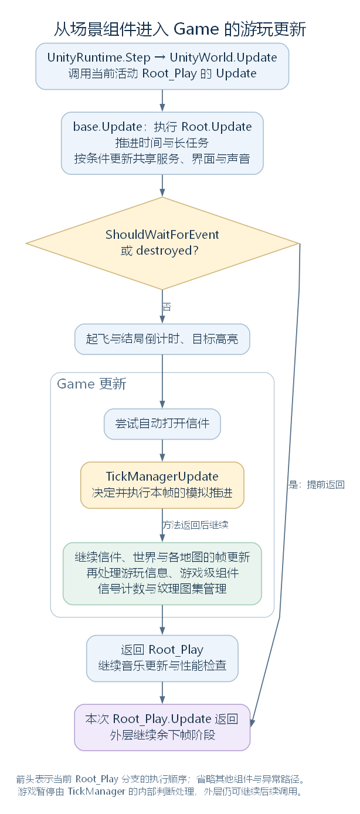
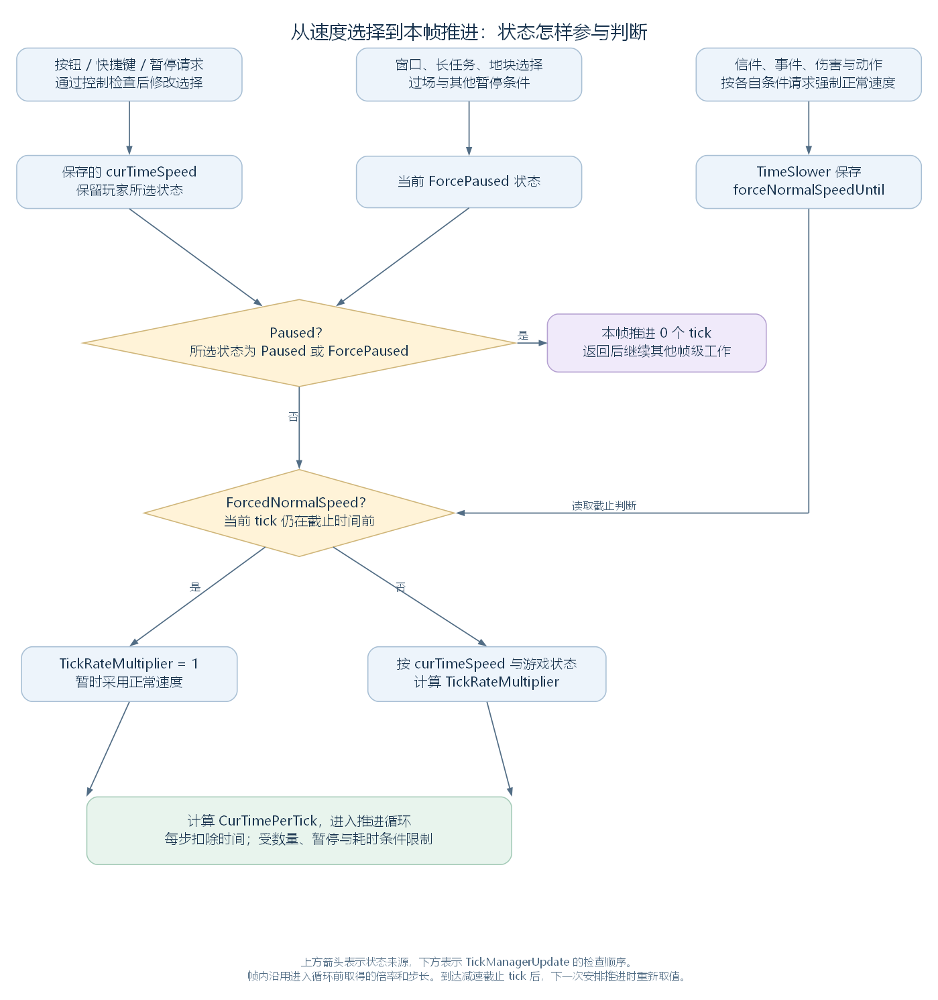
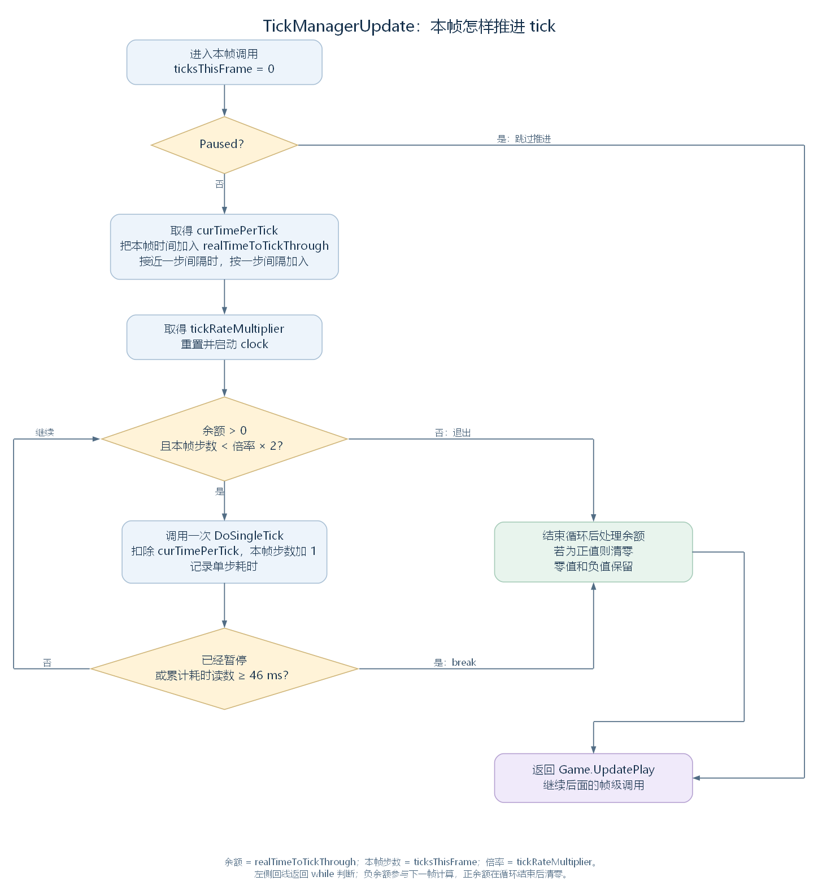
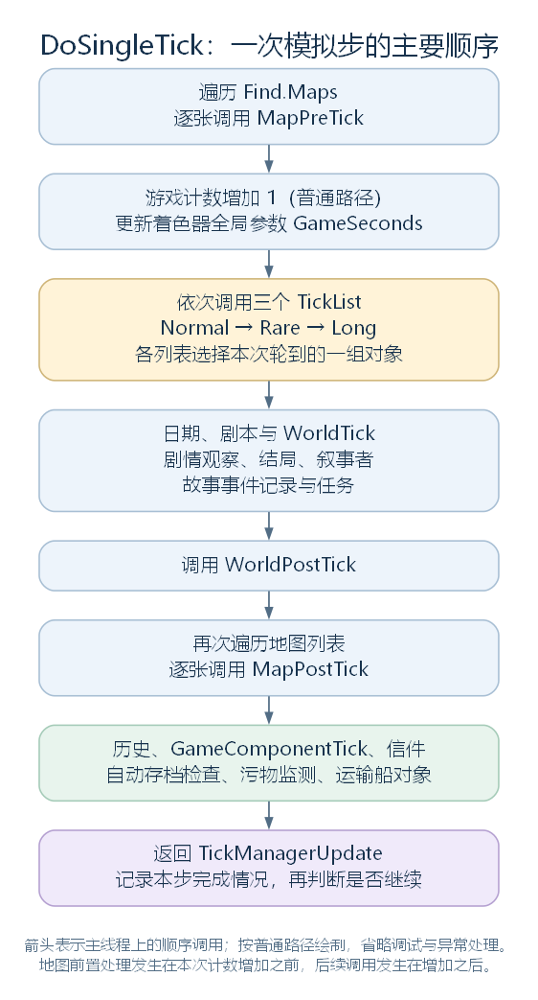
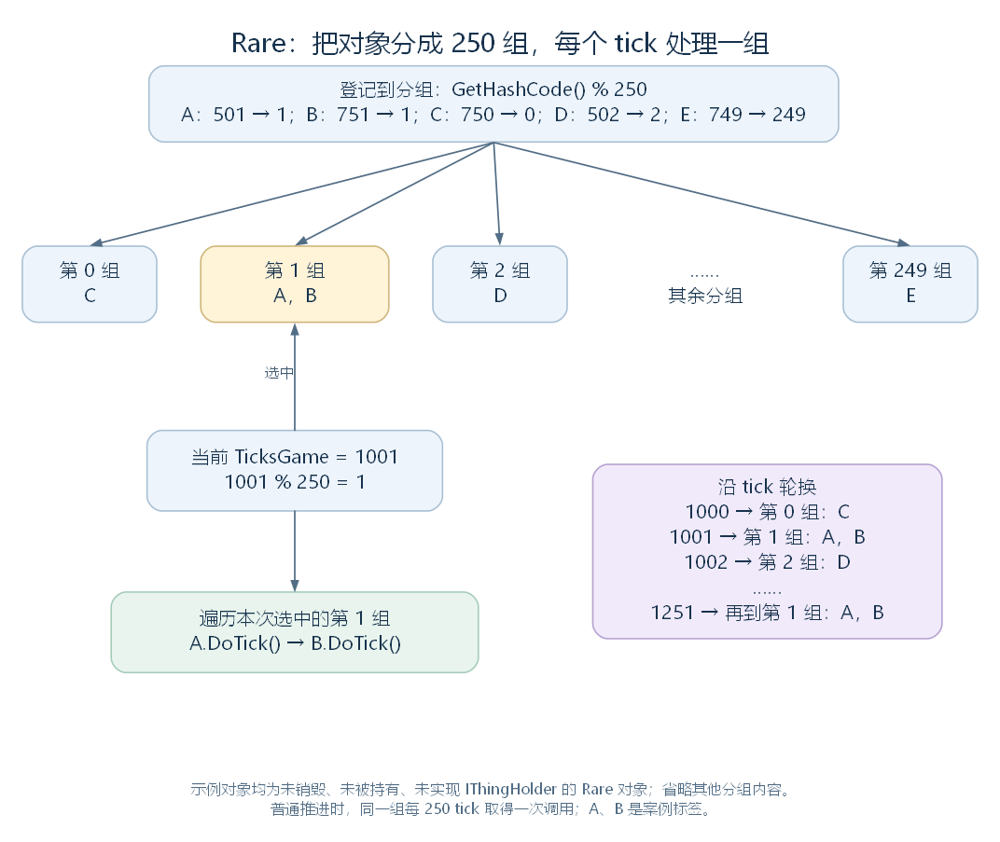

# 游戏时间怎样前进：从每帧更新到 tick 分派

版本：发布版 v1.0｜定稿日期：2026-11-08

在 RimWorld 里，一次 tick 是游戏模拟向前走的一步。正常速度以每秒 60 步为目标。每帧能走多少步，由主线程上的 `TickManager` 决定。本文依据 RimWorld 1.7.4982 rev1280 的普通游玩路径，代码节选沿用原有命名。

## 游玩中能看到的现象

- **暂停时界面仍可以刷新。** 只要这一帧进入游玩更新，游戏可以跳过模拟步，继续执行后面的帧级更新。
- **横跨两个加速按钮的短线标记临时限速。** 游戏仍记得玩家选中的档位，推进时的目标速度暂时回到 Normal。
- **低帧率会压低加速档能达到的速度。** 以 Fast 档为例，目标是每秒 180 tick。帧率稳定在每秒 20 帧（20 FPS）时，即使每步执行得很快，每帧最多跑六步，一秒也只能完成约 120 步。
- **调试栏显示的每秒 tick 数（TPS）是估算值。** 它用单步平均耗时和当前速度倍率计算。实际推进了多少，可以看同一局游戏在一段真实时间内，游戏计数 `TicksGame` 增加了多少。

## 模拟推进总览

一次游玩帧可以分成四段。帧先进入本局游戏，游戏根据当前状态安排模拟步，再由每一步调用地图、对象与全局系统。所有模拟步结束后，这一帧还会继续自己的更新。

| 环节 | 怎样向下走 |
| --- | --- |
| 进入游玩更新 | `UnityRuntime.Step` 经 `UnityWorld.Update` 调用 `Root_Play.Update`。共享更新先处理长任务，允许继续时再进入 `Game.UpdatePlay` |
| 决定步数 | `TickManagerUpdate` 检查暂停，用本帧间隔增加时间余额，再按有效倍率、余额和实际耗时决定推进几步 |
| 执行一步 | `DoSingleTick` 依次执行地图前置、计数推进、对象更新、世界与全局系统、地图后置和收尾 |
| 回到帧更新 | `TickManagerUpdate` 返回后，`Game.UpdatePlay` 继续更新信件、世界、地图和游戏级扩展对象 |



## 一、从游玩帧进入当前游戏

在 Play 场景，`GameRoot` 上的 `Root_Play` 组件会收到 `UnityWorld.Update` 发出的组件更新。`Root_Play.Update` 先调用基类 `Root.Update`。基类先更新帧时间的统计，再让 `LongEventsUpdate` 处理长任务。如果长任务报告场景已切换，旧入口的 `destroyed` 会设为 `true`。场景保持且允许继续时，基类还会更新界面、声音等共享入口。

基类返回后，游玩入口会再检查长任务是否要求等待，以及自己是否已经退出。下面保留这段判断和游玩入口的调用，省略外层异常处理。`Current.Game` 提供本局的 `Game` 对象。

```csharp
base.Update();
if (LongEventHandler.ShouldWaitForEvent || this.destroyed)
{
    return;
}
// 省略结局倒计时与目标高亮更新。
Current.Game.UpdatePlay();
```

`Game` 持有本局的管理器和已加载地图列表。进入 `UpdatePlay` 后，调用按下表继续。

| 顺序 | 调用 |
| --- | --- |
| 1 | `OpenAutomaticLetters` 处理自动打开的信件。这里有独立的异常记录，出错后仍会接着往下 |
| 2 | `tickManager.TickManagerUpdate` 安排并执行本帧的模拟步 |
| 3 | `LetterStackUpdate`、`WorldUpdate`，再依次调用每张已加载地图的 `MapUpdate` |
| 4 | `GameInfoUpdate`、`GameComponentUpdate`、`SignalManagerUpdate`、`GlobalTextureAtlasManagerUpdate` |

`UpdatePlay` 返回后，`Root_Play.Update` 还会调用音乐更新和性能检查，再回到组件更新流程。`Root_Play.Update` 对这段游玩工作统一捕获并记录异常。



例如本局加载了两张地图，玩家暂停后，本帧仍可走到 `Game.UpdatePlay`。此时模拟循环跳过，两张地图各自的 `MapUpdate` 仍会执行。长任务也能让模拟暂停。如果它还要求整个游玩入口等待，`Root_Play.Update` 会在调用 `Game.UpdatePlay` 前返回。

## 二、保存游戏计数与推进状态

每局游戏有自己的 `TickManager`。它持有游戏计数、速度选择，以及用来把真实时间换成模拟步的时间余额。读后面的循环前，可以先认出以下状态。

| 状态 | 在流程中的作用 |
| --- | --- |
| `TicksGame` | 读取 `ticksGameInt`。普通游玩每次 `DoSingleTick` 加一，对象轮选和临时减速都读它 |
| `TicksAbs` | 在游戏计数上加开局的绝对时间偏移 `gameStartAbsTick`，供季节等日期逻辑读取 |
| `curTimeSpeed`、`prePauseTimeSpeed` | 保存当前选中的速度和玩家暂停前的速度 |
| `realTimeToTickThrough` | 以秒计的跨帧时间余额。每帧加入时间，每步扣掉一个间隔，余额可以为负 |
| `ticksThisFrame`、`clock` | 分别记录本帧已走的步数和推进循环的实际耗时 |
| `MeanTickTime` | 读取平滑后的单步耗时，供调试栏计算 TPS |

存档读写通过 `TickManager.ExposeData` 保留游戏计数、开局偏移、起始年份和最近一次定居的 tick。时间余额和帧内计时用于运行时安排推进。

## 三、把玩家选择与事件请求换成推进速度

模拟循环会先看现在能否推进，再把速度换成每步的间隔。按钮或快捷键可以改变档位，窗口和长任务可以要求暂停，游戏事件还可以暂时把目标速度降到 Normal。

### 3.1 从按钮与快捷键进入暂停判断

`TimeControls.DoTimeControlsGUI` 把玩家操作交给 `TickManager`。点速度或暂停按钮时，界面先检查 `ForcePaused`。按速度快捷键时，界面要求按下键且没有要求强制暂停的窗口。暂停快捷键命中时，则直接请求 `TogglePaused`。

设置 `CurTimeSpeed` 和调用 `TogglePaused` 都还要经过 `PlayerCanControl`。确认着陆区域期间会拒绝操作，其他时候看本局的 `PlayerHasControl`。允许操作时，速度请求写入 `curTimeSpeed`。玩家主动暂停时，`TogglePaused` 会把原档位存到 `prePauseTimeSpeed`，再切到 `Paused`。恢复时取回原档位，必要时回到 Normal。

实际暂停判断是 `this.curTimeSpeed == TimeSpeed.Paused || this.ForcePaused`。`ForcePaused` 检查窗口、长任务、地块选择、重力飞船过场或着陆确认，以及地图生成的调试状态。比如在 Fast 档打开一个要求暂停的窗口，档位仍记作 Fast，模拟暂时停下。窗口关闭且其他暂停条件解除后，后续帧便可按 Fast 推进。

### 3.2 从当前档位得到每步间隔

`TickRateMultiplier` 优先检查是否有临时减速。减速期间，玩家主动暂停仍对应 0，其余档位统一返回 1。平时按下表取倍率。窗口等条件触发的强制暂停由外层的 `Paused` 判断，所以即使倍率仍对应所选档位，本帧也可以完全跳过模拟循环。

| 速度 | 倍率 |
| --- | --- |
| Paused | 0 |
| Normal | 1 |
| Fast | 3 |
| Superfast | 没有已加载地图时为 18。有地图且局势平静时为 12，其余情况为 6 |
| Ultrafast | 有地图时为 15，无地图时为 150。开启 `UltraSpeedBoost` 调试选项时为 20000 |

Superfast 使用 `NothingHappeningInGame` 判断局势。它先检查各地图上是否有已生成的玩家派系类人角色，同时满足清醒、`HostFaction` 为空且并非食尸鬼这几个条件。如果一个也找不到，再检查所有玩家基地的危险等级。各基地都低于 `StoryDanger.Low` 时才采用平静倍率。结果按游戏 tick 缓存，当前 tick 内可以复用。

倍率大于零时，`CurTimePerTick` 用 `1f / (60f * this.TickRateMultiplier)` 得到每执行一步要扣的秒数。Normal 每步约扣 16.667 毫秒，目标是每秒 60 步。Fast 每步约扣 5.556 毫秒，目标是每秒 180 步。

### 3.3 用游戏计数确定临时减速何时结束

`TimeSlower` 把减速截止计数存在 `forceNormalSpeedUntil`。标准请求 `SignalForceNormalSpeed` 将截止值写为当前 tick 加 800。短请求 `SignalForceNormalSpeedShort` 取原截止值与当前 tick 加 240 中较晚的一个。`LetterStack.ReceiveLetter` 可以按信件定义请求暂停或短减速，`DamageWorker_Flame.Apply` 在玩家阵营的角色受到火焰伤害时也可以请求短减速。

只要 `TicksGame` 仍小于截止值，而且调试选项允许强制减速，`ForcedNormalSpeed` 就会生效。比如在 tick 10000 收到短请求，原截止值也没有更晚，那么从当时起，直到计数达到 10240 前，都按 Normal 的倍率安排推进。暂停期间计数停住，截止值也要等恢复推进后才会到达。`TimeControls` 用跨过两个加速按钮的横线标出临时减速。



## 四、把帧间隔换成这一帧的步数

`UnityRuntime.Step` 将本帧间隔交给兼容层。游戏从 `Time.deltaTime` 读取这个值，单位是秒，受 `Time.maximumDeltaTime` 限制，默认最多约 0.333 秒。进入 `TickManagerUpdate` 后，先清零 `ticksThisFrame`。如果已经暂停，本次到这里就结束，原有时间余额保留。

下面是完整的推进循环。`curTimePerTick` 是每步扣除的秒数，`tickRateMultiplier` 决定本帧的步数上限。`totalMilliseconds` 和 `totalMilliseconds2` 分别在单步前后读取计时器，差值是这一步的实际毫秒耗时。耗时先进入普通移动平均，再把这个平均值交给指数移动平均，得到调试栏使用的 `MeanTickTime`。

```csharp
public void TickManagerUpdate()
{
    this.ticksThisFrame = 0;
    if (!this.Paused)
    {
        float curTimePerTick = this.CurTimePerTick;
        if (Mathf.Abs(Time.deltaTime - curTimePerTick) < curTimePerTick * 0.1f)
        {
            this.realTimeToTickThrough += curTimePerTick;
        }
        else
        {
            this.realTimeToTickThrough += Time.deltaTime;
        }
        float tickRateMultiplier = this.TickRateMultiplier;
        this.clock.Reset();
        this.clock.Start();
        while (this.realTimeToTickThrough > 0f && (float)this.ticksThisFrame < tickRateMultiplier * 2f)
        {
            double totalMilliseconds = this.clock.Elapsed.TotalMilliseconds;
            this.DoSingleTick();
            double totalMilliseconds2 = this.clock.Elapsed.TotalMilliseconds;
            this.realTimeToTickThrough -= curTimePerTick;
            this.ticksThisFrame++;
            this.rawTickTimeAverage.AddValue((float)(totalMilliseconds2 - totalMilliseconds));
            this.smoothedTickTimeAverage.AddValue(this.rawTickTimeAverage.GetAverage());
            if (this.Paused || (float)this.clock.ElapsedMilliseconds > 45.454544f)
            {
                break;
            }
        }
        if (this.realTimeToTickThrough > 0f)
        {
            this.realTimeToTickThrough = 0f;
        }
    }
}
```



1. **增加余额。** 帧间隔离一步的间隔不到 10% 时，按完整的一步入账，其余情况按 `Time.deltaTime` 入账。
2. **检查能否开始下一步。** 余额只要大于零就符合时间条件，还要确认本帧步数低于倍率的两倍。实际执行一步后扣去完整间隔，再记录步数与耗时。
3. **检查是否提前停下。** 每步返回后都重新读 `Paused`，再看累计耗时是否超过 `45.454544f` 毫秒。计时器这里给出整数毫秒，读数从 46 起才满足条件。即使某一步很慢，也要等它执行完才会检查。
4. **处理帧末余额。** 循环结束后，将还没用掉的正余额清零。负余额留给后续帧抵扣。

倍率和步长在进入循环前取好。接着上一节的例子，如果本帧从 tick 10239 开始，第一步会把计数推进到 10240。若本帧还能再走一步，仍用开头取得的倍率 1 和约 16.667 毫秒的步长。下一次安排推进才会取到解除减速后的倍率，暂停则在当前帧的每步结束后都会重新检查。

### 4.1 余额不足一步时，先走一步

正常启动图形界面时，`Root.CheckGlobalInit` 根据引擎报告的显示刷新率设置 `Application.targetFrameRate`。这个值会传给 Waylith 的 `EngineWindow.TargetFrameRate`，主循环提前做完一帧时，会按这个目标补足等待时间。如果启动时读到 60 Hz，目标就是 60 FPS。

在稳定的 60 FPS 下，Normal 档的帧间隔和每步间隔都约为 16.667 毫秒。从零余额开始，每帧按一步的间隔入账，再扣掉同样的时间，通常一帧走一步。

下面再看帧率目标和实际运行都能达到 120 FPS 的情形。仍用 Normal 档，从零余额开始，假设每步执行很快。每帧约有 8.333 毫秒入账。

| 帧 | 入账后的余额 | 执行步数 | 扣除后的余额 |
| --- | --- | --- | --- |
| 1 | 约 8.333 毫秒 | 1 | 约 −8.333 毫秒 |
| 2 | 约 0 毫秒 | 0 | 约 0 毫秒 |
| 3 | 约 8.333 毫秒 | 1 | 约 −8.333 毫秒 |
| 4 | 约 0 毫秒 | 0 | 约 0 毫秒 |

第一帧可以走一步，因为条件是余额为正。第二帧的时间正好抵消之前多扣的部分。这就形成了约两帧一步的节奏。

### 4.2 一帧很长时，只推进到当前上限

假设进入这一帧前余额是零，两次帧时间采样相隔 100 毫秒，游戏在 Normal 档且期间没有暂停。100 毫秒是本帧拿到的时间，另假设每次 `DoSingleTick` 实际只花约 1 毫秒，循环的其他开销也很小。即使目标帧率为 60，遇到卡顿时两次采样仍可能相隔这么久。

Normal 的倍率是 1，循环要求 `ticksThisFrame < tickRateMultiplier * 2f`。跑完两步后，已完成步数为 2，下一次判断时 `2 < 2` 不成立，所以循环在这里停下。每步按目标节奏扣掉 `1000 / 60` 毫秒，余额还剩 `100 − 2 × (1000 / 60) ≈ 66.667` 毫秒。循环退出后，这笔正余额被清零。

如果单步执行很慢，也可能在第一步返回后就触发耗时退出。

## 五、一次模拟步怎样分派工作

每一次 `DoSingleTick` 都完成下表中的顺序。这里沿各系统的调用入口读过去。

| 顺序 | 本步调用 |
| --- | --- |
| 1. 地图前置 | 取 `Find.Maps`，先逐张调用 `MapPreTick` |
| 2. 推进计数 | 普通游玩将 `ticksGameInt` 加一，`fastEcology` 调试模式加 2000。随后把新的游戏秒数写入着色器参数 `GameSeconds` |
| 3. 更新对象 | 依次调用 Normal、Rare、Long 三张 `TickList`，每张表各选出一组对象 |
| 4. 世界与全局系统 | 依次调用 `DateNotifierTick`、`TickScenario` 和 `WorldTick`，随后是 `StoryWatcherTick`、`GameEndTick`、`StorytellerTick`、`TaleManagerTick` 和 `QuestManagerTick` |
| 5. 世界与地图后置 | 调用 `WorldPostTick`，再逐张调用 `MapPostTick` |
| 6. 收尾 | 依次调用 `HistoryTick`、`GameComponentTick`、`LetterStackTick` 和 `AutosaverTick`。检查调试截图条件，再调用 `FilthMonitorTick`、`ShipObjectsTick`，最后关闭调试控制台的显示标志 |

多数全局系统各自的调用外面都有异常捕获，某个入口抛错时可以记录后继续。地图前置、三个列表和地图后置在这一层直接调用。



例如这一帧要走两步，进入第一步时的计数是 999。两张地图先各做一次 `MapPreTick`，然后计数到 1000，三张对象表按 1000 选组。第一步做到地图后置与收尾，才开始第二步。两步结束后，控制权回到 `Game.UpdatePlay`，两张地图再各做一次 `MapUpdate`。同一个游戏级组件也会在这段流程中收到两次 `GameComponentTick` 和一次 `GameComponentUpdate`。

## 六、先登记对象，再按 tick 轮换分组

每张 `TickList` 按自己的 `TickInterval` 建好分组，存在 `thingLists` 中。这里的 `Thing` 是地图上的实体对象，分组里保存的是待更新的对象引用。

| 列表 | `TickInterval` | 轮换方式 |
| --- | --- | --- |
| Normal | 1 | 每步处理同一组 |
| Rare | 250 | 每步处理一组，250 步轮完 |
| Long | 2000 | 每步处理一组，2000 步轮完 |

### 6.1 登记请求怎样进入分组

对象进入地图时，`Thing.SpawnSetup` 通过 `RegisterAllTickabilityFor` 请求登记。离开时，`Thing.DeSpawn` 通过 `DeRegisterAllTickabilityFor` 请求移除。`TickListFor` 决定请求去哪里。实现了 `IThingHolder` 的对象优先进入 Normal，让其持有内容有机会更新。其余对象按定义中的 `tickerType` 选表，选到 `Never` 就结束登记流程。

请求先进入目标表的 `thingsToRegister` 或 `thingsToDeregister`。下一次该表执行 `Tick` 时，先处理全部加入请求，再处理全部移除请求，并清空这两张请求列表。`BucketOf` 根据对象的哈希值选择分组，负值先转为相反数，再对该表的 `TickInterval` 取余。加入与移除使用同一套分组规则。整张地图卸载时，`RemoveAllFromMap` 会从三个表的分组和待处理列表中一起清除这张地图的对象。

例如 Normal 表更新某个对象时，产生了一个 Rare 对象的登记请求。只要这一轮还没调用 Rare 表，它就能在同一个 tick 加入分组，随后是否立即更新取决于本步选中哪一组。

### 6.2 当前 tick 怎样选组并执行

处理完请求后，普通路径对当前 `TicksGame` 取余，得到本步要遍历的组 `list2`。`m` 是组内下标，`thing` 是当前对象。以下保留选组、跳过已销毁对象和调用更新的代码。一个对象的更新抛出异常时，会记录错误后继续遍历。

```csharp
List<Thing> list2 = this.thingLists[Find.TickManager.TicksGame % this.TickInterval];
for (int m = 0; m < list2.Count; m++)
{
    Thing thing = list2[m];
    if (!thing.Destroyed)
    {
        try
        {
            thing.DoTick();
        }
        catch (Exception ex)
        {
            // 省略源码中的错误信息构造与日志调用。
        }
    }
}
```

`fastEcology` 调试模式在选组前还会清理世界地块温度的缓存，并遍历所有组，对其中的植物额外调用 `TickLong`。之后仍走上面的选组流程。



以图中的 Rare 表为例。A 和 B 的哈希值分别是 501 和 751，除以 250 余 1，所以都进入第 1 组。tick 1000 轮到第 0 组的 C，1001 轮到 A 和 B，1002 轮到第 2 组的 D。1249 调用第 249 组的 E，1250 又回到第 0 组，1251 才再次轮到 A 和 B。这样 Rare 的更新分散在 250 步里。

## 七、从帧率与计数读懂实际速度

帧率决定每秒有多少次安排模拟的机会，倍率又限制每次最多执行多少步。假设帧率稳定、单步执行很快，期间没有暂停或临时减速，可以算出下表中的节奏。

| 画面帧率和速度 | 平均每帧推进量 | 每秒约完成 |
| --- | --- | --- |
| 60 FPS，Normal | 1 tick | 60 tick |
| 120 FPS，Normal（目标允许时） | 0.5 tick | 60 tick |
| 60 FPS，Fast | 3 tick | 180 tick |
| 30 FPS，Fast | 6 tick | 180 tick |
| 20 FPS，Fast | 6 tick，达到数量上限 | 120 tick |

20 FPS 时每帧约有 50 毫秒入账，六步只扣约 33.333 毫秒。剩余正余额被清零，下一帧从零开始入账。若单步更耗时，每帧还可能在达到数量上限前停下。

调试栏的 FPS 用 1000 除以平均帧间隔的毫秒数。旁边的 TPS 走另一套计算。`meanTickTime` 是刚才在循环中统计的平滑单步耗时。`num` 按这个耗时估算每秒处理能力，`num2` 是当前倍率对应的目标，显示时取较小值。

```csharp
float meanTickTime = Find.TickManager.MeanTickTime;
float num = 1000f / meanTickTime;
float num2 = 60f * Find.TickManager.TickRateMultiplier;
num = Mathf.Min(num, num2);
```

假设 Fast 档平均一步用 2 毫秒，耗时换算出的能力是每秒 500 步，显示公式取目标值 180。即使画面只能稳定在 20 FPS，实际按上表每秒最多推进约 120 步，公式仍能给出 180。要求暂停的窗口也可能保留 Fast 的倍率和此前的平均耗时，导致调试栏有读数而游戏计数暂时不动。

要统计实际速度，可以在同一局游戏中用 `TicksGame` 的差值除以观察期间真实经过的秒数。普通计数路径上，差值就等于这段时间完成的步数。

## 八、从模拟步接到长任务

自动存档是模拟步和下一帧之间的一个接点。`AutosaverTick` 达到存档条件时，把保存操作交给 `LongEventHandler`。长任务排队后会要求暂停，当前这一步仍继续到结束。回到 `TickManagerUpdate` 后，暂停检查让推进循环停下来。后续帧再由 `Root.Update` 接手这个任务。保存操作的执行和等待在下一章展开。[线程章](../05-threads/README.md)

字段声明、更多源码节选和本地反编译定位见 [完整解析版](article.md)。
