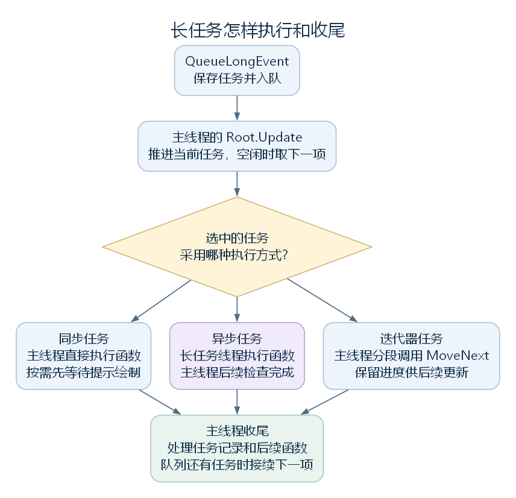
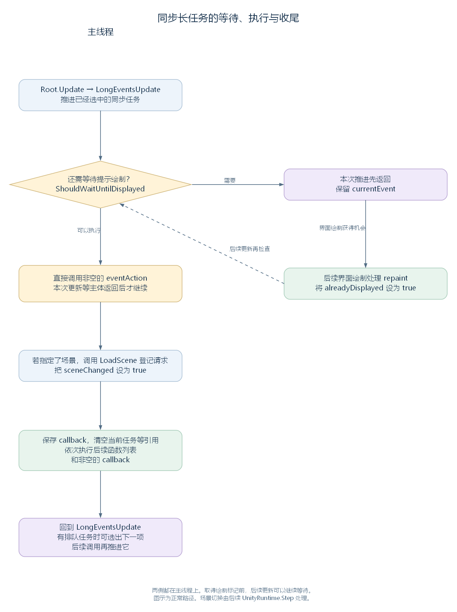
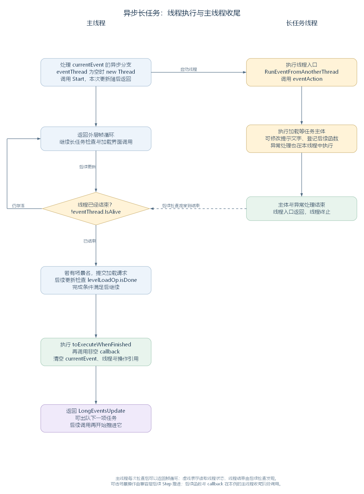
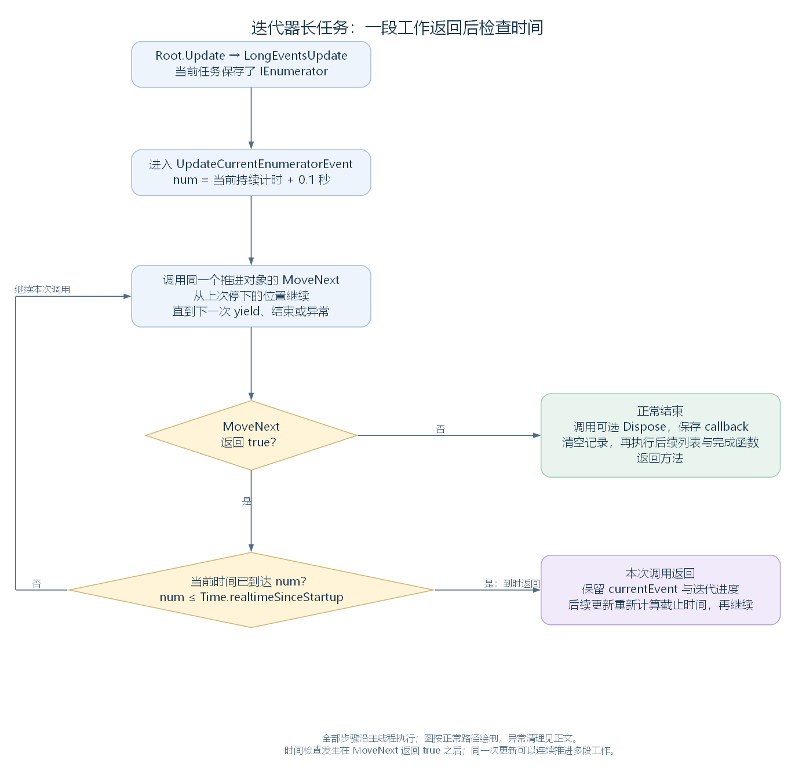
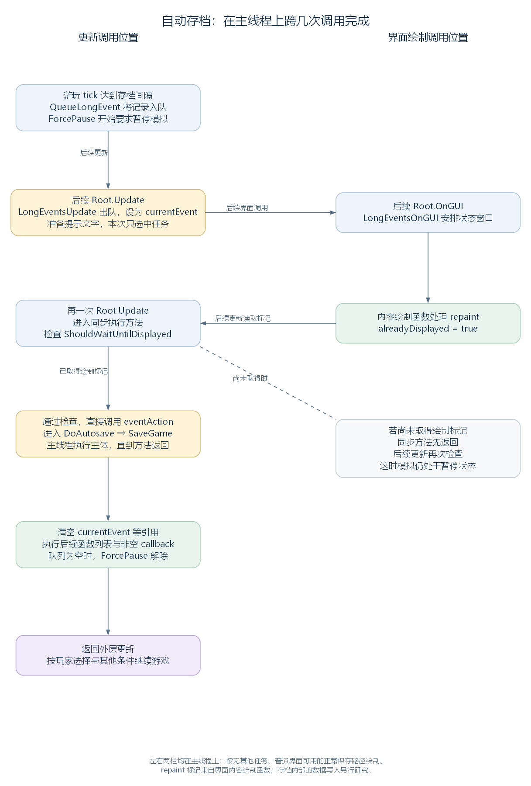
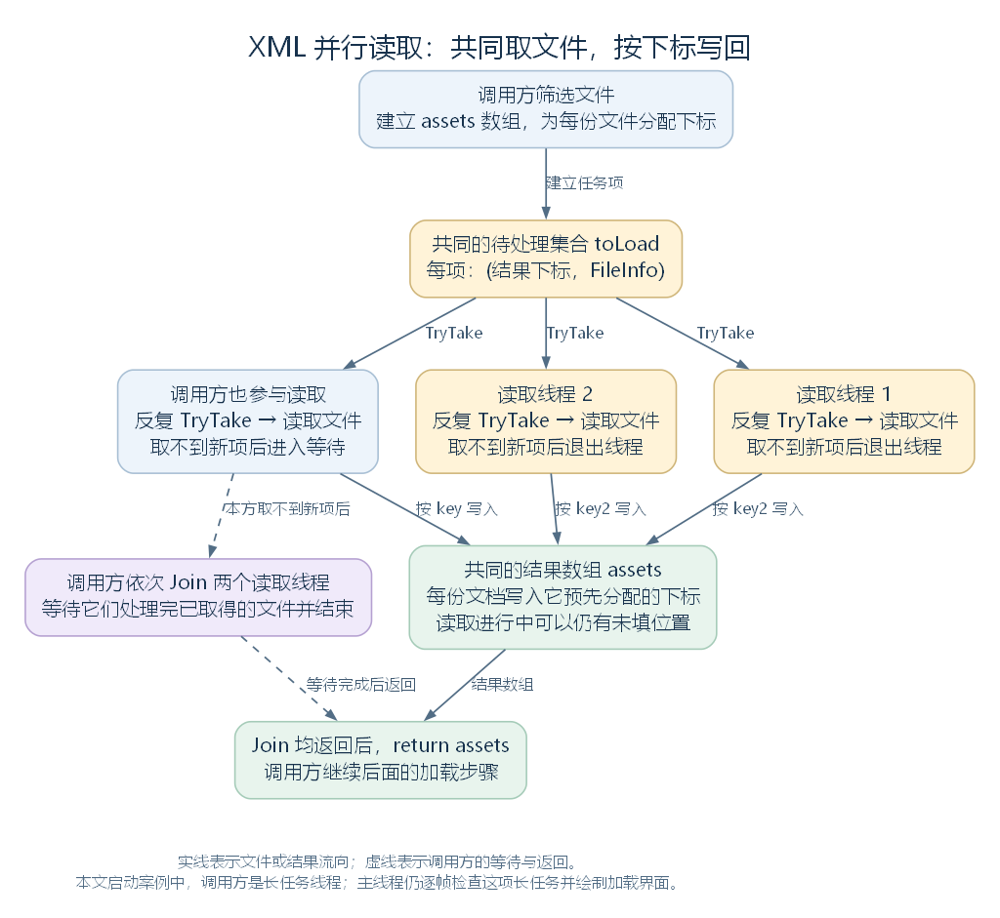
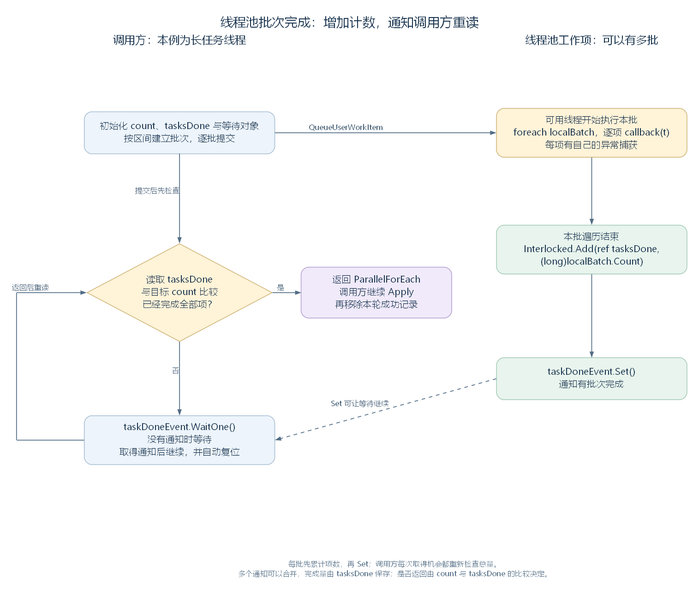
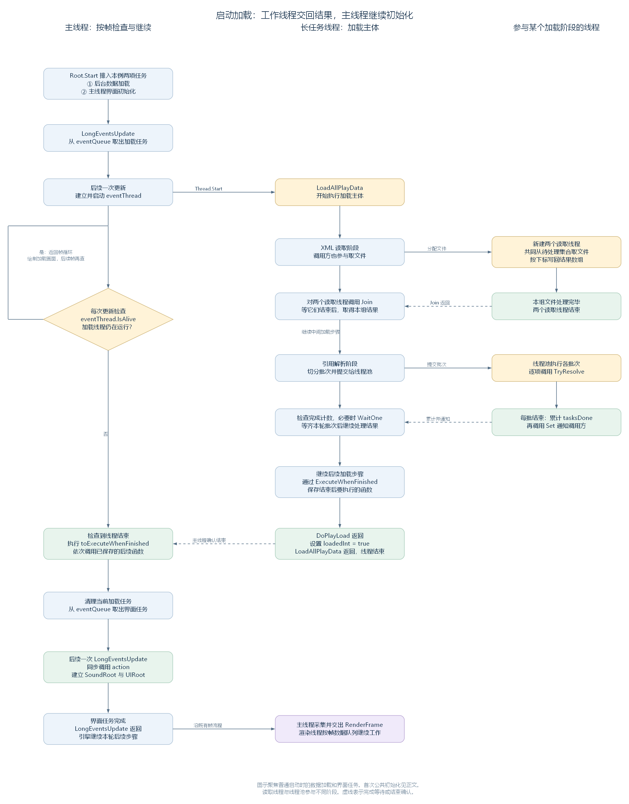

# 长任务与线程协作：工作怎样排队、执行和交回

版本：完整解析版 v1.0｜定稿日期：2026-11-11

存档、启动加载和批量文件处理，需要在游戏运行中取得执行机会。`LongEventHandler` 把这些工作保存为任务，安排它们何时开始、在哪条线程执行，以及完成后怎样继续。

本文依据 RimWorld 1.7.4982 rev1280 的代码，使用代表性路径解释调度。源码保留原名，节选与教学示意注明。存档格式、XML 加载规则、资源和绘制内部实现由相应模块展开。

## 一、长任务运行总览

存档和加载代码通过 `QueueLongEvent` 将任务排入队列。主线程每次执行 `Root.Update`，都会让 `LongEventHandler` 推进当前任务。当前没有任务时可以选出下一项，选中的任务会在后续更新里按登记的方式执行。

| 执行方式 | 谁来执行主体 | 怎样等待和确认完成 |
| --- | --- | --- |
| 同步任务 | 主线程直接调用任务函数 | 需要显示标准提示时，先等窗口获得绘制机会。函数返回后开始收尾 |
| 异步任务 | 长任务线程执行任务函数 | 主线程在后续更新中检查线程是否结束，并按需继续等待场景操作 |
| 迭代器任务 | 主线程调用 `MoveNext`，按耗时分段推进 | 到达本轮时间限制时返回，后续更新从同一个迭代器继续。迭代结束后开始收尾 |



[SVG](../../figures/long-event-chapter-overview.svg) · [图源](../../figures/long-event-chapter-overview.dot)

先读三种模式各自怎样开始、等待与收尾，再沿两个实际流程看它们如何配合。自动存档从游玩 tick 接到主线程保存。启动资源加载从后台加载接到主线程的界面初始化。

源码定位：帧内入口（`Verse.Root.cs:122`）、长任务分派（`Verse.LongEventHandler.cs:193`）。

## 二、任务怎样入队、选中并影响游戏更新

三种模式共享同一条队列。先看记录里保存什么、主线程何时选中它，以及等待期间游戏哪些更新还能继续。

### 2.1 保存排队任务与当前执行状态

LongEventHandler 是共同的静态管理器。它用队列保存尚未开始的任务，用 currentEvent 保存当前任务，另外保存执行线程、场景操作和后续函数列表。相关字段节选如下：

```csharp
private static Queue<LongEventHandler.QueuedLongEvent> eventQueue = new Queue<LongEventHandler.QueuedLongEvent>();
internal static LongEventHandler.QueuedLongEvent currentEvent = null;
private static Thread eventThread = null;
private static AsyncOperation levelLoadOp = null;
private static List<Action> toExecuteWhenFinished = new List<Action>();
private static bool executingToExecuteWhenFinished = false;
```

| 字段 | 保存内容 |
| --- | --- |
| eventQueue | 按入队次序等待的 QueuedLongEvent 记录 |
| currentEvent | 当前任务。为空时可以从队首取下一项 |
| eventThread | 执行异步任务主体的 `Thread` 对象 |
| levelLoadOp | `LoadSceneAsync` 返回的场景操作。主线程通过它检查场景处理是否完成 |
| toExecuteWhenFinished | 待执行的 Action 列表 |
| executingToExecuteWhenFinished | 标记管理器是否正在遍历这份函数列表 |

`Action` 表示无参数、无返回值的函数。`Action<Exception>` 则接收一个异常。`QueuedLongEvent` 把任务主体、执行方式、提示设置和完成处理存在同一条记录里。

| 记录成员 | 含义 |
| --- | --- |
| eventAction、eventActionEnumerator | 任务主体。前者保存要调用的函数，后者保存带有推进位置的迭代器 |
| doAsynchronously | 是否把 `eventAction` 交给长任务线程 |
| eventTextKey、eventText | 提示文字的翻译键和当前文字。选中任务时根据翻译键填入文字 |
| alreadyDisplayed、canEverUseStandardWindow | 前者由提示内容处理 `repaint` 时写入。后者记录入队时是否允许使用标准窗口 |
| levelToLoad | 主体完成后可选的场景名 |
| callback、exceptionHandler | 此项任务自己的完成函数与异常处理函数 |
| showExtraUIInfo、forceHideUI | 前者允许加载画面附带玩法提示和模组信息。后者为真时，长任务提示的绘制入口直接返回 |

源码定位：管理字段（`Verse.LongEventHandler.cs:505`）、记录类型与成员（`Verse.LongEventHandler.cs:529`）。

### 2.2 登记任务，再从队首选中当前项

接收 `Action` 的 `QueueLongEvent` 重载会把传入参数写进新的 `QueuedLongEvent`，再将记录放到队尾。局部变量 `queuedLongEvent` 就是这条新记录。参数 `action` 是任务函数，`textKey` 是提示文字的翻译键，其余参数按上表同名成员保存。

```csharp
public static void QueueLongEvent(Action action, string textKey, bool doAsynchronously,
    Action<Exception> exceptionHandler, bool showExtraUIInfo = true,
    bool forceHideUI = false, Action callback = null)
{
    LongEventHandler.QueuedLongEvent queuedLongEvent = new LongEventHandler.QueuedLongEvent
    {
        eventAction = action,
        eventTextKey = textKey,
        doAsynchronously = doAsynchronously,
        exceptionHandler = exceptionHandler,
        canEverUseStandardWindow = !LongEventHandler.AnyEventWhichDoesntUseStandardWindowNowOrWaiting,
        showExtraUIInfo = showExtraUIInfo,
        callback = callback,
        forceHideUI = forceHideUI
    };
    LongEventHandler.eventQueue.Enqueue(queuedLongEvent);
}
```

登记时，`AnyEventWhichDoesntUseStandardWindowNowOrWaiting` 会检查当前任务与排队任务的 `UseStandardWindow`。只要其中有任务的值为 `false`，新任务的 `canEverUseStandardWindow` 就设为 `false`。迭代器重载在入队时通过 `GetEnumerator` 取得 `IEnumerator`，把它存进记录，再放到同一个队尾。

`LongEventsUpdate` 先推进已经选中的 `currentEvent`，依次检查迭代器和异步标记，其余情况进入同步路径。只要当前项为空且队列里有任务，就取下一条记录。`sceneChanged` 是输出参数，同步路径发出场景切换请求时将它设为 `true`。

```csharp
public static void LongEventsUpdate(out bool sceneChanged)
{
    sceneChanged = false;
    if (LongEventHandler.currentEvent != null)
    {
        if (LongEventHandler.currentEvent.eventActionEnumerator != null)
        {
            LongEventHandler.UpdateCurrentEnumeratorEvent();
        }
        else if (LongEventHandler.currentEvent.doAsynchronously)
        {
            LongEventHandler.UpdateCurrentAsynchronousEvent();
        }
        else
        {
            LongEventHandler.UpdateCurrentSynchronousEvent(out sceneChanged);
        }
    }
    if (LongEventHandler.currentEvent == null && LongEventHandler.eventQueue.Count > 0)
    {
        LongEventHandler.currentEvent = LongEventHandler.eventQueue.Dequeue();
        if (LongEventHandler.currentEvent.eventTextKey == null)
        {
            LongEventHandler.currentEvent.eventText = "";
            return;
        }
        LongEventHandler.currentEvent.eventText = LongEventHandler.currentEvent.eventTextKey.Translate();
    }
}
```

新出队的任务在本次调用里只设置当前记录和文字，后续一次更新才会进入它的执行分支。前一项结束时，同一次 LongEventsUpdate 可以选出后一项，但后一项仍等待后续调用推进。

源码定位：Action 入队（`Verse.LongEventHandler.cs:61`）、迭代器入队（`Verse.LongEventHandler.cs:78`）、主线程分派与出队（`Verse.LongEventHandler.cs:193`）。

### 2.3 根据任务状态暂停模拟或等待游玩更新

AnyEventNowOrWaiting 在当前或队列中有任务时为 true，ForcePause 直接返回它。TickManager 将这个结果纳入强制暂停条件，所以任务入队后就能阻止继续推进模拟。

`Root` 另外查询 `ShouldWaitForEvent`。`Find.UIRoot` 与 `Find.WindowStack` 分别取得当前界面入口和窗口栈。该属性决定 `Root` 是否继续常规更新，以及 `Root_Play` 是否进入本局的游玩更新。

```csharp
public static bool ShouldWaitForEvent
{
    get
    {
        return LongEventHandler.AnyEventNowOrWaiting && ((LongEventHandler.currentEvent != null && !LongEventHandler.currentEvent.UseStandardWindow) || (Find.UIRoot == null || Find.WindowStack == null));
    }
}
```

| 状态 | 对模拟与普通更新的影响 |
| --- | --- |
| 只有排队任务，普通界面可用 | 模拟暂停，普通帧级更新仍可继续 |
| 当前使用标准窗口，普通界面可用 | 模拟暂停，保留相应普通更新与绘制机会 |
| 当前任务不使用标准窗口 | Root 跳过对应共享服务，Root_Play 提前返回 |
| 存在任务，普通界面尚不可用 | 按长任务等待路径处理 |

第 3.1 节的 `UseStandardWindow` 给出任务能否借用标准窗口。绘制时还要检查界面入口和窗口栈。两者已经就绪且任务允许使用标准窗口时，提示叠在普通界面上，其余情况由 `LongEventsOnGUI` 直接绘制加载画面。

源码定位：暂停与等待（`Verse.LongEventHandler.cs:17`、`Verse.LongEventHandler.cs:52`）。

## 三、三种长任务怎样运行

选中的任务会在后续 `LongEventsUpdate` 中推进。下面依次看主体由谁执行、什么时候需要继续等，以及完成后怎样清理。

常见的原版调用见[文末用例表](#原版长任务用例)。

### 3.1 同步任务在主线程直接执行

同步任务在主线程直接运行。执行前会检查提示是否需要先显示。`UseStandardWindow` 根据登记条件和执行方式判断能否用标准窗口。使用标准窗口、已有提示文字且还没收到 `alreadyDisplayed` 标记时，`ShouldWaitUntilDisplayed` 要求留到后续更新再检查。

```csharp
public bool ShouldWaitUntilDisplayed
{
    get
    {
        return !this.alreadyDisplayed && this.UseStandardWindow && !this.eventText.NullOrEmpty();
    }
}

public bool UseStandardWindow
{
    get
    {
        return this.canEverUseStandardWindow && !this.doAsynchronously && this.eventActionEnumerator == null;
    }
}
```

通过显示检查后，`UpdateCurrentSynchronousEvent` 直接调用 `currentEvent.eventAction`。任务指定了 `levelToLoad` 时，`SceneManager.LoadScene` 将场景名存到 `pendingSceneName`，等待后续 `UnityRuntime.Step` 开头处理。`sceneChanged` 为真时，`Root.Update` 把当前入口的 `destroyed` 设为 `true`，结束这个入口的普通更新。局部变量 `callback` 保存完成函数，以便清空任务记录以后调用。

这里和后面的日志片段沿用反编译命名。`ex` 是捕获的异常，`ex2` 是记录前的临时引用，`text` 是日志前缀。

```csharp
private static void UpdateCurrentSynchronousEvent(out bool sceneChanged)
{
    sceneChanged = false;
    if (LongEventHandler.currentEvent.ShouldWaitUntilDisplayed)
    {
        return;
    }
    try
    {
        if (LongEventHandler.currentEvent.eventAction != null)
        {
            LongEventHandler.currentEvent.eventAction();
        }
        if (!LongEventHandler.currentEvent.levelToLoad.NullOrEmpty())
        {
            SceneManager.LoadScene(LongEventHandler.currentEvent.levelToLoad);
            sceneChanged = true;
        }
        Action callback = LongEventHandler.currentEvent.callback;
        LongEventHandler.currentEvent = null;
        LongEventHandler.eventThread = null;
        LongEventHandler.levelLoadOp = null;
        LongEventHandler.ExecuteToExecuteWhenFinished();
        if (callback != null)
        {
            callback();
        }
    }
    catch (Exception ex)
    {
        string text = "Exception from long event: ";
        Exception ex2 = ex;
        Log.Error(text + ((ex2 != null) ? ex2.ToString() : null));
        if (LongEventHandler.currentEvent != null && LongEventHandler.currentEvent.exceptionHandler != null)
        {
            LongEventHandler.currentEvent.exceptionHandler(ex);
        }
        LongEventHandler.currentEvent = null;
        LongEventHandler.eventThread = null;
        LongEventHandler.levelLoadOp = null;
    }
}
```



[SVG](../../figures/long-event-sync-flow.svg) · [图源](../../figures/long-event-sync-flow.dot)

正常路径依次执行主体、按需登记场景切换请求。保存 `callback` 并清空当前引用后，先执行管理器的后续函数列表，再调用本任务的 `callback`。

异常传播到管理器时，由 `catch` 记录，在当前记录仍存在时调用其中的异常处理函数，再清理任务状态。

源码定位：标准窗口与显示条件（`Verse.LongEventHandler.cs:543`、`Verse.LongEventHandler.cs:553`）、同步执行（`Verse.LongEventHandler.cs:350`）、登记场景请求（`UnityEngine.SceneManagement.SceneManager.cs:77`）。

### 3.2 异步任务由长任务线程执行

`UpdateCurrentAsynchronousEvent` 第一次推进异步任务时建立并启动线程，后续调用通过 `eventThread.IsAlive` 查看它是否仍在运行。`RunEventFromAnotherThread` 是线程入口，负责调用任务主体并处理异常。线程结束后，局部变量 `flag` 表示能否收尾。未指定场景时直接置为 `true`。指定场景时，要等 `levelLoadOp.isDone` 报告场景操作完成。

```csharp
private static void UpdateCurrentAsynchronousEvent()
{
    if (LongEventHandler.eventThread == null)
    {
        LongEventHandler.eventThread = new Thread(delegate
        {
            LongEventHandler.RunEventFromAnotherThread(LongEventHandler.currentEvent.eventAction);
        });
        LongEventHandler.eventThread.Start();
        return;
    }
    if (!LongEventHandler.eventThread.IsAlive)
    {
        bool flag = false;
        if (!LongEventHandler.currentEvent.levelToLoad.NullOrEmpty())
        {
            if (LongEventHandler.levelLoadOp == null)
            {
                LongEventHandler.levelLoadOp = SceneManager.LoadSceneAsync(LongEventHandler.currentEvent.levelToLoad);
            }
            else if (LongEventHandler.levelLoadOp.isDone)
            {
                flag = true;
            }
        }
        else
        {
            flag = true;
        }
        if (flag)
        {
            LongEventHandler.ExecuteToExecuteWhenFinished();
            Action callback = LongEventHandler.currentEvent.callback;
            if (callback != null)
            {
                callback();
            }
            LongEventHandler.currentEvent = null;
            LongEventHandler.eventThread = null;
            LongEventHandler.levelLoadOp = null;
        }
    }
}
```



[SVG](../../figures/long-event-async-threads.svg) · [图源](../../figures/long-event-async-threads.dot)

`RunEventFromAnotherThread` 在线程入口设置文化环境，再调用传来的函数。主体抛出异常时，同一线程负责记录并调用 `exceptionHandler`。如果这个处理函数也抛出异常，线程入口会再记录一次。主线程后续通过 `IsAlive` 观察到线程退出，任务结果则由主体、日志与异常处理表达。

存在 `levelToLoad` 时，主线程先发出 `LoadSceneAsync` 请求。后续 `UnityRuntime.Step` 开头的 `ProcessPendingLoad` 完成场景处理后，把对应操作标为完成。异步分支再次读到 `isDone` 为真时进入收尾。主线程正常收尾时先执行后续函数列表和任务的 `callback`，最后清空任务、线程与场景操作的引用。

源码定位：异步检查与收尾（`Verse.LongEventHandler.cs:305`）、线程入口（`Verse.LongEventHandler.cs:394`）、场景请求（`UnityEngine.SceneManagement.SceneManager.cs:134`）。

### 3.3 迭代器任务在主线程分段执行

登记迭代器任务时传入的是 `IEnumerable`。管理器取得它的 `IEnumerator`，存到 `eventActionEnumerator`。每次更新都在同一个对象上调用 `MoveNext`，从上次停下的位置接着执行。返回 `true` 表示已经推进到下一项，返回 `false` 表示迭代已经结束。

下面是教学用的分段任务，方法与局部变量名称为本例自行命名。completed 记录已完成段数，注释处表示一段实际工作：

```csharp
private static IEnumerable PrepareInStages()
{
    int completed = 0;
    while (completed < 5)
    {
        // 教学：在这里处理一小段工作。
        completed++;
        yield return completed;
    }
}
```

`Time.realtimeSinceStartup` 读取启动后的真实经过时间，单位是秒。每次调用先把当前读数加上 0.1 秒，保存到截止值 `num`。`disposable` 和 `disposable2` 分别在正常与异常路径取得迭代器的 `IDisposable` 接口，以便调用 `Dispose` 清理。局部变量 `callback` 和 `exceptionHandler` 从当前任务取出相应的函数。

```csharp
private static void UpdateCurrentEnumeratorEvent()
{
    try
    {
        float num = Time.realtimeSinceStartup + 0.1f;
        while (LongEventHandler.currentEvent.eventActionEnumerator.MoveNext())
        {
            if (num <= Time.realtimeSinceStartup)
            {
                return;
            }
        }
        IDisposable disposable = LongEventHandler.currentEvent.eventActionEnumerator as IDisposable;
        if (disposable != null)
        {
            disposable.Dispose();
        }
        Action callback = LongEventHandler.currentEvent.callback;
        LongEventHandler.currentEvent = null;
        LongEventHandler.eventThread = null;
        LongEventHandler.levelLoadOp = null;
        LongEventHandler.ExecuteToExecuteWhenFinished();
        if (callback != null)
        {
            callback();
        }
    }
    catch (Exception ex)
    {
        string text = "Exception from long event: ";
        Exception ex2 = ex;
        Log.Error(text + ((ex2 != null) ? ex2.ToString() : null));
        if (LongEventHandler.currentEvent != null)
        {
            IDisposable disposable2 = LongEventHandler.currentEvent.eventActionEnumerator as IDisposable;
            if (disposable2 != null)
            {
                disposable2.Dispose();
            }
            Action<Exception> exceptionHandler = LongEventHandler.currentEvent.exceptionHandler;
            if (exceptionHandler != null)
            {
                exceptionHandler(ex);
            }
        }
        LongEventHandler.currentEvent = null;
        LongEventHandler.eventThread = null;
        LongEventHandler.levelLoadOp = null;
    }
}
```



[SVG](../../figures/long-event-iterator-loop.svg) · [图源](../../figures/long-event-iterator-loop.dot)

`while` 根据 `MoveNext` 的布尔结果决定是否继续。教学例子里 `yield return completed` 产出的值可从迭代器的 `Current` 读取，这段调度只检查 `MoveNext` 的结果与时间。每次 `MoveNext` 返回 `true` 后再比较截止值。同一次更新可以推进多段，到时后则保留原迭代器，后续更新重新计算截止值。

例如每段耗时 45 毫秒，三段依次结束时约经过 45、90、135 毫秒。前两次继续，第三次检查才返回。时间限制的检查点位于 MoveNext 返回之后，单段必须先交回控制。

Time.realtimeSinceStartup 从运行时保存的 Stopwatch 起点取得真实经过时间，因此同次调用中也能读到计时变化。正常结束和异常路径都会尝试 Dispose 迭代器，再处理任务清理。正常结束时沿用同步模式的顺序，先清空当前任务引用，再调用后续函数列表和本任务的 `callback`。

源码定位：迭代器登记（`Verse.LongEventHandler.cs:78`）、执行与清理（`Verse.LongEventHandler.cs:253`）、持续计时（`Waylith.UnityCompat.UnityTimeState.cs:36`）。

## 四、自动存档从模拟步接到主线程保存

**任务类型　同步长任务**

沿一次普通自动存档看同步模式。假设当前没有其他长任务，普通界面已经可用。任务从模拟步入队，后续更新选中任务并显示提示，接着由主线程执行保存。

### 4.1 达到存档间隔，登记任务并暂停模拟

`DoSingleTick` 接近结束时调用 `AutosaverTick`，让 `ticksSinceSave` 记录上次登记自动存档以来经过的模拟步数。`AutosaveIntervalTicks` 是自动存档间隔，由游戏天数换算为 tick。达到间隔且 `SavingIsTemporarilyDisabled` 为 `false` 时，就登记 `DoAutosave` 并把计数归零。`Autosaving` 是提示文字的翻译键，第三个参数 `doAsynchronously` 传入 `false`，所以保存主体由主线程执行。

```csharp
public void AutosaverTick()
{
    this.ticksSinceSave++;
    if (this.ticksSinceSave >= this.AutosaveIntervalTicks && !GameDataSaveLoader.SavingIsTemporarilyDisabled)
    {
        LongEventHandler.QueueLongEvent(new Action(this.DoAutosave), "Autosaving", false, null, true, false, null);
        this.ticksSinceSave = 0;
    }
}
```

入队后，`ForcePause` 就会生效。当前模拟步执行完后，`TickManagerUpdate` 读到暂停条件，结束本帧的推进循环。之后的 `Root.Update` 再从队首选中存档任务，并准备“正在自动存档”的提示。

源码定位：自动存档登记（`RimWorld.Autosaver.cs:40`）、推进后的暂停检查（`Verse.TickManager.cs:401`）。

### 4.2 等待存档提示获得绘制机会

普通自动存档使用标准窗口时，`Root.OnGUI` 调用 `LongEventsOnGUI` 安排提示窗口。窗口的内容绘制函数处理到一次 `repaint`（界面重绘）时，把 `alreadyDisplayed` 设为 `true`。同步任务在后续更新中通过第 3.1 节的显示检查，随后执行保存。



[SVG](../../figures/long-event-sync-save.svg) · [图源](../../figures/long-event-sync-save.dot)

源码定位：界面入口与显示标记（`Verse.Root.cs:163`、`Verse.LongEventHandler.cs:471`）。

### 4.3 主线程执行保存并恢复推进

`UpdateCurrentSynchronousEvent` 直接调用 `DoAutosave`。它选择存档名称，再调用 `SaveGame`。此处只登记了保存主体，函数返回后，管理器直接清理任务记录并检查待执行的后续函数。

队列里也没有其他任务时，`ForcePause` 的长任务条件解除。后续模拟按玩家的档位和其他暂停条件决定是否继续。实际保存结果由保存代码及日志记录。

源码定位：保存入口（`RimWorld.Autosaver.cs:51`）、同步清理（`Verse.LongEventHandler.cs:350`）。

## 五、启动资源加载从后台执行接回主线程

**任务类型　异步长任务，随后执行同步的界面初始化**

这一节沿普通启动的数据与资源准备顺序往下走。主线程先排好加载和界面初始化。加载线程在内部安排文件读取和引用解析，等齐结果后继续。加载线程退出后，主线程再接手后续准备和界面初始化。

### 5.1 排入启动任务并更新加载提示

首次启动时，`Root.Start` 会先调用 `CheckGlobalInit`，其中把 `StaticConstructorOnStartupUtility.CallAll` 登记为同步任务。之后 `Root.Start` 把界面与声音的初始化代码保存到局部变量 `action`。当 `PlayDataLoader.Loaded` 为 `false`，它再依次排入异步加载与同步的界面初始化。下文沿这两项展开。

`LoadAllPlayData(false)` 的 `false` 是 `recovering` 参数，表示正常加载。前一项登记用 `null` 作为提示文字的翻译键，加载过程中会更新提示。后一项使用 `InitializingInterface` 作为翻译键。

```csharp
LongEventHandler.QueueLongEvent(delegate
{
    PlayDataLoader.LoadAllPlayData(false);
}, null, true, null, true, false, null);
LongEventHandler.QueueLongEvent(action, "InitializingInterface", false, null, true, false, null);
```

主线程依照第 3.2 节启动加载线程。接下来的帧会继续检查 `IsAlive` 并绘制加载界面。对这项加载任务而言，线程退出后便可以进入收尾。

加载线程可通过 `SetCurrentEventText` 改写提示。`newText` 是新文字，`currentEventTextLock` 引用双方使用的锁对象。

```csharp
public static void SetCurrentEventText(string newText)
{
    object currentEventTextLock = LongEventHandler.CurrentEventTextLock;
    lock (currentEventTextLock)
    {
        if (LongEventHandler.currentEvent != null)
        {
            LongEventHandler.currentEvent.eventText = newText;
        }
    }
}
```

主线程读取和绘制文字时也取得同一把锁。后续界面调用读取新值，再进入绘制流程，形成玩家看到的状态提示。异步记录还会采用随时间变化的省略号。

源码定位：公共初始化（`Verse.Root.cs:108`）、加载与界面登记（`Verse.Root.cs:63`）、加载参数（`Verse.PlayDataLoader.cs:32`）、提示文字（`Verse.LongEventHandler.cs:240`）。

### 5.2 让多个执行者共同读取 XML 文件

后台加载内部还会拆分工作。这里从 ModContentPack 的补丁加载进入 DirectXmlLoader.XmlAssetsInModFolder，读取选定目录中的 XML。普通启动中，这个调用发生在长任务线程。

参数 `mod` 是当前内容包 `ModContentPack`，`folderPath` 是要读取的子目录。代码按目录优先级扫描 XML，`dictionary` 以相对路径为键，先遇到的文件优先保留，值是描述文件的 `FileInfo`。`LoadableXmlAsset` 保存来源和读出的 `XmlDocument`。有文件可读时，代码再准备这些工作数据。

| 局部变量 | 保存什么 |
| --- | --- |
| list2 | 本次选定的 FileInfo 列表 |
| assets | 与 list2 等长的结果数组 |
| toLoad | ConcurrentBag，每项携带数组下标和文件信息 |
| array | 预留两个位置，随后各存入一个读取线程 |

下面 k 是文件下标，num 保存该下标，fileInfo2 是当前文件：

```csharp
List<FileInfo> list2 = dictionary.Values.ToList<FileInfo>();
LoadableXmlAsset[] assets = new LoadableXmlAsset[list2.Count];
ConcurrentBag<KeyValuePair<int, FileInfo>> toLoad = new ConcurrentBag<KeyValuePair<int, FileInfo>>();
for (int k = 0; k < list2.Count; k++)
{
    int num = k;
    FileInfo fileInfo2 = list2[k];
    toLoad.Add(new KeyValuePair<int, FileInfo>(num, fileInfo2));
}
Thread[] array = new Thread[2];
```

随后建立并启动两个读取线程。每条线程用 `TryTake` 领取并移除一项工作，结果存到 `keyValuePair2`。其中 `Key` 交给 `key2`，表示结果数组的下标。`Value` 交给 `value2`，表示本次要读取的文件。

```csharp
KeyValuePair<int, FileInfo> keyValuePair2;
while (toLoad.TryTake(out keyValuePair2))
{
    int key2 = keyValuePair2.Key;
    FileInfo value2 = keyValuePair2.Value;
    assets[key2] = new LoadableXmlAsset(value2, mod);
}
```

调用方启动两条线程后，也执行自己的 TryTake 循环。它使用的局部名为 keyValuePair、key、value，写入同一份 assets。于是最多有三个执行者共同读取这一批文件。

每个执行者取得一项就读取，再按携带下标写回。即使第 4 个文件先完成，它也填第 4 格，本次结果数组与 list2 的位置对应。取项次序和完成先后随执行情况变化。



[SVG](../../figures/parallel-xml-reading.svg) · [图源](../../figures/parallel-xml-reading.dot)

调用方取不到更多项后，对两个线程 Join。array3 是线程数组引用，m 是下标：

```csharp
Thread[] array3 = array;
for (int m = 0; m < array3.Length; m++)
{
    array3[m].Join();
}
return assets;
```

待领取集合变空时，读取线程手上可能还有已领取的文件。两个 `Join` 都返回后，调用方才把 `assets` 交给后续加载步骤。单个 `LoadableXmlAsset` 在读取 XML 时出错，会记录警告并把 `xmlDoc` 设为空，由后续加载逻辑处理。

源码定位：补丁入口（`Verse.ModContentPack.cs:464`）、读取与工作建立（`Verse.DirectXmlLoader.cs:17`、`Verse.DirectXmlLoader.cs:41`）、线程和调用方取项（`Verse.DirectXmlLoader.cs:61`、`Verse.DirectXmlLoader.cs:80`）、Join（`Verse.DirectXmlLoader.cs:87`）、文档读取（`Verse.LoadableXmlAsset.cs:53`）。

### 5.3 把引用解析切成批次，等齐完成量

XML 读入并建立定义后，加载过程还要连接定义之间的引用。`DirectXmlCrossRefLoader` 的 `wantedRefs` 保存待连接记录，`GenThreading.ParallelForEach` 对它们调用 `TryResolve`。返回 `true` 的记录在锁保护下加入 `resolvedRefs`。整个并行调用返回后，加载线程继续 `Apply`，并移除本轮成功记录。

`ParallelForEach` 的 `list` 是输入列表，本例传入 `wantedRefs`。`callback` 是每条记录要调用的函数。`maxDegreeOfParallelism` 在这里用作批次数上限，默认的 `-1` 会换成运行时报告的处理器数量。`count` 是待处理的总项数，`tasksDone` 累计已遍历完的批次所包含的项数。`taskDoneEvent` 是通知对象，初始为未发信号状态。

```csharp
GenThreading.GetMaxDegreeOfParallelism(ref maxDegreeOfParallelism);
int count = list.Count;
long tasksDone = 0L;
AutoResetEvent taskDoneEvent = new AutoResetEvent(false);
```

`SliceWork` 先计算连续区间，每段从 `fromInclusive` 起，到 `toExclusive` 前一项结束，再把各段复制成批次列表。例如十项最多分三批，得到 4、3、3 项。项数少于批次数上限时，每个非空批次各有一项。

#### 5.3.1 每批结束，先累计再通知

`ThreadPool.QueueUserWorkItem` 将一个批次的处理函数交给线程池。外层的 `enumerator` 遍历各批列表，`list2` 取得当前批，`localBatch` 把这一批的引用留给提交的函数。`T` 是列表元素类型，本例是待连接记录 `WantedRef`，`t` 是当前处理的那条记录。参数 `_` 是这个工作函数接收的状态参数，此处未使用。

```csharp
List<T> list2 = enumerator.Current;
List<T> localBatch = list2;
ThreadPool.QueueUserWorkItem(delegate(object _)
{
    foreach (T t in localBatch)
    {
        try
        {
            callback(t);
        }
        catch (Exception ex)
        {
            string text = "Error in ParallelForEach(): ";
            Exception ex2 = ex;
            Log.Error(text + ((ex2 != null) ? ex2.ToString() : null));
        }
    }
    Interlocked.Add(ref tasksDone, (long)localBatch.Count);
    taskDoneEvent.Set();
});
```

每批在某条线程池线程上顺序调用 callback，各批可以并行。每项都有自己的异常捕获，错误记录后还能继续后项。批次结束以后，Interlocked.Add 原子累计项数，再用 Set 通知调用方。

tasksDone 统计已经遍历的项数，包括被捕获异常的尝试；解析是否成功，由 TryResolve 的结果与 resolvedRefs 另外记录。

#### 5.3.2 每次取得通知，重新比较完成总量

提交全部批次后，调用方先跳到 `IL_008F`，用 `Interlocked.Read` 原子读取完成计数。计数达到 `count` 就返回，仍有待处理项时跳到 `IL_0083` 等待。下面保留反编译中的标签与跳转。

```csharp
IL_0083:
taskDoneEvent.WaitOne();
IL_008F:
if (Interlocked.Read(ref tasksDone) >= (long)count)
{
    return;
}
goto IL_0083;
```

WaitOne 在没有通知时等待；取得通知后自动复位，再重新读取完成量。多个 Set 可能合并为一次可观察通知，完成总量持续保存在 tasksDone 中。



[SVG](../../figures/threadpool-completion-wait.svg) · [图源](../../figures/threadpool-completion-wait.dot)

十项三批若按 3、4、3 项结束，计数会依次变为 3、7、10。调用方每次醒来读到当时的总量，可能直接读到 7 或 10。达到十项时即可返回，即使最后一批还没执行计数更新之后的 `Set`。

本例的调用方仍是长任务线程。并行调用返回以后由它继续 Apply 和待处理列表整理；具体字段引用也可能已经在工作项的 TryResolve 中写入。主线程则从外层继续检查整个长任务线程是否结束。

源码定位：解析调用与后处理（`Verse.DirectXmlCrossRefLoader.cs:247`）、默认批次数（`Verse.GenThreading.cs:22`）、切分（`Verse.GenThreading.cs:31`、`Verse.GenThreading.cs:71`）、提交和等待（`Verse.GenThreading.cs:87`）。

### 5.4 登记加载完成后要执行的函数

引用解析后的整理阶段，加载线程会陆续登记预热启动、人物背景资料、语言注入、静态初始化、材质准备和资源整理等后续工作。

例如，以下登记把语言数据处理保存到列表中。activeLanguage 指向选定语言，注入函数更新这一阶段的定义翻译，ClearCache 清理标签缓存；下面省略性能记录：

```csharp
LongEventHandler.ExecuteWhenFinished(delegate
{
    // 省略 DeepProfiler 记录与相应的 try/finally。
    LanguageDatabase.activeLanguage.InjectIntoData_AfterImpliedDefs();
    GenLabel.ClearCache();
});
```

静态初始化还会调用带 StaticConstructorOnStartup 标记的类型，再处理延后准备的材质与图集。着色器预热入口启动的是后台工作，其返回后仍可能继续执行。

调用 `ExecuteWhenFinished` 时，参数 `action` 是要登记的函数。它先加入 `toExecuteWhenFinished`，再依据当前任务和遍历状态决定是否立刻执行。

```csharp
public static void ExecuteWhenFinished(Action action)
{
    LongEventHandler.toExecuteWhenFinished.Add(action);
    if ((LongEventHandler.currentEvent == null || LongEventHandler.currentEvent.ShouldWaitUntilDisplayed) && !LongEventHandler.executingToExecuteWhenFinished)
    {
        LongEventHandler.ExecuteToExecuteWhenFinished();
    }
}
```

“当前没有任务或当前任务仍需等窗口显示”成立，并且没有正在遍历列表时，会立刻执行这些函数。立即执行沿调用者的线程进行；普通异步加载期间，函数先保留，等主线程检测到任务结束时执行。ForceExecuteToExecuteWhenFinished 则直接进入同一个执行方法。

执行方法以 executingToExecuteWhenFinished 防止重入。i 是下标，每项各有异常捕获，执行完清空列表：

```csharp
private static void ExecuteToExecuteWhenFinished()
{
    if (LongEventHandler.executingToExecuteWhenFinished)
    {
        // 省略源码中的警告日志。
        return;
    }
    LongEventHandler.executingToExecuteWhenFinished = true;
    // 省略性能记录开始。
    for (int i = 0; i < LongEventHandler.toExecuteWhenFinished.Count; i++)
    {
        // 省略当前函数的性能记录开始。
        try
        {
            LongEventHandler.toExecuteWhenFinished[i]();
        }
        catch (Exception ex)
        {
            // 省略错误信息构造与日志。
        }
        finally
        {
            // 省略当前函数的性能记录结束。
        }
    }
    // 省略性能记录结束。
    LongEventHandler.toExecuteWhenFinished.Clear();
    LongEventHandler.executingToExecuteWhenFinished = false;
}
```

循环每次重新读取 Count，因而函数执行期间追加的条目也能在本轮取得机会。某一项抛错会记录错误，随后仍可继续其他条目。

在本例的异步收尾中，主线程执行列表期间，`currentEvent` 仍指向加载任务。执行完后续工作，管理器才清空加载任务的引用。

源码定位：登记与立即执行（`Verse.LongEventHandler.cs:224`）、强制执行入口（`Verse.LongEventHandler.cs:234`）、列表遍历（`Verse.LongEventHandler.cs:426`）。

### 5.5 加载结束后回到主线程与界面

正常加载时，`LoadAllPlayData` 在 `DoPlayLoad` 返回后将 `loadedInt` 设为 `true`。这是 `PlayDataLoader.Loaded` 读取的数据加载标记。随后长任务线程退出，第 3.2 节的完成检查才会接着执行这些已登记的函数。

主线程确认加载线程结束，执行后续函数后清空当前任务，再选出先前排好的界面任务。界面任务入队时，异步加载仍在队列里，因此界面任务的 `canEverUseStandardWindow` 已设为 `false`。下一次 `LongEventsUpdate` 会直接通过显示检查，同步调用 `Root.Start` 中保存的 `action`。

这里的 `this` 指向该函数所属的 `Root` 对象，`soundRoot` 和 `uiRoot` 保存声音与界面入口。`GenScene` 用当前场景判断该建立游玩界面 `UIRoot_Play` 还是入口界面 `UIRoot_Entry`。`Current.SubcameraDriver` 是当前的子相机控制组件，有实例时才会初始化。下面省略性能记录与相应的 `try/finally`。

```csharp
this.soundRoot = new SoundRoot();
// 省略 Instantiate UIRoot 的性能记录。
if (GenScene.InPlayScene)
{
    this.uiRoot = new UIRoot_Play();
}
else if (GenScene.InEntryScene)
{
    this.uiRoot = new UIRoot_Entry();
}
// 省略 Instantiate UIRoot 的性能记录结束。
this.uiRoot.Init();
Messages.Notify_LoadedLevelChanged();
if (Current.SubcameraDriver != null)
{
    Current.SubcameraDriver.Init();
}
```

建立界面入口后，代码调用它的 `Init`。接着 `Messages.Notify_LoadedLevelChanged` 清除现有消息保存的查看目标，最后按需初始化子相机控制组件。



[SVG](../../figures/loading-main-thread-handoff.svg) · [图源](../../figures/loading-main-thread-handoff.dot)

放回引擎的一帧，主线程先在 `OnUpdate` 前执行主线程队列中的函数。进入组件更新以后，`Root.Update` 才会在长任务完成检查中执行本例登记的后续函数。

| 等待位置 | 谁等待 | 等待以后谁继续 |
| --- | --- | --- |
| XML 读取的 Join | 长任务线程 | 同一加载线程继续后面的加载步骤 |
| 批次计数与 WaitOne | 长任务线程 | 同一加载线程处理解析结果 |
| 整个加载的 IsAlive 检查 | 主线程每帧检查，检查之间返回帧循环 | 主线程执行后续函数并推进队列 |
| 界面任务在队列中排队 | 任务等待前项结束 | 主线程后续更新调用初始化函数 |

渲染线程沿第一章介绍的帧数据队列继续工作。

源码定位：加载标记与收尾登记（`Verse.PlayDataLoader.cs:85`、`Verse.PlayDataLoader.cs:293`、`Verse.PlayDataLoader.cs:346`）、界面初始化（`Verse.Root.cs:35`）、主线程队列位置（`Waylith.EngineApplication.cs:760`）。

## 原版长任务用例

| 模式 | 游戏中的用例 | 排入队列的工作 | 源码位置 |
| --- | --- | --- | --- |
| 同步 | 自动存档 | 达到存档间隔且允许保存时登记 `DoAutosave`。完整流程见第 4 节。 | `RimWorld.Autosaver.cs:45` |
| 同步 | 存档窗口里的手动保存 | 存档窗口把 `SaveGame` 加入队列。 | `RimWorld.Dialog_SaveFileList_Save.cs:35` |
| 同步 | 启动时初始化界面和声音 | 启动数据加载之后，由主线程建立声音和界面入口。完整流程见第 5 节。 | `Verse.Root.cs:70` |
| 同步 | 远行队抵达尚未生成地图的任务地点 | 主线程生成地点地图，再让远行队进入。地图已存在时，抵达处理直接执行。 | `RimWorld.Planet.CaravanArrivalAction_VisitSite.cs:59` |
| 同步 | 远行队在世界地图上遭遇伏击 | 事件先生成敌人，再排队建立遭遇地图并安排双方入场。 | `RimWorld.IncidentWorker_Ambush.cs:56` |
| 同步 | 重力飞船降落到需要生成地图的地块 | 同步任务调用 `ArriveNewMap`，生成地图并处理飞船抵达。 | `RimWorld.Planet.Gravship.cs:724` |
| 同步 | 读档或开局后的画面淡入 | 地图准备后，主线程执行排队的同步函数，将画面设为黑色并启动 0.5 秒的淡入。淡入随后随画面更新。 | `Verse.Root_Play.cs:48` |
| 异步 | 启动时加载游戏数据 | 长任务线程执行 `LoadAllPlayData`。完整流程见第 5 节。 | `Verse.Root.cs:66` |
| 异步 | 新开局时生成世界 | 长任务线程按玩家选定的参数生成世界。 | `RimWorld.Page_CreateWorldParams.cs:197` |
| 异步 | 从存档恢复游戏 | 进入 Play 场景后，读取和恢复存档交给长任务线程。 | `Verse.Root_Play.cs:30` |
| 异步 | 远行队在空地块建立殖民地 | 先排入地图生成，再排入远行队入场与镜头跳转，两项依次执行。 | `RimWorld.Planet.SettleInEmptyTileUtility.cs:57` |
| 异步 | 远行队扎营 | 生成营地地图和让远行队入场由同一项异步任务执行。 | `RimWorld.Planet.SettleInEmptyTileUtility.cs:139` |
| 异步 | 切换游戏语言 | 更新语言设置后，在后台清除并重新加载游戏数据。 | `Verse.LanguageDatabase.cs:26` |
| 异步 | 返回主菜单 | 后台清理地图和世界，主体结束后由主线程请求切换到 `Entry` 场景。 | `Verse.GenScene.cs:31` |
| 迭代器 | 重建世界地图的地形绘制层 | 可见的星球层有待重建的地形绘制层时，重建会分段推进。新殖民地任务打开物品选择窗口前，也会调用这一检查。 | `RimWorld.Planet.WorldRenderer.cs:195`、`RimWorld.QuestPart_NewColony.cs:25` |
| 迭代器 | 运行开发者工具中的游戏内感染模拟 | 模拟过程以 `IEnumerable` 入队，由主线程分次调用 `MoveNext`。 | `Verse.DebugOutputsInfection.cs:127` |

飞船降落和远行队扎营都用 `GeneratingMap` 作为提示文字的翻译键。登记时，两处的 `doAsynchronously` 分别是 `false` 和 `true`。

---

逐段研究材料：[同步存档](../../49-long-event-queue-and-synchronous-save.md)、[异步任务](../../50-asynchronous-long-events.md)、[迭代器任务](../../51-iterator-long-events.md)、[XML 读取](../../52-parallel-xml-reading.md)、[线程池批次](../../53-threadpool-batches-and-completion.md)、[主线程交接](../../54-loading-main-thread-handoff.md)。

下一章从迭代器接下去，追踪协程在各帧阶段的等待与推进。[《协程怎样分段执行》](../06-coroutines/draft.md)
