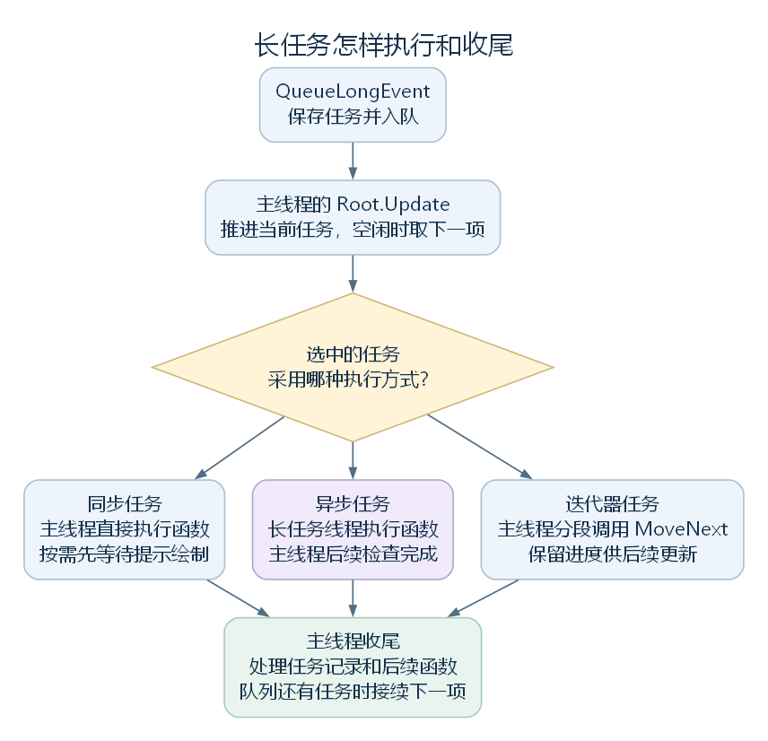
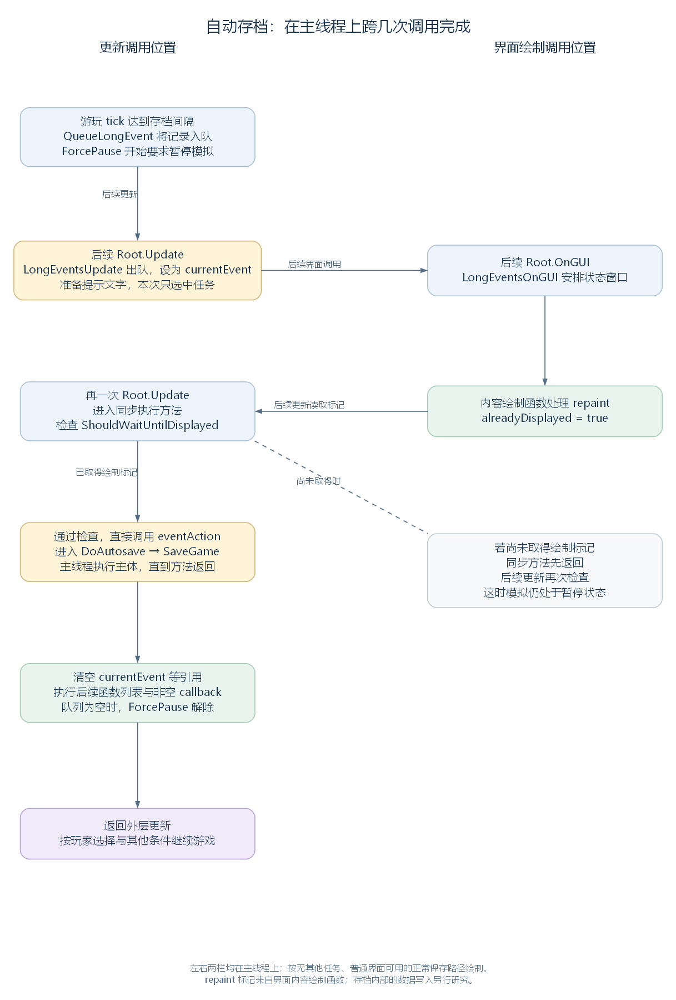
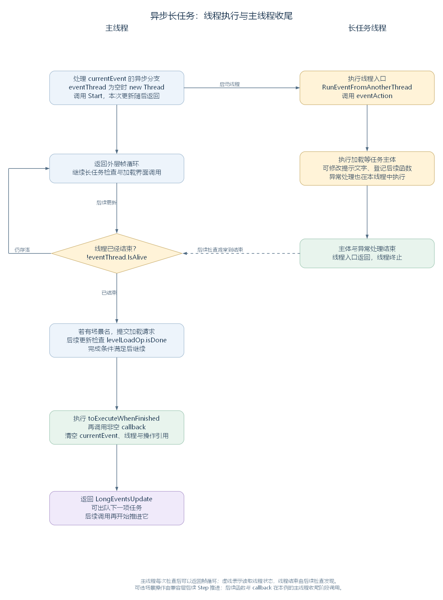
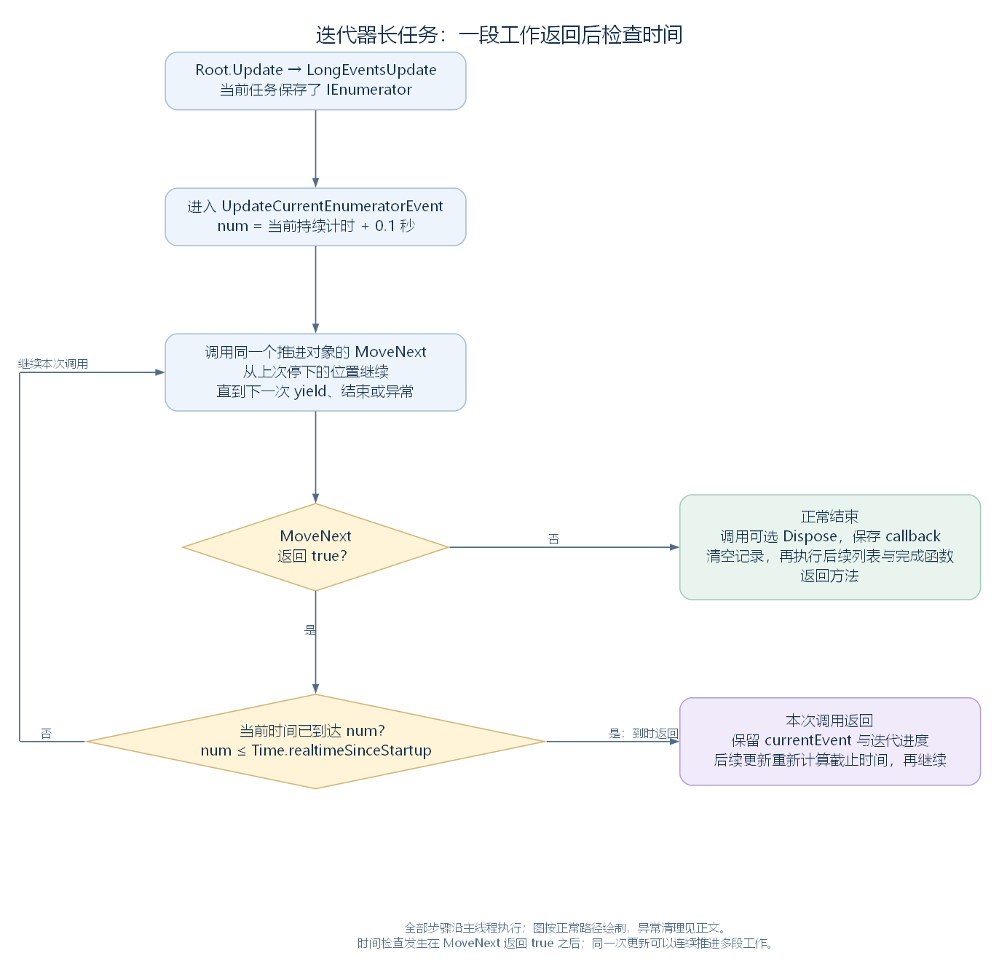
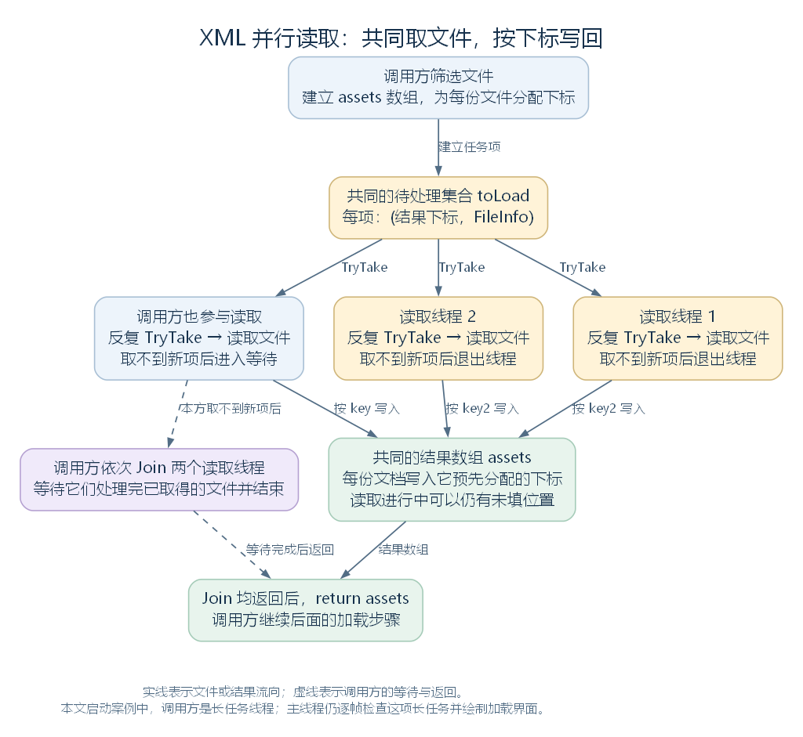
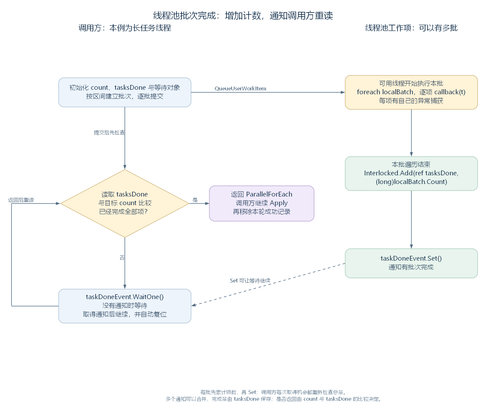
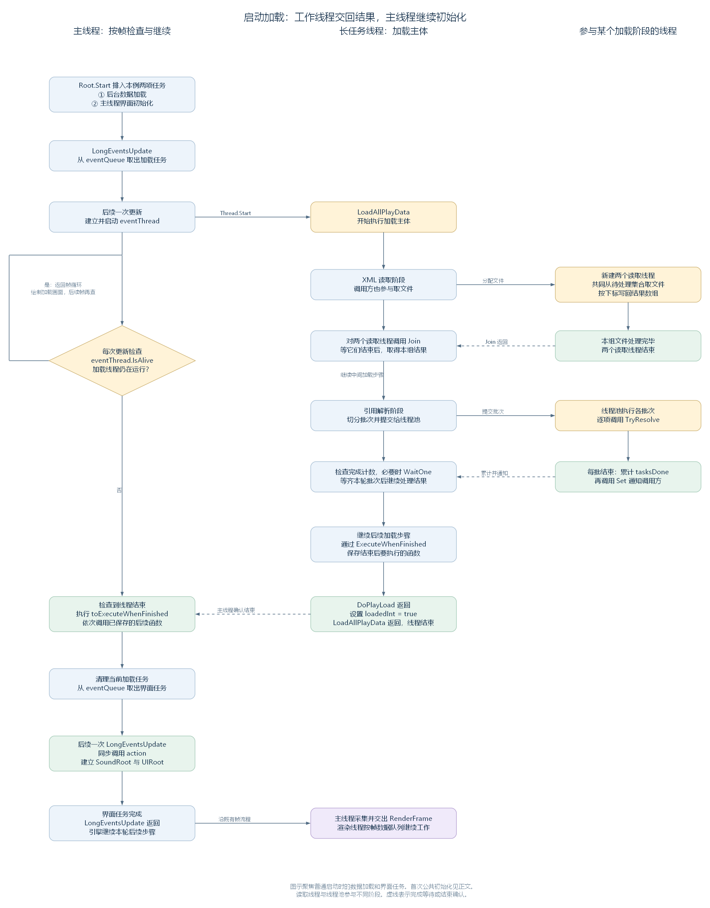

# 长任务与线程协作：工作怎样排队、执行和交回

版本：整合草稿 v0.1｜整理日期：2026-11-07

存档、启动加载和批量文件处理，需要在游戏运行中取得执行机会。LongEventHandler 把这些工作保存为任务，安排它们何时开始、在哪条线程执行，以及完成后怎样继续。

本文依据 RimWorld 1.7.4982 rev1280 的代码，使用代表性路径解释调度。源码保留原名，节选与教学示意注明。存档格式、XML 加载规则、资源和绘制内部实现由相应模块展开。

## 一、长任务运行总览

存档和加载代码通过 `QueueLongEvent` 将任务排入队列。主线程每次执行 `Root.Update`，都会让 `LongEventHandler` 推进当前任务。当前没有任务时可以选出下一项，选中的任务会在后续更新里按登记的方式执行。

| 执行方式 | 谁来执行主体 | 怎样等待和确认完成 |
| --- | --- | --- |
| 同步任务 | 主线程直接调用任务函数 | 需要显示标准提示时，先等窗口获得绘制机会。函数返回后开始收尾 |
| 异步任务 | 长任务线程执行任务函数 | 主线程在后续更新中检查线程是否结束，并按需继续等待场景操作 |
| 迭代器任务 | 主线程调用 `MoveNext`，按耗时分段推进 | 到达本轮时间限制时保存进度。迭代结束后开始收尾 |



[SVG](../../figures/long-event-chapter-overview.svg) · [图源](../../figures/long-event-chapter-overview.dot)

普通启动的数据加载走异步路径。加载线程可以把一批 XML 文件交给读取线程共同处理，也可以把引用解析切成批次交给线程池。加载线程在相应的调用位置等齐结果，再继续后续步骤。此时主线程仍能返回帧循环，更新加载提示。

加载线程退出后，主线程执行加载过程中登记的后续函数，再推进已排队的界面初始化。游玩中也沿这套机制处理自动存档，待处理任务会暂停模拟，主线程继续安排存档提示和保存工作。

源码定位：帧内入口（`Verse.Root.cs:122`）、长任务分派（`Verse.LongEventHandler.cs:193`）。

## 二、保存排队任务与当前执行状态

LongEventHandler 是共同的静态管理器。它用队列保存尚未开始的任务，用 currentEvent 保存当前任务，另外保存执行线程、场景操作和后续函数列表。相关字段节选如下：

```csharp
private static Queue<LongEventHandler.QueuedLongEvent> eventQueue = new Queue<LongEventHandler.QueuedLongEvent>();
internal static LongEventHandler.QueuedLongEvent currentEvent = null;
private static Thread eventThread = null;
private static AsyncOperation levelLoadOp = null;
private static List<Action> toExecuteWhenFinished = new List<Action>();
private static bool executingToExecuteWhenFinished = false;
```

| 字段 | 保存内容 |
| --- | --- |
| eventQueue | 按入队次序等待的 QueuedLongEvent 记录 |
| currentEvent | 当前任务；为空时可以取下一项 |
| eventThread | 异步主体使用的 Thread |
| levelLoadOp | 可选的异步场景操作 |
| toExecuteWhenFinished | 待执行的 Action 列表 |
| executingToExecuteWhenFinished | 标记管理器是否正在遍历这份函数列表 |

Action 保存无参数、无返回值的方法；Action<Exception> 保存接收异常的方法。任务记录 QueuedLongEvent 把这些函数与显示、执行条件放在一起：

| 记录成员 | 含义 |
| --- | --- |
| eventAction；eventActionEnumerator | 任务主体，分别保存 Action 或 IEnumerator |
| doAsynchronously | Action 是否交给长任务线程 |
| eventTextKey；eventText | 显示文字的翻译键与当前文字 |
| alreadyDisplayed；canEverUseStandardWindow | 是否已经绘制，以及是否具备使用标准窗口的条件 |
| levelToLoad | 主体完成后可选的场景名 |
| callback；exceptionHandler | 完成函数与异常处理函数 |
| showExtraUIInfo；forceHideUI | 加载界面的额外显示设置 |

源码定位：管理字段（`Verse.LongEventHandler.cs:505`）、记录类型与成员（`Verse.LongEventHandler.cs:529`）。

## 三、登记任务，再从队首选中当前项

自动存档是一个具体入口。AutosaverTick 由 DoSingleTick 调用，每步累计 ticksSinceSave，达到间隔且允许保存时，把 DoAutosave 登记为同步任务：

```csharp
public void AutosaverTick()
{
    this.ticksSinceSave++;
    if (this.ticksSinceSave >= this.AutosaveIntervalTicks && !GameDataSaveLoader.SavingIsTemporarilyDisabled)
    {
        LongEventHandler.QueueLongEvent(new Action(this.DoAutosave), "Autosaving", false, null, true, false, null);
        this.ticksSinceSave = 0;
    }
}
```

这里传给 QueueLongEvent 的第三个参数是 false。管理器接收 Action 时，将它与参数写入新记录，再入队；action 是主体，textKey 是翻译键，doAsynchronously 决定执行位置，exceptionHandler 和 callback 分别处理异常与完成：

```csharp
public static void QueueLongEvent(Action action, string textKey, bool doAsynchronously,
    Action<Exception> exceptionHandler, bool showExtraUIInfo = true,
    bool forceHideUI = false, Action callback = null)
{
    LongEventHandler.QueuedLongEvent queuedLongEvent = new LongEventHandler.QueuedLongEvent
    {
        eventAction = action,
        eventTextKey = textKey,
        doAsynchronously = doAsynchronously,
        exceptionHandler = exceptionHandler,
        canEverUseStandardWindow = !LongEventHandler.AnyEventWhichDoesntUseStandardWindowNowOrWaiting,
        showExtraUIInfo = showExtraUIInfo,
        callback = callback,
        forceHideUI = forceHideUI
    };
    LongEventHandler.eventQueue.Enqueue(queuedLongEvent);
}
```

canEverUseStandardWindow 在登记时依据已有任务状态确定，后面参与窗口选择。入队本身先保存任务，主体等待 LongEventsUpdate 选中以后执行。

LongEventsUpdate 首先推进已经存在的 currentEvent，按迭代器、异步 Action、同步 Action 的顺序选择路径。当前项清空以后，再取下一条记录。sceneChanged 是输出的场景切换标记：

```csharp
public static void LongEventsUpdate(out bool sceneChanged)
{
    sceneChanged = false;
    if (LongEventHandler.currentEvent != null)
    {
        if (LongEventHandler.currentEvent.eventActionEnumerator != null)
        {
            LongEventHandler.UpdateCurrentEnumeratorEvent();
        }
        else if (LongEventHandler.currentEvent.doAsynchronously)
        {
            LongEventHandler.UpdateCurrentAsynchronousEvent();
        }
        else
        {
            LongEventHandler.UpdateCurrentSynchronousEvent(out sceneChanged);
        }
    }
    if (LongEventHandler.currentEvent == null && LongEventHandler.eventQueue.Count > 0)
    {
        LongEventHandler.currentEvent = LongEventHandler.eventQueue.Dequeue();
        if (LongEventHandler.currentEvent.eventTextKey == null)
        {
            LongEventHandler.currentEvent.eventText = "";
            return;
        }
        LongEventHandler.currentEvent.eventText = LongEventHandler.currentEvent.eventTextKey.Translate();
    }
}
```

新出队的任务在本次调用里只设置当前记录和文字，后续一次更新才会进入它的执行分支。前一项结束时，同一次 LongEventsUpdate 可以选出后一项，但后一项仍等待后续调用推进。

源码定位：自动存档登记（`RimWorld.Autosaver.cs:40`）、Action 入队（`Verse.LongEventHandler.cs:61`）、主线程分派与出队（`Verse.LongEventHandler.cs:193`）。

## 四、让界面先取得绘制机会，再执行同步主体

任务的 UseStandardWindow 根据登记条件和执行方式选择标准窗口；ShouldWaitUntilDisplayed 再结合 alreadyDisplayed 与文字判断是否继续等待：

```csharp
public bool ShouldWaitUntilDisplayed
{
    get
    {
        return !this.alreadyDisplayed && this.UseStandardWindow && !this.eventText.NullOrEmpty();
    }
}

public bool UseStandardWindow
{
    get
    {
        return this.canEverUseStandardWindow && !this.doAsynchronously && this.eventActionEnumerator == null;
    }
}
```

普通自动存档使用标准窗口时，Root.OnGUI 会接到长任务界面。窗口内容处理过一次 repaint 后，把 alreadyDisplayed 设为 true。后续同步更新通过显示检查，才调用存档主体。



[SVG](../../figures/long-event-sync-save.svg) · [图源](../../figures/long-event-sync-save.dot)

### 4.1 把任务状态接到游戏暂停与更新判断

AnyEventNowOrWaiting 在当前或队列中有任务时为 true，ForcePause 直接返回它。TickManager 将这个结果纳入强制暂停条件，所以任务入队后就能阻止继续推进模拟。

Root 层另外查询 ShouldWaitForEvent。Find.UIRoot 与 Find.WindowStack 分别取得当前界面入口和窗口栈，参与普通界面是否已经可用的判断：

```csharp
public static bool ShouldWaitForEvent
{
    get
    {
        return LongEventHandler.AnyEventNowOrWaiting && ((LongEventHandler.currentEvent != null && !LongEventHandler.currentEvent.UseStandardWindow) || (Find.UIRoot == null || Find.WindowStack == null));
    }
}
```

| 状态 | 对模拟与普通更新的影响 |
| --- | --- |
| 只有排队任务，普通界面可用 | 模拟暂停，普通帧级更新仍可继续 |
| 当前使用标准窗口，普通界面可用 | 模拟暂停，保留相应普通更新与绘制机会 |
| 当前任务不使用标准窗口 | Root 跳过对应共享服务，Root_Play 提前返回 |
| 存在任务，普通界面尚不可用 | 按长任务等待路径处理 |

如果任务在 DoSingleTick 中登记，当前这一步仍会返回，TickManagerUpdate 随后的暂停检查再结束推进循环。

### 4.2 调用主体，并按顺序清理

UpdateCurrentSynchronousEvent 直接调用 currentEvent.eventAction。自动存档在这里进入 DoAutosave，选择名称，再调用 SaveGame。sceneChanged 带回场景变化；局部变量 callback 保存完成函数，以便清空记录以后调用：

```csharp
private static void UpdateCurrentSynchronousEvent(out bool sceneChanged)
{
    sceneChanged = false;
    if (LongEventHandler.currentEvent.ShouldWaitUntilDisplayed)
    {
        return;
    }
    try
    {
        if (LongEventHandler.currentEvent.eventAction != null)
        {
            LongEventHandler.currentEvent.eventAction();
        }
        if (!LongEventHandler.currentEvent.levelToLoad.NullOrEmpty())
        {
            SceneManager.LoadScene(LongEventHandler.currentEvent.levelToLoad);
            sceneChanged = true;
        }
        Action callback = LongEventHandler.currentEvent.callback;
        LongEventHandler.currentEvent = null;
        LongEventHandler.eventThread = null;
        LongEventHandler.levelLoadOp = null;
        LongEventHandler.ExecuteToExecuteWhenFinished();
        if (callback != null)
        {
            callback();
        }
    }
    catch (Exception ex)
    {
        string text = "Exception from long event: ";
        Exception ex2 = ex;
        Log.Error(text + ((ex2 != null) ? ex2.ToString() : null));
        if (LongEventHandler.currentEvent != null && LongEventHandler.currentEvent.exceptionHandler != null)
        {
            LongEventHandler.currentEvent.exceptionHandler(ex);
        }
        LongEventHandler.currentEvent = null;
        LongEventHandler.eventThread = null;
        LongEventHandler.levelLoadOp = null;
    }
}
```

正常路径依次执行主体、可选场景加载、保存 callback、清除当前引用、执行后续函数列表，再调用 callback。本例没有场景和完成函数。若没有其他排队任务，长任务的暂停要求也随状态清空而解除。

异常传播到管理器时，由 catch 记录、调用现有异常处理函数并清理。存档代码内部还可能自行处理错误，因此实际保存结果需要结合该模块及日志判断。

源码定位：界面与显示标记（`Verse.Root.cs:163`、`Verse.LongEventHandler.cs:471`）、暂停与等待（`Verse.LongEventHandler.cs:17`、`Verse.LongEventHandler.cs:52`）、同步执行（`Verse.LongEventHandler.cs:350`）。

## 五、交给长任务线程，再由主线程检查完成

启动时，Root.Start 创建一个保存界面初始化的 Action，局部名为 action。数据尚未加载时，先排入异步 LoadAllPlayData，再排入同步界面初始化：

```csharp
LongEventHandler.QueueLongEvent(delegate
{
    PlayDataLoader.LoadAllPlayData(false);
}, null, true, null, true, false, null);
LongEventHandler.QueueLongEvent(action, "InitializingInterface", false, null, true, false, null);
```

当前项选中异步任务后，UpdateCurrentAsynchronousEvent 第一次建立并启动 Thread；后续调用检查 IsAlive。RunEventFromAnotherThread 是线程入口，负责调用任务主体并处理其异常；flag 表示主体与可选场景操作已经达到完成条件：

```csharp
private static void UpdateCurrentAsynchronousEvent()
{
    if (LongEventHandler.eventThread == null)
    {
        LongEventHandler.eventThread = new Thread(delegate
        {
            LongEventHandler.RunEventFromAnotherThread(LongEventHandler.currentEvent.eventAction);
        });
        LongEventHandler.eventThread.Start();
        return;
    }
    if (!LongEventHandler.eventThread.IsAlive)
    {
        bool flag = false;
        if (!LongEventHandler.currentEvent.levelToLoad.NullOrEmpty())
        {
            if (LongEventHandler.levelLoadOp == null)
            {
                LongEventHandler.levelLoadOp = SceneManager.LoadSceneAsync(LongEventHandler.currentEvent.levelToLoad);
            }
            else if (LongEventHandler.levelLoadOp.isDone)
            {
                flag = true;
            }
        }
        else
        {
            flag = true;
        }
        if (flag)
        {
            LongEventHandler.ExecuteToExecuteWhenFinished();
            Action callback = LongEventHandler.currentEvent.callback;
            if (callback != null)
            {
                callback();
            }
            LongEventHandler.currentEvent = null;
            LongEventHandler.eventThread = null;
            LongEventHandler.levelLoadOp = null;
        }
    }
}
```



[SVG](../../figures/long-event-async-threads.svg) · [图源](../../figures/long-event-async-threads.dot)

RunEventFromAnotherThread 在线程入口设置文化环境，再调用传来的 Action。主体抛出的异常和 exceptionHandler 都在这条长任务线程处理；异常处理函数再次抛错时，还有外层捕获记录。主体结束后，主线程在之后的检查中看到线程不再存活。

存在 levelToLoad 时，主线程先发出 LoadSceneAsync 请求，再在后续检查读取 isDone。兼容层保存的场景操作由 UnityRuntime.Step 开头的 ProcessPendingLoad 推进。达到完成条件后，主线程执行后续函数列表与当前 callback，最后清空记录及线程、场景操作引用。

启动案例没有额外场景请求，完成条件来自线程结束。IsAlive 说明线程入口是否已经结束，具体任务结果由主体、日志与异常处理表达。

### 更新加载提示文字

任务线程可通过 SetCurrentEventText 改写当前文字。newText 是新文字，currentEventTextLock 引用共同的锁对象：

```csharp
public static void SetCurrentEventText(string newText)
{
    object currentEventTextLock = LongEventHandler.CurrentEventTextLock;
    lock (currentEventTextLock)
    {
        if (LongEventHandler.currentEvent != null)
        {
            LongEventHandler.currentEvent.eventText = newText;
        }
    }
}
```

主线程读取和绘制文字时也取得同一把锁。后续界面调用读取新值，再进入绘制流程，形成玩家看到的状态提示。异步记录还会采用随时间变化的省略号。

源码定位：启动登记（`Verse.Root.cs:63`）、线程入口（`Verse.LongEventHandler.cs:394`）、异步检查与收尾（`Verse.LongEventHandler.cs:305`）、提示文字（`Verse.LongEventHandler.cs:240`）、场景请求（`UnityEngine.SceneManagement.SceneManager.cs:134`）。

## 六、在主线程上保存进度，分次推进任务

IEnumerable 形式的 QueueLongEvent 会取得 IEnumerator，保存为 eventActionEnumerator。每次 LongEventsUpdate 进入迭代器路径，就从同一份进度继续调用 MoveNext。

下面是教学用的分段任务，方法与局部变量名称为本例自行命名。completed 记录已完成段数，注释处表示一段实际工作：

```csharp
private static IEnumerable PrepareInStages()
{
    int completed = 0;
    while (completed < 5)
    {
        // 教学：在这里处理一小段工作。
        completed++;
        yield return completed;
    }
}
```

管理器使用持续计时，在一次调用开头建立当前时间 + 0.1 秒的截止值 num。IDisposable 提供 Dispose 清理入口；disposable、disposable2 在正常和异常路径取得这个可选接口，callback 与 exceptionHandler 保存后续函数：

```csharp
private static void UpdateCurrentEnumeratorEvent()
{
    try
    {
        float num = Time.realtimeSinceStartup + 0.1f;
        while (LongEventHandler.currentEvent.eventActionEnumerator.MoveNext())
        {
            if (num <= Time.realtimeSinceStartup)
            {
                return;
            }
        }
        IDisposable disposable = LongEventHandler.currentEvent.eventActionEnumerator as IDisposable;
        if (disposable != null)
        {
            disposable.Dispose();
        }
        Action callback = LongEventHandler.currentEvent.callback;
        LongEventHandler.currentEvent = null;
        LongEventHandler.eventThread = null;
        LongEventHandler.levelLoadOp = null;
        LongEventHandler.ExecuteToExecuteWhenFinished();
        if (callback != null)
        {
            callback();
        }
    }
    catch (Exception ex)
    {
        string text = "Exception from long event: ";
        Exception ex2 = ex;
        Log.Error(text + ((ex2 != null) ? ex2.ToString() : null));
        if (LongEventHandler.currentEvent != null)
        {
            IDisposable disposable2 = LongEventHandler.currentEvent.eventActionEnumerator as IDisposable;
            if (disposable2 != null)
            {
                disposable2.Dispose();
            }
            Action<Exception> exceptionHandler = LongEventHandler.currentEvent.exceptionHandler;
            if (exceptionHandler != null)
            {
                exceptionHandler(ex);
            }
        }
        LongEventHandler.currentEvent = null;
        LongEventHandler.eventThread = null;
        LongEventHandler.levelLoadOp = null;
    }
}
```



[SVG](../../figures/long-event-iterator-loop.svg) · [图源](../../figures/long-event-iterator-loop.dot)

while 读取 MoveNext 的 bool 结果，在每段返回以后比较时间；Current 的值不参与这里的条件判断。一段耗时较短时，同次调用可以连续推进多段；到时以后保留原迭代器，后续更新重新建立截止值。

例如每段耗时 45 毫秒，三段依次结束时约经过 45、90、135 毫秒。前两次继续，第三次检查才返回。时间限制的检查点位于 MoveNext 返回之后，单段必须先交回控制。

Time.realtimeSinceStartup 从运行时保存的 Stopwatch 起点取得真实经过时间，因此同次调用中也能读到计时变化。正常结束和异常路径都会尝试 Dispose 迭代器，再处理任务清理。世界绘制层的重新生成已有使用这个登记入口的案例，具体绘制工作留到世界与渲染模块。

源码定位：迭代器登记（`Verse.LongEventHandler.cs:78`）、执行与清理（`Verse.LongEventHandler.cs:253`）、持续计时（`Waylith.UnityCompat.UnityTimeState.cs:36`）、实际入口（`RimWorld.Planet.WorldRenderer.cs:195`）。

## 七、让多个执行者共同读取文件

后台加载内部还会拆分工作。这里从 ModContentPack 的补丁加载进入 DirectXmlLoader.XmlAssetsInModFolder，读取选定目录中的 XML。普通启动中，这个调用发生在长任务线程。

ModContentPack 保存当前内容包；FileInfo 保存文件信息；LoadableXmlAsset 保存来源与读出的 XmlDocument。目录扫描先以 dictionary 选定文件，再建立以下工作数据：

| 局部变量 | 保存什么 |
| --- | --- |
| list2 | 本次选定的 FileInfo 列表 |
| assets | 与 list2 等长的结果数组 |
| toLoad | ConcurrentBag，每项携带数组下标和文件信息 |
| array | 两条新建读取线程的数组 |

下面 k 是文件下标，num 保存该下标，fileInfo2 是当前文件：

```csharp
List<FileInfo> list2 = dictionary.Values.ToList<FileInfo>();
LoadableXmlAsset[] assets = new LoadableXmlAsset[list2.Count];
ConcurrentBag<KeyValuePair<int, FileInfo>> toLoad = new ConcurrentBag<KeyValuePair<int, FileInfo>>();
for (int k = 0; k < list2.Count; k++)
{
    int num = k;
    FileInfo fileInfo2 = list2[k];
    toLoad.Add(new KeyValuePair<int, FileInfo>(num, fileInfo2));
}
Thread[] array = new Thread[2];
```

随后建立并启动两个读取线程。每条线程使用相同取项流程；keyValuePair2 保存任务，key2 是结果下标，value2 是文件：

```csharp
KeyValuePair<int, FileInfo> keyValuePair2;
while (toLoad.TryTake(out keyValuePair2))
{
    int key2 = keyValuePair2.Key;
    FileInfo value2 = keyValuePair2.Value;
    assets[key2] = new LoadableXmlAsset(value2, mod);
}
```

调用方启动两条线程后，也执行自己的 TryTake 循环。它使用的局部名为 keyValuePair、key、value，写入同一份 assets。于是最多有三个执行者共同读取这一批文件。

每个执行者取得一项就读取，再按携带下标写回。即使第 4 个文件先完成，它也填第 4 格，本次结果数组与 list2 的位置对应。取项次序和完成先后随执行情况变化。



[SVG](../../figures/parallel-xml-reading.svg) · [图源](../../figures/parallel-xml-reading.dot)

调用方取不到更多项后，对两个线程 Join。array3 是线程数组引用，m 是下标：

```csharp
Thread[] array3 = array;
for (int m = 0; m < array3.Length; m++)
{
    array3[m].Join();
}
return assets;
```

Join 等待的是这两条读取线程结束。调用方自己的文件已经读完，等待返回以后，本批结果数组才能交给后续加载步骤。单个 LoadableXmlAsset 构造过程中读 XML 出错，会记录并把文档设为空，具体后续处理由加载逻辑继续判断。

源码定位：补丁入口（`Verse.ModContentPack.cs:464`）、读取与工作建立（`Verse.DirectXmlLoader.cs:17`、`Verse.DirectXmlLoader.cs:41`）、线程和调用方取项（`Verse.DirectXmlLoader.cs:61`、`Verse.DirectXmlLoader.cs:80`）、Join（`Verse.DirectXmlLoader.cs:87`）、文档读取（`Verse.LoadableXmlAsset.cs:53`）。

## 八、把引用解析切成批次，等齐完成量

DirectXmlCrossRefLoader 的 wantedRefs 保存待连接记录，GenThreading.ParallelForEach 对它们调用 TryResolve。返回 true 的记录在锁保护下加入 resolvedRefs；整个并行调用返回后，调用方继续 Apply，并移除本轮成功记录。

ParallelForEach 的 list 是输入列表，callback 是单项函数，maxDegreeOfParallelism 为批次数上限；默认 -1 会替换为运行时报告的处理器数量。方法建立总数、完成计数和通知对象：

```csharp
GenThreading.GetMaxDegreeOfParallelism(ref maxDegreeOfParallelism);
int count = list.Count;
long tasksDone = 0L;
AutoResetEvent taskDoneEvent = new AutoResetEvent(false);
```

count 是目标项数，tasksDone 是已经遍历完的项数；taskDoneEvent 是初始无通知的 AutoResetEvent。SliceWork 用 fromInclusive、toExclusive 描述连续区间，再把各区间复制成批次列表。例如十项最多分三批，得到 4、3、3 项；项数少于批次数上限时只建立非空批次。

### 8.1 每批结束，先累计再通知

ThreadPool 使用可用的线程池线程执行提交的函数，QueueUserWorkItem 是这里的提交入口。外层 enumerator 遍历批次，list2 取得本批，localBatch 为工作项保存引用；t 是本批当前元素，匿名参数 _ 未使用：

```csharp
List<T> list2 = enumerator.Current;
List<T> localBatch = list2;
ThreadPool.QueueUserWorkItem(delegate(object _)
{
    foreach (T t in localBatch)
    {
        try
        {
            callback(t);
        }
        catch (Exception ex)
        {
            string text = "Error in ParallelForEach(): ";
            Exception ex2 = ex;
            Log.Error(text + ((ex2 != null) ? ex2.ToString() : null));
        }
    }
    Interlocked.Add(ref tasksDone, (long)localBatch.Count);
    taskDoneEvent.Set();
});
```

每批在某条线程池线程上顺序调用 callback，各批可以并行。每项都有自己的异常捕获，错误记录后还能继续后项。批次结束以后，Interlocked.Add 原子累计项数，再用 Set 通知调用方。

tasksDone 统计已经遍历的项数，包括被捕获异常的尝试；解析是否成功，由 TryResolve 的结果与 resolvedRefs 另外记录。

### 8.2 每次取得通知，重新比较完成总量

提交全部批次后，调用方先跳到 IL_008F 检查计数，未完成时到 IL_0083 等待。下面保留原始标签与跳转：

```csharp
IL_0083:
taskDoneEvent.WaitOne();
IL_008F:
if (Interlocked.Read(ref tasksDone) >= (long)count)
{
    return;
}
goto IL_0083;
```

WaitOne 在没有通知时等待；取得通知后自动复位，再重新读取完成量。多个 Set 可能合并为一次可观察通知，完成总量持续保存在 tasksDone 中。



[SVG](../../figures/threadpool-completion-wait.svg) · [图源](../../figures/threadpool-completion-wait.dot)

十项三批若按 3、4、3 项结束，计数可以依次变为 3、7、10。调用方看到前两个数继续等待，达到十项才返回。较早结束的多批通知即使合并，也能在下一次检查读到累计总量。

本例的调用方仍是长任务线程。并行调用返回以后由它继续 Apply 和待处理列表整理；具体字段引用也可能已经在工作项的 TryResolve 中写入。主线程则从外层继续检查整个长任务线程是否结束。

源码定位：解析调用与后处理（`Verse.DirectXmlCrossRefLoader.cs:247`）、默认批次数（`Verse.GenThreading.cs:22`）、切分（`Verse.GenThreading.cs:31`、`Verse.GenThreading.cs:71`）、提交和等待（`Verse.GenThreading.cs:87`）。

## 九、保存后续函数，再按调用位置执行

任务期间可以调用 ExecuteWhenFinished，把一个 Action 加入 toExecuteWhenFinished。它先加入列表，再依据当前任务和遍历状态决定是否立刻执行：

```csharp
public static void ExecuteWhenFinished(Action action)
{
    LongEventHandler.toExecuteWhenFinished.Add(action);
    if ((LongEventHandler.currentEvent == null || LongEventHandler.currentEvent.ShouldWaitUntilDisplayed) && !LongEventHandler.executingToExecuteWhenFinished)
    {
        LongEventHandler.ExecuteToExecuteWhenFinished();
    }
}
```

“当前没有任务或当前任务仍需等窗口显示”成立，并且没有正在遍历列表时，会立刻执行这些函数。立即执行沿调用者的线程进行；普通异步加载期间，函数先保留，等主线程检测到任务结束时执行。ForceExecuteToExecuteWhenFinished 则直接进入同一个执行方法。

执行方法以 executingToExecuteWhenFinished 防止重入。i 是下标，每项各有异常捕获，执行完清空列表：

```csharp
private static void ExecuteToExecuteWhenFinished()
{
    if (LongEventHandler.executingToExecuteWhenFinished)
    {
        // 省略源码中的警告日志。
        return;
    }
    LongEventHandler.executingToExecuteWhenFinished = true;
    // 省略性能记录开始。
    for (int i = 0; i < LongEventHandler.toExecuteWhenFinished.Count; i++)
    {
        // 省略当前函数的性能记录开始。
        try
        {
            LongEventHandler.toExecuteWhenFinished[i]();
        }
        catch (Exception ex)
        {
            // 省略错误信息构造与日志。
        }
        finally
        {
            // 省略当前函数的性能记录结束。
        }
    }
    // 省略性能记录结束。
    LongEventHandler.toExecuteWhenFinished.Clear();
    LongEventHandler.executingToExecuteWhenFinished = false;
}
```

循环每次重新读取 Count，因而函数执行期间追加的条目也能在本轮取得机会。某一项抛错会记录错误，随后仍可继续其他条目。

普通异步结束时，先执行列表与 callback，再清空 currentEvent；同步和迭代器正常结束则先保存 callback、清空当前引用，再执行列表与 callback。这个顺序决定了函数执行期间读取到的管理器状态。

源码定位：登记与立即执行（`Verse.LongEventHandler.cs:224`）、强制执行入口（`Verse.LongEventHandler.cs:234`）、列表遍历（`Verse.LongEventHandler.cs:426`）。

## 十、把加载收尾接回主线程与界面

普通启动的数据加载会登记预热启动、人物背景资料、语言注入、静态初始化、材质准备和资源整理等后续函数。LoadAllPlayData 在 DoPlayLoad 返回后设置 loadedInt，再结束线程入口；之后主线程才执行这些已登记工作。

例如，以下登记把语言数据处理保存到列表中。activeLanguage 指向选定语言，注入函数更新这一阶段的定义翻译，ClearCache 清理标签缓存；下面省略性能记录：

```csharp
LongEventHandler.ExecuteWhenFinished(delegate
{
    // 省略 DeepProfiler 记录与相应的 try/finally。
    LanguageDatabase.activeLanguage.InjectIntoData_AfterImpliedDefs();
    GenLabel.ClearCache();
});
```

静态初始化还会调用带 StaticConstructorOnStartup 标记的类型，再处理延后准备的材质与图集。着色器预热入口启动的是后台工作，其返回后仍可能继续执行。

主线程确认加载线程结束，执行后续函数后清空当前任务，再选出先前排好的界面任务。下一次 LongEventsUpdate 才同步调用 Root.Start 中保存的 action。其中 this 指向当前 Root，soundRoot、uiRoot 保存声音与界面入口，GenScene 按 Play 或 Entry 场景选择 UIRoot。主体如下，省略性能记录与相应 try/finally：

```csharp
this.soundRoot = new SoundRoot();
// 省略 Instantiate UIRoot 的性能记录。
if (GenScene.InPlayScene)
{
    this.uiRoot = new UIRoot_Play();
}
else if (GenScene.InEntryScene)
{
    this.uiRoot = new UIRoot_Entry();
}
// 省略 Instantiate UIRoot 的性能记录结束。
this.uiRoot.Init();
Messages.Notify_LoadedLevelChanged();
if (Current.SubcameraDriver != null)
{
    Current.SubcameraDriver.Init();
}
```

建立入口以后，代码继续 Init 并通知场景变化。由此形成“后台数据加载 → 主线程后续准备 → 主线程界面初始化”的顺序。



[SVG](../../figures/loading-main-thread-handoff.svg) · [图源](../../figures/loading-main-thread-handoff.dot)

放回引擎的一帧，主线程队列的 Pump 位于 OnUpdate 之前；这里的后续函数则由 Root.Update 内的长任务完成检查调用。函数保存在哪个列表、在哪里被取出，沿实际调用点即可确定。

| 等待位置 | 谁等待 | 等待以后谁继续 |
| --- | --- | --- |
| XML 读取的 Join | 长任务线程 | 同一加载线程继续后面的加载步骤 |
| 批次计数与 WaitOne | 长任务线程 | 同一加载线程处理解析结果 |
| 整个加载的 IsAlive 检查 | 主线程每帧检查，检查之间返回帧循环 | 主线程执行后续函数并推进队列 |
| 界面任务在队列中排队 | 任务等待前项结束 | 主线程后续更新调用初始化函数 |

渲染线程继续按第一章的帧数据队列工作；资源准备内部的设备操作留到渲染模块。本章已经把每层执行者、等待点及继续位置接通。下一章 [《协程的分段执行》](../06-coroutines/draft.md) 将追踪更细的等待条件，解释一段代码如何在多个帧阶段继续运行。

源码定位：加载标记与收尾登记（`Verse.PlayDataLoader.cs:85`、`Verse.PlayDataLoader.cs:293`、`Verse.PlayDataLoader.cs:346`）、界面初始化（`Verse.Root.cs:35`）、主线程队列位置（`Waylith.EngineApplication.cs:760`）。

逐段研究材料：[同步存档](../../49-long-event-queue-and-synchronous-save.md)、[异步任务](../../50-asynchronous-long-events.md)、[迭代器任务](../../51-iterator-long-events.md)、[XML 读取](../../52-parallel-xml-reading.md)、[线程池批次](../../53-threadpool-batches-and-completion.md)、[主线程交接](../../54-loading-main-thread-handoff.md)。
