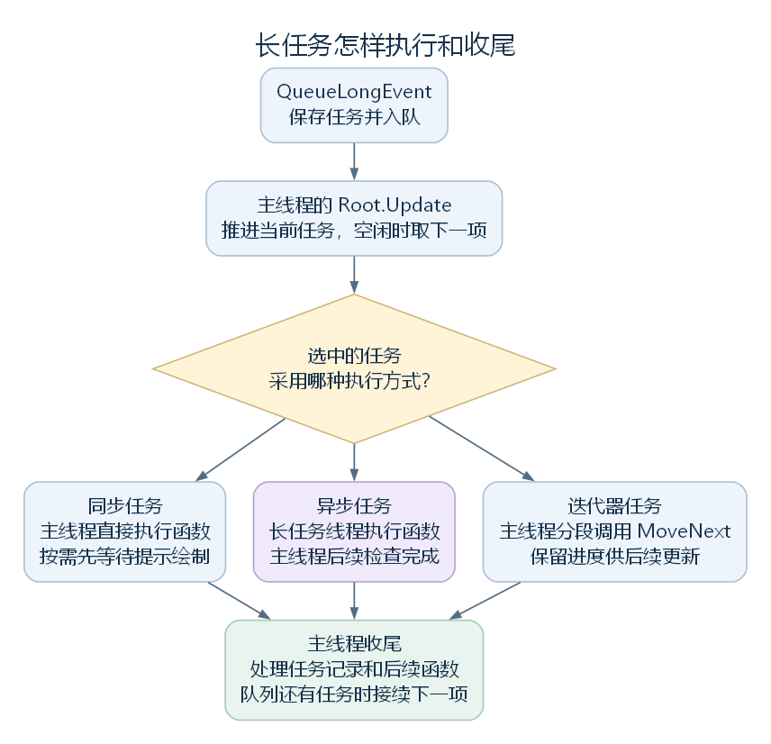
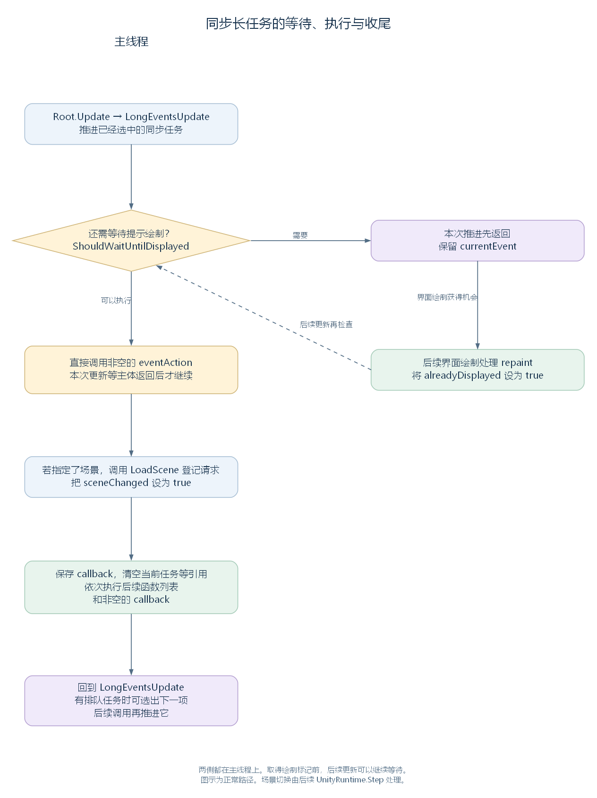
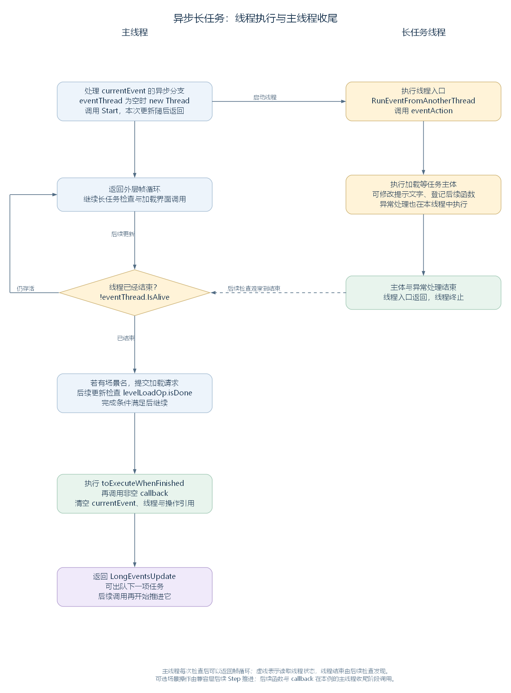
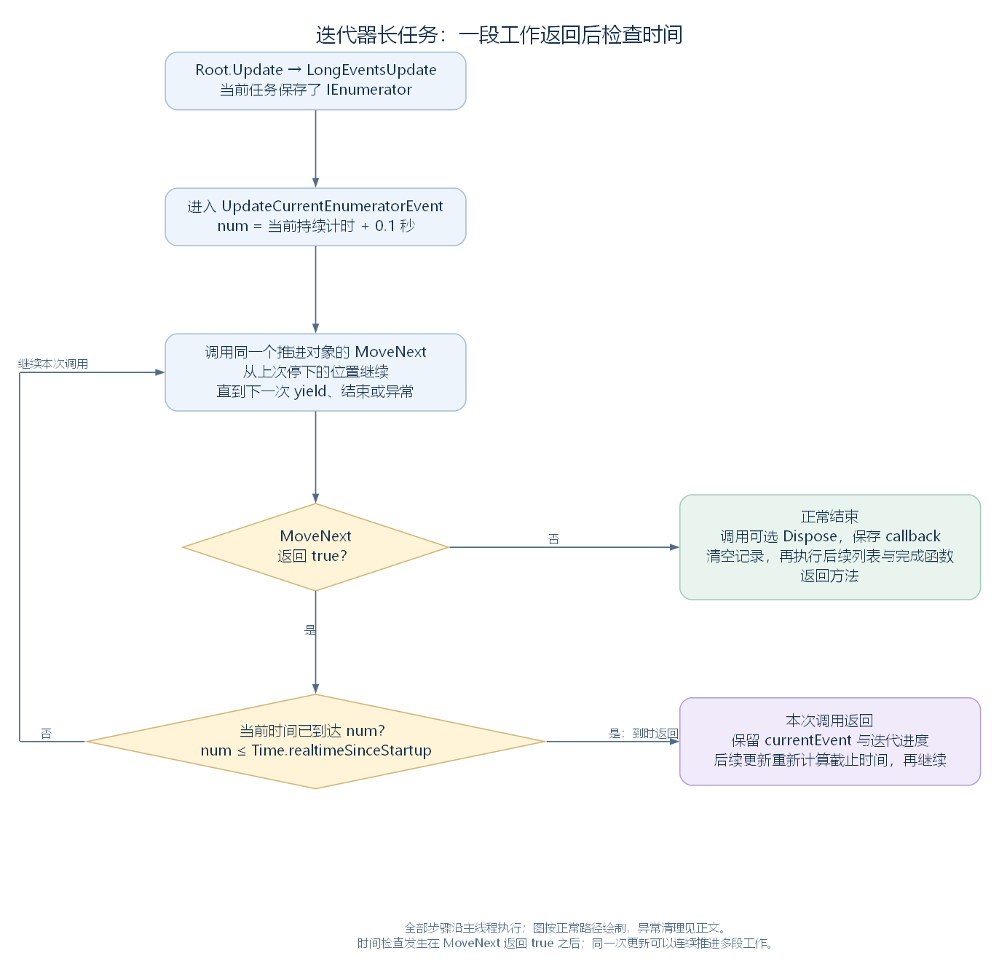
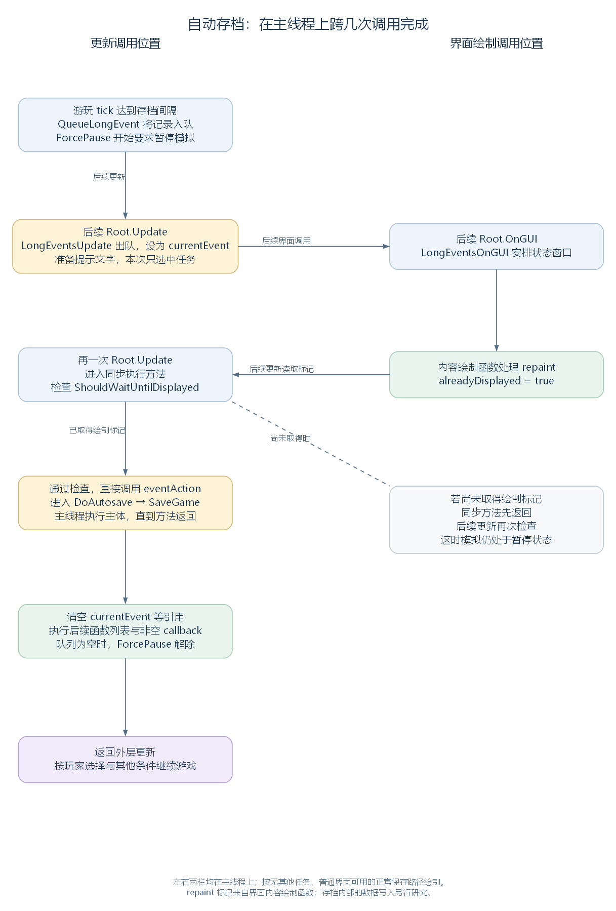
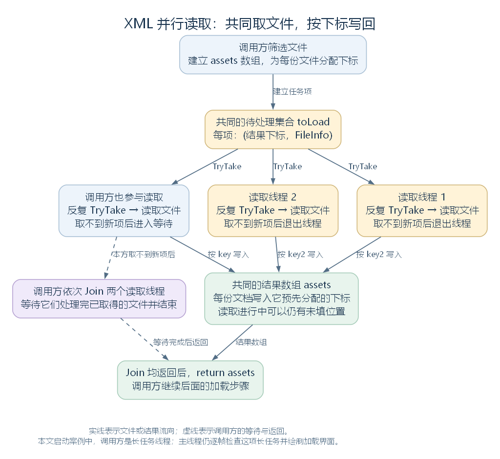
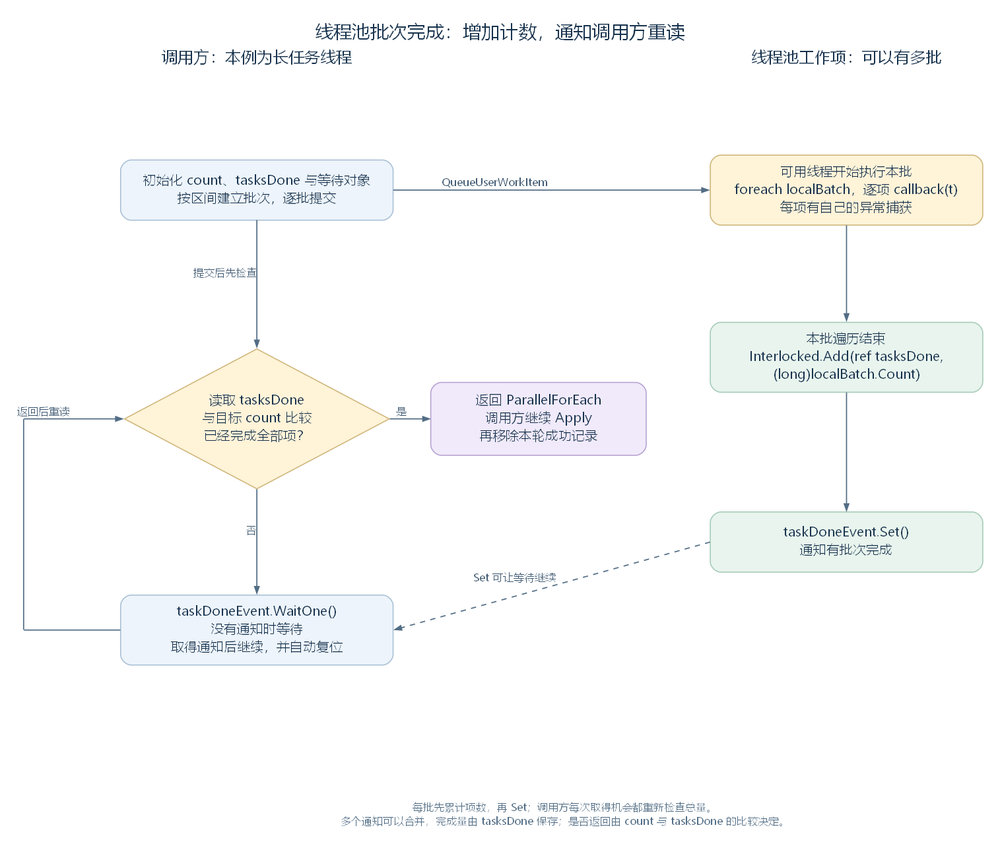
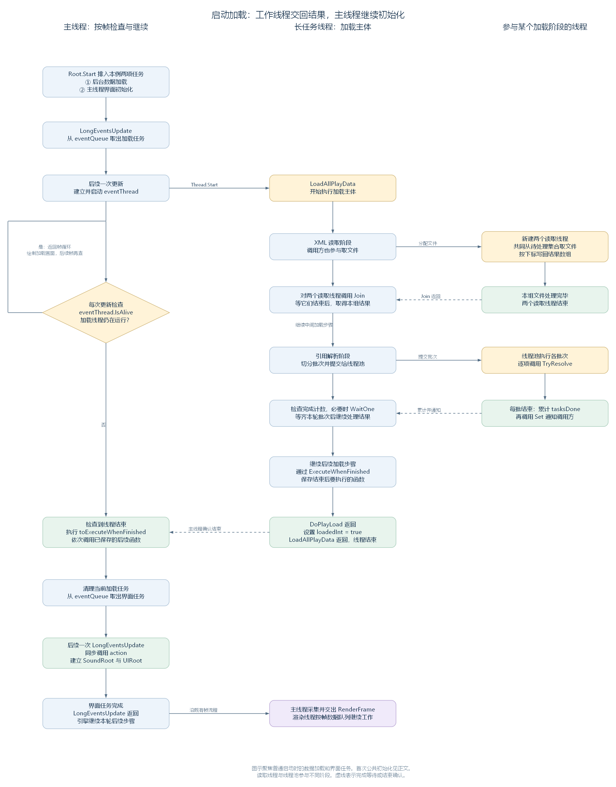

# 长任务与线程协作：工作怎样排队、执行和交回

版本：发布版 v1.0｜定稿日期：2026-11-11

自动存档时，游戏会先停住模拟，让存档提示有机会绘制，再由主线程执行保存。启动加载时，主线程能在后台加载数据的同时继续绘制加载界面。两条流程都由 `LongEventHandler` 安排。本文依据 RimWorld 1.7.4982 rev1280 的代码，沿原版的普通存档和启动路径展开。

## 一、长任务运行总览

需要安排的工作通过 `QueueLongEvent` 入队。主线程在 `Root.Update` 中推进长任务，空闲时从队首选中一项，后续更新再开始执行。任务怎样交回控制，取决于入队时登记的方式。

| 模式 | 谁执行任务 | 主线程怎样继续 |
| --- | --- | --- |
| 同步 | 主线程直接调用任务函数 | 需要显示标准窗口时，先等绘制标记。执行主体后，当次更新接着收尾 |
| 异步 | 长任务线程执行任务函数 | 主线程回到帧循环，后续检查线程是否结束，按需再等场景操作 |
| 迭代器 | 主线程调用同一个迭代器的 `MoveNext` | 达到本轮时间限制时先返回，后续更新接着推进。迭代结束后收尾 |



## 二、任务怎样入队、选中并影响游戏更新

### 2.1 一条任务记录保存什么

`eventQueue` 保存待执行的记录，`currentEvent` 指向当前选中的一项。一条记录包括执行主体、提示设置和任务结束时要调用的函数。管理器还在 `toExecuteWhenFinished` 中保存各处登记的后续函数。

| 记录成员 | 在流程中的作用 |
| --- | --- |
| `eventAction`、`eventActionEnumerator` | 前者保存可直接调用的无参函数 `Action`，后者保存能从上次停下的位置继续的迭代器 |
| `doAsynchronously` | 决定一个 `Action` 由主线程还是长任务线程执行 |
| `eventTextKey`、`eventText` | 分别保存提示文字的翻译键和当前要显示的文字 |
| `canEverUseStandardWindow`、`alreadyDisplayed` | 分别记录入队时能否用标准窗口，以及提示内容是否已走到绘制阶段 |
| `levelToLoad` | 按需指定任务主体结束后要切换的场景 |
| `exceptionHandler`、`callback` | 分别保存该任务自己的异常处理函数和完成函数 |

登记迭代器任务时，管理器通过传入对象的 `GetEnumerator` 取得迭代器。登记时也会查看当前任务和队列。只要其中有一项的 `UseStandardWindow` 为假，新任务的 `canEverUseStandardWindow` 就会设为假。这个状态保存在记录里，前面的任务结束后，后面的任务仍会用登记时保存的值。

### 2.2 主线程何时取出下一项

`LongEventsUpdate` 先检查当前任务并推进它。迭代器优先进入迭代器分支，普通函数则根据异步标记选择执行方式。当前项清空后，方法可以在同一次调用中取出下一项。`sceneChanged` 是传回 `Root.Update` 的标记，同步任务发出场景切换请求时会设置它。

```csharp
public static void LongEventsUpdate(out bool sceneChanged)
{
    sceneChanged = false;
    if (LongEventHandler.currentEvent != null)
    {
        if (LongEventHandler.currentEvent.eventActionEnumerator != null)
        {
            LongEventHandler.UpdateCurrentEnumeratorEvent();
        }
        else if (LongEventHandler.currentEvent.doAsynchronously)
        {
            LongEventHandler.UpdateCurrentAsynchronousEvent();
        }
        else
        {
            LongEventHandler.UpdateCurrentSynchronousEvent(out sceneChanged);
        }
    }
    if (LongEventHandler.currentEvent == null && LongEventHandler.eventQueue.Count > 0)
    {
        LongEventHandler.currentEvent = LongEventHandler.eventQueue.Dequeue();
        if (LongEventHandler.currentEvent.eventTextKey == null)
        {
            LongEventHandler.currentEvent.eventText = "";
            return;
        }
        LongEventHandler.currentEvent.eventText = LongEventHandler.currentEvent.eventTextKey.Translate();
    }
}
```

新取出的任务在这里成为 `currentEvent`。提示文字由翻译键生成，未提供翻译键时先用空字符串。它要到下一次 `LongEventsUpdate` 才会进入上半段的执行分支。

### 2.3 等待任务时，游戏哪些更新还会继续

当前或队列中有长任务时，游玩中的 `TickManager` 会通过 `ForcePause` 暂停模拟。`Root` 另用 `ShouldWaitForEvent` 判断能否继续普通的界面、声音和游玩更新。

| 长任务期间的状态 | 游戏怎样处理 |
| --- | --- |
| 普通界面已就绪，只有排队任务，当前项为空 | 暂停模拟，普通帧级更新可以继续 |
| 普通界面已就绪，当前任务允许标准窗口 | 暂停模拟，长任务提示可以叠在普通界面上 |
| 当前任务走独立加载画面，或普通界面尚未就绪 | 暂停模拟，跳过相应的普通更新，由长任务界面处理提示 |

绘制长任务提示时，`LongEventsOnGUI` 会检查任务能否使用标准窗口，也会检查普通界面的入口和窗口栈是否已经建立。这就能解释为什么游玩中的存档提示可以叠在地图画面上，而启动时可以先显示独立的加载画面。

## 三、三种长任务怎样运行

常见的原版调用见[文末用例表](#原版长任务用例)。

### 3.1 同步任务在主线程直接执行

当前任务是同步函数、登记时允许用标准窗口，而且已有提示文字时，`ShouldWaitUntilDisplayed` 会检查 `alreadyDisplayed`。需要等待时，同步分支先返回，保留当前任务。提示内容的绘制函数遇到 `repaint`，也就是界面重绘时，会把 `alreadyDisplayed` 设为真。主线程在后续更新里重新检查。

通过检查后，主线程直接调用非空的 `eventAction`，等函数返回再继续。指定了场景时，管理器调用 `LoadScene` 登记请求，并把 `sceneChanged` 设为真。`Root.Update` 据此结束当前入口的普通更新，实际切换由后续 `UnityRuntime.Step` 处理。

正常收尾时，管理器先保存任务的 `callback`，再清空当前任务及线程、场景操作引用。随后依次执行公共的后续函数列表和这项任务自己的 `callback`。主体抛出异常时，管理器记录错误，在当前记录仍存在时调用其中登记的异常处理函数，再进入异常清理。



### 3.2 异步任务由长任务线程执行

第一次推进异步任务时，`eventThread` 还为空。主线程建立线程，让它通过 `RunEventFromAnotherThread` 执行 `currentEvent.eventAction`。这个线程入口也负责处理主体抛出的异常。调用 `Start` 后，主线程本次更新先返回。

```csharp
if (LongEventHandler.eventThread == null)
{
    LongEventHandler.eventThread = new Thread(delegate
    {
        LongEventHandler.RunEventFromAnotherThread(LongEventHandler.currentEvent.eventAction);
    });
    LongEventHandler.eventThread.Start();
    return;
}
```

后续更新通过 `eventThread.IsAlive` 检查线程状态。线程还在运行时，主线程返回帧循环，加载画面仍有机会绘制。线程结束后，如果任务指定了场景，主线程调用 `LoadSceneAsync`，把返回的操作保存到 `levelLoadOp`。之后的 `UnityRuntime.Step` 处理场景请求，主线程再等到 `levelLoadOp.isDone` 为真。直接以线程结束为完成条件的任务可以立即进入收尾。

异步分支正常收尾时，主线程先执行公共的后续函数列表，再调用当前任务的 `callback`，最后清空任务、线程与场景操作引用。



### 3.3 迭代器任务在主线程分段执行

管理器在入队时保存一个 `IEnumerator`。后续每次推进都在同一个对象上调用 `MoveNext`。返回真表示推进到下一项，返回假表示已经迭代完。任务用 `yield return` 分段时，下一次调用会从上次停下的位置接着走。

每次进入迭代器分支，局部变量 `num` 记录本次调用的截止时间。它等于 `Time.realtimeSinceStartup` 的当前读数加 0.1 秒。该属性以秒为单位读取启动后实际经过的时间。下面保留推进和时间检查的部分。

```csharp
float num = Time.realtimeSinceStartup + 0.1f;
while (LongEventHandler.currentEvent.eventActionEnumerator.MoveNext())
{
    if (num <= Time.realtimeSinceStartup)
    {
        return;
    }
}
```

假设每段耗时 45 毫秒，头两段分别在约 45 和 90 毫秒时返回，可以继续。第三段约在 135 毫秒时返回，届时管理器才检查到超时，保留当前任务并结束本次推进。因此，一次更新可以执行多段，时间检查总在一段工作交回控制之后。后续更新会重新计算截止时间。

当迭代结束时，管理器按需调用 `Dispose` 清理迭代器，保存 `callback` 并清空当前引用，再依次执行后续函数列表与任务的 `callback`。发生异常时也会尝试清理迭代器，并调用任务登记的异常处理函数。



## 四、自动存档从模拟步接到主线程保存

**任务类型　同步长任务**

以游玩中一次普通自动存档为例，假设普通界面已经可用，队列里也没有其他长任务。存档主体由主线程执行，前面的登记、选中和提示绘制可以分布在多次调用中。

### 4.1 达到存档间隔，登记任务并暂停模拟

`DoSingleTick` 接近结束时调用 `AutosaverTick`，增加自动存档计数 `ticksSinceSave`。达到存档间隔且当前允许保存时，它把 `DoAutosave` 登记为任务并清零计数。`Autosaving` 是提示文字的翻译键，第三个参数 `doAsynchronously` 传入 `false`，选择同步模式。两处 `null` 分别对应任务自己的异常处理函数和完成函数，另两个布尔值沿用默认的界面设置。

```csharp
LongEventHandler.QueueLongEvent(new Action(this.DoAutosave), "Autosaving", false, null, true, false, null);
```

任务入队就会触发 `ForcePause`。当前 tick 先执行完，`TickManagerUpdate` 在这一步返回后检查暂停，结束本帧的模拟循环。之后的 `Root.Update` 才会从队首选中存档任务，准备提示文字。

### 4.2 等待提示绘制

本例可以使用标准窗口。`Root.OnGUI` 会调用 `LongEventsOnGUI` 来安排存档提示。内容绘制处理到 `repaint` 时写入 `alreadyDisplayed`，之后的 `Root.Update` 就能通过第 3.1 节的等待条件。如果推进检查先到，当前任务继续留到后续更新。



### 4.3 主线程执行保存，再恢复模拟

通过显示检查后，主线程直接调用 `DoAutosave`，由它选定名称并调用 `SaveGame`。保存函数返回后，管理器清理当前任务并处理待执行的后续函数。当前和队列都空下来时，长任务要求的暂停解除。游戏接着按玩家选择的速度和其他暂停条件判断是否继续推进 tick。

## 五、启动资源加载从后台执行接回主线程

**任务类型　异步长任务，随后执行同步的界面初始化**

普通启动会用一项异步长任务加载数据。文件读取和引用解析还会把部分计算交给其他线程，结果先交回加载线程。加载线程退出后，主线程接着执行准备工作，再处理排在后面的同步界面任务。

### 5.1 排入启动任务并更新加载提示

首次 `Root.Start` 先执行公共初始化，其中登记了一项调用静态构造函数的同步任务。随后 `Root.Start` 把界面和声音初始化函数保存到局部变量 `action`。如果 `PlayDataLoader.Loaded` 为假，再按以下顺序登记两项任务。

`LoadAllPlayData(false)` 的参数 `recovering` 为假，表示从普通加载路径开始。前一项没有初始翻译键，第三个参数为真，选择异步执行。后一项用 `InitializingInterface` 作为翻译键，第三个参数为假，选择同步执行。

```csharp
LongEventHandler.QueueLongEvent(delegate
{
    PlayDataLoader.LoadAllPlayData(false);
}, null, true, null, true, false, null);
LongEventHandler.QueueLongEvent(action, "InitializingInterface", false, null, true, false, null);
```

主线程从队列选中加载任务后，按照异步模式启动线程。加载线程用 `SetCurrentEventText` 更新提示文字，主线程绘制时通过同一把锁读取。此时主线程逐帧检查 `IsAlive`，加载线程则继续下面的数据处理。

### 5.2 多个线程共同读取 XML

加载补丁时，`DirectXmlLoader.XmlAssetsInModFolder` 先按目录优先级选出 XML 文件，再给每个文件分配结果数组的下标。有文件可读时，加载线程启动两条读取线程。三者从同一个待领取集合取文件，把文件来源和读出的 XML 文档存在 `LoadableXmlAsset` 中，再按下标写回结果数组。因此，即使后一个文件先读完，它也会写到自己对应的位置。



加载线程取不到下一项后，仍可能有文件在其他线程手上。它对两条读取线程调用 `Join`，等两条线程都结束，再把结果数组交给后续加载步骤。

### 5.3 把定义引用分批解析，再处理结果

建立定义后，`DirectXmlCrossRefLoader` 还需要把待连接记录交给 `GenThreading.ParallelForEach`。它把列表切成若干批，提交给线程池。每批内部逐项执行 `TryResolve`，解析成功的记录在锁保护下加入 `resolvedRefs`。

批次处理完后，工作线程用 `Interlocked.Add` 把本批 `localBatch` 的项数加到共享计数 `tasksDone`，然后通过 `taskDoneEvent` 通知加载线程。计数按批累加，也包含解析失败的尝试。成功解析的记录由 `resolvedRefs` 保存。

```csharp
Interlocked.Add(ref tasksDone, (long)localBatch.Count);
taskDoneEvent.Set();
```

提交后，加载线程先将 `tasksDone` 和总项数 `count` 比较，未完成时调用 `WaitOne` 等通知。每次醒来都重新读取计数。即使多次通知合并，也能从累计值判断是否处理完。计数达到目标后，加载线程接着应用成功的解析结果并移除本轮已解决的记录。



### 5.4 登记加载完成后要做的工作

后台加载过程中还会调用 `ExecuteWhenFinished`，把语言数据补充、人物背景资料、材质和图集准备等函数加入 `toExecuteWhenFinished`。如果列表尚未开始执行，而且当前项为空或当前任务仍需等待提示绘制，调用者会立即执行列表。启动案例此时正在推进异步加载，所以登记的函数会留在列表里，等主线程接手。

列表按登记顺序执行，每次都会重新读取长度，所以某项函数执行期间追加的后续函数也能在这一轮得到执行机会。

### 5.5 主线程收尾并初始化界面

普通加载成功时，`LoadAllPlayData` 在数据处理完成后将 `loadedInt` 设为真，供 `PlayDataLoader.Loaded` 读取，随后长任务线程退出。主线程检查到线程结束，先执行登记好的后续函数，再清空当前加载任务并选中界面任务。

界面任务入队时，异步加载还在它前面，所以界面任务的 `canEverUseStandardWindow` 为假。下一次 `LongEventsUpdate` 可以直接通过显示检查，执行 `Root.Start` 保存的 `action`。主线程建立 `SoundRoot` 和当前场景对应的 `UIRoot`，然后初始化界面以及已有的子相机控制组件。



| 等待什么 | 谁等待和接着做什么 |
| --- | --- |
| 两条 XML 读取线程结束 | 加载线程调用 `Join`，等齐后交回文件结果 |
| 引用解析达到目标项数 | 加载线程按计数等待，随后应用成功的解析结果 |
| 整个加载线程结束 | 主线程在各帧检查 `IsAlive`，结束后执行后续函数并推进任务队列 |
| 界面任务前面的加载任务收尾 | 界面任务留在队列里，等主线程取出，后续更新再开始初始化 |

引擎会在 `OnUpdate` 之前执行主线程队列中的函数。这里的加载后续函数则在 `OnUpdate` 进入组件更新之后，由 `Root.Update` 的长任务完成检查调用。

## 原版长任务用例

| 模式 | 游戏中的用例 | 排入队列的工作 |
| --- | --- | --- |
| 同步 | 自动存档 | 达到存档间隔且允许保存时登记 `DoAutosave`。完整流程见第 4 节。 |
| 同步 | 存档窗口里的手动保存 | 存档窗口把 `SaveGame` 加入队列。 |
| 同步 | 启动时初始化界面和声音 | 启动数据加载之后，由主线程建立声音和界面入口。完整流程见第 5 节。 |
| 同步 | 远行队抵达尚未生成地图的任务地点 | 主线程生成地点地图，再让远行队进入。地图已存在时，抵达处理直接执行。 |
| 同步 | 远行队在世界地图上遭遇伏击 | 事件先生成敌人，再排队建立遭遇地图并安排双方入场。 |
| 同步 | 重力飞船降落到需要生成地图的地块 | 同步任务调用 `ArriveNewMap`，生成地图并处理飞船抵达。 |
| 同步 | 读档或开局后的画面淡入 | 地图准备后，主线程执行排队的同步函数，将画面设为黑色并启动 0.5 秒的淡入。淡入随后随画面更新。 |
| 异步 | 启动时加载游戏数据 | 长任务线程执行 `LoadAllPlayData`。完整流程见第 5 节。 |
| 异步 | 新开局时生成世界 | 长任务线程按玩家选定的参数生成世界。 |
| 异步 | 从存档恢复游戏 | 进入 Play 场景后，读取和恢复存档交给长任务线程。 |
| 异步 | 远行队在空地块建立殖民地 | 先排入地图生成，再排入远行队入场与镜头跳转，两项依次执行。 |
| 异步 | 远行队扎营 | 生成营地地图和让远行队入场由同一项异步任务执行。 |
| 异步 | 切换游戏语言 | 更新语言设置后，在后台清除并重新加载游戏数据。 |
| 异步 | 返回主菜单 | 后台清理地图和世界，主体结束后由主线程请求切换到 `Entry` 场景。 |
| 迭代器 | 重建世界地图的地形绘制层 | 可见的星球层有待重建的地形绘制层时，重建会分段推进。新殖民地任务打开物品选择窗口前，也会调用这一检查。 |
| 迭代器 | 运行开发者工具中的游戏内感染模拟 | 模拟过程以 `IEnumerable` 入队，由主线程分次调用 `MoveNext`。 |

飞船降落和远行队扎营都用 `GeneratingMap` 作为提示文字的翻译键。登记时，两处的 `doAsynchronously` 分别是 `false` 和 `true`。

---

各模式的完整方法、异常分支和源码位置见[完整解析版](article.md)。

下一章继续看迭代器如何在不同帧阶段等待和推进。[协程章](../06-coroutines/README.md)
