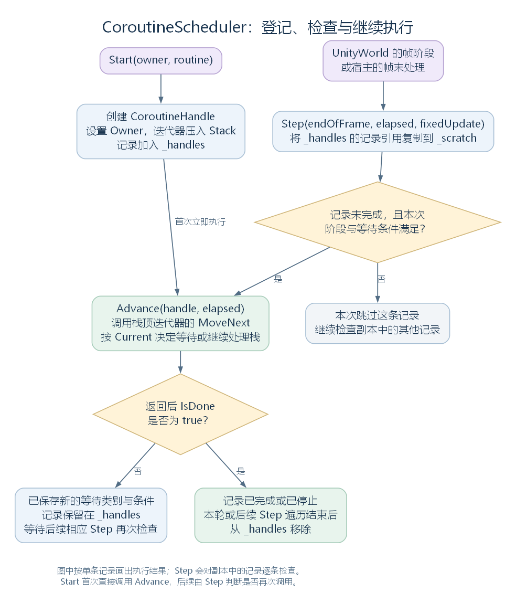
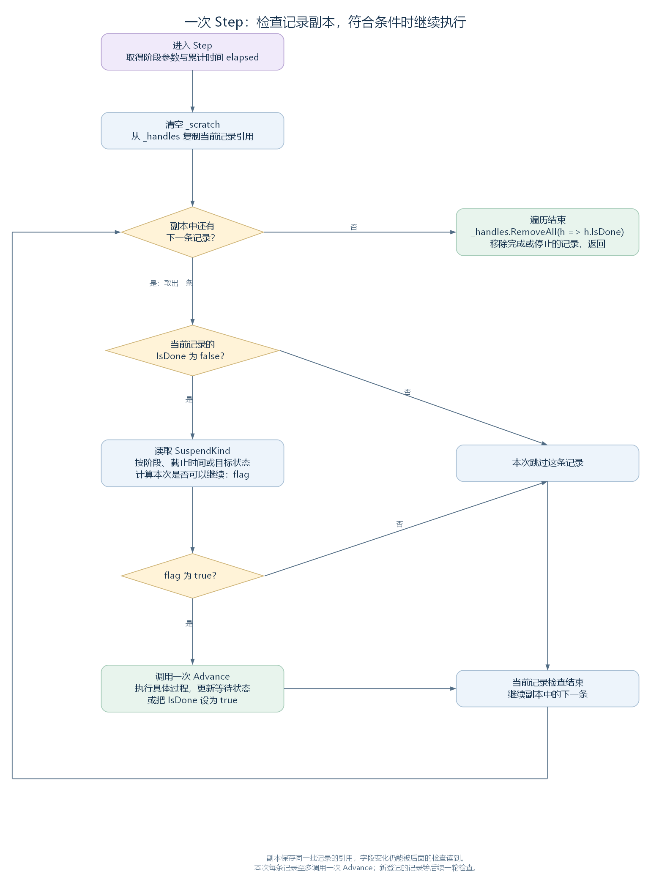
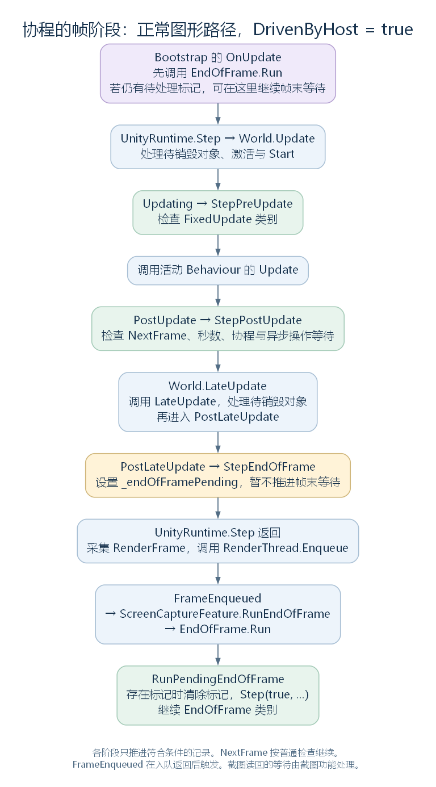
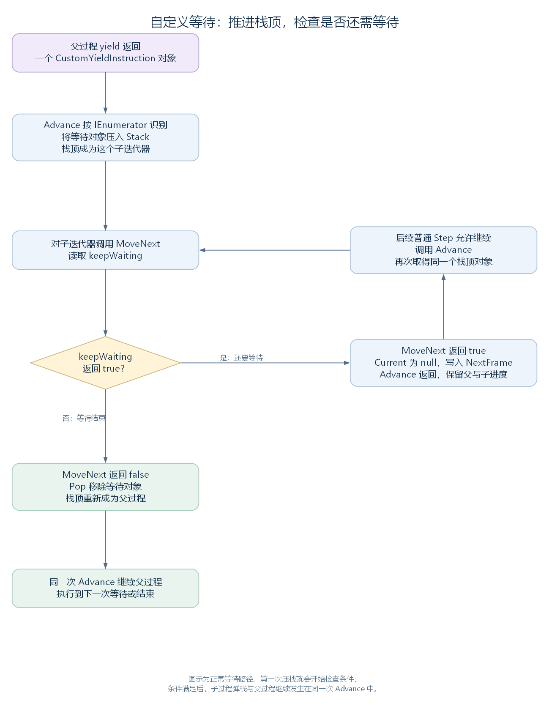

# 协程怎样分段执行：从保存进度到等待与结束

版本：整合草稿 v0.1｜整理日期：2026-11-07

一段代码可以先执行一部分，遇到指定条件时交回控制，稍后再接着执行。当前兼容层通过 IEnumerator 保存进度，再由 CoroutineScheduler 依据帧阶段、时间和目标状态安排下一次执行。

本文依据 RimWorld 1.7.4982 rev1280 的兼容层实现。源码保持原名，教学方法与变量另行注明。

## 协程运行总览

调用者把一个 `IEnumerator` 交给 `CoroutineScheduler`。迭代器保存代码执行到了哪里，管理器用 `CoroutineHandle` 保存所属对象、迭代器栈以及再次执行的条件。首次推进在调用者所在的线程上执行，后续推进沿主线程的帧阶段进行。每次推进都从栈顶开始，直到需要等待或整个过程结束。

| 环节 | 主要处理过程 | 完成后的结果 |
| --- | --- | --- |
| 登记并首次执行 | `Start` 建立记录，把迭代器压入栈，再立即调用 `Advance` | `StartCoroutine` 返回前已经执行第一段 |
| 处理返回值 | `Advance` 读取 `yield` 返回的对象。子迭代器可以压栈继续执行，等待指令则留下阶段、截止时间或目标状态 | 保存下一次继续所需的进度和条件 |
| 检查并恢复 | `Step` 在组件更新前、组件更新后或帧末检查对应的等待。条件满足时再次调用 `Advance` | 协程接着执行，直到下一次等待或结束 |
| 清理结束记录 | 自然完成或主动停止都会标记 `IsDone`。`Step` 跳过这些记录，并在检查完后移除 | 记录退出管理列表 |



[SVG](../../figures/coroutinescheduler-overview.svg) · [图源](../../figures/coroutinescheduler-overview.dot)

例如，协程返回半秒等待时，管理器先记下截止时间。后续 `PostUpdate` 的普通检查读到时间已到，才调用 `Advance` 继续执行等待后的语句。自定义条件也能沿这条流程检查，条件满足后弹出对应的子迭代器，接着执行父过程。

## 一、取得执行进度，再交给管理器

C# 迭代器方法在被调用时返回保存状态的对象。之后调用 IEnumerator.MoveNext，才继续执行到下一次 yield 或结束；返回 true 时，Current 提供本次返回对象；返回 false 表示这一层迭代结束。

下面是 MonoBehaviour 派生组件中的教学实例方法，名称为本例自行命名。null 交回本次执行，WaitForSeconds(0.5f) 提出半秒等待；具体检查过程随后展开：

```csharp
private IEnumerator Example()
{
    Log.Message("A");
    yield return null;
    Log.Message("B");
    yield return new WaitForSeconds(0.5f);
    Log.Message("C");
}
```

同一组件中，另一段代码可以这样启动它。`routine` 是 `Example()` 返回的迭代器，`coroutine` 保存 `StartCoroutine` 返回的对象，后面可以用它等待或停止这条协程。

```csharp
IEnumerator routine = Example();
Log.Message("登记前");
Coroutine coroutine = StartCoroutine(routine);
Log.Message("登记后");
```

第一行取得 routine，尚未输出 A。StartCoroutine 会在返回前先推进一次，所以调用者先看到“登记前 → A → 登记后”。B、C 留在保存的进度后面，由后续条件检查安排。

## 二、用管理记录保存归属与等待状态

routine 是 IEnumerator，保存具体过程执行到了哪里；CoroutineHandle 是内部管理记录，保存接下来等待什么；Coroutine 则是返回给调用者的对象，引用该记录。

Coroutine 的完整类体如下，删除反编译标记注释。YieldInstruction 是空基类：

```csharp
public class Coroutine : YieldInstruction
{
    internal CoroutineHandle Handle;
}
```

CoroutineHandle 的完整字段如下：

```csharp
internal sealed class CoroutineHandle
{
    internal readonly Stack<IEnumerator> Stack = new Stack<IEnumerator>();
    internal CoroutineSuspendKind SuspendKind;
    internal float ResumeTime;
    internal CoroutineHandle AwaitedHandle;
    internal AsyncOperation AwaitedOperation;
    internal bool IsDone;
    internal object Owner;
}
```

| 字段 | 怎样使用 |
| --- | --- |
| Owner | 所属对象；从 MonoBehaviour.StartCoroutine 进入时为当前组件，供 StopAll 匹配 |
| Stack | 迭代器栈，栈顶是当前应继续的过程 |
| SuspendKind | 当前等待类别，类型为 CoroutineSuspendKind |
| ResumeTime | 等待秒数使用的累计时间截止值 |
| AwaitedHandle、AwaitedOperation | 等待中的另一条协程记录或异步操作 |
| IsDone | 已完成或已停止，供后续跳过与列表清理 |

CoroutineSuspendKind 包含 NextFrame、FixedUpdate、EndOfFrame、WaitSeconds、AwaitCoroutine、AwaitOperation。迭代器保存进度，记录保存恢复条件，两者共同保留一次等待所需的状态。

静态管理器还保存四个共同字段：_handles 是登记记录列表，_scratch 是本次检查使用的记录引用副本，_subscribed 标记是否已经连接帧阶段，_endOfFramePending 标记是否有一轮帧末检查待执行。

源码定位：返回对象与记录（`UnityEngine.Coroutine.cs:6`、`UnityEngine.CoroutineHandle.cs:8`）、等待类别（`UnityEngine.CoroutineSuspendKind.cs:6`）、管理字段（`UnityEngine.CoroutineScheduler.cs:271`）。

## 三、登记记录，并立即推进第一段

`MonoBehaviour.StartCoroutine` 接收 `routine`，把当前组件 `this` 作为 `owner` 传给管理器。局部变量 `coroutineHandle` 保存返回的内部记录，再通过 `Handle` 放进交给调用者的 `Coroutine` 对象。

```csharp
public Coroutine StartCoroutine(IEnumerator routine)
{
    CoroutineHandle coroutineHandle = CoroutineScheduler.Start(this, routine);
    return new Coroutine
    {
        Handle = coroutineHandle
    };
}
```

Start 先尝试连接帧阶段，再建立 coroutineHandle，压入 routine、加入列表，立即调用 Advance：

```csharp
internal static CoroutineHandle Start(object owner, IEnumerator routine)
{
    CoroutineScheduler.EnsureSubscribed();
    CoroutineHandle coroutineHandle = new CoroutineHandle
    {
        Owner = owner
    };
    coroutineHandle.Stack.Push(routine);
    CoroutineScheduler._handles.Add(coroutineHandle);
    CoroutineScheduler.Advance(coroutineHandle, Time.time);
    return coroutineHandle;
}
```

`StartCoroutine` 返回以前，首次 `Advance` 已经执行到需要交回调度的位置。这一步也可能顺势执行子迭代器，或直接运行到整个协程结束。`Time.time` 提供这次推进使用的本帧累计时间。

### 把后续检查登记到 World

EnsureSubscribed 取得 UnityRuntime.Current.World，向三个事件登记函数，成功后设置 _subscribed。下面是登记关系的等价写法：原文的 unityWorld2、unityWorld3、unityWorld4 都引用 unityWorld；action、action2、action3 保存对应方法的委托，此处直接写出方法名，省略缓存代码：

```csharp
unityWorld.Updating += CoroutineScheduler.StepPreUpdate;
unityWorld.PostUpdate += CoroutineScheduler.StepPostUpdate;
unityWorld.PostLateUpdate += CoroutineScheduler.StepEndOfFrame;
CoroutineScheduler._subscribed = true;
```

| World 事件 | 登记的方法 | 后续用途 |
| --- | --- | --- |
| Updating | StepPreUpdate | 检查 FixedUpdate 类别 |
| PostUpdate | StepPostUpdate | 普通等待检查 |
| PostLateUpdate | StepEndOfFrame | 执行帧末检查，或先留下待处理标记 |

如果首次启动协程时还没有 `World`，`Start` 仍会建立记录并推进一次。等以后再有 `Start` 调用时，管理器会重新尝试订阅。订阅成功后，已有记录才能随相应帧阶段继续。

源码定位：启动与立即推进（`UnityEngine.CoroutineScheduler.cs:15`）、登记（`UnityEngine.CoroutineScheduler.cs:50`）、组件包装入口（`UnityEngine.MonoBehaviour.cs:19`）。

## 四、执行栈顶过程，保存下一次等待

Advance 围绕 handle.Stack 循环。handle 是当前记录，enumerator 是 Peek 取得的栈顶 IEnumerator，flag 保存 MoveNext 的返回结果，obj 保存 Current。

MoveNext 返回 false 时弹出这一层；返回 true 时读取返回对象，保存等待状态或继续处理栈。下面是 MoveNext 及其异常处理之后的连续节选：

```csharp
if (!flag)
{
    handle.Stack.Pop();
    continue;
}
object obj = enumerator.Current;
if (obj == null)
{
    handle.SuspendKind = CoroutineSuspendKind.NextFrame;
    return;
}
```

第一节的 `Example` 先输出 A，`Current` 为 `null`，于是记录 `NextFrame` 并返回，`routine` 仍在栈中。下一次推进从 `yield` 后面继续。栈全部清空后，`Advance` 将 `IsDone` 设为 `true`。如果 `MoveNext` 抛出异常，`catch` 会记录错误并标记结束。读取 `Current` 在这段 `try` 之后，属性读取抛出的异常会传给外层调用者。

### 4.1 先压入子过程，再继续父过程

返回对象也可以是另一个 IEnumerator。Advance 在处理已支持的等待对象之后，进入下列判断；enumerator2 是把 obj 转成 IEnumerator 的结果：

```csharp
IEnumerator enumerator2 = obj as IEnumerator;
if (enumerator2 == null)
{
    handle.SuspendKind = CoroutineSuspendKind.NextFrame;
    return;
}
handle.Stack.Push(enumerator2);
continue;
```

识别成功后，子过程压栈，同一次 Advance 立即继续推进它。子过程结束后弹出，栈顶重新成为父过程，再沿父过程的进度继续。

下面仍是教学实例方法，名称为本例自行命名：

```csharp
private IEnumerator Outer()
{
    Log.Message("父：开始");
    yield return Inner();
    Log.Message("父：结束");
}

private IEnumerator Inner()
{
    Log.Message("子：开始");
    yield return null;
    Log.Message("子：结束");
}
```

| 时点 | 输出与处理 | 栈底 → 栈顶 |
| --- | --- | --- |
| 首次推进父过程 | 输出“父：开始”，返回 Inner | Outer |
| 同次推进子过程 | 压入 Inner，输出“子：开始”，遇到 null | Outer → Inner |
| 保存等待返回 | 记录 NextFrame，保留两层进度 | Outer → Inner |
| 后续符合条件的推进 | 输出“子：结束”，弹出 Inner；继续输出“父：结束” | Outer，随后为空 |

这个例子建立一条记录，两个迭代器共用它的栈。子过程暂停时，父过程的剩余进度继续保留。

### 4.2 根据返回对象写入等待条件

| Current 返回什么 | Advance 的主要处理 |
| --- | --- |
| null | 写入 NextFrame，返回 |
| WaitForFixedUpdate | 写入 FixedUpdate，返回 |
| WaitForEndOfFrame | 写入 EndOfFrame，返回 |
| WaitForSeconds | 写入 WaitSeconds 与截止时间，返回 |
| 尚未完成的 Coroutine | 保存 AwaitedHandle，写入 AwaitCoroutine，返回 |
| Handle 为空或已完成的 Coroutine | 继续当前 Advance 循环 |
| 尚未完成的 AsyncOperation | 保存 AwaitedOperation，写入 AwaitOperation，返回 |
| 已完成的 AsyncOperation | 保存操作引用，写入 NextFrame，返回 |
| 其他 IEnumerator | 压栈并继续推进 |
| 其他未识别对象 | 写入 NextFrame，返回 |

源码定位：栈循环、异常与完成（`UnityEngine.CoroutineScheduler.cs:188`）、等待对象分类（`UnityEngine.CoroutineScheduler.cs:213`）、子过程压栈（`UnityEngine.CoroutineScheduler.cs:246`）。

## 五、在帧阶段检查哪些记录可以继续

Step 接收 endOfFrame、elapsed、fixedUpdate 三个参数：分别表示是否检查帧末类别、本次累计时间，以及是否检查 FixedUpdate 类别。fixedUpdate 默认 false。

`UnityWorld.Update` 先处理待销毁、激活与 `Start`，再依次调用 `Updating`、活动组件的 `Update` 和 `PostUpdate`。这里的 `frame` 是本次传入的 `UnityFrame`，`frame.ElapsedTime` 保存引擎传来的本帧累计时间。两个阶段传入的布尔值决定要检查哪类等待。

```csharp
private static void StepPreUpdate(UnityFrame frame)
{
    CoroutineScheduler.Step(false, frame.ElapsedTime, true);
}

private static void StepPostUpdate(UnityFrame frame)
{
    CoroutineScheduler.Step(false, frame.ElapsedTime, false);
}
```

下文把两个阶段布尔参数都为 false 的情况称为普通检查。一次 Step 清空 _scratch，从 _handles 复制记录引用，再逐项判断；符合条件时调用一次 Advance，最后移除 IsDone 记录。

`WaitForFixedUpdate` 在此版本接到每次 `World.Update` 中的 `Updating`，也就是组件 `Update` 前的那一次检查。即使随后 `TickManager` 在这一帧执行多个模拟步，该阶段也只调用一次。

coroutineHandle 是当前记录，suspendKind 是它的等待类别，flag 表示本次是否能继续。IL_00C9 是反编译标签，各分支汇合到共同检查；末尾 h 是正在判断是否移除的记录：

```csharp
private static void Step(bool endOfFrame, float elapsed, bool fixedUpdate = false)
{
    CoroutineScheduler._scratch.Clear();
    CoroutineScheduler._scratch.AddRange(CoroutineScheduler._handles);
    foreach (CoroutineHandle coroutineHandle in CoroutineScheduler._scratch)
    {
        if (!coroutineHandle.IsDone)
        {
            CoroutineSuspendKind suspendKind = coroutineHandle.SuspendKind;
            bool flag;
            if (suspendKind != CoroutineSuspendKind.FixedUpdate)
            {
                if (fixedUpdate)
                {
                    flag = false;
                }
                else
                {
                    switch (suspendKind)
                    {
                    case CoroutineSuspendKind.NextFrame:
                        flag = !endOfFrame;
                        goto IL_00C9;
                    case CoroutineSuspendKind.EndOfFrame:
                        flag = endOfFrame;
                        goto IL_00C9;
                    case CoroutineSuspendKind.WaitSeconds:
                        flag = !endOfFrame && elapsed >= coroutineHandle.ResumeTime;
                        goto IL_00C9;
                    case CoroutineSuspendKind.AwaitCoroutine:
                        flag = !endOfFrame && (coroutineHandle.AwaitedHandle == null || coroutineHandle.AwaitedHandle.IsDone);
                        goto IL_00C9;
                    case CoroutineSuspendKind.AwaitOperation:
                        flag = !endOfFrame && coroutineHandle.AwaitedOperation.isDone;
                        goto IL_00C9;
                    }
                    flag = false;
                }
            }
            else
            {
                flag = fixedUpdate;
            }
            IL_00C9:
            if (flag)
            {
                CoroutineScheduler.Advance(coroutineHandle, elapsed);
            }
        }
    }
    CoroutineScheduler._handles.RemoveAll((CoroutineHandle h) => h.IsDone);
}
```



[SVG](../../figures/coroutine-step-wait-checks.svg) · [图源](../../figures/coroutine-step-wait-checks.dot)

| 等待类别 | 恢复条件 |
| --- | --- |
| FixedUpdate | fixedUpdate 为 true |
| NextFrame | 普通检查 |
| EndOfFrame | 非 FixedUpdate 检查，且 endOfFrame 为 true |
| WaitSeconds | 普通检查，elapsed 达到 ResumeTime |
| AwaitCoroutine | 普通检查，目标 Handle 为空或已经 IsDone |
| AwaitOperation | 普通检查，目标操作 isDone 为 true |

_scratch 保存同一批对象的引用，字段变化仍能被后面的检查读到；它确定了本次检查范围。执行期间新启动的协程仍会先立即推进，但其后续检查留待另一轮 Step。本次每条记录至多从这个 foreach 取得一次 Advance 调用。

源码定位：阶段入口（`UnityEngine.CoroutineScheduler.cs:87`、`UnityEngine.CoroutineScheduler.cs:93`）、完整检查（`UnityEngine.CoroutineScheduler.cs:134`）、World 顺序（`Waylith.UnityCompat.UnityWorld.cs:708`）。

## 六、把阶段、时间和完成状态对应到实际顺序

NextFrame 的判断没有保存或比较目标 FrameCount。因此，组件 Update 中启动并返回 null 的记录，可以在同帧稍后的 PostUpdate 继续。若在 Step 执行中启动，新记录的后续检查则等待另一轮普通阶段。

WaitForSeconds 保存 Seconds，Advance 以本次 elapsed 加上它，写入 ResumeTime：

```csharp
WaitForSeconds waitForSeconds = obj as WaitForSeconds;
if (waitForSeconds != null)
{
    handle.SuspendKind = CoroutineSuspendKind.WaitSeconds;
    handle.ResumeTime = elapsed + waitForSeconds.Seconds;
    return;
}
```

对第一节的 Example，假设组件在累计时间 100 秒的 Update 中启动：

| 时点 | 执行结果 | 留下什么 |
| --- | --- | --- |
| Update，100 秒 | 立即输出 A，返回 null | NextFrame |
| 同帧 PostUpdate，100 秒 | 输出 B，返回半秒等待 | WaitSeconds，ResumeTime = 100.5 |
| 后续 PostUpdate，100.3 秒 | 时间不足，跳过 | 保留原进度 |
| 首次达到截止值的 PostUpdate，例如 100.52 秒 | 输出 C，迭代结束 | IsDone，本轮末尾移除 |

`Start` 使用的 `Time.time` 和阶段函数使用的 `frame.ElapsedTime` 都来自 `UnityRuntime.Step` 收到的同一个引擎时间。它在一帧开头采样，在该帧的推进中复用。兼容层的 `timeScale` 读取时固定返回 1，写入时记录未实现提示。只要引擎仍在推进帧阶段，暂停游戏模拟期间也能达到秒数等待的截止值。

### 等待另一条记录时，按实际检查顺序继续

`AwaitedHandle` 指向的记录可能在本轮 `Step` 中结束。自然完成、显式停止和 `MoveNext` 异常都能把 `IsDone` 设为 `true`。由于副本仍保存同一批引用，排在后面的等待者可以读到更新后的标记。

| 本轮检查顺序 | 等待者何时继续 |
| --- | --- |
| 先处理目标，目标完成，再处理等待者 | 等待者可在同一轮继续 |
| 先处理等待者，目标仍未完成，随后目标完成 | 等待者在后续一轮再取得机会 |

AsyncOperation 的等待则在普通检查读取 isDone，操作本身由所属功能推进。已经完成的操作若被 yield 返回，Advance 仍写入 NextFrame；已经完成的 Coroutine 则会让当前 Advance 直接继续循环。具体顺序由返回对象的实际分支确定。

源码定位：截止值与目标保存（`UnityEngine.CoroutineScheduler.cs:229`、`UnityEngine.CoroutineScheduler.cs:239`、`UnityEngine.CoroutineScheduler.cs:257`）、完成条件（`UnityEngine.CoroutineScheduler.cs:160`）、时间来源（`UnityEngine.Time.cs:84`、`Waylith.UnityCompat.UnityTimeState.cs:55`）、timeScale（`UnityEngine.Time.cs:110`）。

## 七、把帧末等待接回引擎调用

`World.LateUpdate` 调用组件的 `LateUpdate`，再处理待销毁对象，随后进入 `PostLateUpdate`。管理器的 `StepEndOfFrame` 读取 `EndOfFrame.DrivenByHost`。为 `true` 时先设置待处理标记，稍后由引擎触发。为 `false` 时，当场检查帧末等待。

```csharp
private static void StepEndOfFrame(UnityFrame frame)
{
    if (EndOfFrame.DrivenByHost)
    {
        CoroutineScheduler._endOfFramePending = true;
        return;
    }
    CoroutineScheduler.Step(true, frame.ElapsedTime, false);
}
```

正常图形初始化中，Bootstrap 设置 DrivenByHost 为 true，并向 FrameEnqueued 登记函数。主线程将 RenderFrame 入队以后，事件经 ScreenCaptureFeature.RunEndOfFrame → EndOfFrame.Run，接到 RunPendingEndOfFrame。

后者看到标记后清除它，再调用 Step(true, Time.time, false)，等待 EndOfFrame 的记录便能继续。



[SVG](../../figures/monobehaviour-coroutine-stages.svg) · [图源](../../figures/monobehaviour-coroutine-stages.dot)

如果某一轮仍执行 `UnityRuntime.Step`，但因窗口最小化等条件跳过帧入队，待处理标记可能留到下一次 `OnUpdate`。`Bootstrap` 会在新的 `Step` 之前调用 `EndOfFrame.Run`，在这里补做检查。标记已经清除时，`RunPendingEndOfFrame` 直接返回。

常规 `Headless` 启动时，`Bootstrap` 跳过图形初始化，`DrivenByHost` 保持默认的 `false`，因此 `PostLateUpdate` 会直接执行帧末检查。

这些帧末入口都在主线程上运行。图形路径上的 `FrameEnqueued` 在帧入队返回后触发。`EndOfFrame.Run` 会先处理待保存的截图，再检查待继续的协程。截图读回可能在自己的流程中等待渲染线程和设备空闲。

源码定位：帧末标记与检查（`UnityEngine.CoroutineScheduler.cs:99`、`UnityEngine.CoroutineScheduler.cs:110`）、启动分支与入口（`RimWorldWaylith.Bootstrap.cs:85`、`RimWorldWaylith.Bootstrap.cs:112`、`RimWorldWaylith.Bootstrap.cs:351`）、入队事件（`Waylith.EngineApplication.cs:797`）、帧末连接与截图读回（`UnityStubs.EndOfFrame.cs:15`、`RimWorldWaylith.Rendering.ScreenCaptureFeature.cs:130`、`RimWorldWaylith.Rendering.ScreenCaptureFeature.cs:298`）。

## 八、把自定义条件放进迭代器栈

CustomYieldInstruction 实现 IEnumerator。派生类提供 keepWaiting，表示现在是否还需等待；基类让 MoveNext 返回这个值，Current 始终为 null。下面节选相关成员，省略 Reset：

```csharp
public abstract class CustomYieldInstruction : IEnumerator
{
    public abstract bool keepWaiting { get; }

    public object Current
    {
        get
        {
            return null;
        }
    }

    public bool MoveNext()
    {
        return this.keepWaiting;
    }
    // 省略 Reset。
}
```

父过程 yield 返回这个对象时，Advance 将它作为子迭代器压栈并立即检查。keepWaiting 为 true 时，MoveNext 返回 true、Current 为 null，于是留下 NextFrame；返回 false 时，弹出这层并继续父过程。



[SVG](../../figures/custom-yield-condition-loop.svg) · [图源](../../figures/custom-yield-condition-loop.dot)

### 8.1 用 WaitUntil 调用条件函数

WaitUntil 接收无参数、返回 bool 的 Func<bool>。predicate 保存到 _predicate，每次读取 keepWaiting 都重新调用它，并将结果取反：

```csharp
public class WaitUntil : CustomYieldInstruction
{
    public WaitUntil(Func<bool> predicate)
    {
        this._predicate = predicate;
    }

    public override bool keepWaiting
    {
        get
        {
            return !this._predicate();
        }
    }

    private readonly Func<bool> _predicate;
}
```

下面另用一个组件示例。`ready` 保存条件是否已满足，`WaitUntilReady` 是本例的协程方法。

```csharp
private bool ready;

private IEnumerator WaitUntilReady()
{
    Log.Message("开始等待");
    yield return new WaitUntil(() => ready);
    Log.Message("条件已满足");
}
```

`ready` 为 `false` 时，记录保留 `WaitUntilReady` 和 `WaitUntil` 两层进度。后续普通检查再次推进子迭代器。某段代码将 `ready` 改为 `true` 后，下一次检查返回 `false`，子迭代器弹栈，同次 `Advance` 输出“条件已满足”。若初次条件就满足，首次推进也能直接继续父过程。

### 8.2 用真实计时建立截止值

WaitForSecondsRealtime 也继承 CustomYieldInstruction。waitTime 是构造时保存的秒数；waitUntilTime 为私有截止值，初始 -1 表示尚未建立。flag 表示本次是否继续等待：

```csharp
public override bool keepWaiting
{
    get
    {
        if (this.waitUntilTime < 0f)
        {
            this.waitUntilTime = Time.realtimeSinceStartup + this.waitTime;
        }
        bool flag = Time.realtimeSinceStartup < this.waitUntilTime;
        if (!flag)
        {
            this.Reset();
        }
        return flag;
    }
}

public new void Reset()
{
    this.waitUntilTime = -1f;
}
```

一个两秒等待对象即使在真实计时 10 秒创建，到 20 秒才第一次检查时，建立的截止值仍是 22 秒。之后比较持续计时；到达时重置截止字段，结束子迭代器，再继续父过程。等待完成后重新使用该对象，首次检查可以建立新的截止值。

`Time.realtimeSinceStartup` 每次读取都从 `UnityTimeState` 保存的 `Stopwatch` 起点计算经过时间，在同一帧内也会更新。到时以后，代码仍需等管理器取得推进机会。`this.Reset()` 调用的是派生类通过 `new` 声明的方法，将截止值恢复为 `-1`。

源码定位：自定义迭代器（`UnityEngine.CustomYieldInstruction.cs:8`）、条件函数（`UnityEngine.WaitUntil.cs:6`）、真实计时等待（`UnityEngine.WaitForSecondsRealtime.cs:21`、`UnityEngine.WaitForSecondsRealtime.cs:39`）、持续计时（`Waylith.UnityCompat.UnityTimeState.cs:36`）。

## 九、停止记录，再追踪清理动作

`MonoBehaviour.StopCoroutine` 将传入 `Coroutine` 的 `Handle` 交给管理器。`StopAllCoroutines` 则将调用它的组件 `this` 作为 `owner`。下面的 `handle` 是指定记录，`coroutineHandle` 是遍历中的当前记录。

```csharp
internal static void Stop(CoroutineHandle handle)
{
    if (handle != null)
    {
        handle.IsDone = true;
    }
}

internal static void StopAll(object owner)
{
    foreach (CoroutineHandle coroutineHandle in CoroutineScheduler._handles)
    {
        if (coroutineHandle.Owner == owner)
        {
            coroutineHandle.IsDone = true;
        }
    }
}
```

停止接口设置 `IsDone`。`Step` 在选择下一条要推进的记录时会跳过已标记的项，遍历结束后将它从 `_handles` 移除。

如果协程在自己的代码里调用停止接口，已经进入的 `Advance` 仍按栈和返回对象继续处理。例如，标记自己结束后紧接着 `yield return Inner()`，`Inner` 仍会在这次 `Advance` 中压栈并开始执行。等这次 `Advance` 交回控制，后续的 `Step` 会根据 `IsDone` 跳过整条记录。

`StopAll` 按 `Owner` 匹配。例如组件 A 启动两条、B 启动一条，A 调用 `StopAllCoroutines` 后，只将 A 的两条记录标记结束。`Stop` 则只标记传入的那条记录。通过 `yield return` 压入的子迭代器共用这条记录，另行通过 `StartCoroutine` 启动的过程有自己的记录。

### 9.1 沿组件状态变化检查默认调用

| 动作 | World 默认处理 |
| --- | --- |
| enabled 设为 false | 修改 Enabled，刷新活动状态，原本活动的组件收到 OnDisable |
| GameObject.SetActive(false) | 修改 ActiveSelf，刷新自身及子对象的活动状态。由活动变为停用的 Behaviour 收到 OnDisable |
| 销毁组件或 GameObject | 处理销毁时，活动的 Behaviour 先走 OnDisable。每个被销毁的 Behaviour 都会进入 OnDestroy 的调用入口。World 随后移除对象登记并发出 ObjectDestroyed |

对已经在 `World` 登记的对象，普通的 `Destroy` 先将它列为待销毁对象，再由 `World` 在帧中处理。`UnityRuntime` 为 `ObjectDestroyed` 登记了 `Object.MarkDestroyed`，给兼容层对象写入销毁标记。`Step` 检查的是协程记录自己的 `IsDone` 和等待条件。

因此，沿本版本默认实现，组件停用或对象销毁以后，原记录仍可取得推进机会。具体脚本可以在 OnDisable、OnDestroy 中显式调用停止接口，将对象事件接到协程结束；分析实际行为时还需继续读脚本的方法。

### 9.2 从 finally 的输出观察结束路径

管理器自然弹栈时直接移除栈顶的引用。停止后的 `Step` 只从 `_handles` 移除记录，保留其 `Stack`。`_scratch` 的引用会留到下一次 `Step` 清空副本时，调用者保留的 `Coroutine` 也仍可引用原记录。

下面是教学实例方法，名称为本例自行命名：

```csharp
private IEnumerator WithCleanup()
{
    try
    {
        Log.Message("开始");
        yield return null;
        Log.Message("继续");
    }
    finally
    {
        Log.Message("清理");
    }
}
```

它已输出“开始”并停在 null 时，两条后续路径的结果为：

| 路径 | 输出 | 执行动作 |
| --- | --- | --- |
| 正常继续到结束 | 开始 → 继续 → 清理 | MoveNext 继续 try 剩余部分和 finally，再结束迭代 |
| 等待期间停止，再由 Step 移除 | 开始 | 跳过后续 MoveNext，移除时没有 Dispose |

自然结束时，finally 由迭代器自身的执行流程运行；已暂停记录的停止路径不会借由列表移除触发它。

自定义条件若在子迭代器 MoveNext 中抛出异常，也会进入 Advance 的 catch，记录错误并设置整条记录结束。仍停在栈中的父迭代器没有在这条路径中被显式 Dispose。

源码定位：停止接口（`UnityEngine.MonoBehaviour.cs:29`、`UnityEngine.MonoBehaviour.cs:35`、`UnityEngine.CoroutineScheduler.cs:29`）、移除与异常（`UnityEngine.CoroutineScheduler.cs:184`、`UnityEngine.CoroutineScheduler.cs:188`）、活动与销毁（`Waylith.UnityCompat.UnityWorld.cs:944`、`Waylith.UnityCompat.UnityWorld.cs:1112`）、销毁通知连接（`Waylith.UnityCompat.UnityRuntime.cs:55`）。

## 十、接回组件与游戏代码的启动入口

游戏工具类 Delay 会在需要时建立名为 CoroutineRunner 的 GameObject，并添加空的 MonoBehaviour 派生组件。随后通过这个组件调用继承的 StartCoroutine，内部进度仍由共同的 CoroutineScheduler 处理。

UnityWorld 还有一条入口：InvokeMessage 调用约定方法以后，检查返回值是否为 IEnumerator；取得迭代器时，通过 MessageCoroutineStarter 交给管理器。UnityRuntime 把这个函数登记为 CoroutineScheduler.Start(owner, routine)。因此，返回 IEnumerator 的约定方法也可以沿这一连接启动，例如迭代器形式的 Start。

由此，组件负责提供游戏代码的调用入口，IEnumerator 保存执行进度，CoroutineHandle 保存等待状态，帧阶段再让 Step 与 Advance 反复推进。一条记录最终沿自然完成、显式停止或异常结束，交给管理器清理。

源码定位：游戏工具类（`Delay.cs:10`、`Delay.cs:53`）、约定方法返回值（`Waylith.UnityCompat.UnityWorld.cs:1265`）、管理器连接（`Waylith.UnityCompat.UnityRuntime.cs:67`）。

逐段研究材料：[记录与首次执行](../../55-coroutine-records-and-first-advance.md)、[帧阶段与条件检查](../../56-coroutine-phases-and-wait-checks.md)、[自定义等待与结束](../../57-custom-yield-and-coroutine-ending.md)。

上一章：[长任务与线程协作](../05-threads/article.md)。
