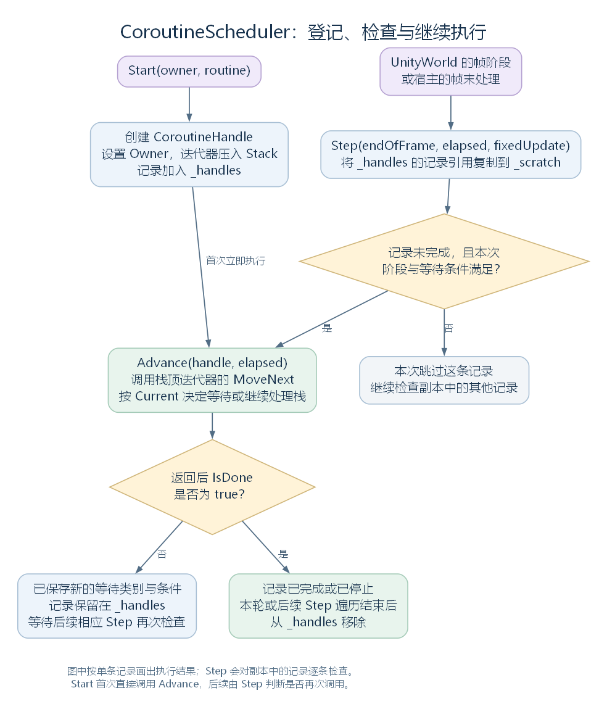
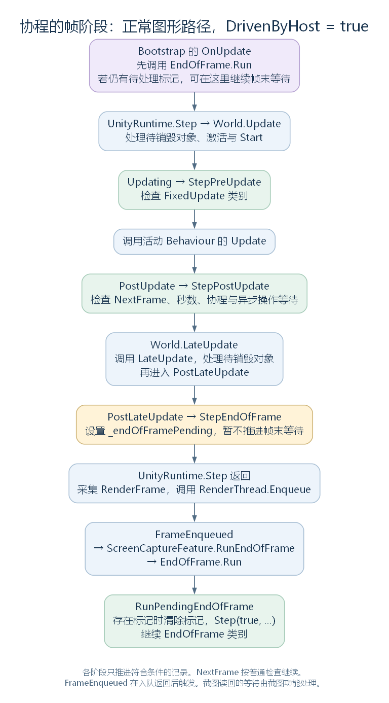
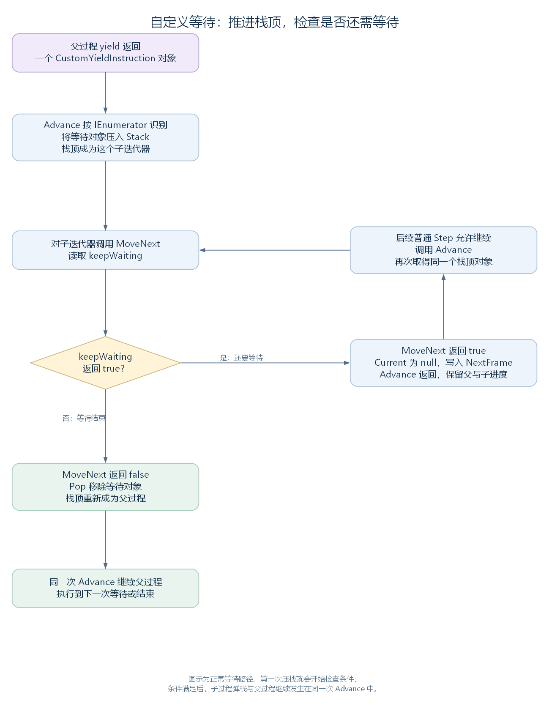

# 协程怎样分段执行：从保存进度到等待与结束

版本：发布版 v1.0｜定稿日期：2026-11-14

本文依据 RimWorld 1.7.4982 rev1280 的兼容层实现。开发者索引可直接跳到等待指令、示例和停止行为。调度器的完整代码见 [完整解析版](article.md)。

## 开发者索引

| 想实现的功能 | 可以先看 |
| --- | --- |
| 在组件里启动协程，把一段逻辑拆成几次执行 | [第一节 · 从登记到输出 C](#从登记到输出-c)、[第三节 · 登记与首次执行](#三登记记录并立即推进第一段) |
| 让代码在组件 `Update` 前或后继续 | [4.2 节 · 等待指令对照表](#42-根据返回对象写入等待条件)、[第五节 · 帧阶段检查](#五在帧阶段检查哪些记录可以继续) |
| 延迟若干秒再执行，选择用帧时间还是持续计时 | [第六节 · `WaitForSeconds`](#六把阶段时间和完成状态对应到实际顺序)、[8.2 节 · `WaitForSecondsRealtime`](#82-用真实计时建立截止值) |
| 等游戏推进若干 tick，或等某个状态就绪 | [第一节 · `Delay.AfterNTicks` 用例](#游戏里的常见用法)、[8.1 节 · `WaitUntil`](#81-用-waituntil-调用条件函数) |
| 在一个协程里跑完子过程，或等另一条协程、异步操作结束 | [4.1 节 · 子过程](#41-先压入子过程再继续父过程)、[第六节 · 等待另一条记录与异步操作](#等待另一条记录时按实际检查顺序继续) |
| 等到帧末再执行一段代码 | [第七节 · `WaitForEndOfFrame`](#七把帧末等待接回引擎调用) |
| 实现自己的等待指令 | [第八节 · `CustomYieldInstruction`](#八把自定义条件放进迭代器栈) |
| 停止协程，确认组件销毁或协程提前结束时的清理行为 | [第九节 · 停止与清理](#九停止记录再追踪清理动作) |

## 协程是什么

协程是一段能停下来、再从原处继续执行的代码。它适合把「先做一步，等一会儿或等某个条件，再接着做」写在同一个方法里。比如飞船起飞前，可以先等相机就位，再留出半秒，最后安排起飞准备。

调用写有 `yield return` 的 C# 迭代器方法，会先得到一个 `IEnumerator`。它能保存执行位置和后续还要用的局部变量。把这个迭代器登记为协程时，`CoroutineScheduler` 会立即推进它。遇到等待指令，协程把执行权交回调用者，引擎可以继续处理其他工作。之后，主线程在对应的帧阶段检查条件，条件满足时从停下的位置继续。每段代码实际执行时仍占用所在帧的时间。

### 谁来启动协程

- **游戏代码显式启动。** 游戏代码可以把迭代器交给一个 `MonoBehaviour` 组件的 `StartCoroutine`，该组件就是这条协程登记的所属对象。普通游戏对象也可以调用 `Delay`，由它借助专门的 `CoroutineRunner` 组件调用 `StartCoroutine`。
- **`UnityWorld` 在调用组件方法时启动。** `UnityWorld` 会按约定调用组件上的方法，例如 `Start`。如果组件把 `Start` 写成 `IEnumerator Start()`，World 会把返回的迭代器连同组件实例交给同一个调度器。

## 协程运行总览

调度器登记迭代器后，先调用 `Advance` 执行第一段。迭代器保存执行位置，调度器记录这段代码接下来要等什么。主线程进入相应帧阶段时，再由 `Step` 检查条件并决定是否继续。

| 环节 | 主要处理过程 | 完成后的结果 |
| --- | --- | --- |
| 登记并首次执行 | 调度器的 `Start` 建立记录，再立即调用 `Advance` | `StartCoroutine` 返回前已经执行第一段 |
| 处理返回值 | `Advance` 读取 `yield` 返回的对象。子迭代器可以压栈继续执行，等待指令则留下阶段、截止时间或目标状态 | 保存下一次继续所需的进度和条件 |
| 检查并恢复 | `Step` 在组件更新前、组件更新后或帧末检查对应的等待。条件满足时再次调用 `Advance` | 协程接着执行，直到下一次等待或结束 |
| 清理结束记录 | 自然完成或主动停止都会标记结束。`Step` 跳过并移除这些记录 | 结束的协程退出调度 |

`UnityWorld` 在活动组件的 `Update` 都执行完以后触发 `PostUpdate`。调度器在这里检查秒数、目标完成状态等常见等待。下文把这次检查简称为「普通检查」。



[SVG](../../figures/coroutinescheduler-overview.svg) · [图源](../../figures/coroutinescheduler-overview.dot)

### 重力飞船起飞前的半秒等待

游戏准备起飞演出时，`WorldComponent_GravshipController.OnGravshipCaptureComplete` 会在相机平移完成后调用 `Delay.AfterNSeconds(num, action)`。如果跳过平移，就直接走这一步。`num` 在这里是 `0.5f`，`action` 保存半秒后要执行的函数。`Delay` 按需创建名为 `CoroutineRunner` 的 `GameObject`，添加同名组件，再用该组件登记下面的迭代器。

这段 C# 按编译产物中 `MoveNext` 的行为还原，沿用原方法与参数名。

```csharp
private static IEnumerator Internal_AfterNSeconds(float seconds, Action action)
{
    yield return new WaitForSeconds(seconds);
    action?.Invoke();
}
```

1. **登记时**，协程立即执行到 `yield return`。调度器把当前帧的累计时间加上 `0.5` 秒，记为恢复时间。
2. **等待时**，主线程在每帧组件更新结束后的 `PostUpdate` 检查时间。半秒从登记时的帧时间算起，游戏 tick 的推进速度不会改变这个截止值。
3. **到点时**，协程在第一次满足条件的 `PostUpdate` 继续，调用 `action` 后结束。`action` 将 `GeneratingGravship` 加入长任务队列。随后由这项长任务准备飞船并开始起飞演出。

## 一、取得执行进度，再交给管理器

C# 迭代器方法在被调用时返回保存状态的对象。之后调用 IEnumerator.MoveNext，才继续执行到下一次 yield 或结束；返回 true 时，Current 提供本次返回对象；返回 false 表示这一层迭代结束。

下面是 `MonoBehaviour` 派生组件中的教学方法，`Example` 为示例名称。它会依次输出 A、B、C，中间有两次 `yield return`。

```csharp
private IEnumerator Example()
{
    Log.Message("A");
    yield return null;
    Log.Message("B");
    yield return new WaitForSeconds(0.5f);
    Log.Message("C");
}
```

假设同一组件在累计时间为 100 秒的那一帧，在 `Update` 中执行一次下面的代码。`routine` 是 `Example()` 返回的迭代器，`coroutine` 保存 `StartCoroutine` 返回的对象，后面可以用它等待或停止这条协程。

```csharp
IEnumerator routine = Example();
Log.Message("登记前");
Coroutine coroutine = StartCoroutine(routine);
Log.Message("登记后");
```

### 从登记到输出 C

第一次由 `StartCoroutine` 进入 `CoroutineScheduler.Start`，再由 `Advance` 调用 `routine.MoveNext()`。之后，主线程在每帧的组件 `Update` 都结束后进入 `PostUpdate`。调度器的 `StepPostUpdate` 调用 `Step` 检查等待条件，满足时才调用 `Advance`，再次推进同一个 `routine`。

| 时点 | 调用与进度 | 新增日志 |
| --- | --- | --- |
| `Update`，准备登记 | `Example()` 创建迭代器。执行到 `StartCoroutine` 前，迭代器还没有被推进。 | 登记前 |
| `Update`，`StartCoroutine` 内 | 第一次 `MoveNext()` 执行到 `yield return null`，返回 `true`。调度器读取 `Current` 得到 `null`，留下等待普通检查的记录。 | A |
| `Update`，`StartCoroutine` 返回 | 调用者接着执行 `Log.Message("登记后")`。 | 登记后 |
| 同帧 `PostUpdate`，100 秒 | `Step` 检查到这条记录可以继续，第二次 `MoveNext()` 从 `yield return null` 后开始，执行到 `yield return new WaitForSeconds(0.5f)`。调度器记下截止时间 100.5 秒。 | B |
| 后续 `PostUpdate`，例如 100.30 秒 | 时间还没到，`Step` 跳过这条记录。 | 无 |
| 首次读到时间达到或超过 100.5 秒的 `PostUpdate`，例如 100.52 秒 | 第三次 `MoveNext()` 从半秒等待后继续，输出 C 后返回 `false`。调度器标记完成，并在本轮检查结束时移除记录。 | C |

完整日志顺序为 `登记前 → A → 登记后 → B → C`。在这个启动位置，前四条日志都可以出现在同一帧。第六节会解释这份兼容层为什么允许 `yield return null` 在同帧的 `PostUpdate` 恢复。

### 游戏里的常见用法

在本版程序集的直接调用点中，[重力飞船起飞](#重力飞船起飞前的半秒等待)用了协程等待。`Delay` 还提供按 tick 等待的工具方法。表中的教学用例展示相同机制如何用在其他游戏脚本里。

| 场景 | 内部顺序 | 出处 |
| --- | --- | --- |
| 重力飞船起飞前留出半秒 | 相机就位 → `Delay.AfterNSeconds` 登记迭代器 → `WaitForSeconds` 等到截止时间 → 把 `GeneratingGravship` 加入长任务队列。 | 原版用例 |
| 等若干游戏 tick 后执行动作 | `Delay.AfterNTicks` 用当前 `TicksGame` 加上指定步数得到目标 tick → `WaitUntil` 检查 `GenTicks.TicksGame >= targetTick` → 帧阶段看到条件满足后调用传入的动作。若尚未到达目标 tick，暂停期间会继续等待，直到模拟推进到目标。 | 游戏提供的工具方法。本版程序集未找到直接调用者。 |
| 界面提示逐渐淡出 | 先显示提示 → 每次推进时降低一点透明度 → `yield return null` 交回执行权 → 下次普通检查继续，直到隐藏提示。 | 教学用例 |
| 镜头就位后显示对白 | 演出协程用 `StartCoroutine` 启动镜头平移 → `yield return` 得到的 `Coroutine` 对象 → 调度器检查平移协程是否结束 → 演出协程继续并显示对白。 | 教学用例 |
| 数据就绪后刷新面板 | 启动一个返回 `AsyncOperation` 的操作 → 交给协程等待 → 调度器在 `PostUpdate` 读到 `isDone` → 协程继续，读取结果并刷新面板。 | 教学用例 |

淡出和等待异步操作的常见写法也可参阅 [Unity 协程手册](https://docs.unity3d.com/cn/2022.3/Manual/Coroutines.html)。

## 二、用管理记录保存归属与等待状态

`IEnumerator` 保存代码执行到哪里，调度器则为它记录所属组件和接下来要等的条件。如果协程调用了子迭代器，两层执行进度也会一起保留。

`StartCoroutine` 返回的 `Coroutine` 对象代表已经启动的那条协程。调用者可以把它传给 `StopCoroutine`，也可以在另一条协程里 `yield return` 它，等它结束后继续自己的流程。

## 三、登记记录，并立即推进第一段

`StartCoroutine(routine)` 把调用它的组件记为所属对象，再让 `CoroutineScheduler` 登记并立即推进传入的迭代器。因此，协程在第一次暂停前对游戏状态做出的修改，调用者在 `StartCoroutine` 返回时已经可以读到。由 `UnityWorld` 启动的组件迭代器也会立即推进第一段。

### 把后续检查登记到 World

调度器启动协程时尝试接上 `UnityWorld` 的帧阶段，接通后就能按第五节的顺序检查等待条件。如果当时还没有 `World`，第一段仍会运行。后续有新的协程启动时，调度器会重新尝试连接。

## 四、执行栈顶过程，保存下一次等待

每次 `Advance` 都调用当前迭代器的 `MoveNext()`。返回 `true` 时，调度器从 `Current` 读取它交出的值，决定写入等待条件还是继续执行子过程。返回 `false` 时，这一层结束。所有层都执行完以后，整条协程标记为结束。

### 4.1 先压入子过程，再继续父过程

`yield return` 一个 `IEnumerator` 时，调度器把它作为子过程放到栈顶，并在这次 `Advance` 内立即开始执行。子过程结束后，父过程在同一次推进中接着运行。

下面仍是教学实例方法，名称为本例自行命名：

```csharp
private IEnumerator Outer()
{
    Log.Message("父：开始");
    yield return Inner();
    Log.Message("父：结束");
}

private IEnumerator Inner()
{
    Log.Message("子：开始");
    yield return null;
    Log.Message("子：结束");
}
```

| 时点 | 输出与处理 | 栈底 → 栈顶 |
| --- | --- | --- |
| 首次推进父过程 | 输出“父：开始”，返回 Inner | Outer |
| 同次推进子过程 | 压入 Inner，输出“子：开始”，遇到 null | Outer → Inner |
| 保存等待返回 | 记录 NextFrame，保留两层进度 | Outer → Inner |
| 后续符合条件的推进 | 输出“子：结束”，弹出 Inner；继续输出“父：结束” | Outer，随后为空 |

这个例子建立一条记录，两个迭代器共用它的栈。子过程暂停时，父过程的剩余进度继续保留。

### 4.2 根据返回对象写入等待条件

`Current` 给出这次 `yield return` 交给调度器的值。表中的 `Updating` 在主线程调用组件 `Update` 之前，`PostUpdate` 在这一批组件的 `Update` 之后。若协程在组件 `Update` 中返回 `null`，当帧稍后的 `PostUpdate` 就能继续推进它。

| `Current` 返回什么 | `Advance` 的主要处理 | 等到什么时候继续 |
| --- | --- | --- |
| `null` | 交回执行权 | 下一次轮到这条记录的 `PostUpdate`。 |
| `WaitForFixedUpdate` | 转入组件更新前的检查 | 下一次轮到这条记录的 `Updating`，即主线程执行组件 `Update` 之前。 |
| `WaitForEndOfFrame` | 转入帧末检查 | 下一次帧末检查。图形模式通常在渲染帧入队后的主线程上执行。Headless 路径在 `PostLateUpdate` 执行。详见第七节。 |
| `WaitForSeconds` | 以本次帧累计时间加上等待秒数作为截止时间 | 首次检查到帧累计时间达到或超过截止值的 `PostUpdate`。 |
| 尚未完成的 `Coroutine` | 记录要等待的目标协程 | `PostUpdate` 检查这条记录时，目标协程已经标记为结束。 |
| 内部记录为空或已完成的 `Coroutine` | 继续当前 `Advance` 循环 | 在本次 `Advance` 立即继续。 |
| 尚未完成的 `AsyncOperation` | 记录要等待的异步操作 | 首次读到操作的 `isDone` 为 `true` 的 `PostUpdate`。 |
| 已完成的 `AsyncOperation` | 交回执行权 | 下一次轮到这条记录的 `PostUpdate`。 |
| `WaitUntil` | 作为子迭代器压栈，立即检查条件 | 首次检查就为 `true` 时当场继续，否则在后续 `PostUpdate` 首次读到条件为 `true` 时继续。 |
| `WaitForSecondsRealtime` | 作为子迭代器压栈，从首次检查的真实计时建立截止值 | 首次检查就到期时当场继续，否则在后续 `PostUpdate` 首次读到真实计时达到截止值时继续。 |
| 其他 `IEnumerator` | 压栈并立即推进子过程 | 子过程结束时，父过程在同一次 `Advance` 继续。子过程若暂停，则按它返回的对象决定何时再推进。 |
| 其他未识别对象 | 交回执行权 | 下一次轮到这条记录的 `PostUpdate`。 |

## 五、在帧阶段检查哪些记录可以继续

主线程执行到下列位置时，调度器会调用 `Step` 检查已登记的协程。符合条件的记录由 `Advance` 继续推进，结束的记录随后移除。

| 主线程中的位置 | 本次检查 |
| --- | --- |
| `Updating`，一批组件的 `Update` 之前 | `WaitForFixedUpdate` 等待。即便这一帧内推进多个游戏 tick，这里也只检查一次。 |
| `PostUpdate`，这一批组件的 `Update` 之后 | 普通等待检查，包括 `null`、秒数等待、另一条协程和异步操作。 |
| 图形模式的渲染帧入队之后，或 Headless 的 `PostLateUpdate` | `WaitForEndOfFrame` 等待，具体入口见第七节。 |

一轮检查开始时就确定了这轮要看的记录。假如执行某条协程时又启动了另一条，新的协程仍会立即运行第一段。它留下的等待由后续符合条件的检查处理。

## 六、把阶段、时间和完成状态对应到实际顺序

`yield return null` 会把余下的代码交给下一次轮到它的普通检查。若在组件 `Update` 里启动协程，该帧稍后的 `PostUpdate` 就能继续它。若在普通检查执行期间返回 `null`，则要等到下一轮普通检查。

`WaitForSeconds` 从本次推进收到的帧累计时间起算。第一节在 100 秒的 `PostUpdate` 输出 B，半秒等待的截止值是 100.5 秒。首次检查到帧累计时间达到或超过该值时，`Step` 才会推进它并输出 C。

首次推进时的 `Time.time` 和后续检查时的 `frame.ElapsedTime` 都来自引擎传给 `UnityRuntime.Step` 的本帧时间。这个版本的 `timeScale` 读取时固定为 1。只要引擎继续推进帧阶段，暂停游戏模拟期间也能完成秒数等待。

### 等待另一条记录时，按实际检查顺序继续

如果写 `yield return StartCoroutine(Inner())`，`StartCoroutine` 会先启动一条独立协程，外层再交出它返回的 `Coroutine` 对象来等待。4.1 节的 `yield return Inner()` 交出的是迭代器，由当前协程直接推进。

等待者在自己的检查时点读取目标协程的状态。目标自然完成、被显式停止或在 `MoveNext` 中抛出异常时，都会被标记为结束。等待者能否在同一轮继续，取决于两条记录的检查顺序。

| 本轮检查顺序 | 等待者何时继续 |
| --- | --- |
| 先处理目标，目标完成，再处理等待者 | 等待者可在同一轮继续 |
| 先处理等待者，目标仍未完成，随后目标完成 | 等待者在后续一轮再取得机会 |

等待 `AsyncOperation` 时，调度器在 `PostUpdate` 检查 `isDone`，操作本身由发起它的功能推进。交出一个已完成的 `AsyncOperation` 仍会等下一次普通检查，交出一个已完成的 `Coroutine` 则会当场继续。

## 七、把帧末等待接回引擎调用

图形模式下，`UnityWorld` 在 `PostLateUpdate` 留下帧末检查标记。主线程把 `RenderFrame` 入队之后，`FrameEnqueued` 触发 `EndOfFrame.Run`，由它推进等待 `WaitForEndOfFrame` 的协程。



[SVG](../../figures/monobehaviour-coroutine-stages.svg) · [图源](../../figures/monobehaviour-coroutine-stages.dot)

如果某一轮仍执行 `UnityRuntime.Step`，但因窗口最小化等条件跳过帧入队，待处理标记可能留到下一次 `OnUpdate`。`Bootstrap` 会在新的 `Step` 之前调用 `EndOfFrame.Run`，在这里补做检查。标记已经清除时，`RunPendingEndOfFrame` 直接返回。

常规 `Headless` 启动时，`Bootstrap` 跳过图形初始化，`DrivenByHost` 保持默认的 `false`，因此 `PostLateUpdate` 会直接执行帧末检查。

这些帧末入口都在主线程上运行。`EndOfFrame.Run` 先处理待保存的截图，再检查待继续的协程。图形路径中，这时本帧的绘制数据已经采集并入队。在这里改动需要重新采集的绘制状态，要等后续帧才能看到变化。

## 八、把自定义条件放进迭代器栈

要定义自己的等待条件，可以继承 `CustomYieldInstruction`，让 `keepWaiting` 在仍需等待时返回 `true`。协程交出这个对象后，调度器立即把它当作子迭代器检查一次。还需等待时，后续的 `PostUpdate` 会再检查。返回 `false` 时，这层等待结束，父过程在同一次 `Advance` 内接着执行。



[SVG](../../figures/custom-yield-condition-loop.svg) · [图源](../../figures/custom-yield-condition-loop.dot)

### 8.1 用 WaitUntil 调用条件函数

`WaitUntil` 接收一个无参数、返回 `bool` 的函数。每次检查都会调用它，返回 `true` 时结束等待。

下面另用一个组件示例。`ready` 保存条件是否已满足，`WaitUntilReady` 是本例的协程方法。

```csharp
private bool ready;

private IEnumerator WaitUntilReady()
{
    Log.Message("开始等待");
    yield return new WaitUntil(() => ready);
    Log.Message("条件已满足");
}
```

首次执行会输出“开始等待”，接着立即检查 `ready`。它为 `true` 时，当场输出“条件已满足”。它为 `false` 时，调度器会在后续的 `PostUpdate` 重新检查。第一次读到 `ready` 为 `true` 时，才输出“条件已满足”。

### 8.2 用真实计时建立截止值

`WaitForSecondsRealtime` 从第一次检查时的 `Time.realtimeSinceStartup` 起算，这个时间在同一帧内也会更新。比如真实计时为 10 秒时创建一个两秒等待对象，到 20 秒才第一次推进它，截止时间就是 22 秒。到时由调度器在取得下一次检查机会时继续。等待结束后重新使用该对象，首次检查会建立新的截止值。

## 九、停止记录，再追踪清理动作

调用 `StopCoroutine(coroutine)` 会将指定协程标记为结束，调用 `StopAllCoroutines()` 会将属于当前组件的协程都标记为结束。下一次检查这些记录时，`Step` 会跳过它们。用 `yield return Inner()` 加入的子迭代器会随父过程一起停止。通过 `StartCoroutine(Inner())` 另行启动的协程有自己的记录。

如果协程在执行中标记自己结束，当前这次 `Advance` 仍会跑到等待或结束。比如它在停止后紧接着 `yield return Inner()`，子迭代器仍会在这次推进中开始执行。后续的 `Step` 才会跳过整条记录。

### 9.1 沿组件状态变化检查默认调用

在这一版兼容层里，将 `enabled` 设为 `false`、调用 `GameObject.SetActive(false)` 或销毁对象以后，原协程仍可能继续推进。需要让协程随组件停用或销毁而结束时，可以在 `OnDisable` 或 `OnDestroy` 里调用停止接口。

### 9.2 从 finally 的输出观察结束路径

下面是教学实例方法，名称为本例自行命名：

```csharp
private IEnumerator WithCleanup()
{
    try
    {
        Log.Message("开始");
        yield return null;
        Log.Message("继续");
    }
    finally
    {
        Log.Message("清理");
    }
}
```

它已输出“开始”并停在 null 时，两条后续路径的结果为：

| 路径 | 输出 | 执行动作 |
| --- | --- | --- |
| 正常继续到结束 | 开始 → 继续 → 清理 | MoveNext 继续 try 剩余部分和 finally，再结束迭代 |
| 等待期间停止，再由 Step 移除 | 开始 | 跳过后续 MoveNext，移除时没有 Dispose |

停止时，调度器把记录标记为结束，跳过后续的 `MoveNext()`，并从列表移除记录。它没有对这个暂停中的迭代器调用 `Dispose()`。因此，必须执行的清理动作要在显式停止路径中一并处理。自定义等待条件抛出异常时，调度器也会标记协程结束，仍暂停在栈中的父过程同样得不到这次清理调用。

[本章完整解析版](article.md) · [上一章 · 长任务与线程协作](../05-threads/release.md) · [运行与调度目录](../04-06-runtime-scheduling.md)
