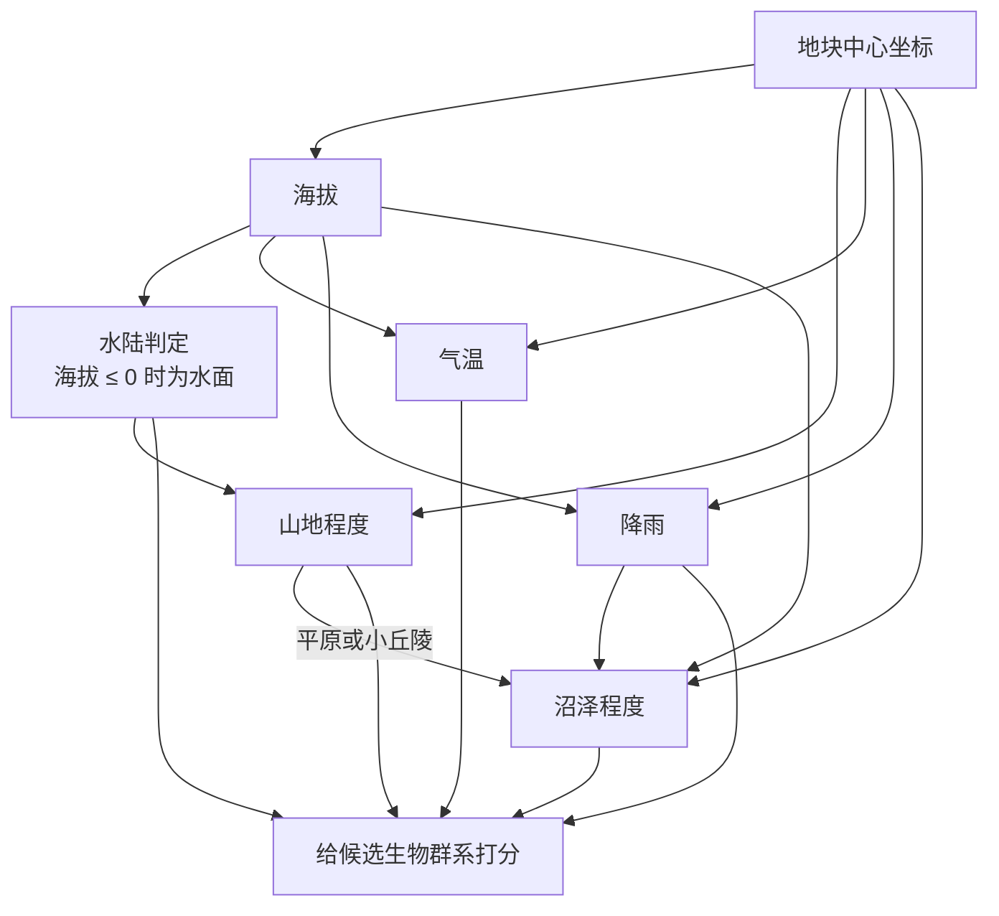

# 气候与地形规则

第 07 章子章草稿。依据 RimWorld 1.7.4982 rev1280 的源码与原版 XML。代码片段中的中文注释由本文补写。

新世界先建立球面网格，再为每格填写海拔、气候和初始生物群系。湖泊、河流等步骤接着读取这些地块，为整个地表补齐相连的水域、道路、地标和地块特征。选址页和开局地图都从这份地表数据读取所选位置的信息。

## 地表生成总览

`Surface` 的 `<worldGenSteps>` 列出地表要用哪些步骤。`PlanetLayerDef.GenStepsInOrder` 按各步骤 Def 的 `order`、再按 `index` 排序。`WorldGenerator` 依次调用它们，执行每一步前先设置该步的随机序列。建好网格后，地表从下表的第一步开始生成，启用相应 DLC 时才加入 `Pollution` 和 `Landmarks`。

| `order` | 步骤 | 生成的内容 |
| ---: | --- | --- |
| 0 | `Terrain` | 按编号填写地块的海拔、山地程度、气候和初始生物群系。 |
| 150 | `Lakes` | 把较小的相连海洋水域改成湖泊。 |
| 200 | `Rivers` | 根据地形与气候确定水系，在相邻地块之间登记河段。 |
| 300 | `AncientSites` | 选出一批古代地点的坐标，提供给古道生成器。 |
| 400 | `AncientRoads` | 从古代地点选出路线，在相邻地块之间登记古代道路。 |
| 450 | `Pollution`（Biotech） | 根据世界污染设定和生物群系的规则写入 `Tile.pollution`。 |
| 500 | `Factions` | 创建派系并放置其定居点，详见[世界生成主章](article.md#32-先生成各派系的初始据点再补足定居点)。 |
| 600 | `Roads` | 用已有世界对象所在位置及补充点建立道路网络。 |
| 650 | `Landmarks`（Odyssey） | 在符合条件的地块上登记地标，并尝试添加地标附带的地块特征。 |
| 700 | `Mutators` | 读取已生成的山地、岸线、河段和地标，为地块添加适用的特征。 |
| 1000 | `Features` | 识别山脉、海湾等区域，创建世界地图上可显示名称的 `WorldFeature`。 |

步骤引用见 `Core/Defs/PlanetLayerDefs/PlanetLayers.xml`，数值取自 Core、Biotech、Odyssey 各自的 `Defs/WorldGeneration/WorldGenerator.xml`。排序与调用见 `RimWorld.PlanetLayerDef.cs:99` 和 `RimWorld.Planet.WorldGenerator.cs:94`。

## 一、建立球面网格

全局准备步骤 `Grids` 调用 `WorldGrid.GenerateFreshWorld()`，按覆盖率确定球面范围，并为剧本要求的图层建立网格。`PlanetLayer.InitializeLayer()` 从正二十面体开始细分，留下每格的顶点和邻接关系。这一步结束时，每格已有编号、形状和位置，后面可以用编号取到该格的中心坐标和邻格。网格与覆盖率的建立过程见[世界生成主章](article.md#23-覆盖率怎样确定地表网格的范围)，源码入口见 `RimWorld.Planet.GameSetupStep_Grids.cs:21`、`RimWorld.Planet.WorldGrid.cs:194` 和 `RimWorld.Planet.PlanetLayer.cs:445`。

## 二、逐格填写地形、气候与生物群系

球面网格确定后，`Terrain` 按地块编号填充 `SurfaceTile`。每格依次计算海拔、山地程度、气温、降雨、沼泽程度和初始生物群系。图中的箭头表示哪项结果会进入后面的计算。



### 2.1 准备噪声并遍历地块

`WorldGenStep_Terrain.GenerateFresh()` 先准备一组按位置求值的函数。其中的 `Perlin` 和 `RidgedMultifractal` 是两种噪声。给定种子和三维坐标，它们会返回一个确定的值。相邻位置的值往往接近，因此可以组成成片的高地、山脉和湿润地区。`Setup…Noise()` 用[主章第二节](article.md#24-挑选生成步骤为每一步设定随机序列)中为 `Terrain` 设好的随机序列给各组噪声取种子，再把噪声和曲线组合起来。

下面是 `WorldGenStep_Terrain.GenerateFresh()`。`seed` 是世界种子字符串，`layer` 是正在生成的地表层。这五项准备工作在本次 `Terrain` 步骤开始时各执行一次，建立整层共用的计算函数。降雨函数会用到海拔函数，沼泽函数又用到海拔和降雨，所以要按这个顺序准备。

```csharp
public override void GenerateFresh(string seed, PlanetLayer layer)
{
    // 先为整层准备好各项计算函数。
    this.SetupElevationNoise(layer);
    this.SetupTemperatureOffsetNoise();
    this.SetupRainfallNoise();
    this.SetupHillinessNoise();
    this.SetupSwampinessNoise();
    // 全部准备好后，进入父类的地块遍历。
    base.GenerateFresh(seed, layer);
}
```

父类 `WorldGenStep_Tiles.GenerateFresh()` 接着清空地块列表，按网格已有的数量逐格生成。`i` 是层内编号，和 `layer` 一起构成 `PlanetTile`。下面的 `GenerateTileFor()` 是虚方法，这次调用会进入 `WorldGenStep_Terrain` 的重写。

```csharp
public override void GenerateFresh(string seed, PlanetLayer layer)
{
    layer.Tiles.Clear();
    for (int i = 0; i < layer.TilesCount; i++)
    {
        // 用同一组函数计算这一格，再按编号保存结果。
        Tile tile = this.GenerateTileFor(new PlanetTile(i, layer), layer);
        layer.Tiles.Add(tile);
    }
}
```

进入 `GenerateTileFor()` 后，`tile` 指明当前地块，`surfaceTile` 是新建的地块记录，`tileCenter` 是从球面网格取得的三维中心坐标。每一格都用自己的坐标向刚才准备好的函数取值。

```csharp
// 建立当前地块的记录，在球面网格上取出它的中心坐标。
SurfaceTile surfaceTile = new SurfaceTile(tile);
Vector3 tileCenter = layer.GetTileCenter(tile);
// 用地块中心求出海拔。后面还会在这个位置求气温偏移和降雨量。
surfaceTile.elevation = this.noiseElevation.GetValue(tileCenter);
```

这一次调用继续填写山地程度、气温、降雨和沼泽程度，再为生物群系打分。全部写好后，`GenerateTileFor()` 返回记录，父类将它加入 `layer.Tiles`，开始下一格。第 2.2–2.7 节按这个写入顺序展开。整层遍历完成后，才进入 `Lakes` 等后续步骤。

源码见 `RimWorld.Planet.WorldGenStep_Terrain.cs:34`、`:174` 和 `RimWorld.Planet.WorldGenStep_Tiles.cs:20`。

### 2.2 海拔划出陆地与水面

`SetupElevationNoise()` 先组合四组噪声。频率较低的噪声变化得慢，适合形成大片区域。频率较高的噪声可以在这些区域里加出较小的起伏。

| 源码变量 | 频率 | 在海拔计算中的作用 |
| --- | ---: | --- |
| `moduleBase` | `0.035` | 提供基础起伏。 |
| `moduleBase2` | `0.012` | 用 `RidgedMultifractal` 形成较大尺度的脊状起伏。 |
| `moduleBase3` | `0.12` | 乘到脊状噪声上，让脊状起伏在不同位置有强有弱。 |
| `moduleBase4` | `0.01` | 最后混入的大陆尺度起伏，影响大片区域整体偏高还是偏低。 |

`Blend` 在两组结果之间做线性插值。它先把第三个参数的值 `w` 变成 `(w + 1) / 2`，再以这个比例取第二组的值。例如，代码传入 `0.4` 时，取七成的第二组结果和三成的第一组结果。

世界覆盖率在两处影响这个过程。

1. 低于 `55%` 时，先把大陆噪声和一个随角距变化的值混合。这个值靠近覆盖区中心时较高，靠近边缘时较低。混入这组大陆起伏时，`num` 会从 `−0.4` 到 `−0.35` 之间随机取值，换算成 `30%` 到 `32.5%` 的混合比例。覆盖率达到 `55%` 时，直接用原来的大陆噪声，混合比例为 `57.5%` 到 `62.5%`。
2. 低于 `99.99%` 时，`ConvertToIsland` 还会压低覆盖区边缘一圈的海拔。它按地块离覆盖区中心的角距计算。例如，`SurfaceViewAngle` 为 `60°` 时，离中心不到 `45°` 的地块会直接保留这一阶段的结果，再往外才开始压低。

下面从 `SetupElevationNoise()` 的后半段节选。`num` 控制大陆噪声的混入比例，`num2` 控制脊状起伏的混入比例。`ScaleBias` 对输入做一次乘法和一次加法，`Power` 对值取幂。

```csharp
// 调整控制强弱的噪声，再将它乘到脊状噪声上。
moduleBase3 = new ScaleBias(0.5, 0.5, moduleBase3);
moduleBase2 = new Multiply(moduleBase2, moduleBase3);
// 先混入脊状起伏，再把大陆尺度的高低混进来。
float num2 = Rand.Range(0.4f, 0.6f);
this.noiseElevation = new Blend(moduleBase, moduleBase2, new Const((double)num2));
this.noiseElevation = new Blend(this.noiseElevation, moduleBase4, new Const((double)num));
// 部分覆盖的世界在边缘额外降低海拔。
if (Find.World.PlanetCoverage < 0.9999f)
{
    this.noiseElevation = new ConvertToIsland(Find.WorldGrid.SurfaceViewCenter, Find.WorldGrid.SurfaceViewAngle, this.noiseElevation);
}
// 调整尺度、取三次方，再换算成米。
this.noiseElevation = new ScaleBias(0.5, 0.5, this.noiseElevation);
this.noiseElevation = new Power(this.noiseElevation, new Const(3.0));
// 开启噪声调试显示时登记这个中间结果，供开发者在世界地图上查看。
NoiseDebugUI.StorePlanetNoise(this.noiseElevation, "noiseElevation");
this.noiseElevation = new ScaleBias((double)WorldGenStep_Terrain.ElevationRange.Span, (double)WorldGenStep_Terrain.ElevationRange.min, this.noiseElevation);
```

设边缘处理后的输入为 `v`，最后三步换算出来的海拔就是 `5500 × (0.5 × v + 0.5)³ − 500` 米。例如，`v = 0` 时海拔是 `187.5` 米。`SurfaceTile.WaterCovered` 用写入地块的海拔判断水陆，`elevation <= 0` 时返回 `true`。后面给海洋、森林等生物群系打分时，会用到这个判断。

源码见 `RimWorld.Planet.WorldGenStep_Terrain.cs:45`、`:349`、`Verse.Noise.Blend.cs:39`、`Verse.Noise.ConvertToIsland.cs:25` 和 `RimWorld.Planet.SurfaceTile.cs:13`。

### 2.3 山脉线和丘陵斑块决定山地程度

`SetupHillinessNoise()` 为山地程度准备山脉线、大尺度丘陵和小尺度丘陵三组函数。山脉线从一组 `Perlin` 开始。把输出取绝对值后，靠近原本零值线的地方就会得到较小的值，适合把山地连成长带。代码还用另一组噪声在这条带上留出缺口。丘陵用两组噪声分别划出大范围和小范围，只有两组都达到门槛时，离开山脉线的地方才会添上丘陵。

下面是山脉线的合成片段。此时 `this.noiseMountainLines` 是频率 `0.025` 的 `Perlin`，`moduleBase` 是频率 `0.06` 的 `Perlin`。`OneMinus` 返回 `1 - 输入`，`Filter` 在输入落入给定区间时返回 `1`，其余位置返回 `0`。

```csharp
// 原始噪声越接近零，取绝对值再用 1 减去后得到的值越大。
this.noiseMountainLines = new Abs(this.noiseMountainLines);
this.noiseMountainLines = new OneMinus(this.noiseMountainLines);
// 用第二组噪声切出缺口，再反转一次，让靠近山脉线的位置取得较小值。
moduleBase = new Filter(moduleBase, -0.3f, 1f);
this.noiseMountainLines = new Multiply(this.noiseMountainLines, moduleBase);
this.noiseMountainLines = new OneMinus(this.noiseMountainLines);
```

逐格计算时，`value` 就是 `noiseMountainLines.GetValue(tileCenter)`。代码由上到下检查这些条件。

| 地块条件 | 写入 `hilliness` 的值 |
| --- | --- |
| 海拔 `≤ 0` | `Flat`。 |
| 陆地且 `value > 0.235` | 小尺度丘陵噪声 `> 0.46` 且大尺度丘陵噪声 `> -0.3` 时，在 `SmallHills` 和 `LargeHills` 中随机选一个。其余位置用 `Flat`。 |
| 陆地且 `0.12 < value ≤ 0.235` | 用 `Rand.Range(0, 4)` 在平原、小丘陵、大丘陵和山地中随机选一个。 |
| 陆地且 `0.0363 < value ≤ 0.12` | `Mountainous`。 |
| 陆地且 `value ≤ 0.0363` | `Impassable`，即不可通行山脉。 |

这样，一格海拔较高也可以是平原，较低的陆地也可以落在山脉线上。

源码见 `RimWorld.Planet.WorldGenStep_Terrain.cs:142`、`:179` 和 `Verse.Noise.Filter.cs:24`。

### 2.4 气温先查纬度，再按海拔和档位调整

`LongLatOf(tile)` 返回地块的经纬度，`.y` 是纬度。`BaseTemperatureAtLatitude()` 把纬度取绝对值后除以 `90`，再查 `AvgTempByLatitudeCurve`。所以南北纬度相同的两个点从同一基础气温出发。曲线在赤道给出 `30°C`，在南北纬 `9°` 给出 `29°C`，在 `45°` 给出 `7°C`，在两极给出 `−37°C`。介于两个曲线点之间时，游戏按距离插值。

接着扣除海拔降温。`250` 米及以下扣 `0°C`，从 `250` 到 `5000` 米线性增加到 `40°C`，再往上仍扣 `40°C`。最后加上当地的气温偏移，它来自另一组 `Perlin` 的结果乘 `4`。`num` 是逐步调整的气温，`temperatureCurve` 是全局气温档位指定的曲线。普通档返回 `null`，会把调整到这一步的气温直接写入地块。

```csharp
// 从纬度查基础气温，扣除高海拔造成的降温。
float num = WorldGenStep_Terrain.BaseTemperatureAtLatitude(layer.LongLatOf(tile).y);
num -= WorldGenStep_Terrain.TemperatureReductionAtElevation(surfaceTile.elevation);
// 加上当前位置的噪声偏移，再按全局气温档位调整。
num += this.noiseTemperatureOffset.GetValue(tileCenter);
SimpleCurve temperatureCurve = Find.World.info.overallTemperature.GetTemperatureCurve();
if (temperatureCurve != null)
{
    num = temperatureCurve.Evaluate(num);
}
// 保存选址页使用的平均气温。
surfaceTile.temperature = num;
```

例如，南纬 `45°`、海拔 `2625` 米的一格从 `7°C` 开始。其海拔正好落在降温区间的中点，要扣 `20°C`。如果该处的噪声偏移刚好为零，且气温选普通档，写入的就是 `−13°C`。

源码见 `RimWorld.Planet.PlanetLayer.cs:867`、`RimWorld.Planet.WorldGenStep_Terrain.cs:81`、`:224`、`:274`、`:358` 和 `RimWorld.Planet.OverallTemperatureUtility.cs:24`。

### 2.5 降雨叠加纬度与海拔，再换算成毫米

`SetupRainfallNoise()` 先把一组 `Perlin` 的输出乘 `0.5` 再加 `0.5`，给不同地区一个湿润程度的基础值。随后对这个值乘两次系数。

| 系数 | 怎样随地块变化 |
| --- | --- |
| 纬度 | 取绝对纬度查曲线。赤道是 `1.12`，`25°` 是 `0.94`，`45°` 是 `0.7`，`70°` 是 `0.3`，`80°` 到两极保持 `0.05`。 |
| 海拔 | `500` 米及以下是 `1`，到 `2750` 米约为 `0.5`，到 `5000` 米约为 `0`，并把结果限制在 `0` 到 `1`。 |

以绝对纬度 `45°`、海拔 `2750` 米的一格为例。若基础值是 `0.6`，乘上纬度和海拔系数后就是 `0.6 × 0.7 × 0.5 = 0.21`。接下来的低值修正先把负值改成零，再把低于 `0.12` 的值与 `0.12` 取平均。这里 `0.21` 直接进入后面的 `1.5` 次方，乘上 `4000` 后得到约 `385` 毫米。即使海拔系数把原值压到零，经过低值修正后也还有大约 `59` 毫米的基础降雨量。

下面是函数结尾。`func` 是上面处理低值的函数，`rainfallCurve` 是全局降雨档位指定的曲线。换算成毫米之后，才把基础降雨量交给曲线调整。

```csharp
// 先修正过低的值，按幂函数改变分布，再将结果换算成毫米。
this.noiseRainfall = new Arbitrary(this.noiseRainfall, func);
this.noiseRainfall = new Power(this.noiseRainfall, new Const(1.5));
this.noiseRainfall = new Clamp(0.0, 999.0, this.noiseRainfall);
NoiseDebugUI.StorePlanetNoise(this.noiseRainfall, "noiseRainfall before mm");
this.noiseRainfall = new ScaleBias(4000.0, 0.0, this.noiseRainfall);
// 普通档保留基础量，其余档位按各自的曲线调整这个值。
SimpleCurve rainfallCurve = Find.World.info.overallRainfall.GetRainfallCurve();
if (rainfallCurve != null)
{
    this.noiseRainfall = new CurveSimple(this.noiseRainfall, rainfallCurve);
}
```

再取一个方便看滑杆效果的例子。假设基础量恰好是 `1000` 毫米，普通档 `Normal` 保留 `1000`。高降雨档 `High` 的 `Curve_High` 有一个点 `(1000, 2800)`，会把它改为 `2800` 毫米。在 `GenerateTileFor()` 中，从地块中心取得的结果会写入当前地块。

```csharp
// 在地块中心求出已经按气候档位调整的降雨量，将结果写回当前地块。
surfaceTile.rainfall = this.noiseRainfall.GetValue(tileCenter);
```

源码见 `RimWorld.Planet.WorldGenStep_Terrain.cs:89`、`:233` 和 `RimWorld.Planet.OverallRainfallUtility.cs:24`、`:140`。

### 2.6 用地形和气候限制沼泽程度

`SetupSwampinessNoise()` 把一组 `Perlin` 和一组脊状噪声的结果相乘，得到随位置变化的基础沼泽程度。接着乘上海拔系数和降雨系数。`InverseLerp` 计算一个值在给定两端之间走了多少，并把比例限制在 `0` 到 `1`。海拔这一项把高值放在前面，得到随海拔升高而变小的系数。降雨这一项把低值放在前面，得到随降雨增加而变大的系数。

| 条件 | 沼泽程度的系数 |
| --- | --- |
| 海拔 | `650` 米及以下取 `1`，`650` 到 `750` 米线性降到 `0`，之后保持 `0`。 |
| 已按档位调整的降雨量 | `725` 毫米及以下取 `0`，`725` 到 `900` 毫米线性升到 `1`，之后保持 `1`。 |

比如海拔 `700` 米、降雨 `900` 毫米的一格，两个系数是 `0.5` 和 `1`，沼泽程度保留基础值的一半。如果降雨改为 `700` 毫米，结果就是零。这个位置还必须是平原或小丘陵，生成器才会求值并写入 `swampiness`。其他地形沿用字段初始值 `0`。

```csharp
// 只有平原和小丘陵才取沼泽程度。它和气温、降雨一样供群系评分使用。
if (surfaceTile.hilliness == Hilliness.Flat || surfaceTile.hilliness == Hilliness.SmallHills)
{
    surfaceTile.swampiness = this.noiseSwampiness.GetValue(tileCenter);
}
surfaceTile.PrimaryBiome = this.BiomeFrom(surfaceTile, tile, layer);
```

源码见 `RimWorld.Planet.WorldGenStep_Terrain.cs:158`、`:243`、`:343` 和 `Verse.Noise.InverseLerp.cs:26`。

### 2.7 给候选生物群系打分

`BiomeFrom()` 从 `DefDatabase<BiomeDef>` 取出生物群系定义，检查它是否已实现、是否允许自然生成，以及能否出现在当前的 `PlanetLayer`。例如，`CanPlaceOnLayer()` 会检查群系定义里的图层白名单和黑名单。通过检查后，群系的 `Worker` 读取地块数据并打分，各群系可以采用自己的条件。例如草原也会看山地程度，山地和不可通行山脉在草原的陆地评分里得 `0` 分。第一次遇到通过检查的群系时就记下它，之后只在分数更高时替换，因此同分时保留先遇到的群系。

`ws` 是已经填好地形和气候数据的地块，`tile` 是它的位置，`layer` 是所在图层。`biomeDef2` 是正在检查的候选，`biomeDef` 和 `num` 记录目前最高分的候选和分数。

```csharp
// 依次检查已加载的群系定义，只给可以在本层自然生成的群系打分。
List<BiomeDef> allDefsListForReading = DefDatabase<BiomeDef>.AllDefsListForReading;
BiomeDef biomeDef = null;
float num = 0f;
for (int i = 0; i < allDefsListForReading.Count; i++)
{
    BiomeDef biomeDef2 = allDefsListForReading[i];
    if (biomeDef2.implemented && biomeDef2.generatesNaturally && biomeDef2.Worker.CanPlaceOnLayer(biomeDef2, layer))
    {
        // 读取该格的数据打分，并在出现更高分时换掉暂时领先的群系。
        float score = biomeDef2.Worker.GetScore(biomeDef2, ws, tile);
        if (score > num || biomeDef == null)
        {
            biomeDef = biomeDef2;
            num = score;
        }
    }
}
return biomeDef;
```

以温带森林和温带沼泽为例。两者在水面上都给 `−100` 分。陆地上，气温至少 `−10°C`、降雨至少 `600` 毫米时，温带森林按 `15 + (气温 − 7) + (降雨量 − 600) / 180` 打分。温带沼泽多检查一项 `swampiness >= 0.5`。达到门槛时，取同样的分数，再加上 `沼泽程度 × 3`。气温、降雨或沼泽程度未达到相应门槛时，候选给 `0` 分。

例如一格陆地是 `17°C`、`1000` 毫米，森林得约 `27.22` 分。若沼泽程度为 `0.2`，沼泽得 `0` 分。若达到 `0.6`，沼泽得约 `29.02` 分，便会在这两个候选中领先。生成器比较完其余群系后，会把分数最高的写进 `PrimaryBiome`。

源码见 `RimWorld.Planet.WorldGenStep_Terrain.cs:252`、`RimWorld.BiomeWorker.cs:13`、`RimWorld.BiomeWorker_Grasslands.cs:10`、`RimWorld.BiomeWorker_TemperateForest.cs:10` 和 `RimWorld.BiomeWorker_TemperateSwamp.cs:10`。

#### Core 地表群系的条件与分数

下表用 `T` 表示地块的平均气温（°C），`R` 表示降雨量（毫米），`S` 表示沼泽程度，也就是前面写入地块的 `temperature`、`rainfall` 和 `swampiness`。陆地群系在水面统一得 `−100` 分，在陆地上未达到表中的条件时得 `0` 分。达到条件时才用右列算分，最终由 `BiomeFrom()` 选最高分。表中的名称采用游戏内简体中文，括号内是 `defName`。

| 陆地群系 | 使用右列公式的条件 | 分数 |
| --- | --- | --- |
| 冰原（`IceSheet`） | 所有陆地都可算分 | `−20 − 2 × T` |
| 冻土苔原（`Tundra`） | 所有陆地都可算分 | `−T` |
| 寒带森林（`BorealForest`） | `T ≥ −10` 且 `R ≥ 600` | `15` |
| 寒带沼泽（`ColdBog`） | `T ≥ −10` 且 `S ≥ 0.5` | `13 − T + 8 × S` |
| 温带森林（`TemperateForest`） | `T ≥ −10` 且 `R ≥ 600` | `15 + (T − 7) + (R − 600) / 180` |
| 温带沼泽（`TemperateSwamp`） | `T ≥ −10`、`R ≥ 600` 且 `S ≥ 0.5` | 同一格的温带森林分数 `+ 3 × S` |
| 热带雨林（`TropicalRainforest`） | `T ≥ 15` 且 `R ≥ 2000` | `28 + 1.5 × (T − 20) + (R − 600) / 165` |
| 热带沼泽（`TropicalSwamp`） | `15 ≤ T ≤ 55`、`R ≥ 2000` 且 `S ≥ 0.5` | 同一格的热带雨林分数 `+ 3 × S` |
| 干旱灌木原（`AridShrubland`） | `T ≥ −10` 且 `600 ≤ R < 2000` | `22.5 + 2.2 × (T − 20) + (R − 600) / 100` |
| 沙漠（`Desert`） | `R < 600` | `T + 0.0001` |
| 极端沙漠（`ExtremeDesert`） | `R < 340` | `2.7 × T − 13 − 0.14 × R` |

寒带森林和温带森林用同一组门槛。寒带森林拿固定的 `15` 分，温带森林则随着气温和降雨上升而多得分。例如在 `−5°C`、`1000` 毫米的一格里，寒带森林得 `15` 分，温带森林约得 `5.22` 分。寒带沼泽只直接检查 `T` 和 `S`，降雨已在上一节的 `S` 计算里起过作用。

| 水域群系 | 水面上的分数 | 陆地上的分数 |
| --- | --- | --- |
| 海洋（`Ocean`） | `0` | `−100` |
| 湖泊（`Lake`） | 与海洋共用 `BiomeWorker_Ocean`，水面得 `0` | `−100` |
| 海洋冰盖（`SeaIce`） | 通过覆盖区的边缘检查时为 `−43 − 2 × T`，否则为 `−100` | `−100` |

海洋冰盖的边缘检查取决于地块离覆盖区中心有多远。设覆盖角为 `a`，代码取 `min(7.5°，0.12 × a)` 作为边缘环带的宽度。内侧边界及更靠中心的格子直接通过。越往外，地块在环带内的位置比例越大。代码按地块相对中心的方位角取得噪声值 `N`，当位置比例小于或等于 `0.5 × N + 0.5` 时，才继续算海洋冰盖的气温分数。通过检查后，要拿到比海洋的 `0` 分更高的分数，气温需低于 `−21.5°C`。

`Biomes_Water.xml` 中海洋排在湖泊前，两者同分时，`BiomeFrom()` 会保留先遇到的海洋。生成完各格后，`Lakes` 再检查相连的海洋地块，把满足大小条件的水域改成湖泊，见下一节。

Core 定义见 `Core/Defs/BiomeDefs/Biomes_*.xml`，评分入口是对应的 `RimWorld.BiomeWorker_<defName>.cs` 中的 `GetScore()`，湖泊复用 `RimWorld.BiomeWorker_Ocean.cs:10`。海洋冰盖的边缘检查见 `RimWorld.BiomeWorker_SeaIce.cs:27`。

#### Odyssey 加入的五种地表群系

启用 Odyssey 后，这五种群系会和 Core 的候选一起评分。它们在水面得 `−100`，陆地未达条件得 `0`。其中冰蚀平原、熔岩荒原、焦痕废土各有一套由世界种子确定的 `Perlin` 噪声，用地块中心坐标取样。表中的 `0.9` 是各自的取样门槛。

| 陆地群系 | 使用右列公式的条件 | 分数 |
| --- | --- | --- |
| 草原（`Grasslands`） | `−10 ≤ T ≤ 55`、`800 ≤ R < 2500`，山地程度筛掉 `Mountainous` 和 `Impassable` | `22.5 + 2.4 × (T − 20) + (R − 800) / 100` |
| 萤光森林（`Glowforest`） | `10 ≤ T ≤ 55`、`R ≥ 1000` 且 `S ≥ 0.6` | `23 + (T − 7) + (R − 600) / 220 + 3 × S` |
| 冰蚀平原（`GlacialPlain`） | `R > 600`，且本格噪声 `≥ 0.9` | `15 − T` 再加山地分。平原加 `0`、小丘陵加 `10`、大丘陵加 `15`、山地和不可通行山脉加 `18` |
| 熔岩荒原（`LavaField`） | 本格噪声 `≥ 0.9`，且符合上表中沙漠或干旱灌木原的取分条件 | 先取对应的沙漠或干旱灌木原分数，减 `0.0001`。如果是小丘陵或更高的山地程度，再加 `0.0002` |
| 焦痕废土（`Scarlands`） | 符合温带森林的取分条件，本格和至少一个相邻格的噪声都 `≥ 0.9` | 同一格的温带森林分数 `+ 20` |

焦痕废土只检查邻格的噪声值。邻格也要走一遍自己的气候条件和群系比分，才能确定最终显示的群系。熔岩荒原则用一小段分差和基础群系竞争。以符合沙漠条件的格子为例，平原上的熔岩荒原比沙漠少 `0.0001` 分，到了小丘陵则比沙漠多约 `0.0001` 分，最后仍要比较其他候选。

定义见 `Odyssey/Defs/BiomeDefs/` 中对应群系的 XML，评分与位置检查见 `RimWorld.BiomeWorker_Grasslands.cs:10`、`RimWorld.BiomeWorker_Glowforest.cs:10`、`RimWorld.BiomeWorker_GlacialPlain.cs:13`、`RimWorld.BiomeWorker_LavaField.cs:13` 和 `RimWorld.BiomeWorker_Scarlands.cs:14`。

太空、地下等图层或特殊地图的群系见[附录](#附录由图层或特殊地图指定的群系)。

## 三、用已有地块补全地表

初始群系写入后，后续步骤开始跨格处理。湖泊和河流用到邻接关系，道路和地标继续使用前面生成的地形和世界对象。

### 3.1 湖泊按相连水域的大小划分

`Lakes` 从一个 `Ocean` 地块出发，只沿相邻的 `Ocean` 继续找，把整片相连水域收齐。如果这一片最多有 `15` 格，就把它们的 `PrimaryBiome` 改为 `Lake`。河流随后寻找入海口，看到的已经是改过的群系标签。

在 `GenerateLakes()` 中，`touched` 按地块编号记录哪些海洋格已经访问过，`oceanChunk` 保存这次找到的整片水域。`tile2` 是当前扫描到的位置。下面把反编译器用于缓存函数的 `<>9__0` 和 `<>9__1` 还原成直接赋给 `predicate` 和 `action` 的写法，其他变量名沿用反编译源码。

```csharp
private void GenerateLakes(PlanetLayer layer)
{
    // 标记已访问的地块，并准备一份可重复使用的水域编号列表。
    bool[] touched = new bool[layer.TilesCount];
    List<int> oceanChunk = new List<int>();
    foreach (Tile tile3 in layer.Tiles)
    {
        PlanetTile tile2 = tile3.tile;
        // 从还没访问过的海洋格开始。已经收进另一片水域的格子可以跳过。
        if (!touched[tile2.tileId] && layer[tile2.tileId].PrimaryBiome == BiomeDefOf.Ocean)
        {
            WorldFloodFiller filler = layer.Filler;
            PlanetTile planetTile = tile2;
            // 搜索只进入海洋格。每找到一格，就记下编号并标记已经访问。
            Predicate<PlanetTile> predicate = (PlanetTile tid) => layer[tid].PrimaryBiome == BiomeDefOf.Ocean;
            Action<PlanetTile> action = delegate(PlanetTile tile)
            {
                oceanChunk.Add(tile.tileId);
                touched[tile.tileId] = true;
            };
            // 从当前格扩展到与它相连的所有海洋格。
            filler.FloodFill(planetTile, predicate, action, int.MaxValue, null);
            // 整片水域收集完成后，才根据格子总数决定是否改成湖泊。
            if (oceanChunk.Count <= 15)
            {
                for (int i = 0; i < oceanChunk.Count; i++)
                {
                    layer[oceanChunk[i]].PrimaryBiome = BiomeDefOf.Lake;
                }
            }
            // 清空本次收集的编号，下次继续用这份列表。
            oceanChunk.Clear();
        }
    }
}
```

源码见 `RimWorld.Planet.WorldGenStep_Lakes.cs:28`。

### 3.2 河流先从海岸找路径，再累积上游流量

1. 找到与至少一格非 `Ocean` 地块相邻的 `Ocean` 格，作为可能的入海口。没有这种格时，本轮河流生成直接结束。
2. 从这些海洋格向内陆搜索，生成可以流向海岸的路径树。搜索把被水覆盖的邻格视为不可穿过，并用海拔与山地程度决定经过每段的代价。`GetImpliedElevation()` 给小丘陵、大丘陵、山地和不可通行山脉分别加 `15`、`250`、`500` 和 `1000` 米，供这次搜索比较高低。
3. 对路径树上的每一格，把本格降雨与上游流量相加，再扣除根据气温和流量算出的蒸发。河流生成器根据累积流量以及 `RiverDef` 的阈值和概率选择河流类型。向上游延伸时优先追流量最大的分支，流量不够时可以换成较小的类型，也可以按定义生成支流。
4. `WorldGrid.OverlayRiver()` 给一条河段的两端各加一条 `RiverLink`，记录另一格及河流类型。之后，地图上的河流和各地块的河流特征都能读取这些连接。

#### 从海岸向内陆建立路径树

`GenerateRivers()` 里，`coastalWaterTiles` 是可能的入海口列表，`array` 存每格向上游连到哪些格子，`array2` 存各格累积的流量。搜索计算一段代价时，`st` 是已经到达的格子，`ed` 是要考察的邻格。代码先找 `ed` 周围最低的格子。若那个格子就是 `st`，该段使用原代价，否则加倍。这样更容易让水系沿较低处接回海岸。

```csharp
private void GenerateRivers(PlanetLayer layer)
{
    // 刷新本层的寻路代价，找出海岸上的入海口候选。
    Find.WorldPathGrid.RecalculateLayerPerceivedPathCosts(layer);
    List<PlanetTile> coastalWaterTiles = this.GetCoastalWaterTiles(layer);
    if (!coastalWaterTiles.Any<PlanetTile>())
    {
        return;
    }
    // 从海岸向内陆扩展。计算每段代价时复用这份邻格列表。
    List<PlanetTile> neighbors = new List<PlanetTile>();
    List<PlanetTile>[] array = layer.Pather.FloodPathsWithCostForTree(coastalWaterTiles, delegate(PlanetTile st, PlanetTile ed)
    {
        Tile tile = Find.WorldGrid[ed];
        Tile tile2 = Find.WorldGrid[st];
        Find.WorldGrid.GetTileNeighbors(ed, neighbors);
        // 找出新考察格周围推算海拔最低的邻格。
        PlanetTile planetTile = neighbors[0];
        for (int j = 0; j < neighbors.Count; j++)
        {
            if (WorldGenStep_Rivers.GetImpliedElevation(Find.WorldGrid[neighbors[j]]) < WorldGenStep_Rivers.GetImpliedElevation(Find.WorldGrid[planetTile]))
            {
                planetTile = neighbors[j];
            }
        }
        // 如果下游方向并未连到最低的邻格，就把这段搜索代价加倍。
        float num = 1f;
        if (planetTile != st)
        {
            num = 2f;
        }
        // 把推算海拔差换成代价。传给搜索的下一个函数用于拦住水面格。
        return Mathf.RoundToInt(num * WorldGenStep_Rivers.ElevationChangeCost.Evaluate(WorldGenStep_Rivers.GetImpliedElevation(tile2) - WorldGenStep_Rivers.GetImpliedElevation(tile)));
    }, (PlanetTile tid) => Find.WorldGrid[tid].WaterCovered, null);
    // 为每格留一个流量值，从每个入海口累计流量，再选出实际生成的河段。
    float[] array2 = new float[array.Length];
    for (int i = 0; i < coastalWaterTiles.Count; i++)
    {
        this.AccumulateFlow(array2, array, coastalWaterTiles[i]);
        this.CreateRivers(array2, array, coastalWaterTiles[i]);
    }
}
```

#### 累计流量并生成河段

`AccumulateFlow()` 从传入的 `planetTile` 找到当前格。`riverPaths[tileId]` 是这一格的直接上游列表，`flow[tileId]` 存这一格的流量。

```csharp
private void AccumulateFlow(float[] flow, List<PlanetTile>[] riverPaths, PlanetTile planetTile)
{
    Tile tile = Find.WorldGrid[planetTile];
    int tileId = planetTile.tileId;
    // 把本格降雨计入流量。
    flow[tileId] += tile.rainfall;
    if (riverPaths[tileId] != null)
    {
        for (int i = 0; i < riverPaths[tileId].Count; i++)
        {
            // 先算出该上游格汇集的流量，再加回本格。
            this.AccumulateFlow(flow, riverPaths, riverPaths[tileId][i]);
            flow[tileId] += flow[riverPaths[tileId][i].tileId];
        }
    }
    // 扣除本地蒸发，流量最低为零。
    flow[tileId] = Mathf.Max(0f, flow[tileId] - WorldGenStep_Rivers.CalculateTotalEvaporation(flow[tileId], tile.temperature));
}
```

`CreateRivers()` 的 `index` 是当前入海口，`list` 存它的邻格，`targetFlow` 是正在检查的邻格的流量。先选流量达到的最高生成门槛，再按对应 `RiverDef` 的 `spawnChance` 决定是否铺出第一段。

```csharp
private void CreateRivers(float[] flow, List<PlanetTile>[] riverPaths, PlanetTile index)
{
    // 检查入海口旁的各个地块。
    List<PlanetTile> list = new List<PlanetTile>();
    Find.WorldGrid.GetTileNeighbors(index, list);
    for (int i = 0; i < list.Count; i++)
    {
        float targetFlow = flow[list[i].tileId];
        // 找出流量达到的河流定义，取其中生成门槛最高的一种。
        RiverDef riverDef = DefDatabase<RiverDef>.AllDefs
            .Where<RiverDef>((RiverDef rd) => rd.spawnFlowThreshold > 0 && (float)rd.spawnFlowThreshold <= targetFlow)
            .MaxByWithFallback((RiverDef rd) => rd.spawnFlowThreshold, null);
        if (riverDef != null && Rand.Value < riverDef.spawnChance)
        {
            // 先登记这一段，然后沿路径继续向上游延伸。
            PlanetTile planetTile = list[i];
            Find.WorldGrid.OverlayRiver(index, planetTile, riverDef);
            this.ExtendRiver(flow, riverPaths, planetTile, riverDef);
        }
    }
}
```

下面节选 `ExtendRiver()` 继续铺主河道的部分。`planetTile` 是当前已铺到的地块，`bestOutput` 是流量最大的直接上游格。`incomingRiver` 是下游已采用的河流类型，`riverDef` 会顺着 `degradeChild` 换成适合较小流量的类型，直到符合条件或没有可用的类型。随后源码还会按 `branches` 检查其余上游格。

```csharp
// 挑一个流量最大的上游格来接续主河道。
PlanetTile bestOutput = riverPaths[planetTile.tileId].MaxBy<PlanetTile, float>((PlanetTile x) => flow[x.tileId]);
RiverDef riverDef = incomingRiver;
// 流量低于当前类型的维护门槛时，沿定义降到更小的类型。
while (riverDef != null && (float)riverDef.degradeThreshold > flow[bestOutput.tileId])
{
    riverDef = riverDef.degradeChild;
}
// 还有可用类型时登记这段连接，继续往上游走。
if (riverDef != null)
{
    Find.WorldGrid.OverlayRiver(planetTile, bestOutput, riverDef);
    this.ExtendRiver(flow, riverPaths, bestOutput, riverDef);
}
```

检查支流时，`alternateRiver` 是除主河道外正在检查的上游格。`branch2` 是其中流量达到的、`minFlow` 最高的分支定义。以下节选来自 `ExtendRiver()` 的另一段循环。

```csharp
// 用上游流量选出适用的分支定义，再抽取是否生成这条支流。
RiverDef.Branch branch2 = incomingRiver.branches
    .Where<RiverDef.Branch>((RiverDef.Branch branch) => (float)branch.minFlow <= flow[alternateRiver.tileId])
    .MaxByWithFallback((RiverDef.Branch branch) => branch.minFlow, null);
if (branch2 != null && Rand.Value < branch2.chance)
{
    // 按该定义指定的河流类型接上支流并向上游延伸。
    Find.WorldGrid.OverlayRiver(planetTile, alternateRiver, branch2.child);
    this.ExtendRiver(flow, riverPaths, alternateRiver, branch2.child);
}
```

#### 把河段写入两端地块

以下是 `OverlayRiver()` 写入连接的部分。此时 `surfaceTile` 对应 `fromTile`，`surfaceTile2` 对应 `toTile`，两个 `potentialRivers` 列表都已准备好。

```csharp
// 两个地块各保存一条记录，指向相邻的另一格。
surfaceTile.potentialRivers.Add(new SurfaceTile.RiverLink
{
    neighbor = toTile,
    river = riverDef
});
surfaceTile2.potentialRivers.Add(new SurfaceTile.RiverLink
{
    neighbor = fromTile,
    river = riverDef
});
// 向上游延伸时，按来路更新新一格的河流距离记录。
surfaceTile2.riverDist = Mathf.Max(surfaceTile2.riverDist, surfaceTile.riverDist + 1);
```

后续地标和地块特征检查通过 `SurfaceTile.Rivers` 读取河段。这个属性先看当前主群系的 `allowRivers`。允许使用河流时，它返回刚才写入的 `potentialRivers` 列表，禁止时返回 `null`。

```csharp
public List<SurfaceTile.RiverLink> Rivers
{
    get
    {
        // 由当前群系决定是否向调用者提供已登记的河段。
        if (!base.PrimaryBiome.allowRivers)
        {
            return null;
        }
        return this.potentialRivers;
    }
}
```

因此，后面条件表里的「有河段」需要当前群系允许河流，且这个属性提供非空列表。调用者用 `Rivers.NullOrEmpty()` 一并处理群系禁止河流、尚未建立列表和列表中没有河段的情况。

入口见 `RimWorld.Planet.WorldGenStep_Rivers.cs:29`，流量与河段生成见 `:119`、`:136`、`:154`，支流筛选见 `:185`，两端的河段记录见 `RimWorld.Planet.WorldGrid.cs:673`，读取入口见 `RimWorld.Planet.SurfaceTile.cs:37`。

### 3.3 生成古代地点与古道

`AncientSites` 先挑出古代地点的坐标，`AncientRoads` 用这些坐标选路线并登记古代道路。

先看 `AncientSites` 怎样留下古道要连接的位置。`num` 是由本层地块数和抽出的地点密度算出的数量，`ancientSites` 按图层保存这些位置，`list` 就是当前层的地块位置列表。

```csharp
private void GenerateAncientSites(PlanetLayer layer)
{
    // 按图层规模折算要选多少个古代地点。
    int num = GenMath.RoundRandom((float)layer.TilesCount / 100000f * this.ancientSitesPer100kTiles.RandomInRange);
    Dictionary<PlanetLayer, List<PlanetTile>> ancientSites = Find.World.genData.ancientSites;
    List<PlanetTile> list;
    // 找到本层列表，首次填入时先创建它。
    if (!ancientSites.TryGetValue(layer, out list))
    {
        list = (ancientSites[layer] = new List<PlanetTile>());
    }
    // 用世界选址方法取出坐标，交给后面的古道步骤使用。
    for (int i = 0; i < num; i++)
    {
        list.Add(TileFinder.RandomSettlementTileFor(layer, null, false, null));
    }
}
```

`AncientRoads` 用这些位置组织候选路线并寻路。下面节选它在一段有效路径上铺路的循环。`nodesReversed` 是这段路径上的地块序列，`k` 指向其中相邻两格的前一格。

```csharp
// 逐对处理这段路径上的相邻地块。
for (int k = 0; k < nodesReversed.Count - 1; k++)
{
    // 路径在这一对格子之间已有道路时，改为古代沥青公路。
    if (Find.WorldGrid.GetRoadDef(nodesReversed[k], nodesReversed[k + 1], false) != null)
    {
        Find.WorldGrid.OverlayRoad(nodesReversed[k], nodesReversed[k + 1], RoadDefOf.AncientAsphaltHighway);
    }
    // 该段还没有道路时，铺设古代沥青路。
    else
    {
        Find.WorldGrid.OverlayRoad(nodesReversed[k], nodesReversed[k + 1], RoadDefOf.AncientAsphaltRoad);
    }
}
```

源码见 `RimWorld.Planet.WorldGenStep_AncientSites.cs:27` 和 `RimWorld.Planet.WorldGenStep_AncientRoads.cs:28`。

### 3.4 写入污染并放置定居点

启用 Biotech 时，`Pollution` 先按世界设置和群系规则写入地块污染。随后 `Factions` 创建派系并放置其定居点，后面的普通道路便可以从这些位置选取节点。

`Pollution` 把滑杆数值读到 `pollution`。`tmpTiles` 保存允许污染的候选位置，`tmpTileNoise` 保存各位置的噪声值。`num` 是按污染比例算出的选取数量，`tile3` 是本轮要写入的地块，`num2` 是对它计算的污染值。

```csharp
public override void GenerateFresh(string seed, PlanetLayer layer)
{
    float pollution = Find.World.info.pollution;
    // 污染比例为零或更低时，各格直接使用本群系的污染偏移。
    if (pollution <= 0f)
    {
        for (int i = 0; i < layer.TilesCount; i++)
        {
            Tile tile = layer[i];
            float pollutionOffset = tile.PrimaryBiome.pollutionOffset;
            tile.pollution = Mathf.Clamp01(pollutionOffset);
        }
        return;
    }
    // 有全局污染时，先在允许污染的地块上对噪声取样。
    Perlin perlin = new Perlin(0.10000000149011612, 2.0, 0.5, 6, seed.GetHashCode(), QualityMode.Medium);
    this.tmpTiles.Clear();
    this.tmpTileNoise.Clear();
    foreach (Tile tile2 in layer.Tiles)
    {
        if (tile2.PrimaryBiome.allowPollution)
        {
            this.tmpTileNoise.Add(tile2.tile, perlin.GetValue(layer.GetTileCenter(tile2.tile)));
            this.tmpTiles.Add(tile2.tile);
        }
    }
    // 按噪声值从高到低排序，按比例选中排在前面的格子。
    this.tmpTiles.SortByDescending<PlanetTile, float>((PlanetTile t) => this.tmpTileNoise[t]);
    int num = Mathf.RoundToInt((float)this.tmpTiles.Count * pollution);
    for (int j = 0; j < num; j++)
    {
        // 用取样值算出每格的污染强度，并把结果限制在零到一之间。
        Tile tile3 = layer[this.tmpTiles[j]];
        float num2 = Mathf.Lerp(0.25f, 1f, this.tmpTileNoise[this.tmpTiles[j]]);
        tile3.pollution = Mathf.Clamp01(num2);
    }
    this.tmpTiles.Clear();
    this.tmpTileNoise.Clear();
}
```

`Factions` 这一步从正在生成的世界读取参数页传来的派系列表，交给 `FactionGenerator` 建立派系和定居点。这里的 `layer` 仍是正在生成的图层。

```csharp
public override void GenerateFresh(string seed, PlanetLayer layer)
{
    // 将本层和玩家选定的派系列表交给派系生成器。
    FactionGenerator.GenerateFactionsIntoWorldLayer(layer, Current.CreatingWorld.info.factions);
}
```

派系和定居点的生成过程见[世界生成主章](article.md#32-先生成各派系的初始据点再补足定居点)。本节源码见 `RimWorld.Planet.WorldGenStep_Pollution.cs:23` 和 `RimWorld.Planet.WorldGenStep_Factions.cs:20`。

### 3.5 利用已有地点生成道路网络

定居点等世界对象已有位置后，`Roads` 从这些位置和额外选出的地块建立道路节点，再为节点间的连接寻路，把道路登记到沿途相邻地块上。

`Roads` 先用 `GenerateRoadEndpoints()` 选出道路节点。`list` 是本层的候选位置，`num` 是还要补取的节点数量。随后，每个节点尝试沿邻格移动 `num2` 步，`list2` 暂存每次遇到的邻格，`planetTile` 是试走后得到的位置。新位置从原节点可达时才替换。

```csharp
private void GenerateRoadEndpoints(PlanetLayer layer)
{
    // 从本层已有的世界对象取得位置，随机略过一小部分。
    List<PlanetTile> list = (from wo in Find.WorldObjects.AllWorldObjects
        where Rand.Value > 0.05f && wo.Tile.Layer == layer
        select wo.Tile).ToList<PlanetTile>();
    // 按世界地块数量补一些道路节点。
    int num = GenMath.RoundRandom((float)Find.WorldGrid.TilesCount / 100000f * WorldGenStep_Roads.ExtraRoadNodesPer100kTiles.RandomInRange);
    for (int i = 0; i < num; i++)
    {
        list.Add(TileFinder.RandomSettlementTileFor(layer, null, false, null));
    }
    List<PlanetTile> list2 = new List<PlanetTile>();
    // 试着把节点移到附近的地块，让节点可以落在世界对象周围。
    for (int j = 0; j < list.Count; j++)
    {
        int num2 = Mathf.Max(0, WorldGenStep_Roads.RoadDistanceFromSettlement.RandomInRange);
        PlanetTile planetTile = list[j];
        for (int k = 0; k < num2; k++)
        {
            Find.WorldGrid.GetTileNeighbors(planetTile, list2);
            planetTile = list2.RandomElement<PlanetTile>();
        }
        // 只有能从原节点走到新位置才接受移动。
        if (Find.WorldReachability.CanReach(list[j], planetTile))
        {
            list[j] = planetTile;
        }
    }
    // 去掉重复位置，把节点列表登记到本层。
    list = list.Distinct<PlanetTile>().ToList<PlanetTile>();
    Find.World.genData.roadNodes[layer] = list;
}
```

下一段从 `roadNodes[layer]` 取出节点。`list` 存候选连接，`list2` 存最终选中的连接。`DrawLinksOnWorld()` 接到这些连接后，逐条寻路，并用 `OverlayRoad()` 把路线写到沿途相邻地块上。

```csharp
private void GenerateRoadNetwork(PlanetLayer layer)
{
    // 使用当前地形重新计算本层的移动代价。
    Find.WorldPathGrid.RecalculateLayerPerceivedPathCosts(layer, new int?(0));
    // 先建立候选连接，筛出最终保留的连接，再将它们铺到世界地图。
    List<WorldGenStep_Roads.Link> list = this.GenerateProspectiveLinks(Find.World.genData.roadNodes[layer], layer);
    List<WorldGenStep_Roads.Link> list2 = this.GenerateFinalLinks(list, Find.World.genData.roadNodes[layer].Count);
    this.DrawLinksOnWorld(layer, list2, Find.World.genData.roadNodes[layer]);
}
```

在实际铺路时，`linkFinal` 是最终要接通的节点对，`indexToTile` 把节点下标转换成实际地块。`nodesReversed` 是寻路所得的整段路线，`roadDef` 是为这条连接选出的道路类型。

```csharp
private void DrawLinksOnWorld(PlanetLayer layer, List<WorldGenStep_Roads.Link> linkFinal, List<PlanetTile> indexToTile)
{
    foreach (WorldGenStep_Roads.Link link in linkFinal)
    {
        // 用连接两端的下标找到世界地块，再寻出它们之间的路线。
        WorldPath worldPath = layer.Pather.FindPath(indexToTile[link.indexA], indexToTile[link.indexB], null, null);
        List<PlanetTile> nodesReversed = worldPath.NodesReversed;
        // 为这一段路线抽取可用于普通道路的定义。
        RoadDef roadDef = DefDatabase<RoadDef>.AllDefsListForReading.Where<RoadDef>((RoadDef rd) => !rd.ancientOnly).RandomElementWithFallback(null);
        // 沿路径逐段写入道路连接，处理完后归还路径对象。
        for (int i = 0; i < nodesReversed.Count - 1; i++)
        {
            Find.WorldGrid.OverlayRoad(nodesReversed[i], nodesReversed[i + 1], roadDef);
        }
        worldPath.ReleaseToPool();
    }
}
```

源码见 `RimWorld.Planet.WorldGenStep_Roads.cs:23`、`:42`。

### 3.6 放置 Odyssey 地标

地标会给所在格附带地块特征，因此先看特征怎样表示。`TileMutatorDef` 定义一项特征，例如洞窟、湖泊或山地，里面规定适用群系、山地程度等条件，以及这项特征会怎样影响局部地图。一个地块已经添加的特征可通过 `Tile.Mutators` 读取。

按普通生成规则添加特征时，代码先调用 `TileMutatorDef.IsValidTile()`，检查当前地形、气候、道路、河段以及已有特征是否允许放置。通过后再调用 `Tile.AddMutator()`，处理可替换的同类特征，并将新定义加入地块的特征列表。地标定义的 `mutatorChances` 列出要附带哪些特征，标有 `required` 的项目还会参与地标候选位置的检查。

Odyssey 的 `Landmarks` 先按图层大小和地标密度计算目标数量，为各 `LandmarkDef` 收集合格位置，再抽取地标类型并放置。`WorldLandmarks.AddLandmark()` 登记地标时，按定义逐项尝试添加附带特征。下一节继续看 `Mutators` 怎样在此基础上为各格补充特征。

候选准备阶段，`num` 是密度乘数调整后的每格地标密度，`num2` 是目标数量，`num3` 初始为零，用来统计已经放下几个地标。`list` 保存地标定义，`list2` 保存打乱顺序的待检查编号，`hashSet` 保存本层已有 `MapParent` 的地块编号。源码中的 `Enumerable.Range()` 第二个参数是数量，因此 `list2` 收录的编号到 `TilesCount - 2` 为止。

收集候选时，`num4` 是在 `list2` 里循环移动的下标，`num5` 才是它指到的地块编号。每种 `landmarkDef` 有一份候选集合，已经被地图对象占用的格子会跳过。

```csharp
// 按本层大小和地标密度设定目标数量。
float num = 0.0022222223f * Find.World.info.landmarkDensity.GetScaleFactor();
int num2 = Mathf.RoundToInt((float)layer.TilesCount * num);
int num3 = 0;
// 收集地标定义和打乱后的待检查地块编号。
List<LandmarkDef> list = DefDatabase<LandmarkDef>.AllDefsListForReading.ToList<LandmarkDef>();
List<int> list2 = Enumerable.Range(0, layer.TilesCount - 1).ToList<int>();
list2.Shuffle<int>();
int num4 = 0;
// 记下本层已经有地图对象的地块，避免将它们选作普通地标候选。
HashSet<int> hashSet = new HashSet<int>();
foreach (MapParent mapParent in Find.WorldObjects.MapParents)
{
    if (mapParent.Tile.Layer == layer)
    {
        hashSet.Add(mapParent.Tile.tileId);
    }
}
// 为每种可生成的地标定义收集合格地块。
foreach (LandmarkDef landmarkDef in list)
{
    if (landmarkDef.EverValid())
    {
        WorldGenStep_Landmarks.landmarkCandidates[landmarkDef] = new HashSet<int>();
        for (int i = 0; i < list2.Count; i++)
        {
            // 在编号列表中循环向前，取出本轮要检查的地块。
            num4 = (num4 + 1) % list2.Count;
            int num5 = list2[num4];
            if (!hashSet.Contains(num5))
            {
                // 跳过已有地图对象的格子，并检查该定义对位置的要求。
                if (landmarkDef.IsValidTile(new PlanetTile(num5, layer), layer, true))
                {
                    WorldGenStep_Landmarks.landmarkCandidates[landmarkDef].Add(num5);
                }
                // 这一种地标的候选数达到目标数量后，就开始找下一种。
                if (WorldGenStep_Landmarks.landmarkCandidates[landmarkDef].Count >= num2)
                {
                    break;
                }
            }
        }
    }
}
```

下面从候选中实际放置地标。`num6` 限制尝试次数，`landmarkDef2` 是按 `commonality` 抽中的定义，`num7` 是从它的候选集合取出的地块编号。`usedTiles` 记录已有地标的位置，避免不同定义选中同一格。

```csharp
// 去掉没有候选格的定义，清空检查地标位置时缓存的定居点坐标。
list.RemoveAll((LandmarkDef ld) => !WorldGenStep_Landmarks.landmarkCandidates.ContainsKey(ld)
    || WorldGenStep_Landmarks.landmarkCandidates[ld].Count == 0);
LandmarkDef.ClearCache();
// 达到放置目标或耗完尝试次数时退出循环。
int num6 = 999999;
while (num3 < num2 && num6-- > 0)
{
    // 按常见程度抽取定义，再从它的候选集合取一个地块。
    LandmarkDef landmarkDef2 = list.RandomElementByWeight<LandmarkDef>((LandmarkDef landmark) => landmark.commonality);
    int num7 = WorldGenStep_Landmarks.landmarkCandidates[landmarkDef2].FirstOrFallback(-1);
    if (num7 != -1)
    {
        // 本次取过的编号从对应集合移除。有地标的格子跳过。
        WorldGenStep_Landmarks.landmarkCandidates[landmarkDef2].Remove(num7);
        if (!WorldGenStep_Landmarks.usedTiles.Contains(num7))
        {
            // 登记地标，记下已经使用的位置。
            num3++;
            Find.World.landmarks.AddLandmark(landmarkDef2, new PlanetTile(num7, layer), layer, false);
            WorldGenStep_Landmarks.usedTiles.Add(num7);
        }
    }
}
```

`WorldLandmarks.AddLandmark()` 创建并命名 `landmark` 后，以 `tile` 为键登记它。`mutatorChance` 和 `mutatorChance2` 分别来自这个定义的常规特征和组合地标特征。新世界的常规调用传入 `forced: false`，所以即使抽中某项特征，也还要通过 `IsValidTile()`。

```csharp
// 记录这个位置的地标，再检查附带的普通地块特征。
this[tile] = landmark;
foreach (MutatorChance mutatorChance in landmarkDef.mutatorChances)
{
    // 概率命中并通过位置条件时，把特征交给该格。
    if (Rand.Chance(mutatorChance.chance)
        && ((mutatorChance.required && forced) || mutatorChance.mutator.IsValidTile(tile, layer)))
    {
        layer[tile].AddMutator(mutatorChance.mutator);
    }
}
// 从组合特征中取第一个成功添加的项目，并标记这是组合地标。
foreach (MutatorChance mutatorChance2 in landmarkDef.comboLandmarkMutators)
{
    if (Rand.Chance(mutatorChance2.chance)
        && ((mutatorChance2.required && forced) || mutatorChance2.mutator.IsValidTile(tile, layer)))
    {
        layer[tile].AddMutator(mutatorChance2.mutator);
        landmark.isComboLandmark = true;
        break;
    }
}
```

源码见 `RimWorld.Planet.WorldGenStep_Landmarks.cs:23`、`RimWorld.Planet.WorldLandmarks.cs:34`、`RimWorld.LandmarkDef.cs:57`、`RimWorld.TileMutatorDef.cs:74` 和 `RimWorld.Planet.Tile.cs:274`。

#### Odyssey 地标的选址条件

地标进入候选名单之前，`LandmarkDef.IsValidTile()` 会检查地块能否通行、是否已有地标或定居点，以及现有特征是否设置了 `preventsLandmarks`。生成器收集候选时也会跳过本层已有 `MapParent` 的格子。本版的 45 种地标都声明了至少一项 `Required="True"` 的地块特征，每一项都要通过自己的 `TileMutatorDef.IsValidTile()`。表中的权重来自 `commonality`，用于抽取地标类型。实际抽中某个类型后，程序再从它的候选集合取出位置，并按定义尝试附带的特征。

同一行列出的可用群系取其一，其余限制同时满足，数值区间包含端点。比如「山地程度至少为山地」来自特征本身，地标的共同检查仍会筛掉不可通行山脉。「水域邻格」按 `coastSidesRange` 计数，包括相邻的 `Ocean` 和 `Lake`。

表中「15 种陆地群系」指干旱灌木原、寒带森林、寒带沼泽、沙漠、极端沙漠、冰蚀平原、萤光森林、草原、熔岩荒原、焦痕废土、温带森林、温带沼泽、热带雨林、热带沼泽和冻土苔原。

岸线旋转条件读取邻格群系的 `isBackgroundBiome`。`ToCoast` 寻找值为 `false` 的邻格，`AwayFromCoast` 寻找值为 `true` 的邻格。按代码遍历邻格时，如果在找到符合要求的邻格之前先遇到已有地标的邻格，候选格就会被筛掉。

| 地标 | 必需地块特征 | 地块条件 | 权重 |
| --- | --- | --- | ---: |
| 绿洲（`Oasis`） | `Oasis` | 沙漠、极端沙漠，平均气温 20–60°C，无河段 | 0.25 |
| 湖泊（`Lake`） | `Lake` | 寒带森林、冰蚀平原、萤光森林、草原、温带森林、热带雨林、冻土苔原，无水域邻格 | 0.5 |
| 湖中孤岛（`LakeWithIsland`） | `LakeWithIsland` | 寒带森林、冰蚀平原、萤光森林、草原、温带森林、热带雨林、冻土苔原，无水域邻格，无河段 | 0.5 |
| 群岛湖（`LakeWithIslands`） | `LakeWithIslands` | 寒带森林、冰蚀平原、萤光森林、草原、温带森林、热带雨林、冻土苔原，无水域邻格，无河段 | 0.5 |
| 池塘（`Pond`） | `Pond` | 干旱灌木原、寒带森林、冰蚀平原、萤光森林、草原、温带森林、热带雨林、冻土苔原，无水域邻格 | 0.5 |
| 干涸湖（`DryLake`） | `DryLake` | 干旱灌木原、沙漠、极端沙漠、草原、冻土苔原，无水域邻格，无河段 | 0.2 |
| 毒湖（`ToxicLake`） | `ToxicLake` | 萤光森林、焦痕废土，无河段 | 0.15 |
| 湿地（`Wetland`） | `Wetland` | 寒带森林、寒带沼泽、萤光森林、温带森林、温带沼泽、热带雨林、热带沼泽、冻土苔原，无水域邻格 | 0.5 |
| 温泉（`HotSprings`） | `HotSprings` | 寒带森林、冰蚀平原、熔岩荒原、温带森林、冻土苔原，山地程度至少为山地，无水域邻格，无河段 | 0.25 |
| 群岛（`Archipelago`） | `Archipelago` | 15 种陆地群系，水域邻格 2–5 格，无河段，无道路 | 0.75 |
| 滨海岛屿（`CoastalIsland`） | `CoastalIsland` | 15 种陆地群系，水域邻格 3–5 格，无河段，无道路 | 0.75 |
| 半岛（`Peninsula`） | `Peninsula` | 15 种陆地群系，水域邻格 3–5 格，无道路，`ToCoast` 旋转条件 | 0.75 |
| 海湾（`Bay`） | `Bay` | 15 种陆地群系，水域邻格 1–5 格，无道路，`AwayFromCoast` 旋转条件 | 0.75 |
| 小海湾（`Cove`） | `Cove` | 15 种陆地群系，水域邻格 1–5 格，无道路，`AwayFromCoast` 旋转条件 | 0.75 |
| 峡湾（`Fjord`） | `Fjord` | 15 种陆地群系，山地程度至少为山地，水域邻格 1–5 格，无河段，`AwayFromCoast` 旋转条件 | 0.5 |
| 滨海环礁（`CoastalAtoll`） | `CoastalAtoll` | 干旱灌木原、沙漠、草原、温带森林、热带雨林，山地程度最高为小丘陵，水域邻格 3–5 格，无河段，无道路 | 0.5 |
| 冰山（`Iceberg`） | `Iceberg` | 寒带森林、寒带沼泽、冰原、海洋冰盖、冻土苔原，平均气温 −100–0°C，水域邻格 3–5 格，无河段，无道路 | 0.15 |
| 山谷（`Valley`） | `Valley` | 山地程度至少为山地，无水域邻格 | 1 |
| 洞窟（`Cavern`） | `Cavern` | 山地程度至少为山地 | 0.5 |
| 断层（`Chasm`） | `Chasm` | 山地程度至少为山地 | 0.5 |
| 冰隙（`Crevasse`） | `Crevasse` | 冰蚀平原，山地程度最高为平原，无水域邻格 | 0.05 |
| 高原（`Plateau`） | `Plateau` | 干旱灌木原、沙漠、萤光森林、草原、冻土苔原，山地程度最高为平原 | 0.4 |
| 冰丘（`IceDunes`） | `IceDunes` | 冰原、海洋冰盖，山地程度最高为平原 | 0.2 |
| 悬崖（`Cliffs`） | `Cliffs` | 干旱灌木原、寒带森林、寒带沼泽、沙漠、极端沙漠、萤光森林、草原、冰原、熔岩荒原、海洋冰盖、温带森林、温带沼泽、热带雨林、热带沼泽、冻土苔原，山地程度至少为山地 | 0.5 |
| 洼地（`Hollow`） | `Hollow` | 山地程度至少为山地 | 0.5 |
| 盆地（`Basin`） | `Basin` | 寒带森林、寒带沼泽、冰蚀平原、萤光森林、草原、熔岩荒原、焦痕废土、温带森林、温带沼泽、热带雨林、热带沼泽、冻土苔原，山地程度至少为山地 | 0.5 |
| 地貌改造疤痕（`TerraformingScar`） | `TerraformingScar` | 干旱灌木原、寒带森林、寒带沼泽、沙漠、极端沙漠、萤光森林、草原、熔岩荒原、焦痕废土、温带森林、温带沼泽、热带雨林、热带沼泽、冻土苔原 | 0.1 |
| 熔岩湖（`LavaLake`） | `LavaLake` | 熔岩荒原，无水域邻格，无河段 | 0.1 |
| 火山口熔岩湖（`LavaCrater`） | `LavaCrater` | 熔岩荒原，无水域邻格，无河段 | 0.1 |
| 熔岩流（`LavaFlow`） | `LavaFlow` | 熔岩荒原，山地程度最高为小丘陵，无水域邻格，无河段 | 0.2 |
| 沙丘（`Dunes`） | `Dunes` | 极端沙漠，山地程度最高为平原 | 0.2 |
| 遗迹（`Ruins`） | `AncientRuins` | 排除冰蚀平原、冰原、海洋冰盖 | 1 |
| 冰封遗迹（`FrozenRuins`） | `AncientRuins_Frozen` | 冰蚀平原、冰原 | 0.05 |
| 远古烟气排放孔（`AncientSmokeVent`） | `AncientSmokeVent` | 干旱灌木原、寒带森林、沙漠、极端沙漠、草原、焦痕废土、温带森林、热带雨林 | 0.15 |
| 远古毒气排放孔（`AncientToxVent`） | `AncientToxVent` | 干旱灌木原、寒带森林、沙漠、极端沙漠、草原、焦痕废土、温带森林、热带雨林 | 0.15 |
| 远古热气排放孔（`AncientHeatVent`） | `AncientHeatVent` | 干旱灌木原、沙漠、极端沙漠 | 0.15 |
| 远古采石场（`AncientQuarry`） | `Cavern`、`AncientQuarry`、`MineralRich` | 排除冰原、海洋冰盖，山地程度至少为山地 | 0.25 |
| 废弃殖民地（`AbandonedColonyTribal`） | `AbandonedColonyTribal` | 排除冰原、焦痕废土、海洋冰盖 | 0.25 |
| 废弃殖民地（`AbandonedColonyOutlander`） | `AbandonedColonyOutlander` | 排除冰原、焦痕废土、海洋冰盖 | 0.25 |
| 港口（`Harbor`） | `Bay`、`Harbor` | 15 种陆地群系中排除焦痕废土，水域邻格 1–5 格，无道路，需有可见、未战败且非临时的派系，`AwayFromCoast` 旋转条件 | 0.2 |
| 远古发射场（`AncientLaunchSite`） | `AncientLaunchSite` | 15 种陆地群系，无河段 | 0.2 |
| 远古守备队（`AncientGarrison`） | `AncientGarrison` | 15 种陆地群系 | 0.2 |
| 远古仓库（`AncientWarehouse`） | `AncientWarehouse` | 15 种陆地群系 | 0.2 |
| 远古化合燃料精炼厂（`AncientChemfuelRefinery`） | `AncientChemfuelRefinery` | 15 种陆地群系 | 0.2 |
| 被侵占的定居点（`AncientInfestedSettlement`） | `AncientInfestedSettlement` | 15 种陆地群系，世界需有 `Insect` 派系 | 0.2 |

例如，湖泊地标只会挑周围没有海洋或湖泊地块的合格陆地。玩家进入这一格时，`TileMutatorWorker_Lake` 才在殖民地地图上生成湖。第 3.1 节的 `Lake` 则用来标记世界地图上的整格水域。

地标与必需项见 `Odyssey/Defs/TileMutators/Landmarks.xml`，地块门槛见同目录下各 `TileMutators_*.xml`。共同检查见 `RimWorld.LandmarkDef.cs:57`、`:119`、`:139` 和 `RimWorld.TileMutatorDef.cs:74`。港口的派系条件见 `RimWorld.TileMutatorWorker_Harbor.cs:21`。

### 3.7 根据地形和地标添加地块特征

随后执行的 `Mutators` 根据现有地块判断山地、海岸、湖岸或河流等特征。比如启用 Odyssey 后，有河段的地块会依次尝试判断河口三角洲、源头、汇流处和河中岛，最后可以回到普通河流特征。没有地标的格子还会按各定义的 `chanceOnNonLandmarkTile` 尝试添加其他特征，所以这一步需要先知道哪些格子已放置地标。

`AddMutatorsFromTile()` 逐格读取 `tile`，用 `tile2` 表示它的世界位置，通过 `surfaceTile` 读取河段。`list` 则是允许在没有地标处随机尝试生成的特征。河流的长条件按源码从左到右检查。一种特殊河流特征添加成功，后面的检查就停止。所有特殊类型都没加上时，才尝试普通河流。

```csharp
public static void AddMutatorsFromTile(PlanetLayer layer)
{
    // 先找出在没有地标的地块上也有机会生成的特征定义。
    List<TileMutatorDef> list = DefDatabase<TileMutatorDef>.AllDefsListForReading.Where<TileMutatorDef>((TileMutatorDef m) => m.chanceOnNonLandmarkTile > 0f).ToList<TileMutatorDef>();
    foreach (Tile tile in layer.Tiles)
    {
        PlanetTile tile2 = tile.tile;
        // 利用已经写好的山地程度尝试添加山地特征。
        if (tile.hilliness == Hilliness.Mountainous || tile.hilliness == Hilliness.Impassable)
        {
            WorldGenStep_Mutators.TryAddMutator(tile, layer, TileMutatorDefOf.Mountain);
        }
        // 满足湖岸条件时尝试湖岸，否则检查是否邻接海洋。
        if (ModsConfig.OdysseyActive && Find.World.LakeDirectionAt(tile2).IsValid)
        {
            WorldGenStep_Mutators.TryAddMutator(tile, layer, TileMutatorDefOf.Lakeshore);
        }
        else if (Find.World.CoastDirectionAt(tile2).IsValid)
        {
            WorldGenStep_Mutators.TryAddMutator(tile, layer, TileMutatorDefOf.Coast);
        }
        // 只有地表地块上已有可用河段时，才继续判断河流特征。
        SurfaceTile surfaceTile = tile as SurfaceTile;
        if (surfaceTile != null && !surfaceTile.Rivers.NullOrEmpty<SurfaceTile.RiverLink>())
        {
            if (!ModsConfig.OdysseyActive)
            {
                WorldGenStep_Mutators.TryAddMutator(tile, layer, TileMutatorDefOf.River);
            }
            // 逐项尝试三角洲、源头、汇流处与河中岛。任一项成功就停止。
            else if ((!surfaceTile.IsCoastal || surfaceTile.Rivers.Count <= 2
                    || !WorldGenStep_Mutators.TryAddMutator(tile, layer, TileMutatorDefOf.RiverDelta))
                && (surfaceTile.Rivers.Count != 1
                    || !WorldGenStep_Mutators.TryAddMutator(tile, layer, TileMutatorDefOf.Headwater))
                && (surfaceTile.Rivers.Count <= 2
                    || !WorldGenStep_Mutators.TryAddMutator(tile, layer, TileMutatorDefOf.RiverConfluence))
                && (!Rand.Chance(0.05f)
                    || !WorldGenStep_Mutators.TryAddMutator(tile, layer, TileMutatorDefOf.RiverIsland)))
            {
                // 上面的特殊类型都未添加，尝试普通的河流特征。
                WorldGenStep_Mutators.TryAddMutator(tile, layer, TileMutatorDefOf.River);
            }
        }
        // 按山地程度分别抽取洞穴生成机会。
        if ((tile.hilliness == Hilliness.Mountainous && Rand.Chance(0.5f)) || (tile.hilliness == Hilliness.LargeHills && Rand.Chance(0.25f)))
        {
            WorldGenStep_Mutators.TryAddMutator(tile, layer, TileMutatorDefOf.Caves);
        }
        // 只有没有地标的格子，才会尝试列表中的随机特征。
        if (tile.Landmark == null)
        {
            foreach (TileMutatorDef tileMutatorDef in list)
            {
                if (Rand.Chance(tileMutatorDef.chanceOnNonLandmarkTile))
                {
                    WorldGenStep_Mutators.TryAddMutator(tile, layer, tileMutatorDef);
                }
            }
        }
        // 已启用 Odyssey 时，再以 20% 概率尝试混合生物群系。
        if (ModsConfig.OdysseyActive && Rand.Chance(0.2f))
        {
            WorldGenStep_Mutators.TryAddMutator(tile, layer, TileMutatorDefOf.MixedBiome);
        }
    }
}
```

每次尝试都要经过 `TryAddMutator()`。`mutator` 是当前想添加的定义，`tile` 是目标记录。下面节选负责过滤的两道检查，通过后源码才调用 `tile.AddMutator(mutator)`。

```csharp
// 已存在同一种特征时返回失败。
if (tile.Mutators.Contains(mutator))
{
    return false;
}
// 检查这个特征能否放在当前地块。
if (!mutator.IsValidTile(tile.tile, layer))
{
    return false;
}
```

源码见 `RimWorld.Planet.WorldGenStep_Mutators.cs:31`。

#### 地表地块特征的判断顺序

下表按 `AddMutatorsFromTile()` 的执行顺序读。山地、岸线、河流、洞穴等是同一格上依次进行的检查。每次写入前都要通过 `TryAddMutator()`。河流行里的「河段数」读取 `SurfaceTile.Rivers.Count`，取的是这一格已登记且群系允许使用的河段。

| 顺序 | 尝试添加的特征 | 何时尝试 | 后续怎样走 |
| --- | --- | --- | --- |
| 1 | 山地（`Mountain`） | `hilliness` 为 `Mountainous` 或 `Impassable`。 | 接着检查岸线。 |
| 2 | 湖岸（`Lakeshore`） | Odyssey 已启用，地块群系可建基地，且存在 `Lake` 邻格。 | 进入这个分支后直接跳到河流检查，湖岸写入失败也一样。 |
| 2 | 海岸（`Coast`） | 没进入湖岸分支，且地块群系可建基地、存在 `Ocean` 邻格。 | 接着检查河流。 |
| 3 | 河流（`River`） | 地表地块有河段，且 Odyssey 未启用。 | 接着检查洞穴。 |
| 3.1 | 三角洲（`RiverDelta`） | Odyssey 已启用、地块临海且河段数大于 2。Def 还要求此处无道路、无地标。 | 成功则退出河流检查，失败则尝试下一个分支。 |
| 3.2 | 源头（`Headwater`） | Odyssey 河流分支走到这里，且河段数恰好为 1。 | 成功则退出河流检查。已有湖泊类特征时，`Lake` 类别的优先级也可能挡住源头。 |
| 3.3 | 汇流点（`RiverConfluence`） | Odyssey 河流分支走到这里，且河段数大于 2。 | 成功则退出河流检查，失败则尝试河中岛。 |
| 3.4 | 河中岛（`RiverIsland`） | Odyssey 河流分支走到这里，按 5% 的概率尝试。Def 还要求此处无地标。 | 成功则退出河流检查，否则尝试普通河流。 |
| 3.5 | 普通河流（`River`） | Odyssey 河流分支中的四种特征都没加上。 | 接着检查洞穴。 |
| 4 | 洞穴（`Caves`） | `Mountainous` 有 50% 的机会尝试，`LargeHills` 有 25% 的机会尝试。 | 接着检查普通随机特征。 |
| 5 | 普通随机特征 | 此格没有地标。逐个检查 `chanceOnNonLandmarkTile > 0` 的 Def，分别抽取。 | 可尝试多项，每项都要检查当前位置和已添加的特征。 |
| 6 | 生态融合（`MixedBiome`） | Odyssey 已启用，按 20% 尝试。本格与至少一个不同群系的邻格都要在该 Def 的群系名单内。 | 完成这一格的处理。有地标的格子也会到这里。 |

普通随机特征的尝试概率如下，抽中后还要通过该定义的位置检查。

- **5%**　黑曜石矿脉（`ObsidianDeposits`）。
- **3%**　野生作物（`WildPlants`）。
- **2%**　动物繁多（`AnimalLife_Increased`）、动物栖息地（`AnimalHabitat`）、植被繁茂（`PlantLife_Increased`）、树林（`PlantGrove`）、晴朗（`SunnyMutator`）、旱地（`DryGround`）。
- **1%**　动物稀少（`AnimalLife_Decreased`）、植被稀少（`PlantLife_Decreased`）、野生热带作物（`WildTropicalPlants`）、废品场（`Junkyard`）、地热活跃（`SteamGeysers_Increased`）、多雾（`FoggyMutator`）、湿润（`WetClimate`）、多风（`WindyMutator`）、泽地（`Marshy`）、沙地（`Sandy`）、沃土（`Fertile`）、泥泞（`Muddy`）。

`TileMutatorDef.IsValidTile()` 先查所需派系、重复项和 `Worker` 的额外条件，再查类别冲突。已有特征与新特征同类且优先级相同或更高，或已有特征的 `overrideCategories` 包含新特征的类别，都会挡住这次添加。接下来还会依次检查群系动植物密度、地块污染、平均气温、山地程度、群系名单、水域邻格数，以及河段、道路和地标的限制。写入时，`Tile.AddMutator()` 会移走符合替换条件的已有特征，再按 `genOrder` 排序。

例如，一格临海且有三条河段，`RiverDelta` 会先被尝试。如果已有道路，它过不了三角洲的 Def 检查。这一格有三条河段，代码跳过源头，继续尝试汇流点。

判断顺序见 `RimWorld.Planet.WorldGenStep_Mutators.cs:31`、`:83`，海岸和湖岸见 `RimWorld.Planet.World.cs:337`、`:375`，通用过滤与写入见 `RimWorld.TileMutatorDef.cs:74` 和 `RimWorld.Planet.Tile.cs:274`，生态融合的邻格判断见 `RimWorld.TileMutatorWorker_MixedBiome.cs:69`。概率和位置限制取自 `Odyssey/Defs/TileMutators/TileMutators_*.xml`。

### 3.8 为大片地貌命名

最后，`Features` 给符合条件的一片地块登记共用的 `WorldFeature`，例如世界地图上一整片山脉的名字。

`Features` 取出 `FeatureDef`，按 `order` 和 `index` 排序，再让每个定义的 `Worker` 在当前 `layer` 上寻找适合它的区域。下面保留这段调用，异常日志的拼接与输出用注释标出。

```csharp
public override void GenerateFresh(string seed, PlanetLayer layer)
{
    // 按定义的顺序逐个运行区域生成规则。
    foreach (FeatureDef featureDef in from x in DefDatabase<FeatureDef>.AllDefsListForReading
        orderby x.order, x.index
        select x)
    {
        try
        {
            // 由当前类型的 Worker 找出适合登记为该地貌的区域。
            featureDef.Worker.GenerateWhereAppropriate(layer);
        }
        catch (Exception ex)
        {
            // 异常日志的拼接和输出省略。
        }
    }
}
```

区域确定后，`FeatureWorker.AddFeature()` 统一登记结果。`members` 是属于这片地貌的格子，`tilesForTextDrawPosCalculation` 是供名称定位用的那组地块。`worldFeature` 是这些格子共同引用的区域记录。

```csharp
protected void AddFeature(PlanetLayer layer, List<PlanetTile> members, List<PlanetTile> tilesForTextDrawPosCalculation)
{
    // 创建区域对象，取名时把已有的区域名称传给命名器。
    WorldFeature worldFeature = new WorldFeature(this.def, layer);
    worldFeature.name = NameGenerator.GenerateName(this.def.nameMaker, Find.WorldFeatures.features.Select<WorldFeature, string>((WorldFeature x) => x.name), false, "r_name");
    WorldGrid worldGrid = Find.WorldGrid;
    // 给每个成员地块写入同一个区域对象。
    for (int i = 0; i < members.Count; i++)
    {
        worldGrid[members[i]].feature = worldFeature;
    }
    // 确定区域名称的显示位置，再将该区域加入世界地貌列表。
    this.AssignBestDrawPos(layer, worldFeature, tilesForTextDrawPosCalculation);
    Find.WorldFeatures.features.Add(worldFeature);
}
```

源码见 `RimWorld.Planet.WorldGenStep_Features.cs:22` 和 `RimWorld.FeatureWorker.cs:18`。

## 四、把结果交给选址和开局地图

### 4.1 完成世界初始化

各层步骤跑完后，`StandardizeTileData()` 只给 `Tiles` 为空的图层补建地块数据。随后 `World.FinalizeInit(false)` 用现有数据重算各层的寻路代价，世界生成任务结束后由主线程打开选址页。

### 4.2 读取所选地块

选址页用 `PlanetTile` 取回当前格，地形页怎样得到生长期、岩石和移动难度等信息，见[在世界地图上能查到什么](02-world-data-storage-query-draft.md#四在世界地图上能查到什么)。正式开局时，殖民地地图通过 `Map.TileInfo` 查回这个世界地块，`GenStep_ElevationFertility` 用它的 `HillinessForElevationGen` 决定局部地图的海拔系数。此处从一格世界地块进入该格上的整张殖民地地图。

源码见 `RimWorld.Planet.WorldGenerator.cs:76`、`RimWorld.Planet.WorldGrid.cs:950`、`RimWorld.Planet.World.cs:218`、`Verse.Map.cs:239`、`RimWorld.Planet.Tile.cs:127` 和 `RimWorld.GenStep_ElevationFertility.cs:56`。

## 附录、由图层或特殊地图指定的群系

原版数据还定义了以下群系。它们的 `generatesNaturally` 为 `false`，有的通过 XML 继承取得该值。它们各自的使用入口也能在定义里找到。

| 内容包 | 群系 | 使用入口 |
| --- | --- | --- |
| Core | 地下（`Underground`） | 特殊地图可在 `MapGeneratorDef` 中指定，例如 Odyssey 的 `InsectLair` 与 `AncientStockpile` 地图。 |
| Odyssey | 太空（`Space`） | 轨道图层的 XML 模板 `OrbitLayer` 将它设为默认群系。 |
| Odyssey | 轨道（`Orbit`） | 具体的 `Orbit` 图层把默认群系设为 `Orbit`。该层用 `Tiles` 步骤把默认群系填入各格，`SpacePocket` 地图也在 `pocketMapProperties` 中指定了这个群系。 |
| Anomaly | 地下洞穴（`Undercave`） | `UndercaveMapGenerator.xml` 指定该群系，群系定义沿用 `Biome_Underground` 的生成设置。 |
| Anomaly | 迷宫（`Labyrinth`） | `LabyrinthMapGenerator.xml` 直接指定。 |
| Anomaly | 金属地狱（`MetalHell`） | `MetalHellMapGenerator.xml` 直接指定。 |

定义见 `Core/Defs/BiomeDefs/Biomes_Misc.xml`、`Odyssey/Defs/BiomeDefs/Space.xml`、`Odyssey/Defs/PlanetLayerDefs/PlanetLayers.xml` 以及相应内容包 `Defs/MapGeneration/` 中的地图定义。按默认群系填地块的入口见 `RimWorld.Planet.WorldGenStep_Tiles.cs:32`。

## 待讨论的内容

地形可以选一处临河地块，跟踪它的河段连接、地块特征以及殖民地地图上实际出现的河道形状。
